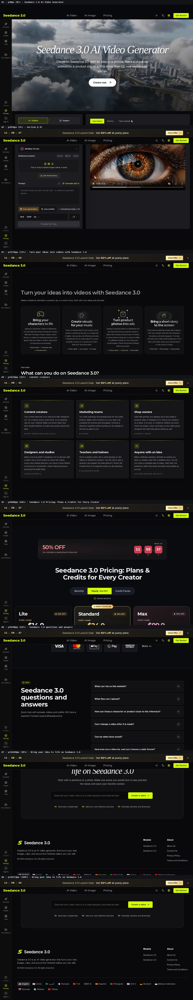
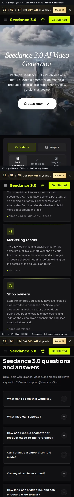

# UI Design System & Master Generation Blueprint: seedance3-si

> **Seedance 3.0 AI Video Generator: Make Videos from References** (https://seedance3.si/) — Try Seedance 3.0 free online. Turn text, images, video clips, and audio into videos with sound. Keep faces the same and edit any part wit...





---

## 1. Executive Visual Persona & Design Archetype

- **Brand Essence & Persona**: **Seedance 3.0 AI Video Generator: Make Videos from References** (`https://seedance3.si/`). Try Seedance 3.0 free online. Turn text, images, video clips, and audio into videos with sound. Keep faces the same and edit any part wit...
- **Capture Provenance**: Live browser capture (`tier1_fast`, HTTP `200`, captured `2026-11-24`).
- **Visual Archetype**: **High-Contrast Obsidian / Atmospheric Design System (`#09090b` canvas, `#ffffff` ink, `#d3ff02` accent)**.
- **Anti-AI-Slop Differentiators**:
  - **Live-Computed Chromatic Polarity**: Anchors the viewport in `#09090b` (live computed `body` `background-color` (`computed_styles.json`)) paired with `#ffffff` primary typography and `#d3ff02` accents.
  - **Grounded Typographic Hierarchy**: Pairs `Georgia` for display copy (`Seedance 3.0 AI Video Generator`) with `Inter`.
  - **Calibrated Spatial Grid & Motion**: Combines `1352px` container bounds (`gap: 32px`, padding `100px`) with `cubic-bezier(.34,1.56,.64,1)` easing and Three.js / WebGL Canvas Pipeline.

---

## 2. Spatial Architecture & Modular Grid Mathematics

### Viewport Allocation & Container Geometry
- **Captured Journey Filmstrips**: Desktop `1280×6624px` (`assets/desktop-journey.webp`, `8` keyframes up to `y=10319px` / doc `11219px`), Mobile `390×2616px` (`assets/mobile-journey.webp`, `3` keyframes).
- **Master Container Bounds**: `1352px` (measured `<main>` bounding box width within `1440px` desktop viewport).
- **Canvas Lateral Padding & Spacing**: `100px` lateral canvas padding with `32px` grid gap.
- **Border Radius Scale**: `999px`, `50%`, `12px`, `6px`.

### Responsive Breakpoint Architecture
- **Desktop Layout**: Multi-column CSS Grid / Flexbox layout at `1440px` (`max-width: 1352px`, `gap: 32px`).
- **Mobile Layout**: Single-column vertical stack at `390px` viewport width with `100px` horizontal padding.
- **Extracted CSS Media Queries**: `@media (max-width:640px)`, `@media (max-width:900px)`, `@media (max-width:480px)`, `@media (max-width:767px)`.

---

## 3. Color System, Materiality & Atmospheric Lighting

### Semantic Palette & Source Grounding
| Semantic Role | Ground-Truth Value | Extracted Live / CSS Source |
|---|---|---|
| **Primary Canvas Substrate** | `#09090b` | live computed `body` `background-color` (`computed_styles.json`) |
| **Primary Typography Ink** | `#ffffff` | live computed `h1` `color` (`computed_styles.json`) |
| **Elevated Surface / Card Substrate** | `#101718` | live computed `section` `background-color` (`computed_styles.json`) |
| **Interactive Accent / Highlight** | `#d3ff02` | `var(--theme-primary)` in `:root` |
| **Secondary / Muted Copy** | `#777970` | `var(--menu-muted)` in `:root` |
| **Structural Hairline Border** | `#0a0a0c` | `var(--gem-line-strong)` in `:root` (`0f0f0f24`) |
| **Variable Token (`--foreground`)** | `#0a0a0a` | `var(--foreground)` in `:root` |
| **Variable Token (`--primary`)** | `#171717` | `var(--primary)` in `:root` |
| **Variable Token (`--primary-foreground`)** | `#fafafa` | `var(--primary-foreground)` in `:root` |
| **Variable Token (`--secondary`)** | `#f5f5f5` | `var(--secondary)` in `:root` |
| **Variable Token (`--muted-foreground`)** | `#737373` | `var(--muted-foreground)` in `:root` |
| **Variable Token (`--destructive`)** | `#e40014` | `var(--destructive)` in `:root` |

### Sanitized Root CSS Variables (`ui-ux.md` Ground Truth)
| Variable Name | Extracted Value | Semantic Role |
|---|---|---|
| `--background` | `#fff` | Canvas / Surface Token |
| `--foreground` | `#0a0a0a` | Typography Ink Token |
| `--card` | `#fff` | Color / Atmospheric Token |
| `--card-foreground` | `#0a0a0a` | Typography Ink Token |
| `--popover` | `#fff` | Color / Atmospheric Token |
| `--popover-foreground` | `#0a0a0a` | Typography Ink Token |
| `--primary` | `#171717` | Brand / Palette Token |
| `--primary-foreground` | `#fafafa` | Typography Ink Token |
| `--secondary` | `#f5f5f5` | Brand / Palette Token |
| `--secondary-foreground` | `#171717` | Typography Ink Token |
| `--muted` | `#f5f5f5` | Color / Atmospheric Token |
| `--muted-foreground` | `#737373` | Typography Ink Token |
| `--accent` | `#f5f5f5` | Brand / Palette Token |
| `--accent-foreground` | `#171717` | Typography Ink Token |
| `--destructive` | `#e40014` | Color / Atmospheric Token |
| `--destructive-foreground` | `#fff` | Typography Ink Token |

---

## 4. Typographic Scale & Editorial Hierarchy

### Font Family Stacks
- **Display Typography**: `Georgia`.
- **Primary Body Stack**: `Inter`.
- **Technical / Metadata Stack**: not declared in live computed styles (uses primary stack / `ui-monospace`).

### Typographic Scale & Rules (Live Computed & Stylesheet Grounded)
- **Hero Display (`H1`)**: live computed `h1` (`font-size: 82.08px`, `line-height: 88.6464px`, `font-weight: 500`, `letter-spacing: -3.6936px`); CSS variables `--text-4xl: 2.25rem`, `--text-4xl--line-height: calc(2.5/2.25)`, `--text-5xl: 3rem`; rule `h1` (`font-weight: 800`).
- **Section Heading (`H2`)**: live computed `h2` (`font-size: 64px`, `line-height: 70.4px`, `font-weight: 500`, `letter-spacing: -2.56px`); CSS variables `--text-2xl: 1.5rem`, `--text-2xl--line-height: calc(2/1.5)`, `--text-3xl: 1.875rem`.
- **Body Copy**: live computed `body` (`font-size: 16px`, `line-height: 24px`, `font-weight: 400`); CSS variables `--text-base: 1rem`, `--text-base--line-height: calc(1.5/1)`, `--font-body: "Geist","Geist Fallback"`; rule `p` (`line-height: var(--leading-relaxed)`).
- **Metadata & Navigation Labels**: live computed `nav/a` (`font-size: 16px`, `line-height: 24px`, `font-weight: 400`); CSS variables `--font-mono: var(--font-mono)`, `--text-xs: .75rem`, `--text-xs--line-height: calc(1/.75)`.

---

## 5. Choreographed Motion & Interaction Physics

### Primary Easing Curves
- **Extracted Timing Functions**: `cubic-bezier(.34,1.56,.64,1)`, `cubic-bezier(0,0,.2,1)`, `cubic-bezier(.4,0,.2,1)`.

### Per-Element Transition & Choreography Rules
- **Selector `.landing-video-hero-module__su8PL...`**: `transition: background .15s` extracted from `seedance3-si` stylesheet.
- **Selector `.scenario-showcase-module__pQSraG...`**: `transition: transform .3s ease-out,border-color .3s ease-out,background-co...` extracted from `seedance3-si` stylesheet.
- **Selector `enario-showcase-module__pQSraG__c...`**: `transition: opacity .5s ease-out` extracted from `seedance3-si` stylesheet.
- **Extracted Easing Curve (`cubic-bezier(.34,1.56,.64,1)`)**: Governs interactive state transitions across `<header.tool-header>` and `<section.jsx-b8e54b4bef176a21>`.
- **Runtime Interaction Engine**: Integrates Three.js / WebGL Canvas Pipeline with `prefers-reduced-motion: reduce` fallback guards.
### Measured Runtime Scroll & Interaction Telemetry (`behavioral_journey_v2`)
- **Scroll Driver Mode**: `native` (max document height `11219px`, deepest scrollY reached `10319px` across `8` desktop keyframes).
- **Detected Scroll / Motion Libraries**: Native browser scroll / standard CSS transitions.
- **Nav / Drawer Probe (`AI Video`)**: Triggered visual change (pixel diff `37.779`, captured in `assets/state-nav.webp`); revealed links: Create Video, 01 Seedance 2.5, 02 Seedance 2.0, AI Video Enhancer Mak....
- **Hover Physics (`primary_cta` · `Create now`)**: `backgroundColor`: `rgb(255, 255, 255)` -> `rgb(233, 233, 233)` (`transition-duration: 0.15s`, `timing: ease`).
- **Interactive Control Probe (`tab` · `Precise Editing`)**: Triggered visual diff `14.25` (attr `false -> true`, captured in `assets/state-interactive.webp`).
- **Theme Toggle Probe (`Switch to light mode`)**: Toggled body background `rgb(9, 9, 11)` -> `rgb(250, 249, 246)` and ink `rgb(244, 244, 245)` -> `rgb(32, 32, 36)`.
- **Route Transition Architecture**: First internal navigation (`/pricing`) measured as `SPA` in `2211ms`.

---

## 6. Component Wireframe & Structural DOM Map

### Visual Layout Schematic — Desktop (`1440px`, Grounded in `dom.html` & Landmark Bounding Boxes)
```
┌────────────────────────────────────────────────────────────────────────┐
│ DESKTOP VIEWPORT (1440px) — Seedance 3.0 AI Video Generator: Make Vide │
│ ====================================================================== │
│ [ <header.tool-header> (1440x57px)    | Pricing                      ] │
│ ---------------------------------------------------------------------- │
│ | HERO STAGE: <section.theme-gold> (w=1352px)                        | │
│ | H1: Seedance 3.0 AI Video Generator                                | │
│ | Substrate: #09090b | Ink: #ffffff | Accent: #d3ff02                | │
│ ---------------------------------------------------------------------- │
│ | SHOWCASE GRID (<section.jsx-b8e54b4bef176) max-w: 1352px           | │
│ | +------------------------------+  +------------------------------+ | │
│ | | Seedance 3.0 Features        |  | Multi-Material Input         | | │
│ | +------------------------------+  +------------------------------+ | │
│ ---------------------------------------------------------------------- │
│ | DETAIL MODULE (<section.py-14>) — Precise Editing                  | │
│ ---------------------------------------------------------------------- │
│ [ FOOTER (<footer.flex>       ) | https://seedance3.si/                │
└────────────────────────────────────────────────────────────────────────┘
```

### Visual Layout Schematic — Mobile Reflow (`390px`)
```
┌────────────────────────────────────────────────────────────────────────┐
│ MOBILE VIEWPORT REFLOW (390px) — Single-Column Stack (gap: 32px)       │
│ ====================================================================== │
│ [ HEADER BAR (<header.tool-header>    ) | Compact Menu (390px)         │
│ ---------------------------------------------------------------------- │
│ | HERO STAGE (<section.theme-gold>) — 390px Vertical Lead            | │
│ | H1: Seedance 3.0 AI Video Generator                                | │
│ ---------------------------------------------------------------------- │
│ | SHOWCASE STACK (<section.jsx-b8e54b4be) — 1-Col Stack              | │
│ | [ Item 1: Seedance 3.0 Features                                  ] | │
│ | [ Item 2: Multi-Material Input                                   ] | │
│ ---------------------------------------------------------------------- │
│ | DETAIL STACK (<section.py-14>) — 1-Col (Precise Editing)           | │
│ ---------------------------------------------------------------------- │
│ [ FOOTER (<footer.flex>       ) | Stacked 390px Colophon               │
└────────────────────────────────────────────────────────────────────────┘
```

### Granular DOM Region Breakdown
1. **Brand Header & Navigation Bar (<header.tool-header> — `seedance3-si`)**:
   - Landmark `<header class="tool-header inset-x-0">` (`1440x57px`) hosting `Seedance 3.0 AI Video Generator: Mak` navigation (`Pricing`), DOM attributes (`data-precedence="next"`, `data-precedence="next"`, `data-precedence="next"`, `data-precedence="next"`), and stylesheet rule `anding-video-hero-module__su8PLW_... { pointer-events:none;width:100%;height:100%;position:absolute;inset:0 }`.
2. **Hero Stage & Focal Lead (<section.theme-gold> — `Seedance 3.0 AI Video Generator`)**:
   - Landmark `<section class="theme-gold">` presenting display lead `Seedance 3.0 AI Video Generator` and copy excerpt *"Create on Seedance 3.0 with an idea or a picture. Make a characte"* over `#09090b` canvas and `#ffffff` ink.
3. **Primary Showcase & Content Grid (<section.jsx-b8e54b4bef176a21> — `Seedance 3.0 Features`)**:
   - Landmark `<section class="jsx-b8e54b4bef176a21 generation-panel">` rendering section `Seedance 3.0 Features` with copy *"Click or drag to upload images, videos, or audio"*, asset references (`logo.png`, `712b6ac0fe98f484.css`, `7697b7c0cef68411.css`, `41592914de078ed4.css`), and grid rule `ding-video-hero-module__su8PLW__c... { width:100%;max-width:1200px;padding:100px 32px;position:relative }`.
4. **Interactive Detail & Feature Matrix (<section.py-14> — `Multi-Material Input`)**:
   - Landmark `<section class="py-14 text-white">` framing `Multi-Material Input` and `Precise Editing` (*"— remaining today / 10"*) with `#101718` surface cards, `#d3ff02` accents, and `video-hero-module__su8PLW__descri... { color:ffffffe6;text-wrap:pretty;max-width:720px;margin:28px auto 0;font-... }`.
5. **Colophon & Global Directory Footer (<footer.flex> — `https://seedance3.si/`)**:
   - Landmark `<footer class="flex">` anchoring `Seedance 3.0 AI Video Generator:` footer links (`Pricing`), copy *"Two core capabilities: multi-material input and precise edit"*, and `#0a0a0c` structural dividers.
### Full Vertical Scroll Sequence (Desktop `1440×900` Keyframes)
- **Step 01** (`y=0px`, `0%`): Active landmark `Seedance 3.0 AI Video Generator` · sticky/fixed elements: `2`
- **Step 02** (`y=850px`, `8%`): Active landmark `Section @ 8%` · sticky/fixed elements: `3`
- **Step 03** (`y=2550px`, `25%`): Active landmark `Turn your ideas into videos with Seedance 3.0` · sticky/fixed elements: `3`
- **Step 04** (`y=4250px`, `41%`): Active landmark `Content creators` · sticky/fixed elements: `3`
- **Step 05** (`y=6800px`, `66%`): Active landmark `Seedance 3.0 Pricing: Plans & Credits for Every C...` · sticky/fixed elements: `3`
- **Step 06** (`y=8500px`, `82%`): Active landmark `Seedance 3.0 questions and answers` · sticky/fixed elements: `3`
- **Step 07** (`y=10200px`, `99%`): Active landmark `Bring your idea to life on Seedance 3.0` · sticky/fixed elements: `3`
- **Step 08** (`y=10319px`, `100%`): Active landmark `Bring your idea to life on Seedance 3.0` · sticky/fixed elements: `3`

### Multi-Page Internal Route Map
- **Listing Route (`/pricing`)**: `https://seedance3.si/pricing` — H1: `Seedance 3.0 Pricing: Plans & Credits for Every C...`, scrollHeight `4356px`, transition `SPA` (`2211ms`)
- **About Route (`/about-us`)**: `https://seedance3.si/about-us` — H1: `About Seedance 3.0`, scrollHeight `1493px`, transition `direct` (`1610ms`)
- **Other Route (`/ja`)**: `https://seedance3.si/ja` — H1: `Seedance 3.0 AI動画生成`, scrollHeight `11170px`, transition `direct` (`4161ms`)

---

## 7. Master Zero-Shot AI Generation Prompt

```markdown
# Master Zero-Shot Frontend Generation Prompt: seedance3-si (Seedance 3.0 AI Video Generator: Make Videos from References)

You are a principal frontend architect and design systems engineer. Build a complete, production-ready web application replicating the exact design system, DOM landmarks, typographic hierarchy, color tokens, and motion physics of `seedance3-si` (**Seedance 3.0 AI Video Generator: Make Videos from References** — `https://seedance3.si/`).

### 1. Visual Archetype & Anti-AI-Slop Mandates
- **Archetype**: High-Contrast Obsidian / Atmospheric Design System (`#09090b` canvas, `#ffffff` ink, `#d3ff02` accent).
- **Identity & Domain Context**: Try Seedance 3.0 free online. Turn text, images, video clips, and audio into videos with sound. Keep faces the same and edit any part wit...
- **Primary Substrate**: `#09090b` (live computed `body` `background-color` (`computed_styles.json`)), **Primary Ink**: `#ffffff`, **Accent / Highlight**: `#d3ff02`.
- **Site-Specific Differentiators**:
  - **Live-Computed Chromatic Polarity**: Anchors the viewport in `#09090b` (live computed `body` `background-color` (`computed_styles.json`)) paired with `#ffffff` primary typography and `#d3ff02` accents.
  - **Grounded Typographic Hierarchy**: Pairs `Georgia` for display copy (`Seedance 3.0 AI Video Generator`) with `Inter`.
  - **Calibrated Spatial Grid & Motion**: Combines `1352px` container bounds (`gap: 32px`, padding `100px`) with `cubic-bezier(.34,1.56,.64,1)` easing and Three.js / WebGL Canvas Pipeline.

### 2. Ground-Truth CSS Variables (`:root` Token Contract)
Declare and consume these exact custom properties extracted from `seedance3-si` in your global stylesheet:

:root {
  /* Seedance 3.0 AI Video Generator: Make Videos from References (seedance3-si) — Live-Grounded CSS Variables */
  --background: #fff; /* Canvas / Surface Token (seedance3-si) */
  --foreground: #0a0a0a; /* Typography Ink Token (seedance3-si) */
  --card: #fff; /* Color / Atmospheric Token (seedance3-si) */
  --card-foreground: #0a0a0a; /* Typography Ink Token (seedance3-si) */
  --popover: #fff; /* Color / Atmospheric Token (seedance3-si) */
  --popover-foreground: #0a0a0a; /* Typography Ink Token (seedance3-si) */
  --primary: #171717; /* Brand / Palette Token (seedance3-si) */
  --primary-foreground: #fafafa; /* Typography Ink Token (seedance3-si) */
  --secondary: #f5f5f5; /* Brand / Palette Token (seedance3-si) */
  --secondary-foreground: #171717; /* Typography Ink Token (seedance3-si) */
  --muted: #f5f5f5; /* Color / Atmospheric Token (seedance3-si) */
  --muted-foreground: #737373; /* Typography Ink Token (seedance3-si) */
  --accent: #f5f5f5; /* Brand / Palette Token (seedance3-si) */
  --accent-foreground: #171717; /* Typography Ink Token (seedance3-si) */
  --destructive: #e40014; /* Color / Atmospheric Token (seedance3-si) */
  --destructive-foreground: #fff; /* Typography Ink Token (seedance3-si) */
}

### 3. Semantic Color & Materiality Contract
Map every surface, ink, and border strictly to these source-grounded tokens:
- **Primary Canvas Substrate**: `#09090b` — grounded in live computed `body` `background-color` (`computed_styles.json`)
- **Primary Typography Ink**: `#ffffff` — grounded in live computed `h1` `color` (`computed_styles.json`)
- **Elevated Surface / Card Substrate**: `#101718` — grounded in live computed `section` `background-color` (`computed_styles.json`)
- **Interactive Accent / Highlight**: `#d3ff02` — grounded in `var(--theme-primary)` in `:root`
- **Secondary / Muted Copy**: `#777970` — grounded in `var(--menu-muted)` in `:root`
- **Structural Hairline Border**: `#0a0a0c` — grounded in `var(--gem-line-strong)` in `:root` (`0f0f0f24`)
- **Variable Token (`--foreground`)**: `#0a0a0a` — grounded in `var(--foreground)` in `:root`
- **Variable Token (`--primary`)**: `#171717` — grounded in `var(--primary)` in `:root`
- **Variable Token (`--primary-foreground`)**: `#fafafa` — grounded in `var(--primary-foreground)` in `:root`
- **Variable Token (`--secondary`)**: `#f5f5f5` — grounded in `var(--secondary)` in `:root`
- **Variable Token (`--muted-foreground`)**: `#737373` — grounded in `var(--muted-foreground)` in `:root`
- **Variable Token (`--destructive`)**: `#e40014` — grounded in `var(--destructive)` in `:root`

### 4. Spatial Grid, Container Bounds & Responsive Breakpoints
- **Desktop Viewport Reference**: `1280×6624px` (multi-frame vertical journey filmstrip (6624px), `1440px` standard desktop width).
- **Mobile Viewport Reference**: `390×2616px` (multi-frame vertical journey filmstrip (2616px), `390px` standard mobile width).
- **Container Max-Width**: `1352px` (measured `<main>` bounding box width within `1440px` desktop viewport)
- **Padding & Gutters**: `100px` lateral canvas padding with `32px` grid gap
- **Desktop Grid**: Multi-column CSS Grid / Flexbox layout at `1440px` (`max-width: 1352px`, `gap: 32px`)
- **Mobile Adaptation**: Single-column vertical stack at `390px` viewport width with `100px` horizontal padding
- **Media Queries**: `@media (max-width:640px)`, `@media (max-width:900px)`, `@media (max-width:480px)`, `@media (max-width:767px)`
- **Corner Radii**: `999px`, `50%`, `12px`, `6px`

### 5. Typography & Editorial Scale Contract
- **Display Font Stack**: `Georgia`
- **Body Font Stack**: `Inter`
- **Monospace / Technical Font Stack**: not declared in live computed styles (uses primary stack / `ui-monospace`)
- **H1 Display Rule**: live computed `h1` (`font-size: 82.08px`, `line-height: 88.6464px`, `font-weight: 500`, `letter-spacing: -3.6936px`); CSS variables `--text-4xl: 2.25rem`, `--text-4xl--line-height: calc(2.5/2.25)`, `--text-5xl: 3rem`; rule `h1` (`font-weight: 800`)
- **H2 Section Rule**: live computed `h2` (`font-size: 64px`, `line-height: 70.4px`, `font-weight: 500`, `letter-spacing: -2.56px`); CSS variables `--text-2xl: 1.5rem`, `--text-2xl--line-height: calc(2/1.5)`, `--text-3xl: 1.875rem`
- **Body Copy Rule**: live computed `body` (`font-size: 16px`, `line-height: 24px`, `font-weight: 400`); CSS variables `--text-base: 1rem`, `--text-base--line-height: calc(1.5/1)`, `--font-body: "Geist","Geist Fallback"`; rule `p` (`line-height: var(--leading-relaxed)`)
- **Metadata & Index Rule**: live computed `nav/a` (`font-size: 16px`, `line-height: 24px`, `font-weight: 400`); CSS variables `--font-mono: var(--font-mono)`, `--text-xs: .75rem`, `--text-xs--line-height: calc(1/.75)`

### 6. Component Hierarchy, Verbatim Copy & Real DOM Landmarks
Scaffold `seedance3-si` (`Seedance 3.0 AI Video Generator: Make Videos from References`) with these exact structural regions, extracted copy, and CSS rules from `dom.html`:
1. **Brand Header & Navigation Bar (<header.tool-header> — `seedance3-si`)**:
   - DOM & Selectors: Landmark `<header class="tool-header inset-x-0">` (`1440x57px`) hosting `Seedance 3.0 AI Video Generator: Mak` navigation (`Pricing`), DOM attributes (`data-precedence="next"`, `data-precedence="next"`, `data-precedence="next"`, `data-precedence="next"`), and stylesheet rule `anding-video-hero-module__su8PLW_... { pointer-events:none;width:100%;height:100%;position:absolute;inset:0 }`.
   - Responsive Contract: Header `Brand Header & Navigation Bar (<header.tool-header> — `seedance3-si`)` (`seedance3-si`) adapts across `@media (max-width:640px)`, `@media (max-width:900px)`, `@media (max-width:480px)`, `@media (max-width:767px)` with `cubic-bezier(.34,1.56,.64,1)`, `cubic-bezier(0,0,.2,1)`, `cubic-bezier(.4,0,.2,1)` transitions and links `Pricing`.
2. **Hero Stage & Focal Lead (<section.theme-gold> — `Seedance 3.0 AI Video Generator`)**:
   - DOM & Selectors: Landmark `<section class="theme-gold">` presenting display lead `Seedance 3.0 AI Video Generator` and copy excerpt *"Create on Seedance 3.0 with an idea or a picture. Make a characte"* over `#09090b` canvas and `#ffffff` ink.
   - Responsive Contract: Hero stage (`1280×6624px` desktop / `390×2616px` mobile) sets `#09090b` background with `#ffffff` headline `Seedance 3.0 AI Video Generator`.
3. **Primary Showcase & Content Grid (<section.jsx-b8e54b4bef176a21> — `Seedance 3.0 Features`)**:
   - DOM & Selectors: Landmark `<section class="jsx-b8e54b4bef176a21 generation-panel">` rendering section `Seedance 3.0 Features` with copy *"Click or drag to upload images, videos, or audio"*, asset references (`logo.png`, `712b6ac0fe98f484.css`, `7697b7c0cef68411.css`, `41592914de078ed4.css`), and grid rule `ding-video-hero-module__su8PLW__c... { width:100%;max-width:1200px;padding:100px 32px;position:relative }`.
   - Responsive Contract: Showcase grid `Primary Showcase & Content Grid (<section.jsx-b8e54b4bef176a21> — `Seedance 3.0 Features`)` applies Multi-column CSS Grid / Flexbox layout at `1440px` (`max-width: 1352px`, `gap: 32px`) on desktop and Single-column vertical stack at `390px` viewport width with `100px` horizontal padding on mobile.
4. **Interactive Detail & Feature Matrix (<section.py-14> — `Multi-Material Input`)**:
   - DOM & Selectors: Landmark `<section class="py-14 text-white">` framing `Multi-Material Input` and `Precise Editing` (*"— remaining today / 10"*) with `#101718` surface cards, `#d3ff02` accents, and `video-hero-module__su8PLW__descri... { color:ffffffe6;text-wrap:pretty;max-width:720px;margin:28px auto 0;font-... }`.
   - Responsive Contract: Detail module `Interactive Detail & Feature Matrix (<section.py-14> — `Multi-Material Input`)` uses `999px`, `50%`, `12px`, `6px` radii, `#d3ff02` highlights, and assets (logo.png, 712b6ac0fe98f484.css, 7697b7c0cef68411.css).
5. **Colophon & Global Directory Footer (<footer.flex> — `https://seedance3.si/`)**:
   - DOM & Selectors: Landmark `<footer class="flex">` anchoring `Seedance 3.0 AI Video Generator:` footer links (`Pricing`), copy *"Two core capabilities: multi-material input and precise edit"*, and `#0a0a0c` structural dividers.
   - Responsive Contract: Footer `Colophon & Global Directory Footer (<footer.flex> — `https://seedance3.si/`)` aligns to `1352px` (measured `<main>` bounding box width within `1440px` desktop viewport) with `100px` lateral canvas padding with `32px` grid gap and attributes (data-precedence="next", data-precedence="next", data-precedence="next").

#### Verbatim DOM Copy Excerpts (`dom.html`)
- Copy Excerpt 1: *"Create on Seedance 3.0 with an idea or a picture. Make a character animation, a pr..."*
- Copy Excerpt 2: *"Click or drag to upload images, videos, or audio"*
- Copy Excerpt 3: *"— remaining today / 10"*
- Copy Excerpt 4: *"Two core capabilities: multi-material input and precise editing."*

### 7. Motion, Extracted Stylesheet Rules & Interaction Choreography
- **Primary Easing Functions**: `cubic-bezier(.34,1.56,.64,1)`, `cubic-bezier(0,0,.2,1)`, `cubic-bezier(.4,0,.2,1)`
- **Extracted Stylesheet Rules (`seedance3-si`)**:
- `anding-video-hero-module__su8PLW_... { pointer-events:none;width:100%;height:100%;position:absolute;inset:0 }`
- `ding-video-hero-module__su8PLW__c... { width:100%;max-width:1200px;padding:100px 32px;position:relative }`
- `video-hero-module__su8PLW__descri... { color:ffffffe6;text-wrap:pretty;max-width:720px;margin:28px auto 0;font-... }`
- `ng-video-hero-module__su8PLW__cta... { background:e9e9e9 }`
- `hero-module__su8PLW__cta:focus-vi... { outline-offset:5px;outline:3px solid fff }`
- **Per-Selector Transition Rules**:
- **Selector `.landing-video-hero-module__su8PL...`**: `transition: background .15s` extracted from `seedance3-si` stylesheet.
- **Selector `.scenario-showcase-module__pQSraG...`**: `transition: transform .3s ease-out,border-color .3s ease-out,background-co...` extracted from `seedance3-si` stylesheet.
- **Selector `enario-showcase-module__pQSraG__c...`**: `transition: opacity .5s ease-out` extracted from `seedance3-si` stylesheet.
- **Extracted Easing Curve (`cubic-bezier(.34,1.56,.64,1)`)**: Governs interactive state transitions across `<header.tool-header>` and `<section.jsx-b8e54b4bef176a21>`.
- **Runtime Interaction Engine**: Integrates Three.js / WebGL Canvas Pipeline with `prefers-reduced-motion: reduce` fallback guards.
### 7b. Full-Page Scroll Choreography, Interactive States & Multi-Page Routes
- **Scroll Mechanics**: Implement `native` vertical progression up to `11219px` across 8 distinct viewport chapters.
- **Vertical Chapter Sequence**: Seedance 3.0 AI Video Gener... (0%) -> Section @ 8% (8%) -> Turn your ideas into videos... (25%) -> Content creators (41%) -> Seedance 3.0 Pricing: Plans... (66%) -> Seedance 3.0 questions and... (82%) -> Bring your idea to life on... (99%) -> Bring your idea to life on... (100%).
- **Navigation Drawer / Menu State**: Replicate interactive menu toggle (`AI Video`) with Escape-to-close keyboard handling.
- **Hover Micro-Interaction (`primary_cta`)**: Animate `backgroundColor` with `0.15s ease`.
- **Multi-Page Routes**: Scaffold internal routes `/pricing` (listing, SPA), `/about-us` (about, direct), `/ja` (other, direct) sharing the global header/footer shell and design tokens.

### 8. Technical Deliverables
- Implement in Next.js (App Router) with TypeScript and Tailwind CSS consuming the `:root` custom properties defined above for `seedance3-si`.
- Reproduce both the `1440px` desktop architecture and `390px` mobile breakpoint transitions, preserving semantic HTML5 landmarks (`<header>`, `<nav>`, `<main>`, `<section>`, `<footer>`) and `prefers-reduced-motion` accessibility guards.
```
---

## 8. Full-Page Scroll Journey, Interactive States & Subpage Inventory

### Desktop Scroll Keyframes (`1440×900` WebP)
| Step | Scroll Y | Progress | Active Landmark / Section | Sticky/Fixed | Visual Asset |
| :---: | :---: | :---: | :--- | :---: | :--- |
| `#01` | `0px` | `0%` | Seedance 3.0 AI Video Generator | `2` | [desktop-step-01.webp](assets/desktop-step-01.webp) |
| `#02` | `850px` | `8%` | Section @ 8% | `3` | [desktop-step-02.webp](assets/desktop-step-02.webp) |
| `#03` | `2550px` | `25%` | Turn your ideas into videos with Seedance 3.0 | `3` | [desktop-step-03.webp](assets/desktop-step-03.webp) |
| `#04` | `4250px` | `41%` | Content creators | `3` | [desktop-step-04.webp](assets/desktop-step-04.webp) |
| `#05` | `6800px` | `66%` | Seedance 3.0 Pricing: Plans & Credits for Eve... | `3` | [desktop-step-05.webp](assets/desktop-step-05.webp) |
| `#06` | `8500px` | `82%` | Seedance 3.0 questions and answers | `3` | [desktop-step-06.webp](assets/desktop-step-06.webp) |
| `#07` | `10200px` | `99%` | Bring your idea to life on Seedance 3.0 | `3` | [desktop-step-07.webp](assets/desktop-step-07.webp) |
| `#08` | `10319px` | `100%` | Bring your idea to life on Seedance 3.0 | `3` | [desktop-step-08.webp](assets/desktop-step-08.webp) |

### Mobile Condensed Keyframes (`390×844` WebP)
| Step | Scroll Y | Progress | Active Landmark | Visual Asset |
| :---: | :---: | :---: | :--- | :--- |
| `#01` | `0px` | `0%` | Seedance 3.0 AI Video Generator | [mobile-step-01.webp](assets/mobile-step-01.webp) |
| `#02` | `7200px` | `50%` | Marketing teams | [mobile-step-02.webp](assets/mobile-step-02.webp) |
| `#03` | `14400px` | `100%` | Seedance 3.0 questions and answers | [mobile-step-03.webp](assets/mobile-step-03.webp) |

### Interactive UI State Captures (`1440×900` WebP)
| State Type | Trigger / Observation | Visual Asset |
| :--- | :--- | :--- |
| `nav_menu` | Nav/Menu opened (`AI Video`, diff `37.779`) | [state-nav.webp](assets/state-nav.webp) |
| `interactive_control` | Control `tab` (`Precise Editing`, diff `14.25`) | [state-interactive.webp](assets/state-interactive.webp) |

### Internal Subpage Filmstrips (`1080px` Wide WebP)
| # | Template | Route URL | H1 / Title | Scroll Height | Transition | Filmstrip Asset |
| :-: | :---: | :--- | :--- | :---: | :---: | :--- |
| `1` | `listing` | `https://seedance3.si/pricing` | Seedance 3.0 Pricing: Plans & Credits... | `4356px` | `SPA` (`2211ms`) | [subpage-01-pricing.webp](assets/subpage-01-pricing.webp) |
| `2` | `about` | `https://seedance3.si/about-us` | About Seedance 3.0 | `1493px` | `direct` (`1610ms`) | [subpage-02-about-us.webp](assets/subpage-02-about-us.webp) |
| `3` | `other` | `https://seedance3.si/ja` | Seedance 3.0 AI動画生成 | `11170px` | `direct` (`4161ms`) | [subpage-03-ja.webp](assets/subpage-03-ja.webp) |

