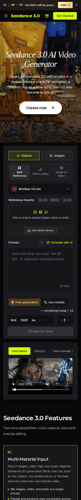

# UI Design System & Master Generation Blueprint: seedance3-si

> **Seedance 3.0 AI Video Generator: Make Videos from References** (https://seedance3.si/) — Try Seedance 3.0 free online. Turn text, images, video clips, and audio into videos with sound. Keep faces the same and edit any part wit...


---

## 1. Executive Visual Persona & Design Archetype

- **Brand Essence & Persona**: **Seedance 3.0 AI Video Generator: Make Videos from References** (`https://seedance3.si/`). Try Seedance 3.0 free online. Turn text, images, video clips, and audio into videos with sound. Keep faces the same and edit any part wit...
- **Capture Provenance**: Live browser capture (`tier1_fast`, HTTP `200`, captured `2026-11-23`).
- **Visual Archetype**: **High-Contrast Obsidian / Atmospheric Design System (`#09090b` canvas, `#ffffff` ink, `#d3ff02` accent)**.
- **Anti-AI-Slop Differentiators**:
  - **Live-Computed Chromatic Polarity**: Anchors the viewport in `#09090b` (live computed `body` `background-color` (`computed_styles.json`)) paired with `#ffffff` primary typography and `#d3ff02` accents.
  - **Grounded Typographic Hierarchy**: Pairs `Georgia` for display copy (`Seedance 3.0 AI Video Generator`) with `Inter` and not declared in live computed styles (uses primary stack / `ui-monospace`).
  - **Calibrated Spatial Grid & Motion**: Combines `1352px` container bounds (`gap: 32px`, padding `18px`) with `cubic-bezier(.2,.7,.2,1)` easing and Three.js / WebGL Canvas Pipeline.

---

## 2. Spatial Architecture & Modular Grid Mathematics



### Viewport Allocation & Container Geometry
- **Captured Viewport Dimensions**: Desktop `1440×2400px` (`assets/desktop.png`, clamped at 2400px live multi-section capture), Mobile `390×2400px` (`assets/mobile.png`, clamped at 2400px live multi-section capture).
- **Master Container Bounds**: `1352px` (measured `<main>` bounding box width within `1440px` desktop viewport).
- **Canvas Lateral Padding & Spacing**: `18px` lateral canvas padding with `32px` grid gap.
- **Border Radius Scale**: `4px`, `18px`, `50%`, `10px`.

### Responsive Breakpoint Architecture
- **Desktop Layout**: Multi-column CSS Grid / Flexbox layout at `1440px` (`max-width: 1352px`, `gap: 32px`).
- **Mobile Layout**: Single-column vertical stack at `390px` viewport width with `18px` horizontal padding.
- **Extracted CSS Media Queries**: `@media (prefers-reduced-motion:reduce)`, `@media (max-width:440px)`, `@media (max-width:639px)`, `@media (min-width:1280px)`.

---

## 3. Color System, Materiality & Atmospheric Lighting

### Semantic Palette & Source Grounding
| Semantic Role | Ground-Truth Value | Extracted Live / CSS Source |
|---|---|---|
| **Primary Canvas Substrate** | `#09090b` | live computed `body` `background-color` (`computed_styles.json`) |
| **Primary Typography Ink** | `#ffffff` | live computed `h1` `color` (`computed_styles.json`) |
| **Elevated Surface / Card Substrate** | `#0a0a0a` | `var(--card-foreground)` in `:root` |
| **Interactive Accent / Highlight** | `#d3ff02` | `var(--theme-primary)` in `:root` |
| **Secondary / Muted Copy** | `#777970` | `var(--menu-muted)` in `:root` |
| **Structural Hairline Border** | `#2c2c32` | `var(--gem-line)` in `:root` |
| **Variable Token (`--primary`)** | `#171717` | `var(--primary)` in `:root` |
| **Variable Token (`--primary-foreground`)** | `#fafafa` | `var(--primary-foreground)` in `:root` |
| **Variable Token (`--secondary`)** | `#f5f5f5` | `var(--secondary)` in `:root` |
| **Variable Token (`--muted-foreground`)** | `#737373` | `var(--muted-foreground)` in `:root` |
| **Variable Token (`--destructive`)** | `#e40014` | `var(--destructive)` in `:root` |

### Sanitized Root CSS Variables (`ui-ux.md` Ground Truth)
| Variable Name | Extracted Value | Semantic Role |
|---|---|---|
| `--background` | `#fff` | Canvas / Surface Token |
| `--foreground` | `#0a0a0a` | Typography Ink Token |
| `--card` | `#fff` | Color / Atmospheric Token |
| `--card-foreground` | `#0a0a0a` | Typography Ink Token |
| `--popover` | `#fff` | Color / Atmospheric Token |
| `--popover-foreground` | `#0a0a0a` | Typography Ink Token |
| `--primary` | `#171717` | Brand / Palette Token |
| `--primary-foreground` | `#fafafa` | Typography Ink Token |
| `--secondary` | `#f5f5f5` | Brand / Palette Token |
| `--secondary-foreground` | `#171717` | Typography Ink Token |
| `--muted` | `#f5f5f5` | Color / Atmospheric Token |
| `--muted-foreground` | `#737373` | Typography Ink Token |
| `--accent` | `#f5f5f5` | Brand / Palette Token |
| `--accent-foreground` | `#171717` | Typography Ink Token |
| `--destructive` | `#e40014` | Color / Atmospheric Token |
| `--destructive-foreground` | `#fff` | Typography Ink Token |

---

## 4. Typographic Scale & Editorial Hierarchy

### Font Family Stacks
- **Display Typography**: `Georgia`.
- **Primary Body Stack**: `Inter`.
- **Technical / Metadata Stack**: not declared in live computed styles (uses primary stack / `ui-monospace`).

### Typographic Scale & Rules (Live Computed & Stylesheet Grounded)
- **Hero Display (`H1`)**: live computed `h1` (`font-size: 82.08px`, `line-height: 88.6464px`, `font-weight: 500`, `letter-spacing: -3.6936px`); CSS variables `--font-display: var(--font-home-heading)`, `--text-4xl: 2.25rem`, `--text-4xl--line-height: calc(2.5/2.25)`; rule `h1` (`font-weight: 800`).
- **Section Heading (`H2`)**: live computed `h2` (`font-size: 48px`, `line-height: 48px`, `font-weight: 600`, `letter-spacing: -1.2px`); CSS variables `--text-2xl: 1.5rem`, `--text-2xl--line-height: calc(2/1.5)`, `--text-3xl: 1.875rem`.
- **Body Copy**: live computed `body` (`font-size: 16px`, `line-height: 24px`, `font-weight: 400`); CSS variables `--font-body: "Geist","Geist Fallback"`, `--text-base: 1rem`, `--text-base--line-height: calc(1.5/1)`; rule `p` (`font-size: clamp(16px,1.4vw,18px)`, `letter-spacing: .01em`, `font-weight: 500`).
- **Metadata & Navigation Labels**: live computed `nav/a` (`font-size: 16px`, `line-height: 24px`, `font-weight: 400`); CSS variables `--font-mono: var(--font-mono)`, `--text-xs: .75rem`, `--text-xs--line-height: calc(1/.75)`.

---

## 5. Choreographed Motion & Interaction Physics

### Primary Easing Curves
- **Extracted Timing Functions**: `cubic-bezier(.2,.7,.2,1)`, `cubic-bezier(.34,1.56,.64,1)`, `cubic-bezier(0,0,.2,1)`.

### Per-Element Transition & Choreography Rules
- **Selector `.navigation-module__C5Mk9a__artwork`**: `transition: transform .65s cubic-bezier(.2,.7,.2,1)` extracted from `seedance3-si` stylesheet.
- **Selector `.navigation-module__C5Mk9a__featu...`**: `transition: background .18s,color .18s,transform .18s` extracted from `seedance3-si` stylesheet.
- **Selector `.navigation-module__C5Mk9a__model`**: `transition: background .18s` extracted from `seedance3-si` stylesheet.
- **Extracted Easing Curve (`cubic-bezier(.2,.7,.2,1)`)**: Governs interactive state transitions across `<header.tool-header>` and `<section.jsx-b8e54b4bef176a21>`.
- **Runtime Interaction Engine**: Integrates Three.js / WebGL Canvas Pipeline with `prefers-reduced-motion: reduce` fallback guards.

---

## 6. Component Wireframe & Structural DOM Map

### Visual Layout Schematic — Desktop (`1440px`, Grounded in `dom.html` & Landmark Bounding Boxes)
```
┌────────────────────────────────────────────────────────────────────────┐
│ DESKTOP VIEWPORT (1440px) — Seedance 3.0 AI Video Generator: Make Vide │
│ ====================================================================== │
│ [ <header.tool-header> (1440x57px)    | Pricing                      ] │
│ ---------------------------------------------------------------------- │
│ | HERO STAGE: <section.theme-gold> (w=1352px)                        | │
│ | H1: Seedance 3.0 AI Video Generator                                | │
│ | Substrate: #09090b | Ink: #ffffff | Accent: #d3ff02                | │
│ ---------------------------------------------------------------------- │
│ | SHOWCASE GRID (<section.jsx-b8e54b4bef176) max-w: 1352px           | │
│ | +------------------------------+  +------------------------------+ | │
│ | | Seedance 3.0 Features        |  | Multi-Material Input         | | │
│ | +------------------------------+  +------------------------------+ | │
│ ---------------------------------------------------------------------- │
│ | DETAIL MODULE (<section.py-14>) — Precise Editing                  | │
│ ---------------------------------------------------------------------- │
│ [ FOOTER (<footer.flex>       ) | https://seedance3.si/                │
└────────────────────────────────────────────────────────────────────────┘
```

### Visual Layout Schematic — Mobile Reflow (`390px`)
```
┌────────────────────────────────────────────────────────────────────────┐
│ MOBILE VIEWPORT REFLOW (390px) — Single-Column Stack (gap: 32px)       │
│ ====================================================================== │
│ [ HEADER BAR (<header.tool-header>    ) | Compact Menu (390px)         │
│ ---------------------------------------------------------------------- │
│ | HERO STAGE (<section.theme-gold>) — 390px Vertical Lead            | │
│ | H1: Seedance 3.0 AI Video Generator                                | │
│ ---------------------------------------------------------------------- │
│ | SHOWCASE STACK (<section.jsx-b8e54b4be) — 1-Col Stack              | │
│ | [ Item 1: Seedance 3.0 Features                                  ] | │
│ | [ Item 2: Multi-Material Input                                   ] | │
│ ---------------------------------------------------------------------- │
│ | DETAIL STACK (<section.py-14>) — 1-Col (Precise Editing)           | │
│ ---------------------------------------------------------------------- │
│ [ FOOTER (<footer.flex>       ) | Stacked 390px Colophon               │
└────────────────────────────────────────────────────────────────────────┘
```

### Granular DOM Region Breakdown
1. **Brand Header & Navigation Bar (<header.tool-header> — `seedance3-si`)**:
   - Landmark `<header class="tool-header inset-x-0">` (`1440x57px`) hosting `Seedance 3.0 AI Video Generator: Mak` navigation (`Pricing`), DOM attributes (`data-precedence="next"`, `data-precedence="next"`, `data-precedence="next"`, `data-precedence="next"`), and stylesheet rule `.navigation-module__C5Mk9a__image... { width:min(380px,100vw - 32px) }`.
2. **Hero Stage & Focal Lead (<section.theme-gold> — `Seedance 3.0 AI Video Generator`)**:
   - Landmark `<section class="theme-gold">` presenting display lead `Seedance 3.0 AI Video Generator` and copy excerpt *"Seedance 3.0 Launch Sale: Get 50% off all yearly plans"* over `#09090b` canvas and `#ffffff` ink.
3. **Primary Showcase & Content Grid (<section.jsx-b8e54b4bef176a21> — `Seedance 3.0 Features`)**:
   - Landmark `<section class="jsx-b8e54b4bef176a21 generation-panel">` rendering section `Seedance 3.0 Features` with copy *"Create on Seedance 3.0 with an idea or a picture. Make a characte"*, asset references (`logo.png`, `712b6ac0fe98f484.css`, `7697b7c0cef68411.css`, `41592914de078ed4.css`), and grid rule `.navigation-module__C5Mk9a__eyebrow { align-items:center;gap:10px;margin:2px 2px 14px;display:flex }`.
4. **Interactive Detail & Feature Matrix (<section.py-14> — `Multi-Material Input`)**:
   - Landmark `<section class="py-14 text-white">` framing `Multi-Material Input` and `Precise Editing` (*"Click or drag to upload images, videos, or audio"*) with `#0a0a0a` surface cards, `#d3ff02` accents, and `vigation-module__C5Mk9a__eyebrow:... { content:"";background:var(--primary);border-radius:50%;width:5px;height:5px }`.
5. **Colophon & Global Directory Footer (<footer.flex> — `https://seedance3.si/`)**:
   - Landmark `<footer class="flex">` anchoring `Seedance 3.0 AI Video Generator:` footer links (`Pricing`), copy *"— remaining today / 10"*, and `#2c2c32` structural dividers.

---

## 7. Master Zero-Shot AI Generation Prompt

```markdown
# Master Zero-Shot Frontend Generation Prompt: seedance3-si (Seedance 3.0 AI Video Generator: Make Videos from References)

You are a principal frontend architect and design systems engineer. Build a complete, production-ready web application replicating the exact design system, DOM landmarks, typographic hierarchy, color tokens, and motion physics of `seedance3-si` (**Seedance 3.0 AI Video Generator: Make Videos from References** — `https://seedance3.si/`).

### 1. Visual Archetype & Anti-AI-Slop Mandates
- **Archetype**: High-Contrast Obsidian / Atmospheric Design System (`#09090b` canvas, `#ffffff` ink, `#d3ff02` accent).
- **Identity & Domain Context**: Try Seedance 3.0 free online. Turn text, images, video clips, and audio into videos with sound. Keep faces the same and edit any part wit...
- **Primary Substrate**: `#09090b` (live computed `body` `background-color` (`computed_styles.json`)), **Primary Ink**: `#ffffff`, **Accent / Highlight**: `#d3ff02`.
- **Site-Specific Differentiators**:
  - **Live-Computed Chromatic Polarity**: Anchors the viewport in `#09090b` (live computed `body` `background-color` (`computed_styles.json`)) paired with `#ffffff` primary typography and `#d3ff02` accents.
  - **Grounded Typographic Hierarchy**: Pairs `Georgia` for display copy (`Seedance 3.0 AI Video Generator`) with `Inter` and not declared in live computed styles (uses primary stack / `ui-monospace`).
  - **Calibrated Spatial Grid & Motion**: Combines `1352px` container bounds (`gap: 32px`, padding `18px`) with `cubic-bezier(.2,.7,.2,1)` easing and Three.js / WebGL Canvas Pipeline.

### 2. Ground-Truth CSS Variables (`:root` Token Contract)
Declare and consume these exact custom properties extracted from `seedance3-si` in your global stylesheet:

:root {
  /* Seedance 3.0 AI Video Generator: Make Videos from References (seedance3-si) — Live-Grounded CSS Variables */
  --background: #fff; /* Canvas / Surface Token (seedance3-si) */
  --foreground: #0a0a0a; /* Typography Ink Token (seedance3-si) */
  --card: #fff; /* Color / Atmospheric Token (seedance3-si) */
  --card-foreground: #0a0a0a; /* Typography Ink Token (seedance3-si) */
  --popover: #fff; /* Color / Atmospheric Token (seedance3-si) */
  --popover-foreground: #0a0a0a; /* Typography Ink Token (seedance3-si) */
  --primary: #171717; /* Brand / Palette Token (seedance3-si) */
  --primary-foreground: #fafafa; /* Typography Ink Token (seedance3-si) */
  --secondary: #f5f5f5; /* Brand / Palette Token (seedance3-si) */
  --secondary-foreground: #171717; /* Typography Ink Token (seedance3-si) */
  --muted: #f5f5f5; /* Color / Atmospheric Token (seedance3-si) */
  --muted-foreground: #737373; /* Typography Ink Token (seedance3-si) */
  --accent: #f5f5f5; /* Brand / Palette Token (seedance3-si) */
  --accent-foreground: #171717; /* Typography Ink Token (seedance3-si) */
  --destructive: #e40014; /* Color / Atmospheric Token (seedance3-si) */
  --destructive-foreground: #fff; /* Typography Ink Token (seedance3-si) */
}

### 3. Semantic Color & Materiality Contract
Map every surface, ink, and border strictly to these source-grounded tokens:
- **Primary Canvas Substrate**: `#09090b` — grounded in live computed `body` `background-color` (`computed_styles.json`)
- **Primary Typography Ink**: `#ffffff` — grounded in live computed `h1` `color` (`computed_styles.json`)
- **Elevated Surface / Card Substrate**: `#0a0a0a` — grounded in `var(--card-foreground)` in `:root`
- **Interactive Accent / Highlight**: `#d3ff02` — grounded in `var(--theme-primary)` in `:root`
- **Secondary / Muted Copy**: `#777970` — grounded in `var(--menu-muted)` in `:root`
- **Structural Hairline Border**: `#2c2c32` — grounded in `var(--gem-line)` in `:root`
- **Variable Token (`--primary`)**: `#171717` — grounded in `var(--primary)` in `:root`
- **Variable Token (`--primary-foreground`)**: `#fafafa` — grounded in `var(--primary-foreground)` in `:root`
- **Variable Token (`--secondary`)**: `#f5f5f5` — grounded in `var(--secondary)` in `:root`
- **Variable Token (`--muted-foreground`)**: `#737373` — grounded in `var(--muted-foreground)` in `:root`
- **Variable Token (`--destructive`)**: `#e40014` — grounded in `var(--destructive)` in `:root`

### 4. Spatial Grid, Container Bounds & Responsive Breakpoints
- **Desktop Viewport Reference**: `1440×2400px` (clamped at 2400px live multi-section capture, `1440px` standard desktop width).
- **Mobile Viewport Reference**: `390×2400px` (clamped at 2400px live multi-section capture, `390px` standard mobile width).
- **Container Max-Width**: `1352px` (measured `<main>` bounding box width within `1440px` desktop viewport)
- **Padding & Gutters**: `18px` lateral canvas padding with `32px` grid gap
- **Desktop Grid**: Multi-column CSS Grid / Flexbox layout at `1440px` (`max-width: 1352px`, `gap: 32px`)
- **Mobile Adaptation**: Single-column vertical stack at `390px` viewport width with `18px` horizontal padding
- **Media Queries**: `@media (prefers-reduced-motion:reduce)`, `@media (max-width:440px)`, `@media (max-width:639px)`, `@media (min-width:1280px)`
- **Corner Radii**: `4px`, `18px`, `50%`, `10px`

### 5. Typography & Editorial Scale Contract
- **Display Font Stack**: `Georgia`
- **Body Font Stack**: `Inter`
- **Monospace / Technical Font Stack**: not declared in live computed styles (uses primary stack / `ui-monospace`)
- **H1 Display Rule**: live computed `h1` (`font-size: 82.08px`, `line-height: 88.6464px`, `font-weight: 500`, `letter-spacing: -3.6936px`); CSS variables `--font-display: var(--font-home-heading)`, `--text-4xl: 2.25rem`, `--text-4xl--line-height: calc(2.5/2.25)`; rule `h1` (`font-weight: 800`)
- **H2 Section Rule**: live computed `h2` (`font-size: 48px`, `line-height: 48px`, `font-weight: 600`, `letter-spacing: -1.2px`); CSS variables `--text-2xl: 1.5rem`, `--text-2xl--line-height: calc(2/1.5)`, `--text-3xl: 1.875rem`
- **Body Copy Rule**: live computed `body` (`font-size: 16px`, `line-height: 24px`, `font-weight: 400`); CSS variables `--font-body: "Geist","Geist Fallback"`, `--text-base: 1rem`, `--text-base--line-height: calc(1.5/1)`; rule `p` (`font-size: clamp(16px,1.4vw,18px)`, `letter-spacing: .01em`, `font-weight: 500`)
- **Metadata & Index Rule**: live computed `nav/a` (`font-size: 16px`, `line-height: 24px`, `font-weight: 400`); CSS variables `--font-mono: var(--font-mono)`, `--text-xs: .75rem`, `--text-xs--line-height: calc(1/.75)`

### 6. Component Hierarchy, Verbatim Copy & Real DOM Landmarks
Scaffold `seedance3-si` (`Seedance 3.0 AI Video Generator: Make Videos from References`) with these exact structural regions, extracted copy, and CSS rules from `dom.html`:
1. **Brand Header & Navigation Bar (<header.tool-header> — `seedance3-si`)**:
   - DOM & Selectors: Landmark `<header class="tool-header inset-x-0">` (`1440x57px`) hosting `Seedance 3.0 AI Video Generator: Mak` navigation (`Pricing`), DOM attributes (`data-precedence="next"`, `data-precedence="next"`, `data-precedence="next"`, `data-precedence="next"`), and stylesheet rule `.navigation-module__C5Mk9a__image... { width:min(380px,100vw - 32px) }`.
   - Responsive Contract: Header `Brand Header & Navigation Bar (<header.tool-header> — `seedance3-si`)` (`seedance3-si`) adapts across `@media (prefers-reduced-motion:reduce)`, `@media (max-width:440px)`, `@media (max-width:639px)`, `@media (min-width:1280px)` with `cubic-bezier(.2,.7,.2,1)`, `cubic-bezier(.34,1.56,.64,1)`, `cubic-bezier(0,0,.2,1)` transitions and links `Pricing`.
2. **Hero Stage & Focal Lead (<section.theme-gold> — `Seedance 3.0 AI Video Generator`)**:
   - DOM & Selectors: Landmark `<section class="theme-gold">` presenting display lead `Seedance 3.0 AI Video Generator` and copy excerpt *"Seedance 3.0 Launch Sale: Get 50% off all yearly plans"* over `#09090b` canvas and `#ffffff` ink.
   - Responsive Contract: Hero stage (`1440×2400px` desktop / `390×2400px` mobile) sets `#09090b` background with `#ffffff` headline `Seedance 3.0 AI Video Generator`.
3. **Primary Showcase & Content Grid (<section.jsx-b8e54b4bef176a21> — `Seedance 3.0 Features`)**:
   - DOM & Selectors: Landmark `<section class="jsx-b8e54b4bef176a21 generation-panel">` rendering section `Seedance 3.0 Features` with copy *"Create on Seedance 3.0 with an idea or a picture. Make a characte"*, asset references (`logo.png`, `712b6ac0fe98f484.css`, `7697b7c0cef68411.css`, `41592914de078ed4.css`), and grid rule `.navigation-module__C5Mk9a__eyebrow { align-items:center;gap:10px;margin:2px 2px 14px;display:flex }`.
   - Responsive Contract: Showcase grid `Primary Showcase & Content Grid (<section.jsx-b8e54b4bef176a21> — `Seedance 3.0 Features`)` applies Multi-column CSS Grid / Flexbox layout at `1440px` (`max-width: 1352px`, `gap: 32px`) on desktop and Single-column vertical stack at `390px` viewport width with `18px` horizontal padding on mobile.
4. **Interactive Detail & Feature Matrix (<section.py-14> — `Multi-Material Input`)**:
   - DOM & Selectors: Landmark `<section class="py-14 text-white">` framing `Multi-Material Input` and `Precise Editing` (*"Click or drag to upload images, videos, or audio"*) with `#0a0a0a` surface cards, `#d3ff02` accents, and `vigation-module__C5Mk9a__eyebrow:... { content:"";background:var(--primary);border-radius:50%;width:5px;height:5px }`.
   - Responsive Contract: Detail module `Interactive Detail & Feature Matrix (<section.py-14> — `Multi-Material Input`)` uses `4px`, `18px`, `50%`, `10px` radii, `#d3ff02` highlights, and assets (logo.png, 712b6ac0fe98f484.css, 7697b7c0cef68411.css).
5. **Colophon & Global Directory Footer (<footer.flex> — `https://seedance3.si/`)**:
   - DOM & Selectors: Landmark `<footer class="flex">` anchoring `Seedance 3.0 AI Video Generator:` footer links (`Pricing`), copy *"— remaining today / 10"*, and `#2c2c32` structural dividers.
   - Responsive Contract: Footer `Colophon & Global Directory Footer (<footer.flex> — `https://seedance3.si/`)` aligns to `1352px` (measured `<main>` bounding box width within `1440px` desktop viewport) with `18px` lateral canvas padding with `32px` grid gap and attributes (data-precedence="next", data-precedence="next", data-precedence="next").

#### Verbatim DOM Copy Excerpts (`dom.html`)
- Copy Excerpt 1: *"Seedance 3.0 Launch Sale: Get 50% off all yearly plans"*
- Copy Excerpt 2: *"Create on Seedance 3.0 with an idea or a picture. Make a character animation, a pr..."*
- Copy Excerpt 3: *"Click or drag to upload images, videos, or audio"*
- Copy Excerpt 4: *"— remaining today / 10"*

### 7. Motion, Extracted Stylesheet Rules & Interaction Choreography
- **Primary Easing Functions**: `cubic-bezier(.2,.7,.2,1)`, `cubic-bezier(.34,1.56,.64,1)`, `cubic-bezier(0,0,.2,1)`
- **Extracted Stylesheet Rules (`seedance3-si`)**:
- `.navigation-module__C5Mk9a__image... { width:min(380px,100vw - 32px) }`
- `.navigation-module__C5Mk9a__eyebrow { align-items:center;gap:10px;margin:2px 2px 14px;display:flex }`
- `vigation-module__C5Mk9a__eyebrow:... { content:"";background:var(--primary);border-radius:50%;width:5px;height:5px }`
- `navigation-module__C5Mk9a__sectio... { margin:22px 2px 8px }`
- `avigation-module__C5Mk9a__feature... { content:"";z-index:-1;background:linear-gradient(060c0f0d 10%,060c0f33 4... }`
- **Per-Selector Transition Rules**:
- **Selector `.navigation-module__C5Mk9a__artwork`**: `transition: transform .65s cubic-bezier(.2,.7,.2,1)` extracted from `seedance3-si` stylesheet.
- **Selector `.navigation-module__C5Mk9a__featu...`**: `transition: background .18s,color .18s,transform .18s` extracted from `seedance3-si` stylesheet.
- **Selector `.navigation-module__C5Mk9a__model`**: `transition: background .18s` extracted from `seedance3-si` stylesheet.
- **Extracted Easing Curve (`cubic-bezier(.2,.7,.2,1)`)**: Governs interactive state transitions across `<header.tool-header>` and `<section.jsx-b8e54b4bef176a21>`.
- **Runtime Interaction Engine**: Integrates Three.js / WebGL Canvas Pipeline with `prefers-reduced-motion: reduce` fallback guards.

### 8. Technical Deliverables
- Implement in Next.js (App Router) with TypeScript and Tailwind CSS consuming the `:root` custom properties defined above for `seedance3-si`.
- Reproduce both the `1440px` desktop architecture and `390px` mobile breakpoint transitions, preserving semantic HTML5 landmarks (`<header>`, `<nav>`, `<main>`, `<section>`, `<footer>`) and `prefers-reduced-motion` accessibility guards.
```
