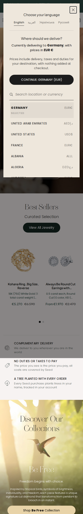

# UI Design System & Master Generation Blueprint: seedjewelry-com

> **Seed Jewelry · Lab-Grown Diamond High Jewelry, Dubai** (https://seedjewelry.com/) — Lab-grown diamond jewelry and transformable designs, crafted in the UAE. Explore Be Free, Kohana, Be True and Always Be, with a tree plan...


---

## 1. Executive Visual Persona & Design Archetype

- **Brand Essence & Persona**: **Seed Jewelry · Lab-Grown Diamond High Jewelry, Dubai** (`https://seedjewelry.com/`). Lab-grown diamond jewelry and transformable designs, crafted in the UAE. Explore Be Free, Kohana, Be True and Always Be, with a tree plan...
- **Capture Provenance**: Live browser capture (`tier1_fast`, HTTP `200`, captured `2026-11-23`).
- **Visual Archetype**: **Light-Substrate Editorial & Modular Grid System (`#ffffff` canvas, `#000000` ink, `#1990c6` accent)**.
- **Anti-AI-Slop Differentiators**:
  - **Live-Computed Chromatic Polarity**: Anchors the viewport in `#ffffff` (live computed `body` `background-color` (`computed_styles.json`)) paired with `#000000` primary typography and `#1990c6` accents.
  - **Grounded Typographic Hierarchy**: Pairs `Poppins` for display copy (`Seed Jewelry`) with `Poppins` and `SFMono-Regular`.
  - **Calibrated Spatial Grid & Motion**: Combines `1536px` container bounds (`gap: 10px 40px`, padding `1.5rem`) with `cubic-bezier(.785,.135,.15,.86)` easing and Barba.js Page Transition Router.

---

## 2. Spatial Architecture & Modular Grid Mathematics



### Viewport Allocation & Container Geometry
- **Captured Viewport Dimensions**: Desktop `1440×2400px` (`assets/desktop.png`, clamped at 2400px live multi-section capture), Mobile `390×2400px` (`assets/mobile.png`, clamped at 2400px live multi-section capture).
- **Master Container Bounds**: `1536px` (non-`@media` desktop container stylesheet rule).
- **Canvas Lateral Padding & Spacing**: `1.5rem` lateral canvas padding with `10px 40px` grid gap.
- **Border Radius Scale**: `var(--button-border-radius)`, `var(--rounded-full)`, `var(--input-border-radius)`, `2px`.

### Responsive Breakpoint Architecture
- **Desktop Layout**: Multi-column CSS Grid / Flexbox layout at `1440px` (`max-width: 1536px`, `gap: 10px 40px`).
- **Mobile Layout**: Single-column vertical stack at `390px` viewport width with `1.5rem` horizontal padding.
- **Extracted CSS Media Queries**: `@media (min-width:767px)`, `@media (max-width:700px)`, `@media (prefers-reduced-motion:reduce)`, `@media screen and (min-width:1000px)`.

---

## 3. Color System, Materiality & Atmospheric Lighting

### Semantic Palette & Source Grounding
| Semantic Role | Ground-Truth Value | Extracted Live / CSS Source |
|---|---|---|
| **Primary Canvas Substrate** | `#ffffff` | live computed `body` `background-color` (`computed_styles.json`) |
| **Primary Typography Ink** | `#000000` | live computed `main` `color` (`computed_styles.json`) |
| **Elevated Surface / Card Substrate** | `#f3f0eb` | `var(--seed-pdp-bg)` in `:root` |
| **Interactive Accent / Highlight** | `#1990c6` | `.shopify-payment-button__button... { background-color: #1990c6 }` |
| **Secondary / Muted Copy** | `#6b716e` | `var(--seed-pdp-ink-muted)` in `:root` |
| **Structural Hairline Border** | `#e3e0d8` | `var(--seed-pdp-border)` in `:root` |

### Sanitized Root CSS Variables (`ui-ux.md` Ground Truth)
| Variable Name | Extracted Value | Semantic Role |
|---|---|---|
| `--container-max-width` | `100%` | Layout / Spatial Grid Token |
| `--container-xxs-max-width` | `27.5rem` | Layout / Spatial Grid Token |
| `--container-xs-max-width` | `42.5rem` | Layout / Spatial Grid Token |
| `--container-sm-max-width` | `61.25rem` | Layout / Spatial Grid Token |
| `--container-md-max-width` | `71.875rem` | Layout / Spatial Grid Token |
| `--container-lg-max-width` | `90rem` | Layout / Spatial Grid Token |
| `--container-xl-max-width` | `1920px` | Layout / Spatial Grid Token |
| `--container-gutter` | `1.25rem` | Layout / Spatial Grid Token |
| `--section-vertical-spacing` | `2.5rem` | Layout / Spatial Grid Token |
| `--section-vertical-spacing-tight` | `2.5rem` | Layout / Spatial Grid Token |
| `--section-stack-gap` | `2.25rem` | Layout / Spatial Grid Token |
| `--section-stack-gap-tight` | `2.25rem` | Layout / Spatial Grid Token |
| `--form-gap` | `1.25rem` | Layout / Spatial Grid Token |
| `--fieldset-gap` | `1rem` | Layout / Spatial Grid Token |
| `--form-control-gap` | `0.625rem` | Layout / Spatial Grid Token |
| `--checkbox-control-gap` | `0.75rem` | Layout / Spatial Grid Token |

---

## 4. Typographic Scale & Editorial Hierarchy

### Font Family Stacks
- **Display Typography**: `Poppins`.
- **Primary Body Stack**: `Poppins`.
- **Technical / Metadata Stack**: `SFMono-Regular`.

### Typographic Scale & Rules (Live Computed & Stylesheet Grounded)
- **Hero Display (`H1`)**: live computed `h1` (`font-size: 32px`, `line-height: 52.8px`, `font-weight: 700`).
- **Section Heading (`H2`)**: live computed `h2` (`font-size: 57.6px`, `line-height: 57.6px`, `font-weight: 400`); rule `h2` (`font-size: 120%`, `font-weight: bold`).
- **Body Copy**: live computed `body` (`font-size: 16px`, `line-height: 26.4px`, `font-weight: 400`); CSS variables `--text-base: 1.0rem`, `--modal-body-padding-block: 1.25rem`, `--modal-body-padding-inline: 1.25rem`; rule `,body` (`font-size: 1rem`, `line-height: 1.5rem`, `letter-spacing: initial`, `font-weight: 450`).
- **Metadata & Navigation Labels**: live computed `nav/a` (`font-size: 16px`, `line-height: 26.4px`, `font-weight: 400`); CSS variables `--heading-letter-spacing: 0.0em`, `--text-letter-spacing: 0.0em`, `--button-letter-spacing: 0.0em`; rule `.label` (`font-size: 14px`).

---

## 5. Choreographed Motion & Interaction Physics

### Primary Easing Curves
- **Extracted Timing Functions**: `cubic-bezier(.785,.135,.15,.86)`, `cubic-bezier(.4,0,.22,1)`, `cubic-bezier(.45,0,.55,1)`.

### Per-Element Transition & Choreography Rules
- **Selector `.accordion :is(svg)`**: `transition: transform .2s` extracted from `seedjewelry-com` stylesheet.
- **Selector `.shopify-payment-button__button--...`**: `transition: background-size .45s cubic-bezier(.785,.135,.15,.86),backgroun...` extracted from `seedjewelry-com` stylesheet.
- **Selector `.shopify-payment-button__button--...`**: `transition: background-size .45s cubic-bezier(.785,.135,.15,.86),backgroun...` extracted from `seedjewelry-com` stylesheet.
- **Extracted Easing Curve (`cubic-bezier(.785,.135,.15,.86)`)**: Governs interactive state transitions across `<header.analytics>` and `<section.seed-hero>`.
- **Runtime Interaction Engine**: Integrates Barba.js Page Transition Router with `prefers-reduced-motion: reduce` fallback guards.

---

## 6. Component Wireframe & Structural DOM Map

### Visual Layout Schematic — Desktop (`1440px`, Grounded in `dom.html` & Landmark Bounding Boxes)
```
┌────────────────────────────────────────────────────────────────────────┐
│ DESKTOP VIEWPORT (1440px) — Seed Jewelry · Lab-Grown Diamond High Jewe │
│ ====================================================================== │
│ [ <header.analytics> (1440x91px)      | Search Search                ] │
│ ---------------------------------------------------------------------- │
│ | HERO STAGE: <section.shopify-section> (w=1440px)                   | │
│ | H1: Seed Jewelry                                                   | │
│ | Substrate: #ffffff | Ink: #000000 | Accent: #1990c6                | │
│ ---------------------------------------------------------------------- │
│ | SHOWCASE GRID (<section.seed-hero>) max-w: 1536px                  | │
│ | +------------------------------+  +------------------------------+ | │
│ | | Born from the earth, refined |  | Best Sellers                 | | │
│ | +------------------------------+  +------------------------------+ | │
│ ---------------------------------------------------------------------- │
│ | DETAIL MODULE (<section.seed-product-grid) — Kohana Ring , Big Siz | │
│ ---------------------------------------------------------------------- │
│ [ FOOTER (<footer.color-scheme) | https://seedjewelry.com/             │
└────────────────────────────────────────────────────────────────────────┘
```

### Visual Layout Schematic — Mobile Reflow (`390px`)
```
┌────────────────────────────────────────────────────────────────────────┐
│ MOBILE VIEWPORT REFLOW (390px) — Single-Column Stack (gap: 10px 40p)   │
│ ====================================================================== │
│ [ HEADER BAR (<header.analytics>      ) | Compact Menu (390px)         │
│ ---------------------------------------------------------------------- │
│ | HERO STAGE (<section.shopify-section) — 390px Vertical Lead        | │
│ | H1: Seed Jewelry                                                   | │
│ ---------------------------------------------------------------------- │
│ | SHOWCASE STACK (<section.seed-hero>) — 1-Col Stack                 | │
│ | [ Item 1: Born from the earth, refined by art                    ] | │
│ | [ Item 2: Best Sellers                                           ] | │
│ ---------------------------------------------------------------------- │
│ | DETAIL STACK (<section.seed-product-gr) — 1-Col (Kohana Ring , Big ) │
│ ---------------------------------------------------------------------- │
│ [ FOOTER (<footer.color-scheme) | Stacked 390px Colophon               │
└────────────────────────────────────────────────────────────────────────┘
```

### Granular DOM Region Breakdown
1. **Brand Header & Navigation Bar (<header.analytics> — `seedjewelry-com`)**:
   - Landmark `<header class="analytics">` (`1440x91px`) hosting `Seed Jewelry · Lab-Grown Diamond Hig` navigation (`Search Search`), DOM attributes (`data-source-attribution="shopify.exit_intersti..."`, `data-source-attribution="shopify.loadfeatures"`, `data-source-attribution="shopify.dynamic_check..."`, `data-source-attribution="shopify.dynamic_check..."`), and stylesheet rule `.page-width { max-width:var(--container-xl-max-width);margin:0 auto;padding:0 25px }`.
2. **Hero Stage & Focal Lead (<section.shopify-section> — `Seed Jewelry`)**:
   - Landmark `<section class="shopify-section seed-hero-section">` presenting display lead `Seed Jewelry` and copy excerpt *"Celebrating our launch: 20% off every piece until 30 November."* over `#ffffff` canvas and `#000000` ink.
3. **Primary Showcase & Content Grid (<section.seed-hero> — `Born from the earth, refined by ar`)**:
   - Landmark `<section class="seed-hero">` rendering section `Born from the earth, refined by art` with copy *"Lab-grown diamonds, transformable designs, and sustainable luxury"*, asset references (`gtm.js`, `2113812439524310`, `fbevents.js`, `clarity.js`), and grid rule `.page-width-lg { max-width:var(--container-lg-max-width);margin:0 auto;padding:0 25px }`.
4. **Interactive Detail & Feature Matrix (<section.seed-product-grid-section> — `Best Sellers`)**:
   - Landmark `<section class="shopify-section seed-product-grid-section">` framing `Best Sellers` and `Kohana Ring , Big Size, Reverse` (*"Kohana Ring , Big Size, Reverse 18K (750) White Gold · 1 total ca"*) with `#f3f0eb` surface cards, `#1990c6` accents, and `strong { font-weight:bolder }`.
5. **Colophon & Global Directory Footer (<footer.color-scheme--scheme-1> — `https://seedjewelry.com/`)**:
   - Landmark `<footer class="color-scheme--scheme-1">` anchoring `Seed Jewelry · Lab-Grown Diamond` footer links (`Search Search`), copy *"18K (750) White Gold · 1 total carat weight ·..."*, and `#e3e0d8` structural dividers.

---

## 7. Master Zero-Shot AI Generation Prompt

```markdown
# Master Zero-Shot Frontend Generation Prompt: seedjewelry-com (Seed Jewelry · Lab-Grown Diamond High Jewelry, Dubai)

You are a principal frontend architect and design systems engineer. Build a complete, production-ready web application replicating the exact design system, DOM landmarks, typographic hierarchy, color tokens, and motion physics of `seedjewelry-com` (**Seed Jewelry · Lab-Grown Diamond High Jewelry, Dubai** — `https://seedjewelry.com/`).

### 1. Visual Archetype & Anti-AI-Slop Mandates
- **Archetype**: Light-Substrate Editorial & Modular Grid System (`#ffffff` canvas, `#000000` ink, `#1990c6` accent).
- **Identity & Domain Context**: Lab-grown diamond jewelry and transformable designs, crafted in the UAE. Explore Be Free, Kohana, Be True and Always Be, with a tree plan...
- **Primary Substrate**: `#ffffff` (live computed `body` `background-color` (`computed_styles.json`)), **Primary Ink**: `#000000`, **Accent / Highlight**: `#1990c6`.
- **Site-Specific Differentiators**:
  - **Live-Computed Chromatic Polarity**: Anchors the viewport in `#ffffff` (live computed `body` `background-color` (`computed_styles.json`)) paired with `#000000` primary typography and `#1990c6` accents.
  - **Grounded Typographic Hierarchy**: Pairs `Poppins` for display copy (`Seed Jewelry`) with `Poppins` and `SFMono-Regular`.
  - **Calibrated Spatial Grid & Motion**: Combines `1536px` container bounds (`gap: 10px 40px`, padding `1.5rem`) with `cubic-bezier(.785,.135,.15,.86)` easing and Barba.js Page Transition Router.

### 2. Ground-Truth CSS Variables (`:root` Token Contract)
Declare and consume these exact custom properties extracted from `seedjewelry-com` in your global stylesheet:

:root {
  /* Seed Jewelry · Lab-Grown Diamond High Jewelry, Dubai (seedjewelry-com) — Live-Grounded CSS Variables */
  --container-max-width: 100%; /* Layout / Spatial Grid Token (seedjewelry-com) */
  --container-xxs-max-width: 27.5rem; /* Layout / Spatial Grid Token (seedjewelry-com) */
  --container-xs-max-width: 42.5rem; /* Layout / Spatial Grid Token (seedjewelry-com) */
  --container-sm-max-width: 61.25rem; /* Layout / Spatial Grid Token (seedjewelry-com) */
  --container-md-max-width: 71.875rem; /* Layout / Spatial Grid Token (seedjewelry-com) */
  --container-lg-max-width: 90rem; /* Layout / Spatial Grid Token (seedjewelry-com) */
  --container-xl-max-width: 1920px; /* Layout / Spatial Grid Token (seedjewelry-com) */
  --container-gutter: 1.25rem; /* Layout / Spatial Grid Token (seedjewelry-com) */
  --section-vertical-spacing: 2.5rem; /* Layout / Spatial Grid Token (seedjewelry-com) */
  --section-vertical-spacing-tight: 2.5rem; /* Layout / Spatial Grid Token (seedjewelry-com) */
  --section-stack-gap: 2.25rem; /* Layout / Spatial Grid Token (seedjewelry-com) */
  --section-stack-gap-tight: 2.25rem; /* Layout / Spatial Grid Token (seedjewelry-com) */
  --form-gap: 1.25rem; /* Layout / Spatial Grid Token (seedjewelry-com) */
  --fieldset-gap: 1rem; /* Layout / Spatial Grid Token (seedjewelry-com) */
  --form-control-gap: 0.625rem; /* Layout / Spatial Grid Token (seedjewelry-com) */
  --checkbox-control-gap: 0.75rem; /* Layout / Spatial Grid Token (seedjewelry-com) */
}

### 3. Semantic Color & Materiality Contract
Map every surface, ink, and border strictly to these source-grounded tokens:
- **Primary Canvas Substrate**: `#ffffff` — grounded in live computed `body` `background-color` (`computed_styles.json`)
- **Primary Typography Ink**: `#000000` — grounded in live computed `main` `color` (`computed_styles.json`)
- **Elevated Surface / Card Substrate**: `#f3f0eb` — grounded in `var(--seed-pdp-bg)` in `:root`
- **Interactive Accent / Highlight**: `#1990c6` — grounded in `.shopify-payment-button__button... { background-color: #1990c6 }`
- **Secondary / Muted Copy**: `#6b716e` — grounded in `var(--seed-pdp-ink-muted)` in `:root`
- **Structural Hairline Border**: `#e3e0d8` — grounded in `var(--seed-pdp-border)` in `:root`

### 4. Spatial Grid, Container Bounds & Responsive Breakpoints
- **Desktop Viewport Reference**: `1440×2400px` (clamped at 2400px live multi-section capture, `1440px` standard desktop width).
- **Mobile Viewport Reference**: `390×2400px` (clamped at 2400px live multi-section capture, `390px` standard mobile width).
- **Container Max-Width**: `1536px` (non-`@media` desktop container stylesheet rule)
- **Padding & Gutters**: `1.5rem` lateral canvas padding with `10px 40px` grid gap
- **Desktop Grid**: Multi-column CSS Grid / Flexbox layout at `1440px` (`max-width: 1536px`, `gap: 10px 40px`)
- **Mobile Adaptation**: Single-column vertical stack at `390px` viewport width with `1.5rem` horizontal padding
- **Media Queries**: `@media (min-width:767px)`, `@media (max-width:700px)`, `@media (prefers-reduced-motion:reduce)`, `@media screen and (min-width:1000px)`
- **Corner Radii**: `var(--button-border-radius)`, `var(--rounded-full)`, `var(--input-border-radius)`, `2px`

### 5. Typography & Editorial Scale Contract
- **Display Font Stack**: `Poppins`
- **Body Font Stack**: `Poppins`
- **Monospace / Technical Font Stack**: `SFMono-Regular`
- **H1 Display Rule**: live computed `h1` (`font-size: 32px`, `line-height: 52.8px`, `font-weight: 700`)
- **H2 Section Rule**: live computed `h2` (`font-size: 57.6px`, `line-height: 57.6px`, `font-weight: 400`); rule `h2` (`font-size: 120%`, `font-weight: bold`)
- **Body Copy Rule**: live computed `body` (`font-size: 16px`, `line-height: 26.4px`, `font-weight: 400`); CSS variables `--text-base: 1.0rem`, `--modal-body-padding-block: 1.25rem`, `--modal-body-padding-inline: 1.25rem`; rule `,body` (`font-size: 1rem`, `line-height: 1.5rem`, `letter-spacing: initial`, `font-weight: 450`)
- **Metadata & Index Rule**: live computed `nav/a` (`font-size: 16px`, `line-height: 26.4px`, `font-weight: 400`); CSS variables `--heading-letter-spacing: 0.0em`, `--text-letter-spacing: 0.0em`, `--button-letter-spacing: 0.0em`; rule `.label` (`font-size: 14px`)

### 6. Component Hierarchy, Verbatim Copy & Real DOM Landmarks
Scaffold `seedjewelry-com` (`Seed Jewelry · Lab-Grown Diamond High Jewelry, Dubai`) with these exact structural regions, extracted copy, and CSS rules from `dom.html`:
1. **Brand Header & Navigation Bar (<header.analytics> — `seedjewelry-com`)**:
   - DOM & Selectors: Landmark `<header class="analytics">` (`1440x91px`) hosting `Seed Jewelry · Lab-Grown Diamond Hig` navigation (`Search Search`), DOM attributes (`data-source-attribution="shopify.exit_intersti..."`, `data-source-attribution="shopify.loadfeatures"`, `data-source-attribution="shopify.dynamic_check..."`, `data-source-attribution="shopify.dynamic_check..."`), and stylesheet rule `.page-width { max-width:var(--container-xl-max-width);margin:0 auto;padding:0 25px }`.
   - Responsive Contract: Header `Brand Header & Navigation Bar (<header.analytics> — `seedjewelry-com`)` (`seedjewelry-com`) adapts across `@media (min-width:767px)`, `@media (max-width:700px)`, `@media (prefers-reduced-motion:reduce)`, `@media screen and (min-width:1000px)` with `cubic-bezier(.785,.135,.15,.86)`, `cubic-bezier(.4,0,.22,1)`, `cubic-bezier(.45,0,.55,1)` transitions and links `Search Search`.
2. **Hero Stage & Focal Lead (<section.shopify-section> — `Seed Jewelry`)**:
   - DOM & Selectors: Landmark `<section class="shopify-section seed-hero-section">` presenting display lead `Seed Jewelry` and copy excerpt *"Celebrating our launch: 20% off every piece until 30 November."* over `#ffffff` canvas and `#000000` ink.
   - Responsive Contract: Hero stage (`1440×2400px` desktop / `390×2400px` mobile) sets `#ffffff` background with `#000000` headline `Seed Jewelry`.
3. **Primary Showcase & Content Grid (<section.seed-hero> — `Born from the earth, refined by ar`)**:
   - DOM & Selectors: Landmark `<section class="seed-hero">` rendering section `Born from the earth, refined by art` with copy *"Lab-grown diamonds, transformable designs, and sustainable luxury"*, asset references (`gtm.js`, `2113812439524310`, `fbevents.js`, `clarity.js`), and grid rule `.page-width-lg { max-width:var(--container-lg-max-width);margin:0 auto;padding:0 25px }`.
   - Responsive Contract: Showcase grid `Primary Showcase & Content Grid (<section.seed-hero> — `Born from the earth, refined by ar`)` applies Multi-column CSS Grid / Flexbox layout at `1440px` (`max-width: 1536px`, `gap: 10px 40px`) on desktop and Single-column vertical stack at `390px` viewport width with `1.5rem` horizontal padding on mobile.
4. **Interactive Detail & Feature Matrix (<section.seed-product-grid-section> — `Best Sellers`)**:
   - DOM & Selectors: Landmark `<section class="shopify-section seed-product-grid-section">` framing `Best Sellers` and `Kohana Ring , Big Size, Reverse` (*"Kohana Ring , Big Size, Reverse 18K (750) White Gold · 1 total ca"*) with `#f3f0eb` surface cards, `#1990c6` accents, and `strong { font-weight:bolder }`.
   - Responsive Contract: Detail module `Interactive Detail & Feature Matrix (<section.seed-product-grid-section> — `Best Sellers`)` uses `var(--button-border-radius)`, `var(--rounded-full)`, `var(--input-border-radius)`, `2px` radii, `#1990c6` highlights, and assets (gtm.js, 2113812439524310, fbevents.js).
5. **Colophon & Global Directory Footer (<footer.color-scheme--scheme-1> — `https://seedjewelry.com/`)**:
   - DOM & Selectors: Landmark `<footer class="color-scheme--scheme-1">` anchoring `Seed Jewelry · Lab-Grown Diamond` footer links (`Search Search`), copy *"18K (750) White Gold · 1 total carat weight ·..."*, and `#e3e0d8` structural dividers.
   - Responsive Contract: Footer `Colophon & Global Directory Footer (<footer.color-scheme--scheme-1> — `https://seedjewelry.com/`)` aligns to `1536px` (non-`@media` desktop container stylesheet rule) with `1.5rem` lateral canvas padding with `10px 40px` grid gap and attributes (data-source-attribution="shopify.exit_intersti...", data-source-attribution="shopify.loadfeatures", data-source-attribution="shopify.dynamic_check...").

#### Verbatim DOM Copy Excerpts (`dom.html`)
- Copy Excerpt 1: *"Celebrating our launch: 20% off every piece until 30 November."*
- Copy Excerpt 2: *"Lab-grown diamonds, transformable designs, and sustainable luxury. Each piece tell..."*
- Copy Excerpt 3: *"Kohana Ring , Big Size, Reverse 18K (750) White Gold · 1 total carat weight ·... €..."*
- Copy Excerpt 4: *"18K (750) White Gold · 1 total carat weight ·..."*

### 7. Motion, Extracted Stylesheet Rules & Interaction Choreography
- **Primary Easing Functions**: `cubic-bezier(.785,.135,.15,.86)`, `cubic-bezier(.4,0,.22,1)`, `cubic-bezier(.45,0,.55,1)`
- **Extracted Stylesheet Rules (`seedjewelry-com`)**:
- `.page-width { max-width:var(--container-xl-max-width);margin:0 auto;padding:0 25px }`
- `.page-width-lg { max-width:var(--container-lg-max-width);margin:0 auto;padding:0 25px }`
- `strong { font-weight:bolder }`
- `pre { font-family:ui-monospace,SFMono-Regular,Menlo,Monaco,Consolas,Liberation... }`
- `table { text-indent:0;border-color:inherit;border-collapse:collapse }`
- **Per-Selector Transition Rules**:
- **Selector `.accordion :is(svg)`**: `transition: transform .2s` extracted from `seedjewelry-com` stylesheet.
- **Selector `.shopify-payment-button__button--...`**: `transition: background-size .45s cubic-bezier(.785,.135,.15,.86),backgroun...` extracted from `seedjewelry-com` stylesheet.
- **Selector `.shopify-payment-button__button--...`**: `transition: background-size .45s cubic-bezier(.785,.135,.15,.86),backgroun...` extracted from `seedjewelry-com` stylesheet.
- **Extracted Easing Curve (`cubic-bezier(.785,.135,.15,.86)`)**: Governs interactive state transitions across `<header.analytics>` and `<section.seed-hero>`.
- **Runtime Interaction Engine**: Integrates Barba.js Page Transition Router with `prefers-reduced-motion: reduce` fallback guards.

### 8. Technical Deliverables
- Implement in Next.js (App Router) with TypeScript and Tailwind CSS consuming the `:root` custom properties defined above for `seedjewelry-com`.
- Reproduce both the `1440px` desktop architecture and `390px` mobile breakpoint transitions, preserving semantic HTML5 landmarks (`<header>`, `<nav>`, `<main>`, `<section>`, `<footer>`) and `prefers-reduced-motion` accessibility guards.
```
