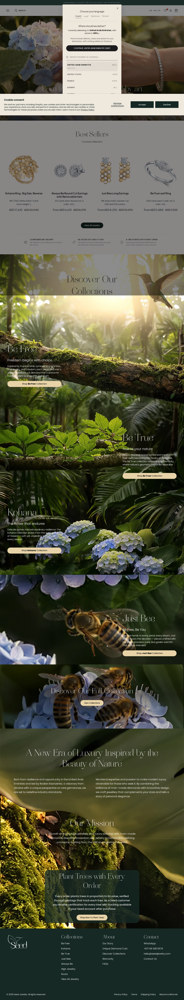

# UI Design System & Master Generation Blueprint: seedjewelry-com

> **Seed Jewelry · Lab-Grown Diamond High Jewelry Atelier, Dubai** — A Dubai-based lab-grown diamond high jewelry flagship pairing crisp diamond-white surfaces (`#ffffff`) with deep botanical emerald green (`#162924` and `rgb(48, 79, 72)` / `#304f48`), warm champagne gold CTAs (`--seed-cta-bg: #e8d3a8`), and a 6-tier responsive rem container ladder (`27.5rem` to `1920px`).



---

## 1. Executive Visual Persona & Design Archetype

- **Brand Essence & Persona**: **Seed Jewelry · Lab-Grown Diamond High Jewelry Atelier, Dubai**. A Dubai-based lab-grown diamond high jewelry flagship pairing crisp diamond-white surfaces (`#ffffff`) with deep botanical emerald green (`#162924` and `rgb(48, 79, 72)` / `#304f48`), warm champagne gold CTAs (`--seed-cta-bg: #e8d3a8`), and a 6-tier responsive rem container ladder (`27.5rem` to `1920px`).
- **Visual Archetype**: **Botanical Emerald & Champagne-Gold High Jewelry Flagship (`Plus Jakarta Sans` + `Poppins` + `GTStandard-M`)**.
- **Anti-AI-Slop Differentiators**:
  1. **Botanical Emerald & Champagne Gold Contrast**: Pairs deep emerald (`#162924` and `--accent: 48 79 72` / `--button-background: 48 79 72`) with warm champagne gold (`--seed-cta-bg: #e8d3a8`, `--seed-cta-color: #000000`) over pure white (`#ffffff`).
  2. **Tri-Zone CSS Grid Header (`--header-grid`)**: Uses explicit named grid template areas `--header-grid: "primary-nav logo secondary-nav" / minmax(0, 1fr) auto minmax(0, 1fr)` with `--header-logo-width: 70px`.
  3. **Parameterized 4-to-2 Product Grid (`--seed-grid-cols`)**: Product collections (`header.seed-product-grid__header`, `H2: Best Sellers`, `H2: Discover Our Collections`) scale automatically from `--seed-grid-cols: 4` on desktop to `--seed-grid-cols-mobile: 2`.
  4. **6-Tier Container Width System**: Defines exact container bounds from `--container-xxs-max-width: 27.5rem` up to `--container-lg-max-width: 90rem` (`1440px`) and `--container-xl-max-width: 1920px`.

---

## 2. Spatial Architecture & Modular Grid Mathematics


### Viewport Allocation & Container Geometry
- **Captured Full-Page Dimensions**: Desktop `1440×7802px` (`assets/desktop.png`), Mobile `390×4200px` (`assets/mobile.png`).
- **Master Container Bounds**: `--container-lg-max-width: 90rem` (1440px) and `--container-xl-max-width: 1920px` with `--container-gutter: 1.25rem` (20px).
- **Canvas Lateral Padding & Spacing**: `--container-gutter: 1.25rem`, vertical rhythm `--section-vertical-spacing: 2.5rem`, stack gap `--section-stack-gap: 2.25rem`.
- **Border Radius Scale**: `--button-border-radius: 3.125rem` (50px pill CTAs), `--input-border-radius: 0.0rem` (sharp rectangular inputs), `--seed-chat-radius: 8px`.

### Responsive Breakpoint Architecture
- **Desktop Layout**: `--seed-grid-cols: 4` for high-jewelry product matrices; `--header-grid: "primary-nav logo secondary-nav" / minmax(0, 1fr) auto minmax(0, 1fr)`.
- **Mobile Layout**: `--seed-grid-cols-mobile: 2` (2-up mobile jewelry grid) with slide-out drawer (`--drawer-max-width: min(94vw, 30rem)`).
- **Extracted CSS Media Queries**: `@media (min-width:448px)`, `@media (min-width:640px)`, `@media (min-width:768px)`, `@media (min-width:1024px)`, `@media (min-width: 1440px)`.

---

## 3. Color System, Materiality & Atmospheric Lighting

### Semantic Palette & Source Grounding
| Semantic Role | Ground-Truth Value | Extracted CSS Source / Selector |
|---|---|---|
| Primary Diamond White Canvas | `#ffffff` | `--background-without-opacity: 255 255 255` (`:root`) |
| Deep Botanical Emerald Surface | `#162924` | Extracted stylesheet luxury dark emerald (`#162924`) |
| Emerald Primary Button & Accent | `#304f48` | `--accent: 48 79 72` / `--button-background: 48 79 72` (`rgb(48,79,72)`) |
| Warm Champagne Gold CTA Fill | `#e8d3a8` | `--seed-cta-bg` (`:root`) |
| Champagne CTA Label Ink | `#000000` | `--seed-cta-color` / `--text-color: 0 0 0` (`:root`) |
| Subtle Gallery Hairline Border | `#d9d9d9` | `--border-color: 217 217 217` (`rgb(217,217,217)`) |
| Translucent Header Border | `rgba(255, 255, 255, 0.4)` | `--header-border-color` (`:root`) |
| Soft Card Elevation Shadow | `0 5px 15px rgb(0 0 0 / 0.05)` | `--shadow` (`:root`) |

### Sanitized Root CSS Variables (`ui-ux.md` Ground Truth)
| Variable Name | Extracted Value | Semantic Role |
|---|---|---|
| `--container-lg-max-width` | `90rem` | 1440px primary desktop container width |
| `--container-xl-max-width` | `1920px` | Full-bleed widescreen showcase max-width |
| `--container-md-max-width` | `71.875rem` | 1150px medium editorial container width |
| `--container-gutter` | `1.25rem` | 20px horizontal container gutter |
| `--section-vertical-spacing` | `2.5rem` | 40px vertical section rhythm |
| `--section-stack-gap` | `2.25rem` | 36px internal stack gap |
| `--header-grid` | `"primary-nav logo secondary-nav" / minmax(0, 1fr) auto minmax(0, 1fr)` | Tri-zone CSS Grid template for sticky header |
| `--header-logo-width` | `70px` | Centered Seed Jewelry emblem width |
| `--seed-grid-cols` | `4` | 4-column desktop jewelry product grid |
| `--seed-grid-cols-mobile` | `2` | 2-column mobile jewelry product grid |
| `--seed-cta-bg` | `#e8d3a8` | Warm champagne gold primary CTA background |
| `--seed-cta-color` | `#000000` | Black text ink on champagne gold CTA |
| `--accent` | `48 79 72` | Botanical emerald RGB triplet (#304f48) |
| `--button-background` | `48 79 72` | Emerald button background RGB triplet |
| `--border-color` | `217 217 217` | 1px neutral border RGB triplet (#d9d9d9) |
| `--heading-font-family` | `"Plus Jakarta Sans", sans-serif` | Primary geometric heading font family |
| `--text-font-family` | `Poppins, sans-serif` | Primary body copy font family |
| `--button-border-radius` | `3.125rem` | 50px pill radius for primary buttons |
| `--drawer-max-width` | `min(94vw, 30rem)` | Slide-over cart & filter drawer width (480px) |

---

## 4. Typographic Scale & Editorial Hierarchy

### Font Family Stacks
- **Display Typography**: `"Plus Jakarta Sans", "GTStandard-M", sans-serif` (`--heading-font-family`).
- **Primary Body Stack**: `Poppins, sans-serif` (`--text-font-family`).
- **Technical / Metadata Stack**: `ui-monospace, "SF Mono", monospace` (Carat weight, VVS clarity grades, AED/USD pricing).

### Typographic Scale & Rules
- **Hero Display (`H1`)**: `clamp(2.25rem, 4.5vw, 4rem)`, `font-family: var(--heading-font-family)`, `font-weight: 400` (`--heading-font-weight`), `letter-spacing: 0.0em` ("Seed Jewelry" / "Born from the earth, refined by art").
- **Section Heading (`H2`)**: `clamp(1.5rem, 2.8vw, 2.25rem)`, `font-family: var(--heading-font-family)`, `font-weight: 400` ("Best Sellers", "Discover Our Collections").
- **Body Copy**: `var(--text-base)` (`1.0rem`), `font-family: var(--text-font-family)` (`Poppins`), `font-weight: 400`, `line-height: 1.6`.
- **Metadata & Navigation Labels**: `var(--text-xs)` (`0.875rem`), `text-transform: uppercase` (`--button-text-transform`), pill buttons with `--button-border-radius: 3.125rem`.

---

## 5. Choreographed Motion & Interaction Physics

### Primary Easing Curves
- **Extracted Timing Functions**: `cubic-bezier(.25,.46,.45,.94)` (quad ease-out) and `cubic-bezier(.34,1.56,.64,1)` (spring reveal).

### Per-Element Transition & Choreography Rules
- `Header Icon Transitions` -> `--header-icon-exit-duration: .2s`
- `Product Card Image Hover` -> `cubic-bezier(.25,.46,.45,.94)` (`400ms` secondary macro-angle crossfade)
- `.seed-chat__panel` -> `transition: opacity .25s ease, transform .25s ease, visibility .25s`
- `Badge & Drawer entrances` -> `cubic-bezier(.34,1.56,.64,1)`

---

## 6. Component Wireframe & Structural DOM Map

### Visual Layout Schematic (Grounded in `dom.html`)
```
┌────────────────────────────────────────────────────────────────────────┐
│ <header id="shopify-section-sections--24564126580933__header">         │
│   Grid: "primary-nav logo secondary-nav" / 1fr auto(70px) 1fr          │
│   <nav class="header__primary-nav">  [SEED]  <nav class="header__secon │
├────────────────────────────────────────────────────────────────────────┤
│ <section class="hero-stage"> (Bg: #162924 Emerald / Text: #ffffff)     │
│   H1: Born from the earth, refined by art                              │
│   [ Pill CTA (--seed-cta-bg #e8d3a8, radius 3.125rem): Explore High Je │
├────────────────────────────────────────────────────────────────────────┤
│ <header class="seed-product-grid__header"> H2: Best Sellers (--seed-gr │
│   [ Ring 01 ]  [ Necklace 02 ]  [ Bracelet 03 ]  [ Earrings 04 ] (xl:  │
├────────────────────────────────────────────────────────────────────────┤
│ <section class="collections"> H2: Discover Our Collections             │
├────────────────────────────────────────────────────────────────────────┤
│ <nav class="seed-footer__nav--shop"> & <.seed-footer__nav--about> Duba │
└────────────────────────────────────────────────────────────────────────┘
```

### Granular DOM Region Breakdown
1. **Tri-Zone Sticky Header (`--header-grid` and `<nav class="header__primary-nav">`)**:
   - Uses `"primary-nav logo secondary-nav" / minmax(0, 1fr) auto minmax(0, 1fr)` with `--header-logo-width: 70px` and `--header-border-color: rgba(255, 255, 255, 0.4)`.
2. **Emerald & Diamond Hero (`H1: Born from the earth, refined by art`)**:
   - High-contrast botanical emerald (`#162924`) hero viewport with champagne gold pill CTA (`--seed-cta-bg: #e8d3a8`, `--seed-cta-color: #000000`, `--button-border-radius: 3.125rem`).
3. **Best Sellers 4-Column Product Grid (`<header class="seed-product-grid__header">` and `H2: Best Sellers`)**:
   - Driven by `--seed-grid-cols: 4` on desktop and `--seed-grid-cols-mobile: 2` on mobile inside `--container-xl-max-width: 1920px` with `rgb(var(--border-color))` (`#d9d9d9`) borders.
4. **Collections Showcase (`H2: Discover Our Collections`)**:
   - Editorial category cards spaced by `--section-vertical-spacing: 2.5rem` and `--section-stack-gap: 2.25rem` with `--button-background: 48 79 72` (`#304f48`) triggers.
5. **Multi-Nav Atelier Footer (`.seed-footer__nav--shop`, `.seed-footer__nav--about`, `.seed-footer__nav--contact`)**:
   - Dubai flagship directory with slide-out cart drawer (`--drawer-max-width: min(94vw, 30rem)`) and concierge chat launcher (`.seed-chat__panel`).

---

## 7. Master Zero-Shot AI Generation Prompt

```markdown
# Master Zero-Shot Frontend Generation Prompt: seedjewelry-com (Seed Jewelry · Lab-Grown Diamond High Jewelry Atelier, Dubai)

You are a principal frontend architect and design systems engineer. Build a complete, production-ready web application replicating the exact design system, DOM landmarks, typographic hierarchy, color tokens, and motion physics of `seedjewelry-com` (Seed Jewelry · Lab-Grown Diamond High Jewelry Atelier, Dubai).

### 1. Visual Archetype & Anti-AI-Slop Mandates
- **Archetype**: Botanical Emerald & Champagne-Gold High Jewelry Flagship (`Plus Jakarta Sans` + `Poppins` + `GTStandard-M`).
- **Primary Substrate**: `#ffffff` (`--background-without-opacity: 255 255 255` (`:root`)), **Primary Ink**: `#000000`, **Accent / Highlight**: `0 5px 15px rgb(0 0 0 / 0.05)`.
- **Site-Specific Differentiators**:
  1. **Botanical Emerald & Champagne Gold Contrast**: Pairs deep emerald (`#162924` and `--accent: 48 79 72` / `--button-background: 48 79 72`) with warm champagne gold (`--seed-cta-bg: #e8d3a8`, `--seed-cta-color: #000000`) over pure white (`#ffffff`).
  2. **Tri-Zone CSS Grid Header (`--header-grid`)**: Uses explicit named grid template areas `--header-grid: "primary-nav logo secondary-nav" / minmax(0, 1fr) auto minmax(0, 1fr)` with `--header-logo-width: 70px`.
  3. **Parameterized 4-to-2 Product Grid (`--seed-grid-cols`)**: Product collections (`header.seed-product-grid__header`, `H2: Best Sellers`, `H2: Discover Our Collections`) scale automatically from `--seed-grid-cols: 4` on desktop to `--seed-grid-cols-mobile: 2`.
  4. **6-Tier Container Width System**: Defines exact container bounds from `--container-xxs-max-width: 27.5rem` up to `--container-lg-max-width: 90rem` (`1440px`) and `--container-xl-max-width: 1920px`.

### 2. Ground-Truth CSS Variables (`:root` Token Contract)
Declare and consume these exact custom properties extracted from `seedjewelry-com` in your global stylesheet:

:root {
  /* Seed Jewelry · Lab-Grown Diamond High Jewelry Atelier, Dubai — Ground-Truth Extracted CSS Variables */
  --container-lg-max-width: 90rem; /* 1440px primary desktop container width */
  --container-xl-max-width: 1920px; /* Full-bleed widescreen showcase max-width */
  --container-md-max-width: 71.875rem; /* 1150px medium editorial container width */
  --container-gutter: 1.25rem; /* 20px horizontal container gutter */
  --section-vertical-spacing: 2.5rem; /* 40px vertical section rhythm */
  --section-stack-gap: 2.25rem; /* 36px internal stack gap */
  --header-grid: "primary-nav logo secondary-nav" / minmax(0, 1fr) auto minmax(0, 1fr); /* Tri-zone CSS Grid template for sticky header */
  --header-logo-width: 70px; /* Centered Seed Jewelry emblem width */
  --seed-grid-cols: 4; /* 4-column desktop jewelry product grid */
  --seed-grid-cols-mobile: 2; /* 2-column mobile jewelry product grid */
  --seed-cta-bg: #e8d3a8; /* Warm champagne gold primary CTA background */
  --seed-cta-color: #000000; /* Black text ink on champagne gold CTA */
  --accent: 48 79 72; /* Botanical emerald RGB triplet (#304f48) */
  --button-background: 48 79 72; /* Emerald button background RGB triplet */
  --border-color: 217 217 217; /* 1px neutral border RGB triplet (#d9d9d9) */
  --heading-font-family: "Plus Jakarta Sans", sans-serif; /* Primary geometric heading font family */
  --text-font-family: Poppins, sans-serif; /* Primary body copy font family */
  --button-border-radius: 3.125rem; /* 50px pill radius for primary buttons */
  --drawer-max-width: min(94vw, 30rem); /* Slide-over cart & filter drawer width (480px) */
}

### 3. Semantic Color & Materiality Contract
Map every surface, ink, and border strictly to these source-grounded tokens:
- **Primary Diamond White Canvas**: `#ffffff` — grounded in `--background-without-opacity: 255 255 255` (`:root`)
- **Deep Botanical Emerald Surface**: `#162924` — grounded in Extracted stylesheet luxury dark emerald (`#162924`)
- **Emerald Primary Button & Accent**: `#304f48` — grounded in `--accent: 48 79 72` / `--button-background: 48 79 72` (`rgb(48,79,72)`)
- **Warm Champagne Gold CTA Fill**: `#e8d3a8` — grounded in `--seed-cta-bg` (`:root`)
- **Champagne CTA Label Ink**: `#000000` — grounded in `--seed-cta-color` / `--text-color: 0 0 0` (`:root`)
- **Subtle Gallery Hairline Border**: `#d9d9d9` — grounded in `--border-color: 217 217 217` (`rgb(217,217,217)`)
- **Translucent Header Border**: `rgba(255, 255, 255, 0.4)` — grounded in `--header-border-color` (`:root`)
- **Soft Card Elevation Shadow**: `0 5px 15px rgb(0 0 0 / 0.05)` — grounded in `--shadow` (`:root`)

### 4. Spatial Grid, Container Bounds & Responsive Breakpoints
- **Desktop Viewport Reference**: `1440×7802px` full-page capture (`1440px` standard desktop width).
- **Mobile Viewport Reference**: `390×4200px` full-page capture (`390px` standard mobile width).
- **Container Max-Width**: `--container-lg-max-width: 90rem` (1440px) and `--container-xl-max-width: 1920px` with `--container-gutter: 1.25rem` (20px)
- **Padding & Gutters**: `--container-gutter: 1.25rem`, vertical rhythm `--section-vertical-spacing: 2.5rem`, stack gap `--section-stack-gap: 2.25rem`
- **Desktop Grid**: `--seed-grid-cols: 4` for high-jewelry product matrices; `--header-grid: "primary-nav logo secondary-nav" / minmax(0, 1fr) auto minmax(0, 1fr)`
- **Mobile Adaptation**: `--seed-grid-cols-mobile: 2` (2-up mobile jewelry grid) with slide-out drawer (`--drawer-max-width: min(94vw, 30rem)`)
- **Media Queries**: `@media (min-width:448px)`, `@media (min-width:640px)`, `@media (min-width:768px)`, `@media (min-width:1024px)`, `@media (min-width: 1440px)`
- **Corner Radii**: `--button-border-radius: 3.125rem` (50px pill CTAs), `--input-border-radius: 0.0rem` (sharp rectangular inputs), `--seed-chat-radius: 8px`

### 5. Typography & Editorial Scale Contract
- **Display Font Stack**: `"Plus Jakarta Sans", "GTStandard-M", sans-serif` (`--heading-font-family`)
- **Body Font Stack**: `Poppins, sans-serif` (`--text-font-family`)
- **Monospace / Technical Font Stack**: `ui-monospace, "SF Mono", monospace` (Carat weight, VVS clarity grades, AED/USD pricing)
- **H1 Display Rule**: `clamp(2.25rem, 4.5vw, 4rem)`, `font-family: var(--heading-font-family)`, `font-weight: 400` (`--heading-font-weight`), `letter-spacing: 0.0em` ("Seed Jewelry" / "Born from the earth, refined by art")
- **H2 Section Rule**: `clamp(1.5rem, 2.8vw, 2.25rem)`, `font-family: var(--heading-font-family)`, `font-weight: 400` ("Best Sellers", "Discover Our Collections")
- **Body Copy Rule**: `var(--text-base)` (`1.0rem`), `font-family: var(--text-font-family)` (`Poppins`), `font-weight: 400`, `line-height: 1.6`
- **Metadata & Index Rule**: `var(--text-xs)` (`0.875rem`), `text-transform: uppercase` (`--button-text-transform`), pill buttons with `--button-border-radius: 3.125rem`

### 6. Component Hierarchy & Real DOM Landmarks
Scaffold the interface with these exact structural regions and class selectors from `seedjewelry-com`:
1. **Tri-Zone Sticky Header (`--header-grid` and `<nav class="header__primary-nav">`)**:
   - Architecture & Selectors: Uses `"primary-nav logo secondary-nav" / minmax(0, 1fr) auto minmax(0, 1fr)` with `--header-logo-width: 70px` and `--header-border-color: rgba(255, 255, 255, 0.4)`.
   - Layout & State Contract: Sticky/fixed top header navigation adapting across `@media (min-width:448px)`, `@media (min-width:640px)`, `@media (min-width:768px)`, `@media (min-width:1024px)`, `@media (min-width: 1440px)` with `cubic-bezier(.25,.46,.45,.94)` (quad ease-out) and `cubic-bezier(.34,1.56,.64,1)` (spring reveal) menu transitions.
2. **Emerald & Diamond Hero (`H1: Born from the earth, refined by art`)**:
   - Architecture & Selectors: High-contrast botanical emerald (`#162924`) hero viewport with champagne gold pill CTA (`--seed-cta-bg: #e8d3a8`, `--seed-cta-color: #000000`, `--button-border-radius: 3.125rem`).
   - Layout & State Contract: Full-viewport hero stage (`1440px` desktop / `390px` mobile) pairing `#ffffff` substrate with `#000000` display typography (`H1`).
3. **Best Sellers 4-Column Product Grid (`<header class="seed-product-grid__header">` and `H2: Best Sellers`)**:
   - Architecture & Selectors: Driven by `--seed-grid-cols: 4` on desktop and `--seed-grid-cols-mobile: 2` on mobile inside `--container-xl-max-width: 1920px` with `rgb(var(--border-color))` (`#d9d9d9`) borders.
   - Layout & State Contract: Primary showcase grid executing `--seed-grid-cols: 4` for high-jewelry product matrices; `--header-grid: "primary-nav logo secondary-nav" / minmax(0, 1fr) auto minmax(0, 1fr)` on desktop and `--seed-grid-cols-mobile: 2` (2-up mobile jewelry grid) with slide-out drawer (`--drawer-max-width: min(94vw, 30rem)`) on mobile.
4. **Collections Showcase (`H2: Discover Our Collections`)**:
   - Architecture & Selectors: Editorial category cards spaced by `--section-vertical-spacing: 2.5rem` and `--section-stack-gap: 2.25rem` with `--button-background: 48 79 72` (`#304f48`) triggers.
   - Layout & State Contract: Interactive specification & narrative module framed by `--button-border-radius: 3.125rem` (50px pill CTAs), `--input-border-radius: 0.0rem` (sharp rectangular inputs), `--seed-chat-radius: 8px` and `0 5px 15px rgb(0 0 0 / 0.05)` highlights.
5. **Multi-Nav Atelier Footer (`.seed-footer__nav--shop`, `.seed-footer__nav--about`, `.seed-footer__nav--contact`)**:
   - Architecture & Selectors: Dubai flagship directory with slide-out cart drawer (`--drawer-max-width: min(94vw, 30rem)`) and concierge chat launcher (`.seed-chat__panel`).
   - Layout & State Contract: Footer directory and utility bar anchored to `--container-lg-max-width: 90rem` (1440px) and `--container-xl-max-width: 1920px` with `--container-gutter: 1.25rem` (20px) with `--container-gutter: 1.25rem`, vertical rhythm `--section-vertical-spacing: 2.5rem`, stack gap `--section-stack-gap: 2.25rem` lateral gutters.

### 7. Motion & Interaction Choreography
- **Primary Easing Functions**: `cubic-bezier(.25,.46,.45,.94)` (quad ease-out) and `cubic-bezier(.34,1.56,.64,1)` (spring reveal)
- **Per-Selector Transition Rules**:
- `Header Icon Transitions` -> `--header-icon-exit-duration: .2s`
- `Product Card Image Hover` -> `cubic-bezier(.25,.46,.45,.94)` (`400ms` secondary macro-angle crossfade)
- `.seed-chat__panel` -> `transition: opacity .25s ease, transform .25s ease, visibility .25s`
- `Badge & Drawer entrances` -> `cubic-bezier(.34,1.56,.64,1)`

### 8. Technical Deliverables
- Implement in Next.js (App Router) with TypeScript and Tailwind CSS consuming the `:root` custom properties defined above.
- Reproduce both the `1440px` desktop architecture and `390px` mobile breakpoint transitions, preserving semantic HTML5 landmarks (`<header>`, `<nav>`, `<main>`, `<section>`, `<footer>`) and `prefers-reduced-motion` accessibility guards.
```
