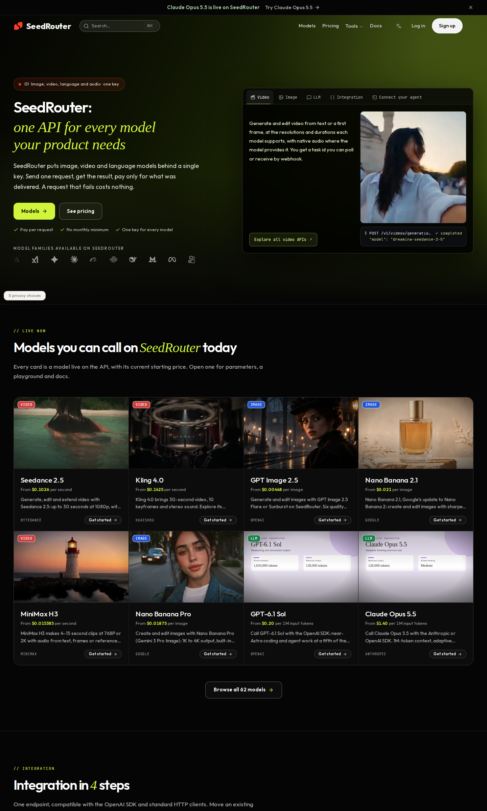
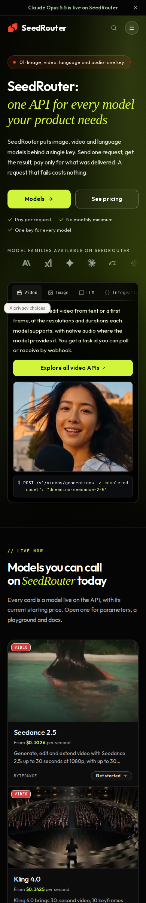

# UI Design System & Master Generation Blueprint: seedrouter-ai

> **SeedRouter · One API for Image, Video, LLM and Audio Models** (https://seedrouter.ai) — SeedRouter puts image, video, language and audio models behind one API key with pay-per-request billing. Failed requests cost nothing. Ge...



---

## 1. Executive Visual Persona & Design Archetype

- **Brand Essence & Persona**: **SeedRouter · One API for Image, Video, LLM and Audio Models** (`https://seedrouter.ai`). SeedRouter puts image, video, language and audio models behind one API key with pay-per-request billing. Failed requests cost nothing. Ge...
- **Capture Provenance**: Live browser capture (`tier1_fast`, HTTP `200`, captured `2026-11-23`).
- **Visual Archetype**: **Light-Substrate Editorial & Modular Grid System (`#f7f5f1` canvas, `#090e12` ink, `#d1f53b` accent)**.
- **Anti-AI-Slop Differentiators**:
  - **Live-Computed Chromatic Polarity**: Anchors the viewport in `#f7f5f1` (live computed `body` `background-color` (`computed_styles.json`)) paired with `#090e12` primary typography and `#d1f53b` accents.
  - **Grounded Typographic Hierarchy**: Pairs `Outfit` for display copy (`SeedRouter: one API for every model `) with `Outfit` and `JetBrains Mono`.
  - **Calibrated Spatial Grid & Motion**: Combines `96rem` container bounds (`gap: 20px`, padding `var(--card-spacing)`) with `cubic-bezier(0,0,.2,1)` easing and Three.js / WebGL Canvas Pipeline.

---

## 2. Spatial Architecture & Modular Grid Mathematics



### Viewport Allocation & Container Geometry
- **Captured Viewport Dimensions**: Desktop `1440×2400px` (`assets/desktop.png`, clamped at 2400px live multi-section capture), Mobile `390×2400px` (`assets/mobile.png`, clamped at 2400px live multi-section capture).
- **Master Container Bounds**: `96rem` (non-`@media` desktop container stylesheet rule).
- **Canvas Lateral Padding & Spacing**: `var(--card-spacing)` lateral canvas padding with `20px` grid gap.
- **Border Radius Scale**: `3.35544e+07px`, `var(--radius)`, `.25rem`, `var(--cell-radius)`.

### Responsive Breakpoint Architecture
- **Desktop Layout**: Multi-column CSS Grid / Flexbox layout at `1440px` (`max-width: 96rem`, `gap: 20px`).
- **Mobile Layout**: Single-column vertical stack at `390px` viewport width with `var(--card-spacing)` horizontal padding.
- **Extracted CSS Media Queries**: `@media (min-width:40rem)`, `@media (min-width:48rem)`, `@media (min-width:64rem)`, `@media (min-width:80rem)`.

---

## 3. Color System, Materiality & Atmospheric Lighting

### Semantic Palette & Source Grounding
| Semantic Role | Ground-Truth Value | Extracted Live / CSS Source |
|---|---|---|
| **Primary Canvas Substrate** | `#f7f5f1` | live computed `body` `background-color` (`computed_styles.json`) |
| **Primary Typography Ink** | `#090e12` | live computed `main` `color` (`computed_styles.json`) |
| **Elevated Surface / Card Substrate** | `#fffdf8` | `var(--card)` in `:root` |
| **Interactive Accent / Highlight** | `#d1f53b` | `var(--sr-hero-accent)` in `:root` |
| **Secondary / Muted Copy** | `#737373` | `var(--color-fd-muted-foreground)` in `:root` |
| **Structural Hairline Border** | `#e2ded4` | `var(--border)` in `:root` |
| **Variable Token (`--primary`)** | `#18763a` | `var(--primary)` in `:root` |
| **Variable Token (`--secondary`)** | `#ece8df` | `var(--secondary)` in `:root` |
| **Variable Token (`--muted`)** | `#f0ede6` | `var(--muted)` in `:root` |
| **Variable Token (`--muted-foreground`)** | `#6b6a63` | `var(--muted-foreground)` in `:root` |
| **Variable Token (`--destructive`)** | `#d92d20` | `var(--destructive)` in `:root` |
| **Variable Token (`--destructive-foreground`)** | `#ffffff` | `var(--destructive-foreground)` in `:root` |
| **Variable Token (`--input`)** | `#d3cec1` | `var(--input)` in `:root` |

### Sanitized Root CSS Variables (`ui-ux.md` Ground Truth)
| Variable Name | Extracted Value | Semantic Role |
|---|---|---|
| `--card` | `#fffdf8` | Color / Atmospheric Token |
| `--card-foreground` | `#090e12` | Typography Ink Token |
| `--popover` | `#fffdf8` | Color / Atmospheric Token |
| `--popover-foreground` | `#090e12` | Typography Ink Token |
| `--primary` | `#18763a` | Brand / Palette Token |
| `--primary-foreground` | `#f7f5f1` | Typography Ink Token |
| `--secondary` | `#ece8df` | Brand / Palette Token |
| `--secondary-foreground` | `#090e12` | Typography Ink Token |
| `--muted` | `#f0ede6` | Color / Atmospheric Token |
| `--muted-foreground` | `#6b6a63` | Typography Ink Token |
| `--accent` | `#f0ede6` | Brand / Palette Token |
| `--accent-foreground` | `#090e12` | Typography Ink Token |
| `--destructive` | `#d92d20` | Color / Atmospheric Token |
| `--destructive-foreground` | `#fff` | Typography Ink Token |
| `--border` | `#e2ded4` | Elevation / Border Token |
| `--input` | `#d3cec1` | Color / Atmospheric Token |

---

## 4. Typographic Scale & Editorial Hierarchy

### Font Family Stacks
- **Display Typography**: `Outfit`.
- **Primary Body Stack**: `Outfit`.
- **Technical / Metadata Stack**: `JetBrains Mono`.

### Typographic Scale & Rules (Live Computed & Stylesheet Grounded)
- **Hero Display (`H1`)**: live computed `h1` (`font-size: 44.64px`, `line-height: 50.8896px`, `font-weight: 600`, `letter-spacing: -1.7856px`); CSS variables `--text-4xl: 2.25rem`, `--text-4xl--line-height: calc(2.5 / 2.25)`, `--text-5xl: 3rem`; rule `h1` (`letter-spacing: -.025em`, `font-weight: 500`).
- **Section Heading (`H2`)**: live computed `h2` (`font-size: 40.32px`, `line-height: 44.352px`, `font-weight: 600`, `letter-spacing: -1.6128px`); CSS variables `--text-2xl: 1.5rem`, `--text-2xl--line-height: calc(2 / 1.5)`, `--text-3xl: 1.875rem`; rule `,h2` (`letter-spacing: -.02em`, `font-weight: 400`).
- **Body Copy**: live computed `body` (`font-size: 16px`, `line-height: 24px`, `font-weight: 400`); CSS variables `--font-body-ext: "Nunito Sans", "Nunito Sans Fallback"`, `--text-base: 1rem`, `--text-base--line-height: calc(1.5 / 1)`.
- **Metadata & Navigation Labels**: live computed `nav/a` (`font-size: 16px`, `line-height: 24px`, `font-weight: 400`); CSS variables `--font-mono: var(--font-mono-label)`, `--text-xs: .75rem`, `--text-xs--line-height: calc(1 / .75)`.

---

## 5. Choreographed Motion & Interaction Physics

### Primary Easing Curves
- **Extracted Timing Functions**: `cubic-bezier(0,0,.2,1)`, `cubic-bezier(.4,0,.2,1)`, `cubic-bezier(.22,1,.36,1)`.

### Per-Element Transition & Choreography Rules
- **Selector `layer theme`**: `transition: .15s` extracted from `seedrouter-ai` stylesheet.
- **Selector `.transition`**: `transition: var(--tw-ease,var(--default-transition-timing-function))` extracted from `seedrouter-ai` stylesheet.
- **Selector `transform\]`**: `transition: var(--tw-ease,var(--default-transition-timing-function))` extracted from `seedrouter-ai` stylesheet.
- **Extracted Easing Curve (`cubic-bezier(0,0,.2,1)`)**: Governs interactive state transitions across `<header.sr-chrome>` and `<section.pb-16>`.
- **Runtime Interaction Engine**: Integrates Three.js / WebGL Canvas Pipeline with `prefers-reduced-motion: reduce` fallback guards.

---

## 6. Component Wireframe & Structural DOM Map

### Visual Layout Schematic — Desktop (`1440px`, Grounded in `dom.html` & Landmark Bounding Boxes)
```
┌────────────────────────────────────────────────────────────────────────┐
│ DESKTOP VIEWPORT (1440px) — SeedRouter · One API for Image, Video, LLM │
│ ====================================================================== │
│ [ <header.sr-chrome> (1440x65px)      | SeedRouter · Models · Pricin ] │
│ ---------------------------------------------------------------------- │
│ | HERO STAGE: <section.sr-hero> (w=1440px)                           | │
│ | H1: SeedRouter: one API for every model your product...            | │
│ | Substrate: #f7f5f1 | Ink: #090e12 | Accent: #d1f53b                | │
│ ---------------------------------------------------------------------- │
│ | SHOWCASE GRID (<section.pb-16>) max-w: 96rem                       | │
│ | +------------------------------+  +------------------------------+ | │
│ | | Models you can call on SeedR |  | Integration in 4 steps       | | │
│ | +------------------------------+  +------------------------------+ | │
│ ---------------------------------------------------------------------- │
│ | DETAIL MODULE (<section.py-16>) — Create an API key                | │
│ ---------------------------------------------------------------------- │
│ [ FOOTER (<footer.sr-chrome-da) | https://seedrouter.ai                │
└────────────────────────────────────────────────────────────────────────┘
```

### Visual Layout Schematic — Mobile Reflow (`390px`)
```
┌────────────────────────────────────────────────────────────────────────┐
│ MOBILE VIEWPORT REFLOW (390px) — Single-Column Stack (gap: 20px)       │
│ ====================================================================== │
│ [ HEADER BAR (<header.sr-chrome>      ) | Compact Menu (390px)         │
│ ---------------------------------------------------------------------- │
│ | HERO STAGE (<section.sr-hero>) — 390px Vertical Lead               | │
│ | H1: SeedRouter: one API for every model your product...            | │
│ ---------------------------------------------------------------------- │
│ | SHOWCASE STACK (<section.pb-16>) — 1-Col Stack                     | │
│ | [ Item 1: Models you can call on SeedRouter today                ] | │
│ | [ Item 2: Integration in 4 steps                                 ] | │
│ ---------------------------------------------------------------------- │
│ | DETAIL STACK (<section.py-16>) — 1-Col (Create an API key)         | │
│ ---------------------------------------------------------------------- │
│ [ FOOTER (<footer.sr-chrome-da) | Stacked 390px Colophon               │
└────────────────────────────────────────────────────────────────────────┘
```

### Granular DOM Region Breakdown
1. **Brand Header & Navigation Bar (<header.sr-chrome> — `seedrouter-ai`)**:
   - Landmark `<header class="sr-chrome inset-x-0">` (`1440x65px`) hosting `SeedRouter · One API for Image, Vide` navigation (`SeedRouter · Models · Pricing · Docs · Sign up`), DOM attributes (`data-precedence="next"`, `data-precedence="next"`, `data-testid="announcement-dismiss"`, `data-nimg="1"`), and stylesheet rule `mono_744f2078-module__kLS_DW__cla... { font-family:JetBrains Mono,JetBrains Mono Fallback;font-style:normal }`.
2. **Hero Stage & Focal Lead (<section.sr-hero> — `SeedRouter: one API for every mode`)**:
   - Landmark `<section class="sr-hero sr-chrome-dark">` presenting display lead `SeedRouter: one API for every model your product...` and copy excerpt *"01 · Image, video, language and audio · one key"* over `#f7f5f1` canvas and `#090e12` ink.
3. **Primary Showcase & Content Grid (<section.pb-16> — `Models you can call on SeedRouter `)**:
   - Landmark `<section class="pb-16 pt-12">` rendering section `Models you can call on SeedRouter today` with copy *"Generate and edit video from text or a first frame, at the resolu"*, asset references (`0c8c4ded07fff55c-s.p.2tcyrya9o07v...`, `1b99372b3eaef0c8-s.p.1gsd1jahc5dg...`, `70bc3e132a0a741e-s.p.3t6q91iet4ns...`, `google.svg`), and grid rule `mono_744f2078-module__kLS_DW__var... { --font-code:"JetBrains Mono", "JetBrains Mono Fallback" }`.
4. **Interactive Detail & Feature Matrix (<section.py-16> — `Integration in 4 steps`)**:
   - Landmark `<section class="py-16">` framing `Integration in 4 steps` and `Create an API key` (*"$ POST /v1/videos/generations ✓ completed"*) with `#fffdf8` surface cards, `#d1f53b` accents, and `tfit_300d5b1f-module__eNyfuq__cla... { font-family:Outfit,Outfit Fallback;font-style:normal }`.
5. **Colophon & Global Directory Footer (<footer.sr-chrome-dark> — `https://seedrouter.ai`)**:
   - Landmark `<footer class="sr-chrome-dark relative">` anchoring `SeedRouter · One API for Image, ` footer links (`SeedRouter · Models · Pricing · Docs · Sign up`), copy *"$ POST /v1/videos/generations"*, and `#e2ded4` structural dividers.

---

## 7. Master Zero-Shot AI Generation Prompt

```markdown
# Master Zero-Shot Frontend Generation Prompt: seedrouter-ai (SeedRouter · One API for Image, Video, LLM and Audio Models)

You are a principal frontend architect and design systems engineer. Build a complete, production-ready web application replicating the exact design system, DOM landmarks, typographic hierarchy, color tokens, and motion physics of `seedrouter-ai` (**SeedRouter · One API for Image, Video, LLM and Audio Models** — `https://seedrouter.ai`).

### 1. Visual Archetype & Anti-AI-Slop Mandates
- **Archetype**: Light-Substrate Editorial & Modular Grid System (`#f7f5f1` canvas, `#090e12` ink, `#d1f53b` accent).
- **Identity & Domain Context**: SeedRouter puts image, video, language and audio models behind one API key with pay-per-request billing. Failed requests cost nothing. Ge...
- **Primary Substrate**: `#f7f5f1` (live computed `body` `background-color` (`computed_styles.json`)), **Primary Ink**: `#090e12`, **Accent / Highlight**: `#d1f53b`.
- **Site-Specific Differentiators**:
  - **Live-Computed Chromatic Polarity**: Anchors the viewport in `#f7f5f1` (live computed `body` `background-color` (`computed_styles.json`)) paired with `#090e12` primary typography and `#d1f53b` accents.
  - **Grounded Typographic Hierarchy**: Pairs `Outfit` for display copy (`SeedRouter: one API for every model `) with `Outfit` and `JetBrains Mono`.
  - **Calibrated Spatial Grid & Motion**: Combines `96rem` container bounds (`gap: 20px`, padding `var(--card-spacing)`) with `cubic-bezier(0,0,.2,1)` easing and Three.js / WebGL Canvas Pipeline.

### 2. Ground-Truth CSS Variables (`:root` Token Contract)
Declare and consume these exact custom properties extracted from `seedrouter-ai` in your global stylesheet:

:root {
  /* SeedRouter · One API for Image, Video, LLM and Audio Models (seedrouter-ai) — Live-Grounded CSS Variables */
  --card: #fffdf8; /* Color / Atmospheric Token (seedrouter-ai) */
  --card-foreground: #090e12; /* Typography Ink Token (seedrouter-ai) */
  --popover: #fffdf8; /* Color / Atmospheric Token (seedrouter-ai) */
  --popover-foreground: #090e12; /* Typography Ink Token (seedrouter-ai) */
  --primary: #18763a; /* Brand / Palette Token (seedrouter-ai) */
  --primary-foreground: #f7f5f1; /* Typography Ink Token (seedrouter-ai) */
  --secondary: #ece8df; /* Brand / Palette Token (seedrouter-ai) */
  --secondary-foreground: #090e12; /* Typography Ink Token (seedrouter-ai) */
  --muted: #f0ede6; /* Color / Atmospheric Token (seedrouter-ai) */
  --muted-foreground: #6b6a63; /* Typography Ink Token (seedrouter-ai) */
  --accent: #f0ede6; /* Brand / Palette Token (seedrouter-ai) */
  --accent-foreground: #090e12; /* Typography Ink Token (seedrouter-ai) */
  --destructive: #d92d20; /* Color / Atmospheric Token (seedrouter-ai) */
  --destructive-foreground: #fff; /* Typography Ink Token (seedrouter-ai) */
  --border: #e2ded4; /* Elevation / Border Token (seedrouter-ai) */
  --input: #d3cec1; /* Color / Atmospheric Token (seedrouter-ai) */
}

### 3. Semantic Color & Materiality Contract
Map every surface, ink, and border strictly to these source-grounded tokens:
- **Primary Canvas Substrate**: `#f7f5f1` — grounded in live computed `body` `background-color` (`computed_styles.json`)
- **Primary Typography Ink**: `#090e12` — grounded in live computed `main` `color` (`computed_styles.json`)
- **Elevated Surface / Card Substrate**: `#fffdf8` — grounded in `var(--card)` in `:root`
- **Interactive Accent / Highlight**: `#d1f53b` — grounded in `var(--sr-hero-accent)` in `:root`
- **Secondary / Muted Copy**: `#737373` — grounded in `var(--color-fd-muted-foreground)` in `:root`
- **Structural Hairline Border**: `#e2ded4` — grounded in `var(--border)` in `:root`
- **Variable Token (`--primary`)**: `#18763a` — grounded in `var(--primary)` in `:root`
- **Variable Token (`--secondary`)**: `#ece8df` — grounded in `var(--secondary)` in `:root`
- **Variable Token (`--muted`)**: `#f0ede6` — grounded in `var(--muted)` in `:root`
- **Variable Token (`--muted-foreground`)**: `#6b6a63` — grounded in `var(--muted-foreground)` in `:root`
- **Variable Token (`--destructive`)**: `#d92d20` — grounded in `var(--destructive)` in `:root`
- **Variable Token (`--destructive-foreground`)**: `#ffffff` — grounded in `var(--destructive-foreground)` in `:root`
- **Variable Token (`--input`)**: `#d3cec1` — grounded in `var(--input)` in `:root`

### 4. Spatial Grid, Container Bounds & Responsive Breakpoints
- **Desktop Viewport Reference**: `1440×2400px` (clamped at 2400px live multi-section capture, `1440px` standard desktop width).
- **Mobile Viewport Reference**: `390×2400px` (clamped at 2400px live multi-section capture, `390px` standard mobile width).
- **Container Max-Width**: `96rem` (non-`@media` desktop container stylesheet rule)
- **Padding & Gutters**: `var(--card-spacing)` lateral canvas padding with `20px` grid gap
- **Desktop Grid**: Multi-column CSS Grid / Flexbox layout at `1440px` (`max-width: 96rem`, `gap: 20px`)
- **Mobile Adaptation**: Single-column vertical stack at `390px` viewport width with `var(--card-spacing)` horizontal padding
- **Media Queries**: `@media (min-width:40rem)`, `@media (min-width:48rem)`, `@media (min-width:64rem)`, `@media (min-width:80rem)`
- **Corner Radii**: `3.35544e+07px`, `var(--radius)`, `.25rem`, `var(--cell-radius)`

### 5. Typography & Editorial Scale Contract
- **Display Font Stack**: `Outfit`
- **Body Font Stack**: `Outfit`
- **Monospace / Technical Font Stack**: `JetBrains Mono`
- **H1 Display Rule**: live computed `h1` (`font-size: 44.64px`, `line-height: 50.8896px`, `font-weight: 600`, `letter-spacing: -1.7856px`); CSS variables `--text-4xl: 2.25rem`, `--text-4xl--line-height: calc(2.5 / 2.25)`, `--text-5xl: 3rem`; rule `h1` (`letter-spacing: -.025em`, `font-weight: 500`)
- **H2 Section Rule**: live computed `h2` (`font-size: 40.32px`, `line-height: 44.352px`, `font-weight: 600`, `letter-spacing: -1.6128px`); CSS variables `--text-2xl: 1.5rem`, `--text-2xl--line-height: calc(2 / 1.5)`, `--text-3xl: 1.875rem`; rule `,h2` (`letter-spacing: -.02em`, `font-weight: 400`)
- **Body Copy Rule**: live computed `body` (`font-size: 16px`, `line-height: 24px`, `font-weight: 400`); CSS variables `--font-body-ext: "Nunito Sans", "Nunito Sans Fallback"`, `--text-base: 1rem`, `--text-base--line-height: calc(1.5 / 1)`
- **Metadata & Index Rule**: live computed `nav/a` (`font-size: 16px`, `line-height: 24px`, `font-weight: 400`); CSS variables `--font-mono: var(--font-mono-label)`, `--text-xs: .75rem`, `--text-xs--line-height: calc(1 / .75)`

### 6. Component Hierarchy, Verbatim Copy & Real DOM Landmarks
Scaffold `seedrouter-ai` (`SeedRouter · One API for Image, Video, LLM and Audio Models`) with these exact structural regions, extracted copy, and CSS rules from `dom.html`:
1. **Brand Header & Navigation Bar (<header.sr-chrome> — `seedrouter-ai`)**:
   - DOM & Selectors: Landmark `<header class="sr-chrome inset-x-0">` (`1440x65px`) hosting `SeedRouter · One API for Image, Vide` navigation (`SeedRouter · Models · Pricing · Docs · Sign up`), DOM attributes (`data-precedence="next"`, `data-precedence="next"`, `data-testid="announcement-dismiss"`, `data-nimg="1"`), and stylesheet rule `mono_744f2078-module__kLS_DW__cla... { font-family:JetBrains Mono,JetBrains Mono Fallback;font-style:normal }`.
   - Responsive Contract: Header `Brand Header & Navigation Bar (<header.sr-chrome> — `seedrouter-ai`)` (`seedrouter-ai`) adapts across `@media (min-width:40rem)`, `@media (min-width:48rem)`, `@media (min-width:64rem)`, `@media (min-width:80rem)` with `cubic-bezier(0,0,.2,1)`, `cubic-bezier(.4,0,.2,1)`, `cubic-bezier(.22,1,.36,1)` transitions and links `SeedRouter · Models · Pricing · Docs · Sign up`.
2. **Hero Stage & Focal Lead (<section.sr-hero> — `SeedRouter: one API for every mode`)**:
   - DOM & Selectors: Landmark `<section class="sr-hero sr-chrome-dark">` presenting display lead `SeedRouter: one API for every model your product...` and copy excerpt *"01 · Image, video, language and audio · one key"* over `#f7f5f1` canvas and `#090e12` ink.
   - Responsive Contract: Hero stage (`1440×2400px` desktop / `390×2400px` mobile) sets `#f7f5f1` background with `#090e12` headline `SeedRouter: one API for every model your product...`.
3. **Primary Showcase & Content Grid (<section.pb-16> — `Models you can call on SeedRouter `)**:
   - DOM & Selectors: Landmark `<section class="pb-16 pt-12">` rendering section `Models you can call on SeedRouter today` with copy *"Generate and edit video from text or a first frame, at the resolu"*, asset references (`0c8c4ded07fff55c-s.p.2tcyrya9o07v...`, `1b99372b3eaef0c8-s.p.1gsd1jahc5dg...`, `70bc3e132a0a741e-s.p.3t6q91iet4ns...`, `google.svg`), and grid rule `mono_744f2078-module__kLS_DW__var... { --font-code:"JetBrains Mono", "JetBrains Mono Fallback" }`.
   - Responsive Contract: Showcase grid `Primary Showcase & Content Grid (<section.pb-16> — `Models you can call on SeedRouter `)` applies Multi-column CSS Grid / Flexbox layout at `1440px` (`max-width: 96rem`, `gap: 20px`) on desktop and Single-column vertical stack at `390px` viewport width with `var(--card-spacing)` horizontal padding on mobile.
4. **Interactive Detail & Feature Matrix (<section.py-16> — `Integration in 4 steps`)**:
   - DOM & Selectors: Landmark `<section class="py-16">` framing `Integration in 4 steps` and `Create an API key` (*"$ POST /v1/videos/generations ✓ completed"*) with `#fffdf8` surface cards, `#d1f53b` accents, and `tfit_300d5b1f-module__eNyfuq__cla... { font-family:Outfit,Outfit Fallback;font-style:normal }`.
   - Responsive Contract: Detail module `Interactive Detail & Feature Matrix (<section.py-16> — `Integration in 4 steps`)` uses `3.35544e+07px`, `var(--radius)`, `.25rem`, `var(--cell-radius)` radii, `#d1f53b` highlights, and assets (0c8c4ded07fff55c-s.p.2tcyrya9o07v..., 1b99372b3eaef0c8-s.p.1gsd1jahc5dg..., 70bc3e132a0a741e-s.p.3t6q91iet4ns...).
5. **Colophon & Global Directory Footer (<footer.sr-chrome-dark> — `https://seedrouter.ai`)**:
   - DOM & Selectors: Landmark `<footer class="sr-chrome-dark relative">` anchoring `SeedRouter · One API for Image, ` footer links (`SeedRouter · Models · Pricing · Docs · Sign up`), copy *"$ POST /v1/videos/generations"*, and `#e2ded4` structural dividers.
   - Responsive Contract: Footer `Colophon & Global Directory Footer (<footer.sr-chrome-dark> — `https://seedrouter.ai`)` aligns to `96rem` (non-`@media` desktop container stylesheet rule) with `var(--card-spacing)` lateral canvas padding with `20px` grid gap and attributes (data-precedence="next", data-precedence="next", data-testid="announcement-dismiss").

#### Verbatim DOM Copy Excerpts (`dom.html`)
- Copy Excerpt 1: *"01 · Image, video, language and audio · one key"*
- Copy Excerpt 2: *"Generate and edit video from text or a first frame, at the resolutions and duratio..."*
- Copy Excerpt 3: *"$ POST /v1/videos/generations ✓ completed"*
- Copy Excerpt 4: *"$ POST /v1/videos/generations"*

### 7. Motion, Extracted Stylesheet Rules & Interaction Choreography
- **Primary Easing Functions**: `cubic-bezier(0,0,.2,1)`, `cubic-bezier(.4,0,.2,1)`, `cubic-bezier(.22,1,.36,1)`
- **Extracted Stylesheet Rules (`seedrouter-ai`)**:
- `mono_744f2078-module__kLS_DW__cla... { font-family:JetBrains Mono,JetBrains Mono Fallback;font-style:normal }`
- `mono_744f2078-module__kLS_DW__var... { --font-code:"JetBrains Mono", "JetBrains Mono Fallback" }`
- `tfit_300d5b1f-module__eNyfuq__cla... { font-family:Outfit,Outfit Fallback;font-style:normal }`
- `utfit_300d5b1f-module__eNyfuq__va... { --font-outfit:"Outfit", "Outfit Fallback" }`
- `t323_f18b1ad5-module__HgsYcq__cla... { font-family:VT323,VT323 Fallback;font-style:normal;font-weight:400 }`
- **Per-Selector Transition Rules**:
- **Selector `layer theme`**: `transition: .15s` extracted from `seedrouter-ai` stylesheet.
- **Selector `.transition`**: `transition: var(--tw-ease,var(--default-transition-timing-function))` extracted from `seedrouter-ai` stylesheet.
- **Selector `transform\]`**: `transition: var(--tw-ease,var(--default-transition-timing-function))` extracted from `seedrouter-ai` stylesheet.
- **Extracted Easing Curve (`cubic-bezier(0,0,.2,1)`)**: Governs interactive state transitions across `<header.sr-chrome>` and `<section.pb-16>`.
- **Runtime Interaction Engine**: Integrates Three.js / WebGL Canvas Pipeline with `prefers-reduced-motion: reduce` fallback guards.

### 8. Technical Deliverables
- Implement in Next.js (App Router) with TypeScript and Tailwind CSS consuming the `:root` custom properties defined above for `seedrouter-ai`.
- Reproduce both the `1440px` desktop architecture and `390px` mobile breakpoint transitions, preserving semantic HTML5 landmarks (`<header>`, `<nav>`, `<main>`, `<section>`, `<footer>`) and `prefers-reduced-motion` accessibility guards.
```
