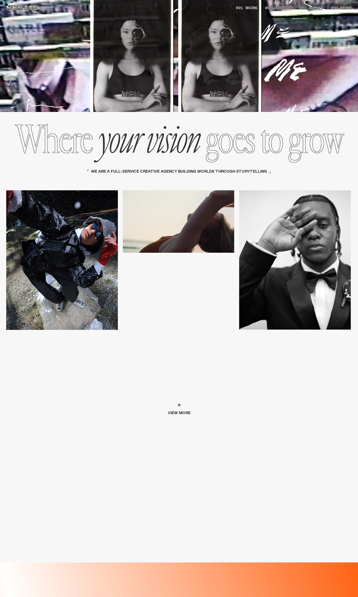
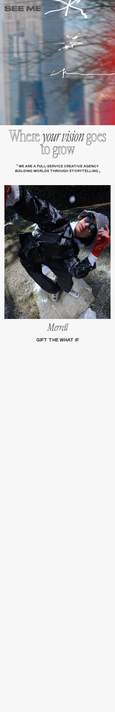

# UI Design System & Master Generation Blueprint: seemecreative-com

> **SEE ME Creative** (https://seemecreative.com/) — SEE ME emerged from the desire to forge a creative environment that reimagines the ways in which we tell, create, and share stories.



---

## 1. Executive Visual Persona & Design Archetype

- **Brand Essence & Persona**: **SEE ME Creative** (`https://seemecreative.com/`). SEE ME emerged from the desire to forge a creative environment that reimagines the ways in which we tell, create, and share stories.
- **Capture Provenance**: Live browser capture (`tier1_fast`, HTTP `200`, captured `2026-11-23`).
- **Visual Archetype**: **Light-Substrate Editorial & Modular Grid System (`#f8f7f7` canvas, `#333333` ink, `#ffa500` accent)**.
- **Anti-AI-Slop Differentiators**:
  - **Live-Computed Chromatic Polarity**: Anchors the viewport in `#f8f7f7` (live computed `html` `background-color` (`computed_styles.json`)) paired with `#333333` primary typography and `#ffa500` accents.
  - **Grounded Typographic Hierarchy**: Pairs `ABC Favorit` for display copy (`SEE ME Creative`) with `ABC Favorit` and `ABC Favorit Mono`.
  - **Calibrated Spatial Grid & Motion**: Combines `1440px` container bounds (`gap: 20px`, padding `25px`) with `cubic-bezier(0.4,0,0.2,1)` easing.

---

## 2. Spatial Architecture & Modular Grid Mathematics



### Viewport Allocation & Container Geometry
- **Captured Viewport Dimensions**: Desktop `1440×2400px` (`assets/desktop.png`, clamped at 2400px live multi-section capture), Mobile `390×2400px` (`assets/mobile.png`, clamped at 2400px live multi-section capture).
- **Master Container Bounds**: `1440px` (full-bleed `100%` desktop stage measured on `1440px` viewport).
- **Canvas Lateral Padding & Spacing**: `25px` lateral canvas padding with `20px` grid gap.
- **Border Radius Scale**: `2px`, `15px`.

### Responsive Breakpoint Architecture
- **Desktop Layout**: Multi-column CSS Grid / Flexbox layout at `1440px` (`max-width: 1440px`, `gap: 20px`).
- **Mobile Layout**: Single-column vertical stack at `390px` viewport width with `25px` horizontal padding.
- **Extracted CSS Media Queries**: `@media only screen and (min-width:1800px)`, `@media only screen and (max-width:1024px)`, `@media only screen and (max-width:850px)`, `@media only screen and (max-width:1799px)`.

---

## 3. Color System, Materiality & Atmospheric Lighting

### Semantic Palette & Source Grounding
| Semantic Role | Ground-Truth Value | Extracted Live / CSS Source |
|---|---|---|
| **Primary Canvas Substrate** | `#f8f7f7` | live computed `html` `background-color` (`computed_styles.json`) |
| **Primary Typography Ink** | `#333333` | live computed `h1` `color` (`computed_styles.json`) |
| **Elevated Surface / Card Substrate** | `#ffffff` | `:after { background-color: #ffffff }` |
| **Interactive Accent / Highlight** | `#ffa500` | `.menu a.router-link-active .index { color: orange }` (`#ffa500`) |
| **Secondary / Muted Copy** | `#ffa500` | `.glyph { color: orange }` (`#ffa500`) |
| **Structural Hairline Border** | `#ffa500` | hairline divider derived from `.glyph { color: orange }` (`#ffa500`) |
| **Variable Token (`--color-black`)** | `#000000` | `var(--color-black)` in `:root` |
| **Variable Token (`--color-gray`)** | `#b2b2b2` | `var(--color-gray)` in `:root` |
| **Variable Token (`--color-orange`)** | `#ff5600` | `var(--color-orange)` in `:root` |
| **Variable Token (`--color-orange-inverse`)** | `#00a9ff` | `var(--color-orange-inverse)` in `:root` |
| **Variable Token (`--color-off-white`)** | `#f9f3f2` | `var(--color-off-white)` in `:root` |

### Sanitized Root CSS Variables (`ui-ux.md` Ground Truth)
| Variable Name | Extracted Value | Semantic Role |
|---|---|---|
| `--color-white` | `#f8f7f7` | Canvas / Surface Token |
| `--color-black` | `#000` | Canvas / Surface Token |
| `--color-gray` | `#b2b2b2` | Brand / Palette Token |
| `--color-charcoal` | `#333` | Brand / Palette Token |
| `--color-orange` | `#ff5600` | Brand / Palette Token |
| `--color-orange-inverse` | `#00a9ff` | Brand / Palette Token |
| `--color-off-white` | `#f9f3f2` | Canvas / Surface Token |
| `--color-white-inverse` | `#f8f7f7` | Canvas / Surface Token |
| `--unit-100vh` | `100vh` | Layout / Spatial Grid Token |
| `--unit-gap` | `25px` | Layout / Spatial Grid Token |
| `--unit-max-width` | `1800px` | Layout / Spatial Grid Token |
| `--unit-header-height` | `66px` | Layout / Spatial Grid Token |
| `--font-primary` | `"ABC Favorit",sans-serif` | Brand / Palette Token |
| `--font-secondary` | `"Cardinal Fruit Web",serif` | Brand / Palette Token |
| `--font-tertiary` | `"ABC Favorit Mono",monospace` | Typography / Scale Token |
| `--easing-motion` | `cubic-bezier(0.4,0,0.2,1)` | Motion / Easing Token |

---

## 4. Typographic Scale & Editorial Hierarchy

### Font Family Stacks
- **Display Typography**: `ABC Favorit`.
- **Primary Body Stack**: `ABC Favorit`.
- **Technical / Metadata Stack**: `ABC Favorit Mono`.

### Typographic Scale & Rules (Live Computed & Stylesheet Grounded)
- **Hero Display (`H1`)**: live computed `h1` (`font-size: 32px`, `line-height: normal`, `font-weight: 400`).
- **Section Heading (`H2`)**: live computed `h2` (`font-size: 50px`, `line-height: 45px`, `font-weight: 400`).
- **Body Copy**: live computed `body` (`font-size: 16px`, `line-height: normal`, `font-weight: 400`); rule `p` (`font-size: 18px`, `line-height: 130%`, `font-weight: 400`).
- **Metadata & Navigation Labels**: live computed `nav/a` (`font-size: 16px`, `line-height: normal`, `font-weight: 400`); CSS variables `--unit-margin-small: 10px`, `--unit-max-width-small: 680px`.

---

## 5. Choreographed Motion & Interaction Physics

### Primary Easing Curves
- **Extracted Timing Functions**: `cubic-bezier(0.4,0,0.2,1)`.

### Per-Element Transition & Choreography Rules
- **Selector `.page-error .message .link[data-v...`**: `transition: color .2s var(--easing-motion)` extracted from `seemecreative-com` stylesheet.
- **Selector `.block-work .meta[data-v-40ec51fd]`**: `transition: opacity .4s var(--easing-motion)` extracted from `seemecreative-com` stylesheet.
- **Selector `.block-work .image[data-v-40ec51fd]`**: `transition: all .2s var(--easing-motion)` extracted from `seemecreative-com` stylesheet.
- **Extracted Easing Curve (`cubic-bezier(0.4,0,0.2,1)`)**: Governs interactive state transitions across `<header.global-header>` and `<section.page-home>`.
- **State & Hover Choreography**: Opacity and transform transitions on `<section.page>` and `<section.page-home>` interactive targets.

---

## 6. Component Wireframe & Structural DOM Map

### Visual Layout Schematic — Desktop (`1440px`, Grounded in `dom.html` & Landmark Bounding Boxes)
```
┌────────────────────────────────────────────────────────────────────────┐
│ DESKTOP VIEWPORT (1440px) — SEE ME Creative                            │
│ ====================================================================== │
│ [ <header.global-header> (1440x66px)  | 001 Work · 002 Artists · 003 ] │
│ ---------------------------------------------------------------------- │
│ | HERO STAGE: <section.page> (w=1440px)                              | │
│ | H1: SEE ME Creative                                                | │
│ | Substrate: #f8f7f7 | Ink: #333333 | Accent: #ffa500                | │
│ ---------------------------------------------------------------------- │
│ | SHOWCASE GRID (<section.page-home>) max-w: 1440px                  | │
│ | +------------------------------+  +------------------------------+ | │
│ | | Where your vision goes to gr |  | WE ARE A FULL-SERVICE CREATI | | │
│ | +------------------------------+  +------------------------------+ | │
│ ---------------------------------------------------------------------- │
│ | DETAIL MODULE (<section.page:nth(2)>) — 「 WE ARE A FULL-SERVI      | │
│ ---------------------------------------------------------------------- │
│ [ FOOTER (<footer.wp-seo>     ) | https://seemecreative.com/           │
└────────────────────────────────────────────────────────────────────────┘
```

### Visual Layout Schematic — Mobile Reflow (`390px`)
```
┌────────────────────────────────────────────────────────────────────────┐
│ MOBILE VIEWPORT REFLOW (390px) — Single-Column Stack (gap: 20px)       │
│ ====================================================================== │
│ [ HEADER BAR (<header.global-header>  ) | Compact Menu (390px)         │
│ ---------------------------------------------------------------------- │
│ | HERO STAGE (<section.page>) — 390px Vertical Lead                  | │
│ | H1: SEE ME Creative                                                | │
│ ---------------------------------------------------------------------- │
│ | SHOWCASE STACK (<section.page-home>) — 1-Col Stack                 | │
│ | [ Item 1: Where your vision goes to grow                         ] | │
│ | [ Item 2: WE ARE A FULL-SERVICE CREATIVE AGENCY BUILDING WO...   ] | │
│ ---------------------------------------------------------------------- │
│ | DETAIL STACK (<section.page:nth(2)>) — 1-Col (「 WE ARE A FULL-SE)  | │
│ ---------------------------------------------------------------------- │
│ [ FOOTER (<footer.wp-seo>     ) | Stacked 390px Colophon               │
└────────────────────────────────────────────────────────────────────────┘
```

### Granular DOM Region Breakdown
1. **Brand Header & Navigation Bar (<header.global-header> — `seemecreative-com`)**:
   - Landmark `<header class="global-header header">` (`1440x66px`) hosting `SEE ME Creative` navigation (`001 Work · 002 Artists · 003 About · 004 News`), DOM attributes (`data-capo`, `data-v-344bacdf`, `data-v-bd05448e`, `data-v-61c5c60e`), and stylesheet rule `before { background-color:ff7e26;mix-blend-mode:color;z-index:200 }`.
2. **Hero Stage & Focal Lead (<section.page> — `SEE ME Creative`)**:
   - Landmark `<section class="page page-home">` presenting display lead `SEE ME Creative` and copy excerpt *"sayhello@seemecreative.com"* over `#f8f7f7` canvas and `#333333` ink.
3. **Primary Showcase & Content Grid (<section.page-home> — `Where your vision goes to grow`)**:
   - Landmark `<section class="page page-home">` rendering section `Where your vision goes to grow` with copy *"SEE ME Creative"*, asset references (`entry.BKkY1yHX.css`, `wp-image.abO9u4pg.css`, `grid-work.Dsp1qX9O.css`, `grid-masonry.BnNvLTuH.css`), and grid rule `after { background-color:fff;z-index:100 }`.
4. **Interactive Detail & Feature Matrix (<section.page:nth(2)> — `WE ARE A FULL-SERVICE CREATIVE AGE`)**:
   - Landmark `<section class="page page-home">` framing `WE ARE A FULL-SERVICE CREATIVE AGENCY BUILDING WO...` and `「 WE ARE A FULL-SERVICE CREATIVE AGENCY BUILDING...` (*"Where your vision goes to grow"*) with `#ffffff` surface cards, `#ffa500` accents, and `.item { width:calc(33% - 10px) }`.
5. **Colophon & Global Directory Footer (<footer.wp-seo> — `https://seemecreative.com/`)**:
   - Landmark `<footer class="wp-seo">` anchoring `SEE ME Creative` footer links (`001 Work · 002 Artists · 003 About · 004 News`), copy *"WE ARE A FULL-SERVICE CREATIVE AGENCY BUILDING WO..."*, and `#ffa500` structural dividers.

---

## 7. Master Zero-Shot AI Generation Prompt

```markdown
# Master Zero-Shot Frontend Generation Prompt: seemecreative-com (SEE ME Creative)

You are a principal frontend architect and design systems engineer. Build a complete, production-ready web application replicating the exact design system, DOM landmarks, typographic hierarchy, color tokens, and motion physics of `seemecreative-com` (**SEE ME Creative** — `https://seemecreative.com/`).

### 1. Visual Archetype & Anti-AI-Slop Mandates
- **Archetype**: Light-Substrate Editorial & Modular Grid System (`#f8f7f7` canvas, `#333333` ink, `#ffa500` accent).
- **Identity & Domain Context**: SEE ME emerged from the desire to forge a creative environment that reimagines the ways in which we tell, create, and share stories.
- **Primary Substrate**: `#f8f7f7` (live computed `html` `background-color` (`computed_styles.json`)), **Primary Ink**: `#333333`, **Accent / Highlight**: `#ffa500`.
- **Site-Specific Differentiators**:
  - **Live-Computed Chromatic Polarity**: Anchors the viewport in `#f8f7f7` (live computed `html` `background-color` (`computed_styles.json`)) paired with `#333333` primary typography and `#ffa500` accents.
  - **Grounded Typographic Hierarchy**: Pairs `ABC Favorit` for display copy (`SEE ME Creative`) with `ABC Favorit` and `ABC Favorit Mono`.
  - **Calibrated Spatial Grid & Motion**: Combines `1440px` container bounds (`gap: 20px`, padding `25px`) with `cubic-bezier(0.4,0,0.2,1)` easing.

### 2. Ground-Truth CSS Variables (`:root` Token Contract)
Declare and consume these exact custom properties extracted from `seemecreative-com` in your global stylesheet:

:root {
  /* SEE ME Creative (seemecreative-com) — Live-Grounded CSS Variables */
  --color-white: #f8f7f7; /* Canvas / Surface Token (seemecreative-com) */
  --color-black: #000; /* Canvas / Surface Token (seemecreative-com) */
  --color-gray: #b2b2b2; /* Brand / Palette Token (seemecreative-com) */
  --color-charcoal: #333; /* Brand / Palette Token (seemecreative-com) */
  --color-orange: #ff5600; /* Brand / Palette Token (seemecreative-com) */
  --color-orange-inverse: #00a9ff; /* Brand / Palette Token (seemecreative-com) */
  --color-off-white: #f9f3f2; /* Canvas / Surface Token (seemecreative-com) */
  --color-white-inverse: #f8f7f7; /* Canvas / Surface Token (seemecreative-com) */
  --unit-100vh: 100vh; /* Layout / Spatial Grid Token (seemecreative-com) */
  --unit-gap: 25px; /* Layout / Spatial Grid Token (seemecreative-com) */
  --unit-max-width: 1800px; /* Layout / Spatial Grid Token (seemecreative-com) */
  --unit-header-height: 66px; /* Layout / Spatial Grid Token (seemecreative-com) */
  --font-primary: "ABC Favorit",sans-serif; /* Brand / Palette Token (seemecreative-com) */
  --font-secondary: "Cardinal Fruit Web",serif; /* Brand / Palette Token (seemecreative-com) */
  --font-tertiary: "ABC Favorit Mono",monospace; /* Typography / Scale Token (seemecreative-com) */
  --easing-motion: cubic-bezier(0.4,0,0.2,1); /* Motion / Easing Token (seemecreative-com) */
}

### 3. Semantic Color & Materiality Contract
Map every surface, ink, and border strictly to these source-grounded tokens:
- **Primary Canvas Substrate**: `#f8f7f7` — grounded in live computed `html` `background-color` (`computed_styles.json`)
- **Primary Typography Ink**: `#333333` — grounded in live computed `h1` `color` (`computed_styles.json`)
- **Elevated Surface / Card Substrate**: `#ffffff` — grounded in `:after { background-color: #ffffff }`
- **Interactive Accent / Highlight**: `#ffa500` — grounded in `.menu a.router-link-active .index { color: orange }` (`#ffa500`)
- **Secondary / Muted Copy**: `#ffa500` — grounded in `.glyph { color: orange }` (`#ffa500`)
- **Structural Hairline Border**: `#ffa500` — grounded in hairline divider derived from `.glyph { color: orange }` (`#ffa500`)
- **Variable Token (`--color-black`)**: `#000000` — grounded in `var(--color-black)` in `:root`
- **Variable Token (`--color-gray`)**: `#b2b2b2` — grounded in `var(--color-gray)` in `:root`
- **Variable Token (`--color-orange`)**: `#ff5600` — grounded in `var(--color-orange)` in `:root`
- **Variable Token (`--color-orange-inverse`)**: `#00a9ff` — grounded in `var(--color-orange-inverse)` in `:root`
- **Variable Token (`--color-off-white`)**: `#f9f3f2` — grounded in `var(--color-off-white)` in `:root`

### 4. Spatial Grid, Container Bounds & Responsive Breakpoints
- **Desktop Viewport Reference**: `1440×2400px` (clamped at 2400px live multi-section capture, `1440px` standard desktop width).
- **Mobile Viewport Reference**: `390×2400px` (clamped at 2400px live multi-section capture, `390px` standard mobile width).
- **Container Max-Width**: `1440px` (full-bleed `100%` desktop stage measured on `1440px` viewport)
- **Padding & Gutters**: `25px` lateral canvas padding with `20px` grid gap
- **Desktop Grid**: Multi-column CSS Grid / Flexbox layout at `1440px` (`max-width: 1440px`, `gap: 20px`)
- **Mobile Adaptation**: Single-column vertical stack at `390px` viewport width with `25px` horizontal padding
- **Media Queries**: `@media only screen and (min-width:1800px)`, `@media only screen and (max-width:1024px)`, `@media only screen and (max-width:850px)`, `@media only screen and (max-width:1799px)`
- **Corner Radii**: `2px`, `15px`

### 5. Typography & Editorial Scale Contract
- **Display Font Stack**: `ABC Favorit`
- **Body Font Stack**: `ABC Favorit`
- **Monospace / Technical Font Stack**: `ABC Favorit Mono`
- **H1 Display Rule**: live computed `h1` (`font-size: 32px`, `line-height: normal`, `font-weight: 400`)
- **H2 Section Rule**: live computed `h2` (`font-size: 50px`, `line-height: 45px`, `font-weight: 400`)
- **Body Copy Rule**: live computed `body` (`font-size: 16px`, `line-height: normal`, `font-weight: 400`); rule `p` (`font-size: 18px`, `line-height: 130%`, `font-weight: 400`)
- **Metadata & Index Rule**: live computed `nav/a` (`font-size: 16px`, `line-height: normal`, `font-weight: 400`); CSS variables `--unit-margin-small: 10px`, `--unit-max-width-small: 680px`

### 6. Component Hierarchy, Verbatim Copy & Real DOM Landmarks
Scaffold `seemecreative-com` (`SEE ME Creative`) with these exact structural regions, extracted copy, and CSS rules from `dom.html`:
1. **Brand Header & Navigation Bar (<header.global-header> — `seemecreative-com`)**:
   - DOM & Selectors: Landmark `<header class="global-header header">` (`1440x66px`) hosting `SEE ME Creative` navigation (`001 Work · 002 Artists · 003 About · 004 News`), DOM attributes (`data-capo`, `data-v-344bacdf`, `data-v-bd05448e`, `data-v-61c5c60e`), and stylesheet rule `before { background-color:ff7e26;mix-blend-mode:color;z-index:200 }`.
   - Responsive Contract: Header `Brand Header & Navigation Bar (<header.global-header> — `seemecreative-com`)` (`seemecreative-com`) adapts across `@media only screen and (min-width:1800px)`, `@media only screen and (max-width:1024px)`, `@media only screen and (max-width:850px)`, `@media only screen and (max-width:1799px)` with `cubic-bezier(0.4,0,0.2,1)` transitions and links `001 Work · 002 Artists · 003 About · 004 News`.
2. **Hero Stage & Focal Lead (<section.page> — `SEE ME Creative`)**:
   - DOM & Selectors: Landmark `<section class="page page-home">` presenting display lead `SEE ME Creative` and copy excerpt *"sayhello@seemecreative.com"* over `#f8f7f7` canvas and `#333333` ink.
   - Responsive Contract: Hero stage (`1440×2400px` desktop / `390×2400px` mobile) sets `#f8f7f7` background with `#333333` headline `SEE ME Creative`.
3. **Primary Showcase & Content Grid (<section.page-home> — `Where your vision goes to grow`)**:
   - DOM & Selectors: Landmark `<section class="page page-home">` rendering section `Where your vision goes to grow` with copy *"SEE ME Creative"*, asset references (`entry.BKkY1yHX.css`, `wp-image.abO9u4pg.css`, `grid-work.Dsp1qX9O.css`, `grid-masonry.BnNvLTuH.css`), and grid rule `after { background-color:fff;z-index:100 }`.
   - Responsive Contract: Showcase grid `Primary Showcase & Content Grid (<section.page-home> — `Where your vision goes to grow`)` applies Multi-column CSS Grid / Flexbox layout at `1440px` (`max-width: 1440px`, `gap: 20px`) on desktop and Single-column vertical stack at `390px` viewport width with `25px` horizontal padding on mobile.
4. **Interactive Detail & Feature Matrix (<section.page:nth(2)> — `WE ARE A FULL-SERVICE CREATIVE AGE`)**:
   - DOM & Selectors: Landmark `<section class="page page-home">` framing `WE ARE A FULL-SERVICE CREATIVE AGENCY BUILDING WO...` and `「 WE ARE A FULL-SERVICE CREATIVE AGENCY BUILDING...` (*"Where your vision goes to grow"*) with `#ffffff` surface cards, `#ffa500` accents, and `.item { width:calc(33% - 10px) }`.
   - Responsive Contract: Detail module `Interactive Detail & Feature Matrix (<section.page:nth(2)> — `WE ARE A FULL-SERVICE CREATIVE AGE`)` uses `2px`, `15px` radii, `#ffa500` highlights, and assets (entry.BKkY1yHX.css, wp-image.abO9u4pg.css, grid-work.Dsp1qX9O.css).
5. **Colophon & Global Directory Footer (<footer.wp-seo> — `https://seemecreative.com/`)**:
   - DOM & Selectors: Landmark `<footer class="wp-seo">` anchoring `SEE ME Creative` footer links (`001 Work · 002 Artists · 003 About · 004 News`), copy *"WE ARE A FULL-SERVICE CREATIVE AGENCY BUILDING WO..."*, and `#ffa500` structural dividers.
   - Responsive Contract: Footer `Colophon & Global Directory Footer (<footer.wp-seo> — `https://seemecreative.com/`)` aligns to `1440px` (full-bleed `100%` desktop stage measured on `1440px` viewport) with `25px` lateral canvas padding with `20px` grid gap and attributes (data-capo, data-v-344bacdf, data-v-bd05448e).

#### Verbatim DOM Copy Excerpts (`dom.html`)
- Copy Excerpt 1: *"sayhello@seemecreative.com"*

### 7. Motion, Extracted Stylesheet Rules & Interaction Choreography
- **Primary Easing Functions**: `cubic-bezier(0.4,0,0.2,1)`
- **Extracted Stylesheet Rules (`seemecreative-com`)**:
- `before { background-color:ff7e26;mix-blend-mode:color;z-index:200 }`
- `after { background-color:fff;z-index:100 }`
- `.item { width:calc(33% - 10px) }`
- `.gutter-sizer { width:20px }`
- `last-of-type { margin-right:0 }`
- **Per-Selector Transition Rules**:
- **Selector `.page-error .message .link[data-v...`**: `transition: color .2s var(--easing-motion)` extracted from `seemecreative-com` stylesheet.
- **Selector `.block-work .meta[data-v-40ec51fd]`**: `transition: opacity .4s var(--easing-motion)` extracted from `seemecreative-com` stylesheet.
- **Selector `.block-work .image[data-v-40ec51fd]`**: `transition: all .2s var(--easing-motion)` extracted from `seemecreative-com` stylesheet.
- **Extracted Easing Curve (`cubic-bezier(0.4,0,0.2,1)`)**: Governs interactive state transitions across `<header.global-header>` and `<section.page-home>`.
- **State & Hover Choreography**: Opacity and transform transitions on `<section.page>` and `<section.page-home>` interactive targets.

### 8. Technical Deliverables
- Implement in Next.js (App Router) with TypeScript and Tailwind CSS consuming the `:root` custom properties defined above for `seemecreative-com`.
- Reproduce both the `1440px` desktop architecture and `390px` mobile breakpoint transitions, preserving semantic HTML5 landmarks (`<header>`, `<nav>`, `<main>`, `<section>`, `<footer>`) and `prefers-reduced-motion` accessibility guards.
```
