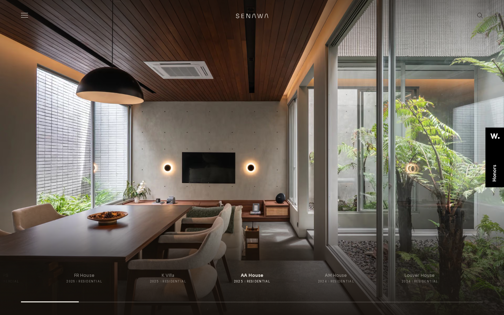
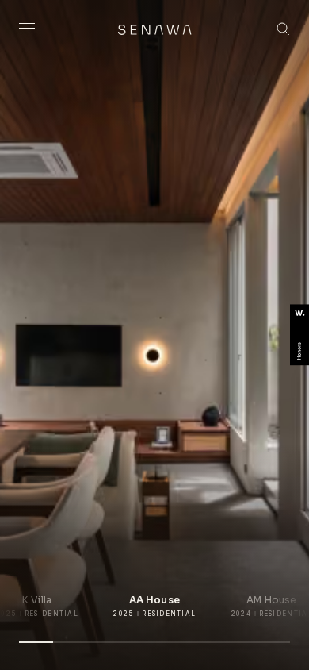

# UI Design System & Master Generation Blueprint: senawastudio-com

> **Senawa · Architecture & Interior Design Studio in Jakarta** (https://senawastudio.com) — Architecture made for how people actually live. An architecture, interior, and furniture design studio in the Greater Jakarta area.



---

## 1. Executive Visual Persona & Design Archetype

- **Brand Essence & Persona**: **Senawa · Architecture & Interior Design Studio in Jakarta** (`https://senawastudio.com`). Architecture made for how people actually live. An architecture, interior, and furniture design studio in the Greater Jakarta area.
- **Capture Provenance**: Live browser capture (`tier1_fast`, HTTP `200`, captured `2026-11-23`).
- **Visual Archetype**: **Light-Substrate Editorial & Modular Grid System (`#f6f2eb` canvas, `#302620` ink, `#8a5a2b` accent)**.
- **Anti-AI-Slop Differentiators**:
  - **Live-Computed Chromatic Polarity**: Anchors the viewport in `#f6f2eb` (live computed `body` `background-color` (`computed_styles.json`)) paired with `#302620` primary typography and `#8a5a2b` accents.
  - **Grounded Typographic Hierarchy**: Pairs `Sora` for display copy (`Senawa, Architecture & Interior Desi`) with `Inter` and not declared in live computed styles (uses primary stack / `ui-monospace`).
  - **Calibrated Spatial Grid & Motion**: Combines `1480px` container bounds (`gap: 16px`, padding `48px`) with `cubic-bezier(.4,0,.2,1)` easing.

---

## 2. Spatial Architecture & Modular Grid Mathematics



### Viewport Allocation & Container Geometry
- **Captured Viewport Dimensions**: Desktop `1440×900px` (`assets/desktop.png`, single-viewport 100vh live capture (900px)), Mobile `390×844px` (`assets/mobile.png`, single-viewport 100vh live capture (844px)).
- **Master Container Bounds**: `1480px` (non-`@media` desktop container stylesheet rule).
- **Canvas Lateral Padding & Spacing**: `48px` lateral canvas padding with `16px` grid gap.
- **Border Radius Scale**: `2px`, `3px`, `var(--radius-sm)`, `var(--radius-md)`.

### Responsive Breakpoint Architecture
- **Desktop Layout**: Multi-column CSS Grid / Flexbox layout at `1440px` (`max-width: 1480px`, `gap: 16px`).
- **Mobile Layout**: Single-column vertical stack at `390px` viewport width with `48px` horizontal padding.
- **Extracted CSS Media Queries**: `@media (prefers-reduced-motion:reduce)`, `@media (min-width:1024px) and (max-height:860px)`, `@media (max-width:1023px)`, `@media (max-width:767px)`.

---

## 3. Color System, Materiality & Atmospheric Lighting

### Semantic Palette & Source Grounding
| Semantic Role | Ground-Truth Value | Extracted Live / CSS Source |
|---|---|---|
| **Primary Canvas Substrate** | `#f6f2eb` | live computed `body` `background-color` (`computed_styles.json`) |
| **Primary Typography Ink** | `#302620` | live computed `h1` `color` (`computed_styles.json`) |
| **Elevated Surface / Card Substrate** | `#302620` | live computed `main` `background-color` (`computed_styles.json`) |
| **Interactive Accent / Highlight** | `#8a5a2b` | `var(--umber)` in `:root` |
| **Secondary / Muted Copy** | `#302620` | secondary opacity step of live computed `h1` `color` (`computed_styles.json`) |
| **Structural Hairline Border** | `#dcd2bf` | `var(--rule-light)` in `:root` |
| **Variable Token (`--linen`)** | `#ede6d8` | `var(--linen)` in `:root` |
| **Variable Token (`--sand`)** | `#d4c9b4` | `var(--sand)` in `:root` |
| **Variable Token (`--oak`)** | `#a8967e` | `var(--oak)` in `:root` |
| **Variable Token (`--walnut`)** | `#6b5a48` | `var(--walnut)` in `:root` |
| **Variable Token (`--lichen`)** | `#4a5247` | `var(--lichen)` in `:root` |
| **Variable Token (`--flax`)** | `#8c7b5c` | `var(--flax)` in `:root` |

### Sanitized Root CSS Variables (`ui-ux.md` Ground Truth)
| Variable Name | Extracted Value | Semantic Role |
|---|---|---|
| `--wool` | `#f6f2eb` | Color / Atmospheric Token |
| `--linen` | `#ede6d8` | Color / Atmospheric Token |
| `--sand` | `#d4c9b4` | Color / Atmospheric Token |
| `--oak` | `#a8967e` | Color / Atmospheric Token |
| `--walnut` | `#6b5a48` | Color / Atmospheric Token |
| `--slate` | `#302620` | Color / Atmospheric Token |
| `--lichen` | `#4a5247` | Color / Atmospheric Token |
| `--flax` | `#8c7b5c` | Color / Atmospheric Token |
| `--color-bg` | `var(--wool)` | Canvas / Surface Token |
| `--color-text` | `var(--slate)` | Typography Ink Token |
| `--color-text-sub` | `var(--slate)` | Typography Ink Token |
| `--color-text-caption` | `var(--slate)` | Typography Ink Token |
| `--color-border` | `var(--sand)` | Brand / Palette Token |
| `--font-body` | `var(--font-sans), "Inter", "Helvetica Neue", sans-serif` | Typography / Scale Token |
| `--font-display` | `var(--font-sora), "Sora", var(--font-sans), "Helvetica Neue", sans-serif` | Typography / Scale Token |
| `--font-accent` | `var(--font-sora), "Sora", var(--font-sans), "Helvetica Neue", sans-serif` | Brand / Palette Token |

---

## 4. Typographic Scale & Editorial Hierarchy

### Font Family Stacks
- **Display Typography**: `Sora`.
- **Primary Body Stack**: `Inter`.
- **Technical / Metadata Stack**: not declared in live computed styles (uses primary stack / `ui-monospace`).

### Typographic Scale & Rules (Live Computed & Stylesheet Grounded)
- **Hero Display (`H1`)**: live computed `h1` (`font-size: 31.5px`, `line-height: 37.8px`, `font-weight: 300`, `letter-spacing: -0.315px`); CSS variables `--font-display: var(--font-sora), "Sora", var(--font-sans), "Helvetica Neue", sans-serif`.
- **Section Heading (`H2`)**: observed font-size ladder: `31.5px`, `14px`, `12px`, `13.3333px`, `10px`.
- **Body Copy**: live computed `body` (`font-size: 14px`, `line-height: 24.5px`, `font-weight: 300`); CSS variables `--font-body: var(--font-sans), "Inter", "Helvetica Neue", sans-serif`, `--leading-body: 1.75`; rule `p` (`font-size: clamp(.9375rem,1vw,1.0625rem)`, `line-height: var(--leading-body)`, `font-weight: 300`).
- **Metadata & Navigation Labels**: live computed `nav/a` (`font-size: 14px`, `line-height: 24.5px`, `font-weight: 300`).

---

## 5. Choreographed Motion & Interaction Physics

### Primary Easing Curves
- **Extracted Timing Functions**: `cubic-bezier(.4,0,.2,1)`, `cubic-bezier(.33,1,.68,1)`, `cubic-bezier(.5,1,.89,1)`.

### Per-Element Transition & Choreography Rules
- **Selector `.PageTransition-module__kKDxmW__c...`**: `transition: opacity .45s cubic-bezier(.4,0,.2,1)` extracted from `senawastudio-com` stylesheet.
- **Selector `.PageTransition-module__kKDxmW__r...`**: `transition: opacity .55s cubic-bezier(.4,0,.2,1)` extracted from `senawastudio-com` stylesheet.
- **Selector `.PageTransition-module__kKDxmW__mark`**: `transition: opacity .45s cubic-bezier(.4,0,.2,1),transform .45s cubic-bezi...` extracted from `senawastudio-com` stylesheet.
- **Extracted Easing Curve (`cubic-bezier(.4,0,.2,1)`)**: Governs interactive state transitions across `<nav.Nav-module__bLoQaq__nav>` and `<section.skip-link>`.
- **State & Hover Choreography**: Opacity and transform transitions on `<section.antialiased>` and `<section.skip-link>` interactive targets.

---

## 6. Component Wireframe & Structural DOM Map

### Visual Layout Schematic — Desktop (`1440px`, Grounded in `dom.html` & Landmark Bounding Boxes)
```
┌────────────────────────────────────────────────────────────────────────┐
│ DESKTOP VIEWPORT (1440px) — Senawa · Architecture & Interior Design St │
│ ====================================================================== │
│ [ <nav.Nav-module__bLoQa (1440x88px)  | Overview · Index · Archive · ] │
│ ---------------------------------------------------------------------- │
│ | HERO STAGE: <section.antialiased> (w=1440px)                       | │
│ | H1: Senawa, Architecture & Interior Design Studio in...            | │
│ | Substrate: #f6f2eb | Ink: #302620 | Accent: #8a5a2b                | │
│ ---------------------------------------------------------------------- │
│ | SHOWCASE GRID (<section.skip-link>) max-w: 1480px                  | │
│ | +------------------------------+  +------------------------------+ | │
│ | | AA House, Residential, 2025  |  | BSD, Tangerang Selatan       | | │
│ | +------------------------------+  +------------------------------+ | │
│ ---------------------------------------------------------------------- │
│ | DETAIL MODULE (<section.Nav-module__bLoQa) — Residential · 2025    | │
│ ---------------------------------------------------------------------- │
│ [ FOOTER (<footer.Nav-module__) | https://senawastudio.com             │
└────────────────────────────────────────────────────────────────────────┘
```

### Visual Layout Schematic — Mobile Reflow (`390px`)
```
┌────────────────────────────────────────────────────────────────────────┐
│ MOBILE VIEWPORT REFLOW (390px) — Single-Column Stack (gap: 16px)       │
│ ====================================================================== │
│ [ HEADER BAR (<nav.Nav-module__bLoQaq_) | Compact Menu (390px)         │
│ ---------------------------------------------------------------------- │
│ | HERO STAGE (<section.antialiased>) — 390px Vertical Lead           | │
│ | H1: Senawa, Architecture & Interior Design Studio in...            | │
│ ---------------------------------------------------------------------- │
│ | SHOWCASE STACK (<section.skip-link>) — 1-Col Stack                 | │
│ | [ Item 1: AA House, Residential, 2025 (1 of 8)                   ] | │
│ | [ Item 2: BSD, Tangerang Selatan                                 ] | │
│ ---------------------------------------------------------------------- │
│ | DETAIL STACK (<section.Nav-module__bLo) — 1-Col (Residential · 2025) │
│ ---------------------------------------------------------------------- │
│ [ FOOTER (<footer.Nav-module__) | Stacked 390px Colophon               │
└────────────────────────────────────────────────────────────────────────┘
```

### Granular DOM Region Breakdown
1. **Brand Header & Navigation Bar (<nav.Nav-module__bLoQaq__nav> — `senawastudio-com`)**:
   - Landmark `<nav class="Nav-module__bLoQaq__nav Nav-module__bLoQaq__navHome">` (`1440x88px`) hosting `Senawa · Architecture & Interior Des` navigation (`Overview · Index · Archive · About · Contact`), DOM attributes (`data-precedence="next"`, `data-href="/_next/static/chunks/..."`, `data-active`, `data-hero`), and stylesheet rule `nter_c21b1aaa-module__0pqmKW__cla... { font-family:Inter,Inter Fallback;font-style:normal }`.
2. **Hero Stage & Focal Lead (<section.antialiased> — `Senawa, Architecture & Interior De`)**:
   - Landmark `<section class="antialiased">` presenting display lead `Senawa, Architecture & Interior Design Studio in...` and copy excerpt *"AA House, Residential, 2025 (1 of 8)"* over `#f6f2eb` canvas and `#302620` ink.
3. **Primary Showcase & Content Grid (<section.skip-link> — `AA House, Residential, 2025 (1 of `)**:
   - Landmark `<section class="skip-link">` rendering section `AA House, Residential, 2025 (1 of 8)` with copy *"BSD, Tangerang Selatan"*, asset references (`clarity.js`, `xmr8ny30a5`, `0ha4m18glnjqn.js`, `3r7r9eemmq-97.js`), and grid rule `inter_c21b1aaa-module__0pqmKW__va... { --font-sans:"Inter", "Inter Fallback" }`.
4. **Interactive Detail & Feature Matrix (<section.Nav-module__bLoQaq__nav> — `BSD, Tangerang Selatan`)**:
   - Landmark `<section class="Nav-module__bLoQaq__nav">` framing `BSD, Tangerang Selatan` and `Residential · 2025` (*"Residential · 2025"*) with `#302620` surface cards, `#8a5a2b` accents, and `sora_2a023f4c-module__BGqKYq__cla... { font-family:Sora,Sora Fallback;font-style:normal }`.
5. **Colophon & Global Directory Footer (<footer.Nav-module__bLoQaq__navHome> — `https://senawastudio.com`)**:
   - Landmark `<footer class="Nav-module__bLoQaq__navHome">` anchoring `Senawa · Architecture & Interior` footer links (`Overview · Index · Archive · About · Contact`), copy *"Louver House Giriloka"*, and `#dcd2bf` structural dividers.

---

## 7. Master Zero-Shot AI Generation Prompt

```markdown
# Master Zero-Shot Frontend Generation Prompt: senawastudio-com (Senawa · Architecture & Interior Design Studio in Jakarta)

You are a principal frontend architect and design systems engineer. Build a complete, production-ready web application replicating the exact design system, DOM landmarks, typographic hierarchy, color tokens, and motion physics of `senawastudio-com` (**Senawa · Architecture & Interior Design Studio in Jakarta** — `https://senawastudio.com`).

### 1. Visual Archetype & Anti-AI-Slop Mandates
- **Archetype**: Light-Substrate Editorial & Modular Grid System (`#f6f2eb` canvas, `#302620` ink, `#8a5a2b` accent).
- **Identity & Domain Context**: Architecture made for how people actually live. An architecture, interior, and furniture design studio in the Greater Jakarta area.
- **Primary Substrate**: `#f6f2eb` (live computed `body` `background-color` (`computed_styles.json`)), **Primary Ink**: `#302620`, **Accent / Highlight**: `#8a5a2b`.
- **Site-Specific Differentiators**:
  - **Live-Computed Chromatic Polarity**: Anchors the viewport in `#f6f2eb` (live computed `body` `background-color` (`computed_styles.json`)) paired with `#302620` primary typography and `#8a5a2b` accents.
  - **Grounded Typographic Hierarchy**: Pairs `Sora` for display copy (`Senawa, Architecture & Interior Desi`) with `Inter` and not declared in live computed styles (uses primary stack / `ui-monospace`).
  - **Calibrated Spatial Grid & Motion**: Combines `1480px` container bounds (`gap: 16px`, padding `48px`) with `cubic-bezier(.4,0,.2,1)` easing.

### 2. Ground-Truth CSS Variables (`:root` Token Contract)
Declare and consume these exact custom properties extracted from `senawastudio-com` in your global stylesheet:

:root {
  /* Senawa · Architecture & Interior Design Studio in Jakarta (senawastudio-com) — Live-Grounded CSS Variables */
  --wool: #f6f2eb; /* Color / Atmospheric Token (senawastudio-com) */
  --linen: #ede6d8; /* Color / Atmospheric Token (senawastudio-com) */
  --sand: #d4c9b4; /* Color / Atmospheric Token (senawastudio-com) */
  --oak: #a8967e; /* Color / Atmospheric Token (senawastudio-com) */
  --walnut: #6b5a48; /* Color / Atmospheric Token (senawastudio-com) */
  --slate: #302620; /* Color / Atmospheric Token (senawastudio-com) */
  --lichen: #4a5247; /* Color / Atmospheric Token (senawastudio-com) */
  --flax: #8c7b5c; /* Color / Atmospheric Token (senawastudio-com) */
  --color-bg: var(--wool); /* Canvas / Surface Token (senawastudio-com) */
  --color-text: var(--slate); /* Typography Ink Token (senawastudio-com) */
  --color-text-sub: var(--slate); /* Typography Ink Token (senawastudio-com) */
  --color-text-caption: var(--slate); /* Typography Ink Token (senawastudio-com) */
  --color-border: var(--sand); /* Brand / Palette Token (senawastudio-com) */
  --font-body: var(--font-sans), "Inter", "Helvetica Neue", sans-serif; /* Typography / Scale Token (senawastudio-com) */
  --font-display: var(--font-sora), "Sora", var(--font-sans), "Helvetica Neue", sans-serif; /* Typography / Scale Token (senawastudio-com) */
  --font-accent: var(--font-sora), "Sora", var(--font-sans), "Helvetica Neue", sans-serif; /* Brand / Palette Token (senawastudio-com) */
}

### 3. Semantic Color & Materiality Contract
Map every surface, ink, and border strictly to these source-grounded tokens:
- **Primary Canvas Substrate**: `#f6f2eb` — grounded in live computed `body` `background-color` (`computed_styles.json`)
- **Primary Typography Ink**: `#302620` — grounded in live computed `h1` `color` (`computed_styles.json`)
- **Elevated Surface / Card Substrate**: `#302620` — grounded in live computed `main` `background-color` (`computed_styles.json`)
- **Interactive Accent / Highlight**: `#8a5a2b` — grounded in `var(--umber)` in `:root`
- **Secondary / Muted Copy**: `#302620` — grounded in secondary opacity step of live computed `h1` `color` (`computed_styles.json`)
- **Structural Hairline Border**: `#dcd2bf` — grounded in `var(--rule-light)` in `:root`
- **Variable Token (`--linen`)**: `#ede6d8` — grounded in `var(--linen)` in `:root`
- **Variable Token (`--sand`)**: `#d4c9b4` — grounded in `var(--sand)` in `:root`
- **Variable Token (`--oak`)**: `#a8967e` — grounded in `var(--oak)` in `:root`
- **Variable Token (`--walnut`)**: `#6b5a48` — grounded in `var(--walnut)` in `:root`
- **Variable Token (`--lichen`)**: `#4a5247` — grounded in `var(--lichen)` in `:root`
- **Variable Token (`--flax`)**: `#8c7b5c` — grounded in `var(--flax)` in `:root`

### 4. Spatial Grid, Container Bounds & Responsive Breakpoints
- **Desktop Viewport Reference**: `1440×900px` (single-viewport 100vh live capture (900px), `1440px` standard desktop width).
- **Mobile Viewport Reference**: `390×844px` (single-viewport 100vh live capture (844px), `390px` standard mobile width).
- **Container Max-Width**: `1480px` (non-`@media` desktop container stylesheet rule)
- **Padding & Gutters**: `48px` lateral canvas padding with `16px` grid gap
- **Desktop Grid**: Multi-column CSS Grid / Flexbox layout at `1440px` (`max-width: 1480px`, `gap: 16px`)
- **Mobile Adaptation**: Single-column vertical stack at `390px` viewport width with `48px` horizontal padding
- **Media Queries**: `@media (prefers-reduced-motion:reduce)`, `@media (min-width:1024px) and (max-height:860px)`, `@media (max-width:1023px)`, `@media (max-width:767px)`
- **Corner Radii**: `2px`, `3px`, `var(--radius-sm)`, `var(--radius-md)`

### 5. Typography & Editorial Scale Contract
- **Display Font Stack**: `Sora`
- **Body Font Stack**: `Inter`
- **Monospace / Technical Font Stack**: not declared in live computed styles (uses primary stack / `ui-monospace`)
- **H1 Display Rule**: live computed `h1` (`font-size: 31.5px`, `line-height: 37.8px`, `font-weight: 300`, `letter-spacing: -0.315px`); CSS variables `--font-display: var(--font-sora), "Sora", var(--font-sans), "Helvetica Neue", sans-serif`
- **H2 Section Rule**: observed font-size ladder: `31.5px`, `14px`, `12px`, `13.3333px`, `10px`
- **Body Copy Rule**: live computed `body` (`font-size: 14px`, `line-height: 24.5px`, `font-weight: 300`); CSS variables `--font-body: var(--font-sans), "Inter", "Helvetica Neue", sans-serif`, `--leading-body: 1.75`; rule `p` (`font-size: clamp(.9375rem,1vw,1.0625rem)`, `line-height: var(--leading-body)`, `font-weight: 300`)
- **Metadata & Index Rule**: live computed `nav/a` (`font-size: 14px`, `line-height: 24.5px`, `font-weight: 300`)

### 6. Component Hierarchy, Verbatim Copy & Real DOM Landmarks
Scaffold `senawastudio-com` (`Senawa · Architecture & Interior Design Studio in Jakarta`) with these exact structural regions, extracted copy, and CSS rules from `dom.html`:
1. **Brand Header & Navigation Bar (<nav.Nav-module__bLoQaq__nav> — `senawastudio-com`)**:
   - DOM & Selectors: Landmark `<nav class="Nav-module__bLoQaq__nav Nav-module__bLoQaq__navHome">` (`1440x88px`) hosting `Senawa · Architecture & Interior Des` navigation (`Overview · Index · Archive · About · Contact`), DOM attributes (`data-precedence="next"`, `data-href="/_next/static/chunks/..."`, `data-active`, `data-hero`), and stylesheet rule `nter_c21b1aaa-module__0pqmKW__cla... { font-family:Inter,Inter Fallback;font-style:normal }`.
   - Responsive Contract: Header `Brand Header & Navigation Bar (<nav.Nav-module__bLoQaq__nav> — `senawastudio-com`)` (`senawastudio-com`) adapts across `@media (prefers-reduced-motion:reduce)`, `@media (min-width:1024px) and (max-height:860px)`, `@media (max-width:1023px)`, `@media (max-width:767px)` with `cubic-bezier(.4,0,.2,1)`, `cubic-bezier(.33,1,.68,1)`, `cubic-bezier(.5,1,.89,1)` transitions and links `Overview · Index · Archive · About · Contact`.
2. **Hero Stage & Focal Lead (<section.antialiased> — `Senawa, Architecture & Interior De`)**:
   - DOM & Selectors: Landmark `<section class="antialiased">` presenting display lead `Senawa, Architecture & Interior Design Studio in...` and copy excerpt *"AA House, Residential, 2025 (1 of 8)"* over `#f6f2eb` canvas and `#302620` ink.
   - Responsive Contract: Hero stage (`1440×900px` desktop / `390×844px` mobile) sets `#f6f2eb` background with `#302620` headline `Senawa, Architecture & Interior Design Studio in...`.
3. **Primary Showcase & Content Grid (<section.skip-link> — `AA House, Residential, 2025 (1 of `)**:
   - DOM & Selectors: Landmark `<section class="skip-link">` rendering section `AA House, Residential, 2025 (1 of 8)` with copy *"BSD, Tangerang Selatan"*, asset references (`clarity.js`, `xmr8ny30a5`, `0ha4m18glnjqn.js`, `3r7r9eemmq-97.js`), and grid rule `inter_c21b1aaa-module__0pqmKW__va... { --font-sans:"Inter", "Inter Fallback" }`.
   - Responsive Contract: Showcase grid `Primary Showcase & Content Grid (<section.skip-link> — `AA House, Residential, 2025 (1 of `)` applies Multi-column CSS Grid / Flexbox layout at `1440px` (`max-width: 1480px`, `gap: 16px`) on desktop and Single-column vertical stack at `390px` viewport width with `48px` horizontal padding on mobile.
4. **Interactive Detail & Feature Matrix (<section.Nav-module__bLoQaq__nav> — `BSD, Tangerang Selatan`)**:
   - DOM & Selectors: Landmark `<section class="Nav-module__bLoQaq__nav">` framing `BSD, Tangerang Selatan` and `Residential · 2025` (*"Residential · 2025"*) with `#302620` surface cards, `#8a5a2b` accents, and `sora_2a023f4c-module__BGqKYq__cla... { font-family:Sora,Sora Fallback;font-style:normal }`.
   - Responsive Contract: Detail module `Interactive Detail & Feature Matrix (<section.Nav-module__bLoQaq__nav> — `BSD, Tangerang Selatan`)` uses `2px`, `3px`, `var(--radius-sm)`, `var(--radius-md)` radii, `#8a5a2b` highlights, and assets (clarity.js, xmr8ny30a5, 0ha4m18glnjqn.js).
5. **Colophon & Global Directory Footer (<footer.Nav-module__bLoQaq__navHome> — `https://senawastudio.com`)**:
   - DOM & Selectors: Landmark `<footer class="Nav-module__bLoQaq__navHome">` anchoring `Senawa · Architecture & Interior` footer links (`Overview · Index · Archive · About · Contact`), copy *"Louver House Giriloka"*, and `#dcd2bf` structural dividers.
   - Responsive Contract: Footer `Colophon & Global Directory Footer (<footer.Nav-module__bLoQaq__navHome> — `https://senawastudio.com`)` aligns to `1480px` (non-`@media` desktop container stylesheet rule) with `48px` lateral canvas padding with `16px` grid gap and attributes (data-precedence="next", data-href="/_next/static/chunks/...", data-active).

#### Verbatim DOM Copy Excerpts (`dom.html`)
- Copy Excerpt 1: *"AA House, Residential, 2025 (1 of 8)"*
- Copy Excerpt 2: *"BSD, Tangerang Selatan"*
- Copy Excerpt 3: *"Residential · 2025"*
- Copy Excerpt 4: *"Louver House Giriloka"*

### 7. Motion, Extracted Stylesheet Rules & Interaction Choreography
- **Primary Easing Functions**: `cubic-bezier(.4,0,.2,1)`, `cubic-bezier(.33,1,.68,1)`, `cubic-bezier(.5,1,.89,1)`
- **Extracted Stylesheet Rules (`senawastudio-com`)**:
- `nter_c21b1aaa-module__0pqmKW__cla... { font-family:Inter,Inter Fallback;font-style:normal }`
- `inter_c21b1aaa-module__0pqmKW__va... { --font-sans:"Inter", "Inter Fallback" }`
- `sora_2a023f4c-module__BGqKYq__cla... { font-family:Sora,Sora Fallback;font-style:normal }`
- `.sora_2a023f4c-module__BGqKYq__va... { --font-sora:"Sora", "Sora Fallback" }`
- `PageTransition-module__kKDxmW__co... { opacity:1;visibility:visible;pointer-events:auto;transition:opacity .45s... }`
- **Per-Selector Transition Rules**:
- **Selector `.PageTransition-module__kKDxmW__c...`**: `transition: opacity .45s cubic-bezier(.4,0,.2,1)` extracted from `senawastudio-com` stylesheet.
- **Selector `.PageTransition-module__kKDxmW__r...`**: `transition: opacity .55s cubic-bezier(.4,0,.2,1)` extracted from `senawastudio-com` stylesheet.
- **Selector `.PageTransition-module__kKDxmW__mark`**: `transition: opacity .45s cubic-bezier(.4,0,.2,1),transform .45s cubic-bezi...` extracted from `senawastudio-com` stylesheet.
- **Extracted Easing Curve (`cubic-bezier(.4,0,.2,1)`)**: Governs interactive state transitions across `<nav.Nav-module__bLoQaq__nav>` and `<section.skip-link>`.
- **State & Hover Choreography**: Opacity and transform transitions on `<section.antialiased>` and `<section.skip-link>` interactive targets.

### 8. Technical Deliverables
- Implement in Next.js (App Router) with TypeScript and Tailwind CSS consuming the `:root` custom properties defined above for `senawastudio-com`.
- Reproduce both the `1440px` desktop architecture and `390px` mobile breakpoint transitions, preserving semantic HTML5 landmarks (`<header>`, `<nav>`, `<main>`, `<section>`, `<footer>`) and `prefers-reduced-motion` accessibility guards.
```
