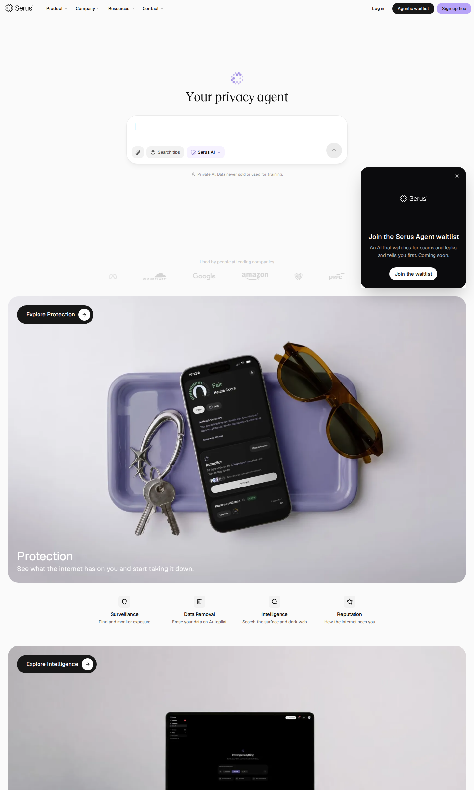
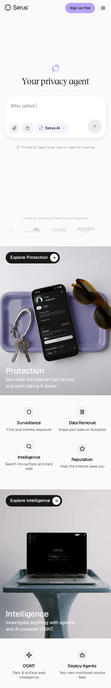

# UI Design System & Master Generation Blueprint: serus-ai

> **Serus — Agentic Privacy & Intelligence** (https://serus.ai/) — Your own privacy agent: finds what's exposed, removes it, watches for more and lets you check who you're dealing with. Protection and int...



---

## 1. Executive Visual Persona & Design Archetype

- **Brand Essence & Persona**: **Serus — Agentic Privacy & Intelligence** (`https://serus.ai/`). Your own privacy agent: finds what's exposed, removes it, watches for more and lets you check who you're dealing with. Protection and int...
- **Final Redirected URL**: [https://www.serus.ai/](https://www.serus.ai/)
- **Capture Provenance**: Live browser capture (`tier1_fast`, HTTP `200`, captured `2026-11-23`).
- **Visual Archetype**: **Light-Gallery WebGL / Canvas Interactive Experience (`#fafafa` / `#800080`)**.
- **Anti-AI-Slop Differentiators**:
  - **Live-Computed Chromatic Polarity**: Anchors the viewport in `#fafafa` (live computed `body` `background-color` (`computed_styles.json`)) paired with `#0d0d0d` primary typography and `#800080` accents.
  - **Grounded Typographic Hierarchy**: Pairs `Reckless` for display copy (`Your privacy agent`) with `Geist Variable` and `Geist Mono Variable`.
  - **Calibrated Spatial Grid & Motion**: Combines `96rem` container bounds (`gap: 8px`, padding `24px`) with `cubic-bezier(.4,0,1,1)` easing and HTML5 `<canvas>` Interactive Viewport Surface.

---

## 2. Spatial Architecture & Modular Grid Mathematics



### Viewport Allocation & Container Geometry
- **Captured Viewport Dimensions**: Desktop `1440×2400px` (`assets/desktop.png`, clamped at 2400px live multi-section capture), Mobile `390×2400px` (`assets/mobile.png`, clamped at 2400px live multi-section capture).
- **Master Container Bounds**: `96rem` (non-`@media` desktop container stylesheet rule).
- **Canvas Lateral Padding & Spacing**: `24px` lateral canvas padding with `8px` grid gap.
- **Border Radius Scale**: `9999px`, `.25rem`, `1rem`, `var(--radius-md)`.

### Responsive Breakpoint Architecture
- **Desktop Layout**: Multi-column CSS Grid / Flexbox layout at `1440px` (`max-width: 96rem`, `gap: 8px`).
- **Mobile Layout**: Single-column vertical stack at `390px` viewport width with `24px` horizontal padding.
- **Extracted CSS Media Queries**: `@media (width<=639px)`, `@media not all and (width>=40rem)`, `@media (width>=40rem)`, `@media (width>=48rem)`.

---

## 3. Color System, Materiality & Atmospheric Lighting

### Semantic Palette & Source Grounding
| Semantic Role | Ground-Truth Value | Extracted Live / CSS Source |
|---|---|---|
| **Primary Canvas Substrate** | `#fafafa` | live computed `body` `background-color` (`computed_styles.json`) |
| **Primary Typography Ink** | `#0d0d0d` | live computed `h1` `color` (`computed_styles.json`) |
| **Elevated Surface / Card Substrate** | `#ffffff` | `var(--color-paper)` in `:root` |
| **Interactive Accent / Highlight** | `#800080` | `.btn-brand { background: purple }` (`#800080`) |
| **Secondary / Muted Copy** | `#ffffff` | live computed `h2` `color` (`computed_styles.json`) |
| **Structural Hairline Border** | `#e2e2e2` | `var(--color-sds-border-default)` in `:root` (`0d0d0d1a`) |
| **Variable Token (`--dither-fill`)** | `#ebebeb` | `var(--dither-fill)` in `:root` |

### Sanitized Root CSS Variables (`ui-ux.md` Ground Truth)
| Variable Name | Extracted Value | Semantic Role |
|---|---|---|
| `--dither-fill` | `#ebebeb` | Color / Atmospheric Token |
| `--chart-1` | `oklch(32% 0 none)` | Color / Atmospheric Token |
| `--chart-2` | `oklch(41% 0 none)` | Color / Atmospheric Token |
| `--chart-3` | `oklch(54% 0 none)` | Color / Atmospheric Token |
| `--chart-4` | `oklch(71% 0 none)` | Color / Atmospheric Token |
| `--chart-5` | `oklch(89% 0 none)` | Color / Atmospheric Token |
| `--chart-background` | `oklch(100% 0 0)` | Canvas / Surface Token |
| `--chart-foreground` | `oklch(14.5% .004 285)` | Typography Ink Token |
| `--chart-foreground-muted` | `oklch(55% .014 260)` | Typography Ink Token |
| `--chart-line-primary` | `var(--chart-1)` | Brand / Palette Token |
| `--chart-line-secondary` | `var(--chart-2)` | Brand / Palette Token |
| `--chart-crosshair` | `oklch(40% .1828 274.34)` | Color / Atmospheric Token |
| `--chart-grid` | `oklch(90% 0 0)` | Layout / Spatial Grid Token |
| `--chart-brush-border` | `var(--chart-grid)` | Elevation / Border Token |
| `--chart-tooltip-background` | `oklch(100% 0 0/.92)` | Canvas / Surface Token |
| `--chart-tooltip-foreground` | `oklch(21% 0 0)` | Typography Ink Token |

---

## 4. Typographic Scale & Editorial Hierarchy

### Font Family Stacks
- **Display Typography**: `Reckless`.
- **Primary Body Stack**: `Geist Variable`.
- **Technical / Metadata Stack**: `Geist Mono Variable`.

### Typographic Scale & Rules (Live Computed & Stylesheet Grounded)
- **Hero Display (`H1`)**: live computed `h1` (`font-size: 40px`, `line-height: 46px`, `font-weight: 400`, `letter-spacing: -0.7px`).
- **Section Heading (`H2`)**: live computed `h2` (`font-size: 36px`, `line-height: 41.4px`, `font-weight: 500`, `letter-spacing: -0.72px`); CSS variables `--text-2xl: 1.5rem`, `--text-2xl--line-height: calc(2 / 1.5)`; rule `h2` (`font-size: 30px`, `line-height: 40px`, `letter-spacing: -.6px`).
- **Body Copy**: live computed `body` (`font-size: 16px`, `line-height: 24px`, `font-weight: 400`); CSS variables `--text-base: 1rem`, `--text-base--line-height: calc(1.5 / 1)`; rule `p` (`line-height: 1.625`).
- **Metadata & Navigation Labels**: live computed `nav/a` (`font-size: 16px`, `line-height: 24px`, `font-weight: 400`); CSS variables `--chart-label: oklch(45% .01 260)`, `--font-mono: "Geist Mono Variable", ui-monospace, monospace`, `--text-xs: .75rem`.

---

## 5. Choreographed Motion & Interaction Physics

### Primary Easing Curves
- **Extracted Timing Functions**: `cubic-bezier(.4,0,1,1)`, `cubic-bezier(0,0,.2,1)`, `cubic-bezier(.4,0,.2,1)`.

### Per-Element Transition & Choreography Rules
- **Selector `layer theme`**: `transition: .15s` extracted from `serus-ai` stylesheet.
- **Selector `.btn-xl`**: `transition: background-color .15s,color .15s,transform .15s` extracted from `serus-ai` stylesheet.
- **Selector `a.bt-name`**: `transition: var(--tw-ease,var(--default-transition-timing-function))` extracted from `serus-ai` stylesheet.
- **Extracted Easing Curve (`cubic-bezier(.4,0,1,1)`)**: Governs interactive state transitions across `<header.top-0>` and `<section.flex-col>`.
- **Runtime Interaction Engine**: Integrates HTML5 `<canvas>` Interactive Viewport Surface with `prefers-reduced-motion: reduce` fallback guards.

---

## 6. Component Wireframe & Structural DOM Map

### Visual Layout Schematic — Desktop (`1440px`, Grounded in `dom.html` & Landmark Bounding Boxes)
```
┌────────────────────────────────────────────────────────────────────────┐
│ DESKTOP VIEWPORT (1440px) — Serus — Agentic Privacy & Intelligence     │
│ ====================================================================== │
│ [ <header.top-0> (1440x52px)          | People Meet the team · Blog  ] │
│ ---------------------------------------------------------------------- │
│ | HERO STAGE: <section.prot-hero> (w=1440px)                         | │
│ | H1: Your privacy agent                                             | │
│ | Substrate: #fafafa | Ink: #0d0d0d | Accent: #800080                | │
│ ---------------------------------------------------------------------- │
│ | SHOWCASE GRID (<section.flex-col>) max-w: 96rem                    | │
│ | +------------------------------+  +------------------------------+ | │
│ | | Y o u r p r i v a c y a g e  |  | What to search               | | │
│ | +------------------------------+  +------------------------------+ | │
│ ---------------------------------------------------------------------- │
│ | DETAIL MODULE (<section.pt-12>) — Surveillance                     | │
│ ---------------------------------------------------------------------- │
│ [ FOOTER (<footer.pb-6>       ) | https://serus.ai/                    │
└────────────────────────────────────────────────────────────────────────┘
```

### Visual Layout Schematic — Mobile Reflow (`390px`)
```
┌────────────────────────────────────────────────────────────────────────┐
│ MOBILE VIEWPORT REFLOW (390px) — Single-Column Stack (gap: 8px)        │
│ ====================================================================== │
│ [ HEADER BAR (<header.top-0>          ) | Compact Menu (390px)         │
│ ---------------------------------------------------------------------- │
│ | HERO STAGE (<section.prot-hero>) — 390px Vertical Lead             | │
│ | H1: Your privacy agent                                             | │
│ ---------------------------------------------------------------------- │
│ | SHOWCASE STACK (<section.flex-col>) — 1-Col Stack                  | │
│ | [ Item 1: Y o u r p r i v a c y a g e n t                        ] | │
│ | [ Item 2: What to search                                         ] | │
│ ---------------------------------------------------------------------- │
│ | DETAIL STACK (<section.pt-12>) — 1-Col (Surveillance)              | │
│ ---------------------------------------------------------------------- │
│ [ FOOTER (<footer.pb-6>       ) | Stacked 390px Colophon               │
└────────────────────────────────────────────────────────────────────────┘
```

### Granular DOM Region Breakdown
1. **Brand Header & Navigation Bar (<header.top-0> — `serus-ai`)**:
   - Landmark `<header class="top-0 bg-background-canvas">` (`1440x52px`) hosting `Serus — Agentic Privacy & Intelligen` navigation (`People Meet the team · Blog News & guides`), DOM attributes (`data-id="D6EM0HRC77UCIF8JNLS0"`, `data-id="D6EM0HRC77UCIF8JNLS0"`, `data-astro-cid-nen7h5rs`, `data-nav-menu`), and stylesheet rule `backdrop { box-sizing:border-box;border:0 solid;margin:0;padding:0 }`.
2. **Hero Stage & Focal Lead (<section.prot-hero> — `Your privacy agent`)**:
   - Landmark `<section class="prot-hero mt-14">` presenting display lead `Your privacy agent` and copy excerpt *"Used by people at leading companies"* over `#fafafa` canvas and `#0d0d0d` ink.
3. **Primary Showcase & Content Grid (<section.flex-col> — `Y o u r p r i v a c y a g e n t`)**:
   - Landmark `<section class="flex-col">` rendering section `Y o u r p r i v a c y a g e n t` with copy *"Y o u r p r i v a c y a g e n t"*, asset references (`23e9b6c532a183c280b129fec77fdf385...`, `favicon.svg`, `apple-touch-icon.png`, `cdn.sanity.io`), and grid rule `file-selector-button { box-sizing:border-box;border:0 solid;margin:0;padding:0 }`.
4. **Interactive Detail & Feature Matrix (<section.pt-12> — `What to search`)**:
   - Landmark `<section class="pt-12 pb-28">` framing `What to search` and `Surveillance` (*"Serus AI Ask questions and explore with Serus."*) with `#ffffff` surface cards, `#800080` accents, and `strong { font-weight:bolder }`.
5. **Colophon & Global Directory Footer (<footer.pb-6> — `https://serus.ai/`)**:
   - Landmark `<footer class="pb-6 pt-16">` anchoring `Serus — Agentic Privacy & Intell` footer links (`People Meet the team · Blog News & guides`), copy *"Ask questions and explore with Serus."*, and `#e2e2e2` structural dividers.

---

## 7. Master Zero-Shot AI Generation Prompt

```markdown
# Master Zero-Shot Frontend Generation Prompt: serus-ai (Serus — Agentic Privacy & Intelligence)

You are a principal frontend architect and design systems engineer. Build a complete, production-ready web application replicating the exact design system, DOM landmarks, typographic hierarchy, color tokens, and motion physics of `serus-ai` (**Serus — Agentic Privacy & Intelligence** — `https://serus.ai/`).

### 1. Visual Archetype & Anti-AI-Slop Mandates
- **Archetype**: Light-Gallery WebGL / Canvas Interactive Experience (`#fafafa` / `#800080`).
- **Identity & Domain Context**: Your own privacy agent: finds what's exposed, removes it, watches for more and lets you check who you're dealing with. Protection and int...
- **Primary Substrate**: `#fafafa` (live computed `body` `background-color` (`computed_styles.json`)), **Primary Ink**: `#0d0d0d`, **Accent / Highlight**: `#800080`.
- **Site-Specific Differentiators**:
  - **Live-Computed Chromatic Polarity**: Anchors the viewport in `#fafafa` (live computed `body` `background-color` (`computed_styles.json`)) paired with `#0d0d0d` primary typography and `#800080` accents.
  - **Grounded Typographic Hierarchy**: Pairs `Reckless` for display copy (`Your privacy agent`) with `Geist Variable` and `Geist Mono Variable`.
  - **Calibrated Spatial Grid & Motion**: Combines `96rem` container bounds (`gap: 8px`, padding `24px`) with `cubic-bezier(.4,0,1,1)` easing and HTML5 `<canvas>` Interactive Viewport Surface.

### 2. Ground-Truth CSS Variables (`:root` Token Contract)
Declare and consume these exact custom properties extracted from `serus-ai` in your global stylesheet:

:root {
  /* Serus — Agentic Privacy & Intelligence (serus-ai) — Live-Grounded CSS Variables */
  --dither-fill: #ebebeb; /* Color / Atmospheric Token (serus-ai) */
  --chart-1: oklch(32% 0 none); /* Color / Atmospheric Token (serus-ai) */
  --chart-2: oklch(41% 0 none); /* Color / Atmospheric Token (serus-ai) */
  --chart-3: oklch(54% 0 none); /* Color / Atmospheric Token (serus-ai) */
  --chart-4: oklch(71% 0 none); /* Color / Atmospheric Token (serus-ai) */
  --chart-5: oklch(89% 0 none); /* Color / Atmospheric Token (serus-ai) */
  --chart-background: oklch(100% 0 0); /* Canvas / Surface Token (serus-ai) */
  --chart-foreground: oklch(14.5% .004 285); /* Typography Ink Token (serus-ai) */
  --chart-foreground-muted: oklch(55% .014 260); /* Typography Ink Token (serus-ai) */
  --chart-line-primary: var(--chart-1); /* Brand / Palette Token (serus-ai) */
  --chart-line-secondary: var(--chart-2); /* Brand / Palette Token (serus-ai) */
  --chart-crosshair: oklch(40% .1828 274.34); /* Color / Atmospheric Token (serus-ai) */
  --chart-grid: oklch(90% 0 0); /* Layout / Spatial Grid Token (serus-ai) */
  --chart-brush-border: var(--chart-grid); /* Elevation / Border Token (serus-ai) */
  --chart-tooltip-background: oklch(100% 0 0/.92); /* Canvas / Surface Token (serus-ai) */
  --chart-tooltip-foreground: oklch(21% 0 0); /* Typography Ink Token (serus-ai) */
}

### 3. Semantic Color & Materiality Contract
Map every surface, ink, and border strictly to these source-grounded tokens:
- **Primary Canvas Substrate**: `#fafafa` — grounded in live computed `body` `background-color` (`computed_styles.json`)
- **Primary Typography Ink**: `#0d0d0d` — grounded in live computed `h1` `color` (`computed_styles.json`)
- **Elevated Surface / Card Substrate**: `#ffffff` — grounded in `var(--color-paper)` in `:root`
- **Interactive Accent / Highlight**: `#800080` — grounded in `.btn-brand { background: purple }` (`#800080`)
- **Secondary / Muted Copy**: `#ffffff` — grounded in live computed `h2` `color` (`computed_styles.json`)
- **Structural Hairline Border**: `#e2e2e2` — grounded in `var(--color-sds-border-default)` in `:root` (`0d0d0d1a`)
- **Variable Token (`--dither-fill`)**: `#ebebeb` — grounded in `var(--dither-fill)` in `:root`

### 4. Spatial Grid, Container Bounds & Responsive Breakpoints
- **Desktop Viewport Reference**: `1440×2400px` (clamped at 2400px live multi-section capture, `1440px` standard desktop width).
- **Mobile Viewport Reference**: `390×2400px` (clamped at 2400px live multi-section capture, `390px` standard mobile width).
- **Container Max-Width**: `96rem` (non-`@media` desktop container stylesheet rule)
- **Padding & Gutters**: `24px` lateral canvas padding with `8px` grid gap
- **Desktop Grid**: Multi-column CSS Grid / Flexbox layout at `1440px` (`max-width: 96rem`, `gap: 8px`)
- **Mobile Adaptation**: Single-column vertical stack at `390px` viewport width with `24px` horizontal padding
- **Media Queries**: `@media (width<=639px)`, `@media not all and (width>=40rem)`, `@media (width>=40rem)`, `@media (width>=48rem)`
- **Corner Radii**: `9999px`, `.25rem`, `1rem`, `var(--radius-md)`

### 5. Typography & Editorial Scale Contract
- **Display Font Stack**: `Reckless`
- **Body Font Stack**: `Geist Variable`
- **Monospace / Technical Font Stack**: `Geist Mono Variable`
- **H1 Display Rule**: live computed `h1` (`font-size: 40px`, `line-height: 46px`, `font-weight: 400`, `letter-spacing: -0.7px`)
- **H2 Section Rule**: live computed `h2` (`font-size: 36px`, `line-height: 41.4px`, `font-weight: 500`, `letter-spacing: -0.72px`); CSS variables `--text-2xl: 1.5rem`, `--text-2xl--line-height: calc(2 / 1.5)`; rule `h2` (`font-size: 30px`, `line-height: 40px`, `letter-spacing: -.6px`)
- **Body Copy Rule**: live computed `body` (`font-size: 16px`, `line-height: 24px`, `font-weight: 400`); CSS variables `--text-base: 1rem`, `--text-base--line-height: calc(1.5 / 1)`; rule `p` (`line-height: 1.625`)
- **Metadata & Index Rule**: live computed `nav/a` (`font-size: 16px`, `line-height: 24px`, `font-weight: 400`); CSS variables `--chart-label: oklch(45% .01 260)`, `--font-mono: "Geist Mono Variable", ui-monospace, monospace`, `--text-xs: .75rem`

### 6. Component Hierarchy, Verbatim Copy & Real DOM Landmarks
Scaffold `serus-ai` (`Serus — Agentic Privacy & Intelligence`) with these exact structural regions, extracted copy, and CSS rules from `dom.html`:
1. **Brand Header & Navigation Bar (<header.top-0> — `serus-ai`)**:
   - DOM & Selectors: Landmark `<header class="top-0 bg-background-canvas">` (`1440x52px`) hosting `Serus — Agentic Privacy & Intelligen` navigation (`People Meet the team · Blog News & guides`), DOM attributes (`data-id="D6EM0HRC77UCIF8JNLS0"`, `data-id="D6EM0HRC77UCIF8JNLS0"`, `data-astro-cid-nen7h5rs`, `data-nav-menu`), and stylesheet rule `backdrop { box-sizing:border-box;border:0 solid;margin:0;padding:0 }`.
   - Responsive Contract: Header `Brand Header & Navigation Bar (<header.top-0> — `serus-ai`)` (`serus-ai`) adapts across `@media (width<=639px)`, `@media not all and (width>=40rem)`, `@media (width>=40rem)`, `@media (width>=48rem)` with `cubic-bezier(.4,0,1,1)`, `cubic-bezier(0,0,.2,1)`, `cubic-bezier(.4,0,.2,1)` transitions and links `People Meet the team · Blog News & guides`.
2. **Hero Stage & Focal Lead (<section.prot-hero> — `Your privacy agent`)**:
   - DOM & Selectors: Landmark `<section class="prot-hero mt-14">` presenting display lead `Your privacy agent` and copy excerpt *"Used by people at leading companies"* over `#fafafa` canvas and `#0d0d0d` ink.
   - Responsive Contract: Hero stage (`1440×2400px` desktop / `390×2400px` mobile) sets `#fafafa` background with `#0d0d0d` headline `Your privacy agent`.
3. **Primary Showcase & Content Grid (<section.flex-col> — `Y o u r p r i v a c y a g e n t`)**:
   - DOM & Selectors: Landmark `<section class="flex-col">` rendering section `Y o u r p r i v a c y a g e n t` with copy *"Y o u r p r i v a c y a g e n t"*, asset references (`23e9b6c532a183c280b129fec77fdf385...`, `favicon.svg`, `apple-touch-icon.png`, `cdn.sanity.io`), and grid rule `file-selector-button { box-sizing:border-box;border:0 solid;margin:0;padding:0 }`.
   - Responsive Contract: Showcase grid `Primary Showcase & Content Grid (<section.flex-col> — `Y o u r p r i v a c y a g e n t`)` applies Multi-column CSS Grid / Flexbox layout at `1440px` (`max-width: 96rem`, `gap: 8px`) on desktop and Single-column vertical stack at `390px` viewport width with `24px` horizontal padding on mobile.
4. **Interactive Detail & Feature Matrix (<section.pt-12> — `What to search`)**:
   - DOM & Selectors: Landmark `<section class="pt-12 pb-28">` framing `What to search` and `Surveillance` (*"Serus AI Ask questions and explore with Serus."*) with `#ffffff` surface cards, `#800080` accents, and `strong { font-weight:bolder }`.
   - Responsive Contract: Detail module `Interactive Detail & Feature Matrix (<section.pt-12> — `What to search`)` uses `9999px`, `.25rem`, `1rem`, `var(--radius-md)` radii, `#800080` highlights, and assets (23e9b6c532a183c280b129fec77fdf385..., favicon.svg, apple-touch-icon.png).
5. **Colophon & Global Directory Footer (<footer.pb-6> — `https://serus.ai/`)**:
   - DOM & Selectors: Landmark `<footer class="pb-6 pt-16">` anchoring `Serus — Agentic Privacy & Intell` footer links (`People Meet the team · Blog News & guides`), copy *"Ask questions and explore with Serus."*, and `#e2e2e2` structural dividers.
   - Responsive Contract: Footer `Colophon & Global Directory Footer (<footer.pb-6> — `https://serus.ai/`)` aligns to `96rem` (non-`@media` desktop container stylesheet rule) with `24px` lateral canvas padding with `8px` grid gap and attributes (data-id="D6EM0HRC77UCIF8JNLS0", data-id="D6EM0HRC77UCIF8JNLS0", data-astro-cid-nen7h5rs).

#### Verbatim DOM Copy Excerpts (`dom.html`)
- Copy Excerpt 1: *"Used by people at leading companies"*
- Copy Excerpt 2: *"Y o u r p r i v a c y a g e n t"*
- Copy Excerpt 3: *"Serus AI Ask questions and explore with Serus."*
- Copy Excerpt 4: *"Ask questions and explore with Serus."*

### 7. Motion, Extracted Stylesheet Rules & Interaction Choreography
- **Primary Easing Functions**: `cubic-bezier(.4,0,1,1)`, `cubic-bezier(0,0,.2,1)`, `cubic-bezier(.4,0,.2,1)`
- **Extracted Stylesheet Rules (`serus-ai`)**:
- `backdrop { box-sizing:border-box;border:0 solid;margin:0;padding:0 }`
- `file-selector-button { box-sizing:border-box;border:0 solid;margin:0;padding:0 }`
- `strong { font-weight:bolder }`
- `small { font-size:80% }`
- `sup { vertical-align:baseline;font-size:75%;line-height:0;position:relative }`
- **Per-Selector Transition Rules**:
- **Selector `layer theme`**: `transition: .15s` extracted from `serus-ai` stylesheet.
- **Selector `.btn-xl`**: `transition: background-color .15s,color .15s,transform .15s` extracted from `serus-ai` stylesheet.
- **Selector `a.bt-name`**: `transition: var(--tw-ease,var(--default-transition-timing-function))` extracted from `serus-ai` stylesheet.
- **Extracted Easing Curve (`cubic-bezier(.4,0,1,1)`)**: Governs interactive state transitions across `<header.top-0>` and `<section.flex-col>`.
- **Runtime Interaction Engine**: Integrates HTML5 `<canvas>` Interactive Viewport Surface with `prefers-reduced-motion: reduce` fallback guards.

### 8. Technical Deliverables
- Implement in Next.js (App Router) with TypeScript and Tailwind CSS consuming the `:root` custom properties defined above for `serus-ai`.
- Reproduce both the `1440px` desktop architecture and `390px` mobile breakpoint transitions, preserving semantic HTML5 landmarks (`<header>`, `<nav>`, `<main>`, `<section>`, `<footer>`) and `prefers-reduced-motion` accessibility guards.
```
