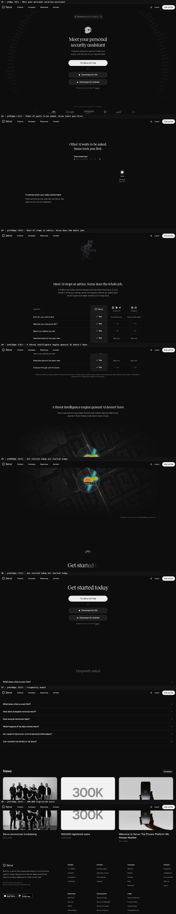
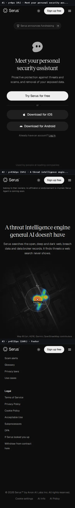

# UI Design System & Master Generation Blueprint: serus-ai

> **Serus — Agentic Privacy & Intelligence** (https://serus.ai/) — Your own privacy agent: finds what's exposed, removes it, watches for more and lets you check who you're dealing with. Protection and int...





---

## 1. Executive Visual Persona & Design Archetype

- **Brand Essence & Persona**: **Serus — Agentic Privacy & Intelligence** (`https://serus.ai/`). Your own privacy agent: finds what's exposed, removes it, watches for more and lets you check who you're dealing with. Protection and int...
- **Final Redirected URL**: [https://www.serus.ai/](https://www.serus.ai/)
- **Capture Provenance**: Live browser capture (`tier1_fast`, HTTP `200`, captured `2026-11-24`).
- **Visual Archetype**: **Dark-Substrate WebGL / Canvas Interactive Experience (`#0d0d0d` / `#800080`)**.
- **Anti-AI-Slop Differentiators**:
  - **Live-Computed Chromatic Polarity**: Anchors the viewport in `#0d0d0d` (live computed `body` `background-color` (`computed_styles.json`)) paired with `#f5f5f5` primary typography and `#800080` accents.
  - **Grounded Typographic Hierarchy**: Pairs `Reckless` for display copy (`Meet your personal security assistan`) with `Geist Variable` and `Geist Mono Variable`.
  - **Calibrated Spatial Grid & Motion**: Combines `96rem` container bounds (`gap: 8px`, padding `24px`) with `cubic-bezier(.22,1,.36,1)` easing and HTML5 `<canvas>` Interactive Viewport Surface.

---

## 2. Spatial Architecture & Modular Grid Mathematics

### Viewport Allocation & Container Geometry
- **Captured Journey Filmstrips**: Desktop `1280×6624px` (`assets/desktop-journey.webp`, `8` keyframes up to `y=7110px` / doc `8557px`), Mobile `390×2616px` (`assets/mobile-journey.webp`, `3` keyframes).
- **Master Container Bounds**: `96rem` (non-`@media` desktop container stylesheet rule).
- **Canvas Lateral Padding & Spacing**: `24px` lateral canvas padding with `8px` grid gap.
- **Border Radius Scale**: `999px`, `.5rem`, `9999px`, `.25rem`.

### Responsive Breakpoint Architecture
- **Desktop Layout**: Multi-column CSS Grid / Flexbox layout at `1440px` (`max-width: 96rem`, `gap: 8px`).
- **Mobile Layout**: Single-column vertical stack at `390px` viewport width with `24px` horizontal padding.
- **Extracted CSS Media Queries**: `@media (width<=639px)`, `@media not all and (width>=40rem)`, `@media (width>=40rem)`, `@media (width>=48rem)`.

---

## 3. Color System, Materiality & Atmospheric Lighting

### Semantic Palette & Source Grounding
| Semantic Role | Ground-Truth Value | Extracted Live / CSS Source |
|---|---|---|
| **Primary Canvas Substrate** | `#0d0d0d` | live computed `body` `background-color` (`computed_styles.json`) |
| **Primary Typography Ink** | `#f5f5f5` | live computed `h1` `color` (`computed_styles.json`) |
| **Elevated Surface / Card Substrate** | `#800080` | `.bt-pill-page { background-color: purple }` (`#800080`) |
| **Interactive Accent / Highlight** | `#800080` | `.prose-serus a:hover { color: purple }` (`#800080`) |
| **Secondary / Muted Copy** | `#808080` | `.eyebrow { color: gray }` (`#808080`) |
| **Structural Hairline Border** | `#808080` | `.border-gray-200 { border-color: #808080 }` |
| **Variable Token (`--dither-fill`)** | `#ebebeb` | `var(--dither-fill)` in `:root` |

### Sanitized Root CSS Variables (`ui-ux.md` Ground Truth)
| Variable Name | Extracted Value | Semantic Role |
|---|---|---|
| `--dither-fill` | `#ebebeb` | Color / Atmospheric Token |
| `--chart-1` | `oklch(32% 0 none)` | Color / Atmospheric Token |
| `--chart-2` | `oklch(41% 0 none)` | Color / Atmospheric Token |
| `--chart-3` | `oklch(54% 0 none)` | Color / Atmospheric Token |
| `--chart-4` | `oklch(71% 0 none)` | Color / Atmospheric Token |
| `--chart-5` | `oklch(89% 0 none)` | Color / Atmospheric Token |
| `--chart-background` | `oklch(100% 0 0)` | Canvas / Surface Token |
| `--chart-foreground` | `oklch(14.5% .004 285)` | Typography Ink Token |
| `--chart-foreground-muted` | `oklch(55% .014 260)` | Typography Ink Token |
| `--chart-line-primary` | `var(--chart-1)` | Brand / Palette Token |
| `--chart-line-secondary` | `var(--chart-2)` | Brand / Palette Token |
| `--chart-crosshair` | `oklch(40% .1828 274.34)` | Color / Atmospheric Token |
| `--chart-grid` | `oklch(90% 0 0)` | Layout / Spatial Grid Token |
| `--chart-brush-border` | `var(--chart-grid)` | Elevation / Border Token |
| `--chart-tooltip-background` | `oklch(100% 0 0/.92)` | Canvas / Surface Token |
| `--chart-tooltip-foreground` | `oklch(21% 0 0)` | Typography Ink Token |

---

## 4. Typographic Scale & Editorial Hierarchy

### Font Family Stacks
- **Display Typography**: `Reckless`.
- **Primary Body Stack**: `Geist Variable`.
- **Technical / Metadata Stack**: `Geist Mono Variable`.

### Typographic Scale & Rules (Live Computed & Stylesheet Grounded)
- **Hero Display (`H1`)**: live computed `h1` (`font-size: 40px`, `line-height: 46px`, `font-weight: 400`, `letter-spacing: -0.7px`).
- **Section Heading (`H2`)**: live computed `h2` (`font-size: 48px`, `line-height: 52.8px`, `font-weight: 400`, `letter-spacing: -0.96px`); CSS variables `--text-2xl: 1.5rem`, `--text-2xl--line-height: calc(2 / 1.5)`; rule `h2` (`font-size: 30px`, `line-height: 40px`, `letter-spacing: -.6px`).
- **Body Copy**: live computed `body` (`font-size: 16px`, `line-height: 24px`, `font-weight: 400`); CSS variables `--text-base: 1rem`, `--text-base--line-height: calc(1.5 / 1)`; rule `p` (`line-height: 1.625`).
- **Metadata & Navigation Labels**: live computed `nav/a` (`font-size: 16px`, `line-height: 24px`, `font-weight: 400`); CSS variables `--chart-label: oklch(45% .01 260)`, `--font-mono: "Geist Mono Variable", ui-monospace, monospace`, `--text-xs: .75rem`.

---

## 5. Choreographed Motion & Interaction Physics

### Primary Easing Curves
- **Extracted Timing Functions**: `cubic-bezier(.22,1,.36,1)`, `cubic-bezier(.34,1.3,.64,1)`, `cubic-bezier(.16,1,.3,1)`.

### Per-Element Transition & Choreography Rules
- **Selector `ta-js] .chat-slide[data-astro-cid...`**: `transition: opacity .35s ease-in,filter .35s ease-in,visibility 0s .35s` extracted from `serus-ai` stylesheet.
- **Selector `slide[data-astro-cid-2z7eqyuz][da...`**: `transition: opacity .6s ease-out .25s,filter .6s ease-out .25s` extracted from `serus-ai` stylesheet.
- **Selector `.chat-label-wrap[data-astro-cid-2...`**: `transition: grid-template-rows .3s,grid-template-columns .3s` extracted from `serus-ai` stylesheet.
- **Extracted Easing Curve (`cubic-bezier(.22,1,.36,1)`)**: Governs interactive state transitions across `<header.top-0>` and `<section.px-4>`.
- **Runtime Interaction Engine**: Integrates HTML5 `<canvas>` Interactive Viewport Surface with `prefers-reduced-motion: reduce` fallback guards.
### Measured Runtime Scroll & Interaction Telemetry (`behavioral_journey_v2`)
- **Scroll Driver Mode**: `native+wheel` (max document height `8557px`, deepest scrollY reached `7110px` across `8` desktop keyframes).
- **Detected Scroll / Motion Libraries**: `WebGL/Canvas`.
- **Nav / Drawer Probe**: Tested trigger `Product` (diff `0.977`, below state-capture threshold).
- **Hover Physics (`primary_cta` · `Serus announces fundraising`)**: `color`: `rgba(245, 245, 245, 0.64)` -> `rgb(245, 245, 245)`; `borderColor`: `rgba(255, 255, 255, 0.12)` -> `oklab(0.970145 0.000044...` (`transition-duration: 0.15s`, `timing: cubic-bezier(0.4, 0, 0.2, 1)`).
- **Interactive Control Probe (`accordion`)**: Tested `What does a Serus scan find?` (diff `2.93`).
- **Theme Toggle Probe (`Switch to light mode`)**: Toggled body background `rgb(13, 13, 13)` -> `rgb(250, 250, 250)` and ink `rgb(245, 245, 245)` -> `rgb(13, 13, 13)`.
- **Route Transition Architecture**: First internal navigation (`/blog/`) measured as `direct` in `1344ms`.

---

## 6. Component Wireframe & Structural DOM Map

### Visual Layout Schematic — Desktop (`1440px`, Grounded in `dom.html` & Landmark Bounding Boxes)
```
┌────────────────────────────────────────────────────────────────────────┐
│ DESKTOP VIEWPORT (1440px) — Serus — Agentic Privacy & Intelligence     │
│ ====================================================================== │
│ [ <header.top-0> (1440x56px)          | People Meet the team · Blog  ] │
│ ---------------------------------------------------------------------- │
│ | HERO STAGE: <section.bg-background-canvas> (w=1440px)              | │
│ | H1: Meet your personal security assistant                          | │
│ | Substrate: #0d0d0d | Ink: #f5f5f5 | Accent: #800080                | │
│ ---------------------------------------------------------------------- │
│ | SHOWCASE GRID (<section.px-4>) max-w: 96rem                        | │
│ | +------------------------------+  +------------------------------+ | │
│ | | Other AI waits to be asked.  |  | It notices when your data co | | │
│ | +------------------------------+  +------------------------------+ | │
│ ---------------------------------------------------------------------- │
│ | DETAIL MODULE (<section.py-20>) — It watches the world             | │
│ ---------------------------------------------------------------------- │
│ [ FOOTER (<footer.pb-6>       ) | https://serus.ai/                    │
└────────────────────────────────────────────────────────────────────────┘
```

### Visual Layout Schematic — Mobile Reflow (`390px`)
```
┌────────────────────────────────────────────────────────────────────────┐
│ MOBILE VIEWPORT REFLOW (390px) — Single-Column Stack (gap: 8px)        │
│ ====================================================================== │
│ [ HEADER BAR (<header.top-0>          ) | Compact Menu (390px)         │
│ ---------------------------------------------------------------------- │
│ | HERO STAGE (<section.bg-background-c) — 390px Vertical Lead        | │
│ | H1: Meet your personal security assistant                          | │
│ ---------------------------------------------------------------------- │
│ | SHOWCASE STACK (<section.px-4>) — 1-Col Stack                      | │
│ | [ Item 1: Other AI waits to be asked. Serus texts you first.     ] | │
│ | [ Item 2: It notices when your data comes back                   ] | │
│ ---------------------------------------------------------------------- │
│ | DETAIL STACK (<section.py-20>) — 1-Col (It watches the wor)        | │
│ ---------------------------------------------------------------------- │
│ [ FOOTER (<footer.pb-6>       ) | Stacked 390px Colophon               │
└────────────────────────────────────────────────────────────────────────┘
```

### Granular DOM Region Breakdown
1. **Brand Header & Navigation Bar (<header.top-0> — `serus-ai`)**:
   - Landmark `<header class="top-0 bg-background-canvas">` (`1440x56px`) hosting `Serus — Agentic Privacy & Intelligen` navigation (`People Meet the team · Blog News & guides`), DOM attributes (`data-id="D6EM0HRC77UCIF8JNLS0"`, `data-id="D6EM0HRC77UCIF8JNLS0"`, `data-astro-cid-nen7h5rs`, `data-nav-menu`), and stylesheet rule `hover { transform:translateY(calc(var(--lift) - 6px)) rotate(0deg) }`.
2. **Hero Stage & Focal Lead (<section.bg-background-canvas> — `Meet your personal security assist`)**:
   - Landmark `<section class="bg-background-canvas text-sds-text-default">` presenting display lead `Meet your personal security assistant` and copy excerpt *"Proactive protection against threats and scams, and removal of yo"* over `#0d0d0d` canvas and `#f5f5f5` ink.
3. **Primary Showcase & Content Grid (<section.px-4> — `Other AI waits to be asked. Serus `)**:
   - Landmark `<section class="px-4 py-20">` rendering section `Other AI waits to be asked. Serus texts you first.` with copy *"Serus announces fundraising"*, asset references (`clientParamBuilder.bundle.js`, `identify_f7846436.js`, `main.MTUyMzg1YjAxMQ.js`, `events.js`), and grid rule `backdrop { box-sizing:border-box;border:0 solid;margin:0;padding:0 }`.
4. **Interactive Detail & Feature Matrix (<section.py-20> — `It notices when your data comes ba`)**:
   - Landmark `<section class="px-4 py-20">` framing `It notices when your data comes back` and `It watches the world around you` (*"Used by people at leading companies"*) with `#800080` surface cards, `#800080` accents, and `file-selector-button { box-sizing:border-box;border:0 solid;margin:0;padding:0 }`.
5. **Colophon & Global Directory Footer (<footer.pb-6> — `https://serus.ai/`)**:
   - Landmark `<footer class="pb-6 pt-16">` anchoring `Serus — Agentic Privacy & Intell` footer links (`People Meet the team · Blog News & guides`), copy *"A contact is hacked"*, and `#808080` structural dividers.
### Full Vertical Scroll Sequence (Desktop `1440×900` Keyframes)
- **Step 01** (`y=0px`, `0%`): Active landmark `Meet your personal security assistant` · sticky/fixed elements: `1`
- **Step 02** (`y=850px`, `11%`): Active landmark `Other AI waits to be asked. Serus texts you first.` · sticky/fixed elements: `1`
- **Step 03** (`y=3360px`, `44%`): Active landmark `Most AI stops at advice. Serus does the whole job.` · sticky/fixed elements: `1`
- **Step 04** (`y=4110px`, `54%`): Active landmark `A threat intelligence engine general AI doesn't have` · sticky/fixed elements: `1`
- **Step 05** (`y=4860px`, `63%`): Active landmark `Get started today Get started today` · sticky/fixed elements: `1`
- **Step 06** (`y=5610px`, `73%`): Active landmark `Get started today Get started today` · sticky/fixed elements: `1`
- **Step 07** (`y=6360px`, `83%`): Active landmark `Frequently asked` · sticky/fixed elements: `1`
- **Step 08** (`y=7110px`, `93%`): Active landmark `300,000 registered users` · sticky/fixed elements: `1`

### Multi-Page Internal Route Map
- **Listing Route (`/blog/`)**: `https://www.serus.ai/blog/` — H1: `Blog`, scrollHeight `6926px`, transition `direct` (`1344ms`)
- **Detail Route (`/blog/serus-announces-fundraising/`)**: `https://www.serus.ai/blog/serus-announces-fundraising/` — H1: `Serus announces fundraising`, scrollHeight `3371px`, transition `direct` (`622ms`)
- **About Route (`/manifesto/`)**: `https://www.serus.ai/manifesto/` — H1: `The internet keeps everything. Someone has to kee...`, scrollHeight `3473px`, transition `direct` (`319ms`)

---

## 7. Master Zero-Shot AI Generation Prompt

```markdown
# Master Zero-Shot Frontend Generation Prompt: serus-ai (Serus — Agentic Privacy & Intelligence)

You are a principal frontend architect and design systems engineer. Build a complete, production-ready web application replicating the exact design system, DOM landmarks, typographic hierarchy, color tokens, and motion physics of `serus-ai` (**Serus — Agentic Privacy & Intelligence** — `https://serus.ai/`).

### 1. Visual Archetype & Anti-AI-Slop Mandates
- **Archetype**: Dark-Substrate WebGL / Canvas Interactive Experience (`#0d0d0d` / `#800080`).
- **Identity & Domain Context**: Your own privacy agent: finds what's exposed, removes it, watches for more and lets you check who you're dealing with. Protection and int...
- **Primary Substrate**: `#0d0d0d` (live computed `body` `background-color` (`computed_styles.json`)), **Primary Ink**: `#f5f5f5`, **Accent / Highlight**: `#800080`.
- **Site-Specific Differentiators**:
  - **Live-Computed Chromatic Polarity**: Anchors the viewport in `#0d0d0d` (live computed `body` `background-color` (`computed_styles.json`)) paired with `#f5f5f5` primary typography and `#800080` accents.
  - **Grounded Typographic Hierarchy**: Pairs `Reckless` for display copy (`Meet your personal security assistan`) with `Geist Variable` and `Geist Mono Variable`.
  - **Calibrated Spatial Grid & Motion**: Combines `96rem` container bounds (`gap: 8px`, padding `24px`) with `cubic-bezier(.22,1,.36,1)` easing and HTML5 `<canvas>` Interactive Viewport Surface.

### 2. Ground-Truth CSS Variables (`:root` Token Contract)
Declare and consume these exact custom properties extracted from `serus-ai` in your global stylesheet:

:root {
  /* Serus — Agentic Privacy & Intelligence (serus-ai) — Live-Grounded CSS Variables */
  --dither-fill: #ebebeb; /* Color / Atmospheric Token (serus-ai) */
  --chart-1: oklch(32% 0 none); /* Color / Atmospheric Token (serus-ai) */
  --chart-2: oklch(41% 0 none); /* Color / Atmospheric Token (serus-ai) */
  --chart-3: oklch(54% 0 none); /* Color / Atmospheric Token (serus-ai) */
  --chart-4: oklch(71% 0 none); /* Color / Atmospheric Token (serus-ai) */
  --chart-5: oklch(89% 0 none); /* Color / Atmospheric Token (serus-ai) */
  --chart-background: oklch(100% 0 0); /* Canvas / Surface Token (serus-ai) */
  --chart-foreground: oklch(14.5% .004 285); /* Typography Ink Token (serus-ai) */
  --chart-foreground-muted: oklch(55% .014 260); /* Typography Ink Token (serus-ai) */
  --chart-line-primary: var(--chart-1); /* Brand / Palette Token (serus-ai) */
  --chart-line-secondary: var(--chart-2); /* Brand / Palette Token (serus-ai) */
  --chart-crosshair: oklch(40% .1828 274.34); /* Color / Atmospheric Token (serus-ai) */
  --chart-grid: oklch(90% 0 0); /* Layout / Spatial Grid Token (serus-ai) */
  --chart-brush-border: var(--chart-grid); /* Elevation / Border Token (serus-ai) */
  --chart-tooltip-background: oklch(100% 0 0/.92); /* Canvas / Surface Token (serus-ai) */
  --chart-tooltip-foreground: oklch(21% 0 0); /* Typography Ink Token (serus-ai) */
}

### 3. Semantic Color & Materiality Contract
Map every surface, ink, and border strictly to these source-grounded tokens:
- **Primary Canvas Substrate**: `#0d0d0d` — grounded in live computed `body` `background-color` (`computed_styles.json`)
- **Primary Typography Ink**: `#f5f5f5` — grounded in live computed `h1` `color` (`computed_styles.json`)
- **Elevated Surface / Card Substrate**: `#800080` — grounded in `.bt-pill-page { background-color: purple }` (`#800080`)
- **Interactive Accent / Highlight**: `#800080` — grounded in `.prose-serus a:hover { color: purple }` (`#800080`)
- **Secondary / Muted Copy**: `#808080` — grounded in `.eyebrow { color: gray }` (`#808080`)
- **Structural Hairline Border**: `#808080` — grounded in `.border-gray-200 { border-color: #808080 }`
- **Variable Token (`--dither-fill`)**: `#ebebeb` — grounded in `var(--dither-fill)` in `:root`

### 4. Spatial Grid, Container Bounds & Responsive Breakpoints
- **Desktop Viewport Reference**: `1280×6624px` (multi-frame vertical journey filmstrip (6624px), `1440px` standard desktop width).
- **Mobile Viewport Reference**: `390×2616px` (multi-frame vertical journey filmstrip (2616px), `390px` standard mobile width).
- **Container Max-Width**: `96rem` (non-`@media` desktop container stylesheet rule)
- **Padding & Gutters**: `24px` lateral canvas padding with `8px` grid gap
- **Desktop Grid**: Multi-column CSS Grid / Flexbox layout at `1440px` (`max-width: 96rem`, `gap: 8px`)
- **Mobile Adaptation**: Single-column vertical stack at `390px` viewport width with `24px` horizontal padding
- **Media Queries**: `@media (width<=639px)`, `@media not all and (width>=40rem)`, `@media (width>=40rem)`, `@media (width>=48rem)`
- **Corner Radii**: `999px`, `.5rem`, `9999px`, `.25rem`

### 5. Typography & Editorial Scale Contract
- **Display Font Stack**: `Reckless`
- **Body Font Stack**: `Geist Variable`
- **Monospace / Technical Font Stack**: `Geist Mono Variable`
- **H1 Display Rule**: live computed `h1` (`font-size: 40px`, `line-height: 46px`, `font-weight: 400`, `letter-spacing: -0.7px`)
- **H2 Section Rule**: live computed `h2` (`font-size: 48px`, `line-height: 52.8px`, `font-weight: 400`, `letter-spacing: -0.96px`); CSS variables `--text-2xl: 1.5rem`, `--text-2xl--line-height: calc(2 / 1.5)`; rule `h2` (`font-size: 30px`, `line-height: 40px`, `letter-spacing: -.6px`)
- **Body Copy Rule**: live computed `body` (`font-size: 16px`, `line-height: 24px`, `font-weight: 400`); CSS variables `--text-base: 1rem`, `--text-base--line-height: calc(1.5 / 1)`; rule `p` (`line-height: 1.625`)
- **Metadata & Index Rule**: live computed `nav/a` (`font-size: 16px`, `line-height: 24px`, `font-weight: 400`); CSS variables `--chart-label: oklch(45% .01 260)`, `--font-mono: "Geist Mono Variable", ui-monospace, monospace`, `--text-xs: .75rem`

### 6. Component Hierarchy, Verbatim Copy & Real DOM Landmarks
Scaffold `serus-ai` (`Serus — Agentic Privacy & Intelligence`) with these exact structural regions, extracted copy, and CSS rules from `dom.html`:
1. **Brand Header & Navigation Bar (<header.top-0> — `serus-ai`)**:
   - DOM & Selectors: Landmark `<header class="top-0 bg-background-canvas">` (`1440x56px`) hosting `Serus — Agentic Privacy & Intelligen` navigation (`People Meet the team · Blog News & guides`), DOM attributes (`data-id="D6EM0HRC77UCIF8JNLS0"`, `data-id="D6EM0HRC77UCIF8JNLS0"`, `data-astro-cid-nen7h5rs`, `data-nav-menu`), and stylesheet rule `hover { transform:translateY(calc(var(--lift) - 6px)) rotate(0deg) }`.
   - Responsive Contract: Header `Brand Header & Navigation Bar (<header.top-0> — `serus-ai`)` (`serus-ai`) adapts across `@media (width<=639px)`, `@media not all and (width>=40rem)`, `@media (width>=40rem)`, `@media (width>=48rem)` with `cubic-bezier(.22,1,.36,1)`, `cubic-bezier(.34,1.3,.64,1)`, `cubic-bezier(.16,1,.3,1)` transitions and links `People Meet the team · Blog News & guides`.
2. **Hero Stage & Focal Lead (<section.bg-background-canvas> — `Meet your personal security assist`)**:
   - DOM & Selectors: Landmark `<section class="bg-background-canvas text-sds-text-default">` presenting display lead `Meet your personal security assistant` and copy excerpt *"Proactive protection against threats and scams, and removal of yo"* over `#0d0d0d` canvas and `#f5f5f5` ink.
   - Responsive Contract: Hero stage (`1280×6624px` desktop / `390×2616px` mobile) sets `#0d0d0d` background with `#f5f5f5` headline `Meet your personal security assistant`.
3. **Primary Showcase & Content Grid (<section.px-4> — `Other AI waits to be asked. Serus `)**:
   - DOM & Selectors: Landmark `<section class="px-4 py-20">` rendering section `Other AI waits to be asked. Serus texts you first.` with copy *"Serus announces fundraising"*, asset references (`clientParamBuilder.bundle.js`, `identify_f7846436.js`, `main.MTUyMzg1YjAxMQ.js`, `events.js`), and grid rule `backdrop { box-sizing:border-box;border:0 solid;margin:0;padding:0 }`.
   - Responsive Contract: Showcase grid `Primary Showcase & Content Grid (<section.px-4> — `Other AI waits to be asked. Serus `)` applies Multi-column CSS Grid / Flexbox layout at `1440px` (`max-width: 96rem`, `gap: 8px`) on desktop and Single-column vertical stack at `390px` viewport width with `24px` horizontal padding on mobile.
4. **Interactive Detail & Feature Matrix (<section.py-20> — `It notices when your data comes ba`)**:
   - DOM & Selectors: Landmark `<section class="px-4 py-20">` framing `It notices when your data comes back` and `It watches the world around you` (*"Used by people at leading companies"*) with `#800080` surface cards, `#800080` accents, and `file-selector-button { box-sizing:border-box;border:0 solid;margin:0;padding:0 }`.
   - Responsive Contract: Detail module `Interactive Detail & Feature Matrix (<section.py-20> — `It notices when your data comes ba`)` uses `999px`, `.5rem`, `9999px`, `.25rem` radii, `#800080` highlights, and assets (clientParamBuilder.bundle.js, identify_f7846436.js, main.MTUyMzg1YjAxMQ.js).
5. **Colophon & Global Directory Footer (<footer.pb-6> — `https://serus.ai/`)**:
   - DOM & Selectors: Landmark `<footer class="pb-6 pt-16">` anchoring `Serus — Agentic Privacy & Intell` footer links (`People Meet the team · Blog News & guides`), copy *"A contact is hacked"*, and `#808080` structural dividers.
   - Responsive Contract: Footer `Colophon & Global Directory Footer (<footer.pb-6> — `https://serus.ai/`)` aligns to `96rem` (non-`@media` desktop container stylesheet rule) with `24px` lateral canvas padding with `8px` grid gap and attributes (data-id="D6EM0HRC77UCIF8JNLS0", data-id="D6EM0HRC77UCIF8JNLS0", data-astro-cid-nen7h5rs).

#### Verbatim DOM Copy Excerpts (`dom.html`)
- Copy Excerpt 1: *"Proactive protection against threats and scams, and removal of your exposed data."*
- Copy Excerpt 2: *"Serus announces fundraising"*
- Copy Excerpt 3: *"Used by people at leading companies"*
- Copy Excerpt 4: *"A contact is hacked"*

### 7. Motion, Extracted Stylesheet Rules & Interaction Choreography
- **Primary Easing Functions**: `cubic-bezier(.22,1,.36,1)`, `cubic-bezier(.34,1.3,.64,1)`, `cubic-bezier(.16,1,.3,1)`
- **Extracted Stylesheet Rules (`serus-ai`)**:
- `hover { transform:translateY(calc(var(--lift) - 6px)) rotate(0deg) }`
- `backdrop { box-sizing:border-box;border:0 solid;margin:0;padding:0 }`
- `file-selector-button { box-sizing:border-box;border:0 solid;margin:0;padding:0 }`
- `strong { font-weight:bolder }`
- `small { font-size:80% }`
- **Per-Selector Transition Rules**:
- **Selector `ta-js] .chat-slide[data-astro-cid...`**: `transition: opacity .35s ease-in,filter .35s ease-in,visibility 0s .35s` extracted from `serus-ai` stylesheet.
- **Selector `slide[data-astro-cid-2z7eqyuz][da...`**: `transition: opacity .6s ease-out .25s,filter .6s ease-out .25s` extracted from `serus-ai` stylesheet.
- **Selector `.chat-label-wrap[data-astro-cid-2...`**: `transition: grid-template-rows .3s,grid-template-columns .3s` extracted from `serus-ai` stylesheet.
- **Extracted Easing Curve (`cubic-bezier(.22,1,.36,1)`)**: Governs interactive state transitions across `<header.top-0>` and `<section.px-4>`.
- **Runtime Interaction Engine**: Integrates HTML5 `<canvas>` Interactive Viewport Surface with `prefers-reduced-motion: reduce` fallback guards.
### 7b. Full-Page Scroll Choreography, Interactive States & Multi-Page Routes
- **Scroll Mechanics**: Implement `native+wheel` vertical progression up to `8557px` across 8 distinct viewport chapters using WebGL/Canvas.
- **Vertical Chapter Sequence**: Meet your personal security... (0%) -> Other AI waits to be asked.... (11%) -> Most AI stops at advice. Se... (44%) -> A threat intelligence engin... (54%) -> Get started today Get start... (63%) -> Get started today Get start... (73%) -> Frequently asked (83%) -> 300,000 registered users (93%).
- **Hover Micro-Interaction (`primary_cta`)**: Animate `color, borderColor` with `0.15s cubic-bezier(0.4, 0, 0.2, 1)`.
- **Multi-Page Routes**: Scaffold internal routes `/blog/` (listing, direct), `/blog/serus-announces-fundraising/` (detail, direct), `/manifesto/` (about, direct) sharing the global header/footer shell and design tokens.

### 8. Technical Deliverables
- Implement in Next.js (App Router) with TypeScript and Tailwind CSS consuming the `:root` custom properties defined above for `serus-ai`.
- Reproduce both the `1440px` desktop architecture and `390px` mobile breakpoint transitions, preserving semantic HTML5 landmarks (`<header>`, `<nav>`, `<main>`, `<section>`, `<footer>`) and `prefers-reduced-motion` accessibility guards.
```
---

## 8. Full-Page Scroll Journey, Interactive States & Subpage Inventory

### Desktop Scroll Keyframes (`1440×900` WebP)
| Step | Scroll Y | Progress | Active Landmark / Section | Sticky/Fixed | Visual Asset |
| :---: | :---: | :---: | :--- | :---: | :--- |
| `#01` | `0px` | `0%` | Meet your personal security assistant | `1` | [desktop-step-01.webp](assets/desktop-step-01.webp) |
| `#02` | `850px` | `11%` | Other AI waits to be asked. Serus texts you f... | `1` | [desktop-step-02.webp](assets/desktop-step-02.webp) |
| `#03` | `3360px` | `44%` | Most AI stops at advice. Serus does the whole... | `1` | [desktop-step-03.webp](assets/desktop-step-03.webp) |
| `#04` | `4110px` | `54%` | A threat intelligence engine general AI doesn... | `1` | [desktop-step-04.webp](assets/desktop-step-04.webp) |
| `#05` | `4860px` | `63%` | Get started today Get started today | `1` | [desktop-step-05.webp](assets/desktop-step-05.webp) |
| `#06` | `5610px` | `73%` | Get started today Get started today | `1` | [desktop-step-06.webp](assets/desktop-step-06.webp) |
| `#07` | `6360px` | `83%` | Frequently asked | `1` | [desktop-step-07.webp](assets/desktop-step-07.webp) |
| `#08` | `7110px` | `93%` | 300,000 registered users | `1` | [desktop-step-08.webp](assets/desktop-step-08.webp) |

### Mobile Condensed Keyframes (`390×844` WebP)
| Step | Scroll Y | Progress | Active Landmark | Visual Asset |
| :---: | :---: | :---: | :--- | :--- |
| `#01` | `0px` | `0%` | Meet your personal security assistant | [mobile-step-01.webp](assets/mobile-step-01.webp) |
| `#02` | `4362px` | `50%` | A threat intelligence engine general AI d... | [mobile-step-02.webp](assets/mobile-step-02.webp) |
| `#03` | `8725px` | `100%` | Footer | [mobile-step-03.webp](assets/mobile-step-03.webp) |

### Internal Subpage Filmstrips (`1080px` Wide WebP)
| # | Template | Route URL | H1 / Title | Scroll Height | Transition | Filmstrip Asset |
| :-: | :---: | :--- | :--- | :---: | :---: | :--- |
| `1` | `listing` | `https://www.serus.ai/blog/` | Blog | `6926px` | `direct` (`1344ms`) | [subpage-01-blog.webp](assets/subpage-01-blog.webp) |
| `2` | `detail` | `https://www.serus.ai/blog/serus-announces-fundraising/` | Serus announces fundraising | `3371px` | `direct` (`622ms`) | [subpage-02-blog-serus-announces-fundraising.webp](assets/subpage-02-blog-serus-announces-fundraising.webp) |
| `3` | `about` | `https://www.serus.ai/manifesto/` | The internet keeps everything. Someon... | `3473px` | `direct` (`319ms`) | [subpage-03-manifesto.webp](assets/subpage-03-manifesto.webp) |

