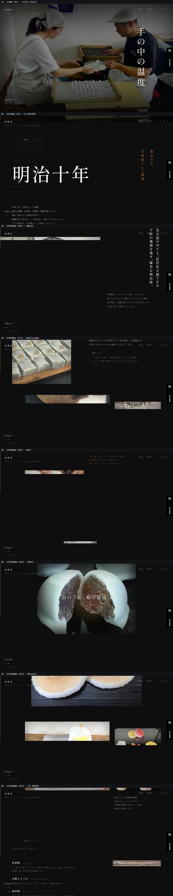
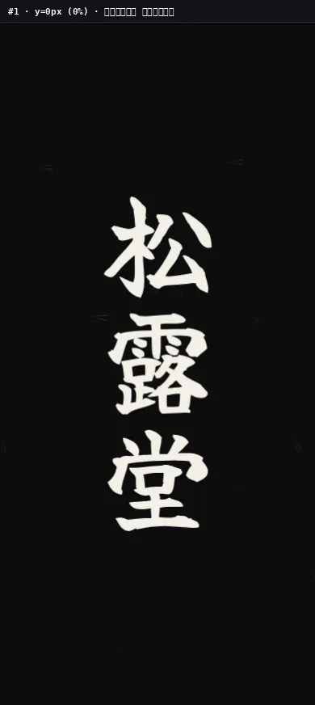

# UI Design System & Master Generation Blueprint: shorodo-nagoya

> **松露堂 — 手の中の温度 · 明治十年創業・名古屋 円頓寺の和菓子処** (https://shorodo.nagoya/) — 明治十年（1877年）創業、名古屋・円頓寺本町商店街の御菓子処 松露堂。季節であんこの硬さを変え、すり蜜の熱を炭火と手で計る——看板の松露糖と、一枚ずつ手焼きする金鯱きんつば。





---

## 1. Executive Visual Persona & Design Archetype

- **Brand Essence & Persona**: **松露堂 — 手の中の温度 · 明治十年創業・名古屋 円頓寺の和菓子処** (`https://shorodo.nagoya/`). 明治十年（1877年）創業、名古屋・円頓寺本町商店街の御菓子処 松露堂。季節であんこの硬さを変え、すり蜜の熱を炭火と手で計る——看板の松露糖と、一枚ずつ手焼きする金鯱きんつば。
- **Capture Provenance**: Live browser capture (`tier1_fast`, HTTP `200`, captured `2026-11-24`).
- **Visual Archetype**: **Dark-Substrate WebGL / Canvas Interactive Experience (`#0d0d0d` / `#231f1c`)**.
- **Anti-AI-Slop Differentiators**:
  - **Live-Computed Chromatic Polarity**: Anchors the viewport in `#0d0d0d` (live computed `body` `background-color` (`computed_styles.json`)) paired with `#fcfbf7` primary typography and `#231f1c` accents.
  - **Grounded Typographic Hierarchy**: Uses `Shorodo Mincho` across display (`手の中の温度 手の中の温度`) and body copy.
  - **Calibrated Spatial Grid & Motion**: Combines `1440px` container bounds (`gap: 25.6px`, padding `100.8px`) with `cubic-bezier(.22,1,.30,1)` easing and Lenis Smooth Scroll (`data-lenis`), GSAP Timeline & ScrollTrigger.

---

## 2. Spatial Architecture & Modular Grid Mathematics

### Viewport Allocation & Container Geometry
- **Captured Journey Filmstrips**: Desktop `1280×6624px` (`assets/desktop-journey.webp`, `8` keyframes up to `y=14400px` / doc `23101px`), Mobile `390×872px` (`assets/mobile-journey.webp`, `1` keyframes).
- **Master Container Bounds**: `1440px` (full-bleed `100%` desktop stage measured on `1440px` viewport).
- **Canvas Lateral Padding & Spacing**: `100.8px` lateral canvas padding with `25.6px` grid gap.
- **Border Radius Scale**: `50%`, `2px`, `5px`.

### Responsive Breakpoint Architecture
- **Desktop Layout**: Multi-column CSS Grid / Flexbox layout at `1440px` (`max-width: 1440px`, `gap: 25.6px`).
- **Mobile Layout**: Single-column vertical stack at `390px` viewport width with `100.8px` horizontal padding.
- **Extracted CSS Media Queries**: `@media (max-width:1080px)`, `@media (prefers-reduced-motion:reduce)`, `@media (prefers-reduced-motion: no-preference)`, `@media (min-width:821px)`.

---

## 3. Color System, Materiality & Atmospheric Lighting

### Semantic Palette & Source Grounding
| Semantic Role | Ground-Truth Value | Extracted Live / CSS Source |
|---|---|---|
| **Primary Canvas Substrate** | `#0d0d0d` | live computed `body` `background-color` (`computed_styles.json`) |
| **Primary Typography Ink** | `#fcfbf7` | live computed `h1` `color` (`computed_styles.json`) |
| **Elevated Surface / Card Substrate** | `#000000` | `#loader { background: black }` (`#000000`) |
| **Interactive Accent / Highlight** | `#231f1c` | live computed `a` `color` (`computed_styles.json`) |
| **Secondary / Muted Copy** | `#c8834a` | live computed `h2` `color` (`computed_styles.json`) |
| **Structural Hairline Border** | `#333332` | `.rl-minor line { stroke: #333332 }` |
| **Variable Token (`--koge`)** | `#16100b` | `var(--koge)` in `:root` |
| **Variable Token (`--copper`)** | `#8b5a2b` | `var(--copper)` in `:root` |
| **Variable Token (`--washi`)** | `#f3efe6` | `var(--washi)` in `:root` |
| **Variable Token (`--enji`)** | `#7e2a2e` | `var(--enji)` in `:root` |
| **Variable Token (`--enji-hi`)** | `#a03a3c` | `var(--enji-hi)` in `:root` |

### Sanitized Root CSS Variables (`ui-ux.md` Ground Truth)
| Variable Name | Extracted Value | Semantic Role |
|---|---|---|
| `--black` | `#0d0d0d` | Canvas / Surface Token |
| `--koge` | `#16100b` | Color / Atmospheric Token |
| `--copper` | `#8b5a2b` | Color / Atmospheric Token |
| `--copper-hi` | `#c8834a` | Color / Atmospheric Token |
| `--copper-dim` | `rgba(139,90,43,.35)` | Color / Atmospheric Token |
| `--ivory` | `#fcfbf7` | Color / Atmospheric Token |
| `--ivory-70` | `rgba(252,251,247,.70)` | Color / Atmospheric Token |
| `--ivory-40` | `rgba(252,251,247,.48)` | Color / Atmospheric Token |
| `--ivory-14` | `rgba(252,251,247,.14)` | Color / Atmospheric Token |
| `--washi` | `#f3efe6` | Color / Atmospheric Token |
| `--sumi` | `#231f1c` | Color / Atmospheric Token |
| `--sumi-60` | `rgba(35,31,28,.66)` | Color / Atmospheric Token |
| `--sumi-30` | `rgba(35,31,28,.45)` | Color / Atmospheric Token |
| `--sumi-ink` | `rgba(35,31,28,.64)` | Typography Ink Token |
| `--enji` | `#7e2a2e` | Color / Atmospheric Token |
| `--enji-hi` | `#a03a3c` | Color / Atmospheric Token |

---

## 4. Typographic Scale & Editorial Hierarchy

### Font Family Stacks
- **Display Typography**: `Shorodo Mincho`.
- **Primary Body Stack**: `Shorodo Mincho`.
- **Technical / Metadata Stack**: not declared in live computed styles (uses primary stack / `ui-monospace`).

### Typographic Scale & Rules (Live Computed & Stylesheet Grounded)
- **Hero Display (`H1`)**: live computed `h1` (`font-size: 72px`, `line-height: 72px`, `font-weight: 500`, `letter-spacing: 15.84px`).
- **Section Heading (`H2`)**: live computed `h3 (primary section heading)` (`font-size: 43.2px`, `line-height: 69.12px`, `font-weight: 500`, `letter-spacing: 8.64px`); rule `h2` (`font-size: .72rem`, `letter-spacing: .4em`, `font-weight: 500`).
- **Body Copy**: live computed `body` (`font-size: 16px`, `line-height: 33.6px`, `font-weight: 400`, `letter-spacing: 0.8px`); rule `body` (`line-height: 2.1`, `letter-spacing: .05em`).
- **Metadata & Navigation Labels**: live computed `nav/a` (`font-size: 11.2px`, `line-height: 23.52px`, `font-weight: 400`, `letter-spacing: 3.808px`); rule `small` (`font-size: .58rem`, `letter-spacing: .34em`).

---

## 5. Choreographed Motion & Interaction Physics

### Primary Easing Curves
- **Extracted Timing Functions**: `cubic-bezier(.22,1,.30,1)`, `cubic-bezier(.55,0,.16,1)`, `cubic-bezier(.33,1,.68,1)`.

### Per-Element Transition & Choreography Rules
- **Selector `.foot__credit a`**: `transition: text-decoration-color .3s,color .3s` extracted from `shorodo-nagoya` stylesheet.
- **Selector `.skip`**: `transition: top .3s` extracted from `shorodo-nagoya` stylesheet.
- **Selector `#loader`**: `transition: opacity 1.1s var(--ease-press),visibility 1.1s` extracted from `shorodo-nagoya` stylesheet.
- **Extracted Easing Curve (`cubic-bezier(.22,1,.30,1)`)**: Governs interactive state transitions across `<nav.chrome__nav>` and `<section.chapter>`.
- **Runtime Interaction Engine**: Integrates Lenis Smooth Scroll (`data-lenis`), GSAP Timeline & ScrollTrigger, HTML5 `<canvas>` Interactive Viewport Surface with `prefers-reduced-motion: reduce` fallback guards.
### Measured Runtime Scroll & Interaction Telemetry (`behavioral_journey_v2`)
- **Scroll Driver Mode**: `native` (max document height `23101px`, deepest scrollY reached `14400px` across `8` desktop keyframes).
- **Detected Scroll / Motion Libraries**: `Lenis`, `GSAP/ScrollTrigger`, `WebGL/Canvas`.
- **Interactive Control Probe (`accordion` · `これまでのお知らせ`)**: Triggered visual diff `5.177` (attr ` -> `, captured in `assets/state-interactive.webp`).
- **Route Transition Architecture**: First internal navigation (`/en.html`) measured as `MPA` in `2968ms`.

---

## 6. Component Wireframe & Structural DOM Map

### Visual Layout Schematic — Desktop (`1440px`, Grounded in `dom.html` & Landmark Bounding Boxes)
```
┌────────────────────────────────────────────────────────────────────────┐
│ DESKTOP VIEWPORT (1440px) — 松露堂 — 手の中の温度 · 明治十年創業・名古屋 円頓寺の和菓子処         │
│ ====================================================================== │
│ [ <nav.chrome__nav> (247x24px)        | 品書き · 御案内 · EN               ] │
│ ---------------------------------------------------------------------- │
│ | HERO STAGE: <section.hero> (w=1440px)                              | │
│ | H1: 手の中の温度 手の中の温度                                                  | │
│ | Substrate: #0d0d0d | Ink: #fcfbf7 | Accent: #231f1c                | │
│ ---------------------------------------------------------------------- │
│ | SHOWCASE GRID (<section.chapter>) max-w: 1440px                    | │
│ | +------------------------------+  +------------------------------+ | │
│ | | 手の中の温度 手 の 中 の 温 度           |  | 手仕事 PHILOSOPHY               | | │
│ | +------------------------------+  +------------------------------+ | │
│ ---------------------------------------------------------------------- │
│ | DETAIL MODULE (<section.news>) — 銘 SIGNATURE — 看板の二菓               | │
│ ---------------------------------------------------------------------- │
│ [ FOOTER (<footer.hide-cursor>) | https://shorodo.nagoya/              │
└────────────────────────────────────────────────────────────────────────┘
```

### Visual Layout Schematic — Mobile Reflow (`390px`)
```
┌────────────────────────────────────────────────────────────────────────┐
│ MOBILE VIEWPORT REFLOW (390px) — Single-Column Stack (gap: 25.6px)     │
│ ====================================================================== │
│ [ HEADER BAR (<nav.chrome__nav>       ) | Compact Menu (390px)         │
│ ---------------------------------------------------------------------- │
│ | HERO STAGE (<section.hero>) — 390px Vertical Lead                  | │
│ | H1: 手の中の温度 手の中の温度                                                  | │
│ ---------------------------------------------------------------------- │
│ | SHOWCASE STACK (<section.chapter>) — 1-Col Stack                   | │
│ | [ Item 1: 手の中の温度 手 の 中 の 温 度                                     ] | │
│ | [ Item 2: 手仕事 PHILOSOPHY                                         ] | │
│ ---------------------------------------------------------------------- │
│ | DETAIL STACK (<section.news>) — 1-Col (銘 SIGNATURE — 看板の二)         | │
│ ---------------------------------------------------------------------- │
│ [ FOOTER (<footer.hide-cursor>) | Stacked 390px Colophon               │
└────────────────────────────────────────────────────────────────────────┘
```

### Granular DOM Region Breakdown
1. **Brand Header & Navigation Bar (<nav.chrome__nav> — `shorodo-nagoya`)**:
   - Landmark `<nav class="chrome__nav">` (`247x24px`) hosting `松露堂 — 手の中の温度 · 明治十年創業・名古屋 円頓寺の和菓子処` navigation (`品書き · 御案内 · EN`), DOM attributes (`data-src="assets/hero_surimitsu..."`, `data-fade`, `data-cursor="計"`, `data-cursor="観"`), and stylesheet rule `after { margin:0;padding:0;box-sizing:border-box }`.
2. **Hero Stage & Focal Lead (<section.hero> — `手の中の温度 手の中の温度`)**:
   - Landmark `<section class="hero">` presenting display lead `手の中の温度 手の中の温度` and copy excerpt *"このページは「手の中の温度」を主題に、炭火・銅板・すり蜜・手のひらと、章が進むごとに温度が下がっていく構成でお店を紹介します。"* over `#0d0d0d` canvas and `#fcfbf7` ink.
3. **Primary Showcase & Content Grid (<section.chapter> — `手の中の温度 手 の 中 の 温 度`)**:
   - Landmark `<section class="chapter history">` rendering section `手の中の温度 手 の 中 の 温 度` with copy *"銅鍋のすり蜜に、あん玉をくぐらせる手元"*, asset references (`en.html`, `tw.html`, `cn.html`, `logo_shouten.png`), and grid rule `html.lenis { height:auto }`.
4. **Interactive Detail & Feature Matrix (<section.news> — `手仕事 PHILOSOPHY`)**:
   - Landmark `<section class="news late-in">` framing `手仕事 PHILOSOPHY` and `銘 SIGNATURE — 看板の二菓` (*"THE TEMPERATURE IN THE HAND"*) with `#000000` surface cards, `#231f1c` accents, and `.lenis.lenis-smooth { scroll-behavior:auto }`.
5. **Colophon & Global Directory Footer (<footer.hide-cursor> — `https://shorodo.nagoya/`)**:
   - Landmark `<footer class="hide-cursor">` anchoring `松露堂 — 手の中の温度 · 明治十年創業・名古屋 円頓寺の和菓` footer links (`品書き · 御案内 · EN`), copy *"明治十年、甘味処として創業。 屋号は藤鎌、 名古屋・伊勢町に暖簾を掲げました。 戦火に焼かれて円頓寺本町へ —— 砂糖の"*, and `#333332` structural dividers.
### Full Vertical Scroll Sequence (Desktop `1440×900` Keyframes)
- **Step 01** (`y=0px`, `0%`): Active landmark `手の中の温度 手の中の温度` · sticky/fixed elements: `3`
- **Step 02** (`y=850px`, `4%`): Active landmark `帳場 HISTORY` · sticky/fixed elements: `3`
- **Step 03** (`y=4250px`, `19%`): Active landmark `#machi` · sticky/fixed elements: `3`
- **Step 04** (`y=6800px`, `31%`): Active landmark `#philosophy` · sticky/fixed elements: `3`
- **Step 05** (`y=8500px`, `38%`): Active landmark `#mei` · sticky/fixed elements: `3`
- **Step 06** (`y=11050px`, `50%`): Active landmark `#waru` · sticky/fixed elements: `3`
- **Step 07** (`y=13600px`, `61%`): Active landmark `#kisetsu` · sticky/fixed elements: `3`
- **Step 08** (`y=14400px`, `65%`): Active landmark `品書き OKASHI` · sticky/fixed elements: `3`

### Multi-Page Internal Route Map
- **Other Route (`/en.html`)**: `https://shorodo.nagoya/en.html` — H1: `The warmth held in the hand The warmth held in th...`, scrollHeight `1170px`, transition `MPA` (`2968ms`)
- **Other Route (`/tw.html`)**: `https://shorodo.nagoya/tw.html` — H1: `手中的溫度 手中的溫度`, scrollHeight `1170px`, transition `direct` (`1073ms`)
- **Other Route (`/cn.html`)**: `https://shorodo.nagoya/cn.html` — H1: `手中的温度 手中的温度`, scrollHeight `2740px`, transition `direct` (`1276ms`)

---

## 7. Master Zero-Shot AI Generation Prompt

```markdown
# Master Zero-Shot Frontend Generation Prompt: shorodo-nagoya (松露堂 — 手の中の温度 · 明治十年創業・名古屋 円頓寺の和菓子処)

You are a principal frontend architect and design systems engineer. Build a complete, production-ready web application replicating the exact design system, DOM landmarks, typographic hierarchy, color tokens, and motion physics of `shorodo-nagoya` (**松露堂 — 手の中の温度 · 明治十年創業・名古屋 円頓寺の和菓子処** — `https://shorodo.nagoya/`).

### 1. Visual Archetype & Anti-AI-Slop Mandates
- **Archetype**: Dark-Substrate WebGL / Canvas Interactive Experience (`#0d0d0d` / `#231f1c`).
- **Identity & Domain Context**: 明治十年（1877年）創業、名古屋・円頓寺本町商店街の御菓子処 松露堂。季節であんこの硬さを変え、すり蜜の熱を炭火と手で計る——看板の松露糖と、一枚ずつ手焼きする金鯱きんつば。
- **Primary Substrate**: `#0d0d0d` (live computed `body` `background-color` (`computed_styles.json`)), **Primary Ink**: `#fcfbf7`, **Accent / Highlight**: `#231f1c`.
- **Site-Specific Differentiators**:
  - **Live-Computed Chromatic Polarity**: Anchors the viewport in `#0d0d0d` (live computed `body` `background-color` (`computed_styles.json`)) paired with `#fcfbf7` primary typography and `#231f1c` accents.
  - **Grounded Typographic Hierarchy**: Uses `Shorodo Mincho` across display (`手の中の温度 手の中の温度`) and body copy.
  - **Calibrated Spatial Grid & Motion**: Combines `1440px` container bounds (`gap: 25.6px`, padding `100.8px`) with `cubic-bezier(.22,1,.30,1)` easing and Lenis Smooth Scroll (`data-lenis`), GSAP Timeline & ScrollTrigger.

### 2. Ground-Truth CSS Variables (`:root` Token Contract)
Declare and consume these exact custom properties extracted from `shorodo-nagoya` in your global stylesheet:

:root {
  /* 松露堂 — 手の中の温度 · 明治十年創業・名古屋 円頓寺の和菓子処 (shorodo-nagoya) — Live-Grounded CSS Variables */
  --black: #0d0d0d; /* Canvas / Surface Token (shorodo-nagoya) */
  --koge: #16100b; /* Color / Atmospheric Token (shorodo-nagoya) */
  --copper: #8b5a2b; /* Color / Atmospheric Token (shorodo-nagoya) */
  --copper-hi: #c8834a; /* Color / Atmospheric Token (shorodo-nagoya) */
  --copper-dim: rgba(139,90,43,.35); /* Color / Atmospheric Token (shorodo-nagoya) */
  --ivory: #fcfbf7; /* Color / Atmospheric Token (shorodo-nagoya) */
  --ivory-70: rgba(252,251,247,.70); /* Color / Atmospheric Token (shorodo-nagoya) */
  --ivory-40: rgba(252,251,247,.48); /* Color / Atmospheric Token (shorodo-nagoya) */
  --ivory-14: rgba(252,251,247,.14); /* Color / Atmospheric Token (shorodo-nagoya) */
  --washi: #f3efe6; /* Color / Atmospheric Token (shorodo-nagoya) */
  --sumi: #231f1c; /* Color / Atmospheric Token (shorodo-nagoya) */
  --sumi-60: rgba(35,31,28,.66); /* Color / Atmospheric Token (shorodo-nagoya) */
  --sumi-30: rgba(35,31,28,.45); /* Color / Atmospheric Token (shorodo-nagoya) */
  --sumi-ink: rgba(35,31,28,.64); /* Typography Ink Token (shorodo-nagoya) */
  --enji: #7e2a2e; /* Color / Atmospheric Token (shorodo-nagoya) */
  --enji-hi: #a03a3c; /* Color / Atmospheric Token (shorodo-nagoya) */
}

### 3. Semantic Color & Materiality Contract
Map every surface, ink, and border strictly to these source-grounded tokens:
- **Primary Canvas Substrate**: `#0d0d0d` — grounded in live computed `body` `background-color` (`computed_styles.json`)
- **Primary Typography Ink**: `#fcfbf7` — grounded in live computed `h1` `color` (`computed_styles.json`)
- **Elevated Surface / Card Substrate**: `#000000` — grounded in `#loader { background: black }` (`#000000`)
- **Interactive Accent / Highlight**: `#231f1c` — grounded in live computed `a` `color` (`computed_styles.json`)
- **Secondary / Muted Copy**: `#c8834a` — grounded in live computed `h2` `color` (`computed_styles.json`)
- **Structural Hairline Border**: `#333332` — grounded in `.rl-minor line { stroke: #333332 }`
- **Variable Token (`--koge`)**: `#16100b` — grounded in `var(--koge)` in `:root`
- **Variable Token (`--copper`)**: `#8b5a2b` — grounded in `var(--copper)` in `:root`
- **Variable Token (`--washi`)**: `#f3efe6` — grounded in `var(--washi)` in `:root`
- **Variable Token (`--enji`)**: `#7e2a2e` — grounded in `var(--enji)` in `:root`
- **Variable Token (`--enji-hi`)**: `#a03a3c` — grounded in `var(--enji-hi)` in `:root`

### 4. Spatial Grid, Container Bounds & Responsive Breakpoints
- **Desktop Viewport Reference**: `1280×6624px` (multi-frame vertical journey filmstrip (6624px), `1440px` standard desktop width).
- **Mobile Viewport Reference**: `390×872px` (full-page live capture (872px), `390px` standard mobile width).
- **Container Max-Width**: `1440px` (full-bleed `100%` desktop stage measured on `1440px` viewport)
- **Padding & Gutters**: `100.8px` lateral canvas padding with `25.6px` grid gap
- **Desktop Grid**: Multi-column CSS Grid / Flexbox layout at `1440px` (`max-width: 1440px`, `gap: 25.6px`)
- **Mobile Adaptation**: Single-column vertical stack at `390px` viewport width with `100.8px` horizontal padding
- **Media Queries**: `@media (max-width:1080px)`, `@media (prefers-reduced-motion:reduce)`, `@media (prefers-reduced-motion: no-preference)`, `@media (min-width:821px)`
- **Corner Radii**: `50%`, `2px`, `5px`

### 5. Typography & Editorial Scale Contract
- **Display Font Stack**: `Shorodo Mincho`
- **Body Font Stack**: `Shorodo Mincho`
- **Monospace / Technical Font Stack**: not declared in live computed styles (uses primary stack / `ui-monospace`)
- **H1 Display Rule**: live computed `h1` (`font-size: 72px`, `line-height: 72px`, `font-weight: 500`, `letter-spacing: 15.84px`)
- **H2 Section Rule**: live computed `h3 (primary section heading)` (`font-size: 43.2px`, `line-height: 69.12px`, `font-weight: 500`, `letter-spacing: 8.64px`); rule `h2` (`font-size: .72rem`, `letter-spacing: .4em`, `font-weight: 500`)
- **Body Copy Rule**: live computed `body` (`font-size: 16px`, `line-height: 33.6px`, `font-weight: 400`, `letter-spacing: 0.8px`); rule `body` (`line-height: 2.1`, `letter-spacing: .05em`)
- **Metadata & Index Rule**: live computed `nav/a` (`font-size: 11.2px`, `line-height: 23.52px`, `font-weight: 400`, `letter-spacing: 3.808px`); rule `small` (`font-size: .58rem`, `letter-spacing: .34em`)

### 6. Component Hierarchy, Verbatim Copy & Real DOM Landmarks
Scaffold `shorodo-nagoya` (`松露堂 — 手の中の温度 · 明治十年創業・名古屋 円頓寺の和菓子処`) with these exact structural regions, extracted copy, and CSS rules from `dom.html`:
1. **Brand Header & Navigation Bar (<nav.chrome__nav> — `shorodo-nagoya`)**:
   - DOM & Selectors: Landmark `<nav class="chrome__nav">` (`247x24px`) hosting `松露堂 — 手の中の温度 · 明治十年創業・名古屋 円頓寺の和菓子処` navigation (`品書き · 御案内 · EN`), DOM attributes (`data-src="assets/hero_surimitsu..."`, `data-fade`, `data-cursor="計"`, `data-cursor="観"`), and stylesheet rule `after { margin:0;padding:0;box-sizing:border-box }`.
   - Responsive Contract: Header `Brand Header & Navigation Bar (<nav.chrome__nav> — `shorodo-nagoya`)` (`shorodo-nagoya`) adapts across `@media (max-width:1080px)`, `@media (prefers-reduced-motion:reduce)`, `@media (prefers-reduced-motion: no-preference)`, `@media (min-width:821px)` with `cubic-bezier(.22,1,.30,1)`, `cubic-bezier(.55,0,.16,1)`, `cubic-bezier(.33,1,.68,1)` transitions and links `品書き · 御案内 · EN`.
2. **Hero Stage & Focal Lead (<section.hero> — `手の中の温度 手の中の温度`)**:
   - DOM & Selectors: Landmark `<section class="hero">` presenting display lead `手の中の温度 手の中の温度` and copy excerpt *"このページは「手の中の温度」を主題に、炭火・銅板・すり蜜・手のひらと、章が進むごとに温度が下がっていく構成でお店を紹介します。"* over `#0d0d0d` canvas and `#fcfbf7` ink.
   - Responsive Contract: Hero stage (`1280×6624px` desktop / `390×872px` mobile) sets `#0d0d0d` background with `#fcfbf7` headline `手の中の温度 手の中の温度`.
3. **Primary Showcase & Content Grid (<section.chapter> — `手の中の温度 手 の 中 の 温 度`)**:
   - DOM & Selectors: Landmark `<section class="chapter history">` rendering section `手の中の温度 手 の 中 の 温 度` with copy *"銅鍋のすり蜜に、あん玉をくぐらせる手元"*, asset references (`en.html`, `tw.html`, `cn.html`, `logo_shouten.png`), and grid rule `html.lenis { height:auto }`.
   - Responsive Contract: Showcase grid `Primary Showcase & Content Grid (<section.chapter> — `手の中の温度 手 の 中 の 温 度`)` applies Multi-column CSS Grid / Flexbox layout at `1440px` (`max-width: 1440px`, `gap: 25.6px`) on desktop and Single-column vertical stack at `390px` viewport width with `100.8px` horizontal padding on mobile.
4. **Interactive Detail & Feature Matrix (<section.news> — `手仕事 PHILOSOPHY`)**:
   - DOM & Selectors: Landmark `<section class="news late-in">` framing `手仕事 PHILOSOPHY` and `銘 SIGNATURE — 看板の二菓` (*"THE TEMPERATURE IN THE HAND"*) with `#000000` surface cards, `#231f1c` accents, and `.lenis.lenis-smooth { scroll-behavior:auto }`.
   - Responsive Contract: Detail module `Interactive Detail & Feature Matrix (<section.news> — `手仕事 PHILOSOPHY`)` uses `50%`, `2px`, `5px` radii, `#231f1c` highlights, and assets (en.html, tw.html, cn.html).
5. **Colophon & Global Directory Footer (<footer.hide-cursor> — `https://shorodo.nagoya/`)**:
   - DOM & Selectors: Landmark `<footer class="hide-cursor">` anchoring `松露堂 — 手の中の温度 · 明治十年創業・名古屋 円頓寺の和菓` footer links (`品書き · 御案内 · EN`), copy *"明治十年、甘味処として創業。 屋号は藤鎌、 名古屋・伊勢町に暖簾を掲げました。 戦火に焼かれて円頓寺本町へ —— 砂糖の"*, and `#333332` structural dividers.
   - Responsive Contract: Footer `Colophon & Global Directory Footer (<footer.hide-cursor> — `https://shorodo.nagoya/`)` aligns to `1440px` (full-bleed `100%` desktop stage measured on `1440px` viewport) with `100.8px` lateral canvas padding with `25.6px` grid gap and attributes (data-src="assets/hero_surimitsu...", data-fade, data-cursor="計").

#### Verbatim DOM Copy Excerpts (`dom.html`)
- Copy Excerpt 1: *"このページは「手の中の温度」を主題に、炭火・銅板・すり蜜・手のひらと、章が進むごとに温度が下がっていく構成でお店を紹介します。"*
- Copy Excerpt 2: *"銅鍋のすり蜜に、あん玉をくぐらせる手元"*
- Copy Excerpt 3: *"THE TEMPERATURE IN THE HAND"*
- Copy Excerpt 4: *"明治十年、甘味処として創業。 屋号は藤鎌、 名古屋・伊勢町に暖簾を掲げました。 戦火に焼かれて円頓寺本町へ —— 砂糖のない時代は、 どて煮を炊いて商いをつなぎまし..."*

### 7. Motion, Extracted Stylesheet Rules & Interaction Choreography
- **Primary Easing Functions**: `cubic-bezier(.22,1,.30,1)`, `cubic-bezier(.55,0,.16,1)`, `cubic-bezier(.33,1,.68,1)`
- **Extracted Stylesheet Rules (`shorodo-nagoya`)**:
- `after { margin:0;padding:0;box-sizing:border-box }`
- `html.lenis { height:auto }`
- `.lenis.lenis-smooth { scroll-behavior:auto }`
- `video { display:block;max-width:100% }`
- `.bx { word-break:keep-all;overflow-wrap:break-word;line-break:strict }`
- **Per-Selector Transition Rules**:
- **Selector `.foot__credit a`**: `transition: text-decoration-color .3s,color .3s` extracted from `shorodo-nagoya` stylesheet.
- **Selector `.skip`**: `transition: top .3s` extracted from `shorodo-nagoya` stylesheet.
- **Selector `#loader`**: `transition: opacity 1.1s var(--ease-press),visibility 1.1s` extracted from `shorodo-nagoya` stylesheet.
- **Extracted Easing Curve (`cubic-bezier(.22,1,.30,1)`)**: Governs interactive state transitions across `<nav.chrome__nav>` and `<section.chapter>`.
- **Runtime Interaction Engine**: Integrates Lenis Smooth Scroll (`data-lenis`), GSAP Timeline & ScrollTrigger, HTML5 `<canvas>` Interactive Viewport Surface with `prefers-reduced-motion: reduce` fallback guards.
### 7b. Full-Page Scroll Choreography, Interactive States & Multi-Page Routes
- **Scroll Mechanics**: Implement `native` vertical progression up to `23101px` across 8 distinct viewport chapters using Lenis, GSAP/ScrollTrigger, WebGL/Canvas.
- **Vertical Chapter Sequence**: 手の中の温度 手の中の温度 (0%) -> 帳場 HISTORY (4%) -> #machi (19%) -> #philosophy (31%) -> #mei (38%) -> #waru (50%) -> #kisetsu (61%) -> 品書き OKASHI (65%).
- **Multi-Page Routes**: Scaffold internal routes `/en.html` (other, MPA), `/tw.html` (other, direct), `/cn.html` (other, direct) sharing the global header/footer shell and design tokens.

### 8. Technical Deliverables
- Implement in Next.js (App Router) with TypeScript and Tailwind CSS consuming the `:root` custom properties defined above for `shorodo-nagoya`.
- Reproduce both the `1440px` desktop architecture and `390px` mobile breakpoint transitions, preserving semantic HTML5 landmarks (`<header>`, `<nav>`, `<main>`, `<section>`, `<footer>`) and `prefers-reduced-motion` accessibility guards.
```
---

## 8. Full-Page Scroll Journey, Interactive States & Subpage Inventory

### Desktop Scroll Keyframes (`1440×900` WebP)
| Step | Scroll Y | Progress | Active Landmark / Section | Sticky/Fixed | Visual Asset |
| :---: | :---: | :---: | :--- | :---: | :--- |
| `#01` | `0px` | `0%` | 手の中の温度 手の中の温度 | `3` | [desktop-step-01.webp](assets/desktop-step-01.webp) |
| `#02` | `850px` | `4%` | 帳場 HISTORY | `3` | [desktop-step-02.webp](assets/desktop-step-02.webp) |
| `#03` | `4250px` | `19%` | #machi | `3` | [desktop-step-03.webp](assets/desktop-step-03.webp) |
| `#04` | `6800px` | `31%` | #philosophy | `3` | [desktop-step-04.webp](assets/desktop-step-04.webp) |
| `#05` | `8500px` | `38%` | #mei | `3` | [desktop-step-05.webp](assets/desktop-step-05.webp) |
| `#06` | `11050px` | `50%` | #waru | `3` | [desktop-step-06.webp](assets/desktop-step-06.webp) |
| `#07` | `13600px` | `61%` | #kisetsu | `3` | [desktop-step-07.webp](assets/desktop-step-07.webp) |
| `#08` | `14400px` | `65%` | 品書き OKASHI | `3` | [desktop-step-08.webp](assets/desktop-step-08.webp) |

### Mobile Condensed Keyframes (`390×844` WebP)
| Step | Scroll Y | Progress | Active Landmark | Visual Asset |
| :---: | :---: | :---: | :--- | :--- |
| `#01` | `0px` | `0%` | 手の中の温度 手の中の温度 | [mobile-step-01.webp](assets/mobile-step-01.webp) |

### Interactive UI State Captures (`1440×900` WebP)
| State Type | Trigger / Observation | Visual Asset |
| :--- | :--- | :--- |
| `interactive_control` | Control `accordion` (`これまでのお知らせ`, diff `5.177`) | [state-interactive.webp](assets/state-interactive.webp) |

### Internal Subpage Filmstrips (`1080px` Wide WebP)
| # | Template | Route URL | H1 / Title | Scroll Height | Transition | Filmstrip Asset |
| :-: | :---: | :--- | :--- | :---: | :---: | :--- |
| `1` | `other` | `https://shorodo.nagoya/en.html` | The warmth held in the hand The warmt... | `1170px` | `MPA` (`2968ms`) | [subpage-01-en-html.webp](assets/subpage-01-en-html.webp) |
| `2` | `other` | `https://shorodo.nagoya/tw.html` | 手中的溫度 手中的溫度 | `1170px` | `direct` (`1073ms`) | [subpage-02-tw-html.webp](assets/subpage-02-tw-html.webp) |
| `3` | `other` | `https://shorodo.nagoya/cn.html` | 手中的温度 手中的温度 | `2740px` | `direct` (`1276ms`) | [subpage-03-cn-html.webp](assets/subpage-03-cn-html.webp) |

