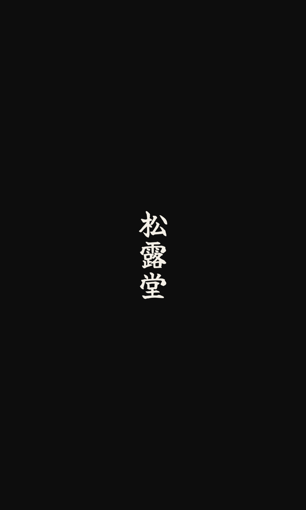

# UI Design System & Master Generation Blueprint: shorodo-nagoya

> **松露堂 — 手の中の温度 · 明治十年創業・名古屋 円頓寺の和菓子処** (https://shorodo.nagoya/) — 明治十年（1877年）創業、名古屋・円頓寺本町商店街の御菓子処 松露堂。季節であんこの硬さを変え、すり蜜の熱を炭火と手で計る——看板の松露糖と、一枚ずつ手焼きする金鯱きんつば。



---

## 1. Executive Visual Persona & Design Archetype

- **Brand Essence & Persona**: **松露堂 — 手の中の温度 · 明治十年創業・名古屋 円頓寺の和菓子処** (`https://shorodo.nagoya/`). 明治十年（1877年）創業、名古屋・円頓寺本町商店街の御菓子処 松露堂。季節であんこの硬さを変え、すり蜜の熱を炭火と手で計る——看板の松露糖と、一枚ずつ手焼きする金鯱きんつば。
- **Visual Archetype**: **Dark-Substrate WebGL / Canvas Interactive Experience (`#0d0d0d` / `#c8834a`)**.
- **Anti-AI-Slop Differentiators**:
  - **Source-Grounded Chromatic Polarity**: Anchors the viewport in `#0d0d0d` (`var(--black)` in `:root`) paired with `#fcfbf7` primary typography and `#c8834a` accents.
  - **Extracted Typographic Hierarchy**: Pairs `Shorodo Mincho` for display copy (`手の中の温度 手 の 中 の 温 度`) with `Shorodo Cormorant` and not declared in static CSS (uses primary stack / `ui-monospace`).
  - **Calibrated Spatial Grid & Motion**: Combines `1080px` container bounds (`gap: 2.6rem`, padding `.6rem`) with `cubic-bezier(.22,1,.30,1)` easing and Lenis Smooth Scroll (`data-lenis`), GSAP Timeline & ScrollTrigger.

---

## 2. Spatial Architecture & Modular Grid Mathematics


### Viewport Allocation & Container Geometry
- **Captured Viewport Dimensions**: Desktop `1440×2400px` (`assets/desktop.png`, capped at 2400px multi-section capture), Mobile `390×2400px` (`assets/mobile.png`, capped at 2400px multi-section capture).
- **Master Container Bounds**: `1080px` extracted from `shorodo-nagoya` stylesheet.
- **Canvas Lateral Padding & Spacing**: `.6rem` lateral canvas padding with `2.6rem` grid gap.
- **Border Radius Scale**: `2px`, `5px`, `50%`.

### Responsive Breakpoint Architecture
- **Desktop Layout**: Multi-column CSS Grid / Flexbox layout at `1440px` (`max-width: 1080px`, `gap: 2.6rem`).
- **Mobile Layout**: Single-column vertical stack at `390px` viewport width with `.6rem` horizontal padding.
- **Extracted CSS Media Queries**: `@media (max-width:1080px)`, `@media (prefers-reduced-motion:reduce)`, `@media (prefers-reduced-motion: no-preference)`, `@media (min-width:821px)`.

---

## 3. Color System, Materiality & Atmospheric Lighting

### Semantic Palette & Source Grounding
| Semantic Role | Ground-Truth Value | Extracted CSS Source / Selector |
|---|---|---|
| **Primary Canvas Substrate** | `#0d0d0d` | `var(--black)` in `:root` |
| **Primary Typography Ink** | `#16100b` | `var(--koge)` in `:root` |
| **Elevated Surface / Card Substrate** | `#8b5a2b` | `var(--copper)` in `:root` |
| **Interactive Accent / Highlight** | `#c8834a` | `var(--copper-hi)` in `:root` |
| **Secondary / Muted Copy** | `#fcfbf7` | `var(--ivory)` in `:root` |
| **Structural Hairline Border** | `#f3efe6` | `var(--washi)` in `:root` |
| **Variable Token (`--sumi`)** | `#231f1c` | `var(--sumi)` in `:root` |
| **Variable Token (`--enji`)** | `#7e2a2e` | `var(--enji)` in `:root` |
| **Variable Token (`--enji-hi`)** | `#a03a3c` | `var(--enji-hi)` in `:root` |

### Sanitized Root CSS Variables (`ui-ux.md` Ground Truth)
| Variable Name | Extracted Value | Semantic Role |
|---|---|---|
| `--black` | `#0d0d0d` | Canvas / Surface Token |
| `--koge` | `#16100b` | Color / Atmospheric Token |
| `--copper` | `#8b5a2b` | Color / Atmospheric Token |
| `--copper-hi` | `#c8834a` | Color / Atmospheric Token |
| `--copper-dim` | `rgba(139,90,43,.35)` | Color / Atmospheric Token |
| `--ivory` | `#fcfbf7` | Color / Atmospheric Token |
| `--ivory-70` | `rgba(252,251,247,.70)` | Color / Atmospheric Token |
| `--ivory-40` | `rgba(252,251,247,.48)` | Color / Atmospheric Token |
| `--ivory-14` | `rgba(252,251,247,.14)` | Color / Atmospheric Token |
| `--washi` | `#f3efe6` | Color / Atmospheric Token |
| `--sumi` | `#231f1c` | Color / Atmospheric Token |
| `--sumi-60` | `rgba(35,31,28,.66)` | Color / Atmospheric Token |
| `--sumi-30` | `rgba(35,31,28,.45)` | Color / Atmospheric Token |
| `--sumi-ink` | `rgba(35,31,28,.64)` | Typography Ink Token |
| `--enji` | `#7e2a2e` | Color / Atmospheric Token |
| `--enji-hi` | `#a03a3c` | Color / Atmospheric Token |

---

## 4. Typographic Scale & Editorial Hierarchy

### Font Family Stacks
- **Display Typography**: `Shorodo Mincho`.
- **Primary Body Stack**: `Shorodo Cormorant`.
- **Technical / Metadata Stack**: not declared in static CSS (uses primary stack / `ui-monospace`).

### Typographic Scale & Rules (Extracted from Stylesheet & Variables)
- **Hero Display (`H1`)**: not explicitly declared on tag in static CSS (stylesheet font-size ladder: `.8rem`, `1rem`, `.58rem`, `.66rem`, `1.65rem`).
- **Section Heading (`H2`)**: rule `h2` (`font-size: .72rem`, `letter-spacing: .4em`, `font-weight: 500`).
- **Body Copy**: rule `body` (`line-height: 2.1`, `letter-spacing: .05em`).
- **Metadata & Navigation Labels**: rule `small` (`font-size: .58rem`, `letter-spacing: .34em`).

---

## 5. Choreographed Motion & Interaction Physics

### Primary Easing Curves
- **Extracted Timing Functions**: `cubic-bezier(.22,1,.30,1)`, `cubic-bezier(.55,0,.16,1)`, `cubic-bezier(.33,1,.68,1)`.

### Per-Element Transition & Choreography Rules
- **Selector `.foot__credit a`**: `transition: text-decoration-color .3s,color .3s` extracted from `shorodo-nagoya` stylesheet.
- **Selector `.skip`**: `transition: top .3s` extracted from `shorodo-nagoya` stylesheet.
- **Selector `#loader`**: `transition: opacity 1.1s var(--ease-press),visibility 1.1s` extracted from `shorodo-nagoya` stylesheet.
- **Extracted Easing Curve (`cubic-bezier(.22,1,.30,1)`)**: Governs interactive state transitions across `<nav.chrome__nav>` and `<section.chapter>`.
- **Runtime Interaction Engine**: Integrates Lenis Smooth Scroll (`data-lenis`), GSAP Timeline & ScrollTrigger, HTML5 `<canvas>` Interactive Viewport Surface with `prefers-reduced-motion: reduce` fallback guards.

---

## 6. Component Wireframe & Structural DOM Map

### Visual Layout Schematic (Grounded in `dom.html` — `1440px` Desktop & `390px` Mobile Reflow)
```
┌────────────────────────────────────────────────────────────────────────┐
│ DESKTOP VIEWPORT (1440px) — 松露堂 — 手の中の温度 · 明治十年創業・名古屋 円頓寺の和菓子処         │
│ ====================================================================== │
│ [ <nav.chrome__nav>        | 品書き · 御案内 · EN                         ]  │
│ ---------------------------------------------------------------------- │
│ | HERO STAGE: <section.hero>                                       |   │
│ | H1: 手の中の温度 手 の 中 の 温 度                                           |   │
│ | Substrate: #0d0d0d    | Ink: #fcfbf7    | Accent: #c8834a        |   │
│ ---------------------------------------------------------------------- │
│ | SHOWCASE GRID (<section.chapter>         ) max-w: 1080px         |   │
│ | +------------------------------+  +------------------------------+ | │
│ | | 帳場 HISTORY                   |  | お知らせ NEWS                    | | │
│ | +------------------------------+  +------------------------------+ | │
│ ---------------------------------------------------------------------- │
│ | MOBILE VIEWPORT REFLOW (390px) — Single-Column Stack (gap: 2.6rem) | │
│ | [<nav.chrome__nav>] -> [<section.hero>] -> [<section.chapter>] |     │
│ ---------------------------------------------------------------------- │
│ [ FOOTER (<footer.matsuba>      ) | https://shorodo.nagoya/            │
└────────────────────────────────────────────────────────────────────────┘
```

### Granular DOM Region Breakdown
1. **Brand Header & Navigation Bar (<nav.chrome__nav> — `shorodo-nagoya`)**:
   - Landmark `<nav class="chrome__nav">` hosting `松露堂 — 手の中の温度 · 明治十年創業・名古屋 円頓寺の和菓子処` navigation (`品書き · 御案内 · EN`), DOM attributes (`data-dur="9.5"`, `data-amp="18"`, `data-delay="0"`, `data-dur="8.0"`), and stylesheet rule `after { margin:0;padding:0;box-sizing:border-box }`.
2. **Hero Stage & Focal Lead (<section.hero> — `手の中の温度 手 の 中 の 温 度`)**:
   - Landmark `<section class="hero">` presenting display lead `手の中の温度 手 の 中 の 温 度` and copy excerpt *"松露堂 SHORODO — SINCE 1877 / 名古屋 円頓寺本町 （頁の初めへ）"* over `#0d0d0d` canvas and `#fcfbf7` ink.
3. **Primary Showcase & Content Grid (<section.chapter> — `帳場 HISTORY`)**:
   - Landmark `<section class="chapter history">` rendering section `帳場 HISTORY` with copy *"このページは「手の中の温度」を主題に、炭火・銅板・すり蜜・手のひらと、章が進むごとに温度が下がっていく構成でお店を紹介します。"*, asset references (`en.html`, `tw.html`, `cn.html`, `logo_shouten.png`), and grid rule `html.lenis { height:auto }`.
4. **Interactive Detail & Feature Matrix (<section.news> — `お知らせ NEWS`)**:
   - Landmark `<section class="news">` framing `お知らせ NEWS` and `町 ENDOJI` (*"銅鍋のすり蜜に、あん玉をくぐらせる手元"*) with `#8b5a2b` surface cards, `#c8834a` accents, and `.lenis.lenis-smooth { scroll-behavior:auto }`.
5. **Colophon & Global Directory Footer (<footer.matsuba> — `https://shorodo.nagoya/`)**:
   - Landmark `<footer class="matsuba">` anchoring `松露堂 — 手の中の温度 · 明治十年創業・名古屋 円頓寺の和菓` footer links (`品書き · 御案内 · EN`), copy *"THE TEMPERATURE IN THE HAND"*, and `#f3efe6` structural dividers.

---

## 7. Master Zero-Shot AI Generation Prompt

```markdown
# Master Zero-Shot Frontend Generation Prompt: shorodo-nagoya (松露堂 — 手の中の温度 · 明治十年創業・名古屋 円頓寺の和菓子処)

You are a principal frontend architect and design systems engineer. Build a complete, production-ready web application replicating the exact design system, DOM landmarks, typographic hierarchy, color tokens, and motion physics of `shorodo-nagoya` (**松露堂 — 手の中の温度 · 明治十年創業・名古屋 円頓寺の和菓子処** — `https://shorodo.nagoya/`).

### 1. Visual Archetype & Anti-AI-Slop Mandates
- **Archetype**: Dark-Substrate WebGL / Canvas Interactive Experience (`#0d0d0d` / `#c8834a`).
- **Identity & Domain Context**: 明治十年（1877年）創業、名古屋・円頓寺本町商店街の御菓子処 松露堂。季節であんこの硬さを変え、すり蜜の熱を炭火と手で計る——看板の松露糖と、一枚ずつ手焼きする金鯱きんつば。
- **Primary Substrate**: `#0d0d0d` (`var(--black)` in `:root`), **Primary Ink**: `#fcfbf7`, **Accent / Highlight**: `#c8834a`.
- **Site-Specific Differentiators**:
  - **Source-Grounded Chromatic Polarity**: Anchors the viewport in `#0d0d0d` (`var(--black)` in `:root`) paired with `#fcfbf7` primary typography and `#c8834a` accents.
  - **Extracted Typographic Hierarchy**: Pairs `Shorodo Mincho` for display copy (`手の中の温度 手 の 中 の 温 度`) with `Shorodo Cormorant` and not declared in static CSS (uses primary stack / `ui-monospace`).
  - **Calibrated Spatial Grid & Motion**: Combines `1080px` container bounds (`gap: 2.6rem`, padding `.6rem`) with `cubic-bezier(.22,1,.30,1)` easing and Lenis Smooth Scroll (`data-lenis`), GSAP Timeline & ScrollTrigger.

### 2. Ground-Truth CSS Variables (`:root` Token Contract)
Declare and consume these exact custom properties extracted from `shorodo-nagoya` in your global stylesheet:

:root {
  /* 松露堂 — 手の中の温度 · 明治十年創業・名古屋 円頓寺の和菓子処 (shorodo-nagoya) — Ground-Truth Extracted CSS Variables */
  --black: #0d0d0d; /* Canvas / Surface Token (shorodo-nagoya) */
  --koge: #16100b; /* Color / Atmospheric Token (shorodo-nagoya) */
  --copper: #8b5a2b; /* Color / Atmospheric Token (shorodo-nagoya) */
  --copper-hi: #c8834a; /* Color / Atmospheric Token (shorodo-nagoya) */
  --copper-dim: rgba(139,90,43,.35); /* Color / Atmospheric Token (shorodo-nagoya) */
  --ivory: #fcfbf7; /* Color / Atmospheric Token (shorodo-nagoya) */
  --ivory-70: rgba(252,251,247,.70); /* Color / Atmospheric Token (shorodo-nagoya) */
  --ivory-40: rgba(252,251,247,.48); /* Color / Atmospheric Token (shorodo-nagoya) */
  --ivory-14: rgba(252,251,247,.14); /* Color / Atmospheric Token (shorodo-nagoya) */
  --washi: #f3efe6; /* Color / Atmospheric Token (shorodo-nagoya) */
  --sumi: #231f1c; /* Color / Atmospheric Token (shorodo-nagoya) */
  --sumi-60: rgba(35,31,28,.66); /* Color / Atmospheric Token (shorodo-nagoya) */
  --sumi-30: rgba(35,31,28,.45); /* Color / Atmospheric Token (shorodo-nagoya) */
  --sumi-ink: rgba(35,31,28,.64); /* Typography Ink Token (shorodo-nagoya) */
  --enji: #7e2a2e; /* Color / Atmospheric Token (shorodo-nagoya) */
  --enji-hi: #a03a3c; /* Color / Atmospheric Token (shorodo-nagoya) */
}

### 3. Semantic Color & Materiality Contract
Map every surface, ink, and border strictly to these source-grounded tokens:
- **Primary Canvas Substrate**: `#0d0d0d` — grounded in `var(--black)` in `:root`
- **Primary Typography Ink**: `#16100b` — grounded in `var(--koge)` in `:root`
- **Elevated Surface / Card Substrate**: `#8b5a2b` — grounded in `var(--copper)` in `:root`
- **Interactive Accent / Highlight**: `#c8834a` — grounded in `var(--copper-hi)` in `:root`
- **Secondary / Muted Copy**: `#fcfbf7` — grounded in `var(--ivory)` in `:root`
- **Structural Hairline Border**: `#f3efe6` — grounded in `var(--washi)` in `:root`
- **Variable Token (`--sumi`)**: `#231f1c` — grounded in `var(--sumi)` in `:root`
- **Variable Token (`--enji`)**: `#7e2a2e` — grounded in `var(--enji)` in `:root`
- **Variable Token (`--enji-hi`)**: `#a03a3c` — grounded in `var(--enji-hi)` in `:root`

### 4. Spatial Grid, Container Bounds & Responsive Breakpoints
- **Desktop Viewport Reference**: `1440×2400px` (capped at 2400px multi-section capture, `1440px` standard desktop width).
- **Mobile Viewport Reference**: `390×2400px` (capped at 2400px multi-section capture, `390px` standard mobile width).
- **Container Max-Width**: `1080px` extracted from `shorodo-nagoya` stylesheet
- **Padding & Gutters**: `.6rem` lateral canvas padding with `2.6rem` grid gap
- **Desktop Grid**: Multi-column CSS Grid / Flexbox layout at `1440px` (`max-width: 1080px`, `gap: 2.6rem`)
- **Mobile Adaptation**: Single-column vertical stack at `390px` viewport width with `.6rem` horizontal padding
- **Media Queries**: `@media (max-width:1080px)`, `@media (prefers-reduced-motion:reduce)`, `@media (prefers-reduced-motion: no-preference)`, `@media (min-width:821px)`
- **Corner Radii**: `2px`, `5px`, `50%`

### 5. Typography & Editorial Scale Contract
- **Display Font Stack**: `Shorodo Mincho`
- **Body Font Stack**: `Shorodo Cormorant`
- **Monospace / Technical Font Stack**: not declared in static CSS (uses primary stack / `ui-monospace`)
- **H1 Display Rule**: not explicitly declared on tag in static CSS (stylesheet font-size ladder: `.8rem`, `1rem`, `.58rem`, `.66rem`, `1.65rem`)
- **H2 Section Rule**: rule `h2` (`font-size: .72rem`, `letter-spacing: .4em`, `font-weight: 500`)
- **Body Copy Rule**: rule `body` (`line-height: 2.1`, `letter-spacing: .05em`)
- **Metadata & Index Rule**: rule `small` (`font-size: .58rem`, `letter-spacing: .34em`)

### 6. Component Hierarchy, Verbatim Copy & Real DOM Landmarks
Scaffold `shorodo-nagoya` (`松露堂 — 手の中の温度 · 明治十年創業・名古屋 円頓寺の和菓子処`) with these exact structural regions, extracted copy, and CSS rules from `dom.html`:
1. **Brand Header & Navigation Bar (<nav.chrome__nav> — `shorodo-nagoya`)**:
   - DOM & Selectors: Landmark `<nav class="chrome__nav">` hosting `松露堂 — 手の中の温度 · 明治十年創業・名古屋 円頓寺の和菓子処` navigation (`品書き · 御案内 · EN`), DOM attributes (`data-dur="9.5"`, `data-amp="18"`, `data-delay="0"`, `data-dur="8.0"`), and stylesheet rule `after { margin:0;padding:0;box-sizing:border-box }`.
   - Responsive Contract: Header `Brand Header & Navigation Bar (<nav.chrome__nav> — `shorodo-nagoya`)` (`shorodo-nagoya`) adapts across `@media (max-width:1080px)`, `@media (prefers-reduced-motion:reduce)`, `@media (prefers-reduced-motion: no-preference)`, `@media (min-width:821px)` with `cubic-bezier(.22,1,.30,1)`, `cubic-bezier(.55,0,.16,1)`, `cubic-bezier(.33,1,.68,1)` transitions and links `品書き · 御案内 · EN`.
2. **Hero Stage & Focal Lead (<section.hero> — `手の中の温度 手 の 中 の 温 度`)**:
   - DOM & Selectors: Landmark `<section class="hero">` presenting display lead `手の中の温度 手 の 中 の 温 度` and copy excerpt *"松露堂 SHORODO — SINCE 1877 / 名古屋 円頓寺本町 （頁の初めへ）"* over `#0d0d0d` canvas and `#fcfbf7` ink.
   - Responsive Contract: Hero stage (`1440×2400px` desktop / `390×2400px` mobile) sets `#0d0d0d` background with `#fcfbf7` headline `手の中の温度 手 の 中 の 温 度`.
3. **Primary Showcase & Content Grid (<section.chapter> — `帳場 HISTORY`)**:
   - DOM & Selectors: Landmark `<section class="chapter history">` rendering section `帳場 HISTORY` with copy *"このページは「手の中の温度」を主題に、炭火・銅板・すり蜜・手のひらと、章が進むごとに温度が下がっていく構成でお店を紹介します。"*, asset references (`en.html`, `tw.html`, `cn.html`, `logo_shouten.png`), and grid rule `html.lenis { height:auto }`.
   - Responsive Contract: Showcase grid `Primary Showcase & Content Grid (<section.chapter> — `帳場 HISTORY`)` applies Multi-column CSS Grid / Flexbox layout at `1440px` (`max-width: 1080px`, `gap: 2.6rem`) on desktop and Single-column vertical stack at `390px` viewport width with `.6rem` horizontal padding on mobile.
4. **Interactive Detail & Feature Matrix (<section.news> — `お知らせ NEWS`)**:
   - DOM & Selectors: Landmark `<section class="news">` framing `お知らせ NEWS` and `町 ENDOJI` (*"銅鍋のすり蜜に、あん玉をくぐらせる手元"*) with `#8b5a2b` surface cards, `#c8834a` accents, and `.lenis.lenis-smooth { scroll-behavior:auto }`.
   - Responsive Contract: Detail module `Interactive Detail & Feature Matrix (<section.news> — `お知らせ NEWS`)` uses `2px`, `5px`, `50%` radii, `#c8834a` highlights, and assets (en.html, tw.html, cn.html).
5. **Colophon & Global Directory Footer (<footer.matsuba> — `https://shorodo.nagoya/`)**:
   - DOM & Selectors: Landmark `<footer class="matsuba">` anchoring `松露堂 — 手の中の温度 · 明治十年創業・名古屋 円頓寺の和菓` footer links (`品書き · 御案内 · EN`), copy *"THE TEMPERATURE IN THE HAND"*, and `#f3efe6` structural dividers.
   - Responsive Contract: Footer `Colophon & Global Directory Footer (<footer.matsuba> — `https://shorodo.nagoya/`)` aligns to `1080px` extracted from `shorodo-nagoya` stylesheet with `.6rem` lateral canvas padding with `2.6rem` grid gap and attributes (data-dur="9.5", data-amp="18", data-delay="0").

#### Verbatim DOM Copy Excerpts (`dom.html`)
- Copy Excerpt 1: *"松露堂 SHORODO — SINCE 1877 / 名古屋 円頓寺本町 （頁の初めへ）"*
- Copy Excerpt 2: *"このページは「手の中の温度」を主題に、炭火・銅板・すり蜜・手のひらと、章が進むごとに温度が下がっていく構成でお店を紹介します。"*
- Copy Excerpt 3: *"銅鍋のすり蜜に、あん玉をくぐらせる手元"*
- Copy Excerpt 4: *"THE TEMPERATURE IN THE HAND"*

### 7. Motion, Extracted Stylesheet Rules & Interaction Choreography
- **Primary Easing Functions**: `cubic-bezier(.22,1,.30,1)`, `cubic-bezier(.55,0,.16,1)`, `cubic-bezier(.33,1,.68,1)`
- **Extracted Stylesheet Rules (`shorodo-nagoya`)**:
- `after { margin:0;padding:0;box-sizing:border-box }`
- `html.lenis { height:auto }`
- `.lenis.lenis-smooth { scroll-behavior:auto }`
- `video { display:block;max-width:100% }`
- `.bx { word-break:keep-all;overflow-wrap:break-word;line-break:strict }`
- **Per-Selector Transition Rules**:
- **Selector `.foot__credit a`**: `transition: text-decoration-color .3s,color .3s` extracted from `shorodo-nagoya` stylesheet.
- **Selector `.skip`**: `transition: top .3s` extracted from `shorodo-nagoya` stylesheet.
- **Selector `#loader`**: `transition: opacity 1.1s var(--ease-press),visibility 1.1s` extracted from `shorodo-nagoya` stylesheet.
- **Extracted Easing Curve (`cubic-bezier(.22,1,.30,1)`)**: Governs interactive state transitions across `<nav.chrome__nav>` and `<section.chapter>`.
- **Runtime Interaction Engine**: Integrates Lenis Smooth Scroll (`data-lenis`), GSAP Timeline & ScrollTrigger, HTML5 `<canvas>` Interactive Viewport Surface with `prefers-reduced-motion: reduce` fallback guards.

### 8. Technical Deliverables
- Implement in Next.js (App Router) with TypeScript and Tailwind CSS consuming the `:root` custom properties defined above for `shorodo-nagoya`.
- Reproduce both the `1440px` desktop architecture and `390px` mobile breakpoint transitions, preserving semantic HTML5 landmarks (`<header>`, `<nav>`, `<main>`, `<section>`, `<footer>`) and `prefers-reduced-motion` accessibility guards.
```
