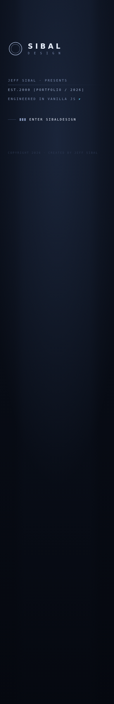

# UI Design System & Master Generation Blueprint: sibaldesign-com

> **Jeff Sibal — Visual & Digital Designer · SIBALDESIGN** (https://sibaldesign.com/) — Jeff Sibal, visual and digital designer in Southern California. Twenty-plus years across web, UI/UX, email, video and photography. I desi...


---

## 1. Executive Visual Persona & Design Archetype

- **Brand Essence & Persona**: **Jeff Sibal — Visual & Digital Designer · SIBALDESIGN** (`https://sibaldesign.com/`). Jeff Sibal, visual and digital designer in Southern California. Twenty-plus years across web, UI/UX, email, video and photography. I desi...
- **Visual Archetype**: **Dark-Substrate WebGL / Canvas Interactive Experience (`#04060b` / `#131b2b`)**.
- **Anti-AI-Slop Differentiators**:
  - **Source-Grounded Chromatic Polarity**: Anchors the viewport in `#04060b` (`var(--ink-000)` in `:root`) paired with `#33415f` primary typography and `#131b2b` accents.
  - **Extracted Typographic Hierarchy**: Pairs `Chakra Petch` for display copy (`A VISUAL & DIGITAL DESIGNER`) with `JetBrains Mono` and `JetBrains Mono`.
  - **Calibrated Spatial Grid & Motion**: Combines `900px` container bounds (`gap: 16px`, padding `8px`) with `cubic-bezier(.16,1,.3,1)` easing and Three.js / WebGL Canvas Pipeline.

---

## 2. Spatial Architecture & Modular Grid Mathematics



### Viewport Allocation & Container Geometry
- **Captured Viewport Dimensions**: Desktop `1440×10877px` (`assets/desktop.png`, full-page scroll capture), Mobile `390×2400px` (`assets/mobile.png`, capped at 2400px multi-section capture).
- **Master Container Bounds**: `900px` extracted from `sibaldesign-com` stylesheet.
- **Canvas Lateral Padding & Spacing**: `8px` lateral canvas padding with `16px` grid gap.
- **Border Radius Scale**: `0px` (sharp unrounded corners).

### Responsive Breakpoint Architecture
- **Desktop Layout**: Multi-column CSS Grid / Flexbox layout at `1440px` (`max-width: 900px`, `gap: 16px`).
- **Mobile Layout**: Single-column vertical stack at `390px` viewport width with `8px` horizontal padding.
- **Extracted CSS Media Queries**: `@media (prefers-reduced-motion:reduce)`, `@media (max-width:900px)`, `@media (max-width:860px)`, `@media (max-width:560px)`.

---

## 3. Color System, Materiality & Atmospheric Lighting

### Semantic Palette & Source Grounding
| Semantic Role | Ground-Truth Value | Extracted CSS Source / Selector |
|---|---|---|
| **Primary Canvas Substrate** | `#04060b` | `var(--ink-000)` in `:root` |
| **Primary Typography Ink** | `#080c15` | `var(--ink-100)` in `:root` |
| **Elevated Surface / Card Substrate** | `#0d1320` | `var(--ink-200)` in `:root` |
| **Interactive Accent / Highlight** | `#131b2b` | `var(--ink-300)` in `:root` |
| **Secondary / Muted Copy** | `#232e45` | `var(--line)` in `:root` |
| **Structural Hairline Border** | `#33415f` | `var(--line-hi)` in `:root` |
| **Variable Token (`--dim`)** | `#7f90b4` | `var(--dim)` in `:root` |
| **Variable Token (`--mid`)** | `#a3b4d4` | `var(--mid)` in `:root` |
| **Variable Token (`--fg`)** | `#c3d0e8` | `var(--fg)` in `:root` |
| **Variable Token (`--white`)** | `#eaf1ff` | `var(--white)` in `:root` |
| **Variable Token (`--accent`)** | `#5fe0ff` | `var(--accent)` in `:root` |
| **Variable Token (`--flash`)** | `#7ce9ff` | `var(--flash)` in `:root` |

### Sanitized Root CSS Variables (`ui-ux.md` Ground Truth)
| Variable Name | Extracted Value | Semantic Role |
|---|---|---|
| `--ink-000` | `#04060b` | Typography Ink Token |
| `--ink-100` | `#080c15` | Typography Ink Token |
| `--ink-200` | `#0d1320` | Typography Ink Token |
| `--ink-300` | `#131b2b` | Typography Ink Token |
| `--panel` | `rgba(20,27,42,.66)` | Color / Atmospheric Token |
| `--panel-hi` | `rgba(30,40,60,.72)` | Color / Atmospheric Token |
| `--line` | `#232e45` | Color / Atmospheric Token |
| `--line-hi` | `#33415f` | Color / Atmospheric Token |
| `--dim` | `#7f90b4` | Color / Atmospheric Token |
| `--mid` | `#a3b4d4` | Color / Atmospheric Token |
| `--fg` | `#c3d0e8` | Typography Ink Token |
| `--white` | `#eaf1ff` | Canvas / Surface Token |
| `--accent` | `#5fe0ff` | Brand / Palette Token |
| `--flash` | `#7ce9ff` | Color / Atmospheric Token |
| `--accent-lo` | `rgba(95,224,255,.14)` | Brand / Palette Token |
| `--mono` | `"JetBrains Mono",ui-monospace,SFMono-Regular,Menlo,monospace` | Typography / Scale Token |

---

## 4. Typographic Scale & Editorial Hierarchy

### Font Family Stacks
- **Display Typography**: `Chakra Petch`.
- **Primary Body Stack**: `JetBrains Mono`.
- **Technical / Metadata Stack**: `JetBrains Mono`.

### Typographic Scale & Rules (Extracted from Stylesheet & Variables)
- **Hero Display (`H1`)**: not explicitly declared on tag in static CSS (stylesheet font-size ladder: `15px`, `clamp(24px,3.6vw,34px)`, `10px`, `11px`, `9px`).
- **Section Heading (`H2`)**: not explicitly declared on tag in static CSS (stylesheet font-size ladder: `15px`, `clamp(24px,3.6vw,34px)`, `10px`, `11px`, `9px`).
- **Body Copy**: rule `p` (`font-size: 15px`).
- **Metadata & Navigation Labels**: CSS variables `--mono: "JetBrains Mono",ui-monospace,SFMono-Regular,Menlo,monospace`; rule `small` (`font-size: 7px`, `letter-spacing: .22em`).

---

## 5. Choreographed Motion & Interaction Physics

### Primary Easing Curves
- **Extracted Timing Functions**: `cubic-bezier(.16,1,.3,1)`, `cubic-bezier(.65,0,.35,1)`, `cubic-bezier(.5,.05,.25,1)`.

### Per-Element Transition & Choreography Rules
- **Selector `body:before`**: `transition: opacity 1.6s var(--ease) .1s` extracted from `sibaldesign-com` stylesheet.
- **Selector `#streaks`**: `transition: opacity 1.6s var(--ease) .6s` extracted from `sibaldesign-com` stylesheet.
- **Selector `.enter__rule`**: `transition: width .5s var(--ease),background .3s` extracted from `sibaldesign-com` stylesheet.
- **Extracted Easing Curve (`cubic-bezier(.16,1,.3,1)`)**: Governs interactive state transitions across `<header.nav>` and `<section.boot>`.
- **Runtime Interaction Engine**: Integrates Three.js / WebGL Canvas Pipeline with `prefers-reduced-motion: reduce` fallback guards.

---

## 6. Component Wireframe & Structural DOM Map

### Visual Layout Schematic (Grounded in `dom.html` — `1440px` Desktop & `390px` Mobile Reflow)
```
┌────────────────────────────────────────────────────────────────────────┐
│ DESKTOP VIEWPORT (1440px) — Jeff Sibal — Visual & Digital Designer · S │
│ ====================================================================== │
│ [ <header.nav>             | PROFILE · PROJECTS · EXPERIENCE · PHOT ]  │
│ ---------------------------------------------------------------------- │
│ | HERO STAGE: <section.boot>                                       |   │
│ | H1: A VISUAL & DIGITAL DESIGNER                                  |   │
│ | Substrate: #04060b    | Ink: #33415f    | Accent: #131b2b        |   │
│ ---------------------------------------------------------------------- │
│ | SHOWCASE GRID (<section.boot>            ) max-w: 900px          |   │
│ | +------------------------------+  +------------------------------+ | │
│ | | PROFILE                      |  | PROJECTS                     | | │
│ | +------------------------------+  +------------------------------+ | │
│ ---------------------------------------------------------------------- │
│ | MOBILE VIEWPORT REFLOW (390px) — Single-Column Stack (gap: 16px  ) | │
│ | [<header.nav>] -> [<section.boot>] -> [<section.boot>] |             │
│ ---------------------------------------------------------------------- │
│ [ FOOTER (<footer.foot>         ) | https://sibaldesign.com/           │
└────────────────────────────────────────────────────────────────────────┘
```

### Granular DOM Region Breakdown
1. **Brand Header & Navigation Bar (<header.nav> — `sibaldesign-com`)**:
   - Landmark `<header class="nav">` hosting `Jeff Sibal — Visual & Digital Design` navigation (`PROFILE · PROJECTS · EXPERIENCE · PHOTOS · EQUIPMENT`), DOM attributes (`data-boot="splash"`, `data-line`, `data-nav`, `data-text="A VISUAL &"`), and stylesheet rule `after { box-sizing:border-box }`.
2. **Hero Stage & Focal Lead (<section.boot> — `A VISUAL & DIGITAL DESIGNER`)**:
   - Landmark `<section class="boot">` presenting display lead `A VISUAL & DIGITAL DESIGNER` and copy excerpt *"JEFF SIBAL · PRESENTS"* over `#04060b` canvas and `#33415f` ink.
3. **Primary Showcase & Content Grid (<section.boot> — `PROFILE`)**:
   - Landmark `<section class="boot">` rendering section `PROFILE` with copy *"EST.2000 [PORTFOLIO / 2026]"*, asset references (`favicon.svg`, `favicon-32.png`, `apple-touch-icon.png`, `fonts.googleapis.com`), and grid rule `body { height:100% }`.
4. **Interactive Detail & Feature Matrix (<section.hero> — `PROJECTS`)**:
   - Landmark `<section class="hero">` framing `PROJECTS` and `Video Testimonial Service` (*"ENGINEERED IN VANILLA JS ◤"*) with `#0d1320` surface cards, `#131b2b` accents, and `button { font:inherit;color:inherit;background:none;border:0;cursor:pointer }`.
5. **Colophon & Global Directory Footer (<footer.foot> — `https://sibaldesign.com/`)**:
   - Landmark `<footer class="foot">` anchoring `Jeff Sibal — Visual & Digital De` footer links (`PROFILE · PROJECTS · EXPERIENCE · PHOTOS · EQUIPMENT`), copy *"COPYRIGHT 2026 · CREATED BY JEFF SIBAL"*, and `#33415f` structural dividers.

---

## 7. Master Zero-Shot AI Generation Prompt

```markdown
# Master Zero-Shot Frontend Generation Prompt: sibaldesign-com (Jeff Sibal — Visual & Digital Designer · SIBALDESIGN)

You are a principal frontend architect and design systems engineer. Build a complete, production-ready web application replicating the exact design system, DOM landmarks, typographic hierarchy, color tokens, and motion physics of `sibaldesign-com` (**Jeff Sibal — Visual & Digital Designer · SIBALDESIGN** — `https://sibaldesign.com/`).

### 1. Visual Archetype & Anti-AI-Slop Mandates
- **Archetype**: Dark-Substrate WebGL / Canvas Interactive Experience (`#04060b` / `#131b2b`).
- **Identity & Domain Context**: Jeff Sibal, visual and digital designer in Southern California. Twenty-plus years across web, UI/UX, email, video and photography. I desi...
- **Primary Substrate**: `#04060b` (`var(--ink-000)` in `:root`), **Primary Ink**: `#33415f`, **Accent / Highlight**: `#131b2b`.
- **Site-Specific Differentiators**:
  - **Source-Grounded Chromatic Polarity**: Anchors the viewport in `#04060b` (`var(--ink-000)` in `:root`) paired with `#33415f` primary typography and `#131b2b` accents.
  - **Extracted Typographic Hierarchy**: Pairs `Chakra Petch` for display copy (`A VISUAL & DIGITAL DESIGNER`) with `JetBrains Mono` and `JetBrains Mono`.
  - **Calibrated Spatial Grid & Motion**: Combines `900px` container bounds (`gap: 16px`, padding `8px`) with `cubic-bezier(.16,1,.3,1)` easing and Three.js / WebGL Canvas Pipeline.

### 2. Ground-Truth CSS Variables (`:root` Token Contract)
Declare and consume these exact custom properties extracted from `sibaldesign-com` in your global stylesheet:

:root {
  /* Jeff Sibal — Visual & Digital Designer · SIBALDESIGN (sibaldesign-com) — Ground-Truth Extracted CSS Variables */
  --ink-000: #04060b; /* Typography Ink Token (sibaldesign-com) */
  --ink-100: #080c15; /* Typography Ink Token (sibaldesign-com) */
  --ink-200: #0d1320; /* Typography Ink Token (sibaldesign-com) */
  --ink-300: #131b2b; /* Typography Ink Token (sibaldesign-com) */
  --panel: rgba(20,27,42,.66); /* Color / Atmospheric Token (sibaldesign-com) */
  --panel-hi: rgba(30,40,60,.72); /* Color / Atmospheric Token (sibaldesign-com) */
  --line: #232e45; /* Color / Atmospheric Token (sibaldesign-com) */
  --line-hi: #33415f; /* Color / Atmospheric Token (sibaldesign-com) */
  --dim: #7f90b4; /* Color / Atmospheric Token (sibaldesign-com) */
  --mid: #a3b4d4; /* Color / Atmospheric Token (sibaldesign-com) */
  --fg: #c3d0e8; /* Typography Ink Token (sibaldesign-com) */
  --white: #eaf1ff; /* Canvas / Surface Token (sibaldesign-com) */
  --accent: #5fe0ff; /* Brand / Palette Token (sibaldesign-com) */
  --flash: #7ce9ff; /* Color / Atmospheric Token (sibaldesign-com) */
  --accent-lo: rgba(95,224,255,.14); /* Brand / Palette Token (sibaldesign-com) */
  --mono: "JetBrains Mono",ui-monospace,SFMono-Regular,Menlo,monospace; /* Typography / Scale Token (sibaldesign-com) */
}

### 3. Semantic Color & Materiality Contract
Map every surface, ink, and border strictly to these source-grounded tokens:
- **Primary Canvas Substrate**: `#04060b` — grounded in `var(--ink-000)` in `:root`
- **Primary Typography Ink**: `#080c15` — grounded in `var(--ink-100)` in `:root`
- **Elevated Surface / Card Substrate**: `#0d1320` — grounded in `var(--ink-200)` in `:root`
- **Interactive Accent / Highlight**: `#131b2b` — grounded in `var(--ink-300)` in `:root`
- **Secondary / Muted Copy**: `#232e45` — grounded in `var(--line)` in `:root`
- **Structural Hairline Border**: `#33415f` — grounded in `var(--line-hi)` in `:root`
- **Variable Token (`--dim`)**: `#7f90b4` — grounded in `var(--dim)` in `:root`
- **Variable Token (`--mid`)**: `#a3b4d4` — grounded in `var(--mid)` in `:root`
- **Variable Token (`--fg`)**: `#c3d0e8` — grounded in `var(--fg)` in `:root`
- **Variable Token (`--white`)**: `#eaf1ff` — grounded in `var(--white)` in `:root`
- **Variable Token (`--accent`)**: `#5fe0ff` — grounded in `var(--accent)` in `:root`
- **Variable Token (`--flash`)**: `#7ce9ff` — grounded in `var(--flash)` in `:root`

### 4. Spatial Grid, Container Bounds & Responsive Breakpoints
- **Desktop Viewport Reference**: `1440×10877px` (full-page scroll capture, `1440px` standard desktop width).
- **Mobile Viewport Reference**: `390×2400px` (capped at 2400px multi-section capture, `390px` standard mobile width).
- **Container Max-Width**: `900px` extracted from `sibaldesign-com` stylesheet
- **Padding & Gutters**: `8px` lateral canvas padding with `16px` grid gap
- **Desktop Grid**: Multi-column CSS Grid / Flexbox layout at `1440px` (`max-width: 900px`, `gap: 16px`)
- **Mobile Adaptation**: Single-column vertical stack at `390px` viewport width with `8px` horizontal padding
- **Media Queries**: `@media (prefers-reduced-motion:reduce)`, `@media (max-width:900px)`, `@media (max-width:860px)`, `@media (max-width:560px)`
- **Corner Radii**: `0px` (sharp unrounded corners)

### 5. Typography & Editorial Scale Contract
- **Display Font Stack**: `Chakra Petch`
- **Body Font Stack**: `JetBrains Mono`
- **Monospace / Technical Font Stack**: `JetBrains Mono`
- **H1 Display Rule**: not explicitly declared on tag in static CSS (stylesheet font-size ladder: `15px`, `clamp(24px,3.6vw,34px)`, `10px`, `11px`, `9px`)
- **H2 Section Rule**: not explicitly declared on tag in static CSS (stylesheet font-size ladder: `15px`, `clamp(24px,3.6vw,34px)`, `10px`, `11px`, `9px`)
- **Body Copy Rule**: rule `p` (`font-size: 15px`)
- **Metadata & Index Rule**: CSS variables `--mono: "JetBrains Mono",ui-monospace,SFMono-Regular,Menlo,monospace`; rule `small` (`font-size: 7px`, `letter-spacing: .22em`)

### 6. Component Hierarchy, Verbatim Copy & Real DOM Landmarks
Scaffold `sibaldesign-com` (`Jeff Sibal — Visual & Digital Designer · SIBALDESIGN`) with these exact structural regions, extracted copy, and CSS rules from `dom.html`:
1. **Brand Header & Navigation Bar (<header.nav> — `sibaldesign-com`)**:
   - DOM & Selectors: Landmark `<header class="nav">` hosting `Jeff Sibal — Visual & Digital Design` navigation (`PROFILE · PROJECTS · EXPERIENCE · PHOTOS · EQUIPMENT`), DOM attributes (`data-boot="splash"`, `data-line`, `data-nav`, `data-text="A VISUAL &"`), and stylesheet rule `after { box-sizing:border-box }`.
   - Responsive Contract: Header `Brand Header & Navigation Bar (<header.nav> — `sibaldesign-com`)` (`sibaldesign-com`) adapts across `@media (prefers-reduced-motion:reduce)`, `@media (max-width:900px)`, `@media (max-width:860px)`, `@media (max-width:560px)` with `cubic-bezier(.16,1,.3,1)`, `cubic-bezier(.65,0,.35,1)`, `cubic-bezier(.5,.05,.25,1)` transitions and links `PROFILE · PROJECTS · EXPERIENCE · PHOTOS · EQUIPMENT`.
2. **Hero Stage & Focal Lead (<section.boot> — `A VISUAL & DIGITAL DESIGNER`)**:
   - DOM & Selectors: Landmark `<section class="boot">` presenting display lead `A VISUAL & DIGITAL DESIGNER` and copy excerpt *"JEFF SIBAL · PRESENTS"* over `#04060b` canvas and `#33415f` ink.
   - Responsive Contract: Hero stage (`1440×10877px` desktop / `390×2400px` mobile) sets `#04060b` background with `#33415f` headline `A VISUAL & DIGITAL DESIGNER`.
3. **Primary Showcase & Content Grid (<section.boot> — `PROFILE`)**:
   - DOM & Selectors: Landmark `<section class="boot">` rendering section `PROFILE` with copy *"EST.2000 [PORTFOLIO / 2026]"*, asset references (`favicon.svg`, `favicon-32.png`, `apple-touch-icon.png`, `fonts.googleapis.com`), and grid rule `body { height:100% }`.
   - Responsive Contract: Showcase grid `Primary Showcase & Content Grid (<section.boot> — `PROFILE`)` applies Multi-column CSS Grid / Flexbox layout at `1440px` (`max-width: 900px`, `gap: 16px`) on desktop and Single-column vertical stack at `390px` viewport width with `8px` horizontal padding on mobile.
4. **Interactive Detail & Feature Matrix (<section.hero> — `PROJECTS`)**:
   - DOM & Selectors: Landmark `<section class="hero">` framing `PROJECTS` and `Video Testimonial Service` (*"ENGINEERED IN VANILLA JS ◤"*) with `#0d1320` surface cards, `#131b2b` accents, and `button { font:inherit;color:inherit;background:none;border:0;cursor:pointer }`.
   - Responsive Contract: Detail module `Interactive Detail & Feature Matrix (<section.hero> — `PROJECTS`)` uses `0px` (sharp unrounded corners) radii, `#131b2b` highlights, and assets (favicon.svg, favicon-32.png, apple-touch-icon.png).
5. **Colophon & Global Directory Footer (<footer.foot> — `https://sibaldesign.com/`)**:
   - DOM & Selectors: Landmark `<footer class="foot">` anchoring `Jeff Sibal — Visual & Digital De` footer links (`PROFILE · PROJECTS · EXPERIENCE · PHOTOS · EQUIPMENT`), copy *"COPYRIGHT 2026 · CREATED BY JEFF SIBAL"*, and `#33415f` structural dividers.
   - Responsive Contract: Footer `Colophon & Global Directory Footer (<footer.foot> — `https://sibaldesign.com/`)` aligns to `900px` extracted from `sibaldesign-com` stylesheet with `8px` lateral canvas padding with `16px` grid gap and attributes (data-boot="splash", data-line, data-nav).

#### Verbatim DOM Copy Excerpts (`dom.html`)
- Copy Excerpt 1: *"JEFF SIBAL · PRESENTS"*
- Copy Excerpt 2: *"EST.2000 [PORTFOLIO / 2026]"*
- Copy Excerpt 3: *"ENGINEERED IN VANILLA JS ◤"*
- Copy Excerpt 4: *"COPYRIGHT 2026 · CREATED BY JEFF SIBAL"*

### 7. Motion, Extracted Stylesheet Rules & Interaction Choreography
- **Primary Easing Functions**: `cubic-bezier(.16,1,.3,1)`, `cubic-bezier(.65,0,.35,1)`, `cubic-bezier(.5,.05,.25,1)`
- **Extracted Stylesheet Rules (`sibaldesign-com`)**:
- `after { box-sizing:border-box }`
- `body { height:100% }`
- `button { font:inherit;color:inherit;background:none;border:0;cursor:pointer }`
- `figure { margin:0;padding:0 }`
- `selection { background:var(--accent);color:var(--ink-000) }`
- **Per-Selector Transition Rules**:
- **Selector `body:before`**: `transition: opacity 1.6s var(--ease) .1s` extracted from `sibaldesign-com` stylesheet.
- **Selector `#streaks`**: `transition: opacity 1.6s var(--ease) .6s` extracted from `sibaldesign-com` stylesheet.
- **Selector `.enter__rule`**: `transition: width .5s var(--ease),background .3s` extracted from `sibaldesign-com` stylesheet.
- **Extracted Easing Curve (`cubic-bezier(.16,1,.3,1)`)**: Governs interactive state transitions across `<header.nav>` and `<section.boot>`.
- **Runtime Interaction Engine**: Integrates Three.js / WebGL Canvas Pipeline with `prefers-reduced-motion: reduce` fallback guards.

### 8. Technical Deliverables
- Implement in Next.js (App Router) with TypeScript and Tailwind CSS consuming the `:root` custom properties defined above for `sibaldesign-com`.
- Reproduce both the `1440px` desktop architecture and `390px` mobile breakpoint transitions, preserving semantic HTML5 landmarks (`<header>`, `<nav>`, `<main>`, `<section>`, `<footer>`) and `prefers-reduced-motion` accessibility guards.
```
