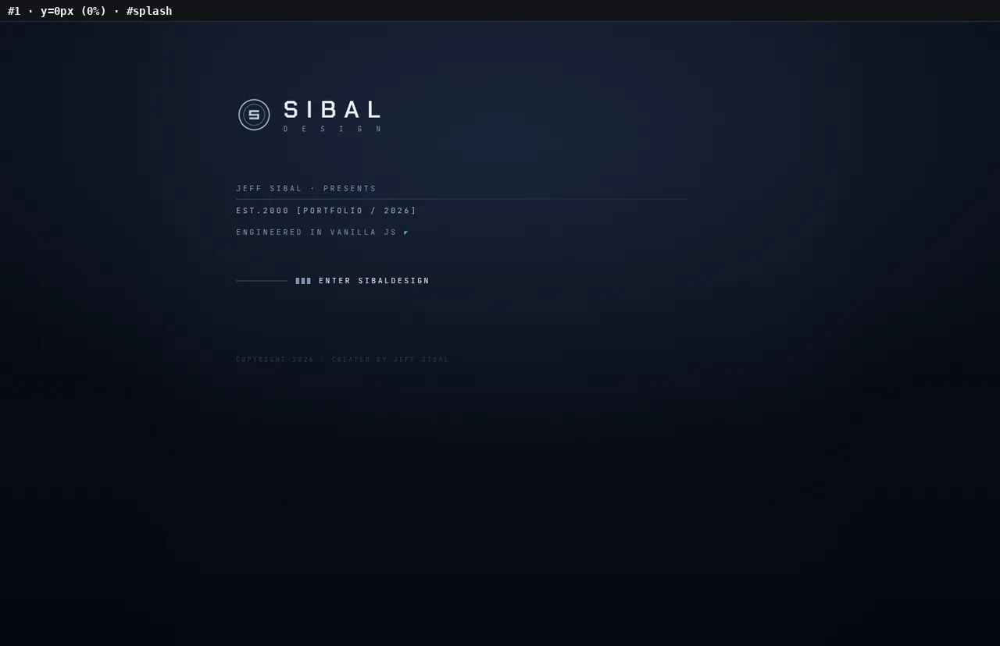
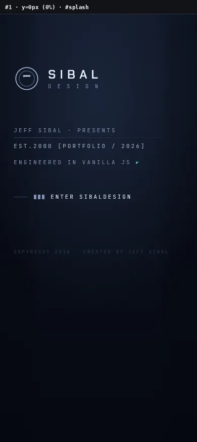

# UI Design System & Master Generation Blueprint: sibaldesign-com

> **Jeff Sibal — Visual & Digital Designer · SIBALDESIGN** (https://sibaldesign.com/) — Jeff Sibal, visual and digital designer in Southern California. Twenty-plus years across web, UI/UX, email, video and photography. I desi...





---

## 1. Executive Visual Persona & Design Archetype

- **Brand Essence & Persona**: **Jeff Sibal — Visual & Digital Designer · SIBALDESIGN** (`https://sibaldesign.com/`). Jeff Sibal, visual and digital designer in Southern California. Twenty-plus years across web, UI/UX, email, video and photography. I desi...
- **Capture Provenance**: Live browser capture (`tier2_webgl`, HTTP `200`, captured `2026-11-24`).
- **Visual Archetype**: **Dark-Substrate WebGL / Canvas Interactive Experience (`#080c15` / `#5fe0ff`)**.
- **Anti-AI-Slop Differentiators**:
  - **Live-Computed Chromatic Polarity**: Anchors the viewport in `#080c15` (live computed `body` `background-color` (`computed_styles.json`)) paired with `#eaf1ff` primary typography and `#5fe0ff` accents.
  - **Grounded Typographic Hierarchy**: Uses `Chakra Petch` across display (`A VISUAL & DIGITAL DESIGNER`) and body copy, paired with `JetBrains Mono` for monospace/code.
  - **Calibrated Spatial Grid & Motion**: Combines `1352px` container bounds (`gap: 34px`, padding `44px`) with `cubic-bezier(.16,1,.3,1)` easing and Three.js / WebGL Canvas Pipeline.

---

## 2. Spatial Architecture & Modular Grid Mathematics

### Viewport Allocation & Container Geometry
- **Captured Journey Filmstrips**: Desktop `1280×828px` (`assets/desktop-journey.webp`, `1` keyframes up to `y=0px` / doc `10853px`), Mobile `390×872px` (`assets/mobile-journey.webp`, `1` keyframes).
- **Master Container Bounds**: `1352px` (measured widest bounded `<section>` landmark width on `1440px` desktop).
- **Canvas Lateral Padding & Spacing**: `44px` lateral canvas padding with `34px` grid gap.
- **Border Radius Scale**: `0px` (sharp unrounded corners).

### Responsive Breakpoint Architecture
- **Desktop Layout**: Multi-column CSS Grid / Flexbox layout at `1440px` (`max-width: 1352px`, `gap: 34px`).
- **Mobile Layout**: Single-column vertical stack at `390px` viewport width with `44px` horizontal padding.
- **Extracted CSS Media Queries**: `@media (prefers-reduced-motion:reduce)`, `@media (max-width:900px)`, `@media (max-width:860px)`, `@media (max-width:560px)`.

---

## 3. Color System, Materiality & Atmospheric Lighting

### Semantic Palette & Source Grounding
| Semantic Role | Ground-Truth Value | Extracted Live / CSS Source |
|---|---|---|
| **Primary Canvas Substrate** | `#080c15` | live computed `body` `background-color` (`computed_styles.json`) |
| **Primary Typography Ink** | `#eaf1ff` | live computed `h1` `color` (`computed_styles.json`) |
| **Elevated Surface / Card Substrate** | `#0d1320` | live computed `a` `background-color` (`computed_styles.json`) |
| **Interactive Accent / Highlight** | `#5fe0ff` | live computed `a` `color` (`computed_styles.json`) |
| **Secondary / Muted Copy** | `#7f90b4` | live computed `footer` `color` (`computed_styles.json`) |
| **Structural Hairline Border** | `#232e45` | `var(--line)` in `:root` |
| **Variable Token (`--ink-000`)** | `#04060b` | `var(--ink-000)` in `:root` |
| **Variable Token (`--ink-300`)** | `#131b2b` | `var(--ink-300)` in `:root` |
| **Variable Token (`--line-hi`)** | `#33415f` | `var(--line-hi)` in `:root` |
| **Variable Token (`--mid`)** | `#a3b4d4` | `var(--mid)` in `:root` |
| **Variable Token (`--fg`)** | `#c3d0e8` | `var(--fg)` in `:root` |
| **Variable Token (`--flash`)** | `#7ce9ff` | `var(--flash)` in `:root` |

### Sanitized Root CSS Variables (`ui-ux.md` Ground Truth)
| Variable Name | Extracted Value | Semantic Role |
|---|---|---|
| `--ink-000` | `#04060b` | Typography Ink Token |
| `--ink-100` | `#080c15` | Typography Ink Token |
| `--ink-200` | `#0d1320` | Typography Ink Token |
| `--ink-300` | `#131b2b` | Typography Ink Token |
| `--panel` | `rgba(20,27,42,.66)` | Color / Atmospheric Token |
| `--panel-hi` | `rgba(30,40,60,.72)` | Color / Atmospheric Token |
| `--line` | `#232e45` | Color / Atmospheric Token |
| `--line-hi` | `#33415f` | Color / Atmospheric Token |
| `--dim` | `#7f90b4` | Color / Atmospheric Token |
| `--mid` | `#a3b4d4` | Color / Atmospheric Token |
| `--fg` | `#c3d0e8` | Typography Ink Token |
| `--white` | `#eaf1ff` | Canvas / Surface Token |
| `--accent` | `#5fe0ff` | Brand / Palette Token |
| `--flash` | `#7ce9ff` | Color / Atmospheric Token |
| `--accent-lo` | `rgba(95,224,255,.14)` | Brand / Palette Token |
| `--mono` | `"JetBrains Mono",ui-monospace,SFMono-Regular,Menlo,monospace` | Typography / Scale Token |

---

## 4. Typographic Scale & Editorial Hierarchy

### Font Family Stacks
- **Display Typography**: `Chakra Petch`.
- **Primary Body Stack**: `Chakra Petch`.
- **Technical / Metadata Stack**: `JetBrains Mono`.

### Typographic Scale & Rules (Live Computed & Stylesheet Grounded)
- **Hero Display (`H1`)**: live computed `h1` (`font-size: 104px`, `line-height: 97.76px`, `font-weight: 700`, `letter-spacing: -0.52px`).
- **Section Heading (`H2`)**: live computed `h2` (`font-size: 34px`, `line-height: 54.4px`, `font-weight: 600`, `letter-spacing: 6.12px`).
- **Body Copy**: live computed `body` (`font-size: 15px`, `line-height: 24px`, `font-weight: 400`); rule `p` (`font-size: 15px`).
- **Metadata & Navigation Labels**: live computed `nav/a` (`font-size: 11px`, `line-height: 17.6px`, `font-weight: 400`, `letter-spacing: 2.64px`); CSS variables `--mono: "JetBrains Mono",ui-monospace,SFMono-Regular,Menlo,monospace`; rule `small` (`font-size: 7px`, `letter-spacing: .22em`).

---

## 5. Choreographed Motion & Interaction Physics

### Primary Easing Curves
- **Extracted Timing Functions**: `cubic-bezier(.16,1,.3,1)`, `cubic-bezier(.65,0,.35,1)`, `cubic-bezier(.5,.05,.25,1)`.

### Per-Element Transition & Choreography Rules
- **Selector `body:before`**: `transition: opacity 1.6s var(--ease) .1s` extracted from `sibaldesign-com` stylesheet.
- **Selector `#streaks`**: `transition: opacity 1.6s var(--ease) .6s` extracted from `sibaldesign-com` stylesheet.
- **Selector `.enter__rule`**: `transition: width .5s var(--ease),background .3s` extracted from `sibaldesign-com` stylesheet.
- **Extracted Easing Curve (`cubic-bezier(.16,1,.3,1)`)**: Governs interactive state transitions across `<header.nav>` and `<section.sec>`.
- **Runtime Interaction Engine**: Integrates Three.js / WebGL Canvas Pipeline with `prefers-reduced-motion: reduce` fallback guards.
### Measured Runtime Scroll & Interaction Telemetry (`behavioral_journey_v2`)
- **Scroll Driver Mode**: `wheel` (max document height `10853px`, deepest scrollY reached `0px` across `1` desktop keyframes).
- **Detected Scroll / Motion Libraries**: `WebGL/Canvas`.

---

## 6. Component Wireframe & Structural DOM Map

### Visual Layout Schematic — Desktop (`1440px`, Grounded in `dom.html` & Landmark Bounding Boxes)
```
┌────────────────────────────────────────────────────────────────────────┐
│ DESKTOP VIEWPORT (1440px) — Jeff Sibal — Visual & Digital Designer · S │
│ ====================================================================== │
│ [ <header.nav> (1440x56px)            | PROFILE · PROJECTS · EXPERIE ] │
│ ---------------------------------------------------------------------- │
│ | HERO STAGE: <section.hero> (w=1440px)                              | │
│ | H1: A VISUAL & DIGITAL DESIGNER                                    | │
│ | Substrate: #080c15 | Ink: #eaf1ff | Accent: #5fe0ff                | │
│ ---------------------------------------------------------------------- │
│ | SHOWCASE GRID (<section.sec>) max-w: 1352px                        | │
│ | +------------------------------+  +------------------------------+ | │
│ | | Video Testimonial Service    |  | Agency Project Board         | | │
│ | +------------------------------+  +------------------------------+ | │
│ ---------------------------------------------------------------------- │
│ | DETAIL MODULE (<section.hz>) — Credit Union Campaign               | │
│ ---------------------------------------------------------------------- │
│ [ FOOTER (<footer.foot>       ) | https://sibaldesign.com/             │
└────────────────────────────────────────────────────────────────────────┘
```

### Visual Layout Schematic — Mobile Reflow (`390px`)
```
┌────────────────────────────────────────────────────────────────────────┐
│ MOBILE VIEWPORT REFLOW (390px) — Single-Column Stack (gap: 34px)       │
│ ====================================================================== │
│ [ HEADER BAR (<header.nav>            ) | Compact Menu (390px)         │
│ ---------------------------------------------------------------------- │
│ | HERO STAGE (<section.hero>) — 390px Vertical Lead                  | │
│ | H1: A VISUAL & DIGITAL DESIGNER                                    | │
│ ---------------------------------------------------------------------- │
│ | SHOWCASE STACK (<section.sec>) — 1-Col Stack                       | │
│ | [ Item 1: Video Testimonial Service                              ] | │
│ | [ Item 2: Agency Project Board                                   ] | │
│ ---------------------------------------------------------------------- │
│ | DETAIL STACK (<section.hz>) — 1-Col (Credit Union Campa)           | │
│ ---------------------------------------------------------------------- │
│ [ FOOTER (<footer.foot>       ) | Stacked 390px Colophon               │
└────────────────────────────────────────────────────────────────────────┘
```

### Granular DOM Region Breakdown
1. **Brand Header & Navigation Bar (<header.nav> — `sibaldesign-com`)**:
   - Landmark `<header class="nav">` (`1440x56px`) hosting `Jeff Sibal — Visual & Digital Design` navigation (`PROFILE · PROJECTS · EXPERIENCE · PHOTOS · EQUIPMENT`), DOM attributes (`data-boot="splash"`, `data-line`, `data-nav`, `data-text="A VISUAL &"`), and stylesheet rule `after { box-sizing:border-box }`.
2. **Hero Stage & Focal Lead (<section.hero> — `A VISUAL & DIGITAL DESIGNER`)**:
   - Landmark `<section class="hero">` presenting display lead `A VISUAL & DIGITAL DESIGNER` and copy excerpt *"COPYRIGHT 2026 · CREATED BY JEFF SIBAL"* over `#080c15` canvas and `#eaf1ff` ink.
3. **Primary Showcase & Content Grid (<section.sec> — `Video Testimonial Service`)**:
   - Landmark `<section class="sec">` rendering section `Video Testimonial Service` with copy *"« JEFF.OF.ALL.TRADES"*, asset references (`favicon.svg`, `favicon-32.png`, `apple-touch-icon.png`, `fonts.googleapis.com`), and grid rule `body { height:100% }`.
4. **Interactive Detail & Feature Matrix (<section.hz> — `Agency Project Board`)**:
   - Landmark `<section class="sec hz">` framing `Agency Project Board` and `Credit Union Campaigns` (*"Twenty-plus years across web, UI/UX, email marketing, video and p"*) with `#0d1320` surface cards, `#5fe0ff` accents, and `button { font:inherit;color:inherit;background:none;border:0;cursor:pointer }`.
5. **Colophon & Global Directory Footer (<footer.foot> — `https://sibaldesign.com/`)**:
   - Landmark `<footer class="foot">` anchoring `Jeff Sibal — Visual & Digital De` footer links (`PROFILE · PROJECTS · EXPERIENCE · PHOTOS · EQUIPMENT`), copy *"SOUTHERN CALIFORNIA"*, and `#232e45` structural dividers.
### Full Vertical Scroll Sequence (Desktop `1440×900` Keyframes)
- **Step 01** (`y=0px`, `0%`): Active landmark `#splash` · sticky/fixed elements: `2`

---

## 7. Master Zero-Shot AI Generation Prompt

```markdown
# Master Zero-Shot Frontend Generation Prompt: sibaldesign-com (Jeff Sibal — Visual & Digital Designer · SIBALDESIGN)

You are a principal frontend architect and design systems engineer. Build a complete, production-ready web application replicating the exact design system, DOM landmarks, typographic hierarchy, color tokens, and motion physics of `sibaldesign-com` (**Jeff Sibal — Visual & Digital Designer · SIBALDESIGN** — `https://sibaldesign.com/`).

### 1. Visual Archetype & Anti-AI-Slop Mandates
- **Archetype**: Dark-Substrate WebGL / Canvas Interactive Experience (`#080c15` / `#5fe0ff`).
- **Identity & Domain Context**: Jeff Sibal, visual and digital designer in Southern California. Twenty-plus years across web, UI/UX, email, video and photography. I desi...
- **Primary Substrate**: `#080c15` (live computed `body` `background-color` (`computed_styles.json`)), **Primary Ink**: `#eaf1ff`, **Accent / Highlight**: `#5fe0ff`.
- **Site-Specific Differentiators**:
  - **Live-Computed Chromatic Polarity**: Anchors the viewport in `#080c15` (live computed `body` `background-color` (`computed_styles.json`)) paired with `#eaf1ff` primary typography and `#5fe0ff` accents.
  - **Grounded Typographic Hierarchy**: Uses `Chakra Petch` across display (`A VISUAL & DIGITAL DESIGNER`) and body copy, paired with `JetBrains Mono` for monospace/code.
  - **Calibrated Spatial Grid & Motion**: Combines `1352px` container bounds (`gap: 34px`, padding `44px`) with `cubic-bezier(.16,1,.3,1)` easing and Three.js / WebGL Canvas Pipeline.

### 2. Ground-Truth CSS Variables (`:root` Token Contract)
Declare and consume these exact custom properties extracted from `sibaldesign-com` in your global stylesheet:

:root {
  /* Jeff Sibal — Visual & Digital Designer · SIBALDESIGN (sibaldesign-com) — Live-Grounded CSS Variables */
  --ink-000: #04060b; /* Typography Ink Token (sibaldesign-com) */
  --ink-100: #080c15; /* Typography Ink Token (sibaldesign-com) */
  --ink-200: #0d1320; /* Typography Ink Token (sibaldesign-com) */
  --ink-300: #131b2b; /* Typography Ink Token (sibaldesign-com) */
  --panel: rgba(20,27,42,.66); /* Color / Atmospheric Token (sibaldesign-com) */
  --panel-hi: rgba(30,40,60,.72); /* Color / Atmospheric Token (sibaldesign-com) */
  --line: #232e45; /* Color / Atmospheric Token (sibaldesign-com) */
  --line-hi: #33415f; /* Color / Atmospheric Token (sibaldesign-com) */
  --dim: #7f90b4; /* Color / Atmospheric Token (sibaldesign-com) */
  --mid: #a3b4d4; /* Color / Atmospheric Token (sibaldesign-com) */
  --fg: #c3d0e8; /* Typography Ink Token (sibaldesign-com) */
  --white: #eaf1ff; /* Canvas / Surface Token (sibaldesign-com) */
  --accent: #5fe0ff; /* Brand / Palette Token (sibaldesign-com) */
  --flash: #7ce9ff; /* Color / Atmospheric Token (sibaldesign-com) */
  --accent-lo: rgba(95,224,255,.14); /* Brand / Palette Token (sibaldesign-com) */
  --mono: "JetBrains Mono",ui-monospace,SFMono-Regular,Menlo,monospace; /* Typography / Scale Token (sibaldesign-com) */
}

### 3. Semantic Color & Materiality Contract
Map every surface, ink, and border strictly to these source-grounded tokens:
- **Primary Canvas Substrate**: `#080c15` — grounded in live computed `body` `background-color` (`computed_styles.json`)
- **Primary Typography Ink**: `#eaf1ff` — grounded in live computed `h1` `color` (`computed_styles.json`)
- **Elevated Surface / Card Substrate**: `#0d1320` — grounded in live computed `a` `background-color` (`computed_styles.json`)
- **Interactive Accent / Highlight**: `#5fe0ff` — grounded in live computed `a` `color` (`computed_styles.json`)
- **Secondary / Muted Copy**: `#7f90b4` — grounded in live computed `footer` `color` (`computed_styles.json`)
- **Structural Hairline Border**: `#232e45` — grounded in `var(--line)` in `:root`
- **Variable Token (`--ink-000`)**: `#04060b` — grounded in `var(--ink-000)` in `:root`
- **Variable Token (`--ink-300`)**: `#131b2b` — grounded in `var(--ink-300)` in `:root`
- **Variable Token (`--line-hi`)**: `#33415f` — grounded in `var(--line-hi)` in `:root`
- **Variable Token (`--mid`)**: `#a3b4d4` — grounded in `var(--mid)` in `:root`
- **Variable Token (`--fg`)**: `#c3d0e8` — grounded in `var(--fg)` in `:root`
- **Variable Token (`--flash`)**: `#7ce9ff` — grounded in `var(--flash)` in `:root`

### 4. Spatial Grid, Container Bounds & Responsive Breakpoints
- **Desktop Viewport Reference**: `1280×828px` (single-viewport 100vh live capture (900px), `1440px` standard desktop width).
- **Mobile Viewport Reference**: `390×872px` (full-page live capture (872px), `390px` standard mobile width).
- **Container Max-Width**: `1352px` (measured widest bounded `<section>` landmark width on `1440px` desktop)
- **Padding & Gutters**: `44px` lateral canvas padding with `34px` grid gap
- **Desktop Grid**: Multi-column CSS Grid / Flexbox layout at `1440px` (`max-width: 1352px`, `gap: 34px`)
- **Mobile Adaptation**: Single-column vertical stack at `390px` viewport width with `44px` horizontal padding
- **Media Queries**: `@media (prefers-reduced-motion:reduce)`, `@media (max-width:900px)`, `@media (max-width:860px)`, `@media (max-width:560px)`
- **Corner Radii**: `0px` (sharp unrounded corners)

### 5. Typography & Editorial Scale Contract
- **Display Font Stack**: `Chakra Petch`
- **Body Font Stack**: `Chakra Petch`
- **Monospace / Technical Font Stack**: `JetBrains Mono`
- **H1 Display Rule**: live computed `h1` (`font-size: 104px`, `line-height: 97.76px`, `font-weight: 700`, `letter-spacing: -0.52px`)
- **H2 Section Rule**: live computed `h2` (`font-size: 34px`, `line-height: 54.4px`, `font-weight: 600`, `letter-spacing: 6.12px`)
- **Body Copy Rule**: live computed `body` (`font-size: 15px`, `line-height: 24px`, `font-weight: 400`); rule `p` (`font-size: 15px`)
- **Metadata & Index Rule**: live computed `nav/a` (`font-size: 11px`, `line-height: 17.6px`, `font-weight: 400`, `letter-spacing: 2.64px`); CSS variables `--mono: "JetBrains Mono",ui-monospace,SFMono-Regular,Menlo,monospace`; rule `small` (`font-size: 7px`, `letter-spacing: .22em`)

### 6. Component Hierarchy, Verbatim Copy & Real DOM Landmarks
Scaffold `sibaldesign-com` (`Jeff Sibal — Visual & Digital Designer · SIBALDESIGN`) with these exact structural regions, extracted copy, and CSS rules from `dom.html`:
1. **Brand Header & Navigation Bar (<header.nav> — `sibaldesign-com`)**:
   - DOM & Selectors: Landmark `<header class="nav">` (`1440x56px`) hosting `Jeff Sibal — Visual & Digital Design` navigation (`PROFILE · PROJECTS · EXPERIENCE · PHOTOS · EQUIPMENT`), DOM attributes (`data-boot="splash"`, `data-line`, `data-nav`, `data-text="A VISUAL &"`), and stylesheet rule `after { box-sizing:border-box }`.
   - Responsive Contract: Header `Brand Header & Navigation Bar (<header.nav> — `sibaldesign-com`)` (`sibaldesign-com`) adapts across `@media (prefers-reduced-motion:reduce)`, `@media (max-width:900px)`, `@media (max-width:860px)`, `@media (max-width:560px)` with `cubic-bezier(.16,1,.3,1)`, `cubic-bezier(.65,0,.35,1)`, `cubic-bezier(.5,.05,.25,1)` transitions and links `PROFILE · PROJECTS · EXPERIENCE · PHOTOS · EQUIPMENT`.
2. **Hero Stage & Focal Lead (<section.hero> — `A VISUAL & DIGITAL DESIGNER`)**:
   - DOM & Selectors: Landmark `<section class="hero">` presenting display lead `A VISUAL & DIGITAL DESIGNER` and copy excerpt *"COPYRIGHT 2026 · CREATED BY JEFF SIBAL"* over `#080c15` canvas and `#eaf1ff` ink.
   - Responsive Contract: Hero stage (`1280×828px` desktop / `390×872px` mobile) sets `#080c15` background with `#eaf1ff` headline `A VISUAL & DIGITAL DESIGNER`.
3. **Primary Showcase & Content Grid (<section.sec> — `Video Testimonial Service`)**:
   - DOM & Selectors: Landmark `<section class="sec">` rendering section `Video Testimonial Service` with copy *"« JEFF.OF.ALL.TRADES"*, asset references (`favicon.svg`, `favicon-32.png`, `apple-touch-icon.png`, `fonts.googleapis.com`), and grid rule `body { height:100% }`.
   - Responsive Contract: Showcase grid `Primary Showcase & Content Grid (<section.sec> — `Video Testimonial Service`)` applies Multi-column CSS Grid / Flexbox layout at `1440px` (`max-width: 1352px`, `gap: 34px`) on desktop and Single-column vertical stack at `390px` viewport width with `44px` horizontal padding on mobile.
4. **Interactive Detail & Feature Matrix (<section.hz> — `Agency Project Board`)**:
   - DOM & Selectors: Landmark `<section class="sec hz">` framing `Agency Project Board` and `Credit Union Campaigns` (*"Twenty-plus years across web, UI/UX, email marketing, video and p"*) with `#0d1320` surface cards, `#5fe0ff` accents, and `button { font:inherit;color:inherit;background:none;border:0;cursor:pointer }`.
   - Responsive Contract: Detail module `Interactive Detail & Feature Matrix (<section.hz> — `Agency Project Board`)` uses `0px` (sharp unrounded corners) radii, `#5fe0ff` highlights, and assets (favicon.svg, favicon-32.png, apple-touch-icon.png).
5. **Colophon & Global Directory Footer (<footer.foot> — `https://sibaldesign.com/`)**:
   - DOM & Selectors: Landmark `<footer class="foot">` anchoring `Jeff Sibal — Visual & Digital De` footer links (`PROFILE · PROJECTS · EXPERIENCE · PHOTOS · EQUIPMENT`), copy *"SOUTHERN CALIFORNIA"*, and `#232e45` structural dividers.
   - Responsive Contract: Footer `Colophon & Global Directory Footer (<footer.foot> — `https://sibaldesign.com/`)` aligns to `1352px` (measured widest bounded `<section>` landmark width on `1440px` desktop) with `44px` lateral canvas padding with `34px` grid gap and attributes (data-boot="splash", data-line, data-nav).

#### Verbatim DOM Copy Excerpts (`dom.html`)
- Copy Excerpt 1: *"COPYRIGHT 2026 · CREATED BY JEFF SIBAL"*
- Copy Excerpt 2: *"« JEFF.OF.ALL.TRADES"*
- Copy Excerpt 3: *"Twenty-plus years across web, UI/UX, email marketing, video and photography — now..."*
- Copy Excerpt 4: *"SOUTHERN CALIFORNIA"*

### 7. Motion, Extracted Stylesheet Rules & Interaction Choreography
- **Primary Easing Functions**: `cubic-bezier(.16,1,.3,1)`, `cubic-bezier(.65,0,.35,1)`, `cubic-bezier(.5,.05,.25,1)`
- **Extracted Stylesheet Rules (`sibaldesign-com`)**:
- `after { box-sizing:border-box }`
- `body { height:100% }`
- `button { font:inherit;color:inherit;background:none;border:0;cursor:pointer }`
- `figure { margin:0;padding:0 }`
- `selection { background:var(--accent);color:var(--ink-000) }`
- **Per-Selector Transition Rules**:
- **Selector `body:before`**: `transition: opacity 1.6s var(--ease) .1s` extracted from `sibaldesign-com` stylesheet.
- **Selector `#streaks`**: `transition: opacity 1.6s var(--ease) .6s` extracted from `sibaldesign-com` stylesheet.
- **Selector `.enter__rule`**: `transition: width .5s var(--ease),background .3s` extracted from `sibaldesign-com` stylesheet.
- **Extracted Easing Curve (`cubic-bezier(.16,1,.3,1)`)**: Governs interactive state transitions across `<header.nav>` and `<section.sec>`.
- **Runtime Interaction Engine**: Integrates Three.js / WebGL Canvas Pipeline with `prefers-reduced-motion: reduce` fallback guards.
### 7b. Full-Page Scroll Choreography, Interactive States & Multi-Page Routes
- **Scroll Mechanics**: Implement `wheel` vertical progression up to `10853px` across 1 distinct viewport chapters using WebGL/Canvas.
- **Vertical Chapter Sequence**: #splash (0%).

### 8. Technical Deliverables
- Implement in Next.js (App Router) with TypeScript and Tailwind CSS consuming the `:root` custom properties defined above for `sibaldesign-com`.
- Reproduce both the `1440px` desktop architecture and `390px` mobile breakpoint transitions, preserving semantic HTML5 landmarks (`<header>`, `<nav>`, `<main>`, `<section>`, `<footer>`) and `prefers-reduced-motion` accessibility guards.
```
---

## 8. Full-Page Scroll Journey, Interactive States & Subpage Inventory

### Desktop Scroll Keyframes (`1440×900` WebP)
| Step | Scroll Y | Progress | Active Landmark / Section | Sticky/Fixed | Visual Asset |
| :---: | :---: | :---: | :--- | :---: | :--- |
| `#01` | `0px` | `0%` | #splash | `2` | [desktop-step-01.webp](assets/desktop-step-01.webp) |

### Mobile Condensed Keyframes (`390×844` WebP)
| Step | Scroll Y | Progress | Active Landmark | Visual Asset |
| :---: | :---: | :---: | :--- | :--- |
| `#01` | `0px` | `0%` | #splash | [mobile-step-01.webp](assets/mobile-step-01.webp) |

