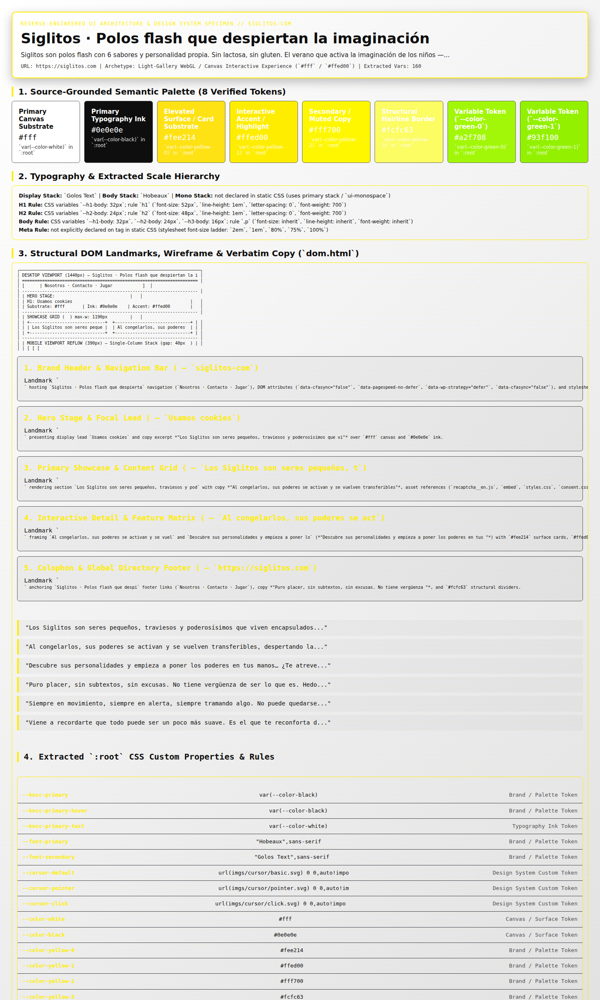
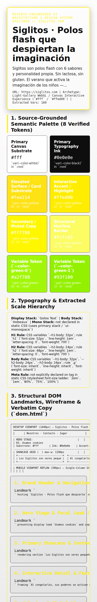

# UI Design System & Master Generation Blueprint: siglitos-com

> **Siglitos · Polos flash que despiertan la imaginación** (https://siglitos.com) — Siglitos son polos flash con 6 sabores y personalidad propia. Sin lactosa, sin gluten. El verano que activa la imaginación de los niños —...



---

## 1. Executive Visual Persona & Design Archetype

- **Brand Essence & Persona**: **Siglitos · Polos flash que despiertan la imaginación** (`https://siglitos.com`). Siglitos son polos flash con 6 sabores y personalidad propia. Sin lactosa, sin gluten. El verano que activa la imaginación de los niños —...
- **Visual Archetype**: **Light-Gallery WebGL / Canvas Interactive Experience (`#fff` / `#ffed00`)**.
- **Anti-AI-Slop Differentiators**:
  - **Source-Grounded Chromatic Polarity**: Anchors the viewport in `#fff` (`var(--color-white)` in `:root`) paired with `#0e0e0e` primary typography and `#ffed00` accents.
  - **Extracted Typographic Hierarchy**: Pairs `Golos Text` for display copy (`Usamos cookies`) with `Hobeaux` and not declared in static CSS (uses primary stack / `ui-monospace`).
  - **Calibrated Spatial Grid & Motion**: Combines `1190px` container bounds (`gap: 40px`, padding `24px`) with `cubic-bezier(0.33,0.01,0.31,0.99)` easing and Lenis Smooth Scroll (`data-lenis`), Three.js / WebGL Canvas Pipeline.

---

## 2. Spatial Architecture & Modular Grid Mathematics



### Viewport Allocation & Container Geometry
- **Captured Viewport Dimensions**: Desktop `1440×2400px` (`assets/desktop.png`, capped at 2400px multi-section capture), Mobile `390×2400px` (`assets/mobile.png`, capped at 2400px multi-section capture).
- **Master Container Bounds**: `1190px` extracted from `siglitos-com` stylesheet.
- **Canvas Lateral Padding & Spacing**: `24px` lateral canvas padding with `40px` grid gap.
- **Border Radius Scale**: `24px`, `50%`, `100px`, `var(--corner-sm)`.

### Responsive Breakpoint Architecture
- **Desktop Layout**: Multi-column CSS Grid / Flexbox layout at `1440px` (`max-width: 1190px`, `gap: 40px`).
- **Mobile Layout**: Single-column vertical stack at `390px` viewport width with `24px` horizontal padding.
- **Extracted CSS Media Queries**: `@media (min-width:724px)`, `@media (min-width:1191px)`, `@media (min-width:724px)and (max-width:1190px)`, `@media (max-width:723px)`.

---

## 3. Color System, Materiality & Atmospheric Lighting

### Semantic Palette & Source Grounding
| Semantic Role | Ground-Truth Value | Extracted CSS Source / Selector |
|---|---|---|
| **Primary Canvas Substrate** | `#fff` | `var(--color-white)` in `:root` |
| **Primary Typography Ink** | `#0e0e0e` | `var(--color-black)` in `:root` |
| **Elevated Surface / Card Substrate** | `#fee214` | `var(--color-yellow-0)` in `:root` |
| **Interactive Accent / Highlight** | `#ffed00` | `var(--color-yellow-1)` in `:root` |
| **Secondary / Muted Copy** | `#fff700` | `var(--color-yellow-2)` in `:root` |
| **Structural Hairline Border** | `#fcfc63` | `var(--color-yellow-3)` in `:root` |
| **Variable Token (`--color-green-0`)** | `#a2f708` | `var(--color-green-0)` in `:root` |
| **Variable Token (`--color-green-1`)** | `#93f100` | `var(--color-green-1)` in `:root` |

### Sanitized Root CSS Variables (`ui-ux.md` Ground Truth)
| Variable Name | Extracted Value | Semantic Role |
|---|---|---|
| `--kncc-primary` | `var(--color-black)` | Brand / Palette Token |
| `--kncc-primary-hover` | `var(--color-black)` | Brand / Palette Token |
| `--kncc-primary-text` | `var(--color-white)` | Typography Ink Token |
| `--font-primary` | `"Hobeaux",sans-serif` | Brand / Palette Token |
| `--font-secondary` | `"Golos Text",sans-serif` | Brand / Palette Token |
| `--cursor-default` | `url(imgs/cursor/basic.svg) 0 0,auto!important` | Design System Custom Token |
| `--cursor-pointer` | `url(imgs/cursor/pointer.svg) 0 0,auto!important` | Design System Custom Token |
| `--cursor-click` | `url(imgs/cursor/click.svg) 0 0,auto!important` | Design System Custom Token |
| `--color-white` | `#fff` | Canvas / Surface Token |
| `--color-black` | `#0e0e0e` | Canvas / Surface Token |
| `--color-yellow-0` | `#fee214` | Brand / Palette Token |
| `--color-yellow-1` | `#ffed00` | Brand / Palette Token |
| `--color-yellow-2` | `#fff700` | Brand / Palette Token |
| `--color-yellow-3` | `#fcfc63` | Brand / Palette Token |
| `--color-green-0` | `#a2f708` | Brand / Palette Token |
| `--color-green-1` | `#93f100` | Brand / Palette Token |

---

## 4. Typographic Scale & Editorial Hierarchy

### Font Family Stacks
- **Display Typography**: `Golos Text`.
- **Primary Body Stack**: `Hobeaux`.
- **Technical / Metadata Stack**: not declared in static CSS (uses primary stack / `ui-monospace`).

### Typographic Scale & Rules (Extracted from Stylesheet & Variables)
- **Hero Display (`H1`)**: CSS variables `--h1-body: 32px`; rule `h1` (`font-size: 52px`, `line-height: 1em`, `letter-spacing: 0`, `font-weight: 700`).
- **Section Heading (`H2`)**: CSS variables `--h2-body: 24px`; rule `h2` (`font-size: 48px`, `line-height: 1em`, `letter-spacing: 0`, `font-weight: 700`).
- **Body Copy**: CSS variables `--h1-body: 32px`, `--h2-body: 24px`, `--h3-body: 16px`; rule `,p` (`font-size: inherit`, `line-height: inherit`, `font-weight: inherit`).
- **Metadata & Navigation Labels**: not explicitly declared on tag in static CSS (stylesheet font-size ladder: `2em`, `1em`, `80%`, `75%`, `100%`).

---

## 5. Choreographed Motion & Interaction Physics

### Primary Easing Curves
- **Extracted Timing Functions**: `cubic-bezier(0.33,0.01,0.31,0.99)`, `cubic-bezier(0,0.57,0.53,1)`, `cubic-bezier(.25,1,.5,1)`.

### Per-Element Transition & Choreography Rules
- **Selector `body`**: `transition: background-color .3s ease` extracted from `siglitos-com` stylesheet.
- **Selector `.o-link:before`**: `transition: var(--transition-quick)` extracted from `siglitos-com` stylesheet.
- **Selector `.b-sound`**: `transition: top .5s ease` extracted from `siglitos-com` stylesheet.
- **Extracted Easing Curve (`cubic-bezier(0.33,0.01,0.31,0.99)`)**: Governs interactive state transitions across `<nav.b-header__menu>` and `<section.all-components>`.
- **Runtime Interaction Engine**: Integrates Lenis Smooth Scroll (`data-lenis`), Three.js / WebGL Canvas Pipeline, Swiper Touch Carousel Engine, Barba.js Page Transition Router with `prefers-reduced-motion: reduce` fallback guards.

---

## 6. Component Wireframe & Structural DOM Map

### Visual Layout Schematic (Grounded in `dom.html` — `1440px` Desktop & `390px` Mobile Reflow)
```
┌────────────────────────────────────────────────────────────────────────┐
│ DESKTOP VIEWPORT (1440px) — Siglitos · Polos flash que despiertan la i │
│ ====================================================================== │
│ [ <nav.b-header__menu>     | Nosotros · Contacto · Jugar            ]  │
│ ---------------------------------------------------------------------- │
│ | HERO STAGE: <section.all-components>                             |   │
│ | H1: Usamos cookies                                               |   │
│ | Substrate: #fff       | Ink: #0e0e0e    | Accent: #ffed00        |   │
│ ---------------------------------------------------------------------- │
│ | SHOWCASE GRID (<section.all-components>  ) max-w: 1190px         |   │
│ | +------------------------------+  +------------------------------+ | │
│ | | Los Siglitos son seres peque |  | Al congelarlos, sus poderes  | | │
│ | +------------------------------+  +------------------------------+ | │
│ ---------------------------------------------------------------------- │
│ | MOBILE VIEWPORT REFLOW (390px) — Single-Column Stack (gap: 40px  ) | │
│ | [<nav.b-header__men] -> [<section.all-compo] -> [<section.all-compo] │
│ ---------------------------------------------------------------------- │
│ [ FOOTER (<footer.page-template-) | https://siglitos.com               │
└────────────────────────────────────────────────────────────────────────┘
```

### Granular DOM Region Breakdown
1. **Brand Header & Navigation Bar (<nav.b-header__menu> — `siglitos-com`)**:
   - Landmark `<nav class="b-header__menu">` hosting `Siglitos · Polos flash que despierta` navigation (`Nosotros · Contacto · Jugar`), DOM attributes (`data-cfasync="false"`, `data-pagespeed-no-defer`, `data-wp-strategy="defer"`, `data-cfasync="false"`), and stylesheet rule `html { line-height:1.15;-webkit-text-size-adjust:100% }`.
2. **Hero Stage & Focal Lead (<section.all-components> — `Usamos cookies`)**:
   - Landmark `<section class="all-components o-main">` presenting display lead `Usamos cookies` and copy excerpt *"Los Siglitos son seres pequeños, traviesos y poderosísimos que vi"* over `#fff` canvas and `#0e0e0e` ink.
3. **Primary Showcase & Content Grid (<section.all-components> — `Los Siglitos son seres pequeños, t`)**:
   - Landmark `<section class="all-components o-main">` rendering section `Los Siglitos son seres pequeños, traviesos y pod` with copy *"Al congelarlos, sus poderes se activan y se vuelven transferibles"*, asset references (`recaptcha__en.js`, `embed`, `styles.css`, `consent.css`), and grid rule `main { display:block }`.
4. **Interactive Detail & Feature Matrix (<section.all-components> — `Al congelarlos, sus poderes se act`)**:
   - Landmark `<section class="all-components o-main">` framing `Al congelarlos, sus poderes se activan y se vuel` and `Descubre sus personalidades y empieza a poner lo` (*"Descubre sus personalidades y empieza a poner los poderes en tus "*) with `#fee214` surface cards, `#ffed00` accents, and `pre { font-family:monospace,monospace;font-size:1em }`.
5. **Colophon & Global Directory Footer (<footer.page-template-default> — `https://siglitos.com`)**:
   - Landmark `<footer class="page-template-default">` anchoring `Siglitos · Polos flash que despi` footer links (`Nosotros · Contacto · Jugar`), copy *"Puro placer, sin subtextos, sin excusas. No tiene vergüenza "*, and `#fcfc63` structural dividers.

---

## 7. Master Zero-Shot AI Generation Prompt

```markdown
# Master Zero-Shot Frontend Generation Prompt: siglitos-com (Siglitos · Polos flash que despiertan la imaginación)

You are a principal frontend architect and design systems engineer. Build a complete, production-ready web application replicating the exact design system, DOM landmarks, typographic hierarchy, color tokens, and motion physics of `siglitos-com` (**Siglitos · Polos flash que despiertan la imaginación** — `https://siglitos.com`).

### 1. Visual Archetype & Anti-AI-Slop Mandates
- **Archetype**: Light-Gallery WebGL / Canvas Interactive Experience (`#fff` / `#ffed00`).
- **Identity & Domain Context**: Siglitos son polos flash con 6 sabores y personalidad propia. Sin lactosa, sin gluten. El verano que activa la imaginación de los niños —...
- **Primary Substrate**: `#fff` (`var(--color-white)` in `:root`), **Primary Ink**: `#0e0e0e`, **Accent / Highlight**: `#ffed00`.
- **Site-Specific Differentiators**:
  - **Source-Grounded Chromatic Polarity**: Anchors the viewport in `#fff` (`var(--color-white)` in `:root`) paired with `#0e0e0e` primary typography and `#ffed00` accents.
  - **Extracted Typographic Hierarchy**: Pairs `Golos Text` for display copy (`Usamos cookies`) with `Hobeaux` and not declared in static CSS (uses primary stack / `ui-monospace`).
  - **Calibrated Spatial Grid & Motion**: Combines `1190px` container bounds (`gap: 40px`, padding `24px`) with `cubic-bezier(0.33,0.01,0.31,0.99)` easing and Lenis Smooth Scroll (`data-lenis`), Three.js / WebGL Canvas Pipeline.

### 2. Ground-Truth CSS Variables (`:root` Token Contract)
Declare and consume these exact custom properties extracted from `siglitos-com` in your global stylesheet:

:root {
  /* Siglitos · Polos flash que despiertan la imaginación (siglitos-com) — Ground-Truth Extracted CSS Variables */
  --kncc-primary: var(--color-black); /* Brand / Palette Token (siglitos-com) */
  --kncc-primary-hover: var(--color-black); /* Brand / Palette Token (siglitos-com) */
  --kncc-primary-text: var(--color-white); /* Typography Ink Token (siglitos-com) */
  --font-primary: "Hobeaux",sans-serif; /* Brand / Palette Token (siglitos-com) */
  --font-secondary: "Golos Text",sans-serif; /* Brand / Palette Token (siglitos-com) */
  --cursor-default: url(imgs/cursor/basic.svg) 0 0,auto!important; /* Design System Custom Token (siglitos-com) */
  --cursor-pointer: url(imgs/cursor/pointer.svg) 0 0,auto!important; /* Design System Custom Token (siglitos-com) */
  --cursor-click: url(imgs/cursor/click.svg) 0 0,auto!important; /* Design System Custom Token (siglitos-com) */
  --color-white: #fff; /* Canvas / Surface Token (siglitos-com) */
  --color-black: #0e0e0e; /* Canvas / Surface Token (siglitos-com) */
  --color-yellow-0: #fee214; /* Brand / Palette Token (siglitos-com) */
  --color-yellow-1: #ffed00; /* Brand / Palette Token (siglitos-com) */
  --color-yellow-2: #fff700; /* Brand / Palette Token (siglitos-com) */
  --color-yellow-3: #fcfc63; /* Brand / Palette Token (siglitos-com) */
  --color-green-0: #a2f708; /* Brand / Palette Token (siglitos-com) */
  --color-green-1: #93f100; /* Brand / Palette Token (siglitos-com) */
}

### 3. Semantic Color & Materiality Contract
Map every surface, ink, and border strictly to these source-grounded tokens:
- **Primary Canvas Substrate**: `#fff` — grounded in `var(--color-white)` in `:root`
- **Primary Typography Ink**: `#0e0e0e` — grounded in `var(--color-black)` in `:root`
- **Elevated Surface / Card Substrate**: `#fee214` — grounded in `var(--color-yellow-0)` in `:root`
- **Interactive Accent / Highlight**: `#ffed00` — grounded in `var(--color-yellow-1)` in `:root`
- **Secondary / Muted Copy**: `#fff700` — grounded in `var(--color-yellow-2)` in `:root`
- **Structural Hairline Border**: `#fcfc63` — grounded in `var(--color-yellow-3)` in `:root`
- **Variable Token (`--color-green-0`)**: `#a2f708` — grounded in `var(--color-green-0)` in `:root`
- **Variable Token (`--color-green-1`)**: `#93f100` — grounded in `var(--color-green-1)` in `:root`

### 4. Spatial Grid, Container Bounds & Responsive Breakpoints
- **Desktop Viewport Reference**: `1440×2400px` (capped at 2400px multi-section capture, `1440px` standard desktop width).
- **Mobile Viewport Reference**: `390×2400px` (capped at 2400px multi-section capture, `390px` standard mobile width).
- **Container Max-Width**: `1190px` extracted from `siglitos-com` stylesheet
- **Padding & Gutters**: `24px` lateral canvas padding with `40px` grid gap
- **Desktop Grid**: Multi-column CSS Grid / Flexbox layout at `1440px` (`max-width: 1190px`, `gap: 40px`)
- **Mobile Adaptation**: Single-column vertical stack at `390px` viewport width with `24px` horizontal padding
- **Media Queries**: `@media (min-width:724px)`, `@media (min-width:1191px)`, `@media (min-width:724px)and (max-width:1190px)`, `@media (max-width:723px)`
- **Corner Radii**: `24px`, `50%`, `100px`, `var(--corner-sm)`

### 5. Typography & Editorial Scale Contract
- **Display Font Stack**: `Golos Text`
- **Body Font Stack**: `Hobeaux`
- **Monospace / Technical Font Stack**: not declared in static CSS (uses primary stack / `ui-monospace`)
- **H1 Display Rule**: CSS variables `--h1-body: 32px`; rule `h1` (`font-size: 52px`, `line-height: 1em`, `letter-spacing: 0`, `font-weight: 700`)
- **H2 Section Rule**: CSS variables `--h2-body: 24px`; rule `h2` (`font-size: 48px`, `line-height: 1em`, `letter-spacing: 0`, `font-weight: 700`)
- **Body Copy Rule**: CSS variables `--h1-body: 32px`, `--h2-body: 24px`, `--h3-body: 16px`; rule `,p` (`font-size: inherit`, `line-height: inherit`, `font-weight: inherit`)
- **Metadata & Index Rule**: not explicitly declared on tag in static CSS (stylesheet font-size ladder: `2em`, `1em`, `80%`, `75%`, `100%`)

### 6. Component Hierarchy, Verbatim Copy & Real DOM Landmarks
Scaffold `siglitos-com` (`Siglitos · Polos flash que despiertan la imaginación`) with these exact structural regions, extracted copy, and CSS rules from `dom.html`:
1. **Brand Header & Navigation Bar (<nav.b-header__menu> — `siglitos-com`)**:
   - DOM & Selectors: Landmark `<nav class="b-header__menu">` hosting `Siglitos · Polos flash que despierta` navigation (`Nosotros · Contacto · Jugar`), DOM attributes (`data-cfasync="false"`, `data-pagespeed-no-defer`, `data-wp-strategy="defer"`, `data-cfasync="false"`), and stylesheet rule `html { line-height:1.15;-webkit-text-size-adjust:100% }`.
   - Responsive Contract: Header `Brand Header & Navigation Bar (<nav.b-header__menu> — `siglitos-com`)` (`siglitos-com`) adapts across `@media (min-width:724px)`, `@media (min-width:1191px)`, `@media (min-width:724px)and (max-width:1190px)`, `@media (max-width:723px)` with `cubic-bezier(0.33,0.01,0.31,0.99)`, `cubic-bezier(0,0.57,0.53,1)`, `cubic-bezier(.25,1,.5,1)` transitions and links `Nosotros · Contacto · Jugar`.
2. **Hero Stage & Focal Lead (<section.all-components> — `Usamos cookies`)**:
   - DOM & Selectors: Landmark `<section class="all-components o-main">` presenting display lead `Usamos cookies` and copy excerpt *"Los Siglitos son seres pequeños, traviesos y poderosísimos que vi"* over `#fff` canvas and `#0e0e0e` ink.
   - Responsive Contract: Hero stage (`1440×2400px` desktop / `390×2400px` mobile) sets `#fff` background with `#0e0e0e` headline `Usamos cookies`.
3. **Primary Showcase & Content Grid (<section.all-components> — `Los Siglitos son seres pequeños, t`)**:
   - DOM & Selectors: Landmark `<section class="all-components o-main">` rendering section `Los Siglitos son seres pequeños, traviesos y pod` with copy *"Al congelarlos, sus poderes se activan y se vuelven transferibles"*, asset references (`recaptcha__en.js`, `embed`, `styles.css`, `consent.css`), and grid rule `main { display:block }`.
   - Responsive Contract: Showcase grid `Primary Showcase & Content Grid (<section.all-components> — `Los Siglitos son seres pequeños, t`)` applies Multi-column CSS Grid / Flexbox layout at `1440px` (`max-width: 1190px`, `gap: 40px`) on desktop and Single-column vertical stack at `390px` viewport width with `24px` horizontal padding on mobile.
4. **Interactive Detail & Feature Matrix (<section.all-components> — `Al congelarlos, sus poderes se act`)**:
   - DOM & Selectors: Landmark `<section class="all-components o-main">` framing `Al congelarlos, sus poderes se activan y se vuel` and `Descubre sus personalidades y empieza a poner lo` (*"Descubre sus personalidades y empieza a poner los poderes en tus "*) with `#fee214` surface cards, `#ffed00` accents, and `pre { font-family:monospace,monospace;font-size:1em }`.
   - Responsive Contract: Detail module `Interactive Detail & Feature Matrix (<section.all-components> — `Al congelarlos, sus poderes se act`)` uses `24px`, `50%`, `100px`, `var(--corner-sm)` radii, `#ffed00` highlights, and assets (recaptcha__en.js, embed, styles.css).
5. **Colophon & Global Directory Footer (<footer.page-template-default> — `https://siglitos.com`)**:
   - DOM & Selectors: Landmark `<footer class="page-template-default">` anchoring `Siglitos · Polos flash que despi` footer links (`Nosotros · Contacto · Jugar`), copy *"Puro placer, sin subtextos, sin excusas. No tiene vergüenza "*, and `#fcfc63` structural dividers.
   - Responsive Contract: Footer `Colophon & Global Directory Footer (<footer.page-template-default> — `https://siglitos.com`)` aligns to `1190px` extracted from `siglitos-com` stylesheet with `24px` lateral canvas padding with `40px` grid gap and attributes (data-cfasync="false", data-pagespeed-no-defer, data-wp-strategy="defer").

#### Verbatim DOM Copy Excerpts (`dom.html`)
- Copy Excerpt 1: *"Los Siglitos son seres pequeños, traviesos y poderosísimos que viven encapsulados..."*
- Copy Excerpt 2: *"Al congelarlos, sus poderes se activan y se vuelven transferibles, despertando la..."*
- Copy Excerpt 3: *"Descubre sus personalidades y empieza a poner los poderes en tus manos… ¿Te atreve..."*
- Copy Excerpt 4: *"Puro placer, sin subtextos, sin excusas. No tiene vergüenza de ser lo que es. Hedo..."*

### 7. Motion, Extracted Stylesheet Rules & Interaction Choreography
- **Primary Easing Functions**: `cubic-bezier(0.33,0.01,0.31,0.99)`, `cubic-bezier(0,0.57,0.53,1)`, `cubic-bezier(.25,1,.5,1)`
- **Extracted Stylesheet Rules (`siglitos-com`)**:
- `html { line-height:1.15;-webkit-text-size-adjust:100% }`
- `main { display:block }`
- `pre { font-family:monospace,monospace;font-size:1em }`
- `strong { font-weight:bolder }`
- `samp { font-family:monospace,monospace;font-size:1em }`
- **Per-Selector Transition Rules**:
- **Selector `body`**: `transition: background-color .3s ease` extracted from `siglitos-com` stylesheet.
- **Selector `.o-link:before`**: `transition: var(--transition-quick)` extracted from `siglitos-com` stylesheet.
- **Selector `.b-sound`**: `transition: top .5s ease` extracted from `siglitos-com` stylesheet.
- **Extracted Easing Curve (`cubic-bezier(0.33,0.01,0.31,0.99)`)**: Governs interactive state transitions across `<nav.b-header__menu>` and `<section.all-components>`.
- **Runtime Interaction Engine**: Integrates Lenis Smooth Scroll (`data-lenis`), Three.js / WebGL Canvas Pipeline, Swiper Touch Carousel Engine, Barba.js Page Transition Router with `prefers-reduced-motion: reduce` fallback guards.

### 8. Technical Deliverables
- Implement in Next.js (App Router) with TypeScript and Tailwind CSS consuming the `:root` custom properties defined above for `siglitos-com`.
- Reproduce both the `1440px` desktop architecture and `390px` mobile breakpoint transitions, preserving semantic HTML5 landmarks (`<header>`, `<nav>`, `<main>`, `<section>`, `<footer>`) and `prefers-reduced-motion` accessibility guards.
```
