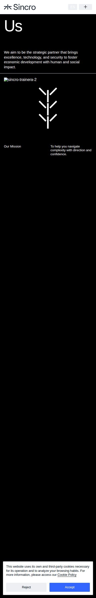

# UI Design System & Master Generation Blueprint: sincro-es_en-us

> **Us - Sincro** (https://sincro.es/en/us/) — Navigating complexity together


---

## 1. Executive Visual Persona & Design Archetype

- **Brand Essence & Persona**: **Us - Sincro** (`https://sincro.es/en/us/`). Navigating complexity together
- **Visual Archetype**: **High-Contrast Obsidian / Atmospheric Design System (`#000` canvas, `#fff` ink, `#36f` accent)**.
- **Anti-AI-Slop Differentiators**:
  - **Source-Grounded Chromatic Polarity**: Anchors the viewport in `#000` (`var(--color-black)` in `:root`) paired with `#fff` primary typography and `#36f` accents.
  - **Extracted Typographic Hierarchy**: Pairs `Schibsted Grotesk` for display copy (`20 years of being who we say we are`) with `AtAero Retina` and not declared in static CSS (uses primary stack / `ui-monospace`).
  - **Calibrated Spatial Grid & Motion**: Combines `40rem` container bounds (`gap: var(--spacing-L)`, padding `var(--spacing-L)`) with `cubic-bezier(.4,0,.2,1)` easing and Lenis Smooth Scroll (`data-lenis`), Swiper Touch Carousel Engine.

---

## 2. Spatial Architecture & Modular Grid Mathematics



### Viewport Allocation & Container Geometry
- **Captured Viewport Dimensions**: Desktop `1440×19719px` (`assets/desktop.png`, full-page scroll capture), Mobile `390×2400px` (`assets/mobile.png`, capped at 2400px multi-section capture).
- **Master Container Bounds**: `40rem` extracted from `sincro-es_en-us` stylesheet.
- **Canvas Lateral Padding & Spacing**: `var(--spacing-L)` lateral canvas padding with `var(--spacing-L)` grid gap.
- **Border Radius Scale**: `50%`, `.25rem`, `2147483647px`, `var(--radius-sm)`.

### Responsive Breakpoint Architecture
- **Desktop Layout**: Multi-column CSS Grid / Flexbox layout at `1440px` (`max-width: 40rem`, `gap: var(--spacing-L)`).
- **Mobile Layout**: Single-column vertical stack at `390px` viewport width with `var(--spacing-L)` horizontal padding.
- **Extracted CSS Media Queries**: `@media (width>=64rem)`, `@media (width>=40rem)`, `@media (width>=80rem)`, `@media (width>=96rem)`.

---

## 3. Color System, Materiality & Atmospheric Lighting

### Semantic Palette & Source Grounding
| Semantic Role | Ground-Truth Value | Extracted CSS Source / Selector |
|---|---|---|
| **Primary Canvas Substrate** | `#000` | `var(--color-black)` in `:root` |
| **Primary Typography Ink** | `#fff` | `var(--color-white)` in `:root` |
| **Elevated Surface / Card Substrate** | `#ff7cc1` | `var(--color-pink)` in `:root` |
| **Interactive Accent / Highlight** | `#36f` | `var(--color-blue)` in `:root` |
| **Secondary / Muted Copy** | `#0040ff` | `var(--color-vividBlueHover)` in `:root` |
| **Structural Hairline Border** | `#081423` | `var(--color-darkBlue)` in `:root` |

### Sanitized Root CSS Variables (`ui-ux.md` Ground Truth)
| Variable Name | Extracted Value | Semantic Role |
|---|---|---|
| `--color-gray-400` | `oklch(70.7% .022 261.325)` | Brand / Palette Token |
| `--color-black` | `#000` | Canvas / Surface Token |
| `--color-white` | `#fff` | Canvas / Surface Token |
| `--spacing` | `.25rem` | Layout / Spatial Grid Token |
| `--container-md` | `28rem` | Layout / Spatial Grid Token |
| `--container-lg` | `32rem` | Layout / Spatial Grid Token |
| `--container-xl` | `36rem` | Layout / Spatial Grid Token |
| `--text-sm` | `.75rem` | Typography Ink Token |
| `--text-sm--line-height` | `1.25` | Typography Ink Token |
| `--text-base` | `100%` | Typography Ink Token |
| `--text-base--line-height` | `normal` | Typography Ink Token |
| `--font-weight-medium` | `500` | Typography / Scale Token |
| `--font-weight-semibold` | `600` | Typography / Scale Token |
| `--tracking-wide` | `.025em` | Typography / Scale Token |
| `--leading-tight` | `1.25` | Typography / Scale Token |
| `--radius-xs` | `.125rem` | Elevation / Border Token |

---

## 4. Typographic Scale & Editorial Hierarchy

### Font Family Stacks
- **Display Typography**: `Schibsted Grotesk`.
- **Primary Body Stack**: `AtAero Retina`.
- **Technical / Metadata Stack**: not declared in static CSS (uses primary stack / `ui-monospace`).

### Typographic Scale & Rules (Extracted from Stylesheet & Variables)
- **Hero Display (`H1`)**: not explicitly declared on tag in static CSS (stylesheet font-size ladder: `1em`, `80%`, `75%`, `var(--text-bodyCaption)`, `var(--text-bodyL)`).
- **Section Heading (`H2`)**: rule `h2` (`font-size: var(--text-bodyMobM,.9375rem)`, `line-height: var(--tw-leading,var(...`, `letter-spacing: var(--tw-tracking,var...`).
- **Body Copy**: CSS variables `--text-base: 100%`, `--text-base--line-height: normal`, `--text-bodyTagline: 5.5rem`; rule `p` (`font-size: var(--text-bodyMobS,.8125rem)`, `line-height: var(--tw-leading,var(...`, `letter-spacing: var(--tw-tracking,var...`).
- **Metadata & Navigation Labels**: CSS variables `--text-sm: .75rem`, `--text-sm--line-height: 1.25`, `--default-mono-font-family: var(--font-mono)`.

---

## 5. Choreographed Motion & Interaction Physics

### Primary Easing Curves
- **Extracted Timing Functions**: `cubic-bezier(.4,0,.2,1)`.

### Per-Element Transition & Choreography Rules
- **Selector `.swiper-wrapper`**: `transition: var(--swiper-wrapper-transition-timing-function,initial)` extracted from `sincro-es_en-us` stylesheet.
- **Selector `layer theme`**: `transition: .15s` extracted from `sincro-es_en-us` stylesheet.
- **Selector `.transition`**: `transition: var(--tw-ease,var(--default-transition-timing-function))` extracted from `sincro-es_en-us` stylesheet.
- **Extracted Easing Curve (`cubic-bezier(.4,0,.2,1)`)**: Governs interactive state transitions across `<header.fixed>` and `<main.relative>`.
- **Runtime Interaction Engine**: Integrates Lenis Smooth Scroll (`data-lenis`), Swiper Touch Carousel Engine, Lottie Vector Animation Player with `prefers-reduced-motion: reduce` fallback guards.

---

## 6. Component Wireframe & Structural DOM Map

### Visual Layout Schematic (Grounded in `dom.html` — `1440px` Desktop & `390px` Mobile Reflow)
```
┌────────────────────────────────────────────────────────────────────────┐
│ DESKTOP VIEWPORT (1440px) — Us - Sincro                                │
│ ====================================================================== │
│ [ <header.fixed>           | Overview · Index · Archive · About · C ]  │
│ ---------------------------------------------------------------------- │
│ | HERO STAGE: <main.relative>                                      |   │
│ | H1: 20 years of being who we say we are                          |   │
│ | Substrate: #000       | Ink: #fff       | Accent: #36f           |   │
│ ---------------------------------------------------------------------- │
│ | SHOWCASE GRID (<main.relative>           ) max-w: 40rem          |   │
│ | +------------------------------+  +------------------------------+ | │
│ | | UNE Standard                 |  | Our values                   | | │
│ | +------------------------------+  +------------------------------+ | │
│ ---------------------------------------------------------------------- │
│ | MOBILE VIEWPORT REFLOW (390px) — Single-Column Stack (gap: var(--) | │
│ | [<header.fixed>] -> [<main.relative>] -> [<main.relative>] |         │
│ ---------------------------------------------------------------------- │
│ [ FOOTER (<footer.border-t>     ) | https://sincro.es/en/us/           │
└────────────────────────────────────────────────────────────────────────┘
```

### Granular DOM Region Breakdown
1. **Brand Header & Navigation Bar (<header.fixed> — `sincro-es_en-us`)**:
   - Landmark `<header class="fixed top-0">` hosting `Us - Sincro` navigation (`Overview · Index · Archive · About · Contact`), DOM attributes (`data-v-8de50b09`, `data-swiper-slide-index="0"`, `data-swiper-slide-index="1"`, `data-swiper-slide-index="2"`), and stylesheet rule `root { --swiper-theme-color:007aff }`.
2. **Hero Stage & Focal Lead (<main.relative> — `20 years of being who we say we ar`)**:
   - Landmark `<main class="relative flex">` presenting display lead `20 years of being who we say we are` and copy excerpt *"Tax and Accounting"* over `#000` canvas and `#fff` ink.
3. **Primary Showcase & Content Grid (<main.relative> — `UNE Standard`)**:
   - Landmark `<main class="relative flex">` rendering section `UNE Standard` with copy *"Navigating complexity together"*, asset references (`entry.BcfY3otZ.css`, `Media.DbUUtcYg.css`, `PageBuilder.D9iVxonM.css`, `SchibstedGrotesk-Regular.woff2`), and grid rule `host { z-index:1;margin-left:auto;margin-right:auto;display:block;position:rela... }`.
4. **Interactive Detail & Feature Matrix (<main.relative> — `Our values`)**:
   - Landmark `<main class="relative flex">` framing `Our values` and `Driven by and for the people` (*"Our expertise Services"*) with `#ff7cc1` surface cards, `#36f` accents, and `.swiper { z-index:1;margin-left:auto;margin-right:auto;padding:0;list-style:none;d... }`.
5. **Colophon & Global Directory Footer (<footer.border-t> — `https://sincro.es/en/us/`)**:
   - Landmark `<footer class="border-t border-mediumGrey">` anchoring `Us - Sincro` footer links (`Overview · Index · Archive · About · Contact`), copy *"We aim to be the strategic partner that brings excellence, t"*, and `#081423` structural dividers.

---

## 7. Master Zero-Shot AI Generation Prompt

```markdown
# Master Zero-Shot Frontend Generation Prompt: sincro-es_en-us (Us - Sincro)

You are a principal frontend architect and design systems engineer. Build a complete, production-ready web application replicating the exact design system, DOM landmarks, typographic hierarchy, color tokens, and motion physics of `sincro-es_en-us` (**Us - Sincro** — `https://sincro.es/en/us/`).

### 1. Visual Archetype & Anti-AI-Slop Mandates
- **Archetype**: High-Contrast Obsidian / Atmospheric Design System (`#000` canvas, `#fff` ink, `#36f` accent).
- **Identity & Domain Context**: Navigating complexity together
- **Primary Substrate**: `#000` (`var(--color-black)` in `:root`), **Primary Ink**: `#fff`, **Accent / Highlight**: `#36f`.
- **Site-Specific Differentiators**:
  - **Source-Grounded Chromatic Polarity**: Anchors the viewport in `#000` (`var(--color-black)` in `:root`) paired with `#fff` primary typography and `#36f` accents.
  - **Extracted Typographic Hierarchy**: Pairs `Schibsted Grotesk` for display copy (`20 years of being who we say we are`) with `AtAero Retina` and not declared in static CSS (uses primary stack / `ui-monospace`).
  - **Calibrated Spatial Grid & Motion**: Combines `40rem` container bounds (`gap: var(--spacing-L)`, padding `var(--spacing-L)`) with `cubic-bezier(.4,0,.2,1)` easing and Lenis Smooth Scroll (`data-lenis`), Swiper Touch Carousel Engine.

### 2. Ground-Truth CSS Variables (`:root` Token Contract)
Declare and consume these exact custom properties extracted from `sincro-es_en-us` in your global stylesheet:

:root {
  /* Us - Sincro (sincro-es_en-us) — Ground-Truth Extracted CSS Variables */
  --color-gray-400: oklch(70.7% .022 261.325); /* Brand / Palette Token (sincro-es_en-us) */
  --color-black: #000; /* Canvas / Surface Token (sincro-es_en-us) */
  --color-white: #fff; /* Canvas / Surface Token (sincro-es_en-us) */
  --spacing: .25rem; /* Layout / Spatial Grid Token (sincro-es_en-us) */
  --container-md: 28rem; /* Layout / Spatial Grid Token (sincro-es_en-us) */
  --container-lg: 32rem; /* Layout / Spatial Grid Token (sincro-es_en-us) */
  --container-xl: 36rem; /* Layout / Spatial Grid Token (sincro-es_en-us) */
  --text-sm: .75rem; /* Typography Ink Token (sincro-es_en-us) */
  --text-sm--line-height: 1.25; /* Typography Ink Token (sincro-es_en-us) */
  --text-base: 100%; /* Typography Ink Token (sincro-es_en-us) */
  --text-base--line-height: normal; /* Typography Ink Token (sincro-es_en-us) */
  --font-weight-medium: 500; /* Typography / Scale Token (sincro-es_en-us) */
  --font-weight-semibold: 600; /* Typography / Scale Token (sincro-es_en-us) */
  --tracking-wide: .025em; /* Typography / Scale Token (sincro-es_en-us) */
  --leading-tight: 1.25; /* Typography / Scale Token (sincro-es_en-us) */
  --radius-xs: .125rem; /* Elevation / Border Token (sincro-es_en-us) */
}

### 3. Semantic Color & Materiality Contract
Map every surface, ink, and border strictly to these source-grounded tokens:
- **Primary Canvas Substrate**: `#000` — grounded in `var(--color-black)` in `:root`
- **Primary Typography Ink**: `#fff` — grounded in `var(--color-white)` in `:root`
- **Elevated Surface / Card Substrate**: `#ff7cc1` — grounded in `var(--color-pink)` in `:root`
- **Interactive Accent / Highlight**: `#36f` — grounded in `var(--color-blue)` in `:root`
- **Secondary / Muted Copy**: `#0040ff` — grounded in `var(--color-vividBlueHover)` in `:root`
- **Structural Hairline Border**: `#081423` — grounded in `var(--color-darkBlue)` in `:root`

### 4. Spatial Grid, Container Bounds & Responsive Breakpoints
- **Desktop Viewport Reference**: `1440×19719px` (full-page scroll capture, `1440px` standard desktop width).
- **Mobile Viewport Reference**: `390×2400px` (capped at 2400px multi-section capture, `390px` standard mobile width).
- **Container Max-Width**: `40rem` extracted from `sincro-es_en-us` stylesheet
- **Padding & Gutters**: `var(--spacing-L)` lateral canvas padding with `var(--spacing-L)` grid gap
- **Desktop Grid**: Multi-column CSS Grid / Flexbox layout at `1440px` (`max-width: 40rem`, `gap: var(--spacing-L)`)
- **Mobile Adaptation**: Single-column vertical stack at `390px` viewport width with `var(--spacing-L)` horizontal padding
- **Media Queries**: `@media (width>=64rem)`, `@media (width>=40rem)`, `@media (width>=80rem)`, `@media (width>=96rem)`
- **Corner Radii**: `50%`, `.25rem`, `2147483647px`, `var(--radius-sm)`

### 5. Typography & Editorial Scale Contract
- **Display Font Stack**: `Schibsted Grotesk`
- **Body Font Stack**: `AtAero Retina`
- **Monospace / Technical Font Stack**: not declared in static CSS (uses primary stack / `ui-monospace`)
- **H1 Display Rule**: not explicitly declared on tag in static CSS (stylesheet font-size ladder: `1em`, `80%`, `75%`, `var(--text-bodyCaption)`, `var(--text-bodyL)`)
- **H2 Section Rule**: rule `h2` (`font-size: var(--text-bodyMobM,.9375rem)`, `line-height: var(--tw-leading,var(...`, `letter-spacing: var(--tw-tracking,var...`)
- **Body Copy Rule**: CSS variables `--text-base: 100%`, `--text-base--line-height: normal`, `--text-bodyTagline: 5.5rem`; rule `p` (`font-size: var(--text-bodyMobS,.8125rem)`, `line-height: var(--tw-leading,var(...`, `letter-spacing: var(--tw-tracking,var...`)
- **Metadata & Index Rule**: CSS variables `--text-sm: .75rem`, `--text-sm--line-height: 1.25`, `--default-mono-font-family: var(--font-mono)`

### 6. Component Hierarchy, Verbatim Copy & Real DOM Landmarks
Scaffold `sincro-es_en-us` (`Us - Sincro`) with these exact structural regions, extracted copy, and CSS rules from `dom.html`:
1. **Brand Header & Navigation Bar (<header.fixed> — `sincro-es_en-us`)**:
   - DOM & Selectors: Landmark `<header class="fixed top-0">` hosting `Us - Sincro` navigation (`Overview · Index · Archive · About · Contact`), DOM attributes (`data-v-8de50b09`, `data-swiper-slide-index="0"`, `data-swiper-slide-index="1"`, `data-swiper-slide-index="2"`), and stylesheet rule `root { --swiper-theme-color:007aff }`.
   - Responsive Contract: Header `Brand Header & Navigation Bar (<header.fixed> — `sincro-es_en-us`)` (`sincro-es_en-us`) adapts across `@media (width>=64rem)`, `@media (width>=40rem)`, `@media (width>=80rem)`, `@media (width>=96rem)` with `cubic-bezier(.4,0,.2,1)` transitions and links `Overview · Index · Archive · About · Contact`.
2. **Hero Stage & Focal Lead (<main.relative> — `20 years of being who we say we ar`)**:
   - DOM & Selectors: Landmark `<main class="relative flex">` presenting display lead `20 years of being who we say we are` and copy excerpt *"Tax and Accounting"* over `#000` canvas and `#fff` ink.
   - Responsive Contract: Hero stage (`1440×19719px` desktop / `390×2400px` mobile) sets `#000` background with `#fff` headline `20 years of being who we say we are`.
3. **Primary Showcase & Content Grid (<main.relative> — `UNE Standard`)**:
   - DOM & Selectors: Landmark `<main class="relative flex">` rendering section `UNE Standard` with copy *"Navigating complexity together"*, asset references (`entry.BcfY3otZ.css`, `Media.DbUUtcYg.css`, `PageBuilder.D9iVxonM.css`, `SchibstedGrotesk-Regular.woff2`), and grid rule `host { z-index:1;margin-left:auto;margin-right:auto;display:block;position:rela... }`.
   - Responsive Contract: Showcase grid `Primary Showcase & Content Grid (<main.relative> — `UNE Standard`)` applies Multi-column CSS Grid / Flexbox layout at `1440px` (`max-width: 40rem`, `gap: var(--spacing-L)`) on desktop and Single-column vertical stack at `390px` viewport width with `var(--spacing-L)` horizontal padding on mobile.
4. **Interactive Detail & Feature Matrix (<main.relative> — `Our values`)**:
   - DOM & Selectors: Landmark `<main class="relative flex">` framing `Our values` and `Driven by and for the people` (*"Our expertise Services"*) with `#ff7cc1` surface cards, `#36f` accents, and `.swiper { z-index:1;margin-left:auto;margin-right:auto;padding:0;list-style:none;d... }`.
   - Responsive Contract: Detail module `Interactive Detail & Feature Matrix (<main.relative> — `Our values`)` uses `50%`, `.25rem`, `2147483647px`, `var(--radius-sm)` radii, `#36f` highlights, and assets (entry.BcfY3otZ.css, Media.DbUUtcYg.css, PageBuilder.D9iVxonM.css).
5. **Colophon & Global Directory Footer (<footer.border-t> — `https://sincro.es/en/us/`)**:
   - DOM & Selectors: Landmark `<footer class="border-t border-mediumGrey">` anchoring `Us - Sincro` footer links (`Overview · Index · Archive · About · Contact`), copy *"We aim to be the strategic partner that brings excellence, t"*, and `#081423` structural dividers.
   - Responsive Contract: Footer `Colophon & Global Directory Footer (<footer.border-t> — `https://sincro.es/en/us/`)` aligns to `40rem` extracted from `sincro-es_en-us` stylesheet with `var(--spacing-L)` lateral canvas padding with `var(--spacing-L)` grid gap and attributes (data-v-8de50b09, data-swiper-slide-index="0", data-swiper-slide-index="1").

#### Verbatim DOM Copy Excerpts (`dom.html`)
- Copy Excerpt 1: *"Tax and Accounting"*
- Copy Excerpt 2: *"Navigating complexity together"*
- Copy Excerpt 3: *"Our expertise Services"*
- Copy Excerpt 4: *"We aim to be the strategic partner that brings excellence, technology, and securit..."*

### 7. Motion, Extracted Stylesheet Rules & Interaction Choreography
- **Primary Easing Functions**: `cubic-bezier(.4,0,.2,1)`
- **Extracted Stylesheet Rules (`sincro-es_en-us`)**:
- `root { --swiper-theme-color:007aff }`
- `host { z-index:1;margin-left:auto;margin-right:auto;display:block;position:rela... }`
- `.swiper { z-index:1;margin-left:auto;margin-right:auto;padding:0;list-style:none;d... }`
- `.swiper-vertical>.swiper-wrapper { flex-direction:column }`
- `.swiper-wrapper { transform:translateZ(0) }`
- **Per-Selector Transition Rules**:
- **Selector `.swiper-wrapper`**: `transition: var(--swiper-wrapper-transition-timing-function,initial)` extracted from `sincro-es_en-us` stylesheet.
- **Selector `layer theme`**: `transition: .15s` extracted from `sincro-es_en-us` stylesheet.
- **Selector `.transition`**: `transition: var(--tw-ease,var(--default-transition-timing-function))` extracted from `sincro-es_en-us` stylesheet.
- **Extracted Easing Curve (`cubic-bezier(.4,0,.2,1)`)**: Governs interactive state transitions across `<header.fixed>` and `<main.relative>`.
- **Runtime Interaction Engine**: Integrates Lenis Smooth Scroll (`data-lenis`), Swiper Touch Carousel Engine, Lottie Vector Animation Player with `prefers-reduced-motion: reduce` fallback guards.

### 8. Technical Deliverables
- Implement in Next.js (App Router) with TypeScript and Tailwind CSS consuming the `:root` custom properties defined above for `sincro-es_en-us`.
- Reproduce both the `1440px` desktop architecture and `390px` mobile breakpoint transitions, preserving semantic HTML5 landmarks (`<header>`, `<nav>`, `<main>`, `<section>`, `<footer>`) and `prefers-reduced-motion` accessibility guards.
```
