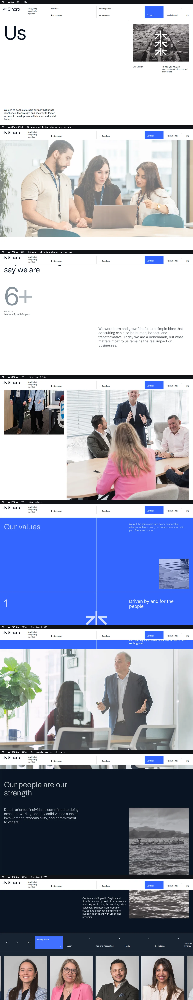
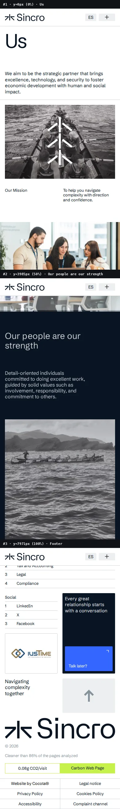

# UI Design System & Master Generation Blueprint: sincro-es_en-us

> **Us - Sincro** (https://sincro.es/en/us/) — Navigating complexity together





---

## 1. Executive Visual Persona & Design Archetype

- **Brand Essence & Persona**: **Us - Sincro** (`https://sincro.es/en/us/`). Navigating complexity together
- **Capture Provenance**: Live browser capture (`tier1_fast`, HTTP `200`, captured `2026-11-24`).
- **Visual Archetype**: **Light-Substrate Editorial & Modular Grid System (`#ffffff` canvas, `#081423` ink, `#0040ff` accent)**.
- **Anti-AI-Slop Differentiators**:
  - **Live-Computed Chromatic Polarity**: Anchors the viewport in `#ffffff` (live computed `browser-default` `background-color` (`computed_styles.json`)) paired with `#081423` primary typography and `#0040ff` accents.
  - **Grounded Typographic Hierarchy**: Uses `Schibsted Grotesk` across display (`20 years of being who we say we are`) and body copy.
  - **Calibrated Spatial Grid & Motion**: Combines `96rem` container bounds (`gap: 29.97px`, padding `var(--spacing-L)`) with `cubic-bezier(.4,0,.2,1)` easing and Lenis Smooth Scroll (`data-lenis`), Swiper Touch Carousel Engine.

---

## 2. Spatial Architecture & Modular Grid Mathematics

### Viewport Allocation & Container Geometry
- **Captured Journey Filmstrips**: Desktop `1280×6624px` (`assets/desktop-journey.webp`, `8` keyframes up to `y=14400px` / doc `19719px`), Mobile `390×2616px` (`assets/mobile-journey.webp`, `3` keyframes).
- **Master Container Bounds**: `96rem` (non-`@media` desktop container stylesheet rule).
- **Canvas Lateral Padding & Spacing**: `var(--spacing-L)` lateral canvas padding with `29.97px` grid gap.
- **Border Radius Scale**: `3.996px`, `50%`, `.25rem`, `2147483647px`.

### Responsive Breakpoint Architecture
- **Desktop Layout**: Multi-column CSS Grid / Flexbox layout at `1440px` (`max-width: 96rem`, `gap: 29.97px`).
- **Mobile Layout**: Single-column vertical stack at `390px` viewport width with `var(--spacing-L)` horizontal padding.
- **Extracted CSS Media Queries**: `@media (width>=64rem)`, `@media (width>=40rem)`, `@media (width>=80rem)`, `@media (width>=96rem)`.

---

## 3. Color System, Materiality & Atmospheric Lighting

### Semantic Palette & Source Grounding
| Semantic Role | Ground-Truth Value | Extracted Live / CSS Source |
|---|---|---|
| **Primary Canvas Substrate** | `#ffffff` | live computed `browser-default` `background-color` (`computed_styles.json`) |
| **Primary Typography Ink** | `#081423` | live computed `h1` `color` (`computed_styles.json`) |
| **Elevated Surface / Card Substrate** | `#081423` | `:placeholder-shown { background-color: #081423 }` |
| **Interactive Accent / Highlight** | `#0040ff` | `var(--color-vividBlueHover)` in `:root` |
| **Secondary / Muted Copy** | `#ff7cc1` | `var(--color-pink)` in `:root` |
| **Structural Hairline Border** | `#808080` | `.border-gray-400 { border-color: #808080 }` |
| **Variable Token (`--color-black`)** | `#000000` | `var(--color-black)` in `:root` |

### Sanitized Root CSS Variables (`ui-ux.md` Ground Truth)
| Variable Name | Extracted Value | Semantic Role |
|---|---|---|
| `--color-gray-400` | `oklch(70.7% .022 261.325)` | Brand / Palette Token |
| `--color-black` | `#000` | Canvas / Surface Token |
| `--color-white` | `#fff` | Canvas / Surface Token |
| `--spacing` | `.25rem` | Layout / Spatial Grid Token |
| `--container-md` | `28rem` | Layout / Spatial Grid Token |
| `--container-lg` | `32rem` | Layout / Spatial Grid Token |
| `--container-xl` | `36rem` | Layout / Spatial Grid Token |
| `--text-sm` | `.75rem` | Typography Ink Token |
| `--text-sm--line-height` | `1.25` | Typography Ink Token |
| `--text-base` | `100%` | Typography Ink Token |
| `--text-base--line-height` | `normal` | Typography Ink Token |
| `--font-weight-medium` | `500` | Typography / Scale Token |
| `--font-weight-semibold` | `600` | Typography / Scale Token |
| `--tracking-wide` | `.025em` | Typography / Scale Token |
| `--leading-tight` | `1.25` | Typography / Scale Token |
| `--radius-xs` | `.125rem` | Elevation / Border Token |

---

## 4. Typographic Scale & Editorial Hierarchy

### Font Family Stacks
- **Display Typography**: `Schibsted Grotesk`.
- **Primary Body Stack**: `Schibsted Grotesk`.
- **Technical / Metadata Stack**: not declared in live computed styles (uses primary stack / `ui-monospace`).

### Typographic Scale & Rules (Live Computed & Stylesheet Grounded)
- **Hero Display (`H1`)**: live computed `h1` (`font-size: 143.856px`, `line-height: 129.47px`, `font-weight: 400`, `letter-spacing: -2.87712px`).
- **Section Heading (`H2`)**: live computed `h2` (`font-size: 55.944px`, `line-height: 61.5384px`, `font-weight: 400`, `letter-spacing: -1.07892px`); rule `h2` (`font-size: var(--text-bodyMobM,.9375rem)`, `line-height: var(--tw-leading,var(...`, `letter-spacing: var(--tw-tracking,var...`).
- **Body Copy**: live computed `body` (`font-size: 15.984px`, `line-height: normal`, `font-weight: 400`); CSS variables `--text-base: 100%`, `--text-base--line-height: normal`, `--text-bodyTagline: 5.5rem`; rule `p` (`font-size: var(--text-bodyMobL)`, `line-height: var(--tw-leading,var(...`, `letter-spacing: var(--tw-tracking,var...`).
- **Metadata & Navigation Labels**: live computed `nav/a` (`font-size: 15.984px`, `line-height: normal`, `font-weight: 400`); CSS variables `--text-sm: .75rem`, `--text-sm--line-height: 1.25`, `--default-mono-font-family: var(--font-mono)`.

---

## 5. Choreographed Motion & Interaction Physics

### Primary Easing Curves
- **Extracted Timing Functions**: `cubic-bezier(.4,0,.2,1)`.

### Per-Element Transition & Choreography Rules
- **Selector `layer theme`**: `transition: .15s` extracted from `sincro-es_en-us` stylesheet.
- **Selector `.transition`**: `transition: var(--tw-ease,var(--default-transition-timing-function))` extracted from `sincro-es_en-us` stylesheet.
- **Selector `.transition-\[height\]`**: `transition: var(--tw-ease,var(--default-transition-timing-function))` extracted from `sincro-es_en-us` stylesheet.
- **Extracted Easing Curve (`cubic-bezier(.4,0,.2,1)`)**: Governs interactive state transitions across `<header.top-0>` and `<main.max-w-full>`.
- **Runtime Interaction Engine**: Integrates Lenis Smooth Scroll (`data-lenis`), Swiper Touch Carousel Engine, Lottie Vector Animation Player with `prefers-reduced-motion: reduce` fallback guards.
### Measured Runtime Scroll & Interaction Telemetry (`behavioral_journey_v2`)
- **Scroll Driver Mode**: `native` (max document height `19719px`, deepest scrollY reached `14400px` across `8` desktop keyframes).
- **Detected Scroll / Motion Libraries**: `Lenis`.
- **Route Transition Architecture**: First internal navigation (`/en/talent/`) measured as `direct` in `1518ms`.

---

## 6. Component Wireframe & Structural DOM Map

### Visual Layout Schematic — Desktop (`1440px`, Grounded in `dom.html` & Landmark Bounding Boxes)
```
┌────────────────────────────────────────────────────────────────────────┐
│ DESKTOP VIEWPORT (1440px) — Us - Sincro                                │
│ ====================================================================== │
│ [ <header.top-0> (1440px)             | Overview · Index · Archive · ] │
│ ---------------------------------------------------------------------- │
│ | HERO STAGE: <main.flex-1> (w=1440px)                               | │
│ | H1: 20 years of being who we say we are                            | │
│ | Substrate: #ffffff | Ink: #081423 | Accent: #0040ff                | │
│ ---------------------------------------------------------------------- │
│ | SHOWCASE GRID (<main.max-w-full>) max-w: 96rem                     | │
│ | +------------------------------+  +------------------------------+ | │
│ | | UNE Standard                 |  | Driven by and for the people | | │
│ | +------------------------------+  +------------------------------+ | │
│ ---------------------------------------------------------------------- │
│ | DETAIL MODULE (<main.relative>) — Building networks                | │
│ ---------------------------------------------------------------------- │
│ [ FOOTER (<footer.border-mediu) | https://sincro.es/en/us/             │
└────────────────────────────────────────────────────────────────────────┘
```

### Visual Layout Schematic — Mobile Reflow (`390px`)
```
┌────────────────────────────────────────────────────────────────────────┐
│ MOBILE VIEWPORT REFLOW (390px) — Single-Column Stack (gap: 29.97px)    │
│ ====================================================================== │
│ [ HEADER BAR (<header.top-0>          ) | Compact Menu (390px)         │
│ ---------------------------------------------------------------------- │
│ | HERO STAGE (<main.flex-1>) — 390px Vertical Lead                   | │
│ | H1: 20 years of being who we say we are                            | │
│ ---------------------------------------------------------------------- │
│ | SHOWCASE STACK (<main.max-w-full>) — 1-Col Stack                   | │
│ | [ Item 1: UNE Standard                                           ] | │
│ | [ Item 2: Driven by and for the people                           ] | │
│ ---------------------------------------------------------------------- │
│ | DETAIL STACK (<main.relative>) — 1-Col (Building networks)         | │
│ ---------------------------------------------------------------------- │
│ [ FOOTER (<footer.border-mediu) | Stacked 390px Colophon               │
└────────────────────────────────────────────────────────────────────────┘
```

### Granular DOM Region Breakdown
1. **Brand Header & Navigation Bar (<header.top-0> — `sincro-es_en-us`)**:
   - Landmark `<header class="top-0 left-0">` (`1440px`) hosting `Us - Sincro` navigation (`Overview · Index · Archive · About · Contact`), DOM attributes (`data-category="analytics"`, `data-analytics-type="ga"`, `data-gtmid="G-SCRK6TBT8Q"`, `data-v-8de50b09`), and stylesheet rule `before { box-sizing:border-box;border:0 solid;margin:0;padding:0 }`.
2. **Hero Stage & Focal Lead (<main.flex-1> — `20 years of being who we say we ar`)**:
   - Landmark `<main class="flex-1 max-w-full">` presenting display lead `20 years of being who we say we are` and copy excerpt *"Navigating complexity together"* over `#ffffff` canvas and `#081423` ink.
3. **Primary Showcase & Content Grid (<main.max-w-full> — `UNE Standard`)**:
   - Landmark `<main class="flex-1 max-w-full">` rendering section `UNE Standard` with copy *"We aim to be the strategic partner that brings excellence, techno"*, asset references (`entry.BcfY3otZ.css`, `Media.DbUUtcYg.css`, `PageBuilder.D9iVxonM.css`, `SchibstedGrotesk-Regular.woff2`), and grid rule `file-selector-button { box-sizing:border-box;border:0 solid;margin:0;padding:0 }`.
4. **Interactive Detail & Feature Matrix (<main.relative> — `Driven by and for the people`)**:
   - Landmark `<main class="flex-1 max-w-full">` framing `Driven by and for the people` and `Building networks` (*"To help you navigate complexity with direction and confidence."*) with `#081423` surface cards, `#0040ff` accents, and `strong { font-weight:bolder }`.
5. **Colophon & Global Directory Footer (<footer.border-mediumGrey> — `https://sincro.es/en/us/`)**:
   - Landmark `<footer class="border-mediumGrey pt-XL">` anchoring `Us - Sincro` footer links (`Overview · Index · Archive · About · Contact`), copy *"We were born and grew faithful to a simple idea: that consul"*, and `#808080` structural dividers.
### Full Vertical Scroll Sequence (Desktop `1440×900` Keyframes)
- **Step 01** (`y=0px`, `0%`): Active landmark `Us` · sticky/fixed elements: `1`
- **Step 02** (`y=849px`, `5%`): Active landmark `20 years of being who we say we are` · sticky/fixed elements: `1`
- **Step 03** (`y=1700px`, `9%`): Active landmark `20 years of being who we say we are` · sticky/fixed elements: `1`
- **Step 04** (`y=3400px`, `18%`): Active landmark `Section @ 18%` · sticky/fixed elements: `1`
- **Step 05** (`y=4250px`, `23%`): Active landmark `Our values` · sticky/fixed elements: `3`
- **Step 06** (`y=12750px`, `68%`): Active landmark `Section @ 68%` · sticky/fixed elements: `3`
- **Step 07** (`y=13600px`, `72%`): Active landmark `Our people are our strength` · sticky/fixed elements: `1`
- **Step 08** (`y=14400px`, `77%`): Active landmark `Section @ 77%` · sticky/fixed elements: `1`

### Multi-Page Internal Route Map
- **Detail Route (`/en/talent/`)**: `https://sincro.es/en/talent/` — H1: `Sincro Culture`, scrollHeight `10466px`, transition `direct` (`1518ms`)
- **Detail Route (`/en/technology/`)**: `https://sincro.es/en/technology/` — H1: `Technology`, scrollHeight `9601px`, transition `direct` (`895ms`)
- **Detail Route (`/en/sdg/`)**: `https://sincro.es/en/sdg/` — H1: `SDG`, scrollHeight `9012px`, transition `direct` (`892ms`)

---

## 7. Master Zero-Shot AI Generation Prompt

```markdown
# Master Zero-Shot Frontend Generation Prompt: sincro-es_en-us (Us - Sincro)

You are a principal frontend architect and design systems engineer. Build a complete, production-ready web application replicating the exact design system, DOM landmarks, typographic hierarchy, color tokens, and motion physics of `sincro-es_en-us` (**Us - Sincro** — `https://sincro.es/en/us/`).

### 1. Visual Archetype & Anti-AI-Slop Mandates
- **Archetype**: Light-Substrate Editorial & Modular Grid System (`#ffffff` canvas, `#081423` ink, `#0040ff` accent).
- **Identity & Domain Context**: Navigating complexity together
- **Primary Substrate**: `#ffffff` (live computed `browser-default` `background-color` (`computed_styles.json`)), **Primary Ink**: `#081423`, **Accent / Highlight**: `#0040ff`.
- **Site-Specific Differentiators**:
  - **Live-Computed Chromatic Polarity**: Anchors the viewport in `#ffffff` (live computed `browser-default` `background-color` (`computed_styles.json`)) paired with `#081423` primary typography and `#0040ff` accents.
  - **Grounded Typographic Hierarchy**: Uses `Schibsted Grotesk` across display (`20 years of being who we say we are`) and body copy.
  - **Calibrated Spatial Grid & Motion**: Combines `96rem` container bounds (`gap: 29.97px`, padding `var(--spacing-L)`) with `cubic-bezier(.4,0,.2,1)` easing and Lenis Smooth Scroll (`data-lenis`), Swiper Touch Carousel Engine.

### 2. Ground-Truth CSS Variables (`:root` Token Contract)
Declare and consume these exact custom properties extracted from `sincro-es_en-us` in your global stylesheet:

:root {
  /* Us - Sincro (sincro-es_en-us) — Live-Grounded CSS Variables */
  --color-gray-400: oklch(70.7% .022 261.325); /* Brand / Palette Token (sincro-es_en-us) */
  --color-black: #000; /* Canvas / Surface Token (sincro-es_en-us) */
  --color-white: #fff; /* Canvas / Surface Token (sincro-es_en-us) */
  --spacing: .25rem; /* Layout / Spatial Grid Token (sincro-es_en-us) */
  --container-md: 28rem; /* Layout / Spatial Grid Token (sincro-es_en-us) */
  --container-lg: 32rem; /* Layout / Spatial Grid Token (sincro-es_en-us) */
  --container-xl: 36rem; /* Layout / Spatial Grid Token (sincro-es_en-us) */
  --text-sm: .75rem; /* Typography Ink Token (sincro-es_en-us) */
  --text-sm--line-height: 1.25; /* Typography Ink Token (sincro-es_en-us) */
  --text-base: 100%; /* Typography Ink Token (sincro-es_en-us) */
  --text-base--line-height: normal; /* Typography Ink Token (sincro-es_en-us) */
  --font-weight-medium: 500; /* Typography / Scale Token (sincro-es_en-us) */
  --font-weight-semibold: 600; /* Typography / Scale Token (sincro-es_en-us) */
  --tracking-wide: .025em; /* Typography / Scale Token (sincro-es_en-us) */
  --leading-tight: 1.25; /* Typography / Scale Token (sincro-es_en-us) */
  --radius-xs: .125rem; /* Elevation / Border Token (sincro-es_en-us) */
}

### 3. Semantic Color & Materiality Contract
Map every surface, ink, and border strictly to these source-grounded tokens:
- **Primary Canvas Substrate**: `#ffffff` — grounded in live computed `browser-default` `background-color` (`computed_styles.json`)
- **Primary Typography Ink**: `#081423` — grounded in live computed `h1` `color` (`computed_styles.json`)
- **Elevated Surface / Card Substrate**: `#081423` — grounded in `:placeholder-shown { background-color: #081423 }`
- **Interactive Accent / Highlight**: `#0040ff` — grounded in `var(--color-vividBlueHover)` in `:root`
- **Secondary / Muted Copy**: `#ff7cc1` — grounded in `var(--color-pink)` in `:root`
- **Structural Hairline Border**: `#808080` — grounded in `.border-gray-400 { border-color: #808080 }`
- **Variable Token (`--color-black`)**: `#000000` — grounded in `var(--color-black)` in `:root`

### 4. Spatial Grid, Container Bounds & Responsive Breakpoints
- **Desktop Viewport Reference**: `1280×6624px` (multi-frame vertical journey filmstrip (6624px), `1440px` standard desktop width).
- **Mobile Viewport Reference**: `390×2616px` (multi-frame vertical journey filmstrip (2616px), `390px` standard mobile width).
- **Container Max-Width**: `96rem` (non-`@media` desktop container stylesheet rule)
- **Padding & Gutters**: `var(--spacing-L)` lateral canvas padding with `29.97px` grid gap
- **Desktop Grid**: Multi-column CSS Grid / Flexbox layout at `1440px` (`max-width: 96rem`, `gap: 29.97px`)
- **Mobile Adaptation**: Single-column vertical stack at `390px` viewport width with `var(--spacing-L)` horizontal padding
- **Media Queries**: `@media (width>=64rem)`, `@media (width>=40rem)`, `@media (width>=80rem)`, `@media (width>=96rem)`
- **Corner Radii**: `3.996px`, `50%`, `.25rem`, `2147483647px`

### 5. Typography & Editorial Scale Contract
- **Display Font Stack**: `Schibsted Grotesk`
- **Body Font Stack**: `Schibsted Grotesk`
- **Monospace / Technical Font Stack**: not declared in live computed styles (uses primary stack / `ui-monospace`)
- **H1 Display Rule**: live computed `h1` (`font-size: 143.856px`, `line-height: 129.47px`, `font-weight: 400`, `letter-spacing: -2.87712px`)
- **H2 Section Rule**: live computed `h2` (`font-size: 55.944px`, `line-height: 61.5384px`, `font-weight: 400`, `letter-spacing: -1.07892px`); rule `h2` (`font-size: var(--text-bodyMobM,.9375rem)`, `line-height: var(--tw-leading,var(...`, `letter-spacing: var(--tw-tracking,var...`)
- **Body Copy Rule**: live computed `body` (`font-size: 15.984px`, `line-height: normal`, `font-weight: 400`); CSS variables `--text-base: 100%`, `--text-base--line-height: normal`, `--text-bodyTagline: 5.5rem`; rule `p` (`font-size: var(--text-bodyMobL)`, `line-height: var(--tw-leading,var(...`, `letter-spacing: var(--tw-tracking,var...`)
- **Metadata & Index Rule**: live computed `nav/a` (`font-size: 15.984px`, `line-height: normal`, `font-weight: 400`); CSS variables `--text-sm: .75rem`, `--text-sm--line-height: 1.25`, `--default-mono-font-family: var(--font-mono)`

### 6. Component Hierarchy, Verbatim Copy & Real DOM Landmarks
Scaffold `sincro-es_en-us` (`Us - Sincro`) with these exact structural regions, extracted copy, and CSS rules from `dom.html`:
1. **Brand Header & Navigation Bar (<header.top-0> — `sincro-es_en-us`)**:
   - DOM & Selectors: Landmark `<header class="top-0 left-0">` (`1440px`) hosting `Us - Sincro` navigation (`Overview · Index · Archive · About · Contact`), DOM attributes (`data-category="analytics"`, `data-analytics-type="ga"`, `data-gtmid="G-SCRK6TBT8Q"`, `data-v-8de50b09`), and stylesheet rule `before { box-sizing:border-box;border:0 solid;margin:0;padding:0 }`.
   - Responsive Contract: Header `Brand Header & Navigation Bar (<header.top-0> — `sincro-es_en-us`)` (`sincro-es_en-us`) adapts across `@media (width>=64rem)`, `@media (width>=40rem)`, `@media (width>=80rem)`, `@media (width>=96rem)` with `cubic-bezier(.4,0,.2,1)` transitions and links `Overview · Index · Archive · About · Contact`.
2. **Hero Stage & Focal Lead (<main.flex-1> — `20 years of being who we say we ar`)**:
   - DOM & Selectors: Landmark `<main class="flex-1 max-w-full">` presenting display lead `20 years of being who we say we are` and copy excerpt *"Navigating complexity together"* over `#ffffff` canvas and `#081423` ink.
   - Responsive Contract: Hero stage (`1280×6624px` desktop / `390×2616px` mobile) sets `#ffffff` background with `#081423` headline `20 years of being who we say we are`.
3. **Primary Showcase & Content Grid (<main.max-w-full> — `UNE Standard`)**:
   - DOM & Selectors: Landmark `<main class="flex-1 max-w-full">` rendering section `UNE Standard` with copy *"We aim to be the strategic partner that brings excellence, techno"*, asset references (`entry.BcfY3otZ.css`, `Media.DbUUtcYg.css`, `PageBuilder.D9iVxonM.css`, `SchibstedGrotesk-Regular.woff2`), and grid rule `file-selector-button { box-sizing:border-box;border:0 solid;margin:0;padding:0 }`.
   - Responsive Contract: Showcase grid `Primary Showcase & Content Grid (<main.max-w-full> — `UNE Standard`)` applies Multi-column CSS Grid / Flexbox layout at `1440px` (`max-width: 96rem`, `gap: 29.97px`) on desktop and Single-column vertical stack at `390px` viewport width with `var(--spacing-L)` horizontal padding on mobile.
4. **Interactive Detail & Feature Matrix (<main.relative> — `Driven by and for the people`)**:
   - DOM & Selectors: Landmark `<main class="flex-1 max-w-full">` framing `Driven by and for the people` and `Building networks` (*"To help you navigate complexity with direction and confidence."*) with `#081423` surface cards, `#0040ff` accents, and `strong { font-weight:bolder }`.
   - Responsive Contract: Detail module `Interactive Detail & Feature Matrix (<main.relative> — `Driven by and for the people`)` uses `3.996px`, `50%`, `.25rem`, `2147483647px` radii, `#0040ff` highlights, and assets (entry.BcfY3otZ.css, Media.DbUUtcYg.css, PageBuilder.D9iVxonM.css).
5. **Colophon & Global Directory Footer (<footer.border-mediumGrey> — `https://sincro.es/en/us/`)**:
   - DOM & Selectors: Landmark `<footer class="border-mediumGrey pt-XL">` anchoring `Us - Sincro` footer links (`Overview · Index · Archive · About · Contact`), copy *"We were born and grew faithful to a simple idea: that consul"*, and `#808080` structural dividers.
   - Responsive Contract: Footer `Colophon & Global Directory Footer (<footer.border-mediumGrey> — `https://sincro.es/en/us/`)` aligns to `96rem` (non-`@media` desktop container stylesheet rule) with `var(--spacing-L)` lateral canvas padding with `29.97px` grid gap and attributes (data-category="analytics", data-analytics-type="ga", data-gtmid="G-SCRK6TBT8Q").

#### Verbatim DOM Copy Excerpts (`dom.html`)
- Copy Excerpt 1: *"Navigating complexity together"*
- Copy Excerpt 2: *"We aim to be the strategic partner that brings excellence, technology, and securit..."*
- Copy Excerpt 3: *"To help you navigate complexity with direction and confidence."*
- Copy Excerpt 4: *"We were born and grew faithful to a simple idea: that consulting can also be human..."*

### 7. Motion, Extracted Stylesheet Rules & Interaction Choreography
- **Primary Easing Functions**: `cubic-bezier(.4,0,.2,1)`
- **Extracted Stylesheet Rules (`sincro-es_en-us`)**:
- `before { box-sizing:border-box;border:0 solid;margin:0;padding:0 }`
- `file-selector-button { box-sizing:border-box;border:0 solid;margin:0;padding:0 }`
- `strong { font-weight:bolder }`
- `small { font-size:80% }`
- `sup { vertical-align:baseline;font-size:75%;line-height:0;position:relative }`
- **Per-Selector Transition Rules**:
- **Selector `layer theme`**: `transition: .15s` extracted from `sincro-es_en-us` stylesheet.
- **Selector `.transition`**: `transition: var(--tw-ease,var(--default-transition-timing-function))` extracted from `sincro-es_en-us` stylesheet.
- **Selector `.transition-\[height\]`**: `transition: var(--tw-ease,var(--default-transition-timing-function))` extracted from `sincro-es_en-us` stylesheet.
- **Extracted Easing Curve (`cubic-bezier(.4,0,.2,1)`)**: Governs interactive state transitions across `<header.top-0>` and `<main.max-w-full>`.
- **Runtime Interaction Engine**: Integrates Lenis Smooth Scroll (`data-lenis`), Swiper Touch Carousel Engine, Lottie Vector Animation Player with `prefers-reduced-motion: reduce` fallback guards.
### 7b. Full-Page Scroll Choreography, Interactive States & Multi-Page Routes
- **Scroll Mechanics**: Implement `native` vertical progression up to `19719px` across 8 distinct viewport chapters using Lenis.
- **Vertical Chapter Sequence**: Us (0%) -> 20 years of being who we sa... (5%) -> 20 years of being who we sa... (9%) -> Section @ 18% (18%) -> Our values (23%) -> Section @ 68% (68%) -> Our people are our strength (72%) -> Section @ 77% (77%).
- **Multi-Page Routes**: Scaffold internal routes `/en/talent/` (detail, direct), `/en/technology/` (detail, direct), `/en/sdg/` (detail, direct) sharing the global header/footer shell and design tokens.

### 8. Technical Deliverables
- Implement in Next.js (App Router) with TypeScript and Tailwind CSS consuming the `:root` custom properties defined above for `sincro-es_en-us`.
- Reproduce both the `1440px` desktop architecture and `390px` mobile breakpoint transitions, preserving semantic HTML5 landmarks (`<header>`, `<nav>`, `<main>`, `<section>`, `<footer>`) and `prefers-reduced-motion` accessibility guards.
```
---

## 8. Full-Page Scroll Journey, Interactive States & Subpage Inventory

### Desktop Scroll Keyframes (`1440×900` WebP)
| Step | Scroll Y | Progress | Active Landmark / Section | Sticky/Fixed | Visual Asset |
| :---: | :---: | :---: | :--- | :---: | :--- |
| `#01` | `0px` | `0%` | Us | `1` | [desktop-step-01.webp](assets/desktop-step-01.webp) |
| `#02` | `849px` | `5%` | 20 years of being who we say we are | `1` | [desktop-step-02.webp](assets/desktop-step-02.webp) |
| `#03` | `1700px` | `9%` | 20 years of being who we say we are | `1` | [desktop-step-03.webp](assets/desktop-step-03.webp) |
| `#04` | `3400px` | `18%` | Section @ 18% | `1` | [desktop-step-04.webp](assets/desktop-step-04.webp) |
| `#05` | `4250px` | `23%` | Our values | `3` | [desktop-step-05.webp](assets/desktop-step-05.webp) |
| `#06` | `12750px` | `68%` | Section @ 68% | `3` | [desktop-step-06.webp](assets/desktop-step-06.webp) |
| `#07` | `13600px` | `72%` | Our people are our strength | `1` | [desktop-step-07.webp](assets/desktop-step-07.webp) |
| `#08` | `14400px` | `77%` | Section @ 77% | `1` | [desktop-step-08.webp](assets/desktop-step-08.webp) |

### Mobile Condensed Keyframes (`390×844` WebP)
| Step | Scroll Y | Progress | Active Landmark | Visual Asset |
| :---: | :---: | :---: | :--- | :--- |
| `#01` | `0px` | `0%` | Us | [mobile-step-01.webp](assets/mobile-step-01.webp) |
| `#02` | `3985px` | `50%` | Our people are our strength | [mobile-step-02.webp](assets/mobile-step-02.webp) |
| `#03` | `7971px` | `100%` | Footer | [mobile-step-03.webp](assets/mobile-step-03.webp) |

### Internal Subpage Filmstrips (`1080px` Wide WebP)
| # | Template | Route URL | H1 / Title | Scroll Height | Transition | Filmstrip Asset |
| :-: | :---: | :--- | :--- | :---: | :---: | :--- |
| `1` | `detail` | `https://sincro.es/en/talent/` | Sincro Culture | `10466px` | `direct` (`1518ms`) | [subpage-01-en-talent.webp](assets/subpage-01-en-talent.webp) |
| `2` | `detail` | `https://sincro.es/en/technology/` | Technology | `9601px` | `direct` (`895ms`) | [subpage-02-en-technology.webp](assets/subpage-02-en-technology.webp) |
| `3` | `detail` | `https://sincro.es/en/sdg/` | SDG | `9012px` | `direct` (`892ms`) | [subpage-03-en-sdg.webp](assets/subpage-03-en-sdg.webp) |

