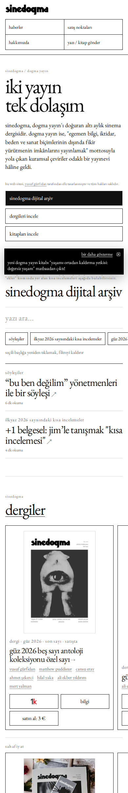

# UI Design System & Master Generation Blueprint: sinedogma-com-tr

> **sinedogma** (https://sinedogma.com.tr/) — sinedogma ve dogma yayın: dijital arşiv, dergiler, kitaplar, haberler ve satış noktaları.


---

## 1. Executive Visual Persona & Design Archetype

- **Brand Essence & Persona**: **sinedogma** (`https://sinedogma.com.tr/`). sinedogma ve dogma yayın: dijital arşiv, dergiler, kitaplar, haberler ve satış noktaları.
- **Capture Provenance**: Live browser capture (`tier1_fast`, HTTP `200`, captured `2026-11-23`).
- **Visual Archetype**: **Light-Substrate Editorial & Modular Grid System (`#ffffff` canvas, `#111111` ink, `#ffcc00` accent)**.
- **Anti-AI-Slop Differentiators**:
  - **Live-Computed Chromatic Polarity**: Anchors the viewport in `#ffffff` (live computed `body` `background-color` (`computed_styles.json`)) paired with `#111111` primary typography and `#ffcc00` accents.
  - **Grounded Typographic Hierarchy**: Pairs `EB Garamond Local` for display copy (`iki yayın tek dolaşım`) with `EB Garamond Local` and `Consolas`.
  - **Calibrated Spatial Grid & Motion**: Combines `1080px` container bounds (`gap: 16px`, padding `34px`) with `cubic-bezier(.22,.61,.36,1)` easing.

---

## 2. Spatial Architecture & Modular Grid Mathematics



### Viewport Allocation & Container Geometry
- **Captured Viewport Dimensions**: Desktop `1440×2400px` (`assets/desktop.png`, clamped at 2400px live multi-section capture), Mobile `390×2400px` (`assets/mobile.png`, clamped at 2400px live multi-section capture).
- **Master Container Bounds**: `1080px` (measured widest bounded `<section>` landmark width on `1440px` desktop).
- **Canvas Lateral Padding & Spacing**: `34px` lateral canvas padding with `16px` grid gap.
- **Border Radius Scale**: `50%`, `999px`, `7px`, `5px`.

### Responsive Breakpoint Architecture
- **Desktop Layout**: Multi-column CSS Grid / Flexbox layout at `1440px` (`max-width: 1080px`, `gap: 16px`).
- **Mobile Layout**: Single-column vertical stack at `390px` viewport width with `34px` horizontal padding.
- **Extracted CSS Media Queries**: `@media (max-width: 860px)`, `@media (max-width: 600px)`, `@media (max-width: 700px)`, `@media (max-width:600px)`.

---

## 3. Color System, Materiality & Atmospheric Lighting

### Semantic Palette & Source Grounding
| Semantic Role | Ground-Truth Value | Extracted Live / CSS Source |
|---|---|---|
| **Primary Canvas Substrate** | `#ffffff` | live computed `body` `background-color` (`computed_styles.json`) |
| **Primary Typography Ink** | `#111111` | live computed `h1` `color` (`computed_styles.json`) |
| **Elevated Surface / Card Substrate** | `#dddddd` | `.community-card { background: #dddddd }` |
| **Interactive Accent / Highlight** | `#ffcc00` | `crubber-button.ytp-swatch-backg... { background-color: #ffcc00 }` |
| **Secondary / Muted Copy** | `#6f6f6f` | live computed `p` `color` (`computed_styles.json`) |
| **Structural Hairline Border** | `#d9d9d9` | `var(--line)` in `:root` |
| **Variable Token (`--soft`)** | `#f5f5f3` | `var(--soft)` in `:root` |

### Sanitized Root CSS Variables (`ui-ux.md` Ground Truth)
| Variable Name | Extracted Value | Semantic Role |
|---|---|---|
| `--paper` | `#fff` | Canvas / Surface Token |
| `--ink` | `#111` | Typography Ink Token |
| `--muted` | `#6f6f6f` | Color / Atmospheric Token |
| `--line` | `#d9d9d9` | Color / Atmospheric Token |
| `--soft` | `#f5f5f3` | Color / Atmospheric Token |
| `--max` | `1080px` | Dimension / Scale Token |
| `--reading` | `680px` | Dimension / Scale Token |
| `--motion-fast` | `160ms` | Motion / Easing Token |
| `--motion-base` | `220ms` | Motion / Easing Token |
| `--motion-slow` | `300ms` | Motion / Easing Token |
| `--motion-ease` | `cubic-bezier(.22,.61,.36,1)` | Motion / Easing Token |
| `--garamond-tracking` | `0em` | Typography / Scale Token |
| `--garamond-heading-tracking` | `-0.025em` | Typography Ink Token |
| `--link-underline-offset` | `.16em` | Typography Ink Token |
| `--link-underline-thickness` | `1px` | Typography Ink Token |
| `--link-underline-color` | `rgba(17,17,17,.48)` | Typography Ink Token |

---

## 4. Typographic Scale & Editorial Hierarchy

### Font Family Stacks
- **Display Typography**: `EB Garamond Local`.
- **Primary Body Stack**: `EB Garamond Local`.
- **Technical / Metadata Stack**: `Consolas`.

### Typographic Scale & Rules (Live Computed & Stylesheet Grounded)
- **Hero Display (`H1`)**: live computed `h1` (`font-size: 78px`, `line-height: 73.32px`, `font-weight: 400`, `letter-spacing: -3.12px`); rule `h1` (`font-weight: 400`).
- **Section Heading (`H2`)**: live computed `h2` (`font-size: 54px`, `line-height: 54px`, `font-weight: 400`, `letter-spacing: -1.62px`); rule `h2` (`font-weight: 400`).
- **Body Copy**: live computed `body` (`font-size: 17px`, `line-height: 24.65px`, `font-weight: 400`); rule `p` (`font-size: 15px`).
- **Metadata & Navigation Labels**: live computed `nav/a` (`font-size: 14px`, `line-height: 20.3px`, `font-weight: 400`); rule `small` (`font-size: .72rem`).

---

## 5. Choreographed Motion & Interaction Physics

### Primary Easing Curves
- **Extracted Timing Functions**: `cubic-bezier(.22,.61,.36,1)`, `cubic-bezier(.2,.75,.25,1)`, `cubic-bezier(.2,.72,.2,1)`.

### Per-Element Transition & Choreography Rules
- **Selector `.text-button`**: `transition: background .15s ease, color .15s ease, transform .15s ease` extracted from `sinedogma-com-tr` stylesheet.
- **Selector `.about-copy a`**: `transition: background-color 160ms ease, color 160ms ease, text-decoration...` extracted from `sinedogma-com-tr` stylesheet.
- **Selector `.carousel-next`**: `transition: var(--motion-base)` extracted from `sinedogma-com-tr` stylesheet.
- **Extracted Easing Curve (`cubic-bezier(.22,.61,.36,1)`)**: Governs interactive state transitions across `<header.site-header>` and `<section.section>`.
- **State & Hover Choreography**: Opacity and transform transitions on `<section.hero>` and `<section.section>` interactive targets.

---

## 6. Component Wireframe & Structural DOM Map

### Visual Layout Schematic — Desktop (`1440px`, Grounded in `dom.html` & Landmark Bounding Boxes)
```
┌────────────────────────────────────────────────────────────────────────┐
│ DESKTOP VIEWPORT (1440px) — sinedogma                                  │
│ ====================================================================== │
│ [ <header.site-header> (1440x57px)    | haberler · satış noktaları · ] │
│ ---------------------------------------------------------------------- │
│ | HERO STAGE: <section.hero> (w=1440px)                              | │
│ | H1: iki yayın tek dolaşım                                          | │
│ | Substrate: #ffffff | Ink: #111111 | Accent: #ffcc00                | │
│ ---------------------------------------------------------------------- │
│ | SHOWCASE GRID (<section.section>) max-w: 1080px                    | │
│ | +------------------------------+  +------------------------------+ | │
│ | | sinedogma dijital arşiv      |  | “bu ben değilim” yönetmenler | | │
│ | +------------------------------+  +------------------------------+ | │
│ ---------------------------------------------------------------------- │
│ | DETAIL MODULE (<article.article-card>) — +1 belgesel: jim’le t     | │
│ ---------------------------------------------------------------------- │
│ [ FOOTER (<footer.site-footer>) | https://sinedogma.com.tr/            │
└────────────────────────────────────────────────────────────────────────┘
```

### Visual Layout Schematic — Mobile Reflow (`390px`)
```
┌────────────────────────────────────────────────────────────────────────┐
│ MOBILE VIEWPORT REFLOW (390px) — Single-Column Stack (gap: 16px)       │
│ ====================================================================== │
│ [ HEADER BAR (<header.site-header>    ) | Compact Menu (390px)         │
│ ---------------------------------------------------------------------- │
│ | HERO STAGE (<section.hero>) — 390px Vertical Lead                  | │
│ | H1: iki yayın tek dolaşım                                          | │
│ ---------------------------------------------------------------------- │
│ | SHOWCASE STACK (<section.section>) — 1-Col Stack                   | │
│ | [ Item 1: sinedogma dijital arşiv                                ] | │
│ | [ Item 2: “bu ben değilim” yönetmenleri ile bir söyleşi          ] | │
│ ---------------------------------------------------------------------- │
│ | DETAIL STACK (<article.article-card>) — 1-Col (+1 belgesel: jim’l) | │
│ ---------------------------------------------------------------------- │
│ [ FOOTER (<footer.site-footer>) | Stacked 390px Colophon               │
└────────────────────────────────────────────────────────────────────────┘
```

### Granular DOM Region Breakdown
1. **Brand Header & Navigation Bar (<header.site-header> — `sinedogma-com-tr`)**:
   - Landmark `<header class="site-header">` (`1440x57px`) hosting `sinedogma` navigation (`haberler · satış noktaları · hakkımızda`), DOM attributes (`data-path="/"`, `data-path="/haberler"`, `data-path="/satis-noktalari"`, `data-path="/hakkimizda"`), and stylesheet rule `root { --paper: fff; --ink: 111; --muted: 6f6f6f; --line: d9d9d9; --soft: f5f5f3; }`.
2. **Hero Stage & Focal Lead (<section.hero> — `iki yayın tek dolaşım`)**:
   - Landmark `<section class="hero shell">` presenting display lead `iki yayın tek dolaşım` and copy excerpt *"sinedogma / dogma yayın"* over `#ffffff` canvas and `#111111` ink.
3. **Primary Showcase & Content Grid (<section.section> — `sinedogma dijital arşiv`)**:
   - Landmark `<section class="section shell">` rendering section `sinedogma dijital arşiv` with copy *"sinedogma · güz 2026 güz 2026 beş sayı antoloji koleksiyonu özel "*, asset references (`EBGaramond-VariableFont_wght.woff2`, `favicon-32x32.png`, `favicon.ico`, `apple-touch-icon.png`), and grid rule `html { scroll-behavior: smooth; }`.
4. **Interactive Detail & Feature Matrix (<article.article-card> — `“bu ben değilim” yönetmenleri ile `)**:
   - Landmark `<article class="article-card">` framing `“bu ben değilim” yönetmenleri ile bir söyleşi` and `+1 belgesel: jim’le tanışmak "kısa incelemesi"` (*"sinedogma · güz 2026"*) with `#dddddd` surface cards, `#ffcc00` accents, and `input { font: inherit; text-transform: lowercase; }`.
5. **Colophon & Global Directory Footer (<footer.site-footer> — `https://sinedogma.com.tr/`)**:
   - Landmark `<footer class="site-footer">` anchoring `sinedogma` footer links (`haberler · satış noktaları · hakkımızda`), copy *"dogma yayın · atakan akar max stirner'in biricik felsefesi i"*, and `#d9d9d9` structural dividers.

---

## 7. Master Zero-Shot AI Generation Prompt

```markdown
# Master Zero-Shot Frontend Generation Prompt: sinedogma-com-tr (sinedogma)

You are a principal frontend architect and design systems engineer. Build a complete, production-ready web application replicating the exact design system, DOM landmarks, typographic hierarchy, color tokens, and motion physics of `sinedogma-com-tr` (**sinedogma** — `https://sinedogma.com.tr/`).

### 1. Visual Archetype & Anti-AI-Slop Mandates
- **Archetype**: Light-Substrate Editorial & Modular Grid System (`#ffffff` canvas, `#111111` ink, `#ffcc00` accent).
- **Identity & Domain Context**: sinedogma ve dogma yayın: dijital arşiv, dergiler, kitaplar, haberler ve satış noktaları.
- **Primary Substrate**: `#ffffff` (live computed `body` `background-color` (`computed_styles.json`)), **Primary Ink**: `#111111`, **Accent / Highlight**: `#ffcc00`.
- **Site-Specific Differentiators**:
  - **Live-Computed Chromatic Polarity**: Anchors the viewport in `#ffffff` (live computed `body` `background-color` (`computed_styles.json`)) paired with `#111111` primary typography and `#ffcc00` accents.
  - **Grounded Typographic Hierarchy**: Pairs `EB Garamond Local` for display copy (`iki yayın tek dolaşım`) with `EB Garamond Local` and `Consolas`.
  - **Calibrated Spatial Grid & Motion**: Combines `1080px` container bounds (`gap: 16px`, padding `34px`) with `cubic-bezier(.22,.61,.36,1)` easing.

### 2. Ground-Truth CSS Variables (`:root` Token Contract)
Declare and consume these exact custom properties extracted from `sinedogma-com-tr` in your global stylesheet:

:root {
  /* sinedogma (sinedogma-com-tr) — Live-Grounded CSS Variables */
  --paper: #fff; /* Canvas / Surface Token (sinedogma-com-tr) */
  --ink: #111; /* Typography Ink Token (sinedogma-com-tr) */
  --muted: #6f6f6f; /* Color / Atmospheric Token (sinedogma-com-tr) */
  --line: #d9d9d9; /* Color / Atmospheric Token (sinedogma-com-tr) */
  --soft: #f5f5f3; /* Color / Atmospheric Token (sinedogma-com-tr) */
  --max: 1080px; /* Dimension / Scale Token (sinedogma-com-tr) */
  --reading: 680px; /* Dimension / Scale Token (sinedogma-com-tr) */
  --motion-fast: 160ms; /* Motion / Easing Token (sinedogma-com-tr) */
  --motion-base: 220ms; /* Motion / Easing Token (sinedogma-com-tr) */
  --motion-slow: 300ms; /* Motion / Easing Token (sinedogma-com-tr) */
  --motion-ease: cubic-bezier(.22,.61,.36,1); /* Motion / Easing Token (sinedogma-com-tr) */
  --garamond-tracking: 0em; /* Typography / Scale Token (sinedogma-com-tr) */
  --garamond-heading-tracking: -0.025em; /* Typography Ink Token (sinedogma-com-tr) */
  --link-underline-offset: .16em; /* Typography Ink Token (sinedogma-com-tr) */
  --link-underline-thickness: 1px; /* Typography Ink Token (sinedogma-com-tr) */
  --link-underline-color: rgba(17,17,17,.48); /* Typography Ink Token (sinedogma-com-tr) */
}

### 3. Semantic Color & Materiality Contract
Map every surface, ink, and border strictly to these source-grounded tokens:
- **Primary Canvas Substrate**: `#ffffff` — grounded in live computed `body` `background-color` (`computed_styles.json`)
- **Primary Typography Ink**: `#111111` — grounded in live computed `h1` `color` (`computed_styles.json`)
- **Elevated Surface / Card Substrate**: `#dddddd` — grounded in `.community-card { background: #dddddd }`
- **Interactive Accent / Highlight**: `#ffcc00` — grounded in `crubber-button.ytp-swatch-backg... { background-color: #ffcc00 }`
- **Secondary / Muted Copy**: `#6f6f6f` — grounded in live computed `p` `color` (`computed_styles.json`)
- **Structural Hairline Border**: `#d9d9d9` — grounded in `var(--line)` in `:root`
- **Variable Token (`--soft`)**: `#f5f5f3` — grounded in `var(--soft)` in `:root`

### 4. Spatial Grid, Container Bounds & Responsive Breakpoints
- **Desktop Viewport Reference**: `1440×2400px` (clamped at 2400px live multi-section capture, `1440px` standard desktop width).
- **Mobile Viewport Reference**: `390×2400px` (clamped at 2400px live multi-section capture, `390px` standard mobile width).
- **Container Max-Width**: `1080px` (measured widest bounded `<section>` landmark width on `1440px` desktop)
- **Padding & Gutters**: `34px` lateral canvas padding with `16px` grid gap
- **Desktop Grid**: Multi-column CSS Grid / Flexbox layout at `1440px` (`max-width: 1080px`, `gap: 16px`)
- **Mobile Adaptation**: Single-column vertical stack at `390px` viewport width with `34px` horizontal padding
- **Media Queries**: `@media (max-width: 860px)`, `@media (max-width: 600px)`, `@media (max-width: 700px)`, `@media (max-width:600px)`
- **Corner Radii**: `50%`, `999px`, `7px`, `5px`

### 5. Typography & Editorial Scale Contract
- **Display Font Stack**: `EB Garamond Local`
- **Body Font Stack**: `EB Garamond Local`
- **Monospace / Technical Font Stack**: `Consolas`
- **H1 Display Rule**: live computed `h1` (`font-size: 78px`, `line-height: 73.32px`, `font-weight: 400`, `letter-spacing: -3.12px`); rule `h1` (`font-weight: 400`)
- **H2 Section Rule**: live computed `h2` (`font-size: 54px`, `line-height: 54px`, `font-weight: 400`, `letter-spacing: -1.62px`); rule `h2` (`font-weight: 400`)
- **Body Copy Rule**: live computed `body` (`font-size: 17px`, `line-height: 24.65px`, `font-weight: 400`); rule `p` (`font-size: 15px`)
- **Metadata & Index Rule**: live computed `nav/a` (`font-size: 14px`, `line-height: 20.3px`, `font-weight: 400`); rule `small` (`font-size: .72rem`)

### 6. Component Hierarchy, Verbatim Copy & Real DOM Landmarks
Scaffold `sinedogma-com-tr` (`sinedogma`) with these exact structural regions, extracted copy, and CSS rules from `dom.html`:
1. **Brand Header & Navigation Bar (<header.site-header> — `sinedogma-com-tr`)**:
   - DOM & Selectors: Landmark `<header class="site-header">` (`1440x57px`) hosting `sinedogma` navigation (`haberler · satış noktaları · hakkımızda`), DOM attributes (`data-path="/"`, `data-path="/haberler"`, `data-path="/satis-noktalari"`, `data-path="/hakkimizda"`), and stylesheet rule `root { --paper: fff; --ink: 111; --muted: 6f6f6f; --line: d9d9d9; --soft: f5f5f3; }`.
   - Responsive Contract: Header `Brand Header & Navigation Bar (<header.site-header> — `sinedogma-com-tr`)` (`sinedogma-com-tr`) adapts across `@media (max-width: 860px)`, `@media (max-width: 600px)`, `@media (max-width: 700px)`, `@media (max-width:600px)` with `cubic-bezier(.22,.61,.36,1)`, `cubic-bezier(.2,.75,.25,1)`, `cubic-bezier(.2,.72,.2,1)` transitions and links `haberler · satış noktaları · hakkımızda`.
2. **Hero Stage & Focal Lead (<section.hero> — `iki yayın tek dolaşım`)**:
   - DOM & Selectors: Landmark `<section class="hero shell">` presenting display lead `iki yayın tek dolaşım` and copy excerpt *"sinedogma / dogma yayın"* over `#ffffff` canvas and `#111111` ink.
   - Responsive Contract: Hero stage (`1440×2400px` desktop / `390×2400px` mobile) sets `#ffffff` background with `#111111` headline `iki yayın tek dolaşım`.
3. **Primary Showcase & Content Grid (<section.section> — `sinedogma dijital arşiv`)**:
   - DOM & Selectors: Landmark `<section class="section shell">` rendering section `sinedogma dijital arşiv` with copy *"sinedogma · güz 2026 güz 2026 beş sayı antoloji koleksiyonu özel "*, asset references (`EBGaramond-VariableFont_wght.woff2`, `favicon-32x32.png`, `favicon.ico`, `apple-touch-icon.png`), and grid rule `html { scroll-behavior: smooth; }`.
   - Responsive Contract: Showcase grid `Primary Showcase & Content Grid (<section.section> — `sinedogma dijital arşiv`)` applies Multi-column CSS Grid / Flexbox layout at `1440px` (`max-width: 1080px`, `gap: 16px`) on desktop and Single-column vertical stack at `390px` viewport width with `34px` horizontal padding on mobile.
4. **Interactive Detail & Feature Matrix (<article.article-card> — `“bu ben değilim” yönetmenleri ile `)**:
   - DOM & Selectors: Landmark `<article class="article-card">` framing `“bu ben değilim” yönetmenleri ile bir söyleşi` and `+1 belgesel: jim’le tanışmak "kısa incelemesi"` (*"sinedogma · güz 2026"*) with `#dddddd` surface cards, `#ffcc00` accents, and `input { font: inherit; text-transform: lowercase; }`.
   - Responsive Contract: Detail module `Interactive Detail & Feature Matrix (<article.article-card> — `“bu ben değilim” yönetmenleri ile `)` uses `50%`, `999px`, `7px`, `5px` radii, `#ffcc00` highlights, and assets (EBGaramond-VariableFont_wght.woff2, favicon-32x32.png, favicon.ico).
5. **Colophon & Global Directory Footer (<footer.site-footer> — `https://sinedogma.com.tr/`)**:
   - DOM & Selectors: Landmark `<footer class="site-footer">` anchoring `sinedogma` footer links (`haberler · satış noktaları · hakkımızda`), copy *"dogma yayın · atakan akar max stirner'in biricik felsefesi i"*, and `#d9d9d9` structural dividers.
   - Responsive Contract: Footer `Colophon & Global Directory Footer (<footer.site-footer> — `https://sinedogma.com.tr/`)` aligns to `1080px` (measured widest bounded `<section>` landmark width on `1440px` desktop) with `34px` lateral canvas padding with `16px` grid gap and attributes (data-path="/", data-path="/haberler", data-path="/satis-noktalari").

#### Verbatim DOM Copy Excerpts (`dom.html`)
- Copy Excerpt 1: *"sinedogma / dogma yayın"*
- Copy Excerpt 2: *"sinedogma · güz 2026 güz 2026 beş sayı antoloji koleksiyonu özel sayı incele ↗"*
- Copy Excerpt 3: *"sinedogma · güz 2026"*
- Copy Excerpt 4: *"dogma yayın · atakan akar max stirner'in biricik felsefesi incele ↗"*

### 7. Motion, Extracted Stylesheet Rules & Interaction Choreography
- **Primary Easing Functions**: `cubic-bezier(.22,.61,.36,1)`, `cubic-bezier(.2,.75,.25,1)`, `cubic-bezier(.2,.72,.2,1)`
- **Extracted Stylesheet Rules (`sinedogma-com-tr`)**:
- `root { --paper: fff; --ink: 111; --muted: 6f6f6f; --line: d9d9d9; --soft: f5f5f3; }`
- `html { scroll-behavior: smooth; }`
- `input { font: inherit; text-transform: lowercase; }`
- `.shell { width: min(calc(100% - 40px), var(--max)); margin-inline: auto; }`
- `.header-inner { display: flex; align-items: center; justify-content: space-between; }`
- **Per-Selector Transition Rules**:
- **Selector `.text-button`**: `transition: background .15s ease, color .15s ease, transform .15s ease` extracted from `sinedogma-com-tr` stylesheet.
- **Selector `.about-copy a`**: `transition: background-color 160ms ease, color 160ms ease, text-decoration...` extracted from `sinedogma-com-tr` stylesheet.
- **Selector `.carousel-next`**: `transition: var(--motion-base)` extracted from `sinedogma-com-tr` stylesheet.
- **Extracted Easing Curve (`cubic-bezier(.22,.61,.36,1)`)**: Governs interactive state transitions across `<header.site-header>` and `<section.section>`.
- **State & Hover Choreography**: Opacity and transform transitions on `<section.hero>` and `<section.section>` interactive targets.

### 8. Technical Deliverables
- Implement in Next.js (App Router) with TypeScript and Tailwind CSS consuming the `:root` custom properties defined above for `sinedogma-com-tr`.
- Reproduce both the `1440px` desktop architecture and `390px` mobile breakpoint transitions, preserving semantic HTML5 landmarks (`<header>`, `<nav>`, `<main>`, `<section>`, `<footer>`) and `prefers-reduced-motion` accessibility guards.
```
