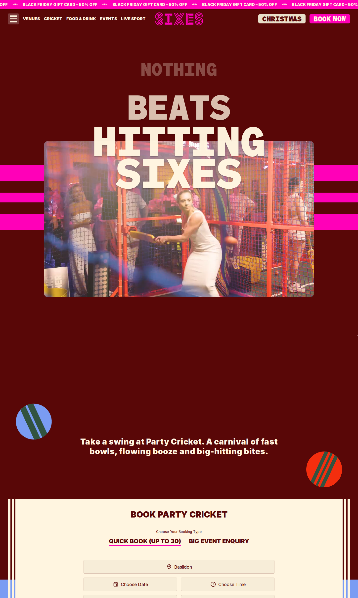

# UI Design System & Master Generation Blueprint: sixescricket-com

> **Sixes Party Cricket · Let's Play · Nets & Simulator · Sixes Social Cricket** (https://sixescricket.com/) — Cricket, but not as you know it. We've re-imagined the age old game of cricket for the modern socialite.



---

## 1. Executive Visual Persona & Design Archetype

- **Brand Essence & Persona**: **Sixes Party Cricket · Let's Play · Nets & Simulator · Sixes Social Cricket** (`https://sixescricket.com/`). Cricket, but not as you know it. We've re-imagined the age old game of cricket for the modern socialite.
- **Visual Archetype**: **Light-Gallery WebGL / Canvas Interactive Experience (`#ffa3a3` / `#e40014`)**.
- **Anti-AI-Slop Differentiators**:
  - **Source-Grounded Chromatic Polarity**: Anchors the viewport in `#ffa3a3` (`var(--color-red-300)` in `:root`) paired with `#e40014` primary typography and `#e40014` accents.
  - **Extracted Typographic Hierarchy**: Pairs `Inter` for display copy (`Sixes Social Cricket`) with `Inter Fallback` and `fontSoehneMono`.
  - **Calibrated Spatial Grid & Motion**: Combines `420px` container bounds (`gap: var(--spacing)`, padding `1px`) with `cubic-bezier(.28,.84,.42,1)` easing and Three.js / WebGL Canvas Pipeline, Swiper Touch Carousel Engine.

---

## 2. Spatial Architecture & Modular Grid Mathematics


### Viewport Allocation & Container Geometry
- **Captured Viewport Dimensions**: Desktop `1440×2400px` (`assets/desktop.png`, capped at 2400px multi-section capture), Mobile `390×2400px` (`assets/mobile.png`, capped at 2400px multi-section capture).
- **Master Container Bounds**: `420px` extracted from `sixescricket-com` stylesheet.
- **Canvas Lateral Padding & Spacing**: `1px` lateral canvas padding with `var(--spacing)` grid gap.
- **Border Radius Scale**: `3px`, `50%`, `100%`, `.25rem`.

### Responsive Breakpoint Architecture
- **Desktop Layout**: Multi-column CSS Grid / Flexbox layout at `1440px` (`max-width: 420px`, `gap: var(--spacing)`).
- **Mobile Layout**: Single-column vertical stack at `390px` viewport width with `1px` horizontal padding.
- **Extracted CSS Media Queries**: `@media screen and (prefers-reduced-motion:reduce)`, `@media screen and (prefers-reduced-motion:no-preference)`, `@media (prefers-reduced-motion:reduce)`, `@media (min-width:48rem)`.

---

## 3. Color System, Materiality & Atmospheric Lighting

### Semantic Palette & Source Grounding
| Semantic Role | Ground-Truth Value | Extracted CSS Source / Selector |
|---|---|---|
| **Primary Canvas Substrate** | `#ffa3a3` | `var(--color-red-300)` in `:root` |
| **Primary Typography Ink** | `#ff6568` | `var(--color-red-400)` in `:root` |
| **Elevated Surface / Card Substrate** | `#fb2c36` | `var(--color-red-500)` in `:root` |
| **Interactive Accent / Highlight** | `#e40014` | `var(--color-red-600)` in `:root` |
| **Secondary / Muted Copy** | `#fef3c6` | `var(--color-amber-100)` in `:root` |
| **Structural Hairline Border** | `#fcbb00` | `var(--color-amber-400)` in `:root` |

### Sanitized Root CSS Variables (`ui-ux.md` Ground Truth)
| Variable Name | Extracted Value | Semantic Role |
|---|---|---|
| `--font-inter` | `"Inter", "Inter Fallback"` | Typography / Scale Token |
| `--font-soehne-mono` | `"fontSoehneMono", "fontSoehneMono Fallback"` | Typography / Scale Token |
| `--fa-font-solid` | `normal 900 1em/1 "Font Awesome 7 Free"` | Typography / Scale Token |
| `--fa-font-regular` | `normal 400 1em/1 "Font Awesome 7 Free"` | Typography / Scale Token |
| `--fa-font-light` | `normal 300 1em/1 "Font Awesome 7 Pro"` | Canvas / Surface Token |
| `--fa-font-thin` | `normal 100 1em/1 "Font Awesome 7 Pro"` | Typography / Scale Token |
| `--fa-font-duotone` | `normal 900 1em/1 "Font Awesome 7 Duotone"` | Typography / Scale Token |
| `--fa-font-duotone-regular` | `normal 400 1em/1 "Font Awesome 7 Duotone"` | Typography / Scale Token |
| `--fa-font-duotone-light` | `normal 300 1em/1 "Font Awesome 7 Duotone"` | Canvas / Surface Token |
| `--fa-font-duotone-thin` | `normal 100 1em/1 "Font Awesome 7 Duotone"` | Typography / Scale Token |
| `--fa-font-brands` | `normal 400 1em/1 "Font Awesome 7 Brands"` | Brand / Palette Token |
| `--fa-font-sharp-solid` | `normal 900 1em/1 "Font Awesome 7 Sharp"` | Typography / Scale Token |
| `--fa-font-sharp-regular` | `normal 400 1em/1 "Font Awesome 7 Sharp"` | Typography / Scale Token |
| `--fa-font-sharp-light` | `normal 300 1em/1 "Font Awesome 7 Sharp"` | Canvas / Surface Token |
| `--fa-font-sharp-thin` | `normal 100 1em/1 "Font Awesome 7 Sharp"` | Typography / Scale Token |
| `--fa-font-sharp-duotone-solid` | `normal 900 1em/1 "Font Awesome 7 Sharp Duotone"` | Typography / Scale Token |

---

## 4. Typographic Scale & Editorial Hierarchy

### Font Family Stacks
- **Display Typography**: `Inter`.
- **Primary Body Stack**: `Inter Fallback`.
- **Technical / Metadata Stack**: `fontSoehneMono`.

### Typographic Scale & Rules (Extracted from Stylesheet & Variables)
- **Hero Display (`H1`)**: CSS variables `--text-4xl: 2.25rem`, `--text-4xl--line-height: calc(2.5 / 2.25)`, `--text-6xl: 3.75rem`.
- **Section Heading (`H2`)**: CSS variables `--text-2xl: 1.5rem`, `--text-2xl--line-height: calc(2 / 1.5)`, `--text-3xl: 1.875rem`; rule `h2` (`font-size: 1.75rem`).
- **Body Copy**: CSS variables `--text-base: 1rem`, `--text-base--line-height: calc(1.5 / 1)`.
- **Metadata & Navigation Labels**: CSS variables `--font-soehne-mono: "fontSoehneMono", "fontSoehneMono Fallback"`, `--text-xs: .75rem`, `--text-xs--line-height: calc(1 / .75)`.

---

## 5. Choreographed Motion & Interaction Physics

### Primary Easing Curves
- **Extracted Timing Functions**: `cubic-bezier(.28,.84,.42,1)`, `cubic-bezier(.33,0,.66,.33)`, `cubic-bezier(.33,.66,.66,1)`.

### Per-Element Transition & Choreography Rules
- **Selector `.fnwpv81`**: `transition: opacity .2s ease-in` extracted from `sixescricket-com` stylesheet.
- **Selector `._14vatmh1`**: `transition: transform .1s` extracted from `sixescricket-com` stylesheet.
- **Selector `._1jezl1b0`**: `transition: all .2s linear` extracted from `sixescricket-com` stylesheet.
- **Extracted Easing Curve (`cubic-bezier(.28,.84,.42,1)`)**: Governs interactive state transitions across `<header.sticky>` and `<article.overlay>`.
- **Runtime Interaction Engine**: Integrates Three.js / WebGL Canvas Pipeline, Swiper Touch Carousel Engine with `prefers-reduced-motion: reduce` fallback guards.

---

## 6. Component Wireframe & Structural DOM Map

### Visual Layout Schematic (Grounded in `dom.html` — `1440px` Desktop & `390px` Mobile Reflow)
```
┌────────────────────────────────────────────────────────────────────────┐
│ DESKTOP VIEWPORT (1440px) — Sixes Party Cricket · Let's Play · Nets &  │
│ ====================================================================== │
│ [ <header.sticky>          | Venues · Cricket · Food & Drink · Even ]  │
│ ---------------------------------------------------------------------- │
│ | HERO STAGE: <section.relative>                                   |   │
│ | H1: Sixes Social Cricket                                         |   │
│ | Substrate: #ffa3a3    | Ink: #e40014    | Accent: #e40014        |   │
│ ---------------------------------------------------------------------- │
│ | SHOWCASE GRID (<article.overlay>         ) max-w: 420px          |   │
│ | +------------------------------+  +------------------------------+ | │
│ | | Nothing Beats Hitting Sixes  |  | Book Party Cricket           | | │
│ | +------------------------------+  +------------------------------+ | │
│ ---------------------------------------------------------------------- │
│ | MOBILE VIEWPORT REFLOW (390px) — Single-Column Stack (gap: var(--) | │
│ | [<header.sticky>] -> [<section.relative>] -> [<article.overlay>] |   │
│ ---------------------------------------------------------------------- │
│ [ FOOTER (<footer.relative>     ) | https://sixescricket.com/          │
└────────────────────────────────────────────────────────────────────────┘
```

### Granular DOM Region Breakdown
1. **Brand Header & Navigation Bar (<header.sticky> — `sixescricket-com`)**:
   - Landmark `<header class="sticky top-0">` hosting `Sixes Party Cricket · Let's Play · N` navigation (`Venues · Cricket · Food & Drink · Events · Live Sport`), DOM attributes (`data-scroll-behavior="smooth"`, `data-sentry-component="RootLayout"`, `data-sentry-source-file="layout.tsx"`, `data-precedence="next"`), and stylesheet rule `.elmvdc0 { white-space:nowrap;text-overflow:ellipsis;display:block;overflow:clip }`.
2. **Hero Stage & Focal Lead (<section.relative> — `Sixes Social Cricket`)**:
   - Landmark `<section class="relative stack">` presenting display lead `Sixes Social Cricket` and copy excerpt *"Necessary 9 Necessary cookies help make a website usable by enabl"* over `#ffa3a3` canvas and `#e40014` ink.
3. **Primary Showcase & Content Grid (<article.overlay> — `Nothing Beats Hitting Sixes`)**:
   - Landmark `<article class="overlay overlay-b">` rendering section `Nothing Beats Hitting Sixes` with copy *"Google 4 Learn more about this provider Some of the data collecte"*, asset references (`6gknobew.api.sanity.io`, `83afe278b6a6bb3c-s.p.45535valc9rz...`, `soehne_mono-s.p.1h8tgkdilcgxe.woff2`, `0dvybyowk9yut.css`), and grid rule `._1b6o2se1 { animation:.5s linear infinite _1b6o2se0 }`.
4. **Interactive Detail & Feature Matrix (<article.overlay> — `Book Party Cricket`)**:
   - Landmark `<article class="overlay overlay-b">` framing `Book Party Cricket` and `Swing your heart out` (*"Learn more about this provider"*) with `#fb2c36` surface cards, `#e40014` accents, and `._1lyk8y0 { align-items:center }`.
5. **Colophon & Global Directory Footer (<footer.relative> — `https://sixescricket.com/`)**:
   - Landmark `<footer class="relative bg-mahogany-500">` anchoring `Sixes Party Cricket · Let's Play` footer links (`Venues · Cricket · Food & Drink · Events · Live Sport`), copy *"Some of the data collected by this provider is for the purpo"*, and `#fcbb00` structural dividers.

---

## 7. Master Zero-Shot AI Generation Prompt

```markdown
# Master Zero-Shot Frontend Generation Prompt: sixescricket-com (Sixes Party Cricket · Let's Play · Nets & Simulator · Sixes Social Cricket)

You are a principal frontend architect and design systems engineer. Build a complete, production-ready web application replicating the exact design system, DOM landmarks, typographic hierarchy, color tokens, and motion physics of `sixescricket-com` (**Sixes Party Cricket · Let's Play · Nets & Simulator · Sixes Social Cricket** — `https://sixescricket.com/`).

### 1. Visual Archetype & Anti-AI-Slop Mandates
- **Archetype**: Light-Gallery WebGL / Canvas Interactive Experience (`#ffa3a3` / `#e40014`).
- **Identity & Domain Context**: Cricket, but not as you know it. We've re-imagined the age old game of cricket for the modern socialite.
- **Primary Substrate**: `#ffa3a3` (`var(--color-red-300)` in `:root`), **Primary Ink**: `#e40014`, **Accent / Highlight**: `#e40014`.
- **Site-Specific Differentiators**:
  - **Source-Grounded Chromatic Polarity**: Anchors the viewport in `#ffa3a3` (`var(--color-red-300)` in `:root`) paired with `#e40014` primary typography and `#e40014` accents.
  - **Extracted Typographic Hierarchy**: Pairs `Inter` for display copy (`Sixes Social Cricket`) with `Inter Fallback` and `fontSoehneMono`.
  - **Calibrated Spatial Grid & Motion**: Combines `420px` container bounds (`gap: var(--spacing)`, padding `1px`) with `cubic-bezier(.28,.84,.42,1)` easing and Three.js / WebGL Canvas Pipeline, Swiper Touch Carousel Engine.

### 2. Ground-Truth CSS Variables (`:root` Token Contract)
Declare and consume these exact custom properties extracted from `sixescricket-com` in your global stylesheet:

:root {
  /* Sixes Party Cricket · Let's Play · Nets & Simulator · Sixes Social Cricket (sixescricket-com) — Ground-Truth Extracted CSS Variables */
  --font-inter: "Inter", "Inter Fallback"; /* Typography / Scale Token (sixescricket-com) */
  --font-soehne-mono: "fontSoehneMono", "fontSoehneMono Fallback"; /* Typography / Scale Token (sixescricket-com) */
  --fa-font-solid: normal 900 1em/1 "Font Awesome 7 Free"; /* Typography / Scale Token (sixescricket-com) */
  --fa-font-regular: normal 400 1em/1 "Font Awesome 7 Free"; /* Typography / Scale Token (sixescricket-com) */
  --fa-font-light: normal 300 1em/1 "Font Awesome 7 Pro"; /* Canvas / Surface Token (sixescricket-com) */
  --fa-font-thin: normal 100 1em/1 "Font Awesome 7 Pro"; /* Typography / Scale Token (sixescricket-com) */
  --fa-font-duotone: normal 900 1em/1 "Font Awesome 7 Duotone"; /* Typography / Scale Token (sixescricket-com) */
  --fa-font-duotone-regular: normal 400 1em/1 "Font Awesome 7 Duotone"; /* Typography / Scale Token (sixescricket-com) */
  --fa-font-duotone-light: normal 300 1em/1 "Font Awesome 7 Duotone"; /* Canvas / Surface Token (sixescricket-com) */
  --fa-font-duotone-thin: normal 100 1em/1 "Font Awesome 7 Duotone"; /* Typography / Scale Token (sixescricket-com) */
  --fa-font-brands: normal 400 1em/1 "Font Awesome 7 Brands"; /* Brand / Palette Token (sixescricket-com) */
  --fa-font-sharp-solid: normal 900 1em/1 "Font Awesome 7 Sharp"; /* Typography / Scale Token (sixescricket-com) */
  --fa-font-sharp-regular: normal 400 1em/1 "Font Awesome 7 Sharp"; /* Typography / Scale Token (sixescricket-com) */
  --fa-font-sharp-light: normal 300 1em/1 "Font Awesome 7 Sharp"; /* Canvas / Surface Token (sixescricket-com) */
  --fa-font-sharp-thin: normal 100 1em/1 "Font Awesome 7 Sharp"; /* Typography / Scale Token (sixescricket-com) */
  --fa-font-sharp-duotone-solid: normal 900 1em/1 "Font Awesome 7 Sharp Duotone"; /* Typography / Scale Token (sixescricket-com) */
}

### 3. Semantic Color & Materiality Contract
Map every surface, ink, and border strictly to these source-grounded tokens:
- **Primary Canvas Substrate**: `#ffa3a3` — grounded in `var(--color-red-300)` in `:root`
- **Primary Typography Ink**: `#ff6568` — grounded in `var(--color-red-400)` in `:root`
- **Elevated Surface / Card Substrate**: `#fb2c36` — grounded in `var(--color-red-500)` in `:root`
- **Interactive Accent / Highlight**: `#e40014` — grounded in `var(--color-red-600)` in `:root`
- **Secondary / Muted Copy**: `#fef3c6` — grounded in `var(--color-amber-100)` in `:root`
- **Structural Hairline Border**: `#fcbb00` — grounded in `var(--color-amber-400)` in `:root`

### 4. Spatial Grid, Container Bounds & Responsive Breakpoints
- **Desktop Viewport Reference**: `1440×2400px` (capped at 2400px multi-section capture, `1440px` standard desktop width).
- **Mobile Viewport Reference**: `390×2400px` (capped at 2400px multi-section capture, `390px` standard mobile width).
- **Container Max-Width**: `420px` extracted from `sixescricket-com` stylesheet
- **Padding & Gutters**: `1px` lateral canvas padding with `var(--spacing)` grid gap
- **Desktop Grid**: Multi-column CSS Grid / Flexbox layout at `1440px` (`max-width: 420px`, `gap: var(--spacing)`)
- **Mobile Adaptation**: Single-column vertical stack at `390px` viewport width with `1px` horizontal padding
- **Media Queries**: `@media screen and (prefers-reduced-motion:reduce)`, `@media screen and (prefers-reduced-motion:no-preference)`, `@media (prefers-reduced-motion:reduce)`, `@media (min-width:48rem)`
- **Corner Radii**: `3px`, `50%`, `100%`, `.25rem`

### 5. Typography & Editorial Scale Contract
- **Display Font Stack**: `Inter`
- **Body Font Stack**: `Inter Fallback`
- **Monospace / Technical Font Stack**: `fontSoehneMono`
- **H1 Display Rule**: CSS variables `--text-4xl: 2.25rem`, `--text-4xl--line-height: calc(2.5 / 2.25)`, `--text-6xl: 3.75rem`
- **H2 Section Rule**: CSS variables `--text-2xl: 1.5rem`, `--text-2xl--line-height: calc(2 / 1.5)`, `--text-3xl: 1.875rem`; rule `h2` (`font-size: 1.75rem`)
- **Body Copy Rule**: CSS variables `--text-base: 1rem`, `--text-base--line-height: calc(1.5 / 1)`
- **Metadata & Index Rule**: CSS variables `--font-soehne-mono: "fontSoehneMono", "fontSoehneMono Fallback"`, `--text-xs: .75rem`, `--text-xs--line-height: calc(1 / .75)`

### 6. Component Hierarchy, Verbatim Copy & Real DOM Landmarks
Scaffold `sixescricket-com` (`Sixes Party Cricket · Let's Play · Nets & Simulator · Sixes Social Cricket`) with these exact structural regions, extracted copy, and CSS rules from `dom.html`:
1. **Brand Header & Navigation Bar (<header.sticky> — `sixescricket-com`)**:
   - DOM & Selectors: Landmark `<header class="sticky top-0">` hosting `Sixes Party Cricket · Let's Play · N` navigation (`Venues · Cricket · Food & Drink · Events · Live Sport`), DOM attributes (`data-scroll-behavior="smooth"`, `data-sentry-component="RootLayout"`, `data-sentry-source-file="layout.tsx"`, `data-precedence="next"`), and stylesheet rule `.elmvdc0 { white-space:nowrap;text-overflow:ellipsis;display:block;overflow:clip }`.
   - Responsive Contract: Header `Brand Header & Navigation Bar (<header.sticky> — `sixescricket-com`)` (`sixescricket-com`) adapts across `@media screen and (prefers-reduced-motion:reduce)`, `@media screen and (prefers-reduced-motion:no-preference)`, `@media (prefers-reduced-motion:reduce)`, `@media (min-width:48rem)` with `cubic-bezier(.28,.84,.42,1)`, `cubic-bezier(.33,0,.66,.33)`, `cubic-bezier(.33,.66,.66,1)` transitions and links `Venues · Cricket · Food & Drink · Events · Live Sport`.
2. **Hero Stage & Focal Lead (<section.relative> — `Sixes Social Cricket`)**:
   - DOM & Selectors: Landmark `<section class="relative stack">` presenting display lead `Sixes Social Cricket` and copy excerpt *"Necessary 9 Necessary cookies help make a website usable by enabl"* over `#ffa3a3` canvas and `#e40014` ink.
   - Responsive Contract: Hero stage (`1440×2400px` desktop / `390×2400px` mobile) sets `#ffa3a3` background with `#e40014` headline `Sixes Social Cricket`.
3. **Primary Showcase & Content Grid (<article.overlay> — `Nothing Beats Hitting Sixes`)**:
   - DOM & Selectors: Landmark `<article class="overlay overlay-b">` rendering section `Nothing Beats Hitting Sixes` with copy *"Google 4 Learn more about this provider Some of the data collecte"*, asset references (`6gknobew.api.sanity.io`, `83afe278b6a6bb3c-s.p.45535valc9rz...`, `soehne_mono-s.p.1h8tgkdilcgxe.woff2`, `0dvybyowk9yut.css`), and grid rule `._1b6o2se1 { animation:.5s linear infinite _1b6o2se0 }`.
   - Responsive Contract: Showcase grid `Primary Showcase & Content Grid (<article.overlay> — `Nothing Beats Hitting Sixes`)` applies Multi-column CSS Grid / Flexbox layout at `1440px` (`max-width: 420px`, `gap: var(--spacing)`) on desktop and Single-column vertical stack at `390px` viewport width with `1px` horizontal padding on mobile.
4. **Interactive Detail & Feature Matrix (<article.overlay> — `Book Party Cricket`)**:
   - DOM & Selectors: Landmark `<article class="overlay overlay-b">` framing `Book Party Cricket` and `Swing your heart out` (*"Learn more about this provider"*) with `#fb2c36` surface cards, `#e40014` accents, and `._1lyk8y0 { align-items:center }`.
   - Responsive Contract: Detail module `Interactive Detail & Feature Matrix (<article.overlay> — `Book Party Cricket`)` uses `3px`, `50%`, `100%`, `.25rem` radii, `#e40014` highlights, and assets (6gknobew.api.sanity.io, 83afe278b6a6bb3c-s.p.45535valc9rz..., soehne_mono-s.p.1h8tgkdilcgxe.woff2).
5. **Colophon & Global Directory Footer (<footer.relative> — `https://sixescricket.com/`)**:
   - DOM & Selectors: Landmark `<footer class="relative bg-mahogany-500">` anchoring `Sixes Party Cricket · Let's Play` footer links (`Venues · Cricket · Food & Drink · Events · Live Sport`), copy *"Some of the data collected by this provider is for the purpo"*, and `#fcbb00` structural dividers.
   - Responsive Contract: Footer `Colophon & Global Directory Footer (<footer.relative> — `https://sixescricket.com/`)` aligns to `420px` extracted from `sixescricket-com` stylesheet with `1px` lateral canvas padding with `var(--spacing)` grid gap and attributes (data-scroll-behavior="smooth", data-sentry-component="RootLayout", data-sentry-source-file="layout.tsx").

#### Verbatim DOM Copy Excerpts (`dom.html`)
- Copy Excerpt 1: *"Necessary 9 Necessary cookies help make a website usable by enabling basic functio..."*
- Copy Excerpt 2: *"Google 4 Learn more about this provider Some of the data collected by this provide..."*
- Copy Excerpt 3: *"Learn more about this provider"*
- Copy Excerpt 4: *"Some of the data collected by this provider is for the purposes of personalization..."*

### 7. Motion, Extracted Stylesheet Rules & Interaction Choreography
- **Primary Easing Functions**: `cubic-bezier(.28,.84,.42,1)`, `cubic-bezier(.33,0,.66,.33)`, `cubic-bezier(.33,.66,.66,1)`
- **Extracted Stylesheet Rules (`sixescricket-com`)**:
- `.elmvdc0 { white-space:nowrap;text-overflow:ellipsis;display:block;overflow:clip }`
- `._1b6o2se1 { animation:.5s linear infinite _1b6o2se0 }`
- `._1lyk8y0 { align-items:center }`
- `._1lyk8y2 { flex:1;min-width:0;display:block;position:relative }`
- `._8fnjkq0 { position:absolute;top:0;left:0 }`
- **Per-Selector Transition Rules**:
- **Selector `.fnwpv81`**: `transition: opacity .2s ease-in` extracted from `sixescricket-com` stylesheet.
- **Selector `._14vatmh1`**: `transition: transform .1s` extracted from `sixescricket-com` stylesheet.
- **Selector `._1jezl1b0`**: `transition: all .2s linear` extracted from `sixescricket-com` stylesheet.
- **Extracted Easing Curve (`cubic-bezier(.28,.84,.42,1)`)**: Governs interactive state transitions across `<header.sticky>` and `<article.overlay>`.
- **Runtime Interaction Engine**: Integrates Three.js / WebGL Canvas Pipeline, Swiper Touch Carousel Engine with `prefers-reduced-motion: reduce` fallback guards.

### 8. Technical Deliverables
- Implement in Next.js (App Router) with TypeScript and Tailwind CSS consuming the `:root` custom properties defined above for `sixescricket-com`.
- Reproduce both the `1440px` desktop architecture and `390px` mobile breakpoint transitions, preserving semantic HTML5 landmarks (`<header>`, `<nav>`, `<main>`, `<section>`, `<footer>`) and `prefers-reduced-motion` accessibility guards.
```
