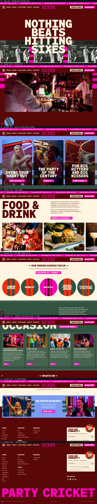
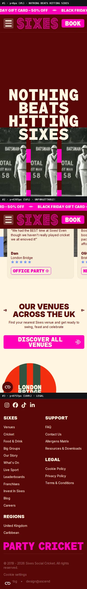

# UI Design System & Master Generation Blueprint: sixescricket-com

> **Sixes Party Cricket · Let's Play · Nets & Simulator · Sixes Social Cricket** (https://sixescricket.com/) — Cricket, but not as you know it. We've re-imagined the age old game of cricket for the modern socialite.





---

## 1. Executive Visual Persona & Design Archetype

- **Brand Essence & Persona**: **Sixes Party Cricket · Let's Play · Nets & Simulator · Sixes Social Cricket** (`https://sixescricket.com/`). Cricket, but not as you know it. We've re-imagined the age old game of cricket for the modern socialite.
- **Capture Provenance**: Live browser capture (`tier1_fast`, HTTP `200`, captured `2026-11-24`).
- **Visual Archetype**: **Light-Gallery WebGL / Canvas Interactive Experience (`#fff5e0` / `#185abc`)**.
- **Anti-AI-Slop Differentiators**:
  - **Live-Computed Chromatic Polarity**: Anchors the viewport in `#fff5e0` (live computed `body` `background-color` (`computed_styles.json`)) paired with `#590707` primary typography and `#185abc` accents.
  - **Grounded Typographic Hierarchy**: Uses `Inter` across display (`Sixes Social Cricket`) and body copy, paired with `fontSoehneMono` for monospace/code.
  - **Calibrated Spatial Grid & Motion**: Combines `120rem` container bounds (`gap: var(--spacing)`, padding `32px`) with `cubic-bezier(.28,.84,.42,1)` easing and Three.js / WebGL Canvas Pipeline, Swiper Touch Carousel Engine.

---

## 2. Spatial Architecture & Modular Grid Mathematics

### Viewport Allocation & Container Geometry
- **Captured Journey Filmstrips**: Desktop `1280×6624px` (`assets/desktop-journey.webp`, `8` keyframes up to `y=8186px` / doc `9087px`), Mobile `390×2616px` (`assets/mobile-journey.webp`, `3` keyframes).
- **Master Container Bounds**: `120rem` (non-`@media` desktop container stylesheet rule).
- **Canvas Lateral Padding & Spacing**: `32px` lateral canvas padding with `var(--spacing)` grid gap.
- **Border Radius Scale**: `4px`, `3px`, `50%`, `100%`.

### Responsive Breakpoint Architecture
- **Desktop Layout**: Multi-column CSS Grid / Flexbox layout at `1440px` (`max-width: 120rem`, `gap: var(--spacing)`).
- **Mobile Layout**: Single-column vertical stack at `390px` viewport width with `32px` horizontal padding.
- **Extracted CSS Media Queries**: `@media screen and (prefers-reduced-motion:reduce)`, `@media screen and (prefers-reduced-motion:no-preference)`, `@media (prefers-reduced-motion:reduce)`, `@media (min-width:48rem)`.

---

## 3. Color System, Materiality & Atmospheric Lighting

### Semantic Palette & Source Grounding
| Semantic Role | Ground-Truth Value | Extracted Live / CSS Source |
|---|---|---|
| **Primary Canvas Substrate** | `#fff5e0` | live computed `body` `background-color` (`computed_styles.json`) |
| **Primary Typography Ink** | `#590707` | live computed `h1` `color` (`computed_styles.json`) |
| **Elevated Surface / Card Substrate** | `#ffffff` | `html { background-color: white }` (`#ffffff`) |
| **Interactive Accent / Highlight** | `#185abc` | `.rc-2fa-submit-button-holder bu... { background-color: #185abc }` |
| **Secondary / Muted Copy** | `#02b875` | `:hover { color: #02b875 }` |
| **Structural Hairline Border** | `#6a7282` | `select { border-color: #6a7282 }` |

### Sanitized Root CSS Variables (`ui-ux.md` Ground Truth)
| Variable Name | Extracted Value | Semantic Role |
|---|---|---|
| `--fa-font-solid` | `normal 900 1em/1 'Font Awesome 7 Free'` | Typography / Scale Token |
| `--fa-font-regular` | `normal 400 1em/1 'Font Awesome 7 Free'` | Typography / Scale Token |
| `--fa-font-light` | `normal 300 1em/1 'Font Awesome 7 Pro'` | Canvas / Surface Token |
| `--fa-font-thin` | `normal 100 1em/1 'Font Awesome 7 Pro'` | Typography / Scale Token |
| `--fa-font-duotone` | `normal 900 1em/1 'Font Awesome 7 Duotone'` | Typography / Scale Token |
| `--fa-font-duotone-regular` | `normal 400 1em/1 'Font Awesome 7 Duotone'` | Typography / Scale Token |
| `--fa-font-duotone-light` | `normal 300 1em/1 'Font Awesome 7 Duotone'` | Canvas / Surface Token |
| `--fa-font-duotone-thin` | `normal 100 1em/1 'Font Awesome 7 Duotone'` | Typography / Scale Token |
| `--fa-font-brands` | `normal 400 1em/1 'Font Awesome 7 Brands'` | Brand / Palette Token |
| `--fa-font-sharp-solid` | `normal 900 1em/1 'Font Awesome 7 Sharp'` | Typography / Scale Token |
| `--fa-font-sharp-regular` | `normal 400 1em/1 'Font Awesome 7 Sharp'` | Typography / Scale Token |
| `--fa-font-sharp-light` | `normal 300 1em/1 'Font Awesome 7 Sharp'` | Canvas / Surface Token |
| `--fa-font-sharp-thin` | `normal 100 1em/1 'Font Awesome 7 Sharp'` | Typography / Scale Token |
| `--fa-font-sharp-duotone-solid` | `normal 900 1em/1 'Font Awesome 7 Sharp Duotone'` | Typography / Scale Token |
| `--fa-font-sharp-duotone-regular` | `normal 400 1em/1 'Font Awesome 7 Sharp Duotone'` | Typography / Scale Token |
| `--fa-font-sharp-duotone-light` | `normal 300 1em/1 'Font Awesome 7 Sharp Duotone'` | Canvas / Surface Token |

---

## 4. Typographic Scale & Editorial Hierarchy

### Font Family Stacks
- **Display Typography**: `Inter`.
- **Primary Body Stack**: `Inter`.
- **Technical / Metadata Stack**: `fontSoehneMono`.

### Typographic Scale & Rules (Live Computed & Stylesheet Grounded)
- **Hero Display (`H1`)**: live computed `h1` (`font-size: 16px`, `line-height: 24px`, `font-weight: 400`); CSS variables `--text-4xl: 2.25rem`, `--text-4xl--line-height: calc(2.5 / 2.25)`, `--text-6xl: 3.75rem`.
- **Section Heading (`H2`)**: live computed `h2` (`font-size: 164px`, `line-height: 131.2px`, `font-weight: 400`, `letter-spacing: 3.28px`); CSS variables `--text-2xl: 1.5rem`, `--text-2xl--line-height: calc(2 / 1.5)`, `--text-3xl: 1.875rem`; rule `h2` (`font-size: 1.75rem`).
- **Body Copy**: live computed `body` (`font-size: 16px`, `line-height: 24px`, `font-weight: 400`); CSS variables `--text-base: 1rem`, `--text-base--line-height: calc(1.5 / 1)`.
- **Metadata & Navigation Labels**: live computed `nav/a` (`font-size: 16px`, `line-height: 24px`, `font-weight: 400`); CSS variables `--font-soehne-mono: "fontSoehneMono", "fontSoehneMono Fallback"`, `--text-xs: .75rem`, `--text-xs--line-height: calc(1 / .75)`.

---

## 5. Choreographed Motion & Interaction Physics

### Primary Easing Curves
- **Extracted Timing Functions**: `cubic-bezier(.28,.84,.42,1)`, `cubic-bezier(.33,0,.66,.33)`, `cubic-bezier(.33,.66,.66,1)`.

### Per-Element Transition & Choreography Rules
- **Selector `.fnwpv81`**: `transition: opacity .2s ease-in` extracted from `sixescricket-com` stylesheet.
- **Selector `._14vatmh1`**: `transition: transform .1s` extracted from `sixescricket-com` stylesheet.
- **Selector `._1jezl1b0`**: `transition: all .2s linear` extracted from `sixescricket-com` stylesheet.
- **Extracted Easing Curve (`cubic-bezier(.28,.84,.42,1)`)**: Governs interactive state transitions across `<header.top-0>` and `<article.overlay>`.
- **Runtime Interaction Engine**: Integrates Three.js / WebGL Canvas Pipeline, Swiper Touch Carousel Engine with `prefers-reduced-motion: reduce` fallback guards.
### Measured Runtime Scroll & Interaction Telemetry (`behavioral_journey_v2`)
- **Scroll Driver Mode**: `native` (max document height `9087px`, deepest scrollY reached `8186px` across `8` desktop keyframes).
- **Detected Scroll / Motion Libraries**: `WebGL/Canvas`.
- **Nav / Drawer Probe (`Menu`)**: Triggered visual change (pixel diff `48.049`, captured in `assets/state-nav.webp`); revealed links: BLACK FRIDAY GIFT CAR..., VENUES, CRICKET, FOOD & DRINK, EVENTS, LIVE SPORT.
- **Hover Physics (`primary_cta` · `CHRISTMAS`)**: Computed transition `0.15s` / `cubic-bezier(0.4, 0, 0.2, 1)` (no static color/transform shift captured at rest).
- **Route Transition Architecture**: First internal navigation (`/blog`) measured as `direct` in `571ms`.

---

## 6. Component Wireframe & Structural DOM Map

### Visual Layout Schematic — Desktop (`1440px`, Grounded in `dom.html` & Landmark Bounding Boxes)
```
┌────────────────────────────────────────────────────────────────────────┐
│ DESKTOP VIEWPORT (1440px) — Sixes Party Cricket · Let's Play · Nets &  │
│ ====================================================================== │
│ [ <header.top-0> (1440x116px)         | Venues · Cricket · Food & Dr ] │
│ ---------------------------------------------------------------------- │
│ | HERO STAGE: <section.stack> (w=1440px)                             | │
│ | H1: Sixes Social Cricket                                           | │
│ | Substrate: #fff5e0 | Ink: #590707 | Accent: #185abc                | │
│ ---------------------------------------------------------------------- │
│ | SHOWCASE GRID (<article.overlay>) max-w: 120rem                    | │
│ | +------------------------------+  +------------------------------+ | │
│ | | Nothing Beats Hitting Sixes  |  | Book Party Cricket           | | │
│ | +------------------------------+  +------------------------------+ | │
│ ---------------------------------------------------------------------- │
│ | DETAIL MODULE (<article.overlay-b>) — Swing your heart out         | │
│ ---------------------------------------------------------------------- │
│ [ FOOTER (<footer.bg-mahogany-) | https://sixescricket.com/            │
└────────────────────────────────────────────────────────────────────────┘
```

### Visual Layout Schematic — Mobile Reflow (`390px`)
```
┌────────────────────────────────────────────────────────────────────────┐
│ MOBILE VIEWPORT REFLOW (390px) — Single-Column Stack (gap: var(--sp)   │
│ ====================================================================== │
│ [ HEADER BAR (<header.top-0>          ) | Compact Menu (390px)         │
│ ---------------------------------------------------------------------- │
│ | HERO STAGE (<section.stack>) — 390px Vertical Lead                 | │
│ | H1: Sixes Social Cricket                                           | │
│ ---------------------------------------------------------------------- │
│ | SHOWCASE STACK (<article.overlay>) — 1-Col Stack                   | │
│ | [ Item 1: Nothing Beats Hitting Sixes                            ] | │
│ | [ Item 2: Book Party Cricket                                     ] | │
│ ---------------------------------------------------------------------- │
│ | DETAIL STACK (<article.overlay-b>) — 1-Col (Swing your heart o)    | │
│ ---------------------------------------------------------------------- │
│ [ FOOTER (<footer.bg-mahogany-) | Stacked 390px Colophon               │
└────────────────────────────────────────────────────────────────────────┘
```

### Granular DOM Region Breakdown
1. **Brand Header & Navigation Bar (<header.top-0> — `sixescricket-com`)**:
   - Landmark `<header class="top-0 h-nav">` (`1440x116px`) hosting `Sixes Party Cricket · Let's Play · N` navigation (`Venues · Cricket · Food & Drink · Events · Live Sport`), DOM attributes (`data-scroll-behavior="smooth"`, `data-sentry-component="RootLayout"`, `data-sentry-source-file="layout.tsx"`, `data-precedence="next"`), and stylesheet rule `.elmvdc0 { white-space:nowrap;text-overflow:ellipsis;display:block;overflow:clip }`.
2. **Hero Stage & Focal Lead (<section.stack> — `Sixes Social Cricket`)**:
   - Landmark `<section class="stack overflow-clip">` presenting display lead `Sixes Social Cricket` and copy excerpt *"Take a swing at Party Cricket. A carnival of fast bowls, flowing "* over `#fff5e0` canvas and `#590707` ink.
3. **Primary Showcase & Content Grid (<article.overlay> — `Nothing Beats Hitting Sixes`)**:
   - Landmark `<article class="overlay overlay-b">` rendering section `Nothing Beats Hitting Sixes` with copy *"Nothing Beats Hitting Sixes"*, asset references (`0dvybyowk9yut.css`, `341tqej08bq76.css`, `events.js`, `state.js`), and grid rule `._1b6o2se1 { animation:.5s linear infinite _1b6o2se0 }`.
4. **Interactive Detail & Feature Matrix (<article.overlay-b> — `Book Party Cricket`)**:
   - Landmark `<article class="overlay overlay-b">` framing `Book Party Cricket` and `Swing your heart out` (*"Inspired by the Age old game"*) with `#ffffff` surface cards, `#185abc` accents, and `._1lyk8y0 { align-items:center }`.
5. **Colophon & Global Directory Footer (<footer.bg-mahogany-500> — `https://sixescricket.com/`)**:
   - Landmark `<footer class="bg-mahogany-500 px-buffer">` anchoring `Sixes Party Cricket · Let's Play` footer links (`Venues · Cricket · Food & Drink · Events · Live Sport`), copy *"Take a swing at Party Cricket"*, and `#6a7282` structural dividers.
### Full Vertical Scroll Sequence (Desktop `1440×900` Keyframes)
- **Step 01** (`y=0px`, `0%`): Active landmark `NOTHING BEATS HITTING SIXES` · sticky/fixed elements: `2`
- **Step 02** (`y=850px`, `10%`): Active landmark `Section @ 10%` · sticky/fixed elements: `2`
- **Step 03** (`y=2550px`, `31%`): Active landmark `FOR BIG HITTERS AND BIG MISSERS` · sticky/fixed elements: `1`
- **Step 04** (`y=3400px`, `42%`): Active landmark `FOOD & DRINK` · sticky/fixed elements: `1`
- **Step 05** (`y=5100px`, `62%`): Active landmark `OUR VENUES ACROSS THE UK` · sticky/fixed elements: `1`
- **Step 06** (`y=5950px`, `73%`): Active landmark `CORPORATE TEAM BUILDING EVENTS AT SIXES` · sticky/fixed elements: `1`
- **Step 07** (`y=7650px`, `93%`): Active landmark `BIG GROUP BOOKING?` · sticky/fixed elements: `1`
- **Step 08** (`y=8186px`, `100%`): Active landmark `JOIN OUR COMMUNITY` · sticky/fixed elements: `1`

### Multi-Page Internal Route Map
- **Listing Route (`/blog`)**: `https://sixescricket.com/blog` — H1: `LATEST FROM SIXES`, scrollHeight `12248px`, transition `direct` (`571ms`)
- **Detail Route (`/london-bridge/offers/black-friday-gift-cards`)**: `https://sixescricket.com/london-bridge/offers/black-friday-gift-cards` — H1: `£120 OF SIXES FOR £60`, scrollHeight `3572px`, transition `direct` (`327ms`)
- **About Route (`/careers`)**: `https://sixescricket.com/careers` — H1: `LET'S PLAY!`, scrollHeight `9643px`, transition `direct` (`328ms`)

---

## 7. Master Zero-Shot AI Generation Prompt

```markdown
# Master Zero-Shot Frontend Generation Prompt: sixescricket-com (Sixes Party Cricket · Let's Play · Nets & Simulator · Sixes Social Cricket)

You are a principal frontend architect and design systems engineer. Build a complete, production-ready web application replicating the exact design system, DOM landmarks, typographic hierarchy, color tokens, and motion physics of `sixescricket-com` (**Sixes Party Cricket · Let's Play · Nets & Simulator · Sixes Social Cricket** — `https://sixescricket.com/`).

### 1. Visual Archetype & Anti-AI-Slop Mandates
- **Archetype**: Light-Gallery WebGL / Canvas Interactive Experience (`#fff5e0` / `#185abc`).
- **Identity & Domain Context**: Cricket, but not as you know it. We've re-imagined the age old game of cricket for the modern socialite.
- **Primary Substrate**: `#fff5e0` (live computed `body` `background-color` (`computed_styles.json`)), **Primary Ink**: `#590707`, **Accent / Highlight**: `#185abc`.
- **Site-Specific Differentiators**:
  - **Live-Computed Chromatic Polarity**: Anchors the viewport in `#fff5e0` (live computed `body` `background-color` (`computed_styles.json`)) paired with `#590707` primary typography and `#185abc` accents.
  - **Grounded Typographic Hierarchy**: Uses `Inter` across display (`Sixes Social Cricket`) and body copy, paired with `fontSoehneMono` for monospace/code.
  - **Calibrated Spatial Grid & Motion**: Combines `120rem` container bounds (`gap: var(--spacing)`, padding `32px`) with `cubic-bezier(.28,.84,.42,1)` easing and Three.js / WebGL Canvas Pipeline, Swiper Touch Carousel Engine.

### 2. Ground-Truth CSS Variables (`:root` Token Contract)
Declare and consume these exact custom properties extracted from `sixescricket-com` in your global stylesheet:

:root {
  /* Sixes Party Cricket · Let's Play · Nets & Simulator · Sixes Social Cricket (sixescricket-com) — Live-Grounded CSS Variables */
  --fa-font-solid: normal 900 1em/1 'Font Awesome 7 Free'; /* Typography / Scale Token (sixescricket-com) */
  --fa-font-regular: normal 400 1em/1 'Font Awesome 7 Free'; /* Typography / Scale Token (sixescricket-com) */
  --fa-font-light: normal 300 1em/1 'Font Awesome 7 Pro'; /* Canvas / Surface Token (sixescricket-com) */
  --fa-font-thin: normal 100 1em/1 'Font Awesome 7 Pro'; /* Typography / Scale Token (sixescricket-com) */
  --fa-font-duotone: normal 900 1em/1 'Font Awesome 7 Duotone'; /* Typography / Scale Token (sixescricket-com) */
  --fa-font-duotone-regular: normal 400 1em/1 'Font Awesome 7 Duotone'; /* Typography / Scale Token (sixescricket-com) */
  --fa-font-duotone-light: normal 300 1em/1 'Font Awesome 7 Duotone'; /* Canvas / Surface Token (sixescricket-com) */
  --fa-font-duotone-thin: normal 100 1em/1 'Font Awesome 7 Duotone'; /* Typography / Scale Token (sixescricket-com) */
  --fa-font-brands: normal 400 1em/1 'Font Awesome 7 Brands'; /* Brand / Palette Token (sixescricket-com) */
  --fa-font-sharp-solid: normal 900 1em/1 'Font Awesome 7 Sharp'; /* Typography / Scale Token (sixescricket-com) */
  --fa-font-sharp-regular: normal 400 1em/1 'Font Awesome 7 Sharp'; /* Typography / Scale Token (sixescricket-com) */
  --fa-font-sharp-light: normal 300 1em/1 'Font Awesome 7 Sharp'; /* Canvas / Surface Token (sixescricket-com) */
  --fa-font-sharp-thin: normal 100 1em/1 'Font Awesome 7 Sharp'; /* Typography / Scale Token (sixescricket-com) */
  --fa-font-sharp-duotone-solid: normal 900 1em/1 'Font Awesome 7 Sharp Duotone'; /* Typography / Scale Token (sixescricket-com) */
  --fa-font-sharp-duotone-regular: normal 400 1em/1 'Font Awesome 7 Sharp Duotone'; /* Typography / Scale Token (sixescricket-com) */
  --fa-font-sharp-duotone-light: normal 300 1em/1 'Font Awesome 7 Sharp Duotone'; /* Canvas / Surface Token (sixescricket-com) */
}

### 3. Semantic Color & Materiality Contract
Map every surface, ink, and border strictly to these source-grounded tokens:
- **Primary Canvas Substrate**: `#fff5e0` — grounded in live computed `body` `background-color` (`computed_styles.json`)
- **Primary Typography Ink**: `#590707` — grounded in live computed `h1` `color` (`computed_styles.json`)
- **Elevated Surface / Card Substrate**: `#ffffff` — grounded in `html { background-color: white }` (`#ffffff`)
- **Interactive Accent / Highlight**: `#185abc` — grounded in `.rc-2fa-submit-button-holder bu... { background-color: #185abc }`
- **Secondary / Muted Copy**: `#02b875` — grounded in `:hover { color: #02b875 }`
- **Structural Hairline Border**: `#6a7282` — grounded in `select { border-color: #6a7282 }`

### 4. Spatial Grid, Container Bounds & Responsive Breakpoints
- **Desktop Viewport Reference**: `1280×6624px` (multi-frame vertical journey filmstrip (6624px), `1440px` standard desktop width).
- **Mobile Viewport Reference**: `390×2616px` (multi-frame vertical journey filmstrip (2616px), `390px` standard mobile width).
- **Container Max-Width**: `120rem` (non-`@media` desktop container stylesheet rule)
- **Padding & Gutters**: `32px` lateral canvas padding with `var(--spacing)` grid gap
- **Desktop Grid**: Multi-column CSS Grid / Flexbox layout at `1440px` (`max-width: 120rem`, `gap: var(--spacing)`)
- **Mobile Adaptation**: Single-column vertical stack at `390px` viewport width with `32px` horizontal padding
- **Media Queries**: `@media screen and (prefers-reduced-motion:reduce)`, `@media screen and (prefers-reduced-motion:no-preference)`, `@media (prefers-reduced-motion:reduce)`, `@media (min-width:48rem)`
- **Corner Radii**: `4px`, `3px`, `50%`, `100%`

### 5. Typography & Editorial Scale Contract
- **Display Font Stack**: `Inter`
- **Body Font Stack**: `Inter`
- **Monospace / Technical Font Stack**: `fontSoehneMono`
- **H1 Display Rule**: live computed `h1` (`font-size: 16px`, `line-height: 24px`, `font-weight: 400`); CSS variables `--text-4xl: 2.25rem`, `--text-4xl--line-height: calc(2.5 / 2.25)`, `--text-6xl: 3.75rem`
- **H2 Section Rule**: live computed `h2` (`font-size: 164px`, `line-height: 131.2px`, `font-weight: 400`, `letter-spacing: 3.28px`); CSS variables `--text-2xl: 1.5rem`, `--text-2xl--line-height: calc(2 / 1.5)`, `--text-3xl: 1.875rem`; rule `h2` (`font-size: 1.75rem`)
- **Body Copy Rule**: live computed `body` (`font-size: 16px`, `line-height: 24px`, `font-weight: 400`); CSS variables `--text-base: 1rem`, `--text-base--line-height: calc(1.5 / 1)`
- **Metadata & Index Rule**: live computed `nav/a` (`font-size: 16px`, `line-height: 24px`, `font-weight: 400`); CSS variables `--font-soehne-mono: "fontSoehneMono", "fontSoehneMono Fallback"`, `--text-xs: .75rem`, `--text-xs--line-height: calc(1 / .75)`

### 6. Component Hierarchy, Verbatim Copy & Real DOM Landmarks
Scaffold `sixescricket-com` (`Sixes Party Cricket · Let's Play · Nets & Simulator · Sixes Social Cricket`) with these exact structural regions, extracted copy, and CSS rules from `dom.html`:
1. **Brand Header & Navigation Bar (<header.top-0> — `sixescricket-com`)**:
   - DOM & Selectors: Landmark `<header class="top-0 h-nav">` (`1440x116px`) hosting `Sixes Party Cricket · Let's Play · N` navigation (`Venues · Cricket · Food & Drink · Events · Live Sport`), DOM attributes (`data-scroll-behavior="smooth"`, `data-sentry-component="RootLayout"`, `data-sentry-source-file="layout.tsx"`, `data-precedence="next"`), and stylesheet rule `.elmvdc0 { white-space:nowrap;text-overflow:ellipsis;display:block;overflow:clip }`.
   - Responsive Contract: Header `Brand Header & Navigation Bar (<header.top-0> — `sixescricket-com`)` (`sixescricket-com`) adapts across `@media screen and (prefers-reduced-motion:reduce)`, `@media screen and (prefers-reduced-motion:no-preference)`, `@media (prefers-reduced-motion:reduce)`, `@media (min-width:48rem)` with `cubic-bezier(.28,.84,.42,1)`, `cubic-bezier(.33,0,.66,.33)`, `cubic-bezier(.33,.66,.66,1)` transitions and links `Venues · Cricket · Food & Drink · Events · Live Sport`.
2. **Hero Stage & Focal Lead (<section.stack> — `Sixes Social Cricket`)**:
   - DOM & Selectors: Landmark `<section class="stack overflow-clip">` presenting display lead `Sixes Social Cricket` and copy excerpt *"Take a swing at Party Cricket. A carnival of fast bowls, flowing "* over `#fff5e0` canvas and `#590707` ink.
   - Responsive Contract: Hero stage (`1280×6624px` desktop / `390×2616px` mobile) sets `#fff5e0` background with `#590707` headline `Sixes Social Cricket`.
3. **Primary Showcase & Content Grid (<article.overlay> — `Nothing Beats Hitting Sixes`)**:
   - DOM & Selectors: Landmark `<article class="overlay overlay-b">` rendering section `Nothing Beats Hitting Sixes` with copy *"Nothing Beats Hitting Sixes"*, asset references (`0dvybyowk9yut.css`, `341tqej08bq76.css`, `events.js`, `state.js`), and grid rule `._1b6o2se1 { animation:.5s linear infinite _1b6o2se0 }`.
   - Responsive Contract: Showcase grid `Primary Showcase & Content Grid (<article.overlay> — `Nothing Beats Hitting Sixes`)` applies Multi-column CSS Grid / Flexbox layout at `1440px` (`max-width: 120rem`, `gap: var(--spacing)`) on desktop and Single-column vertical stack at `390px` viewport width with `32px` horizontal padding on mobile.
4. **Interactive Detail & Feature Matrix (<article.overlay-b> — `Book Party Cricket`)**:
   - DOM & Selectors: Landmark `<article class="overlay overlay-b">` framing `Book Party Cricket` and `Swing your heart out` (*"Inspired by the Age old game"*) with `#ffffff` surface cards, `#185abc` accents, and `._1lyk8y0 { align-items:center }`.
   - Responsive Contract: Detail module `Interactive Detail & Feature Matrix (<article.overlay-b> — `Book Party Cricket`)` uses `4px`, `3px`, `50%`, `100%` radii, `#185abc` highlights, and assets (0dvybyowk9yut.css, 341tqej08bq76.css, events.js).
5. **Colophon & Global Directory Footer (<footer.bg-mahogany-500> — `https://sixescricket.com/`)**:
   - DOM & Selectors: Landmark `<footer class="bg-mahogany-500 px-buffer">` anchoring `Sixes Party Cricket · Let's Play` footer links (`Venues · Cricket · Food & Drink · Events · Live Sport`), copy *"Take a swing at Party Cricket"*, and `#6a7282` structural dividers.
   - Responsive Contract: Footer `Colophon & Global Directory Footer (<footer.bg-mahogany-500> — `https://sixescricket.com/`)` aligns to `120rem` (non-`@media` desktop container stylesheet rule) with `32px` lateral canvas padding with `var(--spacing)` grid gap and attributes (data-scroll-behavior="smooth", data-sentry-component="RootLayout", data-sentry-source-file="layout.tsx").

#### Verbatim DOM Copy Excerpts (`dom.html`)
- Copy Excerpt 1: *"Take a swing at Party Cricket. A carnival of fast bowls, flowing booze and big-hit..."*
- Copy Excerpt 2: *"Nothing Beats Hitting Sixes"*
- Copy Excerpt 3: *"Inspired by the Age old game"*
- Copy Excerpt 4: *"Take a swing at Party Cricket"*

### 7. Motion, Extracted Stylesheet Rules & Interaction Choreography
- **Primary Easing Functions**: `cubic-bezier(.28,.84,.42,1)`, `cubic-bezier(.33,0,.66,.33)`, `cubic-bezier(.33,.66,.66,1)`
- **Extracted Stylesheet Rules (`sixescricket-com`)**:
- `.elmvdc0 { white-space:nowrap;text-overflow:ellipsis;display:block;overflow:clip }`
- `._1b6o2se1 { animation:.5s linear infinite _1b6o2se0 }`
- `._1lyk8y0 { align-items:center }`
- `._1lyk8y2 { flex:1;min-width:0;display:block;position:relative }`
- `._8fnjkq0 { position:absolute;top:0;left:0 }`
- **Per-Selector Transition Rules**:
- **Selector `.fnwpv81`**: `transition: opacity .2s ease-in` extracted from `sixescricket-com` stylesheet.
- **Selector `._14vatmh1`**: `transition: transform .1s` extracted from `sixescricket-com` stylesheet.
- **Selector `._1jezl1b0`**: `transition: all .2s linear` extracted from `sixescricket-com` stylesheet.
- **Extracted Easing Curve (`cubic-bezier(.28,.84,.42,1)`)**: Governs interactive state transitions across `<header.top-0>` and `<article.overlay>`.
- **Runtime Interaction Engine**: Integrates Three.js / WebGL Canvas Pipeline, Swiper Touch Carousel Engine with `prefers-reduced-motion: reduce` fallback guards.
### 7b. Full-Page Scroll Choreography, Interactive States & Multi-Page Routes
- **Scroll Mechanics**: Implement `native` vertical progression up to `9087px` across 8 distinct viewport chapters using WebGL/Canvas.
- **Vertical Chapter Sequence**: NOTHING BEATS HITTING SIXES (0%) -> Section @ 10% (10%) -> FOR BIG HITTERS AND BIG MIS... (31%) -> FOOD & DRINK (42%) -> OUR VENUES ACROSS THE UK (62%) -> CORPORATE TEAM BUILDING EVE... (73%) -> BIG GROUP BOOKING? (93%) -> JOIN OUR COMMUNITY (100%).
- **Navigation Drawer / Menu State**: Replicate interactive menu toggle (`Menu`) with Escape-to-close keyboard handling.
- **Multi-Page Routes**: Scaffold internal routes `/blog` (listing, direct), `/london-bridge/offers/black-friday-gift-cards` (detail, direct), `/careers` (about, direct) sharing the global header/footer shell and design tokens.

### 8. Technical Deliverables
- Implement in Next.js (App Router) with TypeScript and Tailwind CSS consuming the `:root` custom properties defined above for `sixescricket-com`.
- Reproduce both the `1440px` desktop architecture and `390px` mobile breakpoint transitions, preserving semantic HTML5 landmarks (`<header>`, `<nav>`, `<main>`, `<section>`, `<footer>`) and `prefers-reduced-motion` accessibility guards.
```
---

## 8. Full-Page Scroll Journey, Interactive States & Subpage Inventory

### Desktop Scroll Keyframes (`1440×900` WebP)
| Step | Scroll Y | Progress | Active Landmark / Section | Sticky/Fixed | Visual Asset |
| :---: | :---: | :---: | :--- | :---: | :--- |
| `#01` | `0px` | `0%` | NOTHING BEATS HITTING SIXES | `2` | [desktop-step-01.webp](assets/desktop-step-01.webp) |
| `#02` | `850px` | `10%` | Section @ 10% | `2` | [desktop-step-02.webp](assets/desktop-step-02.webp) |
| `#03` | `2550px` | `31%` | FOR BIG HITTERS AND BIG MISSERS | `1` | [desktop-step-03.webp](assets/desktop-step-03.webp) |
| `#04` | `3400px` | `42%` | FOOD & DRINK | `1` | [desktop-step-04.webp](assets/desktop-step-04.webp) |
| `#05` | `5100px` | `62%` | OUR VENUES ACROSS THE UK | `1` | [desktop-step-05.webp](assets/desktop-step-05.webp) |
| `#06` | `5950px` | `73%` | CORPORATE TEAM BUILDING EVENTS AT SIXES | `1` | [desktop-step-06.webp](assets/desktop-step-06.webp) |
| `#07` | `7650px` | `93%` | BIG GROUP BOOKING? | `1` | [desktop-step-07.webp](assets/desktop-step-07.webp) |
| `#08` | `8186px` | `100%` | JOIN OUR COMMUNITY | `1` | [desktop-step-08.webp](assets/desktop-step-08.webp) |

### Mobile Condensed Keyframes (`390×844` WebP)
| Step | Scroll Y | Progress | Active Landmark | Visual Asset |
| :---: | :---: | :---: | :--- | :--- |
| `#01` | `0px` | `0%` | NOTHING BEATS HITTING SIXES | [mobile-step-01.webp](assets/mobile-step-01.webp) |
| `#02` | `4397px` | `50%` | UNFORGETTABLE! | [mobile-step-02.webp](assets/mobile-step-02.webp) |
| `#03` | `8757px` | `100%` | LEGAL | [mobile-step-03.webp](assets/mobile-step-03.webp) |

### Interactive UI State Captures (`1440×900` WebP)
| State Type | Trigger / Observation | Visual Asset |
| :--- | :--- | :--- |
| `nav_menu` | Nav/Menu opened (`Menu`, diff `48.049`) | [state-nav.webp](assets/state-nav.webp) |

### Internal Subpage Filmstrips (`1080px` Wide WebP)
| # | Template | Route URL | H1 / Title | Scroll Height | Transition | Filmstrip Asset |
| :-: | :---: | :--- | :--- | :---: | :---: | :--- |
| `1` | `listing` | `https://sixescricket.com/blog` | LATEST FROM SIXES | `12248px` | `direct` (`571ms`) | [subpage-01-blog.webp](assets/subpage-01-blog.webp) |
| `2` | `detail` | `https://sixescricket.com/london-bridge/offers/black-friday-gift-cards` | £120 OF SIXES FOR £60 | `3572px` | `direct` (`327ms`) | [subpage-02-london-bridge-offers-black-friday-gi.webp](assets/subpage-02-london-bridge-offers-black-friday-gi.webp) |
| `3` | `about` | `https://sixescricket.com/careers` | LET'S PLAY! | `9643px` | `direct` (`328ms`) | [subpage-03-careers.webp](assets/subpage-03-careers.webp) |

