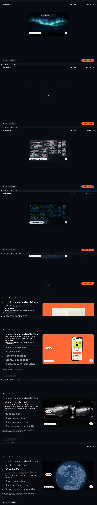
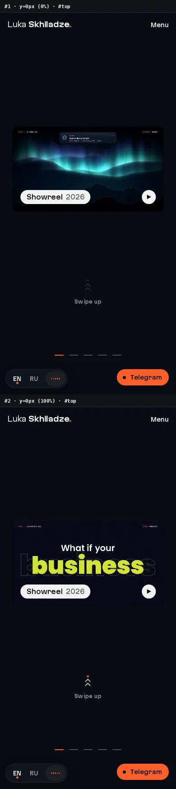

# UI Design System & Master Generation Blueprint: skhiladze-com

> **Luka Skhiladze, motion designer and product engineer** (https://skhiladze.com) — Motion design, AI film, 3D and original sound, plus the website or app to go with them. Tbilisi, working worldwide.





---

## 1. Executive Visual Persona & Design Archetype

- **Brand Essence & Persona**: **Luka Skhiladze, motion designer and product engineer** (`https://skhiladze.com`). Motion design, AI film, 3D and original sound, plus the website or app to go with them. Tbilisi, working worldwide.
- **Capture Provenance**: Live browser capture (`tier1_fast`, HTTP `200`, captured `2026-11-24`).
- **Visual Archetype**: **Dark-Substrate WebGL / Canvas Interactive Experience (`#090c12` / `#fb5e28`)**.
- **Anti-AI-Slop Differentiators**:
  - **Live-Computed Chromatic Polarity**: Anchors the viewport in `#090c12` (live computed `body` `background-color` (`computed_styles.json`)) paired with `#f2f2ef` primary typography and `#fb5e28` accents.
  - **Grounded Typographic Hierarchy**: Uses `Martian Grotesk` across display (`Luka Skhiladze, motion designer and `) and body copy.
  - **Calibrated Spatial Grid & Motion**: Combines `1440px` container bounds (`gap: 20.16px`, padding `31.68px`) with `cubic-bezier(.23,1,.32,1)` easing and Lenis Smooth Scroll (`data-lenis`), Three.js / WebGL Canvas Pipeline.

---

## 2. Spatial Architecture & Modular Grid Mathematics

### Viewport Allocation & Container Geometry
- **Captured Journey Filmstrips**: Desktop `1280×6624px` (`assets/desktop-journey.webp`, `8` keyframes up to `y=4815px` / doc `15769px`), Mobile `390×1744px` (`assets/mobile-journey.webp`, `2` keyframes).
- **Master Container Bounds**: `1440px` (full-bleed `100%` desktop stage measured on `1440px` viewport).
- **Canvas Lateral Padding & Spacing**: `31.68px` lateral canvas padding with `20.16px` grid gap.
- **Border Radius Scale**: `999px`, `2px`, `50%`, `var(--gr)`.

### Responsive Breakpoint Architecture
- **Desktop Layout**: Multi-column CSS Grid / Flexbox layout at `1440px` (`max-width: 1440px`, `gap: 20.16px`).
- **Mobile Layout**: Single-column vertical stack at `390px` viewport width with `31.68px` horizontal padding.
- **Extracted CSS Media Queries**: `@media (min-width:761px)and (min-height:541px)and (max-height:82...`, `@media (max-width:760px),(max-height:540px)`, `@media (max-width:760px)`, `@media (max-width:1080px)`.

---

## 3. Color System, Materiality & Atmospheric Lighting

### Semantic Palette & Source Grounding
| Semantic Role | Ground-Truth Value | Extracted Live / CSS Source |
|---|---|---|
| **Primary Canvas Substrate** | `#090c12` | live computed `body` `background-color` (`computed_styles.json`) |
| **Primary Typography Ink** | `#f2f2ef` | live computed `h1` `color` (`computed_styles.json`) |
| **Elevated Surface / Card Substrate** | `#11151c` | `var(--bg-2)` in `:root` |
| **Interactive Accent / Highlight** | `#fb5e28` | `var(--accent)` in `:root` |
| **Secondary / Muted Copy** | `#9aa0aa` | `var(--muted)` in `:root` |
| **Structural Hairline Border** | `#25282d` | `.make__item { border-top: #25282d }` |
| **Variable Token (`--accent-hi`)** | `#ff7a4d` | `var(--accent-hi)` in `:root` |
| **Variable Token (`--inv-muted`)** | `#4d525b` | `var(--inv-muted)` in `:root` |

### Sanitized Root CSS Variables (`ui-ux.md` Ground Truth)
| Variable Name | Extracted Value | Semantic Role |
|---|---|---|
| `--bg` | `#090c12` | Canvas / Surface Token |
| `--bg-2` | `#11151c` | Canvas / Surface Token |
| `--ink` | `#f2f2ef` | Typography Ink Token |
| `--muted` | `#9aa0aa` | Color / Atmospheric Token |
| `--accent` | `#fb5e28` | Brand / Palette Token |
| `--accent-hi` | `#ff7a4d` | Brand / Palette Token |
| `--accent-ink` | `#090c12` | Typography Ink Token |
| `--inv-bg` | `#f2f2ef` | Canvas / Surface Token |
| `--inv-ink` | `#090c12` | Typography Ink Token |
| `--inv-muted` | `#4d525b` | Color / Atmospheric Token |
| `--scrim` | `rgba(9, 12, 18, .64)` | Color / Atmospheric Token |
| `--clear` | `calc(80px + env(safe-area-inset-bottom, 0px))` | Dimension / Scale Token |
| `--s-small` | `14px` | Dimension / Scale Token |
| `--s-body` | `clamp(16px, .15vw + 15.4px, 17px)` | Dimension / Scale Token |
| `--s-lead` | `clamp(20px, .9vw + 12px, 26px)` | Dimension / Scale Token |
| `--s-head` | `clamp(30px, 2.2vw + 14px, 46px)` | Dimension / Scale Token |

---

## 4. Typographic Scale & Editorial Hierarchy

### Font Family Stacks
- **Display Typography**: `Martian Grotesk`.
- **Primary Body Stack**: `Martian Grotesk`.
- **Technical / Metadata Stack**: not declared in live computed styles (uses primary stack / `ui-monospace`).

### Typographic Scale & Rules (Live Computed & Stylesheet Grounded)
- **Hero Display (`H1`)**: live computed `h1` (`font-size: 34px`, `line-height: 51px`, `font-weight: 400`); CSS variables `--s-display: clamp(58px, 9.4vw, 180px)`.
- **Section Heading (`H2`)**: live computed `h2` (`font-size: 24.96px`, `line-height: 37.44px`, `font-weight: 500`).
- **Body Copy**: live computed `body` (`font-size: 17px`, `line-height: 25.5px`, `font-weight: 400`); CSS variables `--s-body: clamp(16px, .15vw + 15.4px, 17px)`.
- **Metadata & Navigation Labels**: live computed `nav/a` (`font-size: 14px`, `line-height: 16.8px`, `font-weight: 500`); CSS variables `--s-small: 14px`.

---

## 5. Choreographed Motion & Interaction Physics

### Primary Easing Curves
- **Extracted Timing Functions**: `cubic-bezier(.23,1,.32,1)`, `cubic-bezier(.77,0,.175,1)`, `cubic-bezier(.33,1,.68,1)`.

### Per-Element Transition & Choreography Rules
- **Selector `.btn`**: `transition: transform var(--t-press) var(--ease-out),background-color var(...` extracted from `skhiladze-com` stylesheet.
- **Selector `.roll>span`**: `transition: transform .38s var(--ease-io),opacity .22s ease` extracted from `skhiladze-com` stylesheet.
- **Selector `.gate__v`**: `transition: opacity .42s var(--ease-out),filter 1.1s var(--ease-soft)` extracted from `skhiladze-com` stylesheet.
- **Extracted Easing Curve (`cubic-bezier(.23,1,.32,1)`)**: Governs interactive state transitions across `<header.bar>` and `<section.make>`.
- **Runtime Interaction Engine**: Integrates Lenis Smooth Scroll (`data-lenis`), Three.js / WebGL Canvas Pipeline, Lottie Vector Animation Player with `prefers-reduced-motion: reduce` fallback guards.
### Measured Runtime Scroll & Interaction Telemetry (`behavioral_journey_v2`)
- **Scroll Driver Mode**: `wheel` (max document height `15769px`, deepest scrollY reached `4815px` across `8` desktop keyframes).
- **Detected Scroll / Motion Libraries**: `Lenis`, `WebGL/Canvas`.
- **Hover Physics (`primary_cta` · `Luka Skhiladze`)**: `color`: `rgb(242, 242, 239)` -> `rgb(252, 252, 251)`; `borderColor`: `rgb(242, 242, 239)` -> `rgb(252, 252, 251)` (`transition-duration: 0.18s, 0.18s`, `timing: ease, ease`).
- **Route Transition Architecture**: First internal navigation (`/ru/`) measured as `MPA` in `1269ms`.

---

## 6. Component Wireframe & Structural DOM Map

### Visual Layout Schematic — Desktop (`1440px`, Grounded in `dom.html` & Landmark Bounding Boxes)
```
┌────────────────────────────────────────────────────────────────────────┐
│ DESKTOP VIEWPORT (1440px) — Luka Skhiladze, motion designer and produc │
│ ====================================================================== │
│ [ <header.bar> (1430x64px)            | 01 Work · 02 About           ] │
│ ---------------------------------------------------------------------- │
│ | HERO STAGE: <section.hero> (w=1430px)                              | │
│ | H1: Luka Skhiladze, motion designer and product engineer           | │
│ | Substrate: #090c12 | Ink: #f2f2ef | Accent: #fb5e28                | │
│ ---------------------------------------------------------------------- │
│ | SHOWCASE GRID (<section.make>) max-w: 1440px                       | │
│ | +------------------------------+  +------------------------------+ | │
│ | | What I make                  |  | About                        | | │
│ | +------------------------------+  +------------------------------+ | │
│ ---------------------------------------------------------------------- │
│ | DETAIL MODULE (<section.op>) — Coffee prices Spec                  | │
│ ---------------------------------------------------------------------- │
│ [ FOOTER (<footer.no-gl>      ) | https://skhiladze.com                │
└────────────────────────────────────────────────────────────────────────┘
```

### Visual Layout Schematic — Mobile Reflow (`390px`)
```
┌────────────────────────────────────────────────────────────────────────┐
│ MOBILE VIEWPORT REFLOW (390px) — Single-Column Stack (gap: 20.16px)    │
│ ====================================================================== │
│ [ HEADER BAR (<header.bar>            ) | Compact Menu (390px)         │
│ ---------------------------------------------------------------------- │
│ | HERO STAGE (<section.hero>) — 390px Vertical Lead                  | │
│ | H1: Luka Skhiladze, motion designer and product engineer           | │
│ ---------------------------------------------------------------------- │
│ | SHOWCASE STACK (<section.make>) — 1-Col Stack                      | │
│ | [ Item 1: What I make                                            ] | │
│ | [ Item 2: About                                                  ] | │
│ ---------------------------------------------------------------------- │
│ | DETAIL STACK (<section.op>) — 1-Col (Coffee prices Spec)           | │
│ ---------------------------------------------------------------------- │
│ [ FOOTER (<footer.no-gl>      ) | Stacked 390px Colophon               │
└────────────────────────────────────────────────────────────────────────┘
```

### Granular DOM Region Breakdown
1. **Brand Header & Navigation Bar (<header.bar> — `skhiladze-com`)**:
   - Landmark `<header class="bar">` (`1430x64px`) hosting `Luka Skhiladze, motion designer and ` navigation (`01 Work · 02 About`), DOM attributes (`data-base`, `data-av1="loop,film,teaser"`, `data-av1-same="film/bassface film/bo..."`, `data-gl="soft"`), and stylesheet rule `after { box-sizing:border-box }`.
2. **Hero Stage & Focal Lead (<section.hero> — `Luka Skhiladze, motion designer an`)**:
   - Landmark `<section class="hero is-top">` presenting display lead `Luka Skhiladze, motion designer and product engineer` and copy excerpt *"Logos, type, characters and interfaces in motion, and explainers "* over `#090c12` canvas and `#f2f2ef` ink.
3. **Primary Showcase & Content Grid (<section.make> — `What I make`)**:
   - Landmark `<section class="make">` rendering section `What I make` with copy *"Logicor Park 08 Client, AI"*, asset references (`favicon.svg`, `favicon-32.png`, `apple-touch-icon.png`, `martian-display-lat.woff2`), and grid rule `html.lenis body { height:auto }`.
4. **Interactive Detail & Feature Matrix (<section.op> — `About`)**:
   - Landmark `<section class="op">` framing `About` and `Coffee prices Spec` (*"Coffee prices Spec"*) with `#11151c` surface cards, `#fb5e28` accents, and `.lenis.lenis-smooth { scroll-behavior:auto!important }`.
5. **Colophon & Global Directory Footer (<footer.no-gl> — `https://skhiladze.com`)**:
   - Landmark `<footer class="no-gl">` anchoring `Luka Skhiladze, motion designer ` footer links (`01 Work · 02 About`), copy *"01 Motion design and explainers GemiVexa Spec Logos, type, c"*, and `#25282d` structural dividers.
### Full Vertical Scroll Sequence (Desktop `1440×900` Keyframes)
- **Step 01** (`y=0px`, `0%`): Active landmark `#top` · sticky/fixed elements: `3`
- **Step 02** (`y=712px`, `5%`): Active landmark `#top` · sticky/fixed elements: `3`
- **Step 03** (`y=1545px`, `10%`): Active landmark `#top` · sticky/fixed elements: `3`
- **Step 04** (`y=2258px`, `15%`): Active landmark `#top` · sticky/fixed elements: `3`
- **Step 05** (`y=2970px`, `20%`): Active landmark `What I make` · sticky/fixed elements: `4`
- **Step 06** (`y=3682px`, `25%`): Active landmark `What I make` · sticky/fixed elements: `3`
- **Step 07** (`y=4257px`, `29%`): Active landmark `What I make` · sticky/fixed elements: `3`
- **Step 08** (`y=4815px`, `32%`): Active landmark `What I make` · sticky/fixed elements: `3`

### Multi-Page Internal Route Map
- **Other Route (`/ru/`)**: `https://skhiladze.com/ru/` — H1: `Лука Схиладзе — моушн-дизайнер и продуктовый инженер`, scrollHeight `15769px`, transition `MPA` (`1269ms`)

---

## 7. Master Zero-Shot AI Generation Prompt

```markdown
# Master Zero-Shot Frontend Generation Prompt: skhiladze-com (Luka Skhiladze, motion designer and product engineer)

You are a principal frontend architect and design systems engineer. Build a complete, production-ready web application replicating the exact design system, DOM landmarks, typographic hierarchy, color tokens, and motion physics of `skhiladze-com` (**Luka Skhiladze, motion designer and product engineer** — `https://skhiladze.com`).

### 1. Visual Archetype & Anti-AI-Slop Mandates
- **Archetype**: Dark-Substrate WebGL / Canvas Interactive Experience (`#090c12` / `#fb5e28`).
- **Identity & Domain Context**: Motion design, AI film, 3D and original sound, plus the website or app to go with them. Tbilisi, working worldwide.
- **Primary Substrate**: `#090c12` (live computed `body` `background-color` (`computed_styles.json`)), **Primary Ink**: `#f2f2ef`, **Accent / Highlight**: `#fb5e28`.
- **Site-Specific Differentiators**:
  - **Live-Computed Chromatic Polarity**: Anchors the viewport in `#090c12` (live computed `body` `background-color` (`computed_styles.json`)) paired with `#f2f2ef` primary typography and `#fb5e28` accents.
  - **Grounded Typographic Hierarchy**: Uses `Martian Grotesk` across display (`Luka Skhiladze, motion designer and `) and body copy.
  - **Calibrated Spatial Grid & Motion**: Combines `1440px` container bounds (`gap: 20.16px`, padding `31.68px`) with `cubic-bezier(.23,1,.32,1)` easing and Lenis Smooth Scroll (`data-lenis`), Three.js / WebGL Canvas Pipeline.

### 2. Ground-Truth CSS Variables (`:root` Token Contract)
Declare and consume these exact custom properties extracted from `skhiladze-com` in your global stylesheet:

:root {
  /* Luka Skhiladze, motion designer and product engineer (skhiladze-com) — Live-Grounded CSS Variables */
  --bg: #090c12; /* Canvas / Surface Token (skhiladze-com) */
  --bg-2: #11151c; /* Canvas / Surface Token (skhiladze-com) */
  --ink: #f2f2ef; /* Typography Ink Token (skhiladze-com) */
  --muted: #9aa0aa; /* Color / Atmospheric Token (skhiladze-com) */
  --accent: #fb5e28; /* Brand / Palette Token (skhiladze-com) */
  --accent-hi: #ff7a4d; /* Brand / Palette Token (skhiladze-com) */
  --accent-ink: #090c12; /* Typography Ink Token (skhiladze-com) */
  --inv-bg: #f2f2ef; /* Canvas / Surface Token (skhiladze-com) */
  --inv-ink: #090c12; /* Typography Ink Token (skhiladze-com) */
  --inv-muted: #4d525b; /* Color / Atmospheric Token (skhiladze-com) */
  --scrim: rgba(9, 12, 18, .64); /* Color / Atmospheric Token (skhiladze-com) */
  --clear: calc(80px + env(safe-area-inset-bottom, 0px)); /* Dimension / Scale Token (skhiladze-com) */
  --s-small: 14px; /* Dimension / Scale Token (skhiladze-com) */
  --s-body: clamp(16px, .15vw + 15.4px, 17px); /* Dimension / Scale Token (skhiladze-com) */
  --s-lead: clamp(20px, .9vw + 12px, 26px); /* Dimension / Scale Token (skhiladze-com) */
  --s-head: clamp(30px, 2.2vw + 14px, 46px); /* Dimension / Scale Token (skhiladze-com) */
}

### 3. Semantic Color & Materiality Contract
Map every surface, ink, and border strictly to these source-grounded tokens:
- **Primary Canvas Substrate**: `#090c12` — grounded in live computed `body` `background-color` (`computed_styles.json`)
- **Primary Typography Ink**: `#f2f2ef` — grounded in live computed `h1` `color` (`computed_styles.json`)
- **Elevated Surface / Card Substrate**: `#11151c` — grounded in `var(--bg-2)` in `:root`
- **Interactive Accent / Highlight**: `#fb5e28` — grounded in `var(--accent)` in `:root`
- **Secondary / Muted Copy**: `#9aa0aa` — grounded in `var(--muted)` in `:root`
- **Structural Hairline Border**: `#25282d` — grounded in `.make__item { border-top: #25282d }`
- **Variable Token (`--accent-hi`)**: `#ff7a4d` — grounded in `var(--accent-hi)` in `:root`
- **Variable Token (`--inv-muted`)**: `#4d525b` — grounded in `var(--inv-muted)` in `:root`

### 4. Spatial Grid, Container Bounds & Responsive Breakpoints
- **Desktop Viewport Reference**: `1280×6624px` (multi-frame vertical journey filmstrip (6624px), `1440px` standard desktop width).
- **Mobile Viewport Reference**: `390×1744px` (full-page live capture (1744px), `390px` standard mobile width).
- **Container Max-Width**: `1440px` (full-bleed `100%` desktop stage measured on `1440px` viewport)
- **Padding & Gutters**: `31.68px` lateral canvas padding with `20.16px` grid gap
- **Desktop Grid**: Multi-column CSS Grid / Flexbox layout at `1440px` (`max-width: 1440px`, `gap: 20.16px`)
- **Mobile Adaptation**: Single-column vertical stack at `390px` viewport width with `31.68px` horizontal padding
- **Media Queries**: `@media (min-width:761px)and (min-height:541px)and (max-height:82...`, `@media (max-width:760px),(max-height:540px)`, `@media (max-width:760px)`, `@media (max-width:1080px)`
- **Corner Radii**: `999px`, `2px`, `50%`, `var(--gr)`

### 5. Typography & Editorial Scale Contract
- **Display Font Stack**: `Martian Grotesk`
- **Body Font Stack**: `Martian Grotesk`
- **Monospace / Technical Font Stack**: not declared in live computed styles (uses primary stack / `ui-monospace`)
- **H1 Display Rule**: live computed `h1` (`font-size: 34px`, `line-height: 51px`, `font-weight: 400`); CSS variables `--s-display: clamp(58px, 9.4vw, 180px)`
- **H2 Section Rule**: live computed `h2` (`font-size: 24.96px`, `line-height: 37.44px`, `font-weight: 500`)
- **Body Copy Rule**: live computed `body` (`font-size: 17px`, `line-height: 25.5px`, `font-weight: 400`); CSS variables `--s-body: clamp(16px, .15vw + 15.4px, 17px)`
- **Metadata & Index Rule**: live computed `nav/a` (`font-size: 14px`, `line-height: 16.8px`, `font-weight: 500`); CSS variables `--s-small: 14px`

### 6. Component Hierarchy, Verbatim Copy & Real DOM Landmarks
Scaffold `skhiladze-com` (`Luka Skhiladze, motion designer and product engineer`) with these exact structural regions, extracted copy, and CSS rules from `dom.html`:
1. **Brand Header & Navigation Bar (<header.bar> — `skhiladze-com`)**:
   - DOM & Selectors: Landmark `<header class="bar">` (`1430x64px`) hosting `Luka Skhiladze, motion designer and ` navigation (`01 Work · 02 About`), DOM attributes (`data-base`, `data-av1="loop,film,teaser"`, `data-av1-same="film/bassface film/bo..."`, `data-gl="soft"`), and stylesheet rule `after { box-sizing:border-box }`.
   - Responsive Contract: Header `Brand Header & Navigation Bar (<header.bar> — `skhiladze-com`)` (`skhiladze-com`) adapts across `@media (min-width:761px)and (min-height:541px)and (max-height:82...`, `@media (max-width:760px),(max-height:540px)`, `@media (max-width:760px)`, `@media (max-width:1080px)` with `cubic-bezier(.23,1,.32,1)`, `cubic-bezier(.77,0,.175,1)`, `cubic-bezier(.33,1,.68,1)` transitions and links `01 Work · 02 About`.
2. **Hero Stage & Focal Lead (<section.hero> — `Luka Skhiladze, motion designer an`)**:
   - DOM & Selectors: Landmark `<section class="hero is-top">` presenting display lead `Luka Skhiladze, motion designer and product engineer` and copy excerpt *"Logos, type, characters and interfaces in motion, and explainers "* over `#090c12` canvas and `#f2f2ef` ink.
   - Responsive Contract: Hero stage (`1280×6624px` desktop / `390×1744px` mobile) sets `#090c12` background with `#f2f2ef` headline `Luka Skhiladze, motion designer and product engineer`.
3. **Primary Showcase & Content Grid (<section.make> — `What I make`)**:
   - DOM & Selectors: Landmark `<section class="make">` rendering section `What I make` with copy *"Logicor Park 08 Client, AI"*, asset references (`favicon.svg`, `favicon-32.png`, `apple-touch-icon.png`, `martian-display-lat.woff2`), and grid rule `html.lenis body { height:auto }`.
   - Responsive Contract: Showcase grid `Primary Showcase & Content Grid (<section.make> — `What I make`)` applies Multi-column CSS Grid / Flexbox layout at `1440px` (`max-width: 1440px`, `gap: 20.16px`) on desktop and Single-column vertical stack at `390px` viewport width with `31.68px` horizontal padding on mobile.
4. **Interactive Detail & Feature Matrix (<section.op> — `About`)**:
   - DOM & Selectors: Landmark `<section class="op">` framing `About` and `Coffee prices Spec` (*"Coffee prices Spec"*) with `#11151c` surface cards, `#fb5e28` accents, and `.lenis.lenis-smooth { scroll-behavior:auto!important }`.
   - Responsive Contract: Detail module `Interactive Detail & Feature Matrix (<section.op> — `About`)` uses `999px`, `2px`, `50%`, `var(--gr)` radii, `#fb5e28` highlights, and assets (favicon.svg, favicon-32.png, apple-touch-icon.png).
5. **Colophon & Global Directory Footer (<footer.no-gl> — `https://skhiladze.com`)**:
   - DOM & Selectors: Landmark `<footer class="no-gl">` anchoring `Luka Skhiladze, motion designer ` footer links (`01 Work · 02 About`), copy *"01 Motion design and explainers GemiVexa Spec Logos, type, c"*, and `#25282d` structural dividers.
   - Responsive Contract: Footer `Colophon & Global Directory Footer (<footer.no-gl> — `https://skhiladze.com`)` aligns to `1440px` (full-bleed `100%` desktop stage measured on `1440px` viewport) with `31.68px` lateral canvas padding with `20.16px` grid gap and attributes (data-base, data-av1="loop,film,teaser", data-av1-same="film/bassface film/bo...").

#### Verbatim DOM Copy Excerpts (`dom.html`)
- Copy Excerpt 1: *"Logos, type, characters and interfaces in motion, and explainers that make a produ..."*
- Copy Excerpt 2: *"Logicor Park 08 Client, AI"*
- Copy Excerpt 3: *"Coffee prices Spec"*
- Copy Excerpt 4: *"01 Motion design and explainers GemiVexa Spec Logos, type, characters and interfac..."*

### 7. Motion, Extracted Stylesheet Rules & Interaction Choreography
- **Primary Easing Functions**: `cubic-bezier(.23,1,.32,1)`, `cubic-bezier(.77,0,.175,1)`, `cubic-bezier(.33,1,.68,1)`
- **Extracted Stylesheet Rules (`skhiladze-com`)**:
- `after { box-sizing:border-box }`
- `html.lenis body { height:auto }`
- `.lenis.lenis-smooth { scroll-behavior:auto!important }`
- `svg { display:block;max-width:100% }`
- `input { font:inherit;color:inherit }`
- **Per-Selector Transition Rules**:
- **Selector `.btn`**: `transition: transform var(--t-press) var(--ease-out),background-color var(...` extracted from `skhiladze-com` stylesheet.
- **Selector `.roll>span`**: `transition: transform .38s var(--ease-io),opacity .22s ease` extracted from `skhiladze-com` stylesheet.
- **Selector `.gate__v`**: `transition: opacity .42s var(--ease-out),filter 1.1s var(--ease-soft)` extracted from `skhiladze-com` stylesheet.
- **Extracted Easing Curve (`cubic-bezier(.23,1,.32,1)`)**: Governs interactive state transitions across `<header.bar>` and `<section.make>`.
- **Runtime Interaction Engine**: Integrates Lenis Smooth Scroll (`data-lenis`), Three.js / WebGL Canvas Pipeline, Lottie Vector Animation Player with `prefers-reduced-motion: reduce` fallback guards.
### 7b. Full-Page Scroll Choreography, Interactive States & Multi-Page Routes
- **Scroll Mechanics**: Implement `wheel` vertical progression up to `15769px` across 8 distinct viewport chapters using Lenis, WebGL/Canvas.
- **Vertical Chapter Sequence**: #top (0%) -> #top (5%) -> #top (10%) -> #top (15%) -> What I make (20%) -> What I make (25%) -> What I make (29%) -> What I make (32%).
- **Hover Micro-Interaction (`primary_cta`)**: Animate `color, borderColor` with `0.18s, 0.18s ease, ease`.
- **Multi-Page Routes**: Scaffold internal routes `/ru/` (other, MPA) sharing the global header/footer shell and design tokens.

### 8. Technical Deliverables
- Implement in Next.js (App Router) with TypeScript and Tailwind CSS consuming the `:root` custom properties defined above for `skhiladze-com`.
- Reproduce both the `1440px` desktop architecture and `390px` mobile breakpoint transitions, preserving semantic HTML5 landmarks (`<header>`, `<nav>`, `<main>`, `<section>`, `<footer>`) and `prefers-reduced-motion` accessibility guards.
```
---

## 8. Full-Page Scroll Journey, Interactive States & Subpage Inventory

### Desktop Scroll Keyframes (`1440×900` WebP)
| Step | Scroll Y | Progress | Active Landmark / Section | Sticky/Fixed | Visual Asset |
| :---: | :---: | :---: | :--- | :---: | :--- |
| `#01` | `0px` | `0%` | #top | `3` | [desktop-step-01.webp](assets/desktop-step-01.webp) |
| `#02` | `712px` | `5%` | #top | `3` | [desktop-step-02.webp](assets/desktop-step-02.webp) |
| `#03` | `1545px` | `10%` | #top | `3` | [desktop-step-03.webp](assets/desktop-step-03.webp) |
| `#04` | `2258px` | `15%` | #top | `3` | [desktop-step-04.webp](assets/desktop-step-04.webp) |
| `#05` | `2970px` | `20%` | What I make | `4` | [desktop-step-05.webp](assets/desktop-step-05.webp) |
| `#06` | `3682px` | `25%` | What I make | `3` | [desktop-step-06.webp](assets/desktop-step-06.webp) |
| `#07` | `4257px` | `29%` | What I make | `3` | [desktop-step-07.webp](assets/desktop-step-07.webp) |
| `#08` | `4815px` | `32%` | What I make | `3` | [desktop-step-08.webp](assets/desktop-step-08.webp) |

### Mobile Condensed Keyframes (`390×844` WebP)
| Step | Scroll Y | Progress | Active Landmark | Visual Asset |
| :---: | :---: | :---: | :--- | :--- |
| `#01` | `0px` | `0%` | #top | [mobile-step-01.webp](assets/mobile-step-01.webp) |
| `#02` | `0px` | `100%` | #top | [mobile-step-02.webp](assets/mobile-step-02.webp) |

### Internal Subpage Filmstrips (`1080px` Wide WebP)
| # | Template | Route URL | H1 / Title | Scroll Height | Transition | Filmstrip Asset |
| :-: | :---: | :--- | :--- | :---: | :---: | :--- |
| `1` | `other` | `https://skhiladze.com/ru/` | Лука Схиладзе — моушн-дизайнер и прод... | `15769px` | `MPA` (`1269ms`) | [subpage-01-ru.webp](assets/subpage-01-ru.webp) |

