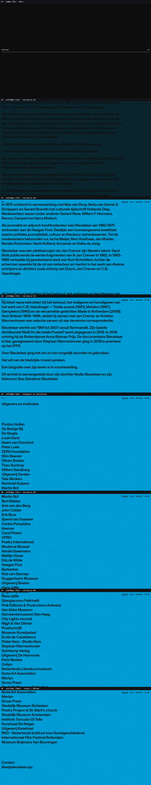
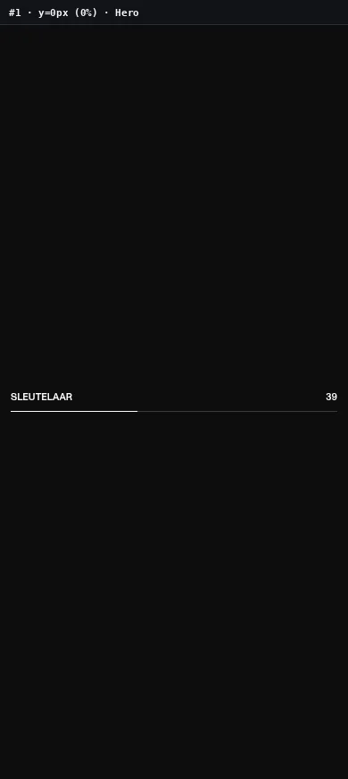

# UI Design System & Master Generation Blueprint: sleutelaar-xyz

> **Hans Sleutelaar · Officiële website** (https://sleutelaar.xyz/) — Digitaal archief over dichter, journalist en Nieuwe Stijl-oprichter Hans Sleutelaar (1935–2020). Gedichten, essays, foto's en bibliografie.





---

## 1. Executive Visual Persona & Design Archetype

- **Brand Essence & Persona**: **Hans Sleutelaar · Officiële website** (`https://sleutelaar.xyz/`). Digitaal archief over dichter, journalist en Nieuwe Stijl-oprichter Hans Sleutelaar (1935–2020). Gedichten, essays, foto's en bibliografie.
- **Capture Provenance**: Live browser capture (`tier2_webgl`, HTTP `200`, captured `2026-11-24`).
- **Visual Archetype**: **Light-Gallery WebGL / Canvas Interactive Experience (`#ffffff` / `#0000ff`)**.
- **Anti-AI-Slop Differentiators**:
  - **Live-Computed Chromatic Polarity**: Anchors the viewport in `#ffffff` (live computed `html` `background-color` (`computed_styles.json`)) paired with `#0d0d0d` primary typography and `#0000ff` accents.
  - **Grounded Typographic Hierarchy**: Uses `ABC Monument Grotesk` across display (`Uitgevers en instituties`) and body copy, paired with `SFMono-Regular` for monospace/code.
  - **Calibrated Spatial Grid & Motion**: Combines `1410px` container bounds (`gap: normal 15px`, padding `15px`) with `cubic-bezier(.4,0,.2,1)` easing and Lenis Smooth Scroll (`data-lenis`), Three.js / WebGL Canvas Pipeline.

---

## 2. Spatial Architecture & Modular Grid Mathematics

### Viewport Allocation & Container Geometry
- **Captured Journey Filmstrips**: Desktop `1280×6624px` (`assets/desktop-journey.webp`, `8` keyframes up to `y=7555px` / doc `8455px`), Mobile `390×872px` (`assets/mobile-journey.webp`, `1` keyframes).
- **Master Container Bounds**: `1410px` (measured widest bounded `<section>` landmark width on `1440px` desktop).
- **Canvas Lateral Padding & Spacing**: `15px` lateral canvas padding with `normal 15px` grid gap.
- **Border Radius Scale**: `.1rem`, `.125rem`.

### Responsive Breakpoint Architecture
- **Desktop Layout**: Multi-column CSS Grid / Flexbox layout at `1440px` (`max-width: 1410px`, `gap: normal 15px`).
- **Mobile Layout**: Single-column vertical stack at `390px` viewport width with `15px` horizontal padding.
- **Extracted CSS Media Queries**: `@media (width>=64rem)`, `@media (width>=1024px)`, `@media (width>=768px)`.

---

## 3. Color System, Materiality & Atmospheric Lighting

### Semantic Palette & Source Grounding
| Semantic Role | Ground-Truth Value | Extracted Live / CSS Source |
|---|---|---|
| **Primary Canvas Substrate** | `#ffffff` | live computed `html` `background-color` (`computed_styles.json`) |
| **Primary Typography Ink** | `#0d0d0d` | live computed `main` `color` (`computed_styles.json`) |
| **Elevated Surface / Card Substrate** | `#0000ff` | `.bg-blue { background-color: blue }` (`#0000ff`) |
| **Interactive Accent / Highlight** | `#0000ff` | `.bg-blue { background-color: blue }` (`#0000ff`) |
| **Secondary / Muted Copy** | `#0000ff` | `html.blue ::selection { color: blue }` (`#0000ff`) |
| **Structural Hairline Border** | `#0000ff` | hairline divider derived from `html.blue ::selection { color: blue }` (`#0000ff`) |
| **Variable Token (`--color-blue`)** | `#009dd8` | `var(--color-blue)` in `:root` |
| **Variable Token (`--color-beige`)** | `#f0e6db` | `var(--color-beige)` in `:root` |

### Sanitized Root CSS Variables (`ui-ux.md` Ground Truth)
| Variable Name | Extracted Value | Semantic Role |
|---|---|---|
| `--color-black` | `#0d0d0d` | Canvas / Surface Token |
| `--color-white` | `#fff` | Canvas / Surface Token |
| `--spacing` | `.25rem` | Layout / Spatial Grid Token |
| `--default-transition-duration` | `.15s` | Motion / Easing Token |
| `--default-transition-timing-function` | `cubic-bezier(.4, 0, .2, 1)` | Motion / Easing Token |
| `--default-font-family` | `var(--font-sans)` | Typography / Scale Token |
| `--default-mono-font-family` | `var(--font-mono)` | Typography / Scale Token |
| `--color-blue` | `#009dd8` | Brand / Palette Token |
| `--color-beige` | `#f0e6db` | Brand / Palette Token |
| `--z-index-filter-clone` | `20` | Elevation / Border Token |
| `--z-index-chrome` | `100` | Elevation / Border Token |
| `--tw-translate-x` | `0` | Design System Custom Token |
| `--tw-translate-y` | `0` | Design System Custom Token |
| `--tw-translate-z` | `0` | Design System Custom Token |
| `--sleutelaar-xyz-bg` | `#ffffff` | Canvas Substrate (from live computed `html` `background-color` (`computed_styles.json`)) |
| `--sleutelaar-xyz-ink` | `#0d0d0d` | Primary Typography Ink (computed-derived) |

---

## 4. Typographic Scale & Editorial Hierarchy

### Font Family Stacks
- **Display Typography**: `ABC Monument Grotesk`.
- **Primary Body Stack**: `ABC Monument Grotesk`.
- **Technical / Metadata Stack**: `SFMono-Regular`.

### Typographic Scale & Rules (Live Computed & Stylesheet Grounded)
- **Hero Display (`H1`)**: observed font-size ladder: `36px`, `12px`, `15px`, `1em`, `80%`.
- **Section Heading (`H2`)**: live computed `h2` (`font-size: 36px`, `line-height: 43.2px`, `font-weight: 500`, `letter-spacing: -0.72px`).
- **Body Copy**: live computed `body` (`font-size: 12px`, `line-height: 18px`, `font-weight: 400`).
- **Metadata & Navigation Labels**: live computed `nav/a` (`font-size: 15px`, `line-height: 15px`, `font-weight: 500`, `letter-spacing: -0.300001px`); CSS variables `--default-mono-font-family: var(--font-mono)`.

---

## 5. Choreographed Motion & Interaction Physics

### Primary Easing Curves
- **Extracted Timing Functions**: `cubic-bezier(.4,0,.2,1)`, `cubic-bezier(.25,.46,.45,.94)`, `cubic-bezier(.19,1,.22,1)`.

### Per-Element Transition & Choreography Rules
- **Selector `layer theme`**: `transition: .15s` extracted from `sleutelaar-xyz` stylesheet.
- **Selector `.transition`**: `transition: var(--tw-ease,var(--default-transition-timing-function))` extracted from `sleutelaar-xyz` stylesheet.
- **Selector `html`**: `transition: background-color .5s cubic-bezier(.4,0,.2,1),color .5s c...` extracted from `sleutelaar-xyz` stylesheet.
- **Extracted Easing Curve (`cubic-bezier(.4,0,.2,1)`)**: Governs interactive state transitions across `<header.uppercase>` and `<section.gap-y-20>`.
- **Runtime Interaction Engine**: Integrates Lenis Smooth Scroll (`data-lenis`), Three.js / WebGL Canvas Pipeline, Barba.js Page Transition Router with `prefers-reduced-motion: reduce` fallback guards.
### Measured Runtime Scroll & Interaction Telemetry (`behavioral_journey_v2`)
- **Scroll Driver Mode**: `native` (max document height `8455px`, deepest scrollY reached `7555px` across `8` desktop keyframes).
- **Detected Scroll / Motion Libraries**: `WebGL/Canvas`.
- **Route Transition Architecture**: First internal navigation (`/index`) measured as `SPA` in `1336ms`.

---

## 6. Component Wireframe & Structural DOM Map

### Visual Layout Schematic — Desktop (`1440px`, Grounded in `dom.html` & Landmark Bounding Boxes)
```
┌────────────────────────────────────────────────────────────────────────┐
│ DESKTOP VIEWPORT (1440px) — Hans Sleutelaar · Officiële website        │
│ ====================================================================== │
│ [ <header.uppercase> (1440x45px)      | Biografie · Index · Gedichte ] │
│ ---------------------------------------------------------------------- │
│ | HERO STAGE: <section.grid-cols-12> (w=1440px)                      | │
│ | H1: Uitgevers en instituties                                       | │
│ | Substrate: #ffffff | Ink: #0d0d0d | Accent: #0000ff                | │
│ ---------------------------------------------------------------------- │
│ | SHOWCASE GRID (<section.gap-y-20>) max-w: 1410px                   | │
│ | +------------------------------+  +------------------------------+ | │
│ | | Samen met                    |  | Voor het betere schrijfwerk  | | │
│ | +------------------------------+  +------------------------------+ | │
│ ---------------------------------------------------------------------- │
│ | DETAIL MODULE (<section.text-48>) — Hij bleef nauw betrok          | │
│ ---------------------------------------------------------------------- │
│ [ FOOTER (<footer.items-center) | https://sleutelaar.xyz/              │
└────────────────────────────────────────────────────────────────────────┘
```

### Visual Layout Schematic — Mobile Reflow (`390px`)
```
┌────────────────────────────────────────────────────────────────────────┐
│ MOBILE VIEWPORT REFLOW (390px) — Single-Column Stack (gap: normal 1)   │
│ ====================================================================== │
│ [ HEADER BAR (<header.uppercase>      ) | Compact Menu (390px)         │
│ ---------------------------------------------------------------------- │
│ | HERO STAGE (<section.grid-cols-12>) — 390px Vertical Lead          | │
│ | H1: Uitgevers en instituties                                       | │
│ ---------------------------------------------------------------------- │
│ | SHOWCASE STACK (<section.gap-y-20>) — 1-Col Stack                  | │
│ | [ Item 1: Samen met                                              ] | │
│ | [ Item 2: Voor het betere schrijfwerk Sleutelaar groeide o       ] | │
│ ---------------------------------------------------------------------- │
│ | DETAIL STACK (<section.text-48>) — 1-Col (Hij bleef nauw bet)      | │
│ ---------------------------------------------------------------------- │
│ [ FOOTER (<footer.items-center) | Stacked 390px Colophon               │
└────────────────────────────────────────────────────────────────────────┘
```

### Granular DOM Region Breakdown
1. **Brand Header & Navigation Bar (<header.uppercase> — `sleutelaar-xyz`)**:
   - Landmark `<header class="uppercase left-0">` (`1440x45px`) hosting `Hans Sleutelaar · Officiële website` navigation (`Biografie · Index · Gedichten · Archief`), DOM attributes (`data-sveltekit-preload-data="hover"`, `data-engine="three.js r185"`), and stylesheet rule `backdrop { box-sizing:border-box;border:0 solid;margin:0;padding:0 }`.
2. **Hero Stage & Focal Lead (<section.grid-cols-12> — `Uitgevers en instituties`)**:
   - Landmark `<section class="grid-cols-12 text-48">` presenting display lead `Uitgevers en instituties` and copy excerpt *"Hans Sleutelaar (22 september 1935 – 25 juni 2020). Dichter - Jou"* over `#ffffff` canvas and `#0d0d0d` ink.
3. **Primary Showcase & Content Grid (<section.gap-y-20> — `Samen met`)**:
   - Landmark `<section class="gap-y-20 text-48">` rendering section `Samen met` with copy *"Voor het betere schrijfwerk Sleutelaar groeide op als enigs kind "*, asset references (`ABCMonumentGroteskTrial-Regular.otf`, `ABCMonumentGroteskTrial-Medium.otf`, `6b9a08feb31cdbce07aca8010c8613f21...`, `0.CvILTd3z.css`), and grid rule `file-selector-button { box-sizing:border-box;border:0 solid;margin:0;padding:0 }`.
4. **Interactive Detail & Feature Matrix (<section.text-48> — `Voor het betere schrijfwerk Sleute`)**:
   - Landmark `<section class="gap-y-20 text-48">` framing `Voor het betere schrijfwerk Sleutelaar groeide o` and `Hij bleef nauw betrokken bij het behoud, het red` (*"Hij bleef nauw betrokken bij het behoud, het redigeren en heruitg"*) with `#0000ff` surface cards, `#0000ff` accents, and `strong { font-weight:bolder }`.
5. **Colophon & Global Directory Footer (<footer.items-center> — `https://sleutelaar.xyz/`)**:
   - Landmark `<footer class="items-center">` anchoring `Hans Sleutelaar · Officiële webs` footer links (`Biografie · Index · Gedichten · Archief`), copy *"2018 International Film Festival Rotterdam (IFFR) - première"*, and `#0000ff` structural dividers.
### Full Vertical Scroll Sequence (Desktop `1440×900` Keyframes)
- **Step 01** (`y=0px`, `0%`): Active landmark `Hero` · sticky/fixed elements: `5`
- **Step 02** (`y=1750px`, `23%`): Active landmark `Section @ 23%` · sticky/fixed elements: `4`
- **Step 03** (`y=2550px`, `34%`): Active landmark `Section @ 34%` · sticky/fixed elements: `3`
- **Step 04** (`y=3400px`, `45%`): Active landmark `Section @ 45%` · sticky/fixed elements: `3`
- **Step 05** (`y=5100px`, `68%`): Active landmark `Uitgevers en instituties` · sticky/fixed elements: `3`
- **Step 06** (`y=5950px`, `79%`): Active landmark `Section @ 79%` · sticky/fixed elements: `3`
- **Step 07** (`y=6800px`, `90%`): Active landmark `Section @ 90%` · sticky/fixed elements: `3`
- **Step 08** (`y=7555px`, `100%`): Active landmark `Footer / Bottom` · sticky/fixed elements: `3`

### Multi-Page Internal Route Map
- **Other Route (`/index`)**: `https://sleutelaar.xyz/index` — H1: `Index · Hans Sleutelaar · Officiële website`, scrollHeight `1768px`, transition `SPA` (`1336ms`)

---

## 7. Master Zero-Shot AI Generation Prompt

```markdown
# Master Zero-Shot Frontend Generation Prompt: sleutelaar-xyz (Hans Sleutelaar · Officiële website)

You are a principal frontend architect and design systems engineer. Build a complete, production-ready web application replicating the exact design system, DOM landmarks, typographic hierarchy, color tokens, and motion physics of `sleutelaar-xyz` (**Hans Sleutelaar · Officiële website** — `https://sleutelaar.xyz/`).

### 1. Visual Archetype & Anti-AI-Slop Mandates
- **Archetype**: Light-Gallery WebGL / Canvas Interactive Experience (`#ffffff` / `#0000ff`).
- **Identity & Domain Context**: Digitaal archief over dichter, journalist en Nieuwe Stijl-oprichter Hans Sleutelaar (1935–2020). Gedichten, essays, foto's en bibliografie.
- **Primary Substrate**: `#ffffff` (live computed `html` `background-color` (`computed_styles.json`)), **Primary Ink**: `#0d0d0d`, **Accent / Highlight**: `#0000ff`.
- **Site-Specific Differentiators**:
  - **Live-Computed Chromatic Polarity**: Anchors the viewport in `#ffffff` (live computed `html` `background-color` (`computed_styles.json`)) paired with `#0d0d0d` primary typography and `#0000ff` accents.
  - **Grounded Typographic Hierarchy**: Uses `ABC Monument Grotesk` across display (`Uitgevers en instituties`) and body copy, paired with `SFMono-Regular` for monospace/code.
  - **Calibrated Spatial Grid & Motion**: Combines `1410px` container bounds (`gap: normal 15px`, padding `15px`) with `cubic-bezier(.4,0,.2,1)` easing and Lenis Smooth Scroll (`data-lenis`), Three.js / WebGL Canvas Pipeline.

### 2. Ground-Truth CSS Variables (`:root` Token Contract)
Declare and consume these exact custom properties extracted from `sleutelaar-xyz` in your global stylesheet:

:root {
  /* Hans Sleutelaar · Officiële website (sleutelaar-xyz) — Live-Grounded CSS Variables */
  --color-black: #0d0d0d; /* Canvas / Surface Token (sleutelaar-xyz) */
  --color-white: #fff; /* Canvas / Surface Token (sleutelaar-xyz) */
  --spacing: .25rem; /* Layout / Spatial Grid Token (sleutelaar-xyz) */
  --default-transition-duration: .15s; /* Motion / Easing Token (sleutelaar-xyz) */
  --default-transition-timing-function: cubic-bezier(.4, 0, .2, 1); /* Motion / Easing Token (sleutelaar-xyz) */
  --default-font-family: var(--font-sans); /* Typography / Scale Token (sleutelaar-xyz) */
  --default-mono-font-family: var(--font-mono); /* Typography / Scale Token (sleutelaar-xyz) */
  --color-blue: #009dd8; /* Brand / Palette Token (sleutelaar-xyz) */
  --color-beige: #f0e6db; /* Brand / Palette Token (sleutelaar-xyz) */
  --z-index-filter-clone: 20; /* Elevation / Border Token (sleutelaar-xyz) */
  --z-index-chrome: 100; /* Elevation / Border Token (sleutelaar-xyz) */
  --tw-translate-x: 0; /* Design System Custom Token (sleutelaar-xyz) */
  --tw-translate-y: 0; /* Design System Custom Token (sleutelaar-xyz) */
  --tw-translate-z: 0; /* Design System Custom Token (sleutelaar-xyz) */
  --sleutelaar-xyz-bg: #ffffff; /* Canvas Substrate (from live computed `html` `background-color` (`computed_styles.json`)) (sleutelaar-xyz) */
  --sleutelaar-xyz-ink: #0d0d0d; /* Primary Typography Ink (computed-derived) (sleutelaar-xyz) */
}

### 3. Semantic Color & Materiality Contract
Map every surface, ink, and border strictly to these source-grounded tokens:
- **Primary Canvas Substrate**: `#ffffff` — grounded in live computed `html` `background-color` (`computed_styles.json`)
- **Primary Typography Ink**: `#0d0d0d` — grounded in live computed `main` `color` (`computed_styles.json`)
- **Elevated Surface / Card Substrate**: `#0000ff` — grounded in `.bg-blue { background-color: blue }` (`#0000ff`)
- **Interactive Accent / Highlight**: `#0000ff` — grounded in `.bg-blue { background-color: blue }` (`#0000ff`)
- **Secondary / Muted Copy**: `#0000ff` — grounded in `html.blue ::selection { color: blue }` (`#0000ff`)
- **Structural Hairline Border**: `#0000ff` — grounded in hairline divider derived from `html.blue ::selection { color: blue }` (`#0000ff`)
- **Variable Token (`--color-blue`)**: `#009dd8` — grounded in `var(--color-blue)` in `:root`
- **Variable Token (`--color-beige`)**: `#f0e6db` — grounded in `var(--color-beige)` in `:root`

### 4. Spatial Grid, Container Bounds & Responsive Breakpoints
- **Desktop Viewport Reference**: `1280×6624px` (multi-frame vertical journey filmstrip (6624px), `1440px` standard desktop width).
- **Mobile Viewport Reference**: `390×872px` (full-page live capture (872px), `390px` standard mobile width).
- **Container Max-Width**: `1410px` (measured widest bounded `<section>` landmark width on `1440px` desktop)
- **Padding & Gutters**: `15px` lateral canvas padding with `normal 15px` grid gap
- **Desktop Grid**: Multi-column CSS Grid / Flexbox layout at `1440px` (`max-width: 1410px`, `gap: normal 15px`)
- **Mobile Adaptation**: Single-column vertical stack at `390px` viewport width with `15px` horizontal padding
- **Media Queries**: `@media (width>=64rem)`, `@media (width>=1024px)`, `@media (width>=768px)`
- **Corner Radii**: `.1rem`, `.125rem`

### 5. Typography & Editorial Scale Contract
- **Display Font Stack**: `ABC Monument Grotesk`
- **Body Font Stack**: `ABC Monument Grotesk`
- **Monospace / Technical Font Stack**: `SFMono-Regular`
- **H1 Display Rule**: observed font-size ladder: `36px`, `12px`, `15px`, `1em`, `80%`
- **H2 Section Rule**: live computed `h2` (`font-size: 36px`, `line-height: 43.2px`, `font-weight: 500`, `letter-spacing: -0.72px`)
- **Body Copy Rule**: live computed `body` (`font-size: 12px`, `line-height: 18px`, `font-weight: 400`)
- **Metadata & Index Rule**: live computed `nav/a` (`font-size: 15px`, `line-height: 15px`, `font-weight: 500`, `letter-spacing: -0.300001px`); CSS variables `--default-mono-font-family: var(--font-mono)`

### 6. Component Hierarchy, Verbatim Copy & Real DOM Landmarks
Scaffold `sleutelaar-xyz` (`Hans Sleutelaar · Officiële website`) with these exact structural regions, extracted copy, and CSS rules from `dom.html`:
1. **Brand Header & Navigation Bar (<header.uppercase> — `sleutelaar-xyz`)**:
   - DOM & Selectors: Landmark `<header class="uppercase left-0">` (`1440x45px`) hosting `Hans Sleutelaar · Officiële website` navigation (`Biografie · Index · Gedichten · Archief`), DOM attributes (`data-sveltekit-preload-data="hover"`, `data-engine="three.js r185"`), and stylesheet rule `backdrop { box-sizing:border-box;border:0 solid;margin:0;padding:0 }`.
   - Responsive Contract: Header `Brand Header & Navigation Bar (<header.uppercase> — `sleutelaar-xyz`)` (`sleutelaar-xyz`) adapts across `@media (width>=64rem)`, `@media (width>=1024px)`, `@media (width>=768px)` with `cubic-bezier(.4,0,.2,1)`, `cubic-bezier(.25,.46,.45,.94)`, `cubic-bezier(.19,1,.22,1)` transitions and links `Biografie · Index · Gedichten · Archief`.
2. **Hero Stage & Focal Lead (<section.grid-cols-12> — `Uitgevers en instituties`)**:
   - DOM & Selectors: Landmark `<section class="grid-cols-12 text-48">` presenting display lead `Uitgevers en instituties` and copy excerpt *"Hans Sleutelaar (22 september 1935 – 25 juni 2020). Dichter - Jou"* over `#ffffff` canvas and `#0d0d0d` ink.
   - Responsive Contract: Hero stage (`1280×6624px` desktop / `390×872px` mobile) sets `#ffffff` background with `#0d0d0d` headline `Uitgevers en instituties`.
3. **Primary Showcase & Content Grid (<section.gap-y-20> — `Samen met`)**:
   - DOM & Selectors: Landmark `<section class="gap-y-20 text-48">` rendering section `Samen met` with copy *"Voor het betere schrijfwerk Sleutelaar groeide op als enigs kind "*, asset references (`ABCMonumentGroteskTrial-Regular.otf`, `ABCMonumentGroteskTrial-Medium.otf`, `6b9a08feb31cdbce07aca8010c8613f21...`, `0.CvILTd3z.css`), and grid rule `file-selector-button { box-sizing:border-box;border:0 solid;margin:0;padding:0 }`.
   - Responsive Contract: Showcase grid `Primary Showcase & Content Grid (<section.gap-y-20> — `Samen met`)` applies Multi-column CSS Grid / Flexbox layout at `1440px` (`max-width: 1410px`, `gap: normal 15px`) on desktop and Single-column vertical stack at `390px` viewport width with `15px` horizontal padding on mobile.
4. **Interactive Detail & Feature Matrix (<section.text-48> — `Voor het betere schrijfwerk Sleute`)**:
   - DOM & Selectors: Landmark `<section class="gap-y-20 text-48">` framing `Voor het betere schrijfwerk Sleutelaar groeide o` and `Hij bleef nauw betrokken bij het behoud, het red` (*"Hij bleef nauw betrokken bij het behoud, het redigeren en heruitg"*) with `#0000ff` surface cards, `#0000ff` accents, and `strong { font-weight:bolder }`.
   - Responsive Contract: Detail module `Interactive Detail & Feature Matrix (<section.text-48> — `Voor het betere schrijfwerk Sleute`)` uses `.1rem`, `.125rem` radii, `#0000ff` highlights, and assets (ABCMonumentGroteskTrial-Regular.otf, ABCMonumentGroteskTrial-Medium.otf, 6b9a08feb31cdbce07aca8010c8613f21...).
5. **Colophon & Global Directory Footer (<footer.items-center> — `https://sleutelaar.xyz/`)**:
   - DOM & Selectors: Landmark `<footer class="items-center">` anchoring `Hans Sleutelaar · Officiële webs` footer links (`Biografie · Index · Gedichten · Archief`), copy *"2018 International Film Festival Rotterdam (IFFR) - première"*, and `#0000ff` structural dividers.
   - Responsive Contract: Footer `Colophon & Global Directory Footer (<footer.items-center> — `https://sleutelaar.xyz/`)` aligns to `1410px` (measured widest bounded `<section>` landmark width on `1440px` desktop) with `15px` lateral canvas padding with `normal 15px` grid gap and attributes (data-sveltekit-preload-data="hover", data-engine="three.js r185").

#### Verbatim DOM Copy Excerpts (`dom.html`)
- Copy Excerpt 1: *"Hans Sleutelaar (22 september 1935 – 25 juni 2020). Dichter - Journalist - Redacte..."*
- Copy Excerpt 2: *"Voor het betere schrijfwerk Sleutelaar groeide op als enigs kind in Rotterdam. Een..."*
- Copy Excerpt 3: *"Hij bleef nauw betrokken bij het behoud, het redigeren en heruitgeven van het werk..."*
- Copy Excerpt 4: *"2018 International Film Festival Rotterdam (IFFR) - première documentaire Sleutela..."*

### 7. Motion, Extracted Stylesheet Rules & Interaction Choreography
- **Primary Easing Functions**: `cubic-bezier(.4,0,.2,1)`, `cubic-bezier(.25,.46,.45,.94)`, `cubic-bezier(.19,1,.22,1)`
- **Extracted Stylesheet Rules (`sleutelaar-xyz`)**:
- `backdrop { box-sizing:border-box;border:0 solid;margin:0;padding:0 }`
- `file-selector-button { box-sizing:border-box;border:0 solid;margin:0;padding:0 }`
- `strong { font-weight:bolder }`
- `small { font-size:80% }`
- `sup { vertical-align:baseline;font-size:75%;line-height:0;position:relative }`
- **Per-Selector Transition Rules**:
- **Selector `layer theme`**: `transition: .15s` extracted from `sleutelaar-xyz` stylesheet.
- **Selector `.transition`**: `transition: var(--tw-ease,var(--default-transition-timing-function))` extracted from `sleutelaar-xyz` stylesheet.
- **Selector `html`**: `transition: background-color .5s cubic-bezier(.4,0,.2,1),color .5s c...` extracted from `sleutelaar-xyz` stylesheet.
- **Extracted Easing Curve (`cubic-bezier(.4,0,.2,1)`)**: Governs interactive state transitions across `<header.uppercase>` and `<section.gap-y-20>`.
- **Runtime Interaction Engine**: Integrates Lenis Smooth Scroll (`data-lenis`), Three.js / WebGL Canvas Pipeline, Barba.js Page Transition Router with `prefers-reduced-motion: reduce` fallback guards.
### 7b. Full-Page Scroll Choreography, Interactive States & Multi-Page Routes
- **Scroll Mechanics**: Implement `native` vertical progression up to `8455px` across 8 distinct viewport chapters using WebGL/Canvas.
- **Vertical Chapter Sequence**: Hero (0%) -> Section @ 23% (23%) -> Section @ 34% (34%) -> Section @ 45% (45%) -> Uitgevers en instituties (68%) -> Section @ 79% (79%) -> Section @ 90% (90%) -> Footer / Bottom (100%).
- **Multi-Page Routes**: Scaffold internal routes `/index` (other, SPA) sharing the global header/footer shell and design tokens.

### 8. Technical Deliverables
- Implement in Next.js (App Router) with TypeScript and Tailwind CSS consuming the `:root` custom properties defined above for `sleutelaar-xyz`.
- Reproduce both the `1440px` desktop architecture and `390px` mobile breakpoint transitions, preserving semantic HTML5 landmarks (`<header>`, `<nav>`, `<main>`, `<section>`, `<footer>`) and `prefers-reduced-motion` accessibility guards.
```
---

## 8. Full-Page Scroll Journey, Interactive States & Subpage Inventory

### Desktop Scroll Keyframes (`1440×900` WebP)
| Step | Scroll Y | Progress | Active Landmark / Section | Sticky/Fixed | Visual Asset |
| :---: | :---: | :---: | :--- | :---: | :--- |
| `#01` | `0px` | `0%` | Hero | `5` | [desktop-step-01.webp](assets/desktop-step-01.webp) |
| `#02` | `1750px` | `23%` | Section @ 23% | `4` | [desktop-step-02.webp](assets/desktop-step-02.webp) |
| `#03` | `2550px` | `34%` | Section @ 34% | `3` | [desktop-step-03.webp](assets/desktop-step-03.webp) |
| `#04` | `3400px` | `45%` | Section @ 45% | `3` | [desktop-step-04.webp](assets/desktop-step-04.webp) |
| `#05` | `5100px` | `68%` | Uitgevers en instituties | `3` | [desktop-step-05.webp](assets/desktop-step-05.webp) |
| `#06` | `5950px` | `79%` | Section @ 79% | `3` | [desktop-step-06.webp](assets/desktop-step-06.webp) |
| `#07` | `6800px` | `90%` | Section @ 90% | `3` | [desktop-step-07.webp](assets/desktop-step-07.webp) |
| `#08` | `7555px` | `100%` | Footer / Bottom | `3` | [desktop-step-08.webp](assets/desktop-step-08.webp) |

### Mobile Condensed Keyframes (`390×844` WebP)
| Step | Scroll Y | Progress | Active Landmark | Visual Asset |
| :---: | :---: | :---: | :--- | :--- |
| `#01` | `0px` | `0%` | Hero | [mobile-step-01.webp](assets/mobile-step-01.webp) |

### Internal Subpage Filmstrips (`1080px` Wide WebP)
| # | Template | Route URL | H1 / Title | Scroll Height | Transition | Filmstrip Asset |
| :-: | :---: | :--- | :--- | :---: | :---: | :--- |
| `1` | `other` | `https://sleutelaar.xyz/index` | Index · Hans Sleutelaar · Officiële w... | `1768px` | `SPA` (`1336ms`) | [subpage-01-index.webp](assets/subpage-01-index.webp) |

