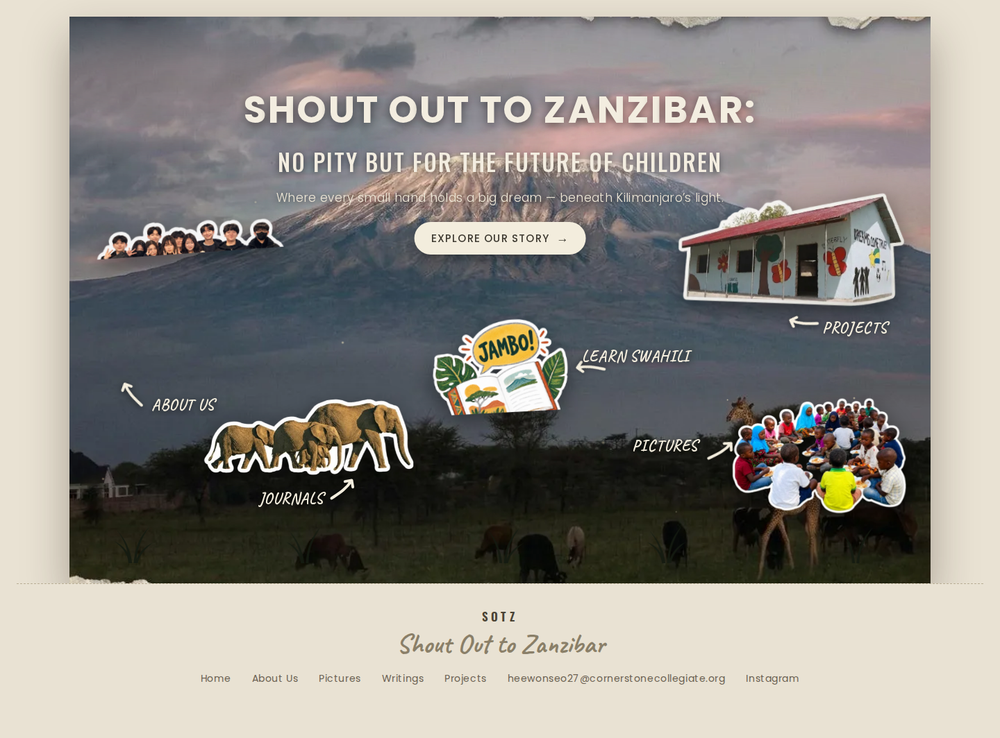
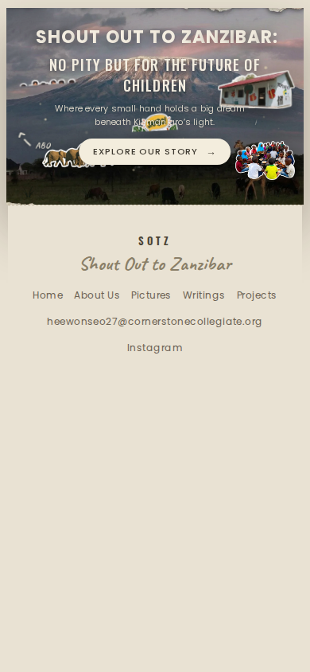

# UI Design System & Master Generation Blueprint: sotz-org

> **Shout out to Zanzibar** (https://sotz.org/) — S h o u t o u t t o Z a n z i b a r :



---

## 1. Executive Visual Persona & Design Archetype

- **Brand Essence & Persona**: **Shout out to Zanzibar** (`https://sotz.org/`). S h o u t o u t t o Z a n z i b a r :
- **Visual Archetype**: **Light-Substrate Editorial & Modular Grid System (`#b9ae95` canvas, `#2b2f33` ink, `#8a7f68` accent)**.
- **Anti-AI-Slop Differentiators**:
  - **Source-Grounded Chromatic Polarity**: Anchors the viewport in `#b9ae95` (`.site-footer { border-top: #b9ae95 }`) paired with `#2b2f33` primary typography and `#8a7f68` accents.
  - **Extracted Typographic Hierarchy**: Pairs `Caveat` for display copy (`S h o u t o u t t o Z a n z i b a r `) with `Oswald` and not declared in static CSS (uses primary stack / `ui-monospace`).
  - **Calibrated Spatial Grid & Motion**: Combines `640px` container bounds (`gap: 10px`, padding `34px`) with `cubic-bezier(.22,.9,.35,1)` easing and GSAP Timeline & ScrollTrigger.

---

## 2. Spatial Architecture & Modular Grid Mathematics



### Viewport Allocation & Container Geometry
- **Captured Viewport Dimensions**: Desktop `1440×2400px` (`assets/desktop.png`, capped at 2400px multi-section capture), Mobile `390×2400px` (`assets/mobile.png`, capped at 2400px multi-section capture).
- **Master Container Bounds**: `640px` extracted from `sotz-org` stylesheet.
- **Canvas Lateral Padding & Spacing**: `34px` lateral canvas padding with `10px` grid gap.
- **Border Radius Scale**: `50%`, `999px`.

### Responsive Breakpoint Architecture
- **Desktop Layout**: Multi-column CSS Grid / Flexbox layout at `1440px` (`max-width: 640px`, `gap: 10px`).
- **Mobile Layout**: Single-column vertical stack at `390px` viewport width with `34px` horizontal padding.
- **Extracted CSS Media Queries**: `@media (prefers-reduced-motion: reduce)`, `@media (max-width: 640px)`.

---

## 3. Color System, Materiality & Atmospheric Lighting

### Semantic Palette & Source Grounding
| Semantic Role | Ground-Truth Value | Extracted CSS Source / Selector |
|---|---|---|
| **Primary Canvas Substrate** | `#b9ae95` | `.site-footer { border-top: #b9ae95 }` |
| **Primary Typography Ink** | `#e9e2d3` | `.site-footer { background: #e9e2d3 }` |
| **Elevated Surface / Card Substrate** | `#4a4233` | `.site-footer { color: #4a4233 }` |
| **Interactive Accent / Highlight** | `#8a7f68` | `.site-footer .ftag { color: #8a7f68 }` |
| **Secondary / Muted Copy** | `#8a6b47` | `.site-footer .flinks a:focus-vi... { border-color: #8a6b47 }` |
| **Structural Hairline Border** | `#2b2f33` | `.stage { background: #2b2f33 }` |

### Sanitized Root CSS Variables (`ui-ux.md` Ground Truth)
| Variable Name | Extracted Value | Semantic Role |
|---|---|---|
| `--dd` | `0s` | Motion / Timing Token |
| `--breath-time` | `5.2s` | Motion / Timing Token |
| `--breath-delay` | `-.9s` | Motion / Easing Token |
| `--breath-x` | `1.5px` | Dimension / Scale Token |
| `--breath-y` | `-2.5px` | Dimension / Scale Token |
| `--sd` | `4.2s` | Motion / Timing Token |
| `--sdd` | `0s` | Motion / Timing Token |
| `--fx` | `-15.405954996532616px` | Dimension / Scale Token |
| `--fy` | `-20.362394431859627px` | Dimension / Scale Token |
| `--fd` | `6.658141834401523s` | Motion / Timing Token |
| `--fdd` | `-0.2258515335672815s` | Motion / Timing Token |
| `--gd` | `2.658352322306388s` | Motion / Timing Token |
| `--gdd` | `-2.123038911815748s` | Motion / Timing Token |
| `--sotz-org-bg` | `#b9ae95` | Canvas Substrate (from `.site-footer { border-top: #b9ae95 }`) |
| `--sotz-org-ink` | `#2b2f33` | Primary Typography Ink (stylesheet-derived) |
| `--sotz-org-surface` | `#4a4233` | Surface Substrate (stylesheet-derived) |

---

## 4. Typographic Scale & Editorial Hierarchy

### Font Family Stacks
- **Display Typography**: `Caveat`.
- **Primary Body Stack**: `Oswald`.
- **Technical / Metadata Stack**: not declared in static CSS (uses primary stack / `ui-monospace`).

### Typographic Scale & Rules (Extracted from Stylesheet & Variables)
- **Hero Display (`H1`)**: rule `h1` (`font-size: clamp(22px, 4.2vw, 54px)`, `line-height: 1.05`, `letter-spacing: .04em`, `font-weight: 700`).
- **Section Heading (`H2`)**: rule `h2` (`font-size: clamp(18px, 2.6vw, 33px)`, `letter-spacing: .06em`, `font-weight: 500`).
- **Body Copy**: rule `p` (`font-size: clamp(11px, 1.35vw, 17px)`, `letter-spacing: .02em`, `font-weight: 300`).
- **Metadata & Navigation Labels**: not explicitly declared on tag in static CSS (stylesheet font-size ladder: `clamp(13px, 1.4vw, 17px)`, `clamp(24px, 3vw, 38px)`, `clamp(12px, 1.2vw, 14px)`, `clamp(22px, 4.2vw, 54px)`, `clamp(18px, 2.6vw, 33px)`).

---

## 5. Choreographed Motion & Interaction Physics

### Primary Easing Curves
- **Extracted Timing Functions**: `cubic-bezier(.22,.9,.35,1)`, `cubic-bezier(.34,1.56,.64,1)`, `cubic-bezier(.7,0,.3,1)`.

### Per-Element Transition & Choreography Rules
- **Selector `.site-footer .flinks a`**: `transition: color .25s ease, border-color .25s ease` extracted from `sotz-org` stylesheet.
- **Selector `.cta`**: `transition: transform .25s ease, box-shadow .25s ease` extracted from `sotz-org` stylesheet.
- **Selector `.cta .arr`**: `transition: transform .25s ease` extracted from `sotz-org` stylesheet.
- **Extracted Easing Curve (`cubic-bezier(.22,.9,.35,1)`)**: Governs interactive state transitions across `<header.headline>` and `<article.story-panel>`.
- **Runtime Interaction Engine**: Integrates GSAP Timeline & ScrollTrigger with `prefers-reduced-motion: reduce` fallback guards.

---

## 6. Component Wireframe & Structural DOM Map

### Visual Layout Schematic (Grounded in `dom.html` — `1440px` Desktop & `390px` Mobile Reflow)
```
┌────────────────────────────────────────────────────────────────────────┐
│ DESKTOP VIEWPORT (1440px) — Shout out to Zanzibar                      │
│ ====================================================================== │
│ [ <header.headline>        | Home · About Us · Pictures · Writings  ]  │
│ ---------------------------------------------------------------------- │
│ | HERO STAGE: <article.story-panel>                                |   │
│ | H1: S h o u t o u t t o Z a n z i b a r :                        |   │
│ | Substrate: #b9ae95    | Ink: #2b2f33    | Accent: #8a7f68        |   │
│ ---------------------------------------------------------------------- │
│ | SHOWCASE GRID (<article.story-panel>     ) max-w: 640px          |   │
│ | +------------------------------+  +------------------------------+ | │
│ | | No Pity but for the Future o |  | Our Story                    | | │
│ | +------------------------------+  +------------------------------+ | │
│ ---------------------------------------------------------------------- │
│ | MOBILE VIEWPORT REFLOW (390px) — Single-Column Stack (gap: 10px  ) | │
│ | [<header.headline>] -> [<article.story-pan] -> [<article.story-pan]  │
│ ---------------------------------------------------------------------- │
│ [ FOOTER (<footer.site-footer>  ) | https://sotz.org/                  │
└────────────────────────────────────────────────────────────────────────┘
```

### Granular DOM Region Breakdown
1. **Brand Header & Navigation Bar (<header.headline> — `sotz-org`)**:
   - Landmark `<header class="headline">` hosting `Shout out to Zanzibar` navigation (`Home · About Us · Pictures · Writings · Projects`), DOM attributes (`data-story="mission"`, `data-story="tanzania"`, `data-story="work"`, `data-story="school"`), and stylesheet rule `.site-footer .flinks { display: flex; flex-wrap: wrap; justify-content: center; gap: clamp(14px... }`.
2. **Hero Stage & Focal Lead (<article.story-panel> — `S h o u t o u t t o Z a n z i b a `)**:
   - Landmark `<article class="story-panel">` presenting display lead `S h o u t o u t t o Z a n z i b a r :` and copy excerpt *"Where every small hand holds a big dream — beneath Kilimanjaro’s "* over `#b9ae95` canvas and `#2b2f33` ink.
3. **Primary Showcase & Content Grid (<article.story-panel> — `No Pity but for the Future of Chil`)**:
   - Landmark `<article class="story-panel">` rendering section `No Pity but for the Future of Children` with copy *"EXPLORE OUR STORY →"*, asset references (`sotz_logo.png`, `fonts.googleapis.com`, `fonts.gstatic.com`, `css2`), and grid rule `.site-footer .flinks a:focus-visible { border-color: 8a6b47; color: 4a4233; }`.
4. **Interactive Detail & Feature Matrix (<article.story-panel> — `Our Story`)**:
   - Landmark `<article class="story-panel">` framing `Our Story` and `Mission` (*"Shout out to Zanzibar"*) with `#4a4233` surface cards, `#8a7f68` accents, and `.stage-art { position: absolute; inset: 0; }`.
5. **Colophon & Global Directory Footer (<footer.site-footer> — `https://sotz.org/`)**:
   - Landmark `<footer class="site-footer">` anchoring `Shout out to Zanzibar` footer links (`Home · About Us · Pictures · Writings · Projects`), copy *"SOTZ, Shout out to Zanzibar is the non-profit organization d"*, and `#2b2f33` structural dividers.

---

## 7. Master Zero-Shot AI Generation Prompt

```markdown
# Master Zero-Shot Frontend Generation Prompt: sotz-org (Shout out to Zanzibar)

You are a principal frontend architect and design systems engineer. Build a complete, production-ready web application replicating the exact design system, DOM landmarks, typographic hierarchy, color tokens, and motion physics of `sotz-org` (**Shout out to Zanzibar** — `https://sotz.org/`).

### 1. Visual Archetype & Anti-AI-Slop Mandates
- **Archetype**: Light-Substrate Editorial & Modular Grid System (`#b9ae95` canvas, `#2b2f33` ink, `#8a7f68` accent).
- **Identity & Domain Context**: S h o u t o u t t o Z a n z i b a r :
- **Primary Substrate**: `#b9ae95` (`.site-footer { border-top: #b9ae95 }`), **Primary Ink**: `#2b2f33`, **Accent / Highlight**: `#8a7f68`.
- **Site-Specific Differentiators**:
  - **Source-Grounded Chromatic Polarity**: Anchors the viewport in `#b9ae95` (`.site-footer { border-top: #b9ae95 }`) paired with `#2b2f33` primary typography and `#8a7f68` accents.
  - **Extracted Typographic Hierarchy**: Pairs `Caveat` for display copy (`S h o u t o u t t o Z a n z i b a r `) with `Oswald` and not declared in static CSS (uses primary stack / `ui-monospace`).
  - **Calibrated Spatial Grid & Motion**: Combines `640px` container bounds (`gap: 10px`, padding `34px`) with `cubic-bezier(.22,.9,.35,1)` easing and GSAP Timeline & ScrollTrigger.

### 2. Ground-Truth CSS Variables (`:root` Token Contract)
Declare and consume these exact custom properties extracted from `sotz-org` in your global stylesheet:

:root {
  /* Shout out to Zanzibar (sotz-org) — Ground-Truth Extracted CSS Variables */
  --dd: 0s; /* Motion / Timing Token (sotz-org) */
  --breath-time: 5.2s; /* Motion / Timing Token (sotz-org) */
  --breath-delay: -.9s; /* Motion / Easing Token (sotz-org) */
  --breath-x: 1.5px; /* Dimension / Scale Token (sotz-org) */
  --breath-y: -2.5px; /* Dimension / Scale Token (sotz-org) */
  --sd: 4.2s; /* Motion / Timing Token (sotz-org) */
  --sdd: 0s; /* Motion / Timing Token (sotz-org) */
  --fx: -15.405954996532616px; /* Dimension / Scale Token (sotz-org) */
  --fy: -20.362394431859627px; /* Dimension / Scale Token (sotz-org) */
  --fd: 6.658141834401523s; /* Motion / Timing Token (sotz-org) */
  --fdd: -0.2258515335672815s; /* Motion / Timing Token (sotz-org) */
  --gd: 2.658352322306388s; /* Motion / Timing Token (sotz-org) */
  --gdd: -2.123038911815748s; /* Motion / Timing Token (sotz-org) */
  --sotz-org-bg: #b9ae95; /* Canvas Substrate (from `.site-footer { border-top: #b9ae95 }`) (sotz-org) */
  --sotz-org-ink: #2b2f33; /* Primary Typography Ink (stylesheet-derived) (sotz-org) */
  --sotz-org-surface: #4a4233; /* Surface Substrate (stylesheet-derived) (sotz-org) */
}

### 3. Semantic Color & Materiality Contract
Map every surface, ink, and border strictly to these source-grounded tokens:
- **Primary Canvas Substrate**: `#b9ae95` — grounded in `.site-footer { border-top: #b9ae95 }`
- **Primary Typography Ink**: `#e9e2d3` — grounded in `.site-footer { background: #e9e2d3 }`
- **Elevated Surface / Card Substrate**: `#4a4233` — grounded in `.site-footer { color: #4a4233 }`
- **Interactive Accent / Highlight**: `#8a7f68` — grounded in `.site-footer .ftag { color: #8a7f68 }`
- **Secondary / Muted Copy**: `#8a6b47` — grounded in `.site-footer .flinks a:focus-vi... { border-color: #8a6b47 }`
- **Structural Hairline Border**: `#2b2f33` — grounded in `.stage { background: #2b2f33 }`

### 4. Spatial Grid, Container Bounds & Responsive Breakpoints
- **Desktop Viewport Reference**: `1440×2400px` (capped at 2400px multi-section capture, `1440px` standard desktop width).
- **Mobile Viewport Reference**: `390×2400px` (capped at 2400px multi-section capture, `390px` standard mobile width).
- **Container Max-Width**: `640px` extracted from `sotz-org` stylesheet
- **Padding & Gutters**: `34px` lateral canvas padding with `10px` grid gap
- **Desktop Grid**: Multi-column CSS Grid / Flexbox layout at `1440px` (`max-width: 640px`, `gap: 10px`)
- **Mobile Adaptation**: Single-column vertical stack at `390px` viewport width with `34px` horizontal padding
- **Media Queries**: `@media (prefers-reduced-motion: reduce)`, `@media (max-width: 640px)`
- **Corner Radii**: `50%`, `999px`

### 5. Typography & Editorial Scale Contract
- **Display Font Stack**: `Caveat`
- **Body Font Stack**: `Oswald`
- **Monospace / Technical Font Stack**: not declared in static CSS (uses primary stack / `ui-monospace`)
- **H1 Display Rule**: rule `h1` (`font-size: clamp(22px, 4.2vw, 54px)`, `line-height: 1.05`, `letter-spacing: .04em`, `font-weight: 700`)
- **H2 Section Rule**: rule `h2` (`font-size: clamp(18px, 2.6vw, 33px)`, `letter-spacing: .06em`, `font-weight: 500`)
- **Body Copy Rule**: rule `p` (`font-size: clamp(11px, 1.35vw, 17px)`, `letter-spacing: .02em`, `font-weight: 300`)
- **Metadata & Index Rule**: not explicitly declared on tag in static CSS (stylesheet font-size ladder: `clamp(13px, 1.4vw, 17px)`, `clamp(24px, 3vw, 38px)`, `clamp(12px, 1.2vw, 14px)`, `clamp(22px, 4.2vw, 54px)`, `clamp(18px, 2.6vw, 33px)`)

### 6. Component Hierarchy, Verbatim Copy & Real DOM Landmarks
Scaffold `sotz-org` (`Shout out to Zanzibar`) with these exact structural regions, extracted copy, and CSS rules from `dom.html`:
1. **Brand Header & Navigation Bar (<header.headline> — `sotz-org`)**:
   - DOM & Selectors: Landmark `<header class="headline">` hosting `Shout out to Zanzibar` navigation (`Home · About Us · Pictures · Writings · Projects`), DOM attributes (`data-story="mission"`, `data-story="tanzania"`, `data-story="work"`, `data-story="school"`), and stylesheet rule `.site-footer .flinks { display: flex; flex-wrap: wrap; justify-content: center; gap: clamp(14px... }`.
   - Responsive Contract: Header `Brand Header & Navigation Bar (<header.headline> — `sotz-org`)` (`sotz-org`) adapts across `@media (prefers-reduced-motion: reduce)`, `@media (max-width: 640px)` with `cubic-bezier(.22,.9,.35,1)`, `cubic-bezier(.34,1.56,.64,1)`, `cubic-bezier(.7,0,.3,1)` transitions and links `Home · About Us · Pictures · Writings · Projects`.
2. **Hero Stage & Focal Lead (<article.story-panel> — `S h o u t o u t t o Z a n z i b a `)**:
   - DOM & Selectors: Landmark `<article class="story-panel">` presenting display lead `S h o u t o u t t o Z a n z i b a r :` and copy excerpt *"Where every small hand holds a big dream — beneath Kilimanjaro’s "* over `#b9ae95` canvas and `#2b2f33` ink.
   - Responsive Contract: Hero stage (`1440×2400px` desktop / `390×2400px` mobile) sets `#b9ae95` background with `#2b2f33` headline `S h o u t o u t t o Z a n z i b a r :`.
3. **Primary Showcase & Content Grid (<article.story-panel> — `No Pity but for the Future of Chil`)**:
   - DOM & Selectors: Landmark `<article class="story-panel">` rendering section `No Pity but for the Future of Children` with copy *"EXPLORE OUR STORY →"*, asset references (`sotz_logo.png`, `fonts.googleapis.com`, `fonts.gstatic.com`, `css2`), and grid rule `.site-footer .flinks a:focus-visible { border-color: 8a6b47; color: 4a4233; }`.
   - Responsive Contract: Showcase grid `Primary Showcase & Content Grid (<article.story-panel> — `No Pity but for the Future of Chil`)` applies Multi-column CSS Grid / Flexbox layout at `1440px` (`max-width: 640px`, `gap: 10px`) on desktop and Single-column vertical stack at `390px` viewport width with `34px` horizontal padding on mobile.
4. **Interactive Detail & Feature Matrix (<article.story-panel> — `Our Story`)**:
   - DOM & Selectors: Landmark `<article class="story-panel">` framing `Our Story` and `Mission` (*"Shout out to Zanzibar"*) with `#4a4233` surface cards, `#8a7f68` accents, and `.stage-art { position: absolute; inset: 0; }`.
   - Responsive Contract: Detail module `Interactive Detail & Feature Matrix (<article.story-panel> — `Our Story`)` uses `50%`, `999px` radii, `#8a7f68` highlights, and assets (sotz_logo.png, fonts.googleapis.com, fonts.gstatic.com).
5. **Colophon & Global Directory Footer (<footer.site-footer> — `https://sotz.org/`)**:
   - DOM & Selectors: Landmark `<footer class="site-footer">` anchoring `Shout out to Zanzibar` footer links (`Home · About Us · Pictures · Writings · Projects`), copy *"SOTZ, Shout out to Zanzibar is the non-profit organization d"*, and `#2b2f33` structural dividers.
   - Responsive Contract: Footer `Colophon & Global Directory Footer (<footer.site-footer> — `https://sotz.org/`)` aligns to `640px` extracted from `sotz-org` stylesheet with `34px` lateral canvas padding with `10px` grid gap and attributes (data-story="mission", data-story="tanzania", data-story="work").

#### Verbatim DOM Copy Excerpts (`dom.html`)
- Copy Excerpt 1: *"Where every small hand holds a big dream — beneath Kilimanjaro’s light."*
- Copy Excerpt 2: *"EXPLORE OUR STORY →"*
- Copy Excerpt 3: *"Shout out to Zanzibar"*
- Copy Excerpt 4: *"SOTZ, Shout out to Zanzibar is the non-profit organization dedicated to supporting..."*

### 7. Motion, Extracted Stylesheet Rules & Interaction Choreography
- **Primary Easing Functions**: `cubic-bezier(.22,.9,.35,1)`, `cubic-bezier(.34,1.56,.64,1)`, `cubic-bezier(.7,0,.3,1)`
- **Extracted Stylesheet Rules (`sotz-org`)**:
- `.site-footer .flinks { display: flex; flex-wrap: wrap; justify-content: center; gap: clamp(14px... }`
- `.site-footer .flinks a:focus-visible { border-color: 8a6b47; color: 4a4233; }`
- `.stage-art { position: absolute; inset: 0; }`
- `.stage.shaking { animation: shake .22s ease; }`
- `.layer { position: absolute; inset: 0; }`
- **Per-Selector Transition Rules**:
- **Selector `.site-footer .flinks a`**: `transition: color .25s ease, border-color .25s ease` extracted from `sotz-org` stylesheet.
- **Selector `.cta`**: `transition: transform .25s ease, box-shadow .25s ease` extracted from `sotz-org` stylesheet.
- **Selector `.cta .arr`**: `transition: transform .25s ease` extracted from `sotz-org` stylesheet.
- **Extracted Easing Curve (`cubic-bezier(.22,.9,.35,1)`)**: Governs interactive state transitions across `<header.headline>` and `<article.story-panel>`.
- **Runtime Interaction Engine**: Integrates GSAP Timeline & ScrollTrigger with `prefers-reduced-motion: reduce` fallback guards.

### 8. Technical Deliverables
- Implement in Next.js (App Router) with TypeScript and Tailwind CSS consuming the `:root` custom properties defined above for `sotz-org`.
- Reproduce both the `1440px` desktop architecture and `390px` mobile breakpoint transitions, preserving semantic HTML5 landmarks (`<header>`, `<nav>`, `<main>`, `<section>`, `<footer>`) and `prefers-reduced-motion` accessibility guards.
```
