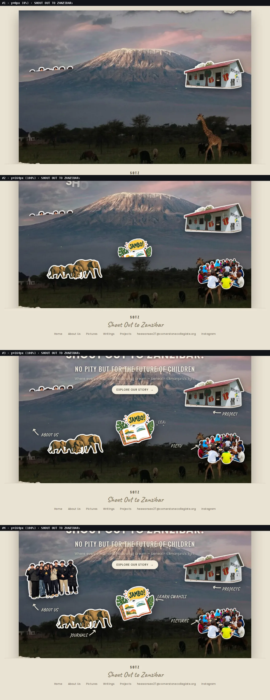
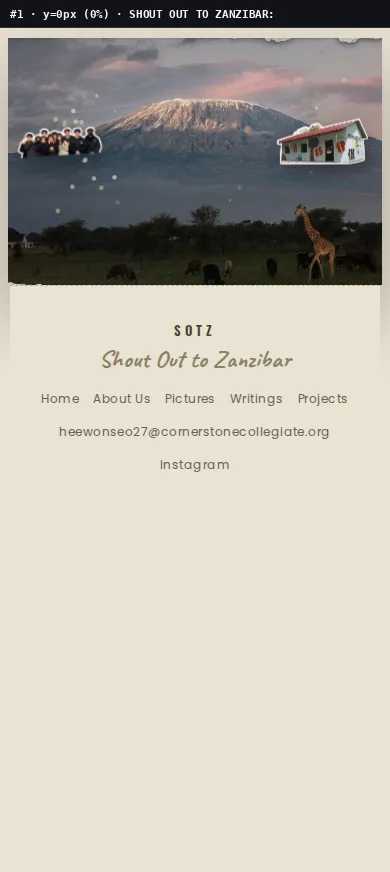

# UI Design System & Master Generation Blueprint: sotz-org

> **Shout out to Zanzibar** (https://sotz.org/) — S h o u t o u t t o Z a n z i b a r :





---

## 1. Executive Visual Persona & Design Archetype

- **Brand Essence & Persona**: **Shout out to Zanzibar** (`https://sotz.org/`). S h o u t o u t t o Z a n z i b a r :
- **Capture Provenance**: Live browser capture (`tier1_fast`, HTTP `200`, captured `2026-11-24`).
- **Visual Archetype**: **Light-Substrate Editorial & Modular Grid System (`#e9e2d3` canvas, `#000000` ink, `#0000ee` accent)**.
- **Anti-AI-Slop Differentiators**:
  - **Live-Computed Chromatic Polarity**: Anchors the viewport in `#e9e2d3` (live computed `body` `background-color` (`computed_styles.json`)) paired with `#000000` primary typography and `#0000ee` accents.
  - **Grounded Typographic Hierarchy**: Uses `Poppins` across display (`SHOUT OUT TO ZANZIBAR:`) and body copy.
  - **Calibrated Spatial Grid & Motion**: Combines `1240px` container bounds (`gap: 30px`, padding `24px`) with `cubic-bezier(.22,.9,.35,1)` easing and GSAP Timeline & ScrollTrigger.

---

## 2. Spatial Architecture & Modular Grid Mathematics

### Viewport Allocation & Container Geometry
- **Captured Journey Filmstrips**: Desktop `1280×3312px` (`assets/desktop-journey.webp`, `4` keyframes up to `y=164px` / doc `1064px`), Mobile `390×872px` (`assets/mobile-journey.webp`, `1` keyframes).
- **Master Container Bounds**: `1240px` (measured `<main>` bounding box width within `1440px` desktop viewport).
- **Canvas Lateral Padding & Spacing**: `24px` lateral canvas padding with `30px` grid gap.
- **Border Radius Scale**: `999px`, `50%`.

### Responsive Breakpoint Architecture
- **Desktop Layout**: Multi-column CSS Grid / Flexbox layout at `1440px` (`max-width: 1240px`, `gap: 30px`).
- **Mobile Layout**: Single-column vertical stack at `390px` viewport width with `24px` horizontal padding.
- **Extracted CSS Media Queries**: `@media (prefers-reduced-motion: reduce)`, `@media (max-width: 640px)`.

---

## 3. Color System, Materiality & Atmospheric Lighting

### Semantic Palette & Source Grounding
| Semantic Role | Ground-Truth Value | Extracted Live / CSS Source |
|---|---|---|
| **Primary Canvas Substrate** | `#e9e2d3` | live computed `body` `background-color` (`computed_styles.json`) |
| **Primary Typography Ink** | `#000000` | live computed `main` `color` (`computed_styles.json`) |
| **Elevated Surface / Card Substrate** | `#f3eddd` | live computed `button` `background-color` (`computed_styles.json`) |
| **Interactive Accent / Highlight** | `#0000ee` | live computed `a` `color` (`computed_styles.json`) |
| **Secondary / Muted Copy** | `#4a4233` | live computed `nav` `color` (`computed_styles.json`) |
| **Structural Hairline Border** | `#b9ae95` | `.site-footer { border-top: #b9ae95 }` |

### Sanitized Root CSS Variables (`ui-ux.md` Ground Truth)
| Variable Name | Extracted Value | Semantic Role |
|---|---|---|
| `--dd` | `0s` | Motion / Timing Token |
| `--breath-time` | `5.2s` | Motion / Timing Token |
| `--breath-delay` | `-.9s` | Motion / Easing Token |
| `--breath-x` | `1.5px` | Dimension / Scale Token |
| `--breath-y` | `-2.5px` | Dimension / Scale Token |
| `--sd` | `4.2s` | Motion / Timing Token |
| `--sdd` | `0s` | Motion / Timing Token |
| `--fx` | `12.686829972268164px` | Dimension / Scale Token |
| `--fy` | `-42.338201167836075px` | Dimension / Scale Token |
| `--fd` | `8.03990141361104s` | Motion / Timing Token |
| `--fdd` | `-4.525146343807082s` | Motion / Timing Token |
| `--gd` | `3.218259545023418s` | Motion / Timing Token |
| `--gdd` | `-1.1055247801866024s` | Motion / Timing Token |
| `--dx` | `97.66093029928604px` | Dimension / Scale Token |
| `--dy` | `-56.65180577215252px` | Dimension / Scale Token |
| `--sotz-org-bg` | `#e9e2d3` | Canvas Substrate (from live computed `body` `background-color` (`computed_styles.json`)) |

---

## 4. Typographic Scale & Editorial Hierarchy

### Font Family Stacks
- **Display Typography**: `Poppins`.
- **Primary Body Stack**: `Poppins`.
- **Technical / Metadata Stack**: not declared in live computed styles (uses primary stack / `ui-monospace`).

### Typographic Scale & Rules (Live Computed & Stylesheet Grounded)
- **Hero Display (`H1`)**: live computed `h1` (`font-size: 54px`, `line-height: 56.7px`, `font-weight: 700`, `letter-spacing: 2.16px`); rule `h1` (`font-size: clamp(22px, 4.2vw, 54px)`, `line-height: 1.05`, `letter-spacing: .04em`, `font-weight: 700`).
- **Section Heading (`H2`)**: live computed `h2` (`font-size: 33px`, `line-height: normal`, `font-weight: 500`, `letter-spacing: 1.98px`); rule `h2` (`font-size: clamp(18px, 2.6vw, 33px)`, `letter-spacing: .06em`, `font-weight: 500`).
- **Body Copy**: live computed `body` (`font-size: 16px`, `line-height: normal`, `font-weight: 400`); rule `p` (`font-size: clamp(11px, 1.35vw, 17px)`, `letter-spacing: .02em`, `font-weight: 300`).
- **Metadata & Navigation Labels**: live computed `nav/a` (`font-size: 16px`, `line-height: normal`, `font-weight: 400`).

---

## 5. Choreographed Motion & Interaction Physics

### Primary Easing Curves
- **Extracted Timing Functions**: `cubic-bezier(.22,.9,.35,1)`, `cubic-bezier(.34,1.56,.64,1)`, `cubic-bezier(.7,0,.3,1)`.

### Per-Element Transition & Choreography Rules
- **Selector `.site-footer .flinks a`**: `transition: color .25s ease, border-color .25s ease` extracted from `sotz-org` stylesheet.
- **Selector `.site-footer .flinks a`**: `transition: color .25s ease, border-color .25s ease` extracted from `sotz-org` stylesheet.
- **Selector `.site-footer .flinks a`**: `transition: color .25s ease, border-color .25s ease` extracted from `sotz-org` stylesheet.
- **Extracted Easing Curve (`cubic-bezier(.22,.9,.35,1)`)**: Governs interactive state transitions across `<header.headline>` and `<article.story-panel:nth(2)>`.
- **Runtime Interaction Engine**: Integrates GSAP Timeline & ScrollTrigger with `prefers-reduced-motion: reduce` fallback guards.
### Measured Runtime Scroll & Interaction Telemetry (`behavioral_journey_v2`)
- **Scroll Driver Mode**: `wheel` (max document height `1064px`, deepest scrollY reached `164px` across `4` desktop keyframes).
- **Detected Scroll / Motion Libraries**: Native browser scroll / standard CSS transitions.
- **Hover Physics (`primary_cta` · `EXPLORE OUR STORY →`)**: `transform`: `none` -> `matrix(1, 0, 0, 1, 0, -...`; `boxShadow`: `rgba(0, 0, 0, 0.35) 0px...` -> `rgba(0, 0, 0, 0.447) 0p...` (`transition-duration: 0.25s, 0.25s`, `timing: ease, ease`).
- **Route Transition Architecture**: First internal navigation (`/index.html`) measured as `direct` in `2699ms`.

---

## 6. Component Wireframe & Structural DOM Map

### Visual Layout Schematic — Desktop (`1440px`, Grounded in `dom.html` & Landmark Bounding Boxes)
```
┌────────────────────────────────────────────────────────────────────────┐
│ DESKTOP VIEWPORT (1440px) — Shout out to Zanzibar                      │
│ ====================================================================== │
│ [ <header.headline> (769x237px)       | Home · About Us · Pictures · ] │
│ ---------------------------------------------------------------------- │
│ | HERO STAGE: <article.story-panel> (w=1240px)                       | │
│ | H1: SHOUT OUT TO ZANZIBAR:                                         | │
│ | Substrate: #e9e2d3 | Ink: #000000 | Accent: #0000ee                | │
│ ---------------------------------------------------------------------- │
│ | SHOWCASE GRID (<article.story-panel:nth(2) max-w: 1240px           | │
│ | +------------------------------+  +------------------------------+ | │
│ | | S h o u t o u t t o Z a n z  |  | No Pity but for the Future o | | │
│ | +------------------------------+  +------------------------------+ | │
│ ---------------------------------------------------------------------- │
│ | DETAIL MODULE (<article.story-panel:nth(3) — SOTZ, Shout out to Za | │
│ ---------------------------------------------------------------------- │
│ [ FOOTER (<footer.site-footer>) | https://sotz.org/                    │
└────────────────────────────────────────────────────────────────────────┘
```

### Visual Layout Schematic — Mobile Reflow (`390px`)
```
┌────────────────────────────────────────────────────────────────────────┐
│ MOBILE VIEWPORT REFLOW (390px) — Single-Column Stack (gap: 30px)       │
│ ====================================================================== │
│ [ HEADER BAR (<header.headline>       ) | Compact Menu (390px)         │
│ ---------------------------------------------------------------------- │
│ | HERO STAGE (<article.story-panel>) — 390px Vertical Lead           | │
│ | H1: SHOUT OUT TO ZANZIBAR:                                         | │
│ ---------------------------------------------------------------------- │
│ | SHOWCASE STACK (<article.story-panel:n) — 1-Col Stack              | │
│ | [ Item 1: S h o u t o u t t o Z a n z i b a r :                  ] | │
│ | [ Item 2: No Pity but for the Future of Children                 ] | │
│ ---------------------------------------------------------------------- │
│ | DETAIL STACK (<article.story-panel:nth) — 1-Col (SOTZ, Shout out to) │
│ ---------------------------------------------------------------------- │
│ [ FOOTER (<footer.site-footer>) | Stacked 390px Colophon               │
└────────────────────────────────────────────────────────────────────────┘
```

### Granular DOM Region Breakdown
1. **Brand Header & Navigation Bar (<header.headline> — `sotz-org`)**:
   - Landmark `<header class="headline">` (`769x237px`) hosting `Shout out to Zanzibar` navigation (`Home · About Us · Pictures · Writings · Projects`), DOM attributes (`data-story="mission"`, `data-story="tanzania"`, `data-story="work"`, `data-story="school"`), and stylesheet rule `.site-footer .flinks { display: flex; flex-wrap: wrap; justify-content: center; gap: clamp(14px... }`.
2. **Hero Stage & Focal Lead (<article.story-panel> — `SHOUT OUT TO ZANZIBAR:`)**:
   - Landmark `<article class="story-panel">` presenting display lead `SHOUT OUT TO ZANZIBAR:` and copy excerpt *"Where every small hand holds a big dream — beneath Kilimanjaro’s "* over `#e9e2d3` canvas and `#000000` ink.
3. **Primary Showcase & Content Grid (<article.story-panel:nth(2)> — `S h o u t o u t t o Z a n z i b a `)**:
   - Landmark `<article class="story-panel">` rendering section `S h o u t o u t t o Z a n z i b a r :` with copy *"Shout out to Zanzibar"*, asset references (`sotz_logo.png`, `fonts.googleapis.com`, `fonts.gstatic.com`, `css2`), and grid rule `.site-footer .flinks a:focus-visible { border-color: 8a6b47; color: 4a4233; }`.
4. **Interactive Detail & Feature Matrix (<article.story-panel:nth(3)> — `No Pity but for the Future of Chil`)**:
   - Landmark `<article class="story-panel">` framing `No Pity but for the Future of Children` and `SOTZ, Shout out to Zanzibar is the non-profit or` (*"SOTZ, Shout out to Zanzibar is the non-profit organization dedica"*) with `#f3eddd` surface cards, `#0000ee` accents, and `.stage-art { position: absolute; inset: 0; }`.
5. **Colophon & Global Directory Footer (<footer.site-footer> — `https://sotz.org/`)**:
   - Landmark `<footer class="site-footer">` anchoring `Shout out to Zanzibar` footer links (`Home · About Us · Pictures · Writings · Projects`), copy *"We believe that charity should not originate from a sense of"*, and `#b9ae95` structural dividers.
### Full Vertical Scroll Sequence (Desktop `1440×900` Keyframes)
- **Step 01** (`y=0px`, `0%`): Active landmark `SHOUT OUT TO ZANZIBAR:` · sticky/fixed elements: `0`
- **Step 02** (`y=164px`, `100%`): Active landmark `SHOUT OUT TO ZANZIBAR:` · sticky/fixed elements: `0`
- **Step 03** (`y=164px`, `100%`): Active landmark `SHOUT OUT TO ZANZIBAR:` · sticky/fixed elements: `0`
- **Step 04** (`y=164px`, `100%`): Active landmark `SHOUT OUT TO ZANZIBAR:` · sticky/fixed elements: `0`

### Multi-Page Internal Route Map
- **Other Route (`/index.html`)**: `https://sotz.org/index.html` — H1: `SHOUT OUT TO ZANZIBAR:`, scrollHeight `1064px`, transition `direct` (`2699ms`)
- **Other Route (`/about_us.html`)**: `https://sotz.org/about_us.html` — H1: `About Us — Shout out to Zanzibar`, scrollHeight `1721px`, transition `direct` (`2589ms`)
- **Other Route (`/picture.html`)**: `https://sotz.org/picture.html` — H1: `Pictures — Shout out to Zanzibar`, scrollHeight `900px`, transition `direct` (`1392ms`)

---

## 7. Master Zero-Shot AI Generation Prompt

```markdown
# Master Zero-Shot Frontend Generation Prompt: sotz-org (Shout out to Zanzibar)

You are a principal frontend architect and design systems engineer. Build a complete, production-ready web application replicating the exact design system, DOM landmarks, typographic hierarchy, color tokens, and motion physics of `sotz-org` (**Shout out to Zanzibar** — `https://sotz.org/`).

### 1. Visual Archetype & Anti-AI-Slop Mandates
- **Archetype**: Light-Substrate Editorial & Modular Grid System (`#e9e2d3` canvas, `#000000` ink, `#0000ee` accent).
- **Identity & Domain Context**: S h o u t o u t t o Z a n z i b a r :
- **Primary Substrate**: `#e9e2d3` (live computed `body` `background-color` (`computed_styles.json`)), **Primary Ink**: `#000000`, **Accent / Highlight**: `#0000ee`.
- **Site-Specific Differentiators**:
  - **Live-Computed Chromatic Polarity**: Anchors the viewport in `#e9e2d3` (live computed `body` `background-color` (`computed_styles.json`)) paired with `#000000` primary typography and `#0000ee` accents.
  - **Grounded Typographic Hierarchy**: Uses `Poppins` across display (`SHOUT OUT TO ZANZIBAR:`) and body copy.
  - **Calibrated Spatial Grid & Motion**: Combines `1240px` container bounds (`gap: 30px`, padding `24px`) with `cubic-bezier(.22,.9,.35,1)` easing and GSAP Timeline & ScrollTrigger.

### 2. Ground-Truth CSS Variables (`:root` Token Contract)
Declare and consume these exact custom properties extracted from `sotz-org` in your global stylesheet:

:root {
  /* Shout out to Zanzibar (sotz-org) — Live-Grounded CSS Variables */
  --dd: 0s; /* Motion / Timing Token (sotz-org) */
  --breath-time: 5.2s; /* Motion / Timing Token (sotz-org) */
  --breath-delay: -.9s; /* Motion / Easing Token (sotz-org) */
  --breath-x: 1.5px; /* Dimension / Scale Token (sotz-org) */
  --breath-y: -2.5px; /* Dimension / Scale Token (sotz-org) */
  --sd: 4.2s; /* Motion / Timing Token (sotz-org) */
  --sdd: 0s; /* Motion / Timing Token (sotz-org) */
  --fx: 12.686829972268164px; /* Dimension / Scale Token (sotz-org) */
  --fy: -42.338201167836075px; /* Dimension / Scale Token (sotz-org) */
  --fd: 8.03990141361104s; /* Motion / Timing Token (sotz-org) */
  --fdd: -4.525146343807082s; /* Motion / Timing Token (sotz-org) */
  --gd: 3.218259545023418s; /* Motion / Timing Token (sotz-org) */
  --gdd: -1.1055247801866024s; /* Motion / Timing Token (sotz-org) */
  --dx: 97.66093029928604px; /* Dimension / Scale Token (sotz-org) */
  --dy: -56.65180577215252px; /* Dimension / Scale Token (sotz-org) */
  --sotz-org-bg: #e9e2d3; /* Canvas Substrate (from live computed `body` `background-color` (`computed_styles.json`)) (sotz-org) */
}

### 3. Semantic Color & Materiality Contract
Map every surface, ink, and border strictly to these source-grounded tokens:
- **Primary Canvas Substrate**: `#e9e2d3` — grounded in live computed `body` `background-color` (`computed_styles.json`)
- **Primary Typography Ink**: `#000000` — grounded in live computed `main` `color` (`computed_styles.json`)
- **Elevated Surface / Card Substrate**: `#f3eddd` — grounded in live computed `button` `background-color` (`computed_styles.json`)
- **Interactive Accent / Highlight**: `#0000ee` — grounded in live computed `a` `color` (`computed_styles.json`)
- **Secondary / Muted Copy**: `#4a4233` — grounded in live computed `nav` `color` (`computed_styles.json`)
- **Structural Hairline Border**: `#b9ae95` — grounded in `.site-footer { border-top: #b9ae95 }`

### 4. Spatial Grid, Container Bounds & Responsive Breakpoints
- **Desktop Viewport Reference**: `1280×3312px` (multi-frame vertical journey filmstrip (3312px), `1440px` standard desktop width).
- **Mobile Viewport Reference**: `390×872px` (full-page live capture (872px), `390px` standard mobile width).
- **Container Max-Width**: `1240px` (measured `<main>` bounding box width within `1440px` desktop viewport)
- **Padding & Gutters**: `24px` lateral canvas padding with `30px` grid gap
- **Desktop Grid**: Multi-column CSS Grid / Flexbox layout at `1440px` (`max-width: 1240px`, `gap: 30px`)
- **Mobile Adaptation**: Single-column vertical stack at `390px` viewport width with `24px` horizontal padding
- **Media Queries**: `@media (prefers-reduced-motion: reduce)`, `@media (max-width: 640px)`
- **Corner Radii**: `999px`, `50%`

### 5. Typography & Editorial Scale Contract
- **Display Font Stack**: `Poppins`
- **Body Font Stack**: `Poppins`
- **Monospace / Technical Font Stack**: not declared in live computed styles (uses primary stack / `ui-monospace`)
- **H1 Display Rule**: live computed `h1` (`font-size: 54px`, `line-height: 56.7px`, `font-weight: 700`, `letter-spacing: 2.16px`); rule `h1` (`font-size: clamp(22px, 4.2vw, 54px)`, `line-height: 1.05`, `letter-spacing: .04em`, `font-weight: 700`)
- **H2 Section Rule**: live computed `h2` (`font-size: 33px`, `line-height: normal`, `font-weight: 500`, `letter-spacing: 1.98px`); rule `h2` (`font-size: clamp(18px, 2.6vw, 33px)`, `letter-spacing: .06em`, `font-weight: 500`)
- **Body Copy Rule**: live computed `body` (`font-size: 16px`, `line-height: normal`, `font-weight: 400`); rule `p` (`font-size: clamp(11px, 1.35vw, 17px)`, `letter-spacing: .02em`, `font-weight: 300`)
- **Metadata & Index Rule**: live computed `nav/a` (`font-size: 16px`, `line-height: normal`, `font-weight: 400`)

### 6. Component Hierarchy, Verbatim Copy & Real DOM Landmarks
Scaffold `sotz-org` (`Shout out to Zanzibar`) with these exact structural regions, extracted copy, and CSS rules from `dom.html`:
1. **Brand Header & Navigation Bar (<header.headline> — `sotz-org`)**:
   - DOM & Selectors: Landmark `<header class="headline">` (`769x237px`) hosting `Shout out to Zanzibar` navigation (`Home · About Us · Pictures · Writings · Projects`), DOM attributes (`data-story="mission"`, `data-story="tanzania"`, `data-story="work"`, `data-story="school"`), and stylesheet rule `.site-footer .flinks { display: flex; flex-wrap: wrap; justify-content: center; gap: clamp(14px... }`.
   - Responsive Contract: Header `Brand Header & Navigation Bar (<header.headline> — `sotz-org`)` (`sotz-org`) adapts across `@media (prefers-reduced-motion: reduce)`, `@media (max-width: 640px)` with `cubic-bezier(.22,.9,.35,1)`, `cubic-bezier(.34,1.56,.64,1)`, `cubic-bezier(.7,0,.3,1)` transitions and links `Home · About Us · Pictures · Writings · Projects`.
2. **Hero Stage & Focal Lead (<article.story-panel> — `SHOUT OUT TO ZANZIBAR:`)**:
   - DOM & Selectors: Landmark `<article class="story-panel">` presenting display lead `SHOUT OUT TO ZANZIBAR:` and copy excerpt *"Where every small hand holds a big dream — beneath Kilimanjaro’s "* over `#e9e2d3` canvas and `#000000` ink.
   - Responsive Contract: Hero stage (`1280×3312px` desktop / `390×872px` mobile) sets `#e9e2d3` background with `#000000` headline `SHOUT OUT TO ZANZIBAR:`.
3. **Primary Showcase & Content Grid (<article.story-panel:nth(2)> — `S h o u t o u t t o Z a n z i b a `)**:
   - DOM & Selectors: Landmark `<article class="story-panel">` rendering section `S h o u t o u t t o Z a n z i b a r :` with copy *"Shout out to Zanzibar"*, asset references (`sotz_logo.png`, `fonts.googleapis.com`, `fonts.gstatic.com`, `css2`), and grid rule `.site-footer .flinks a:focus-visible { border-color: 8a6b47; color: 4a4233; }`.
   - Responsive Contract: Showcase grid `Primary Showcase & Content Grid (<article.story-panel:nth(2)> — `S h o u t o u t t o Z a n z i b a `)` applies Multi-column CSS Grid / Flexbox layout at `1440px` (`max-width: 1240px`, `gap: 30px`) on desktop and Single-column vertical stack at `390px` viewport width with `24px` horizontal padding on mobile.
4. **Interactive Detail & Feature Matrix (<article.story-panel:nth(3)> — `No Pity but for the Future of Chil`)**:
   - DOM & Selectors: Landmark `<article class="story-panel">` framing `No Pity but for the Future of Children` and `SOTZ, Shout out to Zanzibar is the non-profit or` (*"SOTZ, Shout out to Zanzibar is the non-profit organization dedica"*) with `#f3eddd` surface cards, `#0000ee` accents, and `.stage-art { position: absolute; inset: 0; }`.
   - Responsive Contract: Detail module `Interactive Detail & Feature Matrix (<article.story-panel:nth(3)> — `No Pity but for the Future of Chil`)` uses `999px`, `50%` radii, `#0000ee` highlights, and assets (sotz_logo.png, fonts.googleapis.com, fonts.gstatic.com).
5. **Colophon & Global Directory Footer (<footer.site-footer> — `https://sotz.org/`)**:
   - DOM & Selectors: Landmark `<footer class="site-footer">` anchoring `Shout out to Zanzibar` footer links (`Home · About Us · Pictures · Writings · Projects`), copy *"We believe that charity should not originate from a sense of"*, and `#b9ae95` structural dividers.
   - Responsive Contract: Footer `Colophon & Global Directory Footer (<footer.site-footer> — `https://sotz.org/`)` aligns to `1240px` (measured `<main>` bounding box width within `1440px` desktop viewport) with `24px` lateral canvas padding with `30px` grid gap and attributes (data-story="mission", data-story="tanzania", data-story="work").

#### Verbatim DOM Copy Excerpts (`dom.html`)
- Copy Excerpt 1: *"Where every small hand holds a big dream — beneath Kilimanjaro’s light."*
- Copy Excerpt 2: *"Shout out to Zanzibar"*
- Copy Excerpt 3: *"SOTZ, Shout out to Zanzibar is the non-profit organization dedicated to supporting..."*
- Copy Excerpt 4: *"We believe that charity should not originate from a sense of pity. SOTZ’s commitme..."*

### 7. Motion, Extracted Stylesheet Rules & Interaction Choreography
- **Primary Easing Functions**: `cubic-bezier(.22,.9,.35,1)`, `cubic-bezier(.34,1.56,.64,1)`, `cubic-bezier(.7,0,.3,1)`
- **Extracted Stylesheet Rules (`sotz-org`)**:
- `.site-footer .flinks { display: flex; flex-wrap: wrap; justify-content: center; gap: clamp(14px... }`
- `.site-footer .flinks a:focus-visible { border-color: 8a6b47; color: 4a4233; }`
- `.stage-art { position: absolute; inset: 0; }`
- `.stage.shaking { animation: shake .22s ease; }`
- `.layer { position: absolute; inset: 0; }`
- **Per-Selector Transition Rules**:
- **Selector `.site-footer .flinks a`**: `transition: color .25s ease, border-color .25s ease` extracted from `sotz-org` stylesheet.
- **Selector `.site-footer .flinks a`**: `transition: color .25s ease, border-color .25s ease` extracted from `sotz-org` stylesheet.
- **Selector `.site-footer .flinks a`**: `transition: color .25s ease, border-color .25s ease` extracted from `sotz-org` stylesheet.
- **Extracted Easing Curve (`cubic-bezier(.22,.9,.35,1)`)**: Governs interactive state transitions across `<header.headline>` and `<article.story-panel:nth(2)>`.
- **Runtime Interaction Engine**: Integrates GSAP Timeline & ScrollTrigger with `prefers-reduced-motion: reduce` fallback guards.
### 7b. Full-Page Scroll Choreography, Interactive States & Multi-Page Routes
- **Scroll Mechanics**: Implement `wheel` vertical progression up to `1064px` across 4 distinct viewport chapters.
- **Vertical Chapter Sequence**: SHOUT OUT TO ZANZIBAR: (0%) -> SHOUT OUT TO ZANZIBAR: (100%) -> SHOUT OUT TO ZANZIBAR: (100%) -> SHOUT OUT TO ZANZIBAR: (100%).
- **Hover Micro-Interaction (`primary_cta`)**: Animate `transform, boxShadow` with `0.25s, 0.25s ease, ease`.
- **Multi-Page Routes**: Scaffold internal routes `/index.html` (other, direct), `/about_us.html` (other, direct), `/picture.html` (other, direct) sharing the global header/footer shell and design tokens.

### 8. Technical Deliverables
- Implement in Next.js (App Router) with TypeScript and Tailwind CSS consuming the `:root` custom properties defined above for `sotz-org`.
- Reproduce both the `1440px` desktop architecture and `390px` mobile breakpoint transitions, preserving semantic HTML5 landmarks (`<header>`, `<nav>`, `<main>`, `<section>`, `<footer>`) and `prefers-reduced-motion` accessibility guards.
```
---

## 8. Full-Page Scroll Journey, Interactive States & Subpage Inventory

### Desktop Scroll Keyframes (`1440×900` WebP)
| Step | Scroll Y | Progress | Active Landmark / Section | Sticky/Fixed | Visual Asset |
| :---: | :---: | :---: | :--- | :---: | :--- |
| `#01` | `0px` | `0%` | SHOUT OUT TO ZANZIBAR: | `0` | [desktop-step-01.webp](assets/desktop-step-01.webp) |
| `#02` | `164px` | `100%` | SHOUT OUT TO ZANZIBAR: | `0` | [desktop-step-02.webp](assets/desktop-step-02.webp) |
| `#03` | `164px` | `100%` | SHOUT OUT TO ZANZIBAR: | `0` | [desktop-step-03.webp](assets/desktop-step-03.webp) |
| `#04` | `164px` | `100%` | SHOUT OUT TO ZANZIBAR: | `0` | [desktop-step-04.webp](assets/desktop-step-04.webp) |

### Mobile Condensed Keyframes (`390×844` WebP)
| Step | Scroll Y | Progress | Active Landmark | Visual Asset |
| :---: | :---: | :---: | :--- | :--- |
| `#01` | `0px` | `0%` | SHOUT OUT TO ZANZIBAR: | [mobile-step-01.webp](assets/mobile-step-01.webp) |

### Internal Subpage Filmstrips (`1080px` Wide WebP)
| # | Template | Route URL | H1 / Title | Scroll Height | Transition | Filmstrip Asset |
| :-: | :---: | :--- | :--- | :---: | :---: | :--- |
| `1` | `other` | `https://sotz.org/index.html` | SHOUT OUT TO ZANZIBAR: | `1064px` | `direct` (`2699ms`) | [subpage-01-index-html.webp](assets/subpage-01-index-html.webp) |
| `2` | `other` | `https://sotz.org/about_us.html` | About Us — Shout out to Zanzibar | `1721px` | `direct` (`2589ms`) | [subpage-02-about-us-html.webp](assets/subpage-02-about-us-html.webp) |
| `3` | `other` | `https://sotz.org/picture.html` | Pictures — Shout out to Zanzibar | `900px` | `direct` (`1392ms`) | [subpage-03-picture-html.webp](assets/subpage-03-picture-html.webp) |

