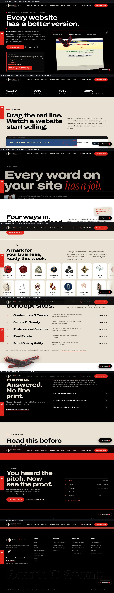
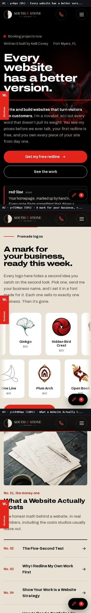

# UI Design System & Master Generation Blueprint: southandstonestudio-com

> **South & Stone Studio · Web Design & Brand Identity** (http://southandstonestudio.com) — Websites written and built by Kelli Covey, a novelist and designer. Custom sites and brand identities for small businesses, with prices p...





---

## 1. Executive Visual Persona & Design Archetype

- **Brand Essence & Persona**: **South & Stone Studio · Web Design & Brand Identity** (`http://southandstonestudio.com`). Websites written and built by Kelli Covey, a novelist and designer. Custom sites and brand identities for small businesses, with prices p...
- **Capture Provenance**: Live browser capture (`tier1_fast`, HTTP `200`, captured `2026-11-24`).
- **Visual Archetype**: **Dark-Substrate WebGL / Canvas Interactive Experience (`#000000` / `#ff9900`)**.
- **Anti-AI-Slop Differentiators**:
  - **Live-Computed Chromatic Polarity**: Anchors the viewport in `#000000` (live computed `body` `background-color` (`computed_styles.json`)) paired with `#ffffff` primary typography and `#ff9900` accents.
  - **Grounded Typographic Hierarchy**: Pairs `Archivo` for display copy (`Every website has a better version.`) with `Geist`.
  - **Calibrated Spatial Grid & Motion**: Combines `1180px` container bounds (`gap: 2px`, padding `14px`) with `cubic-bezier(.65,0,.2,1)` easing and Three.js / WebGL Canvas Pipeline, Swiper Touch Carousel Engine.

---

## 2. Spatial Architecture & Modular Grid Mathematics

### Viewport Allocation & Container Geometry
- **Captured Journey Filmstrips**: Desktop `1280×6624px` (`assets/desktop-journey.webp`, `8` keyframes up to `y=14290px` / doc `15190px`), Mobile `390×2616px` (`assets/mobile-journey.webp`, `3` keyframes).
- **Master Container Bounds**: `1180px` (non-`@media` desktop container stylesheet rule).
- **Canvas Lateral Padding & Spacing**: `14px` lateral canvas padding with `2px` grid gap.
- **Border Radius Scale**: `3px`, `16px`, `8px`, `12px`.

### Responsive Breakpoint Architecture
- **Desktop Layout**: Multi-column CSS Grid / Flexbox layout at `1440px` (`max-width: 1180px`, `gap: 2px`).
- **Mobile Layout**: Single-column vertical stack at `390px` viewport width with `14px` horizontal padding.
- **Extracted CSS Media Queries**: `@media (max-width: 768px)`, `@media only screen and (min-width:768px)`, `@media (min-width:768px)`, `@media (min-width:1200px)`.

---

## 3. Color System, Materiality & Atmospheric Lighting

### Semantic Palette & Source Grounding
| Semantic Role | Ground-Truth Value | Extracted Live / CSS Source |
|---|---|---|
| **Primary Canvas Substrate** | `#000000` | live computed `body` `background-color` (`computed_styles.json`) |
| **Primary Typography Ink** | `#ffffff` | live computed `h1` `color` (`computed_styles.json`) |
| **Elevated Surface / Card Substrate** | `#673de6` | `.hostinger-reach-block-dialog__... { background: #673de6 }` |
| **Interactive Accent / Highlight** | `#ff9900` | `.wp-social-link-amazon { color: #ff9900 }` |
| **Secondary / Muted Copy** | `#7a7a7a` | `var(--e-global-color-text)` in `:root` |
| **Structural Hairline Border** | `#252422` | `var(--sx-line-d)` in `:root` (`rgba(232,225,211,.16)`) |
| **Variable Token (`--edd-blocks-light-grey`)** | `#eeeeee` | `var(--edd-blocks-light-grey)` in `:root` |
| **Variable Token (`--sx-raise`)** | `#121212` | `var(--sx-raise)` in `:root` |
| **Variable Token (`--sx-bone`)** | `#e8e1d3` | `var(--sx-bone)` in `:root` |
| **Variable Token (`--sx-bone-2`)** | `#dcd3c1` | `var(--sx-bone-2)` in `:root` |
| **Variable Token (`--sx-red`)** | `#e1251b` | `var(--sx-red)` in `:root` |
| **Variable Token (`--sx-red-ink`)** | `#b3170f` | `var(--sx-red-ink)` in `:root` |
| **Variable Token (`--sx-red-lit`)** | `#ff5146` | `var(--sx-red-lit)` in `:root` |

### Sanitized Root CSS Variables (`ui-ux.md` Ground Truth)
| Variable Name | Extracted Value | Semantic Role |
|---|---|---|
| `--edd-blocks-light-grey` | `#eee` | Canvas / Surface Token |
| `--wp--style--global--content-size` | `800px` | Layout / Spatial Grid Token |
| `--wp--style--global--wide-size` | `1200px` | Layout / Spatial Grid Token |
| `--wp--style--block-gap` | `24px` | Layout / Spatial Grid Token |
| `--direction-multiplier` | `1` | Design System Custom Token |
| `--page-title-display` | `block` | Design System Custom Token |
| `--sx-serif` | `"Instrument Serif",Georgia,"Times New Roman",serif` | Typography / Scale Token |
| `--sx-hand` | `"Caveat","Segoe Print","Bradley Hand",cursive` | Design System Custom Token |
| `--sx-black` | `#000` | Canvas / Surface Token |
| `--sx-raise` | `#121212` | Color / Atmospheric Token |
| `--sx-bone` | `#E8E1D3` | Color / Atmospheric Token |
| `--sx-bone-2` | `#DCD3C1` | Color / Atmospheric Token |
| `--sx-white` | `#fff` | Canvas / Surface Token |
| `--sx-red` | `#E1251B` | Color / Atmospheric Token |
| `--sx-red-ink` | `#B3170F` | Typography Ink Token |
| `--sx-red-lit` | `#FF5146` | Color / Atmospheric Token |

---

## 4. Typographic Scale & Editorial Hierarchy

### Font Family Stacks
- **Display Typography**: `Archivo`.
- **Primary Body Stack**: `Geist`.
- **Technical / Metadata Stack**: not declared in live computed styles (uses primary stack / `ui-monospace`).

### Typographic Scale & Rules (Live Computed & Stylesheet Grounded)
- **Hero Display (`H1`)**: live computed `h1` (`font-size: 80.64px`, `line-height: 72.576px`, `font-weight: 780`, `letter-spacing: -2.8224px`); CSS variables `--page-title-display: block`, `--display: flex`; rule `h1` (`font-size: clamp(2.7rem,7.6vw,8.2rem)`, `line-height: .92`).
- **Section Heading (`H2`)**: live computed `h2` (`font-size: 106.56px`, `line-height: 101.232px`, `font-weight: 780`, `letter-spacing: -3.7296px`); rule `h2` (`font-size: clamp(1.5rem,2.4vw,2rem)`, `line-height: 1.1`, `letter-spacing: -.02em`, `font-weight: 760`).
- **Body Copy**: live computed `body` (`font-size: 16px`, `line-height: 24px`, `font-weight: 400`); rule `p` (`font-size: 1em`, `line-height: 1.8`).
- **Metadata & Navigation Labels**: live computed `nav/a` (`font-size: 16px`, `line-height: 24px`, `font-weight: 400`); rule `small` (`font-size: .85rem`, `font-weight: 650`).

---

## 5. Choreographed Motion & Interaction Physics

### Primary Easing Curves
- **Extracted Timing Functions**: `cubic-bezier(.65,0,.2,1)`, `cubic-bezier(.7,0,.2,1)`, `cubic-bezier(.3,.6,.2,1)`.

### Per-Element Transition & Choreography Rules
- **Selector `stinger-reach-select-form-modal__...`**: `transition: border-color .2s ease` extracted from `southandstonestudio-com` stylesheet.
- **Selector `a.edd-add-to-cart .edd-add-to-car...`**: `transition: opacity .1s!important` extracted from `southandstonestudio-com` stylesheet.
- **Selector `textarea`**: `transition: all .3s` extracted from `southandstonestudio-com` stylesheet.
- **Extracted Easing Curve (`cubic-bezier(.65,0,.2,1)`)**: Governs interactive state transitions across `<header.sx-head>` and `<section.sx-sec>`.
- **Runtime Interaction Engine**: Integrates Three.js / WebGL Canvas Pipeline, Swiper Touch Carousel Engine with `prefers-reduced-motion: reduce` fallback guards.
### Measured Runtime Scroll & Interaction Telemetry (`behavioral_journey_v2`)
- **Scroll Driver Mode**: `native` (max document height `15190px`, deepest scrollY reached `14290px` across `8` desktop keyframes).
- **Detected Scroll / Motion Libraries**: `WebGL/Canvas`.
- **Nav / Drawer Probe**: Tested trigger `Open the Industries menu` (diff `2.98`, below state-capture threshold).
- **Hover Physics (`primary_cta` · `Services`)**: `color`: `rgb(232, 225, 211)` -> `rgb(255, 255, 255)`; `borderColor`: `rgb(232, 225, 211)` -> `rgb(255, 255, 255)` (`transition-duration: 0.2s`, `timing: ease`).
- **Hover Physics (`first_card` · `www.your-business-name.com Home ·...`)**: Computed transition `0.6s, 0.9s` / `ease, cubic-bezier(0.2, 0.7, 0.1, 1)` (no static color/transform shift captured at rest).
- **Interactive Control Probe (`accordion` · `How long does a project take?`)**: Triggered visual diff `12.252` (attr ` -> `, captured in `assets/state-interactive.webp`).
- **Route Transition Architecture**: First internal navigation (`/services/`) measured as `MPA` in `1755ms`.

---

## 6. Component Wireframe & Structural DOM Map

### Visual Layout Schematic — Desktop (`1440px`, Grounded in `dom.html` & Landmark Bounding Boxes)
```
┌────────────────────────────────────────────────────────────────────────┐
│ DESKTOP VIEWPORT (1440px) — South & Stone Studio · Web Design & Brand  │
│ ====================================================================== │
│ [ <header.sx-head> (1440x76px)        | Services · Portfolio · Indus ] │
│ ---------------------------------------------------------------------- │
│ | HERO STAGE: <section.sx-hero> (w=1440px)                           | │
│ | H1: Every website has a better version.                            | │
│ | Substrate: #000000 | Ink: #ffffff | Accent: #ff9900                | │
│ ---------------------------------------------------------------------- │
│ | SHOWCASE GRID (<section.sx-sec>) max-w: 1180px                     | │
│ | +------------------------------+  +------------------------------+ | │
│ | | Booking projects now Written |  | Try the live demo Holloway H | | │
│ | +------------------------------+  +------------------------------+ | │
│ ---------------------------------------------------------------------- │
│ | DETAIL MODULE (<section.sx-fst-band>) — Websites for contract      | │
│ ---------------------------------------------------------------------- │
│ [ FOOTER (<footer.sx-foot>    ) | http://southandstonestudio.com       │
└────────────────────────────────────────────────────────────────────────┘
```

### Visual Layout Schematic — Mobile Reflow (`390px`)
```
┌────────────────────────────────────────────────────────────────────────┐
│ MOBILE VIEWPORT REFLOW (390px) — Single-Column Stack (gap: 2px)        │
│ ====================================================================== │
│ [ HEADER BAR (<header.sx-head>        ) | Compact Menu (390px)         │
│ ---------------------------------------------------------------------- │
│ | HERO STAGE (<section.sx-hero>) — 390px Vertical Lead               | │
│ | H1: Every website has a better version.                            | │
│ ---------------------------------------------------------------------- │
│ | SHOWCASE STACK (<section.sx-sec>) — 1-Col Stack                    | │
│ | [ Item 1: Booking projects now Written & built by Kelli Co       ] | │
│ | [ Item 2: Try the live demo Holloway Home Repair                 ] | │
│ ---------------------------------------------------------------------- │
│ | DETAIL STACK (<section.sx-fst-band>) — 1-Col (Websites for contr)  | │
│ ---------------------------------------------------------------------- │
│ [ FOOTER (<footer.sx-foot>    ) | Stacked 390px Colophon               │
└────────────────────────────────────────────────────────────────────────┘
```

### Granular DOM Region Breakdown
1. **Brand Header & Navigation Bar (<header.sx-head> — `southandstonestudio-com`)**:
   - Landmark `<header class="sx-head">` (`1440x76px`) hosting `South & Stone Studio · Web Design & ` navigation (`Services · Portfolio · Industries · Estimate Desk · Shop`), DOM attributes (`data-domain="southandstonestudio.com"`, `data-elementor-device-mode="desktop"`, `data-sx-industry`, `data-trade="contractors"`), and stylesheet rule `.hostinger-reach-block-connect__t... { color:1d1e20;font-weight:700;margin-bottom:4px }`.
2. **Hero Stage & Focal Lead (<section.sx-hero> — `Every website has a better version`)**:
   - Landmark `<section class="sx-hero">` presenting display lead `Every website has a better version.` and copy excerpt *"Booking projects now Written & built by Kelli Covey Fort Myers, F"* over `#000000` canvas and `#ffffff` ink.
3. **Primary Showcase & Content Grid (<section.sx-sec> — `Booking projects now Written & bui`)**:
   - Landmark `<section class="sx-sec sx-t-bone">` rendering section `Booking projects now Written & built by Kelli Co` with copy *"Try the live demo Holloway Home Repair"*, asset references (`cdn-reach.hostinger.com`, `js.stripe.com`, `embed`, `south-stone-favicon.png`), and grid rule `hostinger-reach-block-connect__su... { color:727586;margin-bottom:4px }`.
4. **Interactive Detail & Feature Matrix (<section.sx-fst-band> — `Try the live demo Holloway Home Re`)**:
   - Landmark `<section class="sx-fst-band">` framing `Try the live demo Holloway Home Repair` and `Websites for contractors from $1,250` (*"Websites for contractors from $1,250"*) with `#673de6` surface cards, `#ff9900` accents, and `.hostinger-reach-block-connect a { color:rgba(var(--bs-link-color-rgb), var(--bs-link-opacity, 1));text-dec... }`.
5. **Colophon & Global Directory Footer (<footer.sx-foot> — `http://southandstonestudio.com`)**:
   - Landmark `<footer class="sx-foot">` anchoring `South & Stone Studio · Web Desig` footer links (`Services · Portfolio · Industries · Estimate Desk · Shop`), copy *"Eight concept sites see Meridian Contracting"*, and `#252422` structural dividers.
### Full Vertical Scroll Sequence (Desktop `1440×900` Keyframes)
- **Step 01** (`y=0px`, `0%`): Active landmark `Every website has a better version.` · sticky/fixed elements: `3`
- **Step 02** (`y=850px`, `6%`): Active landmark `Drag the red line. Watch a website start selling.` · sticky/fixed elements: `4`
- **Step 03** (`y=3400px`, `24%`): Active landmark `Four ways in. Every one priced.` · sticky/fixed elements: `5`
- **Step 04** (`y=5950px`, `42%`): Active landmark `A mark for your business, ready this week.` · sticky/fixed elements: `4`
- **Step 05** (`y=8500px`, `59%`): Active landmark `Five trades. Forty concept sites.` · sticky/fixed elements: `4`
- **Step 06** (`y=11050px`, `77%`): Active landmark `Asked. Answered. No fine print.` · sticky/fixed elements: `4`
- **Step 07** (`y=13600px`, `95%`): Active landmark `You heard the pitch. Now see the proof.` · sticky/fixed elements: `4`
- **Step 08** (`y=14290px`, `100%`): Active landmark `Studio` · sticky/fixed elements: `3`

### Multi-Page Internal Route Map
- **Listing Route (`/services/`)**: `https://southandstonestudio.com/services/` — H1: `Four services. Zero mystery.`, scrollHeight `12724px`, transition `MPA` (`1755ms`)
- **Detail Route (`/downloads/custom-logo/`)**: `https://southandstonestudio.com/downloads/custom-logo/` — H1: `Custom logo`, scrollHeight `1705px`, transition `direct` (`1077ms`)
- **About Route (`/about/`)**: `https://southandstonestudio.com/about/` — H1: `I write novels. I build websites.`, scrollHeight `8848px`, transition `direct` (`1567ms`)

---

## 7. Master Zero-Shot AI Generation Prompt

```markdown
# Master Zero-Shot Frontend Generation Prompt: southandstonestudio-com (South & Stone Studio · Web Design & Brand Identity)

You are a principal frontend architect and design systems engineer. Build a complete, production-ready web application replicating the exact design system, DOM landmarks, typographic hierarchy, color tokens, and motion physics of `southandstonestudio-com` (**South & Stone Studio · Web Design & Brand Identity** — `http://southandstonestudio.com`).

### 1. Visual Archetype & Anti-AI-Slop Mandates
- **Archetype**: Dark-Substrate WebGL / Canvas Interactive Experience (`#000000` / `#ff9900`).
- **Identity & Domain Context**: Websites written and built by Kelli Covey, a novelist and designer. Custom sites and brand identities for small businesses, with prices p...
- **Primary Substrate**: `#000000` (live computed `body` `background-color` (`computed_styles.json`)), **Primary Ink**: `#ffffff`, **Accent / Highlight**: `#ff9900`.
- **Site-Specific Differentiators**:
  - **Live-Computed Chromatic Polarity**: Anchors the viewport in `#000000` (live computed `body` `background-color` (`computed_styles.json`)) paired with `#ffffff` primary typography and `#ff9900` accents.
  - **Grounded Typographic Hierarchy**: Pairs `Archivo` for display copy (`Every website has a better version.`) with `Geist`.
  - **Calibrated Spatial Grid & Motion**: Combines `1180px` container bounds (`gap: 2px`, padding `14px`) with `cubic-bezier(.65,0,.2,1)` easing and Three.js / WebGL Canvas Pipeline, Swiper Touch Carousel Engine.

### 2. Ground-Truth CSS Variables (`:root` Token Contract)
Declare and consume these exact custom properties extracted from `southandstonestudio-com` in your global stylesheet:

:root {
  /* South & Stone Studio · Web Design & Brand Identity (southandstonestudio-com) — Live-Grounded CSS Variables */
  --edd-blocks-light-grey: #eee; /* Canvas / Surface Token (southandstonestudio-com) */
  --wp--style--global--content-size: 800px; /* Layout / Spatial Grid Token (southandstonestudio-com) */
  --wp--style--global--wide-size: 1200px; /* Layout / Spatial Grid Token (southandstonestudio-com) */
  --wp--style--block-gap: 24px; /* Layout / Spatial Grid Token (southandstonestudio-com) */
  --direction-multiplier: 1; /* Design System Custom Token (southandstonestudio-com) */
  --page-title-display: block; /* Design System Custom Token (southandstonestudio-com) */
  --sx-serif: "Instrument Serif",Georgia,"Times New Roman",serif; /* Typography / Scale Token (southandstonestudio-com) */
  --sx-hand: "Caveat","Segoe Print","Bradley Hand",cursive; /* Design System Custom Token (southandstonestudio-com) */
  --sx-black: #000; /* Canvas / Surface Token (southandstonestudio-com) */
  --sx-raise: #121212; /* Color / Atmospheric Token (southandstonestudio-com) */
  --sx-bone: #E8E1D3; /* Color / Atmospheric Token (southandstonestudio-com) */
  --sx-bone-2: #DCD3C1; /* Color / Atmospheric Token (southandstonestudio-com) */
  --sx-white: #fff; /* Canvas / Surface Token (southandstonestudio-com) */
  --sx-red: #E1251B; /* Color / Atmospheric Token (southandstonestudio-com) */
  --sx-red-ink: #B3170F; /* Typography Ink Token (southandstonestudio-com) */
  --sx-red-lit: #FF5146; /* Color / Atmospheric Token (southandstonestudio-com) */
}

### 3. Semantic Color & Materiality Contract
Map every surface, ink, and border strictly to these source-grounded tokens:
- **Primary Canvas Substrate**: `#000000` — grounded in live computed `body` `background-color` (`computed_styles.json`)
- **Primary Typography Ink**: `#ffffff` — grounded in live computed `h1` `color` (`computed_styles.json`)
- **Elevated Surface / Card Substrate**: `#673de6` — grounded in `.hostinger-reach-block-dialog__... { background: #673de6 }`
- **Interactive Accent / Highlight**: `#ff9900` — grounded in `.wp-social-link-amazon { color: #ff9900 }`
- **Secondary / Muted Copy**: `#7a7a7a` — grounded in `var(--e-global-color-text)` in `:root`
- **Structural Hairline Border**: `#252422` — grounded in `var(--sx-line-d)` in `:root` (`rgba(232,225,211,.16)`)
- **Variable Token (`--edd-blocks-light-grey`)**: `#eeeeee` — grounded in `var(--edd-blocks-light-grey)` in `:root`
- **Variable Token (`--sx-raise`)**: `#121212` — grounded in `var(--sx-raise)` in `:root`
- **Variable Token (`--sx-bone`)**: `#e8e1d3` — grounded in `var(--sx-bone)` in `:root`
- **Variable Token (`--sx-bone-2`)**: `#dcd3c1` — grounded in `var(--sx-bone-2)` in `:root`
- **Variable Token (`--sx-red`)**: `#e1251b` — grounded in `var(--sx-red)` in `:root`
- **Variable Token (`--sx-red-ink`)**: `#b3170f` — grounded in `var(--sx-red-ink)` in `:root`
- **Variable Token (`--sx-red-lit`)**: `#ff5146` — grounded in `var(--sx-red-lit)` in `:root`

### 4. Spatial Grid, Container Bounds & Responsive Breakpoints
- **Desktop Viewport Reference**: `1280×6624px` (multi-frame vertical journey filmstrip (6624px), `1440px` standard desktop width).
- **Mobile Viewport Reference**: `390×2616px` (multi-frame vertical journey filmstrip (2616px), `390px` standard mobile width).
- **Container Max-Width**: `1180px` (non-`@media` desktop container stylesheet rule)
- **Padding & Gutters**: `14px` lateral canvas padding with `2px` grid gap
- **Desktop Grid**: Multi-column CSS Grid / Flexbox layout at `1440px` (`max-width: 1180px`, `gap: 2px`)
- **Mobile Adaptation**: Single-column vertical stack at `390px` viewport width with `14px` horizontal padding
- **Media Queries**: `@media (max-width: 768px)`, `@media only screen and (min-width:768px)`, `@media (min-width:768px)`, `@media (min-width:1200px)`
- **Corner Radii**: `3px`, `16px`, `8px`, `12px`

### 5. Typography & Editorial Scale Contract
- **Display Font Stack**: `Archivo`
- **Body Font Stack**: `Geist`
- **Monospace / Technical Font Stack**: not declared in live computed styles (uses primary stack / `ui-monospace`)
- **H1 Display Rule**: live computed `h1` (`font-size: 80.64px`, `line-height: 72.576px`, `font-weight: 780`, `letter-spacing: -2.8224px`); CSS variables `--page-title-display: block`, `--display: flex`; rule `h1` (`font-size: clamp(2.7rem,7.6vw,8.2rem)`, `line-height: .92`)
- **H2 Section Rule**: live computed `h2` (`font-size: 106.56px`, `line-height: 101.232px`, `font-weight: 780`, `letter-spacing: -3.7296px`); rule `h2` (`font-size: clamp(1.5rem,2.4vw,2rem)`, `line-height: 1.1`, `letter-spacing: -.02em`, `font-weight: 760`)
- **Body Copy Rule**: live computed `body` (`font-size: 16px`, `line-height: 24px`, `font-weight: 400`); rule `p` (`font-size: 1em`, `line-height: 1.8`)
- **Metadata & Index Rule**: live computed `nav/a` (`font-size: 16px`, `line-height: 24px`, `font-weight: 400`); rule `small` (`font-size: .85rem`, `font-weight: 650`)

### 6. Component Hierarchy, Verbatim Copy & Real DOM Landmarks
Scaffold `southandstonestudio-com` (`South & Stone Studio · Web Design & Brand Identity`) with these exact structural regions, extracted copy, and CSS rules from `dom.html`:
1. **Brand Header & Navigation Bar (<header.sx-head> — `southandstonestudio-com`)**:
   - DOM & Selectors: Landmark `<header class="sx-head">` (`1440x76px`) hosting `South & Stone Studio · Web Design & ` navigation (`Services · Portfolio · Industries · Estimate Desk · Shop`), DOM attributes (`data-domain="southandstonestudio.com"`, `data-elementor-device-mode="desktop"`, `data-sx-industry`, `data-trade="contractors"`), and stylesheet rule `.hostinger-reach-block-connect__t... { color:1d1e20;font-weight:700;margin-bottom:4px }`.
   - Responsive Contract: Header `Brand Header & Navigation Bar (<header.sx-head> — `southandstonestudio-com`)` (`southandstonestudio-com`) adapts across `@media (max-width: 768px)`, `@media only screen and (min-width:768px)`, `@media (min-width:768px)`, `@media (min-width:1200px)` with `cubic-bezier(.65,0,.2,1)`, `cubic-bezier(.7,0,.2,1)`, `cubic-bezier(.3,.6,.2,1)` transitions and links `Services · Portfolio · Industries · Estimate Desk · Shop`.
2. **Hero Stage & Focal Lead (<section.sx-hero> — `Every website has a better version`)**:
   - DOM & Selectors: Landmark `<section class="sx-hero">` presenting display lead `Every website has a better version.` and copy excerpt *"Booking projects now Written & built by Kelli Covey Fort Myers, F"* over `#000000` canvas and `#ffffff` ink.
   - Responsive Contract: Hero stage (`1280×6624px` desktop / `390×2616px` mobile) sets `#000000` background with `#ffffff` headline `Every website has a better version.`.
3. **Primary Showcase & Content Grid (<section.sx-sec> — `Booking projects now Written & bui`)**:
   - DOM & Selectors: Landmark `<section class="sx-sec sx-t-bone">` rendering section `Booking projects now Written & built by Kelli Co` with copy *"Try the live demo Holloway Home Repair"*, asset references (`cdn-reach.hostinger.com`, `js.stripe.com`, `embed`, `south-stone-favicon.png`), and grid rule `hostinger-reach-block-connect__su... { color:727586;margin-bottom:4px }`.
   - Responsive Contract: Showcase grid `Primary Showcase & Content Grid (<section.sx-sec> — `Booking projects now Written & bui`)` applies Multi-column CSS Grid / Flexbox layout at `1440px` (`max-width: 1180px`, `gap: 2px`) on desktop and Single-column vertical stack at `390px` viewport width with `14px` horizontal padding on mobile.
4. **Interactive Detail & Feature Matrix (<section.sx-fst-band> — `Try the live demo Holloway Home Re`)**:
   - DOM & Selectors: Landmark `<section class="sx-fst-band">` framing `Try the live demo Holloway Home Repair` and `Websites for contractors from $1,250` (*"Websites for contractors from $1,250"*) with `#673de6` surface cards, `#ff9900` accents, and `.hostinger-reach-block-connect a { color:rgba(var(--bs-link-color-rgb), var(--bs-link-opacity, 1));text-dec... }`.
   - Responsive Contract: Detail module `Interactive Detail & Feature Matrix (<section.sx-fst-band> — `Try the live demo Holloway Home Re`)` uses `3px`, `16px`, `8px`, `12px` radii, `#ff9900` highlights, and assets (cdn-reach.hostinger.com, js.stripe.com, embed).
5. **Colophon & Global Directory Footer (<footer.sx-foot> — `http://southandstonestudio.com`)**:
   - DOM & Selectors: Landmark `<footer class="sx-foot">` anchoring `South & Stone Studio · Web Desig` footer links (`Services · Portfolio · Industries · Estimate Desk · Shop`), copy *"Eight concept sites see Meridian Contracting"*, and `#252422` structural dividers.
   - Responsive Contract: Footer `Colophon & Global Directory Footer (<footer.sx-foot> — `http://southandstonestudio.com`)` aligns to `1180px` (non-`@media` desktop container stylesheet rule) with `14px` lateral canvas padding with `2px` grid gap and attributes (data-domain="southandstonestudio.com", data-elementor-device-mode="desktop", data-sx-industry).

#### Verbatim DOM Copy Excerpts (`dom.html`)
- Copy Excerpt 1: *"Booking projects now Written & built by Kelli Covey Fort Myers, FL"*
- Copy Excerpt 2: *"Try the live demo Holloway Home Repair"*
- Copy Excerpt 3: *"Websites for contractors from $1,250"*
- Copy Excerpt 4: *"Eight concept sites see Meridian Contracting"*

### 7. Motion, Extracted Stylesheet Rules & Interaction Choreography
- **Primary Easing Functions**: `cubic-bezier(.65,0,.2,1)`, `cubic-bezier(.7,0,.2,1)`, `cubic-bezier(.3,.6,.2,1)`
- **Extracted Stylesheet Rules (`southandstonestudio-com`)**:
- `.hostinger-reach-block-connect__t... { color:1d1e20;font-weight:700;margin-bottom:4px }`
- `hostinger-reach-block-connect__su... { color:727586;margin-bottom:4px }`
- `.hostinger-reach-block-connect a { color:rgba(var(--bs-link-color-rgb), var(--bs-link-opacity, 1));text-dec... }`
- `.hostinger-reach-block-dialog__ac... { display:flex;justify-content:flex-start;gap:10px }`
- `er-reach-block-dialog__button_ind... { height:16px;width:16px }`
- **Per-Selector Transition Rules**:
- **Selector `stinger-reach-select-form-modal__...`**: `transition: border-color .2s ease` extracted from `southandstonestudio-com` stylesheet.
- **Selector `a.edd-add-to-cart .edd-add-to-car...`**: `transition: opacity .1s!important` extracted from `southandstonestudio-com` stylesheet.
- **Selector `textarea`**: `transition: all .3s` extracted from `southandstonestudio-com` stylesheet.
- **Extracted Easing Curve (`cubic-bezier(.65,0,.2,1)`)**: Governs interactive state transitions across `<header.sx-head>` and `<section.sx-sec>`.
- **Runtime Interaction Engine**: Integrates Three.js / WebGL Canvas Pipeline, Swiper Touch Carousel Engine with `prefers-reduced-motion: reduce` fallback guards.
### 7b. Full-Page Scroll Choreography, Interactive States & Multi-Page Routes
- **Scroll Mechanics**: Implement `native` vertical progression up to `15190px` across 8 distinct viewport chapters using WebGL/Canvas.
- **Vertical Chapter Sequence**: Every website has a better... (0%) -> Drag the red line. Watch a... (6%) -> Four ways in. Every one pri... (24%) -> A mark for your business, r... (42%) -> Five trades. Forty concept... (59%) -> Asked. Answered. No fine pr... (77%) -> You heard the pitch. Now se... (95%) -> Studio (100%).
- **Hover Micro-Interaction (`primary_cta`)**: Animate `color, borderColor` with `0.2s ease`.
- **Multi-Page Routes**: Scaffold internal routes `/services/` (listing, MPA), `/downloads/custom-logo/` (detail, direct), `/about/` (about, direct) sharing the global header/footer shell and design tokens.

### 8. Technical Deliverables
- Implement in Next.js (App Router) with TypeScript and Tailwind CSS consuming the `:root` custom properties defined above for `southandstonestudio-com`.
- Reproduce both the `1440px` desktop architecture and `390px` mobile breakpoint transitions, preserving semantic HTML5 landmarks (`<header>`, `<nav>`, `<main>`, `<section>`, `<footer>`) and `prefers-reduced-motion` accessibility guards.
```
---

## 8. Full-Page Scroll Journey, Interactive States & Subpage Inventory

### Desktop Scroll Keyframes (`1440×900` WebP)
| Step | Scroll Y | Progress | Active Landmark / Section | Sticky/Fixed | Visual Asset |
| :---: | :---: | :---: | :--- | :---: | :--- |
| `#01` | `0px` | `0%` | Every website has a better version. | `3` | [desktop-step-01.webp](assets/desktop-step-01.webp) |
| `#02` | `850px` | `6%` | Drag the red line. Watch a website start sell... | `4` | [desktop-step-02.webp](assets/desktop-step-02.webp) |
| `#03` | `3400px` | `24%` | Four ways in. Every one priced. | `5` | [desktop-step-03.webp](assets/desktop-step-03.webp) |
| `#04` | `5950px` | `42%` | A mark for your business, ready this week. | `4` | [desktop-step-04.webp](assets/desktop-step-04.webp) |
| `#05` | `8500px` | `59%` | Five trades. Forty concept sites. | `4` | [desktop-step-05.webp](assets/desktop-step-05.webp) |
| `#06` | `11050px` | `77%` | Asked. Answered. No fine print. | `4` | [desktop-step-06.webp](assets/desktop-step-06.webp) |
| `#07` | `13600px` | `95%` | You heard the pitch. Now see the proof. | `4` | [desktop-step-07.webp](assets/desktop-step-07.webp) |
| `#08` | `14290px` | `100%` | Studio | `3` | [desktop-step-08.webp](assets/desktop-step-08.webp) |

### Mobile Condensed Keyframes (`390×844` WebP)
| Step | Scroll Y | Progress | Active Landmark | Visual Asset |
| :---: | :---: | :---: | :--- | :--- |
| `#01` | `0px` | `0%` | Every website has a better version. | [mobile-step-01.webp](assets/mobile-step-01.webp) |
| `#02` | `7200px` | `50%` | A mark for your business, ready this week. | [mobile-step-02.webp](assets/mobile-step-02.webp) |
| `#03` | `14400px` | `100%` | What a Website Actually Costs | [mobile-step-03.webp](assets/mobile-step-03.webp) |

### Interactive UI State Captures (`1440×900` WebP)
| State Type | Trigger / Observation | Visual Asset |
| :--- | :--- | :--- |
| `interactive_control` | Control `accordion` (`How long does a project take?`, diff `12.252`) | [state-interactive.webp](assets/state-interactive.webp) |

### Internal Subpage Filmstrips (`1080px` Wide WebP)
| # | Template | Route URL | H1 / Title | Scroll Height | Transition | Filmstrip Asset |
| :-: | :---: | :--- | :--- | :---: | :---: | :--- |
| `1` | `listing` | `https://southandstonestudio.com/services/` | Four services. Zero mystery. | `12724px` | `MPA` (`1755ms`) | [subpage-01-services.webp](assets/subpage-01-services.webp) |
| `2` | `detail` | `https://southandstonestudio.com/downloads/custom-logo/` | Custom logo | `1705px` | `direct` (`1077ms`) | [subpage-02-downloads-custom-logo.webp](assets/subpage-02-downloads-custom-logo.webp) |
| `3` | `about` | `https://southandstonestudio.com/about/` | I write novels. I build websites. | `8848px` | `direct` (`1567ms`) | [subpage-03-about.webp](assets/subpage-03-about.webp) |

