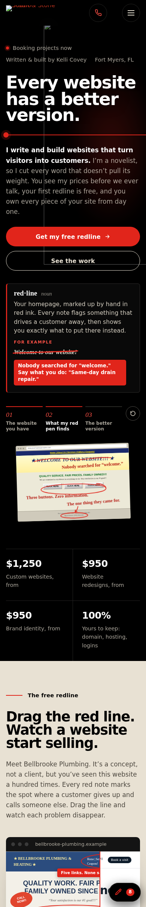

# UI Design System & Master Generation Blueprint: southandstonestudio-com

> **South & Stone Studio · Web Design & Brand Identity** (http://southandstonestudio.com) — Websites written and built by Kelli Covey, a novelist and designer. Custom sites and brand identities for small businesses, with prices p...


---

## 1. Executive Visual Persona & Design Archetype

- **Brand Essence & Persona**: **South & Stone Studio · Web Design & Brand Identity** (`http://southandstonestudio.com`). Websites written and built by Kelli Covey, a novelist and designer. Custom sites and brand identities for small businesses, with prices p...
- **Visual Archetype**: **Light-Gallery WebGL / Canvas Interactive Experience (`#eee` / `#7A7A7A`)**.
- **Anti-AI-Slop Differentiators**:
  - **Source-Grounded Chromatic Polarity**: Anchors the viewport in `#eee` (`var(--edd-blocks-light-grey)` in `:root`) paired with `#000` primary typography and `#7A7A7A` accents.
  - **Extracted Typographic Hierarchy**: Pairs `Archivo` for display copy (`Every website has a better version.`) with `Caveat` and not declared in static CSS (uses primary stack / `ui-monospace`).
  - **Calibrated Spatial Grid & Motion**: Combines `100vw` container bounds (`gap: 20px`, padding `10px`) with `cubic-bezier(.65,0,.2,1)` easing and Three.js / WebGL Canvas Pipeline, Swiper Touch Carousel Engine.

---

## 2. Spatial Architecture & Modular Grid Mathematics



### Viewport Allocation & Container Geometry
- **Captured Viewport Dimensions**: Desktop `1440×15190px` (`assets/desktop.png`, full-page scroll capture), Mobile `390×2400px` (`assets/mobile.png`, capped at 2400px multi-section capture).
- **Master Container Bounds**: `100vw` extracted from `southandstonestudio-com` stylesheet.
- **Canvas Lateral Padding & Spacing**: `10px` lateral canvas padding with `20px` grid gap.
- **Border Radius Scale**: `2px`, `50%`, `4px`, `var(--border-radius)`.

### Responsive Breakpoint Architecture
- **Desktop Layout**: Multi-column CSS Grid / Flexbox layout at `1440px` (`max-width: 100vw`, `gap: 20px`).
- **Mobile Layout**: Single-column vertical stack at `390px` viewport width with `10px` horizontal padding.
- **Extracted CSS Media Queries**: `@media only screen and (min-width:768px)`, `@media (min-width:768px)`, `@media (min-width:1200px)`, `@media (max-width:1024px)`.

---

## 3. Color System, Materiality & Atmospheric Lighting

### Semantic Palette & Source Grounding
| Semantic Role | Ground-Truth Value | Extracted CSS Source / Selector |
|---|---|---|
| **Primary Canvas Substrate** | `#eee` | `var(--edd-blocks-light-grey)` in `:root` |
| **Primary Typography Ink** | `#6EC1E4` | `var(--e-global-color-primary)` in `:root` |
| **Elevated Surface / Card Substrate** | `#54595F` | `var(--e-global-color-secondary)` in `:root` |
| **Interactive Accent / Highlight** | `#7A7A7A` | `var(--e-global-color-text)` in `:root` |
| **Secondary / Muted Copy** | `#61CE70` | `var(--e-global-color-accent)` in `:root` |
| **Structural Hairline Border** | `#000` | `var(--sx-black)` in `:root` |

### Sanitized Root CSS Variables (`ui-ux.md` Ground Truth)
| Variable Name | Extracted Value | Semantic Role |
|---|---|---|
| `--edd-blocks-light-grey` | `#eee` | Canvas / Surface Token |
| `--direction-multiplier` | `1` | Design System Custom Token |
| `--flex-direction` | `initial` | Design System Custom Token |
| `--flex-wrap` | `initial` | Layout / Spatial Grid Token |
| `--justify-content` | `initial` | Design System Custom Token |
| `--align-items` | `initial` | Design System Custom Token |
| `--align-content` | `initial` | Design System Custom Token |
| `--gap` | `initial` | Layout / Spatial Grid Token |
| `--flex-basis` | `initial` | Design System Custom Token |
| `--flex-grow` | `initial` | Design System Custom Token |
| `--flex-shrink` | `initial` | Typography Ink Token |
| `--order` | `initial` | Design System Custom Token |
| `--align-self` | `initial` | Design System Custom Token |
| `--page-title-display` | `block` | Design System Custom Token |
| `--border-radius` | `0` | Elevation / Border Token |
| `--border-top-width` | `0px` | Layout / Spatial Grid Token |

---

## 4. Typographic Scale & Editorial Hierarchy

### Font Family Stacks
- **Display Typography**: `Archivo`.
- **Primary Body Stack**: `Caveat`.
- **Technical / Metadata Stack**: not declared in static CSS (uses primary stack / `ui-monospace`).

### Typographic Scale & Rules (Extracted from Stylesheet & Variables)
- **Hero Display (`H1`)**: CSS variables `--page-title-display: block`, `--display: flex`; rule `h1` (`font-size: clamp(2.7rem,7.6vw,8.2rem)`, `line-height: .92`).
- **Section Heading (`H2`)**: rule `h2` (`font-size: clamp(1.5rem,2.4vw,2rem)`, `line-height: 1.1`, `letter-spacing: -.02em`, `font-weight: 760`).
- **Body Copy**: rule `p` (`font-size: clamp(2rem,5.4vw,5.2rem)`, `line-height: .98`, `letter-spacing: -.035em`, `font-weight: 780`).
- **Metadata & Navigation Labels**: rule `small` (`font-size: .85rem`, `font-weight: 650`).

---

## 5. Choreographed Motion & Interaction Physics

### Primary Easing Curves
- **Extracted Timing Functions**: `cubic-bezier(.65,0,.2,1)`, `cubic-bezier(.7,0,.2,1)`, `cubic-bezier(.3,.6,.2,1)`.

### Per-Element Transition & Choreography Rules
- **Selector `a.edd-add-to-cart .edd-add-to-car...`**: `transition: opacity .1s!important` extracted from `southandstonestudio-com` stylesheet.
- **Selector `entor .elementor-background-video...`**: `transition: opacity 1s` extracted from `southandstonestudio-com` stylesheet.
- **Selector `.elementor-custom-embed-play svg`**: `transition: all .5s` extracted from `southandstonestudio-com` stylesheet.
- **Extracted Easing Curve (`cubic-bezier(.65,0,.2,1)`)**: Governs interactive state transitions across `<header.sx-head>` and `<section.sx-sec>`.
- **Runtime Interaction Engine**: Integrates Three.js / WebGL Canvas Pipeline, Swiper Touch Carousel Engine with `prefers-reduced-motion: reduce` fallback guards.

---

## 6. Component Wireframe & Structural DOM Map

### Visual Layout Schematic (Grounded in `dom.html` — `1440px` Desktop & `390px` Mobile Reflow)
```
┌────────────────────────────────────────────────────────────────────────┐
│ DESKTOP VIEWPORT (1440px) — South & Stone Studio · Web Design & Brand  │
│ ====================================================================== │
│ [ <header.sx-head>         | Services · Portfolio · Industries · Es ]  │
│ ---------------------------------------------------------------------- │
│ | HERO STAGE: <section.sx-hero>                                    |   │
│ | H1: Every website has a better version.                          |   │
│ | Substrate: #eee       | Ink: #000       | Accent: #7A7A7A        |   │
│ ---------------------------------------------------------------------- │
│ | SHOWCASE GRID (<section.sx-sec>          ) max-w: 100vw          |   │
│ | +------------------------------+  +------------------------------+ | │
│ | | Drag the red line. Watch a w |  | Can a customer find your pho | | │
│ | +------------------------------+  +------------------------------+ | │
│ ---------------------------------------------------------------------- │
│ | MOBILE VIEWPORT REFLOW (390px) — Single-Column Stack (gap: 20px  ) | │
│ | [<header.sx-head>] -> [<section.sx-hero>] -> [<section.sx-sec>] |    │
│ ---------------------------------------------------------------------- │
│ [ FOOTER (<footer.sx-foot>      ) | http://southandstonestudio.com     │
└────────────────────────────────────────────────────────────────────────┘
```

### Granular DOM Region Breakdown
1. **Brand Header & Navigation Bar (<header.sx-head> — `southandstonestudio-com`)**:
   - Landmark `<header class="sx-head">` hosting `South & Stone Studio · Web Design & ` navigation (`Services · Portfolio · Industries · Estimate Desk · Shop`), DOM attributes (`data-domain="southandstonestudio.com"`, `data-elementor-device-mode="desktop"`, `data-sx-industry`, `data-trade="contractors"`), and stylesheet rule `.elementor .e-div-block-base { min-width:30px;padding:10px;display:block; }`.
2. **Hero Stage & Focal Lead (<section.sx-hero> — `Every website has a better version`)**:
   - Landmark `<section class="sx-hero">` presenting display lead `Every website has a better version.` and copy excerpt *"Get a free redline"* over `#eee` canvas and `#000` ink.
3. **Primary Showcase & Content Grid (<section.sx-sec> — `Drag the red line. Watch a website`)**:
   - Landmark `<section class="sx-sec sx-t-bone">` rendering section `Drag the red line. Watch a website start selling.` with copy *"Live Try the live demo Holloway Home Repair"*, asset references (`cdn-reach.hostinger.com`, `js.stripe.com`, `embed`, `south-stone-favicon.png`), and grid rule `.elementor .e-flexbox-base { padding:10px;display:flex;flex-direction:row; }`.
4. **Interactive Detail & Feature Matrix (<section.sx-fst-band> — `Can a customer find your phone num`)**:
   - Landmark `<section class="sx-fst-band">` framing `Can a customer find your phone number in five sec...` and `Four ways in. Every one priced.` (*"Try the live demo Holloway Home Repair"*) with `#54595F` surface cards, `#7A7A7A` accents, and `.elementor .e-tabs-base { padding-block-start:0px;display:flex;flex-direction:column;gap:30px; }`.
5. **Colophon & Global Directory Footer (<footer.sx-foot> — `http://southandstonestudio.com`)**:
   - Landmark `<footer class="sx-foot">` anchoring `South & Stone Studio · Web Desig` footer links (`Services · Portfolio · Industries · Estimate Desk · Shop`), copy *"Websites for contractors from $1,250"*, and `#000` structural dividers.

---

## 7. Master Zero-Shot AI Generation Prompt

```markdown
# Master Zero-Shot Frontend Generation Prompt: southandstonestudio-com (South & Stone Studio · Web Design & Brand Identity)

You are a principal frontend architect and design systems engineer. Build a complete, production-ready web application replicating the exact design system, DOM landmarks, typographic hierarchy, color tokens, and motion physics of `southandstonestudio-com` (**South & Stone Studio · Web Design & Brand Identity** — `http://southandstonestudio.com`).

### 1. Visual Archetype & Anti-AI-Slop Mandates
- **Archetype**: Light-Gallery WebGL / Canvas Interactive Experience (`#eee` / `#7A7A7A`).
- **Identity & Domain Context**: Websites written and built by Kelli Covey, a novelist and designer. Custom sites and brand identities for small businesses, with prices p...
- **Primary Substrate**: `#eee` (`var(--edd-blocks-light-grey)` in `:root`), **Primary Ink**: `#000`, **Accent / Highlight**: `#7A7A7A`.
- **Site-Specific Differentiators**:
  - **Source-Grounded Chromatic Polarity**: Anchors the viewport in `#eee` (`var(--edd-blocks-light-grey)` in `:root`) paired with `#000` primary typography and `#7A7A7A` accents.
  - **Extracted Typographic Hierarchy**: Pairs `Archivo` for display copy (`Every website has a better version.`) with `Caveat` and not declared in static CSS (uses primary stack / `ui-monospace`).
  - **Calibrated Spatial Grid & Motion**: Combines `100vw` container bounds (`gap: 20px`, padding `10px`) with `cubic-bezier(.65,0,.2,1)` easing and Three.js / WebGL Canvas Pipeline, Swiper Touch Carousel Engine.

### 2. Ground-Truth CSS Variables (`:root` Token Contract)
Declare and consume these exact custom properties extracted from `southandstonestudio-com` in your global stylesheet:

:root {
  /* South & Stone Studio · Web Design & Brand Identity (southandstonestudio-com) — Ground-Truth Extracted CSS Variables */
  --edd-blocks-light-grey: #eee; /* Canvas / Surface Token (southandstonestudio-com) */
  --direction-multiplier: 1; /* Design System Custom Token (southandstonestudio-com) */
  --flex-direction: initial; /* Design System Custom Token (southandstonestudio-com) */
  --flex-wrap: initial; /* Layout / Spatial Grid Token (southandstonestudio-com) */
  --justify-content: initial; /* Design System Custom Token (southandstonestudio-com) */
  --align-items: initial; /* Design System Custom Token (southandstonestudio-com) */
  --align-content: initial; /* Design System Custom Token (southandstonestudio-com) */
  --gap: initial; /* Layout / Spatial Grid Token (southandstonestudio-com) */
  --flex-basis: initial; /* Design System Custom Token (southandstonestudio-com) */
  --flex-grow: initial; /* Design System Custom Token (southandstonestudio-com) */
  --flex-shrink: initial; /* Typography Ink Token (southandstonestudio-com) */
  --order: initial; /* Design System Custom Token (southandstonestudio-com) */
  --align-self: initial; /* Design System Custom Token (southandstonestudio-com) */
  --page-title-display: block; /* Design System Custom Token (southandstonestudio-com) */
  --border-radius: 0; /* Elevation / Border Token (southandstonestudio-com) */
  --border-top-width: 0px; /* Layout / Spatial Grid Token (southandstonestudio-com) */
}

### 3. Semantic Color & Materiality Contract
Map every surface, ink, and border strictly to these source-grounded tokens:
- **Primary Canvas Substrate**: `#eee` — grounded in `var(--edd-blocks-light-grey)` in `:root`
- **Primary Typography Ink**: `#6EC1E4` — grounded in `var(--e-global-color-primary)` in `:root`
- **Elevated Surface / Card Substrate**: `#54595F` — grounded in `var(--e-global-color-secondary)` in `:root`
- **Interactive Accent / Highlight**: `#7A7A7A` — grounded in `var(--e-global-color-text)` in `:root`
- **Secondary / Muted Copy**: `#61CE70` — grounded in `var(--e-global-color-accent)` in `:root`
- **Structural Hairline Border**: `#000` — grounded in `var(--sx-black)` in `:root`

### 4. Spatial Grid, Container Bounds & Responsive Breakpoints
- **Desktop Viewport Reference**: `1440×15190px` (full-page scroll capture, `1440px` standard desktop width).
- **Mobile Viewport Reference**: `390×2400px` (capped at 2400px multi-section capture, `390px` standard mobile width).
- **Container Max-Width**: `100vw` extracted from `southandstonestudio-com` stylesheet
- **Padding & Gutters**: `10px` lateral canvas padding with `20px` grid gap
- **Desktop Grid**: Multi-column CSS Grid / Flexbox layout at `1440px` (`max-width: 100vw`, `gap: 20px`)
- **Mobile Adaptation**: Single-column vertical stack at `390px` viewport width with `10px` horizontal padding
- **Media Queries**: `@media only screen and (min-width:768px)`, `@media (min-width:768px)`, `@media (min-width:1200px)`, `@media (max-width:1024px)`
- **Corner Radii**: `2px`, `50%`, `4px`, `var(--border-radius)`

### 5. Typography & Editorial Scale Contract
- **Display Font Stack**: `Archivo`
- **Body Font Stack**: `Caveat`
- **Monospace / Technical Font Stack**: not declared in static CSS (uses primary stack / `ui-monospace`)
- **H1 Display Rule**: CSS variables `--page-title-display: block`, `--display: flex`; rule `h1` (`font-size: clamp(2.7rem,7.6vw,8.2rem)`, `line-height: .92`)
- **H2 Section Rule**: rule `h2` (`font-size: clamp(1.5rem,2.4vw,2rem)`, `line-height: 1.1`, `letter-spacing: -.02em`, `font-weight: 760`)
- **Body Copy Rule**: rule `p` (`font-size: clamp(2rem,5.4vw,5.2rem)`, `line-height: .98`, `letter-spacing: -.035em`, `font-weight: 780`)
- **Metadata & Index Rule**: rule `small` (`font-size: .85rem`, `font-weight: 650`)

### 6. Component Hierarchy, Verbatim Copy & Real DOM Landmarks
Scaffold `southandstonestudio-com` (`South & Stone Studio · Web Design & Brand Identity`) with these exact structural regions, extracted copy, and CSS rules from `dom.html`:
1. **Brand Header & Navigation Bar (<header.sx-head> — `southandstonestudio-com`)**:
   - DOM & Selectors: Landmark `<header class="sx-head">` hosting `South & Stone Studio · Web Design & ` navigation (`Services · Portfolio · Industries · Estimate Desk · Shop`), DOM attributes (`data-domain="southandstonestudio.com"`, `data-elementor-device-mode="desktop"`, `data-sx-industry`, `data-trade="contractors"`), and stylesheet rule `.elementor .e-div-block-base { min-width:30px;padding:10px;display:block; }`.
   - Responsive Contract: Header `Brand Header & Navigation Bar (<header.sx-head> — `southandstonestudio-com`)` (`southandstonestudio-com`) adapts across `@media only screen and (min-width:768px)`, `@media (min-width:768px)`, `@media (min-width:1200px)`, `@media (max-width:1024px)` with `cubic-bezier(.65,0,.2,1)`, `cubic-bezier(.7,0,.2,1)`, `cubic-bezier(.3,.6,.2,1)` transitions and links `Services · Portfolio · Industries · Estimate Desk · Shop`.
2. **Hero Stage & Focal Lead (<section.sx-hero> — `Every website has a better version`)**:
   - DOM & Selectors: Landmark `<section class="sx-hero">` presenting display lead `Every website has a better version.` and copy excerpt *"Get a free redline"* over `#eee` canvas and `#000` ink.
   - Responsive Contract: Hero stage (`1440×15190px` desktop / `390×2400px` mobile) sets `#eee` background with `#000` headline `Every website has a better version.`.
3. **Primary Showcase & Content Grid (<section.sx-sec> — `Drag the red line. Watch a website`)**:
   - DOM & Selectors: Landmark `<section class="sx-sec sx-t-bone">` rendering section `Drag the red line. Watch a website start selling.` with copy *"Live Try the live demo Holloway Home Repair"*, asset references (`cdn-reach.hostinger.com`, `js.stripe.com`, `embed`, `south-stone-favicon.png`), and grid rule `.elementor .e-flexbox-base { padding:10px;display:flex;flex-direction:row; }`.
   - Responsive Contract: Showcase grid `Primary Showcase & Content Grid (<section.sx-sec> — `Drag the red line. Watch a website`)` applies Multi-column CSS Grid / Flexbox layout at `1440px` (`max-width: 100vw`, `gap: 20px`) on desktop and Single-column vertical stack at `390px` viewport width with `10px` horizontal padding on mobile.
4. **Interactive Detail & Feature Matrix (<section.sx-fst-band> — `Can a customer find your phone num`)**:
   - DOM & Selectors: Landmark `<section class="sx-fst-band">` framing `Can a customer find your phone number in five sec...` and `Four ways in. Every one priced.` (*"Try the live demo Holloway Home Repair"*) with `#54595F` surface cards, `#7A7A7A` accents, and `.elementor .e-tabs-base { padding-block-start:0px;display:flex;flex-direction:column;gap:30px; }`.
   - Responsive Contract: Detail module `Interactive Detail & Feature Matrix (<section.sx-fst-band> — `Can a customer find your phone num`)` uses `2px`, `50%`, `4px`, `var(--border-radius)` radii, `#7A7A7A` highlights, and assets (cdn-reach.hostinger.com, js.stripe.com, embed).
5. **Colophon & Global Directory Footer (<footer.sx-foot> — `http://southandstonestudio.com`)**:
   - DOM & Selectors: Landmark `<footer class="sx-foot">` anchoring `South & Stone Studio · Web Desig` footer links (`Services · Portfolio · Industries · Estimate Desk · Shop`), copy *"Websites for contractors from $1,250"*, and `#000` structural dividers.
   - Responsive Contract: Footer `Colophon & Global Directory Footer (<footer.sx-foot> — `http://southandstonestudio.com`)` aligns to `100vw` extracted from `southandstonestudio-com` stylesheet with `10px` lateral canvas padding with `20px` grid gap and attributes (data-domain="southandstonestudio.com", data-elementor-device-mode="desktop", data-sx-industry).

#### Verbatim DOM Copy Excerpts (`dom.html`)
- Copy Excerpt 1: *"Get a free redline"*
- Copy Excerpt 2: *"Live Try the live demo Holloway Home Repair"*
- Copy Excerpt 3: *"Try the live demo Holloway Home Repair"*
- Copy Excerpt 4: *"Websites for contractors from $1,250"*

### 7. Motion, Extracted Stylesheet Rules & Interaction Choreography
- **Primary Easing Functions**: `cubic-bezier(.65,0,.2,1)`, `cubic-bezier(.7,0,.2,1)`, `cubic-bezier(.3,.6,.2,1)`
- **Extracted Stylesheet Rules (`southandstonestudio-com`)**:
- `.elementor .e-div-block-base { min-width:30px;padding:10px;display:block; }`
- `.elementor .e-flexbox-base { padding:10px;display:flex;flex-direction:row; }`
- `.elementor .e-tabs-base { padding-block-start:0px;display:flex;flex-direction:column;gap:30px; }`
- `.elementor .e-tabs-menu-base { display:flex;justify-content:center; }`
- `.elementor .e-tab-base.e--selected { border-color:0C0D0E;outline-width:0px; }`
- **Per-Selector Transition Rules**:
- **Selector `a.edd-add-to-cart .edd-add-to-car...`**: `transition: opacity .1s!important` extracted from `southandstonestudio-com` stylesheet.
- **Selector `entor .elementor-background-video...`**: `transition: opacity 1s` extracted from `southandstonestudio-com` stylesheet.
- **Selector `.elementor-custom-embed-play svg`**: `transition: all .5s` extracted from `southandstonestudio-com` stylesheet.
- **Extracted Easing Curve (`cubic-bezier(.65,0,.2,1)`)**: Governs interactive state transitions across `<header.sx-head>` and `<section.sx-sec>`.
- **Runtime Interaction Engine**: Integrates Three.js / WebGL Canvas Pipeline, Swiper Touch Carousel Engine with `prefers-reduced-motion: reduce` fallback guards.

### 8. Technical Deliverables
- Implement in Next.js (App Router) with TypeScript and Tailwind CSS consuming the `:root` custom properties defined above for `southandstonestudio-com`.
- Reproduce both the `1440px` desktop architecture and `390px` mobile breakpoint transitions, preserving semantic HTML5 landmarks (`<header>`, `<nav>`, `<main>`, `<section>`, `<footer>`) and `prefers-reduced-motion` accessibility guards.
```
