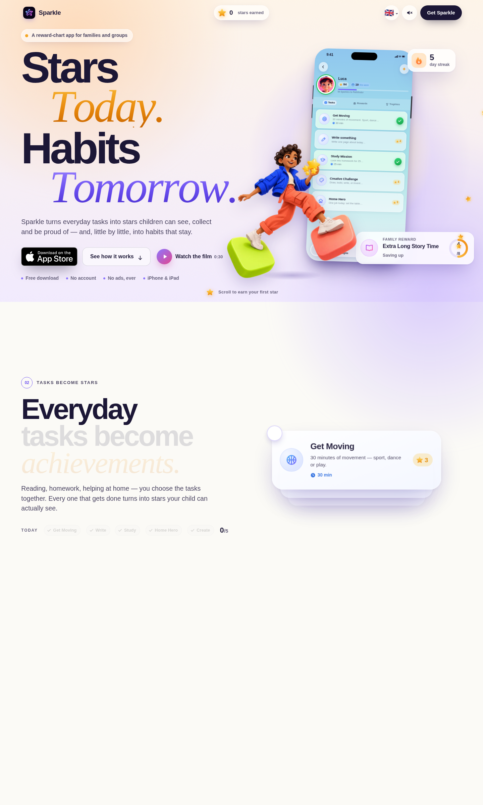
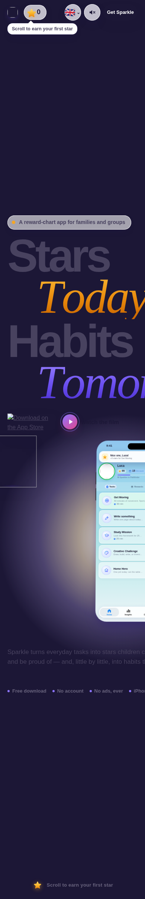

# UI Design System & Master Generation Blueprint: sparkle-ankatms-com

> **Kids Reward Chart & Chore App · Sparkle** (https://sparkle.ankatms.com) — Organize tasks, earn stars and choose rewards together. Sparkle is a private reward-chart app for families and groups on iPhone and iPad....



---

## 1. Executive Visual Persona & Design Archetype

- **Brand Essence & Persona**: **Kids Reward Chart & Chore App · Sparkle** (`https://sparkle.ankatms.com`). Organize tasks, earn stars and choose rewards together. Sparkle is a private reward-chart app for families and groups on iPhone and iPad....
- **Visual Archetype**: **Dark-Substrate WebGL / Canvas Interactive Experience (`#1c1736` / `#fbfaf6`)**.
- **Anti-AI-Slop Differentiators**:
  - **Source-Grounded Chromatic Polarity**: Anchors the viewport in `#1c1736` (`var(--ink)` in `:root`) paired with `#fbfaf6` primary typography and `#fbfaf6` accents.
  - **Extracted Typographic Hierarchy**: Pairs `Apple Color Emoji` for display copy (`S t a r s T o d a y . H a b i t s T `) with `Hiragino Sans` and not declared in static CSS (uses primary stack / `ui-monospace`).
  - **Calibrated Spatial Grid & Motion**: Combines `65ch` container bounds (`gap: .7rem`, padding `1.5rem`) with `cubic-bezier(0.16,1,0.3,1)` easing and Three.js / WebGL Canvas Pipeline.

---

## 2. Spatial Architecture & Modular Grid Mathematics



### Viewport Allocation & Container Geometry
- **Captured Viewport Dimensions**: Desktop `1440×25386px` (`assets/desktop.png`, full-page scroll capture), Mobile `390×2400px` (`assets/mobile.png`, capped at 2400px multi-section capture).
- **Master Container Bounds**: `65ch` extracted from `sparkle-ankatms-com` stylesheet.
- **Canvas Lateral Padding & Spacing**: `1.5rem` lateral canvas padding with `.7rem` grid gap.
- **Border Radius Scale**: `10px`, `100px`, `32px`, `24px`.

### Responsive Breakpoint Architecture
- **Desktop Layout**: Multi-column CSS Grid / Flexbox layout at `1440px` (`max-width: 65ch`, `gap: .7rem`).
- **Mobile Layout**: Single-column vertical stack at `390px` viewport width with `1.5rem` horizontal padding.
- **Extracted CSS Media Queries**: `@media (max-width:760px)`, `@media (prefers-reduced-motion:reduce)`, `@media (max-width: 1180px)`, `@media (max-width: 959px)`.

---

## 3. Color System, Materiality & Atmospheric Lighting

### Semantic Palette & Source Grounding
| Semantic Role | Ground-Truth Value | Extracted CSS Source / Selector |
|---|---|---|
| **Primary Canvas Substrate** | `#1c1736` | `var(--ink)` in `:root` |
| **Primary Typography Ink** | `#48425f` | `var(--ink-2)` in `:root` |
| **Elevated Surface / Card Substrate** | `#68637d` | `var(--ink-3)` in `:root` |
| **Interactive Accent / Highlight** | `#fbfaf6` | `var(--paper)` in `:root` |
| **Secondary / Muted Copy** | `#6b4ff0` | `var(--violet)` in `:root` |
| **Structural Hairline Border** | `#8d75ff` | `var(--violet-2)` in `:root` |
| **Variable Token (`--gold`)** | `#f5a623` | `var(--gold)` in `:root` |
| **Variable Token (`--gold-2`)** | `#ffcf4a` | `var(--gold-2)` in `:root` |
| **Variable Token (`--amber-ink`)** | `#b85f00` | `var(--amber-ink)` in `:root` |
| **Variable Token (`--rose`)** | `#e2478f` | `var(--rose)` in `:root` |
| **Variable Token (`--mint`)** | `#22c55e` | `var(--mint)` in `:root` |
| **Variable Token (`--night-ink`)** | `#f5f2ff` | `var(--night-ink)` in `:root` |

### Sanitized Root CSS Variables (`ui-ux.md` Ground Truth)
| Variable Name | Extracted Value | Semantic Role |
|---|---|---|
| `--ink` | `#1c1736` | Typography Ink Token |
| `--ink-2` | `#48425f` | Typography Ink Token |
| `--ink-3` | `#68637d` | Typography Ink Token |
| `--paper` | `#fbfaf6` | Canvas / Surface Token |
| `--violet` | `#6b4ff0` | Color / Atmospheric Token |
| `--violet-2` | `#8d75ff` | Color / Atmospheric Token |
| `--gold` | `#f5a623` | Color / Atmospheric Token |
| `--gold-2` | `#ffcf4a` | Color / Atmospheric Token |
| `--amber-ink` | `#b85f00` | Typography Ink Token |
| `--rose` | `#e2478f` | Color / Atmospheric Token |
| `--mint` | `#22c55e` | Color / Atmospheric Token |
| `--night-ink` | `#f5f2ff` | Typography Ink Token |
| `--sky-top` | `rgb(255 247 236)` | Color / Atmospheric Token |
| `--sky-bottom` | `rgb(244 238 255)` | Color / Atmospheric Token |
| `--glow-a` | `rgb(255 214 168 / 0.6)` | Color / Atmospheric Token |
| `--glow-b` | `rgb(203 184 255 / 0.6)` | Color / Atmospheric Token |

---

## 4. Typographic Scale & Editorial Hierarchy

### Font Family Stacks
- **Display Typography**: `Apple Color Emoji`.
- **Primary Body Stack**: `Hiragino Sans`.
- **Technical / Metadata Stack**: not declared in static CSS (uses primary stack / `ui-monospace`).

### Typographic Scale & Rules (Extracted from Stylesheet & Variables)
- **Hero Display (`H1`)**: rule `h1` (`font-size: clamp(2.3rem,4.5vw,4rem)`, `line-height: 1.15`, `letter-spacing: -.035em`).
- **Section Heading (`H2`)**: rule `h2` (`font-size: clamp(1.6rem,3vw,2.3rem)`, `line-height: 1.3`, `letter-spacing: -.025em`).
- **Body Copy**: rule `p` (`font-size: .9rem`).
- **Metadata & Navigation Labels**: rule `small` (`font-size: 13px`, `font-weight: 650`).

---

## 5. Choreographed Motion & Interaction Physics

### Primary Easing Curves
- **Extracted Timing Functions**: `cubic-bezier(0.16,1,0.3,1)`, `cubic-bezier(0.2,1.45,0.35,1)`, `cubic-bezier(0.25,1.25,0.4,1)`.

### Per-Element Transition & Choreography Rules
- **Selector `.skip-link`**: `transition: transform 0.2s ease` extracted from `sparkle-ankatms-com` stylesheet.
- **Selector `.nav::before`**: `transition: opacity 0.4s ease` extracted from `sparkle-ankatms-com` stylesheet.
- **Selector `.nav__brand`**: `transition: background-color 0.4s ease, box-shadow 0.4s ease, color 0.4s ease` extracted from `sparkle-ankatms-com` stylesheet.
- **Extracted Easing Curve (`cubic-bezier(0.16,1,0.3,1)`)**: Governs interactive state transitions across `<header.nav>` and `<section.scene>`.
- **Runtime Interaction Engine**: Integrates Three.js / WebGL Canvas Pipeline with `prefers-reduced-motion: reduce` fallback guards.

---

## 6. Component Wireframe & Structural DOM Map

### Visual Layout Schematic (Grounded in `dom.html` — `1440px` Desktop & `390px` Mobile Reflow)
```
┌────────────────────────────────────────────────────────────────────────┐
│ DESKTOP VIEWPORT (1440px) — Kids Reward Chart & Chore App · Sparkle    │
│ ====================================================================== │
│ [ <header.nav>             | English · Deutsch · Español · Français ]  │
│ ---------------------------------------------------------------------- │
│ | HERO STAGE: <section.hero>                                       |   │
│ | H1: S t a r s T o d a y . H a b i t s T o m o r r o w .          |   │
│ | Substrate: #1c1736    | Ink: #fbfaf6    | Accent: #fbfaf6        |   │
│ ---------------------------------------------------------------------- │
│ | SHOWCASE GRID (<section.scene>           ) max-w: 65ch           |   │
│ | +------------------------------+  +------------------------------+ | │
│ | | Everyday tasks become achiev |  | Get Moving                   | | │
│ | +------------------------------+  +------------------------------+ | │
│ ---------------------------------------------------------------------- │
│ | MOBILE VIEWPORT REFLOW (390px) — Single-Column Stack (gap: .7rem ) | │
│ | [<header.nav>] -> [<section.hero>] -> [<section.scene>] |            │
│ ---------------------------------------------------------------------- │
│ [ FOOTER (<footer.foot>         ) | https://sparkle.ankatms.com        │
└────────────────────────────────────────────────────────────────────────┘
```

### Granular DOM Region Breakdown
1. **Brand Header & Navigation Bar (<header.nav> — `sparkle-ankatms-com`)**:
   - Landmark `<header class="nav">` hosting `Kids Reward Chart & Chore App · Spar` navigation (`English · Deutsch · Español · Français · Türkçe`), DOM attributes (`data-nav`, `data-logo`, `data-hud`, `data-hud-count`), and stylesheet rule `.search-languages a { color:inherit;text-decoration:underline;text-underline-offset:.2em }`.
2. **Hero Stage & Focal Lead (<section.hero> — `S t a r s T o d a y . H a b i t s `)**:
   - Landmark `<section class="hero">` presenting display lead `S t a r s T o d a y . H a b i t s T o m o r r o w .` and copy excerpt *"Scroll to earn your first star"* over `#1c1736` canvas and `#fbfaf6` ink.
3. **Primary Showcase & Content Grid (<section.scene> — `Everyday tasks become achievements`)**:
   - Landmark `<section class="scene scene--tasks">` rendering section `Everyday tasks become achievements.` with copy *"🇧🇷 Português (Brasil)"*, asset references (`favicon-32.png`, `apple-touch-icon.png`, `avatar-luca.jpg`, `sparkle-story.css`), and grid rule `.search-page img { display:block;max-width:100%;height:auto }`.
4. **Interactive Detail & Feature Matrix (<article.tcard> — `Get Moving`)**:
   - Landmark `<article class="tcard">` framing `Get Moving` and `Write something` (*"Português (Brasil)"*) with `#68637d` surface cards, `#fbfaf6` accents, and `.search-page a { color:4c3fba;text-underline-offset:.2em }`.
5. **Colophon & Global Directory Footer (<footer.foot> — `https://sparkle.ankatms.com`)**:
   - Landmark `<footer class="foot">` anchoring `Kids Reward Chart & Chore App · ` footer links (`English · Deutsch · Español · Français · Türkçe`), copy *"A reward-chart app for families and groups"*, and `#8d75ff` structural dividers.

---

## 7. Master Zero-Shot AI Generation Prompt

```markdown
# Master Zero-Shot Frontend Generation Prompt: sparkle-ankatms-com (Kids Reward Chart & Chore App · Sparkle)

You are a principal frontend architect and design systems engineer. Build a complete, production-ready web application replicating the exact design system, DOM landmarks, typographic hierarchy, color tokens, and motion physics of `sparkle-ankatms-com` (**Kids Reward Chart & Chore App · Sparkle** — `https://sparkle.ankatms.com`).

### 1. Visual Archetype & Anti-AI-Slop Mandates
- **Archetype**: Dark-Substrate WebGL / Canvas Interactive Experience (`#1c1736` / `#fbfaf6`).
- **Identity & Domain Context**: Organize tasks, earn stars and choose rewards together. Sparkle is a private reward-chart app for families and groups on iPhone and iPad....
- **Primary Substrate**: `#1c1736` (`var(--ink)` in `:root`), **Primary Ink**: `#fbfaf6`, **Accent / Highlight**: `#fbfaf6`.
- **Site-Specific Differentiators**:
  - **Source-Grounded Chromatic Polarity**: Anchors the viewport in `#1c1736` (`var(--ink)` in `:root`) paired with `#fbfaf6` primary typography and `#fbfaf6` accents.
  - **Extracted Typographic Hierarchy**: Pairs `Apple Color Emoji` for display copy (`S t a r s T o d a y . H a b i t s T `) with `Hiragino Sans` and not declared in static CSS (uses primary stack / `ui-monospace`).
  - **Calibrated Spatial Grid & Motion**: Combines `65ch` container bounds (`gap: .7rem`, padding `1.5rem`) with `cubic-bezier(0.16,1,0.3,1)` easing and Three.js / WebGL Canvas Pipeline.

### 2. Ground-Truth CSS Variables (`:root` Token Contract)
Declare and consume these exact custom properties extracted from `sparkle-ankatms-com` in your global stylesheet:

:root {
  /* Kids Reward Chart & Chore App · Sparkle (sparkle-ankatms-com) — Ground-Truth Extracted CSS Variables */
  --ink: #1c1736; /* Typography Ink Token (sparkle-ankatms-com) */
  --ink-2: #48425f; /* Typography Ink Token (sparkle-ankatms-com) */
  --ink-3: #68637d; /* Typography Ink Token (sparkle-ankatms-com) */
  --paper: #fbfaf6; /* Canvas / Surface Token (sparkle-ankatms-com) */
  --violet: #6b4ff0; /* Color / Atmospheric Token (sparkle-ankatms-com) */
  --violet-2: #8d75ff; /* Color / Atmospheric Token (sparkle-ankatms-com) */
  --gold: #f5a623; /* Color / Atmospheric Token (sparkle-ankatms-com) */
  --gold-2: #ffcf4a; /* Color / Atmospheric Token (sparkle-ankatms-com) */
  --amber-ink: #b85f00; /* Typography Ink Token (sparkle-ankatms-com) */
  --rose: #e2478f; /* Color / Atmospheric Token (sparkle-ankatms-com) */
  --mint: #22c55e; /* Color / Atmospheric Token (sparkle-ankatms-com) */
  --night-ink: #f5f2ff; /* Typography Ink Token (sparkle-ankatms-com) */
  --sky-top: rgb(255 247 236); /* Color / Atmospheric Token (sparkle-ankatms-com) */
  --sky-bottom: rgb(244 238 255); /* Color / Atmospheric Token (sparkle-ankatms-com) */
  --glow-a: rgb(255 214 168 / 0.6); /* Color / Atmospheric Token (sparkle-ankatms-com) */
  --glow-b: rgb(203 184 255 / 0.6); /* Color / Atmospheric Token (sparkle-ankatms-com) */
}

### 3. Semantic Color & Materiality Contract
Map every surface, ink, and border strictly to these source-grounded tokens:
- **Primary Canvas Substrate**: `#1c1736` — grounded in `var(--ink)` in `:root`
- **Primary Typography Ink**: `#48425f` — grounded in `var(--ink-2)` in `:root`
- **Elevated Surface / Card Substrate**: `#68637d` — grounded in `var(--ink-3)` in `:root`
- **Interactive Accent / Highlight**: `#fbfaf6` — grounded in `var(--paper)` in `:root`
- **Secondary / Muted Copy**: `#6b4ff0` — grounded in `var(--violet)` in `:root`
- **Structural Hairline Border**: `#8d75ff` — grounded in `var(--violet-2)` in `:root`
- **Variable Token (`--gold`)**: `#f5a623` — grounded in `var(--gold)` in `:root`
- **Variable Token (`--gold-2`)**: `#ffcf4a` — grounded in `var(--gold-2)` in `:root`
- **Variable Token (`--amber-ink`)**: `#b85f00` — grounded in `var(--amber-ink)` in `:root`
- **Variable Token (`--rose`)**: `#e2478f` — grounded in `var(--rose)` in `:root`
- **Variable Token (`--mint`)**: `#22c55e` — grounded in `var(--mint)` in `:root`
- **Variable Token (`--night-ink`)**: `#f5f2ff` — grounded in `var(--night-ink)` in `:root`

### 4. Spatial Grid, Container Bounds & Responsive Breakpoints
- **Desktop Viewport Reference**: `1440×25386px` (full-page scroll capture, `1440px` standard desktop width).
- **Mobile Viewport Reference**: `390×2400px` (capped at 2400px multi-section capture, `390px` standard mobile width).
- **Container Max-Width**: `65ch` extracted from `sparkle-ankatms-com` stylesheet
- **Padding & Gutters**: `1.5rem` lateral canvas padding with `.7rem` grid gap
- **Desktop Grid**: Multi-column CSS Grid / Flexbox layout at `1440px` (`max-width: 65ch`, `gap: .7rem`)
- **Mobile Adaptation**: Single-column vertical stack at `390px` viewport width with `1.5rem` horizontal padding
- **Media Queries**: `@media (max-width:760px)`, `@media (prefers-reduced-motion:reduce)`, `@media (max-width: 1180px)`, `@media (max-width: 959px)`
- **Corner Radii**: `10px`, `100px`, `32px`, `24px`

### 5. Typography & Editorial Scale Contract
- **Display Font Stack**: `Apple Color Emoji`
- **Body Font Stack**: `Hiragino Sans`
- **Monospace / Technical Font Stack**: not declared in static CSS (uses primary stack / `ui-monospace`)
- **H1 Display Rule**: rule `h1` (`font-size: clamp(2.3rem,4.5vw,4rem)`, `line-height: 1.15`, `letter-spacing: -.035em`)
- **H2 Section Rule**: rule `h2` (`font-size: clamp(1.6rem,3vw,2.3rem)`, `line-height: 1.3`, `letter-spacing: -.025em`)
- **Body Copy Rule**: rule `p` (`font-size: .9rem`)
- **Metadata & Index Rule**: rule `small` (`font-size: 13px`, `font-weight: 650`)

### 6. Component Hierarchy, Verbatim Copy & Real DOM Landmarks
Scaffold `sparkle-ankatms-com` (`Kids Reward Chart & Chore App · Sparkle`) with these exact structural regions, extracted copy, and CSS rules from `dom.html`:
1. **Brand Header & Navigation Bar (<header.nav> — `sparkle-ankatms-com`)**:
   - DOM & Selectors: Landmark `<header class="nav">` hosting `Kids Reward Chart & Chore App · Spar` navigation (`English · Deutsch · Español · Français · Türkçe`), DOM attributes (`data-nav`, `data-logo`, `data-hud`, `data-hud-count`), and stylesheet rule `.search-languages a { color:inherit;text-decoration:underline;text-underline-offset:.2em }`.
   - Responsive Contract: Header `Brand Header & Navigation Bar (<header.nav> — `sparkle-ankatms-com`)` (`sparkle-ankatms-com`) adapts across `@media (max-width:760px)`, `@media (prefers-reduced-motion:reduce)`, `@media (max-width: 1180px)`, `@media (max-width: 959px)` with `cubic-bezier(0.16,1,0.3,1)`, `cubic-bezier(0.2,1.45,0.35,1)`, `cubic-bezier(0.25,1.25,0.4,1)` transitions and links `English · Deutsch · Español · Français · Türkçe`.
2. **Hero Stage & Focal Lead (<section.hero> — `S t a r s T o d a y . H a b i t s `)**:
   - DOM & Selectors: Landmark `<section class="hero">` presenting display lead `S t a r s T o d a y . H a b i t s T o m o r r o w .` and copy excerpt *"Scroll to earn your first star"* over `#1c1736` canvas and `#fbfaf6` ink.
   - Responsive Contract: Hero stage (`1440×25386px` desktop / `390×2400px` mobile) sets `#1c1736` background with `#fbfaf6` headline `S t a r s T o d a y . H a b i t s T o m o r r o w .`.
3. **Primary Showcase & Content Grid (<section.scene> — `Everyday tasks become achievements`)**:
   - DOM & Selectors: Landmark `<section class="scene scene--tasks">` rendering section `Everyday tasks become achievements.` with copy *"🇧🇷 Português (Brasil)"*, asset references (`favicon-32.png`, `apple-touch-icon.png`, `avatar-luca.jpg`, `sparkle-story.css`), and grid rule `.search-page img { display:block;max-width:100%;height:auto }`.
   - Responsive Contract: Showcase grid `Primary Showcase & Content Grid (<section.scene> — `Everyday tasks become achievements`)` applies Multi-column CSS Grid / Flexbox layout at `1440px` (`max-width: 65ch`, `gap: .7rem`) on desktop and Single-column vertical stack at `390px` viewport width with `1.5rem` horizontal padding on mobile.
4. **Interactive Detail & Feature Matrix (<article.tcard> — `Get Moving`)**:
   - DOM & Selectors: Landmark `<article class="tcard">` framing `Get Moving` and `Write something` (*"Português (Brasil)"*) with `#68637d` surface cards, `#fbfaf6` accents, and `.search-page a { color:4c3fba;text-underline-offset:.2em }`.
   - Responsive Contract: Detail module `Interactive Detail & Feature Matrix (<article.tcard> — `Get Moving`)` uses `10px`, `100px`, `32px`, `24px` radii, `#fbfaf6` highlights, and assets (favicon-32.png, apple-touch-icon.png, avatar-luca.jpg).
5. **Colophon & Global Directory Footer (<footer.foot> — `https://sparkle.ankatms.com`)**:
   - DOM & Selectors: Landmark `<footer class="foot">` anchoring `Kids Reward Chart & Chore App · ` footer links (`English · Deutsch · Español · Français · Türkçe`), copy *"A reward-chart app for families and groups"*, and `#8d75ff` structural dividers.
   - Responsive Contract: Footer `Colophon & Global Directory Footer (<footer.foot> — `https://sparkle.ankatms.com`)` aligns to `65ch` extracted from `sparkle-ankatms-com` stylesheet with `1.5rem` lateral canvas padding with `.7rem` grid gap and attributes (data-nav, data-logo, data-hud).

#### Verbatim DOM Copy Excerpts (`dom.html`)
- Copy Excerpt 1: *"Scroll to earn your first star"*
- Copy Excerpt 2: *"🇧🇷 Português (Brasil)"*
- Copy Excerpt 3: *"Português (Brasil)"*
- Copy Excerpt 4: *"A reward-chart app for families and groups"*

### 7. Motion, Extracted Stylesheet Rules & Interaction Choreography
- **Primary Easing Functions**: `cubic-bezier(0.16,1,0.3,1)`, `cubic-bezier(0.2,1.45,0.35,1)`, `cubic-bezier(0.25,1.25,0.4,1)`
- **Extracted Stylesheet Rules (`sparkle-ankatms-com`)**:
- `.search-languages a { color:inherit;text-decoration:underline;text-underline-offset:.2em }`
- `.search-page img { display:block;max-width:100%;height:auto }`
- `.search-page a { color:4c3fba;text-underline-offset:.2em }`
- `.search-page :focus-visible { outline:3px solid 1679d3;outline-offset:5px }`
- `.search-shell { width:min(1120px,calc(100% - 48px));margin-inline:auto }`
- **Per-Selector Transition Rules**:
- **Selector `.skip-link`**: `transition: transform 0.2s ease` extracted from `sparkle-ankatms-com` stylesheet.
- **Selector `.nav::before`**: `transition: opacity 0.4s ease` extracted from `sparkle-ankatms-com` stylesheet.
- **Selector `.nav__brand`**: `transition: background-color 0.4s ease, box-shadow 0.4s ease, color 0.4s ease` extracted from `sparkle-ankatms-com` stylesheet.
- **Extracted Easing Curve (`cubic-bezier(0.16,1,0.3,1)`)**: Governs interactive state transitions across `<header.nav>` and `<section.scene>`.
- **Runtime Interaction Engine**: Integrates Three.js / WebGL Canvas Pipeline with `prefers-reduced-motion: reduce` fallback guards.

### 8. Technical Deliverables
- Implement in Next.js (App Router) with TypeScript and Tailwind CSS consuming the `:root` custom properties defined above for `sparkle-ankatms-com`.
- Reproduce both the `1440px` desktop architecture and `390px` mobile breakpoint transitions, preserving semantic HTML5 landmarks (`<header>`, `<nav>`, `<main>`, `<section>`, `<footer>`) and `prefers-reduced-motion` accessibility guards.
```
