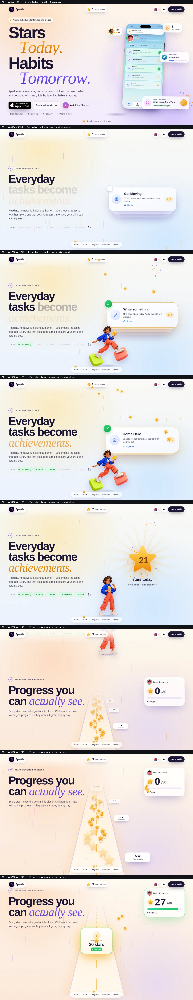
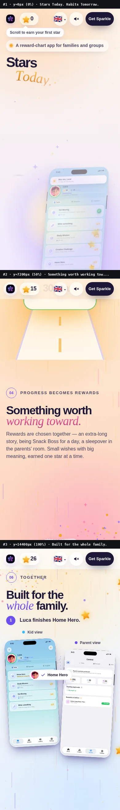

# UI Design System & Master Generation Blueprint: sparkle-ankatms-com

> **Kids Reward Chart & Chore App · Sparkle** (https://sparkle.ankatms.com) — Organize tasks, earn stars and choose rewards together. Sparkle is a private reward-chart app for families and groups on iPhone and iPad....





---

## 1. Executive Visual Persona & Design Archetype

- **Brand Essence & Persona**: **Kids Reward Chart & Chore App · Sparkle** (`https://sparkle.ankatms.com`). Organize tasks, earn stars and choose rewards together. Sparkle is a private reward-chart app for families and groups on iPhone and iPad....
- **Capture Provenance**: Live browser capture (`tier1_fast`, HTTP `200`, captured `2026-11-24`).
- **Visual Archetype**: **Light-Gallery WebGL / Canvas Interactive Experience (`#fbfaf6` / `#ff3b30`)**.
- **Anti-AI-Slop Differentiators**:
  - **Live-Computed Chromatic Polarity**: Anchors the viewport in `#fbfaf6` (live computed `html` `background-color` (`computed_styles.json`)) paired with `#1c1736` primary typography and `#ff3b30` accents.
  - **Grounded Typographic Hierarchy**: Uses `SF Pro Display` across display (`Stars Today. Habits Tomorrow.`) and body copy.
  - **Calibrated Spatial Grid & Motion**: Combines `1440px` container bounds (`gap: 11.2px 19.2px`, padding `63.36px`) with `cubic-bezier(0.16,1,0.3,1)` easing and Three.js / WebGL Canvas Pipeline.

---

## 2. Spatial Architecture & Modular Grid Mathematics

### Viewport Allocation & Container Geometry
- **Captured Journey Filmstrips**: Desktop `1280×6624px` (`assets/desktop-journey.webp`, `8` keyframes up to `y=6700px` / doc `25386px`), Mobile `390×2616px` (`assets/mobile-journey.webp`, `3` keyframes).
- **Master Container Bounds**: `1440px` (full-bleed `100%` desktop stage measured on `1440px` viewport).
- **Canvas Lateral Padding & Spacing**: `63.36px` lateral canvas padding with `11.2px 19.2px` grid gap.
- **Border Radius Scale**: `50%`, `12px`, `10px`, `100px`.

### Responsive Breakpoint Architecture
- **Desktop Layout**: Multi-column CSS Grid / Flexbox layout at `1440px` (`max-width: 1440px`, `gap: 11.2px 19.2px`).
- **Mobile Layout**: Single-column vertical stack at `390px` viewport width with `63.36px` horizontal padding.
- **Extracted CSS Media Queries**: `@media (max-width:760px)`, `@media (prefers-reduced-motion:reduce)`, `@media (max-width: 1180px)`, `@media (max-width: 959px)`.

---

## 3. Color System, Materiality & Atmospheric Lighting

### Semantic Palette & Source Grounding
| Semantic Role | Ground-Truth Value | Extracted Live / CSS Source |
|---|---|---|
| **Primary Canvas Substrate** | `#fbfaf6` | live computed `html` `background-color` (`computed_styles.json`) |
| **Primary Typography Ink** | `#1c1736` | live computed `h1` `color` (`computed_styles.json`) |
| **Elevated Surface / Card Substrate** | `#ffffff` | live computed `p` `background-color` (`computed_styles.json`) |
| **Interactive Accent / Highlight** | `#ff3b30` | `.ctl-badge.is-hot { background: #ff3b30 }` |
| **Secondary / Muted Copy** | `#b85f00` | `var(--amber-ink)` in `:root` |
| **Structural Hairline Border** | `#e3dfef` | `.search-steps li { border: #e3dfef }` |
| **Variable Token (`--ink-2`)** | `#48425f` | `var(--ink-2)` in `:root` |
| **Variable Token (`--ink-3`)** | `#68637d` | `var(--ink-3)` in `:root` |
| **Variable Token (`--violet`)** | `#6b4ff0` | `var(--violet)` in `:root` |
| **Variable Token (`--violet-2`)** | `#8d75ff` | `var(--violet-2)` in `:root` |
| **Variable Token (`--gold`)** | `#f5a623` | `var(--gold)` in `:root` |
| **Variable Token (`--gold-2`)** | `#ffcf4a` | `var(--gold-2)` in `:root` |
| **Variable Token (`--rose`)** | `#e2478f` | `var(--rose)` in `:root` |
| **Variable Token (`--mint`)** | `#22c55e` | `var(--mint)` in `:root` |
| **Variable Token (`--night-ink`)** | `#f5f2ff` | `var(--night-ink)` in `:root` |

### Sanitized Root CSS Variables (`ui-ux.md` Ground Truth)
| Variable Name | Extracted Value | Semantic Role |
|---|---|---|
| `--ink` | `#1c1736` | Typography Ink Token |
| `--ink-2` | `#48425f` | Typography Ink Token |
| `--ink-3` | `#68637d` | Typography Ink Token |
| `--paper` | `#fbfaf6` | Canvas / Surface Token |
| `--violet` | `#6b4ff0` | Color / Atmospheric Token |
| `--violet-2` | `#8d75ff` | Color / Atmospheric Token |
| `--gold` | `#f5a623` | Color / Atmospheric Token |
| `--gold-2` | `#ffcf4a` | Color / Atmospheric Token |
| `--amber-ink` | `#b85f00` | Typography Ink Token |
| `--rose` | `#e2478f` | Color / Atmospheric Token |
| `--mint` | `#22c55e` | Color / Atmospheric Token |
| `--night-ink` | `#f5f2ff` | Typography Ink Token |
| `--sky-top` | `rgb(255 247 236)` | Color / Atmospheric Token |
| `--sky-bottom` | `rgb(244 238 255)` | Color / Atmospheric Token |
| `--glow-a` | `rgb(255 214 168 / 0.6)` | Color / Atmospheric Token |
| `--glow-b` | `rgb(203 184 255 / 0.6)` | Color / Atmospheric Token |

---

## 4. Typographic Scale & Editorial Hierarchy

### Font Family Stacks
- **Display Typography**: `SF Pro Display`.
- **Primary Body Stack**: `SF Pro Display`.
- **Technical / Metadata Stack**: not declared in live computed styles (uses primary stack / `ui-monospace`).

### Typographic Scale & Rules (Live Computed & Stylesheet Grounded)
- **Hero Display (`H1`)**: live computed `h1` (`font-size: 123.1px`, `line-height: 103.404px`, `font-weight: 820`, `letter-spacing: -7.1398px`); rule `h1` (`font-size: clamp(2.3rem,4.5vw,4rem)`, `line-height: 1.15`, `letter-spacing: -.035em`).
- **Section Heading (`H2`)**: live computed `h2` (`font-size: 84.96px`, `line-height: 79.8624px`, `font-weight: 800`, `letter-spacing: -4.248px`); rule `h2` (`font-size: clamp(1.6rem,3vw,2.3rem)`, `line-height: 1.3`, `letter-spacing: -.025em`).
- **Body Copy**: live computed `body` (`font-size: 17px`, `line-height: 26.35px`, `font-weight: 400`); rule `p` (`font-size: .9rem`).
- **Metadata & Navigation Labels**: live computed `nav/a` (`font-size: 14.4px`, `line-height: 21.6px`, `font-weight: 500`); rule `small` (`font-size: 13px`, `font-weight: 650`).

---

## 5. Choreographed Motion & Interaction Physics

### Primary Easing Curves
- **Extracted Timing Functions**: `cubic-bezier(0.16,1,0.3,1)`, `cubic-bezier(0.2,1.45,0.35,1)`, `cubic-bezier(0.25,1.25,0.4,1)`.

### Per-Element Transition & Choreography Rules
- **Selector `.skip-link`**: `transition: transform 0.2s ease` extracted from `sparkle-ankatms-com` stylesheet.
- **Selector `.nav::before`**: `transition: opacity 0.4s ease` extracted from `sparkle-ankatms-com` stylesheet.
- **Selector `.nav__brand`**: `transition: background-color 0.4s ease, box-shadow 0.4s ease, color 0.4s ease` extracted from `sparkle-ankatms-com` stylesheet.
- **Extracted Easing Curve (`cubic-bezier(0.16,1,0.3,1)`)**: Governs interactive state transitions across `<header.nav>` and `<section.scene>`.
- **Runtime Interaction Engine**: Integrates Three.js / WebGL Canvas Pipeline with `prefers-reduced-motion: reduce` fallback guards.
### Measured Runtime Scroll & Interaction Telemetry (`behavioral_journey_v2`)
- **Scroll Driver Mode**: `native+wheel` (max document height `25386px`, deepest scrollY reached `6700px` across `8` desktop keyframes).
- **Detected Scroll / Motion Libraries**: `WebGL/Canvas`.
- **Hover Physics (`primary_cta` · `Scroll to earn your first star`)**: Computed transition `0s` / `ease` (no static color/transform shift captured at rest).
- **Hover Physics (`first_card` · `Get Moving 30 minutes of movement...`)**: `boxShadow`: `rgba(245, 166, 35, 0.55...` -> `rgba(60, 40, 160, 0.42)...` (`transition-duration: 0.6s`, `timing: ease`).
- **Interactive Control Probe (`accordion` · `Is Sparkle really free?`)**: Triggered visual diff `5.692` (attr ` -> `, captured in `assets/state-interactive.webp`).

---

## 6. Component Wireframe & Structural DOM Map

### Visual Layout Schematic — Desktop (`1440px`, Grounded in `dom.html` & Landmark Bounding Boxes)
```
┌────────────────────────────────────────────────────────────────────────┐
│ DESKTOP VIEWPORT (1440px) — Kids Reward Chart & Chore App · Sparkle    │
│ ====================================================================== │
│ [ <header.nav> (1440x76px)            | English · Deutsch · Español  ] │
│ ---------------------------------------------------------------------- │
│ | HERO STAGE: <section.hero> (w=1440px)                              | │
│ | H1: Stars Today. Habits Tomorrow.                                  | │
│ | Substrate: #fbfaf6 | Ink: #1c1736 | Accent: #ff3b30                | │
│ ---------------------------------------------------------------------- │
│ | SHOWCASE GRID (<section.scene>) max-w: 1440px                      | │
│ | +------------------------------+  +------------------------------+ | │
│ | | S t a r s T o d a y . H a b  |  | Everyday tasks become achiev | | │
│ | +------------------------------+  +------------------------------+ | │
│ ---------------------------------------------------------------------- │
│ | DETAIL MODULE (<article.tcard>) — Write something                  | │
│ ---------------------------------------------------------------------- │
│ [ FOOTER (<footer.foot>       ) | https://sparkle.ankatms.com          │
└────────────────────────────────────────────────────────────────────────┘
```

### Visual Layout Schematic — Mobile Reflow (`390px`)
```
┌────────────────────────────────────────────────────────────────────────┐
│ MOBILE VIEWPORT REFLOW (390px) — Single-Column Stack (gap: 11.2px 1)   │
│ ====================================================================== │
│ [ HEADER BAR (<header.nav>            ) | Compact Menu (390px)         │
│ ---------------------------------------------------------------------- │
│ | HERO STAGE (<section.hero>) — 390px Vertical Lead                  | │
│ | H1: Stars Today. Habits Tomorrow.                                  | │
│ ---------------------------------------------------------------------- │
│ | SHOWCASE STACK (<section.scene>) — 1-Col Stack                     | │
│ | [ Item 1: S t a r s T o d a y . H a b i t s T o m o r r o w .    ] | │
│ | [ Item 2: Everyday tasks become achievements.                    ] | │
│ ---------------------------------------------------------------------- │
│ | DETAIL STACK (<article.tcard>) — 1-Col (Write something)           | │
│ ---------------------------------------------------------------------- │
│ [ FOOTER (<footer.foot>       ) | Stacked 390px Colophon               │
└────────────────────────────────────────────────────────────────────────┘
```

### Granular DOM Region Breakdown
1. **Brand Header & Navigation Bar (<header.nav> — `sparkle-ankatms-com`)**:
   - Landmark `<header class="nav">` (`1440x76px`) hosting `Kids Reward Chart & Chore App · Spar` navigation (`English · Deutsch · Español · Français · Türkçe`), DOM attributes (`data-nav`, `data-logo`, `data-hud`, `data-hud-count`), and stylesheet rule `.search-languages a { color:inherit;text-decoration:underline;text-underline-offset:.2em }`.
2. **Hero Stage & Focal Lead (<section.hero> — `Stars Today. Habits Tomorrow.`)**:
   - Landmark `<section class="hero">` presenting display lead `Stars Today. Habits Tomorrow.` and copy excerpt *"A reward-chart app for families and groups"* over `#fbfaf6` canvas and `#1c1736` ink.
3. **Primary Showcase & Content Grid (<section.scene> — `S t a r s T o d a y . H a b i t s `)**:
   - Landmark `<section class="scene scene--tasks">` rendering section `S t a r s T o d a y . H a b i t s T o m o r r o w .` with copy *"Sparkle turns everyday tasks into stars children can see, collect"*, asset references (`favicon-32.png`, `apple-touch-icon.png`, `avatar-luca.jpg`, `sparkle-story.css`), and grid rule `.search-page img { display:block;max-width:100%;height:auto }`.
4. **Interactive Detail & Feature Matrix (<article.tcard> — `Everyday tasks become achievements`)**:
   - Landmark `<article class="tcard">` framing `Everyday tasks become achievements.` and `Write something` (*"Watch the film 0:30"*) with `#ffffff` surface cards, `#ff3b30` accents, and `.search-page a { color:4c3fba;text-underline-offset:.2em }`.
5. **Colophon & Global Directory Footer (<footer.foot> — `https://sparkle.ankatms.com`)**:
   - Landmark `<footer class="foot">` anchoring `Kids Reward Chart & Chore App · ` footer links (`English · Deutsch · Español · Français · Türkçe`), copy *"Get Moving 30 minutes of movement. Sport, dance… 30 min 3 st"*, and `#e3dfef` structural dividers.
### Full Vertical Scroll Sequence (Desktop `1440×900` Keyframes)
- **Step 01** (`y=0px`, `0%`): Active landmark `Stars Today. Habits Tomorrow.` · sticky/fixed elements: `3`
- **Step 02** (`y=850px`, `3%`): Active landmark `Everyday tasks become achievements.` · sticky/fixed elements: `5`
- **Step 03** (`y=1700px`, `7%`): Active landmark `Everyday tasks become achievements.` · sticky/fixed elements: `5`
- **Step 04** (`y=2550px`, `10%`): Active landmark `Everyday tasks become achievements.` · sticky/fixed elements: `5`
- **Step 05** (`y=3400px`, `14%`): Active landmark `Everyday tasks become achievements.` · sticky/fixed elements: `5`
- **Step 06** (`y=4250px`, `17%`): Active landmark `Progress you can actually see.` · sticky/fixed elements: `6`
- **Step 07** (`y=5100px`, `21%`): Active landmark `Progress you can actually see.` · sticky/fixed elements: `5`
- **Step 08** (`y=6700px`, `27%`): Active landmark `Progress you can actually see.` · sticky/fixed elements: `6`

---

## 7. Master Zero-Shot AI Generation Prompt

```markdown
# Master Zero-Shot Frontend Generation Prompt: sparkle-ankatms-com (Kids Reward Chart & Chore App · Sparkle)

You are a principal frontend architect and design systems engineer. Build a complete, production-ready web application replicating the exact design system, DOM landmarks, typographic hierarchy, color tokens, and motion physics of `sparkle-ankatms-com` (**Kids Reward Chart & Chore App · Sparkle** — `https://sparkle.ankatms.com`).

### 1. Visual Archetype & Anti-AI-Slop Mandates
- **Archetype**: Light-Gallery WebGL / Canvas Interactive Experience (`#fbfaf6` / `#ff3b30`).
- **Identity & Domain Context**: Organize tasks, earn stars and choose rewards together. Sparkle is a private reward-chart app for families and groups on iPhone and iPad....
- **Primary Substrate**: `#fbfaf6` (live computed `html` `background-color` (`computed_styles.json`)), **Primary Ink**: `#1c1736`, **Accent / Highlight**: `#ff3b30`.
- **Site-Specific Differentiators**:
  - **Live-Computed Chromatic Polarity**: Anchors the viewport in `#fbfaf6` (live computed `html` `background-color` (`computed_styles.json`)) paired with `#1c1736` primary typography and `#ff3b30` accents.
  - **Grounded Typographic Hierarchy**: Uses `SF Pro Display` across display (`Stars Today. Habits Tomorrow.`) and body copy.
  - **Calibrated Spatial Grid & Motion**: Combines `1440px` container bounds (`gap: 11.2px 19.2px`, padding `63.36px`) with `cubic-bezier(0.16,1,0.3,1)` easing and Three.js / WebGL Canvas Pipeline.

### 2. Ground-Truth CSS Variables (`:root` Token Contract)
Declare and consume these exact custom properties extracted from `sparkle-ankatms-com` in your global stylesheet:

:root {
  /* Kids Reward Chart & Chore App · Sparkle (sparkle-ankatms-com) — Live-Grounded CSS Variables */
  --ink: #1c1736; /* Typography Ink Token (sparkle-ankatms-com) */
  --ink-2: #48425f; /* Typography Ink Token (sparkle-ankatms-com) */
  --ink-3: #68637d; /* Typography Ink Token (sparkle-ankatms-com) */
  --paper: #fbfaf6; /* Canvas / Surface Token (sparkle-ankatms-com) */
  --violet: #6b4ff0; /* Color / Atmospheric Token (sparkle-ankatms-com) */
  --violet-2: #8d75ff; /* Color / Atmospheric Token (sparkle-ankatms-com) */
  --gold: #f5a623; /* Color / Atmospheric Token (sparkle-ankatms-com) */
  --gold-2: #ffcf4a; /* Color / Atmospheric Token (sparkle-ankatms-com) */
  --amber-ink: #b85f00; /* Typography Ink Token (sparkle-ankatms-com) */
  --rose: #e2478f; /* Color / Atmospheric Token (sparkle-ankatms-com) */
  --mint: #22c55e; /* Color / Atmospheric Token (sparkle-ankatms-com) */
  --night-ink: #f5f2ff; /* Typography Ink Token (sparkle-ankatms-com) */
  --sky-top: rgb(255 247 236); /* Color / Atmospheric Token (sparkle-ankatms-com) */
  --sky-bottom: rgb(244 238 255); /* Color / Atmospheric Token (sparkle-ankatms-com) */
  --glow-a: rgb(255 214 168 / 0.6); /* Color / Atmospheric Token (sparkle-ankatms-com) */
  --glow-b: rgb(203 184 255 / 0.6); /* Color / Atmospheric Token (sparkle-ankatms-com) */
}

### 3. Semantic Color & Materiality Contract
Map every surface, ink, and border strictly to these source-grounded tokens:
- **Primary Canvas Substrate**: `#fbfaf6` — grounded in live computed `html` `background-color` (`computed_styles.json`)
- **Primary Typography Ink**: `#1c1736` — grounded in live computed `h1` `color` (`computed_styles.json`)
- **Elevated Surface / Card Substrate**: `#ffffff` — grounded in live computed `p` `background-color` (`computed_styles.json`)
- **Interactive Accent / Highlight**: `#ff3b30` — grounded in `.ctl-badge.is-hot { background: #ff3b30 }`
- **Secondary / Muted Copy**: `#b85f00` — grounded in `var(--amber-ink)` in `:root`
- **Structural Hairline Border**: `#e3dfef` — grounded in `.search-steps li { border: #e3dfef }`
- **Variable Token (`--ink-2`)**: `#48425f` — grounded in `var(--ink-2)` in `:root`
- **Variable Token (`--ink-3`)**: `#68637d` — grounded in `var(--ink-3)` in `:root`
- **Variable Token (`--violet`)**: `#6b4ff0` — grounded in `var(--violet)` in `:root`
- **Variable Token (`--violet-2`)**: `#8d75ff` — grounded in `var(--violet-2)` in `:root`
- **Variable Token (`--gold`)**: `#f5a623` — grounded in `var(--gold)` in `:root`
- **Variable Token (`--gold-2`)**: `#ffcf4a` — grounded in `var(--gold-2)` in `:root`
- **Variable Token (`--rose`)**: `#e2478f` — grounded in `var(--rose)` in `:root`
- **Variable Token (`--mint`)**: `#22c55e` — grounded in `var(--mint)` in `:root`
- **Variable Token (`--night-ink`)**: `#f5f2ff` — grounded in `var(--night-ink)` in `:root`

### 4. Spatial Grid, Container Bounds & Responsive Breakpoints
- **Desktop Viewport Reference**: `1280×6624px` (multi-frame vertical journey filmstrip (6624px), `1440px` standard desktop width).
- **Mobile Viewport Reference**: `390×2616px` (multi-frame vertical journey filmstrip (2616px), `390px` standard mobile width).
- **Container Max-Width**: `1440px` (full-bleed `100%` desktop stage measured on `1440px` viewport)
- **Padding & Gutters**: `63.36px` lateral canvas padding with `11.2px 19.2px` grid gap
- **Desktop Grid**: Multi-column CSS Grid / Flexbox layout at `1440px` (`max-width: 1440px`, `gap: 11.2px 19.2px`)
- **Mobile Adaptation**: Single-column vertical stack at `390px` viewport width with `63.36px` horizontal padding
- **Media Queries**: `@media (max-width:760px)`, `@media (prefers-reduced-motion:reduce)`, `@media (max-width: 1180px)`, `@media (max-width: 959px)`
- **Corner Radii**: `50%`, `12px`, `10px`, `100px`

### 5. Typography & Editorial Scale Contract
- **Display Font Stack**: `SF Pro Display`
- **Body Font Stack**: `SF Pro Display`
- **Monospace / Technical Font Stack**: not declared in live computed styles (uses primary stack / `ui-monospace`)
- **H1 Display Rule**: live computed `h1` (`font-size: 123.1px`, `line-height: 103.404px`, `font-weight: 820`, `letter-spacing: -7.1398px`); rule `h1` (`font-size: clamp(2.3rem,4.5vw,4rem)`, `line-height: 1.15`, `letter-spacing: -.035em`)
- **H2 Section Rule**: live computed `h2` (`font-size: 84.96px`, `line-height: 79.8624px`, `font-weight: 800`, `letter-spacing: -4.248px`); rule `h2` (`font-size: clamp(1.6rem,3vw,2.3rem)`, `line-height: 1.3`, `letter-spacing: -.025em`)
- **Body Copy Rule**: live computed `body` (`font-size: 17px`, `line-height: 26.35px`, `font-weight: 400`); rule `p` (`font-size: .9rem`)
- **Metadata & Index Rule**: live computed `nav/a` (`font-size: 14.4px`, `line-height: 21.6px`, `font-weight: 500`); rule `small` (`font-size: 13px`, `font-weight: 650`)

### 6. Component Hierarchy, Verbatim Copy & Real DOM Landmarks
Scaffold `sparkle-ankatms-com` (`Kids Reward Chart & Chore App · Sparkle`) with these exact structural regions, extracted copy, and CSS rules from `dom.html`:
1. **Brand Header & Navigation Bar (<header.nav> — `sparkle-ankatms-com`)**:
   - DOM & Selectors: Landmark `<header class="nav">` (`1440x76px`) hosting `Kids Reward Chart & Chore App · Spar` navigation (`English · Deutsch · Español · Français · Türkçe`), DOM attributes (`data-nav`, `data-logo`, `data-hud`, `data-hud-count`), and stylesheet rule `.search-languages a { color:inherit;text-decoration:underline;text-underline-offset:.2em }`.
   - Responsive Contract: Header `Brand Header & Navigation Bar (<header.nav> — `sparkle-ankatms-com`)` (`sparkle-ankatms-com`) adapts across `@media (max-width:760px)`, `@media (prefers-reduced-motion:reduce)`, `@media (max-width: 1180px)`, `@media (max-width: 959px)` with `cubic-bezier(0.16,1,0.3,1)`, `cubic-bezier(0.2,1.45,0.35,1)`, `cubic-bezier(0.25,1.25,0.4,1)` transitions and links `English · Deutsch · Español · Français · Türkçe`.
2. **Hero Stage & Focal Lead (<section.hero> — `Stars Today. Habits Tomorrow.`)**:
   - DOM & Selectors: Landmark `<section class="hero">` presenting display lead `Stars Today. Habits Tomorrow.` and copy excerpt *"A reward-chart app for families and groups"* over `#fbfaf6` canvas and `#1c1736` ink.
   - Responsive Contract: Hero stage (`1280×6624px` desktop / `390×2616px` mobile) sets `#fbfaf6` background with `#1c1736` headline `Stars Today. Habits Tomorrow.`.
3. **Primary Showcase & Content Grid (<section.scene> — `S t a r s T o d a y . H a b i t s `)**:
   - DOM & Selectors: Landmark `<section class="scene scene--tasks">` rendering section `S t a r s T o d a y . H a b i t s T o m o r r o w .` with copy *"Sparkle turns everyday tasks into stars children can see, collect"*, asset references (`favicon-32.png`, `apple-touch-icon.png`, `avatar-luca.jpg`, `sparkle-story.css`), and grid rule `.search-page img { display:block;max-width:100%;height:auto }`.
   - Responsive Contract: Showcase grid `Primary Showcase & Content Grid (<section.scene> — `S t a r s T o d a y . H a b i t s `)` applies Multi-column CSS Grid / Flexbox layout at `1440px` (`max-width: 1440px`, `gap: 11.2px 19.2px`) on desktop and Single-column vertical stack at `390px` viewport width with `63.36px` horizontal padding on mobile.
4. **Interactive Detail & Feature Matrix (<article.tcard> — `Everyday tasks become achievements`)**:
   - DOM & Selectors: Landmark `<article class="tcard">` framing `Everyday tasks become achievements.` and `Write something` (*"Watch the film 0:30"*) with `#ffffff` surface cards, `#ff3b30` accents, and `.search-page a { color:4c3fba;text-underline-offset:.2em }`.
   - Responsive Contract: Detail module `Interactive Detail & Feature Matrix (<article.tcard> — `Everyday tasks become achievements`)` uses `50%`, `12px`, `10px`, `100px` radii, `#ff3b30` highlights, and assets (favicon-32.png, apple-touch-icon.png, avatar-luca.jpg).
5. **Colophon & Global Directory Footer (<footer.foot> — `https://sparkle.ankatms.com`)**:
   - DOM & Selectors: Landmark `<footer class="foot">` anchoring `Kids Reward Chart & Chore App · ` footer links (`English · Deutsch · Español · Français · Türkçe`), copy *"Get Moving 30 minutes of movement. Sport, dance… 30 min 3 st"*, and `#e3dfef` structural dividers.
   - Responsive Contract: Footer `Colophon & Global Directory Footer (<footer.foot> — `https://sparkle.ankatms.com`)` aligns to `1440px` (full-bleed `100%` desktop stage measured on `1440px` viewport) with `63.36px` lateral canvas padding with `11.2px 19.2px` grid gap and attributes (data-nav, data-logo, data-hud).

#### Verbatim DOM Copy Excerpts (`dom.html`)
- Copy Excerpt 1: *"A reward-chart app for families and groups"*
- Copy Excerpt 2: *"Sparkle turns everyday tasks into stars children can see, collect and be proud of..."*
- Copy Excerpt 3: *"Watch the film 0:30"*
- Copy Excerpt 4: *"Get Moving 30 minutes of movement. Sport, dance… 30 min 3 stars"*

### 7. Motion, Extracted Stylesheet Rules & Interaction Choreography
- **Primary Easing Functions**: `cubic-bezier(0.16,1,0.3,1)`, `cubic-bezier(0.2,1.45,0.35,1)`, `cubic-bezier(0.25,1.25,0.4,1)`
- **Extracted Stylesheet Rules (`sparkle-ankatms-com`)**:
- `.search-languages a { color:inherit;text-decoration:underline;text-underline-offset:.2em }`
- `.search-page img { display:block;max-width:100%;height:auto }`
- `.search-page a { color:4c3fba;text-underline-offset:.2em }`
- `.search-page :focus-visible { outline:3px solid 1679d3;outline-offset:5px }`
- `.search-shell { width:min(1120px,calc(100% - 48px));margin-inline:auto }`
- **Per-Selector Transition Rules**:
- **Selector `.skip-link`**: `transition: transform 0.2s ease` extracted from `sparkle-ankatms-com` stylesheet.
- **Selector `.nav::before`**: `transition: opacity 0.4s ease` extracted from `sparkle-ankatms-com` stylesheet.
- **Selector `.nav__brand`**: `transition: background-color 0.4s ease, box-shadow 0.4s ease, color 0.4s ease` extracted from `sparkle-ankatms-com` stylesheet.
- **Extracted Easing Curve (`cubic-bezier(0.16,1,0.3,1)`)**: Governs interactive state transitions across `<header.nav>` and `<section.scene>`.
- **Runtime Interaction Engine**: Integrates Three.js / WebGL Canvas Pipeline with `prefers-reduced-motion: reduce` fallback guards.
### 7b. Full-Page Scroll Choreography, Interactive States & Multi-Page Routes
- **Scroll Mechanics**: Implement `native+wheel` vertical progression up to `25386px` across 8 distinct viewport chapters using WebGL/Canvas.
- **Vertical Chapter Sequence**: Stars Today. Habits Tomorrow. (0%) -> Everyday tasks become achie... (3%) -> Everyday tasks become achie... (7%) -> Everyday tasks become achie... (10%) -> Everyday tasks become achie... (14%) -> Progress you can actually see. (17%) -> Progress you can actually see. (21%) -> Progress you can actually see. (27%).
- **Hover Micro-Interaction (`first_card`)**: Animate `boxShadow` with `0.6s ease`.

### 8. Technical Deliverables
- Implement in Next.js (App Router) with TypeScript and Tailwind CSS consuming the `:root` custom properties defined above for `sparkle-ankatms-com`.
- Reproduce both the `1440px` desktop architecture and `390px` mobile breakpoint transitions, preserving semantic HTML5 landmarks (`<header>`, `<nav>`, `<main>`, `<section>`, `<footer>`) and `prefers-reduced-motion` accessibility guards.
```
---

## 8. Full-Page Scroll Journey, Interactive States & Subpage Inventory

### Desktop Scroll Keyframes (`1440×900` WebP)
| Step | Scroll Y | Progress | Active Landmark / Section | Sticky/Fixed | Visual Asset |
| :---: | :---: | :---: | :--- | :---: | :--- |
| `#01` | `0px` | `0%` | Stars Today. Habits Tomorrow. | `3` | [desktop-step-01.webp](assets/desktop-step-01.webp) |
| `#02` | `850px` | `3%` | Everyday tasks become achievements. | `5` | [desktop-step-02.webp](assets/desktop-step-02.webp) |
| `#03` | `1700px` | `7%` | Everyday tasks become achievements. | `5` | [desktop-step-03.webp](assets/desktop-step-03.webp) |
| `#04` | `2550px` | `10%` | Everyday tasks become achievements. | `5` | [desktop-step-04.webp](assets/desktop-step-04.webp) |
| `#05` | `3400px` | `14%` | Everyday tasks become achievements. | `5` | [desktop-step-05.webp](assets/desktop-step-05.webp) |
| `#06` | `4250px` | `17%` | Progress you can actually see. | `6` | [desktop-step-06.webp](assets/desktop-step-06.webp) |
| `#07` | `5100px` | `21%` | Progress you can actually see. | `5` | [desktop-step-07.webp](assets/desktop-step-07.webp) |
| `#08` | `6700px` | `27%` | Progress you can actually see. | `6` | [desktop-step-08.webp](assets/desktop-step-08.webp) |

### Mobile Condensed Keyframes (`390×844` WebP)
| Step | Scroll Y | Progress | Active Landmark | Visual Asset |
| :---: | :---: | :---: | :--- | :--- |
| `#01` | `0px` | `0%` | Stars Today. Habits Tomorrow. | [mobile-step-01.webp](assets/mobile-step-01.webp) |
| `#02` | `7200px` | `50%` | Something worth working toward. | [mobile-step-02.webp](assets/mobile-step-02.webp) |
| `#03` | `14400px` | `100%` | Built for the whole family. | [mobile-step-03.webp](assets/mobile-step-03.webp) |

### Interactive UI State Captures (`1440×900` WebP)
| State Type | Trigger / Observation | Visual Asset |
| :--- | :--- | :--- |
| `interactive_control` | Control `accordion` (`Is Sparkle really free?`, diff `5.692`) | [state-interactive.webp](assets/state-interactive.webp) |

