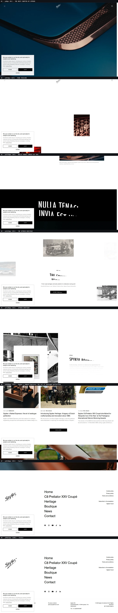

# UI Design System & Master Generation Blueprint: spykercars-com

> **Hand-Built Super Sports Cars Since 1880 · Spyker Cars** (https://spykercars.com/) — Spyker builds highly exclusive, hand-built super sports cars in the Netherlands. Discover the C8 Preliator XXV Coupé and the marque's sto...




---

## 1. Executive Visual Persona & Design Archetype

- **Brand Essence & Persona**: **Hand-Built Super Sports Cars Since 1880 · Spyker Cars** (`https://spykercars.com/`). Spyker builds highly exclusive, hand-built super sports cars in the Netherlands. Discover the C8 Preliator XXV Coupé and the marque's sto...
- **Capture Provenance**: Live browser capture (`tier1_fast`, HTTP `200`, captured `2026-11-24`).
- **Visual Archetype**: **Light-Substrate Editorial & Modular Grid System (`#ffffff` canvas, `#000000` ink, `#0000ff` accent)**.
- **Anti-AI-Slop Differentiators**:
  - **Live-Computed Chromatic Polarity**: Anchors the viewport in `#ffffff` (live computed `browser-default` `background-color` (`computed_styles.json`)) paired with `#000000` primary typography and `#0000ff` accents.
  - **Grounded Typographic Hierarchy**: Pairs `futura-pt-condensed` for display copy (`THE NEXT CHAPTER OF SPYKER`) with `swiss721` and `SFMono-Regular`.
  - **Calibrated Spatial Grid & Motion**: Combines `86rem` container bounds (`gap: 5px`, padding `16px`) with `cubic-bezier(.4,0,1,1)` easing and Lenis Smooth Scroll (`data-lenis`), GSAP Timeline & ScrollTrigger.

---

## 2. Spatial Architecture & Modular Grid Mathematics

### Viewport Allocation & Container Geometry
- **Captured Journey Filmstrips**: Desktop `1280×6624px` (`assets/desktop-journey.webp`, `8` keyframes up to `y=8627px` / doc `9527px`), Mobile `390×1744px` (`assets/mobile-journey.webp`, `2` keyframes).
- **Master Container Bounds**: `86rem` (non-`@media` desktop container stylesheet rule).
- **Canvas Lateral Padding & Spacing**: `16px` lateral canvas padding with `5px` grid gap.
- **Border Radius Scale**: `.3125rem`, `.375rem`, `.25rem`, `var(--radius-2xl)`.

### Responsive Breakpoint Architecture
- **Desktop Layout**: Multi-column CSS Grid / Flexbox layout at `1440px` (`max-width: 86rem`, `gap: 5px`).
- **Mobile Layout**: Single-column vertical stack at `390px` viewport width with `16px` horizontal padding.
- **Extracted CSS Media Queries**: `@media screen and (max-width:1023px)`, `@media (min-width:64rem) and (orientation:landscape)`, `@media (min-width:40rem)`, `@media (min-width:48rem)`.

---

## 3. Color System, Materiality & Atmospheric Lighting

### Semantic Palette & Source Grounding
| Semantic Role | Ground-Truth Value | Extracted Live / CSS Source |
|---|---|---|
| **Primary Canvas Substrate** | `#ffffff` | live computed `browser-default` `background-color` (`computed_styles.json`) |
| **Primary Typography Ink** | `#000000` | live computed `p` `color` (`computed_styles.json`) |
| **Elevated Surface / Card Substrate** | `#f24822` | `.animated-grid__col { background-color: #f24822 }` |
| **Interactive Accent / Highlight** | `#0000ff` | `.border-blue-600 { border-color: #0000ff }` |
| **Secondary / Muted Copy** | `#101010` | live computed `section` `color` (`computed_styles.json`) |
| **Structural Hairline Border** | `#e5e5e5` | `10 { border-color: #e5e5e5 }` |

### Sanitized Root CSS Variables (`ui-ux.md` Ground Truth)
| Variable Name | Extracted Value | Semantic Role |
|---|---|---|
| `--background` | `oklch(100% 0 0)` | Canvas / Surface Token |
| `--foreground` | `oklch(14.5% 0 0)` | Typography Ink Token |
| `--card` | `oklch(96.5% .005 265)` | Color / Atmospheric Token |
| `--card-foreground` | `oklch(14.5% 0 0)` | Typography Ink Token |
| `--popover` | `oklch(100% 0 0)` | Color / Atmospheric Token |
| `--popover-foreground` | `oklch(14.5% 0 0)` | Typography Ink Token |
| `--primary` | `oklch(20.5% 0 0)` | Brand / Palette Token |
| `--primary-foreground` | `oklch(98.5% 0 0)` | Typography Ink Token |
| `--secondary` | `oklch(97% 0 0)` | Brand / Palette Token |
| `--secondary-foreground` | `oklch(20.5% 0 0)` | Typography Ink Token |
| `--muted` | `oklch(97% 0 0)` | Color / Atmospheric Token |
| `--muted-foreground` | `oklch(55.6% 0 0)` | Typography Ink Token |
| `--accent` | `oklch(97% 0 0)` | Brand / Palette Token |
| `--accent-foreground` | `oklch(20.5% 0 0)` | Typography Ink Token |
| `--destructive` | `oklch(57.7% .245 27.325)` | Color / Atmospheric Token |
| `--destructive-foreground` | `oklch(57.7% .245 27.325)` | Typography Ink Token |

---

## 4. Typographic Scale & Editorial Hierarchy

### Font Family Stacks
- **Display Typography**: `futura-pt-condensed`.
- **Primary Body Stack**: `swiss721`.
- **Technical / Metadata Stack**: `SFMono-Regular`.

### Typographic Scale & Rules (Live Computed & Stylesheet Grounded)
- **Hero Display (`H1`)**: live computed `h1` (`font-size: 56px`, `line-height: 47.6px`, `font-weight: 500`, `letter-spacing: 2.24px`); CSS variables `--text-4xl: 2.25rem`, `--text-4xl--line-height: calc(2.5/2.25)`, `--text-5xl: 3rem`.
- **Section Heading (`H2`)**: live computed `h2` (`font-size: 120px`, `line-height: 102px`, `font-weight: 500`, `letter-spacing: 2px`); CSS variables `--text-2xl: 1.5rem`, `--text-2xl--line-height: calc(2/1.5)`, `--text-3xl: 1.875rem`; rule `h2` (`font-size: 38px`).
- **Body Copy**: live computed `body` (`font-size: 16px`, `line-height: 24px`, `font-weight: 400`); CSS variables `--text-base: 1rem`, `--text-base--line-height: calc(1.5/1)`; rule `p` (`font-size: var(--text-sm)`, `line-height: var(--tw-leading,var(...`).
- **Metadata & Navigation Labels**: live computed `nav/a` (`font-size: 16px`, `line-height: 24px`, `font-weight: 400`); CSS variables `--font-mono: ui-monospace,SFMono-Regular,monospace`, `--text-xs: .75rem`, `--text-xs--line-height: calc(1/.75)`.

---

## 5. Choreographed Motion & Interaction Physics

### Primary Easing Curves
- **Extracted Timing Functions**: `cubic-bezier(.4,0,1,1)`, `cubic-bezier(0,0,.2,1)`, `cubic-bezier(.4,0,.2,1)`.

### Per-Element Transition & Choreography Rules
- **Selector `layer theme`**: `transition: .15s` extracted from `spykercars-com` stylesheet.
- **Selector `.transition`**: `transition: var(--tw-ease,var(--default-transition-timing-function))` extracted from `spykercars-com` stylesheet.
- **Selector `box-shadow\]`**: `transition: var(--tw-ease,var(--default-transition-timing-function))` extracted from `spykercars-com` stylesheet.
- **Extracted Easing Curve (`cubic-bezier(.4,0,1,1)`)**: Governs interactive state transitions across `<nav.py-4>` and `<section.w-full>`.
- **Runtime Interaction Engine**: Integrates Lenis Smooth Scroll (`data-lenis`), GSAP Timeline & ScrollTrigger, Three.js / WebGL Canvas Pipeline, Lottie Vector Animation Player with `prefers-reduced-motion: reduce` fallback guards.
### Measured Runtime Scroll & Interaction Telemetry (`behavioral_journey_v2`)
- **Scroll Driver Mode**: `native` (max document height `9527px`, deepest scrollY reached `8627px` across `8` desktop keyframes).
- **Detected Scroll / Motion Libraries**: `Lenis`.
- **Route Transition Architecture**: First internal navigation (`/news`) measured as `direct` in `1703ms`.

---

## 6. Component Wireframe & Structural DOM Map

### Visual Layout Schematic — Desktop (`1440px`, Grounded in `dom.html` & Landmark Bounding Boxes)
```
┌────────────────────────────────────────────────────────────────────────┐
│ DESKTOP VIEWPORT (1440px) — Hand-Built Super Sports Cars Since 1880 ·  │
│ ====================================================================== │
│ [ <nav.py-4> (1425x88px)              | Home · Heritage · Boutique · ] │
│ ---------------------------------------------------------------------- │
│ | HERO STAGE: <article.lenis-autoToggle> (w=1425px)                  | │
│ | H1: THE NEXT CHAPTER OF SPYKER                                     | │
│ | Substrate: #ffffff | Ink: #000000 | Accent: #0000ff                | │
│ ---------------------------------------------------------------------- │
│ | SHOWCASE GRID (<section.w-full>) max-w: 86rem                      | │
│ | +------------------------------+  +------------------------------+ | │
│ | | The next chapter of Spyker T |  | P u r e P a s s i o n        | | │
│ | +------------------------------+  +------------------------------+ | │
│ ---------------------------------------------------------------------- │
│ | DETAIL MODULE (<section.sr-only>) — N u l l a T e n a c i          | │
│ ---------------------------------------------------------------------- │
│ [ FOOTER (<footer.relative>   ) | https://spykercars.com/              │
└────────────────────────────────────────────────────────────────────────┘
```

### Visual Layout Schematic — Mobile Reflow (`390px`)
```
┌────────────────────────────────────────────────────────────────────────┐
│ MOBILE VIEWPORT REFLOW (390px) — Single-Column Stack (gap: 5px)        │
│ ====================================================================== │
│ [ HEADER BAR (<nav.py-4>              ) | Compact Menu (390px)         │
│ ---------------------------------------------------------------------- │
│ | HERO STAGE (<article.lenis-autoToggl) — 390px Vertical Lead        | │
│ | H1: THE NEXT CHAPTER OF SPYKER                                     | │
│ ---------------------------------------------------------------------- │
│ | SHOWCASE STACK (<section.w-full>) — 1-Col Stack                    | │
│ | [ Item 1: The next chapter of Spyker T h e n e x t c h a p...    ] | │
│ | [ Item 2: P u r e P a s s i o n                                  ] | │
│ ---------------------------------------------------------------------- │
│ | DETAIL STACK (<section.sr-only>) — 1-Col (N u l l a T e n a )      | │
│ ---------------------------------------------------------------------- │
│ [ FOOTER (<footer.relative>   ) | Stacked 390px Colophon               │
└────────────────────────────────────────────────────────────────────────┘
```

### Granular DOM Region Breakdown
1. **Brand Header & Navigation Bar (<nav.py-4> — `spykercars-com`)**:
   - Landmark `<nav class="py-4 container">` (`1425x88px`) hosting `Hand-Built Super Sports Cars Since 1` navigation (`Home · Heritage · Boutique · News · Contact`), DOM attributes (`data-theme="light"`, `data-precedence="next"`, `data-precedence="next"`, `data-precedence="next"`), and stylesheet rule `.__className_e6d04a { font-family:swiss721,swiss721 Fallback }`.
2. **Hero Stage & Focal Lead (<article.lenis-autoToggle> — `THE NEXT CHAPTER OF SPYKER`)**:
   - Landmark `<article class="lenis-autoToggle">` presenting display lead `THE NEXT CHAPTER OF SPYKER` and copy excerpt *"We use cookies to run the site, and optionally for analytics and "* over `#ffffff` canvas and `#000000` ink.
3. **Primary Showcase & Content Grid (<section.w-full> — `The next chapter of Spyker T h e n`)**:
   - Landmark `<section class="w-full relative">` rendering section `The next chapter of Spyker T h e n e x t c h a p...` with copy *"T h e b e g i n n i n g o f X X V"*, asset references (`f13a7bda184fa931.css`, `86c130d7567786c0.css`, `3c4afd8b2a3df79a.css`, `cdb4fb19178d4946.css`), and grid rule `.__variable_e6d04a { --font-swiss-721:"swiss721","swiss721 Fallback" }`.
4. **Interactive Detail & Feature Matrix (<section.sr-only> — `P u r e P a s s i o n`)**:
   - Landmark `<section class="sr-only">` framing `P u r e P a s s i o n` and `N u l l a T e n a c i I n v i a E s t V i a` (*"The next chapter of Spyker"*) with `#f24822` surface cards, `#0000ff` accents, and `.__className_83cf94 { font-family:"PT Serif","PT Serif Fallback";font-weight:400;font-style:no... }`.
5. **Colophon & Global Directory Footer (<footer.relative> — `https://spykercars.com/`)**:
   - Landmark `<footer class="relative z-30">` anchoring `Hand-Built Super Sports Cars Sin` footer links (`Home · Heritage · Boutique · News · Contact`), copy *"T h e n e x t c h a p t e r o f S p y k e r"*, and `#e5e5e5` structural dividers.
### Full Vertical Scroll Sequence (Desktop `1440×900` Keyframes)
- **Step 01** (`y=0px`, `0%`): Active landmark `THE NEXT CHAPTER OF SPYKER` · sticky/fixed elements: `2`
- **Step 02** (`y=850px`, `10%`): Active landmark `PURE PASSION` · sticky/fixed elements: `1`
- **Step 03** (`y=2550px`, `30%`): Active landmark `NULLA TENACI INVIA EST VIA` · sticky/fixed elements: `1`
- **Step 04** (`y=4250px`, `49%`): Active landmark `THE SPYKER HERITAGE` · sticky/fixed elements: `1`
- **Step 05** (`y=5100px`, `59%`): Active landmark `SPYKER BOUTIQUE` · sticky/fixed elements: `1`
- **Step 06** (`y=6800px`, `79%`): Active landmark `Spyker x Naked Espresso: the art of analogue perf...` · sticky/fixed elements: `1`
- **Step 07** (`y=8500px`, `99%`): Active landmark `Footer` · sticky/fixed elements: `1`
- **Step 08** (`y=8627px`, `100%`): Active landmark `Footer` · sticky/fixed elements: `1`

### Multi-Page Internal Route Map
- **Listing Route (`/news`)**: `https://spykercars.com/news` — H1: `news`, scrollHeight `900px`, transition `direct` (`1703ms`)
- **Detail Route (`/products/spyker-made-in-holland`)**: `https://spykercars.com/products/spyker-made-in-holland` — H1: `Spyker · Made in Holland`, scrollHeight `1705px`, transition `direct` (`1192ms`)
- **About Route (`/contact`)**: `https://spykercars.com/contact` — H1: `Contact us`, scrollHeight `2281px`, transition `direct` (`2470ms`)

---

## 7. Master Zero-Shot AI Generation Prompt

```markdown
# Master Zero-Shot Frontend Generation Prompt: spykercars-com (Hand-Built Super Sports Cars Since 1880 · Spyker Cars)

You are a principal frontend architect and design systems engineer. Build a complete, production-ready web application replicating the exact design system, DOM landmarks, typographic hierarchy, color tokens, and motion physics of `spykercars-com` (**Hand-Built Super Sports Cars Since 1880 · Spyker Cars** — `https://spykercars.com/`).

### 1. Visual Archetype & Anti-AI-Slop Mandates
- **Archetype**: Light-Substrate Editorial & Modular Grid System (`#ffffff` canvas, `#000000` ink, `#0000ff` accent).
- **Identity & Domain Context**: Spyker builds highly exclusive, hand-built super sports cars in the Netherlands. Discover the C8 Preliator XXV Coupé and the marque's sto...
- **Primary Substrate**: `#ffffff` (live computed `browser-default` `background-color` (`computed_styles.json`)), **Primary Ink**: `#000000`, **Accent / Highlight**: `#0000ff`.
- **Site-Specific Differentiators**:
  - **Live-Computed Chromatic Polarity**: Anchors the viewport in `#ffffff` (live computed `browser-default` `background-color` (`computed_styles.json`)) paired with `#000000` primary typography and `#0000ff` accents.
  - **Grounded Typographic Hierarchy**: Pairs `futura-pt-condensed` for display copy (`THE NEXT CHAPTER OF SPYKER`) with `swiss721` and `SFMono-Regular`.
  - **Calibrated Spatial Grid & Motion**: Combines `86rem` container bounds (`gap: 5px`, padding `16px`) with `cubic-bezier(.4,0,1,1)` easing and Lenis Smooth Scroll (`data-lenis`), GSAP Timeline & ScrollTrigger.

### 2. Ground-Truth CSS Variables (`:root` Token Contract)
Declare and consume these exact custom properties extracted from `spykercars-com` in your global stylesheet:

:root {
  /* Hand-Built Super Sports Cars Since 1880 · Spyker Cars (spykercars-com) — Live-Grounded CSS Variables */
  --background: oklch(100% 0 0); /* Canvas / Surface Token (spykercars-com) */
  --foreground: oklch(14.5% 0 0); /* Typography Ink Token (spykercars-com) */
  --card: oklch(96.5% .005 265); /* Color / Atmospheric Token (spykercars-com) */
  --card-foreground: oklch(14.5% 0 0); /* Typography Ink Token (spykercars-com) */
  --popover: oklch(100% 0 0); /* Color / Atmospheric Token (spykercars-com) */
  --popover-foreground: oklch(14.5% 0 0); /* Typography Ink Token (spykercars-com) */
  --primary: oklch(20.5% 0 0); /* Brand / Palette Token (spykercars-com) */
  --primary-foreground: oklch(98.5% 0 0); /* Typography Ink Token (spykercars-com) */
  --secondary: oklch(97% 0 0); /* Brand / Palette Token (spykercars-com) */
  --secondary-foreground: oklch(20.5% 0 0); /* Typography Ink Token (spykercars-com) */
  --muted: oklch(97% 0 0); /* Color / Atmospheric Token (spykercars-com) */
  --muted-foreground: oklch(55.6% 0 0); /* Typography Ink Token (spykercars-com) */
  --accent: oklch(97% 0 0); /* Brand / Palette Token (spykercars-com) */
  --accent-foreground: oklch(20.5% 0 0); /* Typography Ink Token (spykercars-com) */
  --destructive: oklch(57.7% .245 27.325); /* Color / Atmospheric Token (spykercars-com) */
  --destructive-foreground: oklch(57.7% .245 27.325); /* Typography Ink Token (spykercars-com) */
}

### 3. Semantic Color & Materiality Contract
Map every surface, ink, and border strictly to these source-grounded tokens:
- **Primary Canvas Substrate**: `#ffffff` — grounded in live computed `browser-default` `background-color` (`computed_styles.json`)
- **Primary Typography Ink**: `#000000` — grounded in live computed `p` `color` (`computed_styles.json`)
- **Elevated Surface / Card Substrate**: `#f24822` — grounded in `.animated-grid__col { background-color: #f24822 }`
- **Interactive Accent / Highlight**: `#0000ff` — grounded in `.border-blue-600 { border-color: #0000ff }`
- **Secondary / Muted Copy**: `#101010` — grounded in live computed `section` `color` (`computed_styles.json`)
- **Structural Hairline Border**: `#e5e5e5` — grounded in `10 { border-color: #e5e5e5 }`

### 4. Spatial Grid, Container Bounds & Responsive Breakpoints
- **Desktop Viewport Reference**: `1280×6624px` (multi-frame vertical journey filmstrip (6624px), `1440px` standard desktop width).
- **Mobile Viewport Reference**: `390×1744px` (full-page live capture (1744px), `390px` standard mobile width).
- **Container Max-Width**: `86rem` (non-`@media` desktop container stylesheet rule)
- **Padding & Gutters**: `16px` lateral canvas padding with `5px` grid gap
- **Desktop Grid**: Multi-column CSS Grid / Flexbox layout at `1440px` (`max-width: 86rem`, `gap: 5px`)
- **Mobile Adaptation**: Single-column vertical stack at `390px` viewport width with `16px` horizontal padding
- **Media Queries**: `@media screen and (max-width:1023px)`, `@media (min-width:64rem) and (orientation:landscape)`, `@media (min-width:40rem)`, `@media (min-width:48rem)`
- **Corner Radii**: `.3125rem`, `.375rem`, `.25rem`, `var(--radius-2xl)`

### 5. Typography & Editorial Scale Contract
- **Display Font Stack**: `futura-pt-condensed`
- **Body Font Stack**: `swiss721`
- **Monospace / Technical Font Stack**: `SFMono-Regular`
- **H1 Display Rule**: live computed `h1` (`font-size: 56px`, `line-height: 47.6px`, `font-weight: 500`, `letter-spacing: 2.24px`); CSS variables `--text-4xl: 2.25rem`, `--text-4xl--line-height: calc(2.5/2.25)`, `--text-5xl: 3rem`
- **H2 Section Rule**: live computed `h2` (`font-size: 120px`, `line-height: 102px`, `font-weight: 500`, `letter-spacing: 2px`); CSS variables `--text-2xl: 1.5rem`, `--text-2xl--line-height: calc(2/1.5)`, `--text-3xl: 1.875rem`; rule `h2` (`font-size: 38px`)
- **Body Copy Rule**: live computed `body` (`font-size: 16px`, `line-height: 24px`, `font-weight: 400`); CSS variables `--text-base: 1rem`, `--text-base--line-height: calc(1.5/1)`; rule `p` (`font-size: var(--text-sm)`, `line-height: var(--tw-leading,var(...`)
- **Metadata & Index Rule**: live computed `nav/a` (`font-size: 16px`, `line-height: 24px`, `font-weight: 400`); CSS variables `--font-mono: ui-monospace,SFMono-Regular,monospace`, `--text-xs: .75rem`, `--text-xs--line-height: calc(1/.75)`

### 6. Component Hierarchy, Verbatim Copy & Real DOM Landmarks
Scaffold `spykercars-com` (`Hand-Built Super Sports Cars Since 1880 · Spyker Cars`) with these exact structural regions, extracted copy, and CSS rules from `dom.html`:
1. **Brand Header & Navigation Bar (<nav.py-4> — `spykercars-com`)**:
   - DOM & Selectors: Landmark `<nav class="py-4 container">` (`1425x88px`) hosting `Hand-Built Super Sports Cars Since 1` navigation (`Home · Heritage · Boutique · News · Contact`), DOM attributes (`data-theme="light"`, `data-precedence="next"`, `data-precedence="next"`, `data-precedence="next"`), and stylesheet rule `.__className_e6d04a { font-family:swiss721,swiss721 Fallback }`.
   - Responsive Contract: Header `Brand Header & Navigation Bar (<nav.py-4> — `spykercars-com`)` (`spykercars-com`) adapts across `@media screen and (max-width:1023px)`, `@media (min-width:64rem) and (orientation:landscape)`, `@media (min-width:40rem)`, `@media (min-width:48rem)` with `cubic-bezier(.4,0,1,1)`, `cubic-bezier(0,0,.2,1)`, `cubic-bezier(.4,0,.2,1)` transitions and links `Home · Heritage · Boutique · News · Contact`.
2. **Hero Stage & Focal Lead (<article.lenis-autoToggle> — `THE NEXT CHAPTER OF SPYKER`)**:
   - DOM & Selectors: Landmark `<article class="lenis-autoToggle">` presenting display lead `THE NEXT CHAPTER OF SPYKER` and copy excerpt *"We use cookies to run the site, and optionally for analytics and "* over `#ffffff` canvas and `#000000` ink.
   - Responsive Contract: Hero stage (`1280×6624px` desktop / `390×1744px` mobile) sets `#ffffff` background with `#000000` headline `THE NEXT CHAPTER OF SPYKER`.
3. **Primary Showcase & Content Grid (<section.w-full> — `The next chapter of Spyker T h e n`)**:
   - DOM & Selectors: Landmark `<section class="w-full relative">` rendering section `The next chapter of Spyker T h e n e x t c h a p...` with copy *"T h e b e g i n n i n g o f X X V"*, asset references (`f13a7bda184fa931.css`, `86c130d7567786c0.css`, `3c4afd8b2a3df79a.css`, `cdb4fb19178d4946.css`), and grid rule `.__variable_e6d04a { --font-swiss-721:"swiss721","swiss721 Fallback" }`.
   - Responsive Contract: Showcase grid `Primary Showcase & Content Grid (<section.w-full> — `The next chapter of Spyker T h e n`)` applies Multi-column CSS Grid / Flexbox layout at `1440px` (`max-width: 86rem`, `gap: 5px`) on desktop and Single-column vertical stack at `390px` viewport width with `16px` horizontal padding on mobile.
4. **Interactive Detail & Feature Matrix (<section.sr-only> — `P u r e P a s s i o n`)**:
   - DOM & Selectors: Landmark `<section class="sr-only">` framing `P u r e P a s s i o n` and `N u l l a T e n a c i I n v i a E s t V i a` (*"The next chapter of Spyker"*) with `#f24822` surface cards, `#0000ff` accents, and `.__className_83cf94 { font-family:"PT Serif","PT Serif Fallback";font-weight:400;font-style:no... }`.
   - Responsive Contract: Detail module `Interactive Detail & Feature Matrix (<section.sr-only> — `P u r e P a s s i o n`)` uses `.3125rem`, `.375rem`, `.25rem`, `var(--radius-2xl)` radii, `#0000ff` highlights, and assets (f13a7bda184fa931.css, 86c130d7567786c0.css, 3c4afd8b2a3df79a.css).
5. **Colophon & Global Directory Footer (<footer.relative> — `https://spykercars.com/`)**:
   - DOM & Selectors: Landmark `<footer class="relative z-30">` anchoring `Hand-Built Super Sports Cars Sin` footer links (`Home · Heritage · Boutique · News · Contact`), copy *"T h e n e x t c h a p t e r o f S p y k e r"*, and `#e5e5e5` structural dividers.
   - Responsive Contract: Footer `Colophon & Global Directory Footer (<footer.relative> — `https://spykercars.com/`)` aligns to `86rem` (non-`@media` desktop container stylesheet rule) with `16px` lateral canvas padding with `5px` grid gap and attributes (data-theme="light", data-precedence="next", data-precedence="next").

#### Verbatim DOM Copy Excerpts (`dom.html`)
- Copy Excerpt 1: *"We use cookies to run the site, and optionally for analytics and marketing."*
- Copy Excerpt 2: *"T h e b e g i n n i n g o f X X V"*
- Copy Excerpt 3: *"The next chapter of Spyker"*
- Copy Excerpt 4: *"T h e n e x t c h a p t e r o f S p y k e r"*

### 7. Motion, Extracted Stylesheet Rules & Interaction Choreography
- **Primary Easing Functions**: `cubic-bezier(.4,0,1,1)`, `cubic-bezier(0,0,.2,1)`, `cubic-bezier(.4,0,.2,1)`
- **Extracted Stylesheet Rules (`spykercars-com`)**:
- `.__className_e6d04a { font-family:swiss721,swiss721 Fallback }`
- `.__variable_e6d04a { --font-swiss-721:"swiss721","swiss721 Fallback" }`
- `.__className_83cf94 { font-family:"PT Serif","PT Serif Fallback";font-weight:400;font-style:no... }`
- `.__variable_83cf94 { --font-pt-serif:"PT Serif","PT Serif Fallback" }`
- `.animated-grid { position:fixed;inset:0;z-index:200;pointer-events:none;display:none }`
- **Per-Selector Transition Rules**:
- **Selector `layer theme`**: `transition: .15s` extracted from `spykercars-com` stylesheet.
- **Selector `.transition`**: `transition: var(--tw-ease,var(--default-transition-timing-function))` extracted from `spykercars-com` stylesheet.
- **Selector `box-shadow\]`**: `transition: var(--tw-ease,var(--default-transition-timing-function))` extracted from `spykercars-com` stylesheet.
- **Extracted Easing Curve (`cubic-bezier(.4,0,1,1)`)**: Governs interactive state transitions across `<nav.py-4>` and `<section.w-full>`.
- **Runtime Interaction Engine**: Integrates Lenis Smooth Scroll (`data-lenis`), GSAP Timeline & ScrollTrigger, Three.js / WebGL Canvas Pipeline, Lottie Vector Animation Player with `prefers-reduced-motion: reduce` fallback guards.
### 7b. Full-Page Scroll Choreography, Interactive States & Multi-Page Routes
- **Scroll Mechanics**: Implement `native` vertical progression up to `9527px` across 8 distinct viewport chapters using Lenis.
- **Vertical Chapter Sequence**: THE NEXT CHAPTER OF SPYKER (0%) -> PURE PASSION (10%) -> NULLA TENACI INVIA EST VIA (30%) -> THE SPYKER HERITAGE (49%) -> SPYKER BOUTIQUE (59%) -> Spyker x Naked Espresso: th... (79%) -> Footer (99%) -> Footer (100%).
- **Multi-Page Routes**: Scaffold internal routes `/news` (listing, direct), `/products/spyker-made-in-holland` (detail, direct), `/contact` (about, direct) sharing the global header/footer shell and design tokens.

### 8. Technical Deliverables
- Implement in Next.js (App Router) with TypeScript and Tailwind CSS consuming the `:root` custom properties defined above for `spykercars-com`.
- Reproduce both the `1440px` desktop architecture and `390px` mobile breakpoint transitions, preserving semantic HTML5 landmarks (`<header>`, `<nav>`, `<main>`, `<section>`, `<footer>`) and `prefers-reduced-motion` accessibility guards.
```
---

## 8. Full-Page Scroll Journey, Interactive States & Subpage Inventory

### Desktop Scroll Keyframes (`1440×900` WebP)
| Step | Scroll Y | Progress | Active Landmark / Section | Sticky/Fixed | Visual Asset |
| :---: | :---: | :---: | :--- | :---: | :--- |
| `#01` | `0px` | `0%` | THE NEXT CHAPTER OF SPYKER | `2` | [desktop-step-01.webp](assets/desktop-step-01.webp) |
| `#02` | `850px` | `10%` | PURE PASSION | `1` | [desktop-step-02.webp](assets/desktop-step-02.webp) |
| `#03` | `2550px` | `30%` | NULLA TENACI INVIA EST VIA | `1` | [desktop-step-03.webp](assets/desktop-step-03.webp) |
| `#04` | `4250px` | `49%` | THE SPYKER HERITAGE | `1` | [desktop-step-04.webp](assets/desktop-step-04.webp) |
| `#05` | `5100px` | `59%` | SPYKER BOUTIQUE | `1` | [desktop-step-05.webp](assets/desktop-step-05.webp) |
| `#06` | `6800px` | `79%` | Spyker x Naked Espresso: the art of analogue... | `1` | [desktop-step-06.webp](assets/desktop-step-06.webp) |
| `#07` | `8500px` | `99%` | Footer | `1` | [desktop-step-07.webp](assets/desktop-step-07.webp) |
| `#08` | `8627px` | `100%` | Footer | `1` | [desktop-step-08.webp](assets/desktop-step-08.webp) |

### Mobile Condensed Keyframes (`390×844` WebP)
| Step | Scroll Y | Progress | Active Landmark | Visual Asset |
| :---: | :---: | :---: | :--- | :--- |
| `#01` | `0px` | `0%` | THE NEXT CHAPTER OF SPYKER | [mobile-step-01.webp](assets/mobile-step-01.webp) |
| `#02` | `0px` | `100%` | THE NEXT CHAPTER OF SPYKER | [mobile-step-02.webp](assets/mobile-step-02.webp) |

### Internal Subpage Filmstrips (`1080px` Wide WebP)
| # | Template | Route URL | H1 / Title | Scroll Height | Transition | Filmstrip Asset |
| :-: | :---: | :--- | :--- | :---: | :---: | :--- |
| `1` | `listing` | `https://spykercars.com/news` | news | `900px` | `direct` (`1703ms`) | [subpage-01-news.webp](assets/subpage-01-news.webp) |
| `2` | `detail` | `https://spykercars.com/products/spyker-made-in-holland` | Spyker · Made in Holland | `1705px` | `direct` (`1192ms`) | [subpage-02-products-spyker-made-in-holland.webp](assets/subpage-02-products-spyker-made-in-holland.webp) |
| `3` | `about` | `https://spykercars.com/contact` | Contact us | `2281px` | `direct` (`2470ms`) | [subpage-03-contact.webp](assets/subpage-03-contact.webp) |

