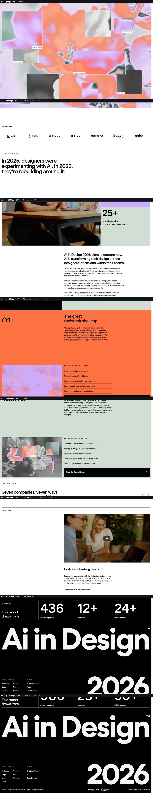
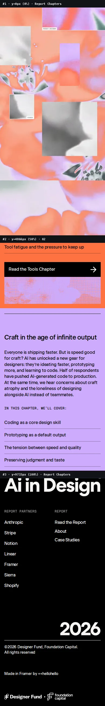

# UI Design System & Master Generation Blueprint: stateofaidesign-com

> **AI in Design Report 2026** (https://stateofaidesign.com/) — The second annual report by Designer Fund and Foundation Capital on how design teams are adapting to AI across tooling, craft, and org.





---

## 1. Executive Visual Persona & Design Archetype

- **Brand Essence & Persona**: **AI in Design Report 2026** (`https://stateofaidesign.com/`). The second annual report by Designer Fund and Foundation Capital on how design teams are adapting to AI across tooling, craft, and org.
- **Capture Provenance**: Live browser capture (`tier1_fast`, HTTP `200`, captured `2026-11-24`).
- **Visual Archetype**: **Light-Substrate Editorial & Modular Grid System (`#ffffff` canvas, `#000000` ink, `#0000ee` accent)**.
- **Anti-AI-Slop Differentiators**:
  - **Live-Computed Chromatic Polarity**: Anchors the viewport in `#ffffff` (live computed `body` `background-color` (`computed_styles.json`)) paired with `#000000` primary typography and `#0000ee` accents.
  - **Grounded Typographic Hierarchy**: Pairs `Beausite Classic Medium` for display copy (`AI in Design Report 2026`) with `Beausite Classic Medium Placeholder` and `Geist Mono`.
  - **Calibrated Spatial Grid & Motion**: Combines `1440px` container bounds (`gap: 0px 16px`, padding `145px`) with `cubic-bezier(.44,0,.56,1)` easing and Framer Motion Layout Physics.

---

## 2. Spatial Architecture & Modular Grid Mathematics

### Viewport Allocation & Container Geometry
- **Captured Journey Filmstrips**: Desktop `1280×6624px` (`assets/desktop-journey.webp`, `8` keyframes up to `y=10309px` / doc `11209px`), Mobile `390×2616px` (`assets/mobile-journey.webp`, `3` keyframes).
- **Master Container Bounds**: `1440px` (full-bleed `100%` viewport stage).
- **Canvas Lateral Padding & Spacing**: `145px` lateral canvas padding with `0px 16px` grid gap.
- **Border Radius Scale**: `8px`, `15px`, `0px`, `100%`.

### Responsive Breakpoint Architecture
- **Desktop Layout**: Multi-column CSS Grid / Flexbox layout at `1440px` (`max-width: 1440px`, `gap: 0px 16px`).
- **Mobile Layout**: Single-column vertical stack at `390px` viewport width with `145px` horizontal padding.
- **Extracted CSS Media Queries**: `@media (min-width: 2560px)`, `@media (min-width: 1200px) and (max-width: 2559.98px)`, `@media (min-width: 768px) and (max-width: 1199.98px)`, `@media (max-width: 767.98px)`.

---

## 3. Color System, Materiality & Atmospheric Lighting

### Semantic Palette & Source Grounding
| Semantic Role | Ground-Truth Value | Extracted Live / CSS Source |
|---|---|---|
| **Primary Canvas Substrate** | `#ffffff` | live computed `body` `background-color` (`computed_styles.json`) |
| **Primary Typography Ink** | `#000000` | live computed `h1` `color` (`computed_styles.json`) |
| **Elevated Surface / Card Substrate** | `#cdabfe` | live computed `a` `background-color` (`computed_styles.json`) |
| **Interactive Accent / Highlight** | `#0000ee` | live computed `a` `color` (`computed_styles.json`) |
| **Secondary / Muted Copy** | `#0000ee` | live computed `a` `color` (`computed_styles.json`) |
| **Structural Hairline Border** | `#000000` | `var(--border-color)` in `:root` |
| **Variable Token (`--token-3412d4dd-2f5f-48c8-b607-f8105a8b7211`)** | `#fe7141` | `var(--token-3412d4dd-2f5f-48c8-b607-f8105a8b7211)` in `:root` |
| **Variable Token (`--token-6af35a76-1812-4e65-b20e-93b47dd846c7`)** | `#597e87` | `var(--token-6af35a76-1812-4e65-b20e-93b47dd846c7)` in `:root` |
| **Variable Token (`--token-dc58878c-6871-4081-9b9a-81f0df31eb6a`)** | `#d1ddd3` | `var(--token-dc58878c-6871-4081-9b9a-81f0df31eb6a)` in `:root` |
| **Variable Token (`--token-9c987371-9131-4ecc-9a69-10e703280af3`)** | `#f5f9fc` | `var(--token-9c987371-9131-4ecc-9a69-10e703280af3)` in `:root` |
| **Variable Token (`--token-ce625ef5-5dd0-428c-a706-db60cbd06c7f`)** | `#153250` | `var(--token-ce625ef5-5dd0-428c-a706-db60cbd06c7f)` in `:root` |

### Sanitized Root CSS Variables (`ui-ux.md` Ground Truth)
| Variable Name | Extracted Value | Semantic Role |
|---|---|---|
| `--token-3412d4dd-2f5f-48c8-b607-f8105a8b7211` | `#fe7141` | Color / Atmospheric Token |
| `--token-a228bc56-904d-4a09-b7f8-6b60e0221982` | `#000` | Color / Atmospheric Token |
| `--token-0d9c52bb-4346-4afb-b8ae-283673444b3f` | `#fff` | Color / Atmospheric Token |
| `--token-54653423-a788-4b87-99d2-f130e2af5148` | `#cdabfe` | Color / Atmospheric Token |
| `--token-6af35a76-1812-4e65-b20e-93b47dd846c7` | `#597e87` | Color / Atmospheric Token |
| `--token-dc58878c-6871-4081-9b9a-81f0df31eb6a` | `#d1ddd3` | Color / Atmospheric Token |
| `--token-9c987371-9131-4ecc-9a69-10e703280af3` | `#f5f9fc` | Color / Atmospheric Token |
| `--token-ce625ef5-5dd0-428c-a706-db60cbd06c7f` | `#153250` | Color / Atmospheric Token |
| `--token-d66b7197-4553-4ba6-b16f-d06cd8b6ab87` | `#d1ddd3` | Color / Atmospheric Token |
| `--text-decoration-skip-ink` | `var(--framer-text-decoration-skip-ink)` | Typography Ink Token |
| `--text-underline-offset` | `var(--framer-text-decoration-offset)` | Typography Ink Token |
| `--font-family` | `var(--framer-font-family)` | Typography / Scale Token |
| `--font-style` | `var(--framer-font-style)` | Typography / Scale Token |
| `--font-weight` | `var(--framer-font-weight)` | Typography / Scale Token |
| `--text-color` | `var(--framer-text-color)` | Typography Ink Token |
| `--letter-spacing` | `var(--framer-letter-spacing)` | Typography / Scale Token |

---

## 4. Typographic Scale & Editorial Hierarchy

### Font Family Stacks
- **Display Typography**: `Beausite Classic Medium`.
- **Primary Body Stack**: `Beausite Classic Medium Placeholder`.
- **Technical / Metadata Stack**: `Geist Mono`.

### Typographic Scale & Rules (Live Computed & Stylesheet Grounded)
- **Hero Display (`H1`)**: live computed `h1` (`font-size: 120px`, `line-height: 114px`, `font-weight: 500`, `letter-spacing: -7.2px`); rule `h1` (`font-size: 50px`, `line-height: 1em`, `letter-spacing: -.04em`, `font-weight: 500`).
- **Section Heading (`H2`)**: live computed `h2` (`font-size: 80px`, `line-height: 76px`, `font-weight: 500`, `letter-spacing: -4.8px`).
- **Body Copy**: live computed `body` (`font-size: 12px`, `line-height: normal`, `font-weight: 400`); rule `p` (`font-size: 50px`, `line-height: 120%`, `letter-spacing: -.03em`, `font-weight: 500`).
- **Metadata & Navigation Labels**: live computed `nav/a` (`font-size: 12px`, `line-height: normal`, `font-weight: 400`); CSS variables `--letter-spacing: var(--framer-letter-spacing)`.

---

## 5. Choreographed Motion & Interaction Physics

### Primary Easing Curves
- **Extracted Timing Functions**: `cubic-bezier(.44,0,.56,1)`, `cubic-bezier(0.4,0,1,1)`.

### Per-Element Transition & Choreography Rules
- **Selector `r-styles-preset-1irpjtw.rich-text...`**: `transition: color .2s cubic-bezier(.44,0,.56,1),text-decoration-color .2s...` extracted from `stateofaidesign-com` stylesheet.
- **Selector `er-styles-preset-minbjw.rich-text...`**: `transition: color .2s cubic-bezier(.44,0,.56,1),text-decoration-color .2s...` extracted from `stateofaidesign-com` stylesheet.
- **Selector `.framer-form-input-wrapper:after`**: `transition: var(--framer-input-focused-transition)` extracted from `stateofaidesign-com` stylesheet.
- **Extracted Easing Curve (`cubic-bezier(.44,0,.56,1)`)**: Governs interactive state transitions across `<nav.framer-g5d54>` and `<article.framer-HiGHW>`.
- **Runtime Interaction Engine**: Integrates Framer Motion Layout Physics with `prefers-reduced-motion: reduce` fallback guards.
### Measured Runtime Scroll & Interaction Telemetry (`behavioral_journey_v2`)
- **Scroll Driver Mode**: `native` (max document height `11209px`, deepest scrollY reached `10309px` across `8` desktop keyframes).
- **Detected Scroll / Motion Libraries**: `Framer Motion`.
- **Route Transition Architecture**: First internal navigation (`/chapters/tools`) measured as `direct` in `2204ms`.

---

## 6. Component Wireframe & Structural DOM Map

### Visual Layout Schematic — Desktop (`1440px`, Grounded in `dom.html` & Landmark Bounding Boxes)
```
┌────────────────────────────────────────────────────────────────────────┐
│ DESKTOP VIEWPORT (1440px) — AI in Design Report 2026                   │
│ ====================================================================== │
│ [ <nav.framer-g5d54> (1425x56px)      | About About · Tools 01 · Cra ] │
│ ---------------------------------------------------------------------- │
│ | HERO STAGE: <article.framer-1ti4ff8> (w=1440px)                    | │
│ | H1: AI in Design Report 2026                                       | │
│ | Substrate: #ffffff | Ink: #000000 | Accent: #0000ee                | │
│ ---------------------------------------------------------------------- │
│ | SHOWCASE GRID (<article.framer-HiGHW>) max-w: 1440px               | │
│ | +------------------------------+  +------------------------------+ | │
│ | | In 2025, designers were expe |  | The great toolstack shakeup  | | │
│ | +------------------------------+  +------------------------------+ | │
│ ---------------------------------------------------------------------- │
│ | DETAIL MODULE (<article.framer-72rtr7>) — Craft in the age of i    | │
│ ---------------------------------------------------------------------- │
│ [ FOOTER (<footer.framer-3azmv) | https://stateofaidesign.com/         │
└────────────────────────────────────────────────────────────────────────┘
```

### Visual Layout Schematic — Mobile Reflow (`390px`)
```
┌────────────────────────────────────────────────────────────────────────┐
│ MOBILE VIEWPORT REFLOW (390px) — Single-Column Stack (gap: 0px 16px)   │
│ ====================================================================== │
│ [ HEADER BAR (<nav.framer-g5d54>      ) | Compact Menu (390px)         │
│ ---------------------------------------------------------------------- │
│ | HERO STAGE (<article.framer-1ti4ff8>) — 390px Vertical Lead        | │
│ | H1: AI in Design Report 2026                                       | │
│ ---------------------------------------------------------------------- │
│ | SHOWCASE STACK (<article.framer-HiGHW>) — 1-Col Stack              | │
│ | [ Item 1: In 2025, designers were experimenting with AI. In...   ] | │
│ | [ Item 2: The great toolstack shakeup                            ] | │
│ ---------------------------------------------------------------------- │
│ | DETAIL STACK (<article.framer-72rtr7>) — 1-Col (Craft in the age o)  │
│ ---------------------------------------------------------------------- │
│ [ FOOTER (<footer.framer-3azmv) | Stacked 390px Colophon               │
└────────────────────────────────────────────────────────────────────────┘
```

### Granular DOM Region Breakdown
1. **Brand Header & Navigation Bar (<nav.framer-g5d54> — `stateofaidesign-com`)**:
   - Landmark `<nav class="framer-g5d54 framer-60e8rl">` (`1425x56px`) hosting `AI in Design Report 2026` navigation (`About About · Tools 01 · Craft 02 · Teams 03 · Sierra 01`), DOM attributes (`data-framer-font-css`, `data-framer-breakpoint-css`, `data-framer-css-ssr-minified`, `data-framer-components="framer-lib-cursors-ho..."`), and stylesheet rule `.hidden-miin9m { display:none!important }`.
2. **Hero Stage & Focal Lead (<article.framer-1ti4ff8> — `AI in Design Report 2026`)**:
   - Landmark `<article class="framer-1ti4ff8">` presenting display lead `AI in Design Report 2026` and copy excerpt *"©2026 Designer Fund, Foundation Capital. All rights reserved"* over `#ffffff` canvas and `#000000` ink.
3. **Primary Showcase & Content Grid (<article.framer-HiGHW> — `In 2025, designers were experiment`)**:
   - Landmark `<article class="framer-HiGHW">` rendering section `In 2025, designers were experimenting with AI. In...` with copy *"How designers are evolving their tools, craft, and teams with AI"*, asset references (`YeBg4KhukpeFDQRc7qUySaNCzM4.png`, `LYZGuKjYSwOjtebGnDa0R1K1zg.png`, `fonts.gstatic.com`, `adora-start.js`), and grid rule `.hidden-72rtr7 { display:none!important }`.
4. **Interactive Detail & Feature Matrix (<article.framer-72rtr7> — `The great toolstack shakeup`)**:
   - Landmark `<article class="framer-72rtr7">` framing `The great toolstack shakeup` and `Craft in the age of infinite output` (*"By Designer Fund in partnership with Foundation Capital"*) with `#cdabfe` surface cards, `#0000ee` accents, and `.hidden-t69d6d { display:none!important }`.
5. **Colophon & Global Directory Footer (<footer.framer-3azmvu> — `https://stateofaidesign.com/`)**:
   - Landmark `<footer class="framer-3azmvu">` anchoring `AI in Design Report 2026` footer links (`About About · Tools 01 · Craft 02 · Teams 03 · Sierra 01`), copy *"An Inflection Point"*, and `#000000` structural dividers.
### Full Vertical Scroll Sequence (Desktop `1440×900` Keyframes)
- **Step 01** (`y=0px`, `0%`): Active landmark `Hero` · sticky/fixed elements: `0`
- **Step 02** (`y=850px`, `8%`): Active landmark `AI in Design Report 2026` · sticky/fixed elements: `0`
- **Step 03** (`y=2550px`, `25%`): Active landmark `Section @ 25%` · sticky/fixed elements: `0`
- **Step 04** (`y=4250px`, `41%`): Active landmark `The great toolstack shakeup` · sticky/fixed elements: `0`
- **Step 05** (`y=6800px`, `66%`): Active landmark `Teams` · sticky/fixed elements: `0`
- **Step 06** (`y=8500px`, `82%`): Active landmark `Inside AI-native design teams` · sticky/fixed elements: `0`
- **Step 07** (`y=10200px`, `99%`): Active landmark `METHODOLOGY` · sticky/fixed elements: `0`
- **Step 08** (`y=10309px`, `100%`): Active landmark `Footer / Bottom` · sticky/fixed elements: `0`

### Multi-Page Internal Route Map
- **Detail Route (`/chapters/tools`)**: `https://stateofaidesign.com/chapters/tools` — H1: `The great toolstack shakeup`, scrollHeight `25322px`, transition `direct` (`2204ms`)
- **About Route (`/about`)**: `https://stateofaidesign.com/about` — H1: `AI in Design 2026 is the second annual research p...`, scrollHeight `10445px`, transition `direct` (`1949ms`)
- **Detail Route (`/chapters/craft`)**: `https://stateofaidesign.com/chapters/craft` — H1: `Craft in an age of infinite output`, scrollHeight `28191px`, transition `direct` (`3565ms`)

---

## 7. Master Zero-Shot AI Generation Prompt

```markdown
# Master Zero-Shot Frontend Generation Prompt: stateofaidesign-com (AI in Design Report 2026)

You are a principal frontend architect and design systems engineer. Build a complete, production-ready web application replicating the exact design system, DOM landmarks, typographic hierarchy, color tokens, and motion physics of `stateofaidesign-com` (**AI in Design Report 2026** — `https://stateofaidesign.com/`).

### 1. Visual Archetype & Anti-AI-Slop Mandates
- **Archetype**: Light-Substrate Editorial & Modular Grid System (`#ffffff` canvas, `#000000` ink, `#0000ee` accent).
- **Identity & Domain Context**: The second annual report by Designer Fund and Foundation Capital on how design teams are adapting to AI across tooling, craft, and org.
- **Primary Substrate**: `#ffffff` (live computed `body` `background-color` (`computed_styles.json`)), **Primary Ink**: `#000000`, **Accent / Highlight**: `#0000ee`.
- **Site-Specific Differentiators**:
  - **Live-Computed Chromatic Polarity**: Anchors the viewport in `#ffffff` (live computed `body` `background-color` (`computed_styles.json`)) paired with `#000000` primary typography and `#0000ee` accents.
  - **Grounded Typographic Hierarchy**: Pairs `Beausite Classic Medium` for display copy (`AI in Design Report 2026`) with `Beausite Classic Medium Placeholder` and `Geist Mono`.
  - **Calibrated Spatial Grid & Motion**: Combines `1440px` container bounds (`gap: 0px 16px`, padding `145px`) with `cubic-bezier(.44,0,.56,1)` easing and Framer Motion Layout Physics.

### 2. Ground-Truth CSS Variables (`:root` Token Contract)
Declare and consume these exact custom properties extracted from `stateofaidesign-com` in your global stylesheet:

:root {
  /* AI in Design Report 2026 (stateofaidesign-com) — Live-Grounded CSS Variables */
  --token-3412d4dd-2f5f-48c8-b607-f8105a8b7211: #fe7141; /* Color / Atmospheric Token (stateofaidesign-com) */
  --token-a228bc56-904d-4a09-b7f8-6b60e0221982: #000; /* Color / Atmospheric Token (stateofaidesign-com) */
  --token-0d9c52bb-4346-4afb-b8ae-283673444b3f: #fff; /* Color / Atmospheric Token (stateofaidesign-com) */
  --token-54653423-a788-4b87-99d2-f130e2af5148: #cdabfe; /* Color / Atmospheric Token (stateofaidesign-com) */
  --token-6af35a76-1812-4e65-b20e-93b47dd846c7: #597e87; /* Color / Atmospheric Token (stateofaidesign-com) */
  --token-dc58878c-6871-4081-9b9a-81f0df31eb6a: #d1ddd3; /* Color / Atmospheric Token (stateofaidesign-com) */
  --token-9c987371-9131-4ecc-9a69-10e703280af3: #f5f9fc; /* Color / Atmospheric Token (stateofaidesign-com) */
  --token-ce625ef5-5dd0-428c-a706-db60cbd06c7f: #153250; /* Color / Atmospheric Token (stateofaidesign-com) */
  --token-d66b7197-4553-4ba6-b16f-d06cd8b6ab87: #d1ddd3; /* Color / Atmospheric Token (stateofaidesign-com) */
  --text-decoration-skip-ink: var(--framer-text-decoration-skip-ink); /* Typography Ink Token (stateofaidesign-com) */
  --text-underline-offset: var(--framer-text-decoration-offset); /* Typography Ink Token (stateofaidesign-com) */
  --font-family: var(--framer-font-family); /* Typography / Scale Token (stateofaidesign-com) */
  --font-style: var(--framer-font-style); /* Typography / Scale Token (stateofaidesign-com) */
  --font-weight: var(--framer-font-weight); /* Typography / Scale Token (stateofaidesign-com) */
  --text-color: var(--framer-text-color); /* Typography Ink Token (stateofaidesign-com) */
  --letter-spacing: var(--framer-letter-spacing); /* Typography / Scale Token (stateofaidesign-com) */
}

### 3. Semantic Color & Materiality Contract
Map every surface, ink, and border strictly to these source-grounded tokens:
- **Primary Canvas Substrate**: `#ffffff` — grounded in live computed `body` `background-color` (`computed_styles.json`)
- **Primary Typography Ink**: `#000000` — grounded in live computed `h1` `color` (`computed_styles.json`)
- **Elevated Surface / Card Substrate**: `#cdabfe` — grounded in live computed `a` `background-color` (`computed_styles.json`)
- **Interactive Accent / Highlight**: `#0000ee` — grounded in live computed `a` `color` (`computed_styles.json`)
- **Secondary / Muted Copy**: `#0000ee` — grounded in live computed `a` `color` (`computed_styles.json`)
- **Structural Hairline Border**: `#000000` — grounded in `var(--border-color)` in `:root`
- **Variable Token (`--token-3412d4dd-2f5f-48c8-b607-f8105a8b7211`)**: `#fe7141` — grounded in `var(--token-3412d4dd-2f5f-48c8-b607-f8105a8b7211)` in `:root`
- **Variable Token (`--token-6af35a76-1812-4e65-b20e-93b47dd846c7`)**: `#597e87` — grounded in `var(--token-6af35a76-1812-4e65-b20e-93b47dd846c7)` in `:root`
- **Variable Token (`--token-dc58878c-6871-4081-9b9a-81f0df31eb6a`)**: `#d1ddd3` — grounded in `var(--token-dc58878c-6871-4081-9b9a-81f0df31eb6a)` in `:root`
- **Variable Token (`--token-9c987371-9131-4ecc-9a69-10e703280af3`)**: `#f5f9fc` — grounded in `var(--token-9c987371-9131-4ecc-9a69-10e703280af3)` in `:root`
- **Variable Token (`--token-ce625ef5-5dd0-428c-a706-db60cbd06c7f`)**: `#153250` — grounded in `var(--token-ce625ef5-5dd0-428c-a706-db60cbd06c7f)` in `:root`

### 4. Spatial Grid, Container Bounds & Responsive Breakpoints
- **Desktop Viewport Reference**: `1280×6624px` (multi-frame vertical journey filmstrip (6624px), `1440px` standard desktop width).
- **Mobile Viewport Reference**: `390×2616px` (multi-frame vertical journey filmstrip (2616px), `390px` standard mobile width).
- **Container Max-Width**: `1440px` (full-bleed `100%` viewport stage)
- **Padding & Gutters**: `145px` lateral canvas padding with `0px 16px` grid gap
- **Desktop Grid**: Multi-column CSS Grid / Flexbox layout at `1440px` (`max-width: 1440px`, `gap: 0px 16px`)
- **Mobile Adaptation**: Single-column vertical stack at `390px` viewport width with `145px` horizontal padding
- **Media Queries**: `@media (min-width: 2560px)`, `@media (min-width: 1200px) and (max-width: 2559.98px)`, `@media (min-width: 768px) and (max-width: 1199.98px)`, `@media (max-width: 767.98px)`
- **Corner Radii**: `8px`, `15px`, `0px`, `100%`

### 5. Typography & Editorial Scale Contract
- **Display Font Stack**: `Beausite Classic Medium`
- **Body Font Stack**: `Beausite Classic Medium Placeholder`
- **Monospace / Technical Font Stack**: `Geist Mono`
- **H1 Display Rule**: live computed `h1` (`font-size: 120px`, `line-height: 114px`, `font-weight: 500`, `letter-spacing: -7.2px`); rule `h1` (`font-size: 50px`, `line-height: 1em`, `letter-spacing: -.04em`, `font-weight: 500`)
- **H2 Section Rule**: live computed `h2` (`font-size: 80px`, `line-height: 76px`, `font-weight: 500`, `letter-spacing: -4.8px`)
- **Body Copy Rule**: live computed `body` (`font-size: 12px`, `line-height: normal`, `font-weight: 400`); rule `p` (`font-size: 50px`, `line-height: 120%`, `letter-spacing: -.03em`, `font-weight: 500`)
- **Metadata & Index Rule**: live computed `nav/a` (`font-size: 12px`, `line-height: normal`, `font-weight: 400`); CSS variables `--letter-spacing: var(--framer-letter-spacing)`

### 6. Component Hierarchy, Verbatim Copy & Real DOM Landmarks
Scaffold `stateofaidesign-com` (`AI in Design Report 2026`) with these exact structural regions, extracted copy, and CSS rules from `dom.html`:
1. **Brand Header & Navigation Bar (<nav.framer-g5d54> — `stateofaidesign-com`)**:
   - DOM & Selectors: Landmark `<nav class="framer-g5d54 framer-60e8rl">` (`1425x56px`) hosting `AI in Design Report 2026` navigation (`About About · Tools 01 · Craft 02 · Teams 03 · Sierra 01`), DOM attributes (`data-framer-font-css`, `data-framer-breakpoint-css`, `data-framer-css-ssr-minified`, `data-framer-components="framer-lib-cursors-ho..."`), and stylesheet rule `.hidden-miin9m { display:none!important }`.
   - Responsive Contract: Header `Brand Header & Navigation Bar (<nav.framer-g5d54> — `stateofaidesign-com`)` (`stateofaidesign-com`) adapts across `@media (min-width: 2560px)`, `@media (min-width: 1200px) and (max-width: 2559.98px)`, `@media (min-width: 768px) and (max-width: 1199.98px)`, `@media (max-width: 767.98px)` with `cubic-bezier(.44,0,.56,1)`, `cubic-bezier(0.4,0,1,1)` transitions and links `About About · Tools 01 · Craft 02 · Teams 03 · Sierra 01`.
2. **Hero Stage & Focal Lead (<article.framer-1ti4ff8> — `AI in Design Report 2026`)**:
   - DOM & Selectors: Landmark `<article class="framer-1ti4ff8">` presenting display lead `AI in Design Report 2026` and copy excerpt *"©2026 Designer Fund, Foundation Capital. All rights reserved"* over `#ffffff` canvas and `#000000` ink.
   - Responsive Contract: Hero stage (`1280×6624px` desktop / `390×2616px` mobile) sets `#ffffff` background with `#000000` headline `AI in Design Report 2026`.
3. **Primary Showcase & Content Grid (<article.framer-HiGHW> — `In 2025, designers were experiment`)**:
   - DOM & Selectors: Landmark `<article class="framer-HiGHW">` rendering section `In 2025, designers were experimenting with AI. In...` with copy *"How designers are evolving their tools, craft, and teams with AI"*, asset references (`YeBg4KhukpeFDQRc7qUySaNCzM4.png`, `LYZGuKjYSwOjtebGnDa0R1K1zg.png`, `fonts.gstatic.com`, `adora-start.js`), and grid rule `.hidden-72rtr7 { display:none!important }`.
   - Responsive Contract: Showcase grid `Primary Showcase & Content Grid (<article.framer-HiGHW> — `In 2025, designers were experiment`)` applies Multi-column CSS Grid / Flexbox layout at `1440px` (`max-width: 1440px`, `gap: 0px 16px`) on desktop and Single-column vertical stack at `390px` viewport width with `145px` horizontal padding on mobile.
4. **Interactive Detail & Feature Matrix (<article.framer-72rtr7> — `The great toolstack shakeup`)**:
   - DOM & Selectors: Landmark `<article class="framer-72rtr7">` framing `The great toolstack shakeup` and `Craft in the age of infinite output` (*"By Designer Fund in partnership with Foundation Capital"*) with `#cdabfe` surface cards, `#0000ee` accents, and `.hidden-t69d6d { display:none!important }`.
   - Responsive Contract: Detail module `Interactive Detail & Feature Matrix (<article.framer-72rtr7> — `The great toolstack shakeup`)` uses `8px`, `15px`, `0px`, `100%` radii, `#0000ee` highlights, and assets (YeBg4KhukpeFDQRc7qUySaNCzM4.png, LYZGuKjYSwOjtebGnDa0R1K1zg.png, fonts.gstatic.com).
5. **Colophon & Global Directory Footer (<footer.framer-3azmvu> — `https://stateofaidesign.com/`)**:
   - DOM & Selectors: Landmark `<footer class="framer-3azmvu">` anchoring `AI in Design Report 2026` footer links (`About About · Tools 01 · Craft 02 · Teams 03 · Sierra 01`), copy *"An Inflection Point"*, and `#000000` structural dividers.
   - Responsive Contract: Footer `Colophon & Global Directory Footer (<footer.framer-3azmvu> — `https://stateofaidesign.com/`)` aligns to `1440px` (full-bleed `100%` viewport stage) with `145px` lateral canvas padding with `0px 16px` grid gap and attributes (data-framer-font-css, data-framer-breakpoint-css, data-framer-css-ssr-minified).

#### Verbatim DOM Copy Excerpts (`dom.html`)
- Copy Excerpt 1: *"©2026 Designer Fund, Foundation Capital. All rights reserved"*
- Copy Excerpt 2: *"How designers are evolving their tools, craft, and teams with AI"*
- Copy Excerpt 3: *"By Designer Fund in partnership with Foundation Capital"*
- Copy Excerpt 4: *"An Inflection Point"*

### 7. Motion, Extracted Stylesheet Rules & Interaction Choreography
- **Primary Easing Functions**: `cubic-bezier(.44,0,.56,1)`, `cubic-bezier(0.4,0,1,1)`
- **Extracted Stylesheet Rules (`stateofaidesign-com`)**:
- `.hidden-miin9m { display:none!important }`
- `.hidden-72rtr7 { display:none!important }`
- `.hidden-t69d6d { display:none!important }`
- `.hidden-12sschj { display:none!important }`
- `.hidden-1l822iz { display:none!important }`
- **Per-Selector Transition Rules**:
- **Selector `r-styles-preset-1irpjtw.rich-text...`**: `transition: color .2s cubic-bezier(.44,0,.56,1),text-decoration-color .2s...` extracted from `stateofaidesign-com` stylesheet.
- **Selector `er-styles-preset-minbjw.rich-text...`**: `transition: color .2s cubic-bezier(.44,0,.56,1),text-decoration-color .2s...` extracted from `stateofaidesign-com` stylesheet.
- **Selector `.framer-form-input-wrapper:after`**: `transition: var(--framer-input-focused-transition)` extracted from `stateofaidesign-com` stylesheet.
- **Extracted Easing Curve (`cubic-bezier(.44,0,.56,1)`)**: Governs interactive state transitions across `<nav.framer-g5d54>` and `<article.framer-HiGHW>`.
- **Runtime Interaction Engine**: Integrates Framer Motion Layout Physics with `prefers-reduced-motion: reduce` fallback guards.
### 7b. Full-Page Scroll Choreography, Interactive States & Multi-Page Routes
- **Scroll Mechanics**: Implement `native` vertical progression up to `11209px` across 8 distinct viewport chapters using Framer Motion.
- **Vertical Chapter Sequence**: Hero (0%) -> AI in Design Report 2026 (8%) -> Section @ 25% (25%) -> The great toolstack shakeup (41%) -> Teams (66%) -> Inside AI-native design teams (82%) -> METHODOLOGY (99%) -> Footer / Bottom (100%).
- **Multi-Page Routes**: Scaffold internal routes `/chapters/tools` (detail, direct), `/about` (about, direct), `/chapters/craft` (detail, direct) sharing the global header/footer shell and design tokens.

### 8. Technical Deliverables
- Implement in Next.js (App Router) with TypeScript and Tailwind CSS consuming the `:root` custom properties defined above for `stateofaidesign-com`.
- Reproduce both the `1440px` desktop architecture and `390px` mobile breakpoint transitions, preserving semantic HTML5 landmarks (`<header>`, `<nav>`, `<main>`, `<section>`, `<footer>`) and `prefers-reduced-motion` accessibility guards.
```
---

## 8. Full-Page Scroll Journey, Interactive States & Subpage Inventory

### Desktop Scroll Keyframes (`1440×900` WebP)
| Step | Scroll Y | Progress | Active Landmark / Section | Sticky/Fixed | Visual Asset |
| :---: | :---: | :---: | :--- | :---: | :--- |
| `#01` | `0px` | `0%` | Hero | `0` | [desktop-step-01.webp](assets/desktop-step-01.webp) |
| `#02` | `850px` | `8%` | AI in Design Report 2026 | `0` | [desktop-step-02.webp](assets/desktop-step-02.webp) |
| `#03` | `2550px` | `25%` | Section @ 25% | `0` | [desktop-step-03.webp](assets/desktop-step-03.webp) |
| `#04` | `4250px` | `41%` | The great toolstack shakeup | `0` | [desktop-step-04.webp](assets/desktop-step-04.webp) |
| `#05` | `6800px` | `66%` | Teams | `0` | [desktop-step-05.webp](assets/desktop-step-05.webp) |
| `#06` | `8500px` | `82%` | Inside AI-native design teams | `0` | [desktop-step-06.webp](assets/desktop-step-06.webp) |
| `#07` | `10200px` | `99%` | METHODOLOGY | `0` | [desktop-step-07.webp](assets/desktop-step-07.webp) |
| `#08` | `10309px` | `100%` | Footer / Bottom | `0` | [desktop-step-08.webp](assets/desktop-step-08.webp) |

### Mobile Condensed Keyframes (`390×844` WebP)
| Step | Scroll Y | Progress | Active Landmark | Visual Asset |
| :---: | :---: | :---: | :--- | :--- |
| `#01` | `0px` | `0%` | Report Chapters | [mobile-step-01.webp](assets/mobile-step-01.webp) |
| `#02` | `4866px` | `50%` | 02 | [mobile-step-02.webp](assets/mobile-step-02.webp) |
| `#03` | `9733px` | `100%` | Report Chapters | [mobile-step-03.webp](assets/mobile-step-03.webp) |

### Internal Subpage Filmstrips (`1080px` Wide WebP)
| # | Template | Route URL | H1 / Title | Scroll Height | Transition | Filmstrip Asset |
| :-: | :---: | :--- | :--- | :---: | :---: | :--- |
| `1` | `detail` | `https://stateofaidesign.com/chapters/tools` | The great toolstack shakeup | `25322px` | `direct` (`2204ms`) | [subpage-01-chapters-tools.webp](assets/subpage-01-chapters-tools.webp) |
| `2` | `about` | `https://stateofaidesign.com/about` | AI in Design 2026 is the second annua... | `10445px` | `direct` (`1949ms`) | [subpage-02-about.webp](assets/subpage-02-about.webp) |
| `3` | `detail` | `https://stateofaidesign.com/chapters/craft` | Craft in an age of infinite output | `28191px` | `direct` (`3565ms`) | [subpage-03-chapters-craft.webp](assets/subpage-03-chapters-craft.webp) |

