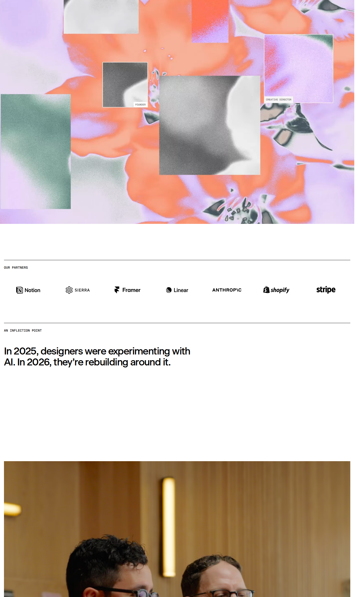
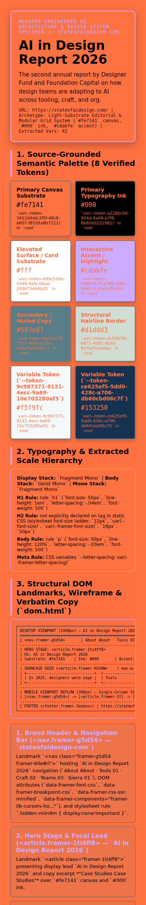

# UI Design System & Master Generation Blueprint: stateofaidesign-com

> **AI in Design Report 2026** (https://stateofaidesign.com/) — The second annual report by Designer Fund and Foundation Capital on how design teams are adapting to AI across tooling, craft, and org.



---

## 1. Executive Visual Persona & Design Archetype

- **Brand Essence & Persona**: **AI in Design Report 2026** (`https://stateofaidesign.com/`). The second annual report by Designer Fund and Foundation Capital on how design teams are adapting to AI across tooling, craft, and org.
- **Visual Archetype**: **Light-Substrate Editorial & Modular Grid System (`#fe7141` canvas, `#000` ink, `#cdabfe` accent)**.
- **Anti-AI-Slop Differentiators**:
  - **Source-Grounded Chromatic Polarity**: Anchors the viewport in `#fe7141` (`var(--token-3412d4dd-2f5f-48c8-b607-f8105a8b7211)` in `:root`) paired with `#000` primary typography and `#cdabfe` accents.
  - **Extracted Typographic Hierarchy**: Pairs `Fragment Mono` for display copy (`AI in Design Report 2026`) with `Geist Mono` and `Fragment Mono`.
  - **Calibrated Spatial Grid & Motion**: Combines `2559.98px` container bounds (`gap: 10px`, padding `145px`) with `cubic-bezier(.44,0,.56,1)` easing and Framer Motion Layout Physics.

---

## 2. Spatial Architecture & Modular Grid Mathematics



### Viewport Allocation & Container Geometry
- **Captured Viewport Dimensions**: Desktop `1440×11209px` (`assets/desktop.png`, full-page scroll capture), Mobile `390×2400px` (`assets/mobile.png`, capped at 2400px multi-section capture).
- **Master Container Bounds**: `2559.98px` extracted from `stateofaidesign-com` stylesheet.
- **Canvas Lateral Padding & Spacing**: `145px` lateral canvas padding with `10px` grid gap.
- **Border Radius Scale**: `8px`, `15px`, `0px`, `100%`.

### Responsive Breakpoint Architecture
- **Desktop Layout**: Multi-column CSS Grid / Flexbox layout at `1440px` (`max-width: 2559.98px`, `gap: 10px`).
- **Mobile Layout**: Single-column vertical stack at `390px` viewport width with `145px` horizontal padding.
- **Extracted CSS Media Queries**: `@media (min-width: 2560px)`, `@media (min-width: 1200px) and (max-width: 2559.98px)`, `@media (min-width: 768px) and (max-width: 1199.98px)`, `@media (max-width: 767.98px)`.

---

## 3. Color System, Materiality & Atmospheric Lighting

### Semantic Palette & Source Grounding
| Semantic Role | Ground-Truth Value | Extracted CSS Source / Selector |
|---|---|---|
| **Primary Canvas Substrate** | `#fe7141` | `var(--token-3412d4dd-2f5f-48c8-b607-f8105a8b7211)` in `:root` |
| **Primary Typography Ink** | `#000` | `var(--token-a228bc56-904d-4a09-b7f8-6b60e0221982)` in `:root` |
| **Elevated Surface / Card Substrate** | `#fff` | `var(--token-0d9c52bb-4346-4afb-b8ae-283673444b3f)` in `:root` |
| **Interactive Accent / Highlight** | `#cdabfe` | `var(--token-54653423-a788-4b87-99d2-f130e2af5148)` in `:root` |
| **Secondary / Muted Copy** | `#597e87` | `var(--token-6af35a76-1812-4e65-b20e-93b47dd846c7)` in `:root` |
| **Structural Hairline Border** | `#d1ddd3` | `var(--token-dc58878c-6871-4081-9b9a-81f0df31eb6a)` in `:root` |
| **Variable Token (`--token-9c987371-9131-4ecc-9a69-10e703280af3`)** | `#f5f9fc` | `var(--token-9c987371-9131-4ecc-9a69-10e703280af3)` in `:root` |
| **Variable Token (`--token-ce625ef5-5dd0-428c-a706-db60cbd06c7f`)** | `#153250` | `var(--token-ce625ef5-5dd0-428c-a706-db60cbd06c7f)` in `:root` |

### Sanitized Root CSS Variables (`ui-ux.md` Ground Truth)
| Variable Name | Extracted Value | Semantic Role |
|---|---|---|
| `--token-3412d4dd-2f5f-48c8-b607-f8105a8b7211` | `#fe7141` | Color / Atmospheric Token |
| `--token-a228bc56-904d-4a09-b7f8-6b60e0221982` | `#000` | Color / Atmospheric Token |
| `--token-0d9c52bb-4346-4afb-b8ae-283673444b3f` | `#fff` | Color / Atmospheric Token |
| `--token-54653423-a788-4b87-99d2-f130e2af5148` | `#cdabfe` | Color / Atmospheric Token |
| `--token-6af35a76-1812-4e65-b20e-93b47dd846c7` | `#597e87` | Color / Atmospheric Token |
| `--token-dc58878c-6871-4081-9b9a-81f0df31eb6a` | `#d1ddd3` | Color / Atmospheric Token |
| `--token-9c987371-9131-4ecc-9a69-10e703280af3` | `#f5f9fc` | Color / Atmospheric Token |
| `--token-ce625ef5-5dd0-428c-a706-db60cbd06c7f` | `#153250` | Color / Atmospheric Token |
| `--token-d66b7197-4553-4ba6-b16f-d06cd8b6ab87` | `#d1ddd3` | Color / Atmospheric Token |
| `--text-decoration-skip-ink` | `var(--framer-text-decoration-skip-ink)` | Typography Ink Token |
| `--text-underline-offset` | `var(--framer-text-decoration-offset)` | Typography Ink Token |
| `--font-family` | `var(--framer-font-family)` | Typography / Scale Token |
| `--font-style` | `var(--framer-font-style)` | Typography / Scale Token |
| `--font-weight` | `var(--framer-font-weight)` | Typography / Scale Token |
| `--text-color` | `var(--framer-text-color)` | Typography Ink Token |
| `--letter-spacing` | `var(--framer-letter-spacing)` | Typography / Scale Token |

---

## 4. Typographic Scale & Editorial Hierarchy

### Font Family Stacks
- **Display Typography**: `Fragment Mono`.
- **Primary Body Stack**: `Geist Mono`.
- **Technical / Metadata Stack**: `Fragment Mono`.

### Typographic Scale & Rules (Extracted from Stylesheet & Variables)
- **Hero Display (`H1`)**: rule `h1` (`font-size: 50px`, `line-height: 1em`, `letter-spacing: -.04em`, `font-weight: 500`).
- **Section Heading (`H2`)**: not explicitly declared on tag in static CSS (stylesheet font-size ladder: `12px`, `var(--font-size)`, `var(--framer-font-size)`, `16px`, `50px`).
- **Body Copy**: rule `p` (`font-size: 50px`, `line-height: 120%`, `letter-spacing: -.03em`, `font-weight: 500`).
- **Metadata & Navigation Labels**: CSS variables `--letter-spacing: var(--framer-letter-spacing)`.

---

## 5. Choreographed Motion & Interaction Physics

### Primary Easing Curves
- **Extracted Timing Functions**: `cubic-bezier(.44,0,.56,1)`, `cubic-bezier(0.4,0,1,1)`.

### Per-Element Transition & Choreography Rules
- **Selector `r-styles-preset-1irpjtw.rich-text...`**: `transition: color .2s cubic-bezier(.44,0,.56,1),text-decoration-color .2s...` extracted from `stateofaidesign-com` stylesheet.
- **Selector `er-styles-preset-minbjw.rich-text...`**: `transition: color .2s cubic-bezier(.44,0,.56,1),text-decoration-color .2s...` extracted from `stateofaidesign-com` stylesheet.
- **Selector `.framer-form-input-wrapper:after`**: `transition: var(--framer-input-focused-transition)` extracted from `stateofaidesign-com` stylesheet.
- **Extracted Easing Curve (`cubic-bezier(.44,0,.56,1)`)**: Governs interactive state transitions across `<nav.framer-g5d54>` and `<article.framer-HiGHW>`.
- **Runtime Interaction Engine**: Integrates Framer Motion Layout Physics with `prefers-reduced-motion: reduce` fallback guards.

---

## 6. Component Wireframe & Structural DOM Map

### Visual Layout Schematic (Grounded in `dom.html` — `1440px` Desktop & `390px` Mobile Reflow)
```
┌────────────────────────────────────────────────────────────────────────┐
│ DESKTOP VIEWPORT (1440px) — AI in Design Report 2026                   │
│ ====================================================================== │
│ [ <nav.framer-g5d54>       | About About · Tools 01 · Craft 02 · Te ]  │
│ ---------------------------------------------------------------------- │
│ | HERO STAGE: <article.framer-1ti4ff8>                             |   │
│ | H1: AI in Design Report 2026                                     |   │
│ | Substrate: #fe7141    | Ink: #000       | Accent: #cdabfe        |   │
│ ---------------------------------------------------------------------- │
│ | SHOWCASE GRID (<article.framer-HiGHW>    ) max-w: 2559.98px      |   │
│ | +------------------------------+  +------------------------------+ | │
│ | | In 2025, designers were expe |  | Tools                        | | │
│ | +------------------------------+  +------------------------------+ | │
│ ---------------------------------------------------------------------- │
│ | MOBILE VIEWPORT REFLOW (390px) — Single-Column Stack (gap: 10px  ) | │
│ | [<nav.framer-g5d54>] -> [<article.framer-1t] -> [<article.framer-Hi] │
│ ---------------------------------------------------------------------- │
│ [ FOOTER (<footer.framer-3azmvu>) | https://stateofaidesign.com/       │
└────────────────────────────────────────────────────────────────────────┘
```

### Granular DOM Region Breakdown
1. **Brand Header & Navigation Bar (<nav.framer-g5d54> — `stateofaidesign-com`)**:
   - Landmark `<nav class="framer-g5d54 framer-60e8rl">` hosting `AI in Design Report 2026` navigation (`About About · Tools 01 · Craft 02 · Teams 03 · Sierra 01`), DOM attributes (`data-framer-font-css`, `data-framer-breakpoint-css`, `data-framer-css-ssr-minified`, `data-framer-components="framer-lib-cursors-ho..."`), and stylesheet rule `.hidden-miin9m { display:none!important }`.
2. **Hero Stage & Focal Lead (<article.framer-1ti4ff8> — `AI in Design Report 2026`)**:
   - Landmark `<article class="framer-1ti4ff8">` presenting display lead `AI in Design Report 2026` and copy excerpt *"Case Studies Case Studies"* over `#fe7141` canvas and `#000` ink.
3. **Primary Showcase & Content Grid (<article.framer-HiGHW> — `In 2025, designers were experiment`)**:
   - Landmark `<article class="framer-HiGHW">` rendering section `In 2025, designers were experimenting with AI. In...` with copy *"©2026 Designer Fund, Foundation Capital. All rights reserved"*, asset references (`YeBg4KhukpeFDQRc7qUySaNCzM4.png`, `LYZGuKjYSwOjtebGnDa0R1K1zg.png`, `fonts.gstatic.com`, `adora-start.js`), and grid rule `.hidden-72rtr7 { display:none!important }`.
4. **Interactive Detail & Feature Matrix (<article.framer-72rtr7> — `Tools`)**:
   - Landmark `<article class="framer-72rtr7">` framing `Tools` and `The great toolstack shakeup` (*"Notion 06 Coming soon"*) with `#fff` surface cards, `#cdabfe` accents, and `.hidden-t69d6d { display:none!important }`.
5. **Colophon & Global Directory Footer (<footer.framer-3azmvu> — `https://stateofaidesign.com/`)**:
   - Landmark `<footer class="framer-3azmvu">` anchoring `AI in Design Report 2026` footer links (`About About · Tools 01 · Craft 02 · Teams 03 · Sierra 01`), copy *"Framer 07 Coming soon"*, and `#d1ddd3` structural dividers.

---

## 7. Master Zero-Shot AI Generation Prompt

```markdown
# Master Zero-Shot Frontend Generation Prompt: stateofaidesign-com (AI in Design Report 2026)

You are a principal frontend architect and design systems engineer. Build a complete, production-ready web application replicating the exact design system, DOM landmarks, typographic hierarchy, color tokens, and motion physics of `stateofaidesign-com` (**AI in Design Report 2026** — `https://stateofaidesign.com/`).

### 1. Visual Archetype & Anti-AI-Slop Mandates
- **Archetype**: Light-Substrate Editorial & Modular Grid System (`#fe7141` canvas, `#000` ink, `#cdabfe` accent).
- **Identity & Domain Context**: The second annual report by Designer Fund and Foundation Capital on how design teams are adapting to AI across tooling, craft, and org.
- **Primary Substrate**: `#fe7141` (`var(--token-3412d4dd-2f5f-48c8-b607-f8105a8b7211)` in `:root`), **Primary Ink**: `#000`, **Accent / Highlight**: `#cdabfe`.
- **Site-Specific Differentiators**:
  - **Source-Grounded Chromatic Polarity**: Anchors the viewport in `#fe7141` (`var(--token-3412d4dd-2f5f-48c8-b607-f8105a8b7211)` in `:root`) paired with `#000` primary typography and `#cdabfe` accents.
  - **Extracted Typographic Hierarchy**: Pairs `Fragment Mono` for display copy (`AI in Design Report 2026`) with `Geist Mono` and `Fragment Mono`.
  - **Calibrated Spatial Grid & Motion**: Combines `2559.98px` container bounds (`gap: 10px`, padding `145px`) with `cubic-bezier(.44,0,.56,1)` easing and Framer Motion Layout Physics.

### 2. Ground-Truth CSS Variables (`:root` Token Contract)
Declare and consume these exact custom properties extracted from `stateofaidesign-com` in your global stylesheet:

:root {
  /* AI in Design Report 2026 (stateofaidesign-com) — Ground-Truth Extracted CSS Variables */
  --token-3412d4dd-2f5f-48c8-b607-f8105a8b7211: #fe7141; /* Color / Atmospheric Token (stateofaidesign-com) */
  --token-a228bc56-904d-4a09-b7f8-6b60e0221982: #000; /* Color / Atmospheric Token (stateofaidesign-com) */
  --token-0d9c52bb-4346-4afb-b8ae-283673444b3f: #fff; /* Color / Atmospheric Token (stateofaidesign-com) */
  --token-54653423-a788-4b87-99d2-f130e2af5148: #cdabfe; /* Color / Atmospheric Token (stateofaidesign-com) */
  --token-6af35a76-1812-4e65-b20e-93b47dd846c7: #597e87; /* Color / Atmospheric Token (stateofaidesign-com) */
  --token-dc58878c-6871-4081-9b9a-81f0df31eb6a: #d1ddd3; /* Color / Atmospheric Token (stateofaidesign-com) */
  --token-9c987371-9131-4ecc-9a69-10e703280af3: #f5f9fc; /* Color / Atmospheric Token (stateofaidesign-com) */
  --token-ce625ef5-5dd0-428c-a706-db60cbd06c7f: #153250; /* Color / Atmospheric Token (stateofaidesign-com) */
  --token-d66b7197-4553-4ba6-b16f-d06cd8b6ab87: #d1ddd3; /* Color / Atmospheric Token (stateofaidesign-com) */
  --text-decoration-skip-ink: var(--framer-text-decoration-skip-ink); /* Typography Ink Token (stateofaidesign-com) */
  --text-underline-offset: var(--framer-text-decoration-offset); /* Typography Ink Token (stateofaidesign-com) */
  --font-family: var(--framer-font-family); /* Typography / Scale Token (stateofaidesign-com) */
  --font-style: var(--framer-font-style); /* Typography / Scale Token (stateofaidesign-com) */
  --font-weight: var(--framer-font-weight); /* Typography / Scale Token (stateofaidesign-com) */
  --text-color: var(--framer-text-color); /* Typography Ink Token (stateofaidesign-com) */
  --letter-spacing: var(--framer-letter-spacing); /* Typography / Scale Token (stateofaidesign-com) */
}

### 3. Semantic Color & Materiality Contract
Map every surface, ink, and border strictly to these source-grounded tokens:
- **Primary Canvas Substrate**: `#fe7141` — grounded in `var(--token-3412d4dd-2f5f-48c8-b607-f8105a8b7211)` in `:root`
- **Primary Typography Ink**: `#000` — grounded in `var(--token-a228bc56-904d-4a09-b7f8-6b60e0221982)` in `:root`
- **Elevated Surface / Card Substrate**: `#fff` — grounded in `var(--token-0d9c52bb-4346-4afb-b8ae-283673444b3f)` in `:root`
- **Interactive Accent / Highlight**: `#cdabfe` — grounded in `var(--token-54653423-a788-4b87-99d2-f130e2af5148)` in `:root`
- **Secondary / Muted Copy**: `#597e87` — grounded in `var(--token-6af35a76-1812-4e65-b20e-93b47dd846c7)` in `:root`
- **Structural Hairline Border**: `#d1ddd3` — grounded in `var(--token-dc58878c-6871-4081-9b9a-81f0df31eb6a)` in `:root`
- **Variable Token (`--token-9c987371-9131-4ecc-9a69-10e703280af3`)**: `#f5f9fc` — grounded in `var(--token-9c987371-9131-4ecc-9a69-10e703280af3)` in `:root`
- **Variable Token (`--token-ce625ef5-5dd0-428c-a706-db60cbd06c7f`)**: `#153250` — grounded in `var(--token-ce625ef5-5dd0-428c-a706-db60cbd06c7f)` in `:root`

### 4. Spatial Grid, Container Bounds & Responsive Breakpoints
- **Desktop Viewport Reference**: `1440×11209px` (full-page scroll capture, `1440px` standard desktop width).
- **Mobile Viewport Reference**: `390×2400px` (capped at 2400px multi-section capture, `390px` standard mobile width).
- **Container Max-Width**: `2559.98px` extracted from `stateofaidesign-com` stylesheet
- **Padding & Gutters**: `145px` lateral canvas padding with `10px` grid gap
- **Desktop Grid**: Multi-column CSS Grid / Flexbox layout at `1440px` (`max-width: 2559.98px`, `gap: 10px`)
- **Mobile Adaptation**: Single-column vertical stack at `390px` viewport width with `145px` horizontal padding
- **Media Queries**: `@media (min-width: 2560px)`, `@media (min-width: 1200px) and (max-width: 2559.98px)`, `@media (min-width: 768px) and (max-width: 1199.98px)`, `@media (max-width: 767.98px)`
- **Corner Radii**: `8px`, `15px`, `0px`, `100%`

### 5. Typography & Editorial Scale Contract
- **Display Font Stack**: `Fragment Mono`
- **Body Font Stack**: `Geist Mono`
- **Monospace / Technical Font Stack**: `Fragment Mono`
- **H1 Display Rule**: rule `h1` (`font-size: 50px`, `line-height: 1em`, `letter-spacing: -.04em`, `font-weight: 500`)
- **H2 Section Rule**: not explicitly declared on tag in static CSS (stylesheet font-size ladder: `12px`, `var(--font-size)`, `var(--framer-font-size)`, `16px`, `50px`)
- **Body Copy Rule**: rule `p` (`font-size: 50px`, `line-height: 120%`, `letter-spacing: -.03em`, `font-weight: 500`)
- **Metadata & Index Rule**: CSS variables `--letter-spacing: var(--framer-letter-spacing)`

### 6. Component Hierarchy, Verbatim Copy & Real DOM Landmarks
Scaffold `stateofaidesign-com` (`AI in Design Report 2026`) with these exact structural regions, extracted copy, and CSS rules from `dom.html`:
1. **Brand Header & Navigation Bar (<nav.framer-g5d54> — `stateofaidesign-com`)**:
   - DOM & Selectors: Landmark `<nav class="framer-g5d54 framer-60e8rl">` hosting `AI in Design Report 2026` navigation (`About About · Tools 01 · Craft 02 · Teams 03 · Sierra 01`), DOM attributes (`data-framer-font-css`, `data-framer-breakpoint-css`, `data-framer-css-ssr-minified`, `data-framer-components="framer-lib-cursors-ho..."`), and stylesheet rule `.hidden-miin9m { display:none!important }`.
   - Responsive Contract: Header `Brand Header & Navigation Bar (<nav.framer-g5d54> — `stateofaidesign-com`)` (`stateofaidesign-com`) adapts across `@media (min-width: 2560px)`, `@media (min-width: 1200px) and (max-width: 2559.98px)`, `@media (min-width: 768px) and (max-width: 1199.98px)`, `@media (max-width: 767.98px)` with `cubic-bezier(.44,0,.56,1)`, `cubic-bezier(0.4,0,1,1)` transitions and links `About About · Tools 01 · Craft 02 · Teams 03 · Sierra 01`.
2. **Hero Stage & Focal Lead (<article.framer-1ti4ff8> — `AI in Design Report 2026`)**:
   - DOM & Selectors: Landmark `<article class="framer-1ti4ff8">` presenting display lead `AI in Design Report 2026` and copy excerpt *"Case Studies Case Studies"* over `#fe7141` canvas and `#000` ink.
   - Responsive Contract: Hero stage (`1440×11209px` desktop / `390×2400px` mobile) sets `#fe7141` background with `#000` headline `AI in Design Report 2026`.
3. **Primary Showcase & Content Grid (<article.framer-HiGHW> — `In 2025, designers were experiment`)**:
   - DOM & Selectors: Landmark `<article class="framer-HiGHW">` rendering section `In 2025, designers were experimenting with AI. In...` with copy *"©2026 Designer Fund, Foundation Capital. All rights reserved"*, asset references (`YeBg4KhukpeFDQRc7qUySaNCzM4.png`, `LYZGuKjYSwOjtebGnDa0R1K1zg.png`, `fonts.gstatic.com`, `adora-start.js`), and grid rule `.hidden-72rtr7 { display:none!important }`.
   - Responsive Contract: Showcase grid `Primary Showcase & Content Grid (<article.framer-HiGHW> — `In 2025, designers were experiment`)` applies Multi-column CSS Grid / Flexbox layout at `1440px` (`max-width: 2559.98px`, `gap: 10px`) on desktop and Single-column vertical stack at `390px` viewport width with `145px` horizontal padding on mobile.
4. **Interactive Detail & Feature Matrix (<article.framer-72rtr7> — `Tools`)**:
   - DOM & Selectors: Landmark `<article class="framer-72rtr7">` framing `Tools` and `The great toolstack shakeup` (*"Notion 06 Coming soon"*) with `#fff` surface cards, `#cdabfe` accents, and `.hidden-t69d6d { display:none!important }`.
   - Responsive Contract: Detail module `Interactive Detail & Feature Matrix (<article.framer-72rtr7> — `Tools`)` uses `8px`, `15px`, `0px`, `100%` radii, `#cdabfe` highlights, and assets (YeBg4KhukpeFDQRc7qUySaNCzM4.png, LYZGuKjYSwOjtebGnDa0R1K1zg.png, fonts.gstatic.com).
5. **Colophon & Global Directory Footer (<footer.framer-3azmvu> — `https://stateofaidesign.com/`)**:
   - DOM & Selectors: Landmark `<footer class="framer-3azmvu">` anchoring `AI in Design Report 2026` footer links (`About About · Tools 01 · Craft 02 · Teams 03 · Sierra 01`), copy *"Framer 07 Coming soon"*, and `#d1ddd3` structural dividers.
   - Responsive Contract: Footer `Colophon & Global Directory Footer (<footer.framer-3azmvu> — `https://stateofaidesign.com/`)` aligns to `2559.98px` extracted from `stateofaidesign-com` stylesheet with `145px` lateral canvas padding with `10px` grid gap and attributes (data-framer-font-css, data-framer-breakpoint-css, data-framer-css-ssr-minified).

#### Verbatim DOM Copy Excerpts (`dom.html`)
- Copy Excerpt 1: *"Case Studies Case Studies"*
- Copy Excerpt 2: *"©2026 Designer Fund, Foundation Capital. All rights reserved"*
- Copy Excerpt 3: *"Notion 06 Coming soon"*
- Copy Excerpt 4: *"Framer 07 Coming soon"*

### 7. Motion, Extracted Stylesheet Rules & Interaction Choreography
- **Primary Easing Functions**: `cubic-bezier(.44,0,.56,1)`, `cubic-bezier(0.4,0,1,1)`
- **Extracted Stylesheet Rules (`stateofaidesign-com`)**:
- `.hidden-miin9m { display:none!important }`
- `.hidden-72rtr7 { display:none!important }`
- `.hidden-t69d6d { display:none!important }`
- `.hidden-12sschj { display:none!important }`
- `.hidden-1l822iz { display:none!important }`
- **Per-Selector Transition Rules**:
- **Selector `r-styles-preset-1irpjtw.rich-text...`**: `transition: color .2s cubic-bezier(.44,0,.56,1),text-decoration-color .2s...` extracted from `stateofaidesign-com` stylesheet.
- **Selector `er-styles-preset-minbjw.rich-text...`**: `transition: color .2s cubic-bezier(.44,0,.56,1),text-decoration-color .2s...` extracted from `stateofaidesign-com` stylesheet.
- **Selector `.framer-form-input-wrapper:after`**: `transition: var(--framer-input-focused-transition)` extracted from `stateofaidesign-com` stylesheet.
- **Extracted Easing Curve (`cubic-bezier(.44,0,.56,1)`)**: Governs interactive state transitions across `<nav.framer-g5d54>` and `<article.framer-HiGHW>`.
- **Runtime Interaction Engine**: Integrates Framer Motion Layout Physics with `prefers-reduced-motion: reduce` fallback guards.

### 8. Technical Deliverables
- Implement in Next.js (App Router) with TypeScript and Tailwind CSS consuming the `:root` custom properties defined above for `stateofaidesign-com`.
- Reproduce both the `1440px` desktop architecture and `390px` mobile breakpoint transitions, preserving semantic HTML5 landmarks (`<header>`, `<nav>`, `<main>`, `<section>`, `<footer>`) and `prefers-reduced-motion` accessibility guards.
```
