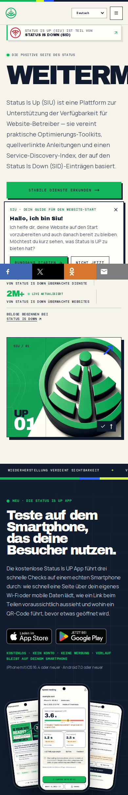

# UI Design System & Master Generation Blueprint: statusisup-com

> **Status Is UP — Index für Service-Uptime, Performance & Zuverlässigkeit** (https://statusisup.com/) — Entdecken Sie Dienste mit geringer beobachteter Ausfallaktivität über einen quellverknüpften Index für Service-Uptime, Performance und Zu...


---

## 1. Executive Visual Persona & Design Archetype

- **Brand Essence & Persona**: **Status Is UP — Index für Service-Uptime, Performance & Zuverlässigkeit** (`https://statusisup.com/`). Entdecken Sie Dienste mit geringer beobachteter Ausfallaktivität über einen quellverknüpften Index für Service-Uptime, Performance und Zu...
- **Visual Archetype**: **High-Contrast Obsidian / Atmospheric Design System (`#111d2f` canvas, `#fffef8` ink, `#fffef8` accent)**.
- **Anti-AI-Slop Differentiators**:
  - **Source-Grounded Chromatic Polarity**: Anchors the viewport in `#111d2f` (`var(--siu-guide-navy)` in `:root`) paired with `#fffef8` primary typography and `#fffef8` accents.
  - **Extracted Typographic Hierarchy**: Pairs `Archivo Black` for display copy (`WEITERMACHEN.`) with `DM Mono` and `DM Mono`.
  - **Calibrated Spatial Grid & Motion**: Combines `112px` container bounds (`gap: .36rem`, padding `.32rem`) with `cubic-bezier(.23,1,.32,1)` easing.

---

## 2. Spatial Architecture & Modular Grid Mathematics



### Viewport Allocation & Container Geometry
- **Captured Viewport Dimensions**: Desktop `1440×11173px` (`assets/desktop.png`, full-page scroll capture), Mobile `390×2400px` (`assets/mobile.png`, capped at 2400px multi-section capture).
- **Master Container Bounds**: `112px` extracted from `statusisup-com` stylesheet.
- **Canvas Lateral Padding & Spacing**: `.32rem` lateral canvas padding with `.36rem` grid gap.
- **Border Radius Scale**: `50%`, `999px`, `9px`, `2.4rem`.

### Responsive Breakpoint Architecture
- **Desktop Layout**: Multi-column CSS Grid / Flexbox layout at `1440px` (`max-width: 112px`, `gap: .36rem`).
- **Mobile Layout**: Single-column vertical stack at `390px` viewport width with `.32rem` horizontal padding.
- **Extracted CSS Media Queries**: `@media (max-width:720px)`, `@media (max-width: 1120px)`, `@media (max-width: 720px)`, `@media (max-width: 430px)`.

---

## 3. Color System, Materiality & Atmospheric Lighting

### Semantic Palette & Source Grounding
| Semantic Role | Ground-Truth Value | Extracted CSS Source / Selector |
|---|---|---|
| **Primary Canvas Substrate** | `#111d2f` | `var(--siu-guide-navy)` in `:root` |
| **Primary Typography Ink** | `#14b65b` | `var(--siu-guide-green)` in `:root` |
| **Elevated Surface / Card Substrate** | `#c7f42b` | `var(--siu-guide-lime)` in `:root` |
| **Interactive Accent / Highlight** | `#fffef8` | `var(--siu-guide-cream)` in `:root` |
| **Secondary / Muted Copy** | `#435064` | `var(--siu-guide-ink)` in `:root` |
| **Structural Hairline Border** | `#17202a` | `var(--action-card-ink)` in `:root` |
| **Variable Token (`--action-card-muted`)** | `#52606d` | `var(--action-card-muted)` in `:root` |
| **Variable Token (`--action-card-border`)** | `#cbd5df` | `var(--action-card-border)` in `:root` |
| **Variable Token (`--action-card-surface`)** | `#ffffff` | `var(--action-card-surface)` in `:root` |
| **Variable Token (`--action-card-subtle`)** | `#f4f7fa` | `var(--action-card-subtle)` in `:root` |
| **Variable Token (`--action-card-accent`)** | `#085cc7` | `var(--action-card-accent)` in `:root` |
| **Variable Token (`--action-card-focus`)** | `#f59e0b` | `var(--action-card-focus)` in `:root` |
| **Variable Token (`--signal-ink`)** | `#08733a` | `var(--signal-ink)` in `:root` |
| **Variable Token (`--signal-cobalt`)** | `#1d4ed8` | `var(--signal-cobalt)` in `:root` |

### Sanitized Root CSS Variables (`ui-ux.md` Ground Truth)
| Variable Name | Extracted Value | Semantic Role |
|---|---|---|
| `--siu-guide-navy` | `#111d2f` | Layout / Spatial Grid Token |
| `--siu-guide-green` | `#14b65b` | Color / Atmospheric Token |
| `--siu-guide-lime` | `#c7f42b` | Color / Atmospheric Token |
| `--siu-guide-cream` | `#fffef8` | Color / Atmospheric Token |
| `--siu-guide-ink` | `#435064` | Typography Ink Token |
| `--action-card-ink` | `#17202a` | Typography Ink Token |
| `--action-card-muted` | `#52606d` | Color / Atmospheric Token |
| `--action-card-border` | `#cbd5df` | Elevation / Border Token |
| `--action-card-surface` | `#ffffff` | Canvas / Surface Token |
| `--action-card-subtle` | `#f4f7fa` | Color / Atmospheric Token |
| `--action-card-accent` | `#085cc7` | Brand / Palette Token |
| `--action-card-focus` | `#f59e0b` | Color / Atmospheric Token |
| `--signal-tone` | `#14b65b` | Color / Atmospheric Token |
| `--signal-ink` | `#08733a` | Typography Ink Token |
| `--signal-wash` | `rgba(20,182,91,.12)` | Color / Atmospheric Token |
| `--signal-cobalt` | `#1d4ed8` | Color / Atmospheric Token |

---

## 4. Typographic Scale & Editorial Hierarchy

### Font Family Stacks
- **Display Typography**: `Archivo Black`.
- **Primary Body Stack**: `DM Mono`.
- **Technical / Metadata Stack**: `DM Mono`.

### Typographic Scale & Rules (Extracted from Stylesheet & Variables)
- **Hero Display (`H1`)**: CSS variables `--text-4xl: 2.25rem`, `--text-4xl--line-height: calc(2.5/2.25)`, `--text-5xl: 3rem`; rule `h1` (`letter-spacing: -.075em`).
- **Section Heading (`H2`)**: CSS variables `--text-2xl: 1.5rem`, `--text-2xl--line-height: calc(2/1.5)`, `--text-3xl: 1.875rem`; rule `h2` (`letter-spacing: -.065em`).
- **Body Copy**: CSS variables `--text-base: 1rem`, `--text-base--line-height: 1.5`, `--siu-body: "Manrope",sans-serif`; rule `p` (`font-size: .76rem`, `line-height: 1.65`).
- **Metadata & Navigation Labels**: CSS variables `--text-xs: .75rem`, `--text-xs--line-height: calc(1/.75)`, `--text-sm: .875rem`; rule `small` (`letter-spacing: .09em`).

---

## 5. Choreographed Motion & Interaction Physics

### Primary Easing Curves
- **Extracted Timing Functions**: `cubic-bezier(.23,1,.32,1)`, `cubic-bezier(0,0,.2,1)`, `cubic-bezier(.4,0,.2,1)`.

### Per-Element Transition & Choreography Rules
- **Selector `.siu-site-footer-brand img`**: `transition: transform .18s cubic-bezier(.23,1,.32,1)` extracted from `statusisup-com` stylesheet.
- **Selector `.siu-site-nav-link`**: `transition: color .16s cubic-bezier(.23,1,.32,1),background-color .16s cub...` extracted from `statusisup-com` stylesheet.
- **Selector `.siu-site-nav-link:after`**: `transition: transform .18s cubic-bezier(.23,1,.32,1)` extracted from `statusisup-com` stylesheet.
- **Extracted Easing Curve (`cubic-bezier(.23,1,.32,1)`)**: Governs interactive state transitions across `<header.siu-site-header>` and `<section.hero-shell>`.
- **State & Hover Choreography**: Opacity and transform transitions on `<section.min-h-screen>` and `<section.hero-shell>` interactive targets.

---

## 6. Component Wireframe & Structural DOM Map

### Visual Layout Schematic (Grounded in `dom.html` — `1440px` Desktop & `390px` Mobile Reflow)
```
┌────────────────────────────────────────────────────────────────────────┐
│ DESKTOP VIEWPORT (1440px) — Status Is UP — Index für Service-Uptime, P │
│ ====================================================================== │
│ [ <header.siu-site-header> | Launch Kit · Toolkits · Preise         ]  │
│ ---------------------------------------------------------------------- │
│ | HERO STAGE: <section.min-h-screen>                               |   │
│ | H1: WEITERMACHEN.                                                |   │
│ | Substrate: #111d2f    | Ink: #fffef8    | Accent: #fffef8        |   │
│ ---------------------------------------------------------------------- │
│ | SHOWCASE GRID (<section.hero-shell>      ) max-w: 112px          |   │
│ | +------------------------------+  +------------------------------+ | │
│ | | Teste auf dem Smartphone, da |  | Finden Sie Dienste, die bere | | │
│ | +------------------------------+  +------------------------------+ | │
│ ---------------------------------------------------------------------- │
│ | MOBILE VIEWPORT REFLOW (390px) — Single-Column Stack (gap: .36rem) | │
│ | [<header.siu-site-h] -> [<section.min-h-scr] -> [<section.hero-shel] │
│ ---------------------------------------------------------------------- │
│ [ FOOTER (<footer.siu-site-foote) | https://statusisup.com/            │
└────────────────────────────────────────────────────────────────────────┘
```

### Granular DOM Region Breakdown
1. **Brand Header & Navigation Bar (<header.siu-site-header> — `statusisup-com`)**:
   - Landmark `<header class="siu-site-header">` hosting `Status Is UP — Index für Service-Upt` navigation (`Launch Kit · Toolkits · Preise`), DOM attributes (`data-siu-asset-recovery`, `data-checked-head="true"`, `data-loc="client/src/pages/Home..."`, `data-loc="client/src/components..."`), and stylesheet rule `.language-selector svg { width:.88rem;height:.88rem;color:08733a }`.
2. **Hero Stage & Focal Lead (<section.min-h-screen> — `WEITERMACHEN.`)**:
   - Landmark `<section class="min-h-screen">` presenting display lead `WEITERMACHEN.` and copy excerpt *"STATUS IS UP UNTERSTÜTZUNG VERFÜGBARKEIT"* over `#111d2f` canvas and `#fffef8` ink.
3. **Primary Showcase & Content Grid (<section.hero-shell> — `Teste auf dem Smartphone, das dein`)**:
   - Landmark `<section class="hero-shell relative">` rendering section `Teste auf dem Smartphone, das deine Besucher nutzen.` with copy *"Website‑Optimierungs‑Wiki"*, asset references (`get_counts`, `show_ads_impl_fy2021.js`, `6a949f167c6f97b4640555e1.js`, `favicon.ico`), and grid rule `.language-selector select { max-width:112px;border:0;background:transparent;color:inherit;font:inher... }`.
4. **Interactive Detail & Feature Matrix (<section.ticker-bar> — `Finden Sie Dienste, die bereit ble`)**:
   - Landmark `<section class="ticker-bar">` framing `Finden Sie Dienste, die bereit bleiben.` and `Gute Nachrichten brauchen gute Belege.` (*"Anzeigesprache wählen"*) with `#c7f42b` surface cards, `#fffef8` accents, and `.language-selector:focus-within { border-color:14b65b;box-shadow:0 0 0 2px 14b65b33 }`.
5. **Colophon & Global Directory Footer (<footer.siu-site-footer> — `https://statusisup.com/`)**:
   - Landmark `<footer class="siu-site-footer">` anchoring `Status Is UP — Index für Service` footer links (`Launch Kit · Toolkits · Preise`), copy *"Live-Status auf SID"*, and `#17202a` structural dividers.

---

## 7. Master Zero-Shot AI Generation Prompt

```markdown
# Master Zero-Shot Frontend Generation Prompt: statusisup-com (Status Is UP — Index für Service-Uptime, Performance & Zuverlässigkeit)

You are a principal frontend architect and design systems engineer. Build a complete, production-ready web application replicating the exact design system, DOM landmarks, typographic hierarchy, color tokens, and motion physics of `statusisup-com` (**Status Is UP — Index für Service-Uptime, Performance & Zuverlässigkeit** — `https://statusisup.com/`).

### 1. Visual Archetype & Anti-AI-Slop Mandates
- **Archetype**: High-Contrast Obsidian / Atmospheric Design System (`#111d2f` canvas, `#fffef8` ink, `#fffef8` accent).
- **Identity & Domain Context**: Entdecken Sie Dienste mit geringer beobachteter Ausfallaktivität über einen quellverknüpften Index für Service-Uptime, Performance und Zu...
- **Primary Substrate**: `#111d2f` (`var(--siu-guide-navy)` in `:root`), **Primary Ink**: `#fffef8`, **Accent / Highlight**: `#fffef8`.
- **Site-Specific Differentiators**:
  - **Source-Grounded Chromatic Polarity**: Anchors the viewport in `#111d2f` (`var(--siu-guide-navy)` in `:root`) paired with `#fffef8` primary typography and `#fffef8` accents.
  - **Extracted Typographic Hierarchy**: Pairs `Archivo Black` for display copy (`WEITERMACHEN.`) with `DM Mono` and `DM Mono`.
  - **Calibrated Spatial Grid & Motion**: Combines `112px` container bounds (`gap: .36rem`, padding `.32rem`) with `cubic-bezier(.23,1,.32,1)` easing.

### 2. Ground-Truth CSS Variables (`:root` Token Contract)
Declare and consume these exact custom properties extracted from `statusisup-com` in your global stylesheet:

:root {
  /* Status Is UP — Index für Service-Uptime, Performance & Zuverlässigkeit (statusisup-com) — Ground-Truth Extracted CSS Variables */
  --siu-guide-navy: #111d2f; /* Layout / Spatial Grid Token (statusisup-com) */
  --siu-guide-green: #14b65b; /* Color / Atmospheric Token (statusisup-com) */
  --siu-guide-lime: #c7f42b; /* Color / Atmospheric Token (statusisup-com) */
  --siu-guide-cream: #fffef8; /* Color / Atmospheric Token (statusisup-com) */
  --siu-guide-ink: #435064; /* Typography Ink Token (statusisup-com) */
  --action-card-ink: #17202a; /* Typography Ink Token (statusisup-com) */
  --action-card-muted: #52606d; /* Color / Atmospheric Token (statusisup-com) */
  --action-card-border: #cbd5df; /* Elevation / Border Token (statusisup-com) */
  --action-card-surface: #ffffff; /* Canvas / Surface Token (statusisup-com) */
  --action-card-subtle: #f4f7fa; /* Color / Atmospheric Token (statusisup-com) */
  --action-card-accent: #085cc7; /* Brand / Palette Token (statusisup-com) */
  --action-card-focus: #f59e0b; /* Color / Atmospheric Token (statusisup-com) */
  --signal-tone: #14b65b; /* Color / Atmospheric Token (statusisup-com) */
  --signal-ink: #08733a; /* Typography Ink Token (statusisup-com) */
  --signal-wash: rgba(20,182,91,.12); /* Color / Atmospheric Token (statusisup-com) */
  --signal-cobalt: #1d4ed8; /* Color / Atmospheric Token (statusisup-com) */
}

### 3. Semantic Color & Materiality Contract
Map every surface, ink, and border strictly to these source-grounded tokens:
- **Primary Canvas Substrate**: `#111d2f` — grounded in `var(--siu-guide-navy)` in `:root`
- **Primary Typography Ink**: `#14b65b` — grounded in `var(--siu-guide-green)` in `:root`
- **Elevated Surface / Card Substrate**: `#c7f42b` — grounded in `var(--siu-guide-lime)` in `:root`
- **Interactive Accent / Highlight**: `#fffef8` — grounded in `var(--siu-guide-cream)` in `:root`
- **Secondary / Muted Copy**: `#435064` — grounded in `var(--siu-guide-ink)` in `:root`
- **Structural Hairline Border**: `#17202a` — grounded in `var(--action-card-ink)` in `:root`
- **Variable Token (`--action-card-muted`)**: `#52606d` — grounded in `var(--action-card-muted)` in `:root`
- **Variable Token (`--action-card-border`)**: `#cbd5df` — grounded in `var(--action-card-border)` in `:root`
- **Variable Token (`--action-card-surface`)**: `#ffffff` — grounded in `var(--action-card-surface)` in `:root`
- **Variable Token (`--action-card-subtle`)**: `#f4f7fa` — grounded in `var(--action-card-subtle)` in `:root`
- **Variable Token (`--action-card-accent`)**: `#085cc7` — grounded in `var(--action-card-accent)` in `:root`
- **Variable Token (`--action-card-focus`)**: `#f59e0b` — grounded in `var(--action-card-focus)` in `:root`
- **Variable Token (`--signal-ink`)**: `#08733a` — grounded in `var(--signal-ink)` in `:root`
- **Variable Token (`--signal-cobalt`)**: `#1d4ed8` — grounded in `var(--signal-cobalt)` in `:root`

### 4. Spatial Grid, Container Bounds & Responsive Breakpoints
- **Desktop Viewport Reference**: `1440×11173px` (full-page scroll capture, `1440px` standard desktop width).
- **Mobile Viewport Reference**: `390×2400px` (capped at 2400px multi-section capture, `390px` standard mobile width).
- **Container Max-Width**: `112px` extracted from `statusisup-com` stylesheet
- **Padding & Gutters**: `.32rem` lateral canvas padding with `.36rem` grid gap
- **Desktop Grid**: Multi-column CSS Grid / Flexbox layout at `1440px` (`max-width: 112px`, `gap: .36rem`)
- **Mobile Adaptation**: Single-column vertical stack at `390px` viewport width with `.32rem` horizontal padding
- **Media Queries**: `@media (max-width:720px)`, `@media (max-width: 1120px)`, `@media (max-width: 720px)`, `@media (max-width: 430px)`
- **Corner Radii**: `50%`, `999px`, `9px`, `2.4rem`

### 5. Typography & Editorial Scale Contract
- **Display Font Stack**: `Archivo Black`
- **Body Font Stack**: `DM Mono`
- **Monospace / Technical Font Stack**: `DM Mono`
- **H1 Display Rule**: CSS variables `--text-4xl: 2.25rem`, `--text-4xl--line-height: calc(2.5/2.25)`, `--text-5xl: 3rem`; rule `h1` (`letter-spacing: -.075em`)
- **H2 Section Rule**: CSS variables `--text-2xl: 1.5rem`, `--text-2xl--line-height: calc(2/1.5)`, `--text-3xl: 1.875rem`; rule `h2` (`letter-spacing: -.065em`)
- **Body Copy Rule**: CSS variables `--text-base: 1rem`, `--text-base--line-height: 1.5`, `--siu-body: "Manrope",sans-serif`; rule `p` (`font-size: .76rem`, `line-height: 1.65`)
- **Metadata & Index Rule**: CSS variables `--text-xs: .75rem`, `--text-xs--line-height: calc(1/.75)`, `--text-sm: .875rem`; rule `small` (`letter-spacing: .09em`)

### 6. Component Hierarchy, Verbatim Copy & Real DOM Landmarks
Scaffold `statusisup-com` (`Status Is UP — Index für Service-Uptime, Performance & Zuverlässigkeit`) with these exact structural regions, extracted copy, and CSS rules from `dom.html`:
1. **Brand Header & Navigation Bar (<header.siu-site-header> — `statusisup-com`)**:
   - DOM & Selectors: Landmark `<header class="siu-site-header">` hosting `Status Is UP — Index für Service-Upt` navigation (`Launch Kit · Toolkits · Preise`), DOM attributes (`data-siu-asset-recovery`, `data-checked-head="true"`, `data-loc="client/src/pages/Home..."`, `data-loc="client/src/components..."`), and stylesheet rule `.language-selector svg { width:.88rem;height:.88rem;color:08733a }`.
   - Responsive Contract: Header `Brand Header & Navigation Bar (<header.siu-site-header> — `statusisup-com`)` (`statusisup-com`) adapts across `@media (max-width:720px)`, `@media (max-width: 1120px)`, `@media (max-width: 720px)`, `@media (max-width: 430px)` with `cubic-bezier(.23,1,.32,1)`, `cubic-bezier(0,0,.2,1)`, `cubic-bezier(.4,0,.2,1)` transitions and links `Launch Kit · Toolkits · Preise`.
2. **Hero Stage & Focal Lead (<section.min-h-screen> — `WEITERMACHEN.`)**:
   - DOM & Selectors: Landmark `<section class="min-h-screen">` presenting display lead `WEITERMACHEN.` and copy excerpt *"STATUS IS UP UNTERSTÜTZUNG VERFÜGBARKEIT"* over `#111d2f` canvas and `#fffef8` ink.
   - Responsive Contract: Hero stage (`1440×11173px` desktop / `390×2400px` mobile) sets `#111d2f` background with `#fffef8` headline `WEITERMACHEN.`.
3. **Primary Showcase & Content Grid (<section.hero-shell> — `Teste auf dem Smartphone, das dein`)**:
   - DOM & Selectors: Landmark `<section class="hero-shell relative">` rendering section `Teste auf dem Smartphone, das deine Besucher nutzen.` with copy *"Website‑Optimierungs‑Wiki"*, asset references (`get_counts`, `show_ads_impl_fy2021.js`, `6a949f167c6f97b4640555e1.js`, `favicon.ico`), and grid rule `.language-selector select { max-width:112px;border:0;background:transparent;color:inherit;font:inher... }`.
   - Responsive Contract: Showcase grid `Primary Showcase & Content Grid (<section.hero-shell> — `Teste auf dem Smartphone, das dein`)` applies Multi-column CSS Grid / Flexbox layout at `1440px` (`max-width: 112px`, `gap: .36rem`) on desktop and Single-column vertical stack at `390px` viewport width with `.32rem` horizontal padding on mobile.
4. **Interactive Detail & Feature Matrix (<section.ticker-bar> — `Finden Sie Dienste, die bereit ble`)**:
   - DOM & Selectors: Landmark `<section class="ticker-bar">` framing `Finden Sie Dienste, die bereit bleiben.` and `Gute Nachrichten brauchen gute Belege.` (*"Anzeigesprache wählen"*) with `#c7f42b` surface cards, `#fffef8` accents, and `.language-selector:focus-within { border-color:14b65b;box-shadow:0 0 0 2px 14b65b33 }`.
   - Responsive Contract: Detail module `Interactive Detail & Feature Matrix (<section.ticker-bar> — `Finden Sie Dienste, die bereit ble`)` uses `50%`, `999px`, `9px`, `2.4rem` radii, `#fffef8` highlights, and assets (get_counts, show_ads_impl_fy2021.js, 6a949f167c6f97b4640555e1.js).
5. **Colophon & Global Directory Footer (<footer.siu-site-footer> — `https://statusisup.com/`)**:
   - DOM & Selectors: Landmark `<footer class="siu-site-footer">` anchoring `Status Is UP — Index für Service` footer links (`Launch Kit · Toolkits · Preise`), copy *"Live-Status auf SID"*, and `#17202a` structural dividers.
   - Responsive Contract: Footer `Colophon & Global Directory Footer (<footer.siu-site-footer> — `https://statusisup.com/`)` aligns to `112px` extracted from `statusisup-com` stylesheet with `.32rem` lateral canvas padding with `.36rem` grid gap and attributes (data-siu-asset-recovery, data-checked-head="true", data-loc="client/src/pages/Home...").

#### Verbatim DOM Copy Excerpts (`dom.html`)
- Copy Excerpt 1: *"STATUS IS UP UNTERSTÜTZUNG VERFÜGBARKEIT"*
- Copy Excerpt 2: *"Website‑Optimierungs‑Wiki"*
- Copy Excerpt 3: *"Anzeigesprache wählen"*
- Copy Excerpt 4: *"Live-Status auf SID"*

### 7. Motion, Extracted Stylesheet Rules & Interaction Choreography
- **Primary Easing Functions**: `cubic-bezier(.23,1,.32,1)`, `cubic-bezier(0,0,.2,1)`, `cubic-bezier(.4,0,.2,1)`
- **Extracted Stylesheet Rules (`statusisup-com`)**:
- `.language-selector svg { width:.88rem;height:.88rem;color:08733a }`
- `.language-selector select { max-width:112px;border:0;background:transparent;color:inherit;font:inher... }`
- `.language-selector:focus-within { border-color:14b65b;box-shadow:0 0 0 2px 14b65b33 }`
- `.language-selector.is-compact { min-height:31px;padding:.25rem .32rem }`
- `.language-selector.is-compact select { max-width:90px }`
- **Per-Selector Transition Rules**:
- **Selector `.siu-site-footer-brand img`**: `transition: transform .18s cubic-bezier(.23,1,.32,1)` extracted from `statusisup-com` stylesheet.
- **Selector `.siu-site-nav-link`**: `transition: color .16s cubic-bezier(.23,1,.32,1),background-color .16s cub...` extracted from `statusisup-com` stylesheet.
- **Selector `.siu-site-nav-link:after`**: `transition: transform .18s cubic-bezier(.23,1,.32,1)` extracted from `statusisup-com` stylesheet.
- **Extracted Easing Curve (`cubic-bezier(.23,1,.32,1)`)**: Governs interactive state transitions across `<header.siu-site-header>` and `<section.hero-shell>`.
- **State & Hover Choreography**: Opacity and transform transitions on `<section.min-h-screen>` and `<section.hero-shell>` interactive targets.

### 8. Technical Deliverables
- Implement in Next.js (App Router) with TypeScript and Tailwind CSS consuming the `:root` custom properties defined above for `statusisup-com`.
- Reproduce both the `1440px` desktop architecture and `390px` mobile breakpoint transitions, preserving semantic HTML5 landmarks (`<header>`, `<nav>`, `<main>`, `<section>`, `<footer>`) and `prefers-reduced-motion` accessibility guards.
```
