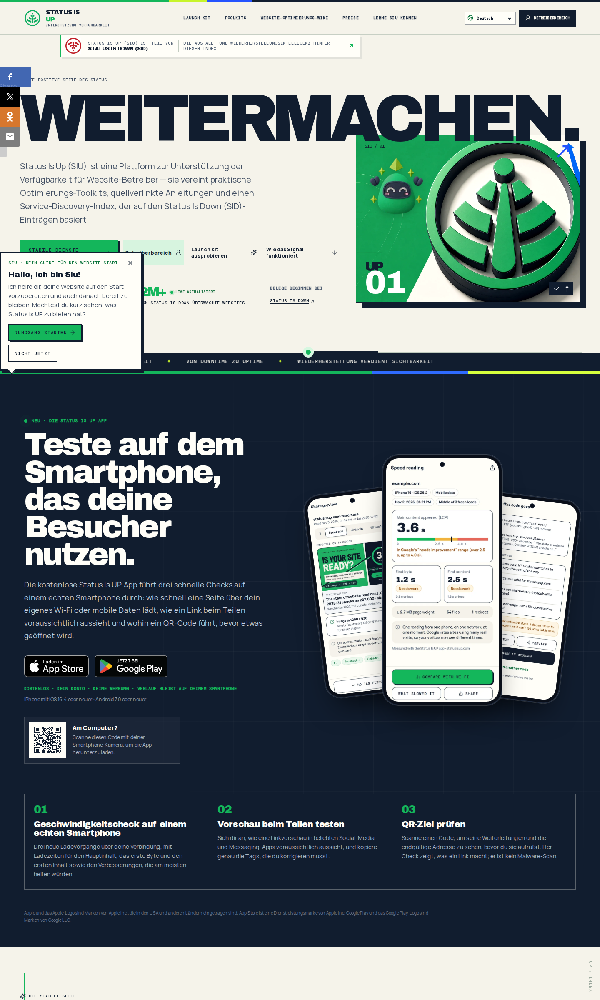

# UI Design System & Master Generation Blueprint: statusisup-com

> **Status Is UP — Index für Service-Uptime, Performance & Zuverlässigkeit** (https://statusisup.com/) — Entdecken Sie Dienste mit geringer beobachteter Ausfallaktivität über einen quellverknüpften Index für Service-Uptime, Performance und Zu...



---

## 1. Executive Visual Persona & Design Archetype

- **Brand Essence & Persona**: **Status Is UP — Index für Service-Uptime, Performance & Zuverlässigkeit** (`https://statusisup.com/`). Entdecken Sie Dienste mit geringer beobachteter Ausfallaktivität über einen quellverknüpften Index für Service-Uptime, Performance und Zu...
- **Capture Provenance**: Live browser capture (`tier1_fast`, HTTP `200`, captured `2026-11-23`).
- **Visual Archetype**: **Light-Substrate Editorial & Modular Grid System (`#f5f3ea` canvas, `#111d2f` ink, `#f2a30f` accent)**.
- **Anti-AI-Slop Differentiators**:
  - **Live-Computed Chromatic Polarity**: Anchors the viewport in `#f5f3ea` (live computed `body` `background-color` (`computed_styles.json`)) paired with `#111d2f` primary typography and `#f2a30f` accents.
  - **Grounded Typographic Hierarchy**: Pairs `Archivo Black` for display copy (`WEITERMACHEN.`) with `Manrope` and `DM Mono`.
  - **Calibrated Spatial Grid & Motion**: Combines `1344px` container bounds (`gap: 31.68px`, padding `57.6px`) with `cubic-bezier(.23,1,.32,1)` easing.

---

## 2. Spatial Architecture & Modular Grid Mathematics


### Viewport Allocation & Container Geometry
- **Captured Viewport Dimensions**: Desktop `1440×2400px` (`assets/desktop.png`, clamped at 2400px live multi-section capture), Mobile `390×2400px` (`assets/mobile.png`, clamped at 2400px live multi-section capture).
- **Master Container Bounds**: `1344px` (measured widest bounded `<section>` landmark width on `1440px` desktop).
- **Canvas Lateral Padding & Spacing**: `57.6px` lateral canvas padding with `31.68px` grid gap.
- **Border Radius Scale**: `50%`, `999px`, `9px`, `2.4rem`.

### Responsive Breakpoint Architecture
- **Desktop Layout**: Multi-column CSS Grid / Flexbox layout at `1440px` (`max-width: 1344px`, `gap: 31.68px`).
- **Mobile Layout**: Single-column vertical stack at `390px` viewport width with `57.6px` horizontal padding.
- **Extracted CSS Media Queries**: `@media (max-width:720px)`, `@media (max-width: 1320px)`, `@media (max-width: 1120px)`, `@media (max-width: 960px)`.

---

## 3. Color System, Materiality & Atmospheric Lighting

### Semantic Palette & Source Grounding
| Semantic Role | Ground-Truth Value | Extracted Live / CSS Source |
|---|---|---|
| **Primary Canvas Substrate** | `#f5f3ea` | live computed `body` `background-color` (`computed_styles.json`) |
| **Primary Typography Ink** | `#111d2f` | live computed `h1` `color` (`computed_styles.json`) |
| **Elevated Surface / Card Substrate** | `#fffef8` | `var(--card)` in `:root` |
| **Interactive Accent / Highlight** | `#f2a30f` | `.rating-stars button.is-selected { color: #f2a30f }` |
| **Secondary / Muted Copy** | `#8f9a91` | live computed `button` `color` (`computed_styles.json`) |
| **Structural Hairline Border** | `#cbd3c9` | `var(--border)` in `:root` |
| **Variable Token (`--primary`)** | `#14b65b` | `var(--primary)` in `:root` |
| **Variable Token (`--primary-foreground`)** | `#112235` | `var(--primary-foreground)` in `:root` |
| **Variable Token (`--secondary`)** | `#e6ece5` | `var(--secondary)` in `:root` |
| **Variable Token (`--muted`)** | `#e9e9e1` | `var(--muted)` in `:root` |
| **Variable Token (`--muted-foreground`)** | `#526073` | `var(--muted-foreground)` in `:root` |
| **Variable Token (`--accent`)** | `#c7f42b` | `var(--accent)` in `:root` |
| **Variable Token (`--destructive`)** | `#dc4d42` | `var(--destructive)` in `:root` |

### Sanitized Root CSS Variables (`ui-ux.md` Ground Truth)
| Variable Name | Extracted Value | Semantic Role |
|---|---|---|
| `--radius` | `.5rem` | Elevation / Border Token |
| `--background` | `#f5f3ea` | Canvas / Surface Token |
| `--foreground` | `#111d2f` | Typography Ink Token |
| `--card` | `#fffef8` | Color / Atmospheric Token |
| `--card-foreground` | `#111d2f` | Typography Ink Token |
| `--popover` | `#fffef8` | Color / Atmospheric Token |
| `--popover-foreground` | `#111d2f` | Typography Ink Token |
| `--primary` | `#14b65b` | Brand / Palette Token |
| `--primary-foreground` | `#112235` | Typography Ink Token |
| `--secondary` | `#e6ece5` | Brand / Palette Token |
| `--secondary-foreground` | `#112235` | Typography Ink Token |
| `--muted` | `#e9e9e1` | Color / Atmospheric Token |
| `--muted-foreground` | `#526073` | Typography Ink Token |
| `--accent` | `#c7f42b` | Brand / Palette Token |
| `--accent-foreground` | `#112235` | Typography Ink Token |
| `--destructive` | `#dc4d42` | Color / Atmospheric Token |

---

## 4. Typographic Scale & Editorial Hierarchy

### Font Family Stacks
- **Display Typography**: `Archivo Black`.
- **Primary Body Stack**: `Manrope`.
- **Technical / Metadata Stack**: `DM Mono`.

### Typographic Scale & Rules (Live Computed & Stylesheet Grounded)
- **Hero Display (`H1`)**: live computed `h1` (`font-size: 158.4px`, `line-height: 131.472px`, `font-weight: 400`, `letter-spacing: -13.464px`); CSS variables `--siu-display: "Archivo Black",sans-serif`, `--text-4xl: 2.25rem`, `--text-4xl--line-height: calc(2.5/2.25)`; rule `h1` (`letter-spacing: -.075em`).
- **Section Heading (`H2`)**: live computed `h2` (`font-size: 74.88px`, `line-height: 65.8944px`, `font-weight: 400`, `letter-spacing: -4.8672px`); CSS variables `--text-2xl: 1.5rem`, `--text-2xl--line-height: calc(2/1.5)`, `--text-3xl: 1.875rem`; rule `h2` (`letter-spacing: -.065em`).
- **Body Copy**: live computed `body` (`font-size: 16px`, `line-height: 24px`, `font-weight: 400`); CSS variables `--siu-body: "Manrope",sans-serif`, `--text-base: 1rem`, `--text-base--line-height: 1.5`; rule `p` (`font-size: .76rem`, `line-height: 1.65`).
- **Metadata & Navigation Labels**: live computed `nav/a` (`font-size: 16px`, `line-height: 24px`, `font-weight: 400`); CSS variables `--siu-label: "DM Mono",ui-monospace,monospace`, `--siu-label-size: .62rem`, `--siu-label-line: 1.35`; rule `small` (`letter-spacing: .09em`).

---

## 5. Choreographed Motion & Interaction Physics

### Primary Easing Curves
- **Extracted Timing Functions**: `cubic-bezier(.23,1,.32,1)`, `cubic-bezier(0,0,.2,1)`, `cubic-bezier(.4,0,.2,1)`.

### Per-Element Transition & Choreography Rules
- **Selector `.siu-site-footer-brand img`**: `transition: transform .18s cubic-bezier(.23,1,.32,1)` extracted from `statusisup-com` stylesheet.
- **Selector `.siu-site-nav-link`**: `transition: color .16s cubic-bezier(.23,1,.32,1),background-color .16s cub...` extracted from `statusisup-com` stylesheet.
- **Selector `.siu-site-nav-link:after`**: `transition: transform .18s cubic-bezier(.23,1,.32,1)` extracted from `statusisup-com` stylesheet.
- **Extracted Easing Curve (`cubic-bezier(.23,1,.32,1)`)**: Governs interactive state transitions across `<header.siu-site-header>` and `<section.ticker-bar>`.
- **State & Hover Choreography**: Opacity and transform transitions on `<section.hero-shell>` and `<section.ticker-bar>` interactive targets.

---

## 6. Component Wireframe & Structural DOM Map

### Visual Layout Schematic — Desktop (`1440px`, Grounded in `dom.html` & Landmark Bounding Boxes)
```
┌────────────────────────────────────────────────────────────────────────┐
│ DESKTOP VIEWPORT (1440px) — Status Is UP — Index für Service-Uptime, P │
│ ====================================================================== │
│ [ <header.siu-site-heade (1440x78px)  | Launch Kit · Toolkits · Prei ] │
│ ---------------------------------------------------------------------- │
│ | HERO STAGE: <section.hero-shell> (w=1440px)                        | │
│ | H1: WEITERMACHEN.                                                  | │
│ | Substrate: #f5f3ea | Ink: #111d2f | Accent: #f2a30f                | │
│ ---------------------------------------------------------------------- │
│ | SHOWCASE GRID (<section.ticker-bar>) max-w: 1344px                 | │
│ | +------------------------------+  +------------------------------+ | │
│ | | Teste auf dem Smartphone, da |  | Finden Sie Dienste, die bere | | │
│ | +------------------------------+  +------------------------------+ | │
│ ---------------------------------------------------------------------- │
│ | DETAIL MODULE (<section.siu-app-promo>) — Gute Nachrichten brau    | │
│ ---------------------------------------------------------------------- │
│ [ FOOTER (<footer.siu-site-foo) | https://statusisup.com/              │
└────────────────────────────────────────────────────────────────────────┘
```

### Visual Layout Schematic — Mobile Reflow (`390px`)
```
┌────────────────────────────────────────────────────────────────────────┐
│ MOBILE VIEWPORT REFLOW (390px) — Single-Column Stack (gap: 31.68px)    │
│ ====================================================================== │
│ [ HEADER BAR (<header.siu-site-header>) | Compact Menu (390px)         │
│ ---------------------------------------------------------------------- │
│ | HERO STAGE (<section.hero-shell>) — 390px Vertical Lead            | │
│ | H1: WEITERMACHEN.                                                  | │
│ ---------------------------------------------------------------------- │
│ | SHOWCASE STACK (<section.ticker-bar>) — 1-Col Stack                | │
│ | [ Item 1: Teste auf dem Smartphone, das deine Besucher nutzen.   ] | │
│ | [ Item 2: Finden Sie Dienste, die bereit bleiben.                ] | │
│ ---------------------------------------------------------------------- │
│ | DETAIL STACK (<section.siu-app-promo>) — 1-Col (Gute Nachrichten b)  │
│ ---------------------------------------------------------------------- │
│ [ FOOTER (<footer.siu-site-foo) | Stacked 390px Colophon               │
└────────────────────────────────────────────────────────────────────────┘
```

### Granular DOM Region Breakdown
1. **Brand Header & Navigation Bar (<header.siu-site-header> — `statusisup-com`)**:
   - Landmark `<header class="siu-site-header">` (`1440x78px`) hosting `Status Is UP — Index für Service-Upt` navigation (`Launch Kit · Toolkits · Preise · Lerne Siu kennen`), DOM attributes (`data-siu-asset-recovery`, `data-checked-head="true"`, `data-loc="client/src/pages/Home..."`, `data-loc="client/src/components..."`), and stylesheet rule `.language-selector svg { width:.88rem;height:.88rem;color:08733a }`.
2. **Hero Stage & Focal Lead (<section.hero-shell> — `WEITERMACHEN.`)**:
   - Landmark `<section class="hero-shell px-5">` presenting display lead `WEITERMACHEN.` and copy excerpt *"Status Is Up (SIU) ist eine Plattform zur Unterstützung der Verfü"* over `#f5f3ea` canvas and `#111d2f` ink.
3. **Primary Showcase & Content Grid (<section.ticker-bar> — `Teste auf dem Smartphone, das dein`)**:
   - Landmark `<section class="ticker-bar">` rendering section `Teste auf dem Smartphone, das deine Besucher nutzen.` with copy *"Von Status Is Down überwachte Dienste"*, asset references (`get_counts`, `show_ads_impl_fy2021.js`, `6a949f167c6f97b4640555e1.js`, `favicon.ico`), and grid rule `.language-selector select { max-width:112px;border:0;background:transparent;color:inherit;font:inher... }`.
4. **Interactive Detail & Feature Matrix (<section.siu-app-promo> — `Finden Sie Dienste, die bereit ble`)**:
   - Landmark `<section class="siu-app-promo">` framing `Finden Sie Dienste, die bereit bleiben.` and `Gute Nachrichten brauchen gute Belege.` (*"Von Status Is Down überwachte Websites"*) with `#fffef8` surface cards, `#f2a30f` accents, and `.language-selector:focus-within { border-color:14b65b;box-shadow:0 0 0 2px 14b65b33 }`.
5. **Colophon & Global Directory Footer (<footer.siu-site-footer> — `https://statusisup.com/`)**:
   - Landmark `<footer class="siu-site-footer">` anchoring `Status Is UP — Index für Service` footer links (`Launch Kit · Toolkits · Preise · Lerne Siu kennen`), copy *"Belege beginnen bei Status Is Down"*, and `#cbd3c9` structural dividers.

---

## 7. Master Zero-Shot AI Generation Prompt

```markdown
# Master Zero-Shot Frontend Generation Prompt: statusisup-com (Status Is UP — Index für Service-Uptime, Performance & Zuverlässigkeit)

You are a principal frontend architect and design systems engineer. Build a complete, production-ready web application replicating the exact design system, DOM landmarks, typographic hierarchy, color tokens, and motion physics of `statusisup-com` (**Status Is UP — Index für Service-Uptime, Performance & Zuverlässigkeit** — `https://statusisup.com/`).

### 1. Visual Archetype & Anti-AI-Slop Mandates
- **Archetype**: Light-Substrate Editorial & Modular Grid System (`#f5f3ea` canvas, `#111d2f` ink, `#f2a30f` accent).
- **Identity & Domain Context**: Entdecken Sie Dienste mit geringer beobachteter Ausfallaktivität über einen quellverknüpften Index für Service-Uptime, Performance und Zu...
- **Primary Substrate**: `#f5f3ea` (live computed `body` `background-color` (`computed_styles.json`)), **Primary Ink**: `#111d2f`, **Accent / Highlight**: `#f2a30f`.
- **Site-Specific Differentiators**:
  - **Live-Computed Chromatic Polarity**: Anchors the viewport in `#f5f3ea` (live computed `body` `background-color` (`computed_styles.json`)) paired with `#111d2f` primary typography and `#f2a30f` accents.
  - **Grounded Typographic Hierarchy**: Pairs `Archivo Black` for display copy (`WEITERMACHEN.`) with `Manrope` and `DM Mono`.
  - **Calibrated Spatial Grid & Motion**: Combines `1344px` container bounds (`gap: 31.68px`, padding `57.6px`) with `cubic-bezier(.23,1,.32,1)` easing.

### 2. Ground-Truth CSS Variables (`:root` Token Contract)
Declare and consume these exact custom properties extracted from `statusisup-com` in your global stylesheet:

:root {
  /* Status Is UP — Index für Service-Uptime, Performance & Zuverlässigkeit (statusisup-com) — Live-Grounded CSS Variables */
  --radius: .5rem; /* Elevation / Border Token (statusisup-com) */
  --background: #f5f3ea; /* Canvas / Surface Token (statusisup-com) */
  --foreground: #111d2f; /* Typography Ink Token (statusisup-com) */
  --card: #fffef8; /* Color / Atmospheric Token (statusisup-com) */
  --card-foreground: #111d2f; /* Typography Ink Token (statusisup-com) */
  --popover: #fffef8; /* Color / Atmospheric Token (statusisup-com) */
  --popover-foreground: #111d2f; /* Typography Ink Token (statusisup-com) */
  --primary: #14b65b; /* Brand / Palette Token (statusisup-com) */
  --primary-foreground: #112235; /* Typography Ink Token (statusisup-com) */
  --secondary: #e6ece5; /* Brand / Palette Token (statusisup-com) */
  --secondary-foreground: #112235; /* Typography Ink Token (statusisup-com) */
  --muted: #e9e9e1; /* Color / Atmospheric Token (statusisup-com) */
  --muted-foreground: #526073; /* Typography Ink Token (statusisup-com) */
  --accent: #c7f42b; /* Brand / Palette Token (statusisup-com) */
  --accent-foreground: #112235; /* Typography Ink Token (statusisup-com) */
  --destructive: #dc4d42; /* Color / Atmospheric Token (statusisup-com) */
}

### 3. Semantic Color & Materiality Contract
Map every surface, ink, and border strictly to these source-grounded tokens:
- **Primary Canvas Substrate**: `#f5f3ea` — grounded in live computed `body` `background-color` (`computed_styles.json`)
- **Primary Typography Ink**: `#111d2f` — grounded in live computed `h1` `color` (`computed_styles.json`)
- **Elevated Surface / Card Substrate**: `#fffef8` — grounded in `var(--card)` in `:root`
- **Interactive Accent / Highlight**: `#f2a30f` — grounded in `.rating-stars button.is-selected { color: #f2a30f }`
- **Secondary / Muted Copy**: `#8f9a91` — grounded in live computed `button` `color` (`computed_styles.json`)
- **Structural Hairline Border**: `#cbd3c9` — grounded in `var(--border)` in `:root`
- **Variable Token (`--primary`)**: `#14b65b` — grounded in `var(--primary)` in `:root`
- **Variable Token (`--primary-foreground`)**: `#112235` — grounded in `var(--primary-foreground)` in `:root`
- **Variable Token (`--secondary`)**: `#e6ece5` — grounded in `var(--secondary)` in `:root`
- **Variable Token (`--muted`)**: `#e9e9e1` — grounded in `var(--muted)` in `:root`
- **Variable Token (`--muted-foreground`)**: `#526073` — grounded in `var(--muted-foreground)` in `:root`
- **Variable Token (`--accent`)**: `#c7f42b` — grounded in `var(--accent)` in `:root`
- **Variable Token (`--destructive`)**: `#dc4d42` — grounded in `var(--destructive)` in `:root`

### 4. Spatial Grid, Container Bounds & Responsive Breakpoints
- **Desktop Viewport Reference**: `1440×2400px` (clamped at 2400px live multi-section capture, `1440px` standard desktop width).
- **Mobile Viewport Reference**: `390×2400px` (clamped at 2400px live multi-section capture, `390px` standard mobile width).
- **Container Max-Width**: `1344px` (measured widest bounded `<section>` landmark width on `1440px` desktop)
- **Padding & Gutters**: `57.6px` lateral canvas padding with `31.68px` grid gap
- **Desktop Grid**: Multi-column CSS Grid / Flexbox layout at `1440px` (`max-width: 1344px`, `gap: 31.68px`)
- **Mobile Adaptation**: Single-column vertical stack at `390px` viewport width with `57.6px` horizontal padding
- **Media Queries**: `@media (max-width:720px)`, `@media (max-width: 1320px)`, `@media (max-width: 1120px)`, `@media (max-width: 960px)`
- **Corner Radii**: `50%`, `999px`, `9px`, `2.4rem`

### 5. Typography & Editorial Scale Contract
- **Display Font Stack**: `Archivo Black`
- **Body Font Stack**: `Manrope`
- **Monospace / Technical Font Stack**: `DM Mono`
- **H1 Display Rule**: live computed `h1` (`font-size: 158.4px`, `line-height: 131.472px`, `font-weight: 400`, `letter-spacing: -13.464px`); CSS variables `--siu-display: "Archivo Black",sans-serif`, `--text-4xl: 2.25rem`, `--text-4xl--line-height: calc(2.5/2.25)`; rule `h1` (`letter-spacing: -.075em`)
- **H2 Section Rule**: live computed `h2` (`font-size: 74.88px`, `line-height: 65.8944px`, `font-weight: 400`, `letter-spacing: -4.8672px`); CSS variables `--text-2xl: 1.5rem`, `--text-2xl--line-height: calc(2/1.5)`, `--text-3xl: 1.875rem`; rule `h2` (`letter-spacing: -.065em`)
- **Body Copy Rule**: live computed `body` (`font-size: 16px`, `line-height: 24px`, `font-weight: 400`); CSS variables `--siu-body: "Manrope",sans-serif`, `--text-base: 1rem`, `--text-base--line-height: 1.5`; rule `p` (`font-size: .76rem`, `line-height: 1.65`)
- **Metadata & Index Rule**: live computed `nav/a` (`font-size: 16px`, `line-height: 24px`, `font-weight: 400`); CSS variables `--siu-label: "DM Mono",ui-monospace,monospace`, `--siu-label-size: .62rem`, `--siu-label-line: 1.35`; rule `small` (`letter-spacing: .09em`)

### 6. Component Hierarchy, Verbatim Copy & Real DOM Landmarks
Scaffold `statusisup-com` (`Status Is UP — Index für Service-Uptime, Performance & Zuverlässigkeit`) with these exact structural regions, extracted copy, and CSS rules from `dom.html`:
1. **Brand Header & Navigation Bar (<header.siu-site-header> — `statusisup-com`)**:
   - DOM & Selectors: Landmark `<header class="siu-site-header">` (`1440x78px`) hosting `Status Is UP — Index für Service-Upt` navigation (`Launch Kit · Toolkits · Preise · Lerne Siu kennen`), DOM attributes (`data-siu-asset-recovery`, `data-checked-head="true"`, `data-loc="client/src/pages/Home..."`, `data-loc="client/src/components..."`), and stylesheet rule `.language-selector svg { width:.88rem;height:.88rem;color:08733a }`.
   - Responsive Contract: Header `Brand Header & Navigation Bar (<header.siu-site-header> — `statusisup-com`)` (`statusisup-com`) adapts across `@media (max-width:720px)`, `@media (max-width: 1320px)`, `@media (max-width: 1120px)`, `@media (max-width: 960px)` with `cubic-bezier(.23,1,.32,1)`, `cubic-bezier(0,0,.2,1)`, `cubic-bezier(.4,0,.2,1)` transitions and links `Launch Kit · Toolkits · Preise · Lerne Siu kennen`.
2. **Hero Stage & Focal Lead (<section.hero-shell> — `WEITERMACHEN.`)**:
   - DOM & Selectors: Landmark `<section class="hero-shell px-5">` presenting display lead `WEITERMACHEN.` and copy excerpt *"Status Is Up (SIU) ist eine Plattform zur Unterstützung der Verfü"* over `#f5f3ea` canvas and `#111d2f` ink.
   - Responsive Contract: Hero stage (`1440×2400px` desktop / `390×2400px` mobile) sets `#f5f3ea` background with `#111d2f` headline `WEITERMACHEN.`.
3. **Primary Showcase & Content Grid (<section.ticker-bar> — `Teste auf dem Smartphone, das dein`)**:
   - DOM & Selectors: Landmark `<section class="ticker-bar">` rendering section `Teste auf dem Smartphone, das deine Besucher nutzen.` with copy *"Von Status Is Down überwachte Dienste"*, asset references (`get_counts`, `show_ads_impl_fy2021.js`, `6a949f167c6f97b4640555e1.js`, `favicon.ico`), and grid rule `.language-selector select { max-width:112px;border:0;background:transparent;color:inherit;font:inher... }`.
   - Responsive Contract: Showcase grid `Primary Showcase & Content Grid (<section.ticker-bar> — `Teste auf dem Smartphone, das dein`)` applies Multi-column CSS Grid / Flexbox layout at `1440px` (`max-width: 1344px`, `gap: 31.68px`) on desktop and Single-column vertical stack at `390px` viewport width with `57.6px` horizontal padding on mobile.
4. **Interactive Detail & Feature Matrix (<section.siu-app-promo> — `Finden Sie Dienste, die bereit ble`)**:
   - DOM & Selectors: Landmark `<section class="siu-app-promo">` framing `Finden Sie Dienste, die bereit bleiben.` and `Gute Nachrichten brauchen gute Belege.` (*"Von Status Is Down überwachte Websites"*) with `#fffef8` surface cards, `#f2a30f` accents, and `.language-selector:focus-within { border-color:14b65b;box-shadow:0 0 0 2px 14b65b33 }`.
   - Responsive Contract: Detail module `Interactive Detail & Feature Matrix (<section.siu-app-promo> — `Finden Sie Dienste, die bereit ble`)` uses `50%`, `999px`, `9px`, `2.4rem` radii, `#f2a30f` highlights, and assets (get_counts, show_ads_impl_fy2021.js, 6a949f167c6f97b4640555e1.js).
5. **Colophon & Global Directory Footer (<footer.siu-site-footer> — `https://statusisup.com/`)**:
   - DOM & Selectors: Landmark `<footer class="siu-site-footer">` anchoring `Status Is UP — Index für Service` footer links (`Launch Kit · Toolkits · Preise · Lerne Siu kennen`), copy *"Belege beginnen bei Status Is Down"*, and `#cbd3c9` structural dividers.
   - Responsive Contract: Footer `Colophon & Global Directory Footer (<footer.siu-site-footer> — `https://statusisup.com/`)` aligns to `1344px` (measured widest bounded `<section>` landmark width on `1440px` desktop) with `57.6px` lateral canvas padding with `31.68px` grid gap and attributes (data-siu-asset-recovery, data-checked-head="true", data-loc="client/src/pages/Home...").

#### Verbatim DOM Copy Excerpts (`dom.html`)
- Copy Excerpt 1: *"Status Is Up (SIU) ist eine Plattform zur Unterstützung der Verfügbarkeit für Webs..."*
- Copy Excerpt 2: *"Von Status Is Down überwachte Dienste"*
- Copy Excerpt 3: *"Von Status Is Down überwachte Websites"*
- Copy Excerpt 4: *"Belege beginnen bei Status Is Down"*

### 7. Motion, Extracted Stylesheet Rules & Interaction Choreography
- **Primary Easing Functions**: `cubic-bezier(.23,1,.32,1)`, `cubic-bezier(0,0,.2,1)`, `cubic-bezier(.4,0,.2,1)`
- **Extracted Stylesheet Rules (`statusisup-com`)**:
- `.language-selector svg { width:.88rem;height:.88rem;color:08733a }`
- `.language-selector select { max-width:112px;border:0;background:transparent;color:inherit;font:inher... }`
- `.language-selector:focus-within { border-color:14b65b;box-shadow:0 0 0 2px 14b65b33 }`
- `.language-selector.is-compact { min-height:31px;padding:.25rem .32rem }`
- `.language-selector.is-compact select { max-width:90px }`
- **Per-Selector Transition Rules**:
- **Selector `.siu-site-footer-brand img`**: `transition: transform .18s cubic-bezier(.23,1,.32,1)` extracted from `statusisup-com` stylesheet.
- **Selector `.siu-site-nav-link`**: `transition: color .16s cubic-bezier(.23,1,.32,1),background-color .16s cub...` extracted from `statusisup-com` stylesheet.
- **Selector `.siu-site-nav-link:after`**: `transition: transform .18s cubic-bezier(.23,1,.32,1)` extracted from `statusisup-com` stylesheet.
- **Extracted Easing Curve (`cubic-bezier(.23,1,.32,1)`)**: Governs interactive state transitions across `<header.siu-site-header>` and `<section.ticker-bar>`.
- **State & Hover Choreography**: Opacity and transform transitions on `<section.hero-shell>` and `<section.ticker-bar>` interactive targets.

### 8. Technical Deliverables
- Implement in Next.js (App Router) with TypeScript and Tailwind CSS consuming the `:root` custom properties defined above for `statusisup-com`.
- Reproduce both the `1440px` desktop architecture and `390px` mobile breakpoint transitions, preserving semantic HTML5 landmarks (`<header>`, `<nav>`, `<main>`, `<section>`, `<footer>`) and `prefers-reduced-motion` accessibility guards.
```
