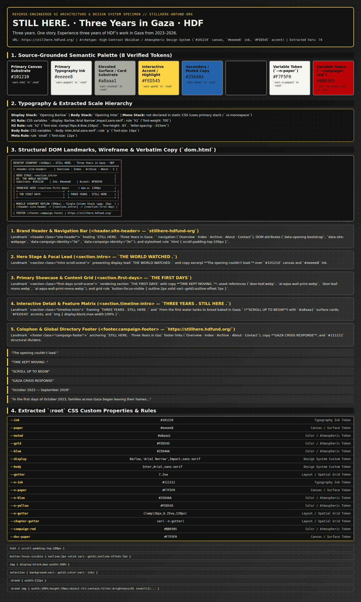
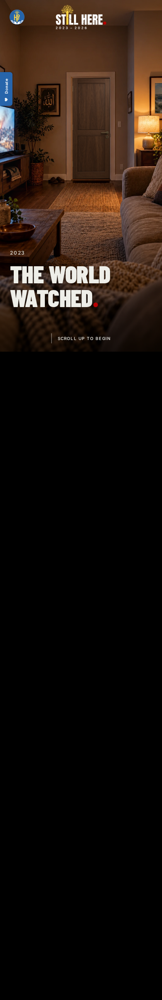

# UI Design System & Master Generation Blueprint: stillhere-hdfund-org

> **STILL HERE. · Three Years in Gaza · HDF** (https://stillhere.hdfund.org/) — Three years. One story. Experience three years of HDF’s work in Gaza from 2023–2026.



---

## 1. Executive Visual Persona & Design Archetype

- **Brand Essence & Persona**: **STILL HERE. · Three Years in Gaza · HDF** (`https://stillhere.hdfund.org/`). Three years. One story. Experience three years of HDF’s work in Gaza from 2023–2026.
- **Visual Archetype**: **High-Contrast Obsidian / Atmospheric Design System (`#101210` canvas, `#eeeee8` ink, `#FED545` accent)**.
- **Anti-AI-Slop Differentiators**:
  - **Source-Grounded Chromatic Polarity**: Anchors the viewport in `#101210` (`var(--ink)` in `:root`) paired with `#eeeee8` primary typography and `#FED545` accents.
  - **Extracted Typographic Hierarchy**: Pairs `Opening Barlow` for display copy (`THE WORLD WATCHED .`) with `Opening Inter` and not declared in static CSS (uses primary stack / `ui-monospace`).
  - **Calibrated Spatial Grid & Motion**: Combines `1100px` container bounds (`gap: 15px`, padding `30px`) with `cubic-bezier(.22,1,.36,1)` easing and Three.js / WebGL Canvas Pipeline.

---

## 2. Spatial Architecture & Modular Grid Mathematics



### Viewport Allocation & Container Geometry
- **Captured Viewport Dimensions**: Desktop `1440×2400px` (`assets/desktop.png`, capped at 2400px multi-section capture), Mobile `390×2400px` (`assets/mobile.png`, capped at 2400px multi-section capture).
- **Master Container Bounds**: `1100px` extracted from `stillhere-hdfund-org` stylesheet.
- **Canvas Lateral Padding & Spacing**: `30px` lateral canvas padding with `15px` grid gap.
- **Border Radius Scale**: `50%`, `2px`.

### Responsive Breakpoint Architecture
- **Desktop Layout**: Multi-column CSS Grid / Flexbox layout at `1440px` (`max-width: 1100px`, `gap: 15px`).
- **Mobile Layout**: Single-column vertical stack at `390px` viewport width with `30px` horizontal padding.
- **Extracted CSS Media Queries**: `@media (min-width:1600px)`, `@media (max-width:1100px)`, `@media (max-width:700px)`, `@media (max-height:700px) and (min-width:701px)`.

---

## 3. Color System, Materiality & Atmospheric Lighting

### Semantic Palette & Source Grounding
| Semantic Role | Ground-Truth Value | Extracted CSS Source / Selector |
|---|---|---|
| **Primary Canvas Substrate** | `#101210` | `var(--ink)` in `:root` |
| **Primary Typography Ink** | `#eeeee8` | `var(--paper)` in `:root` |
| **Elevated Surface / Card Substrate** | `#a8aaa1` | `var(--muted)` in `:root` |
| **Interactive Accent / Highlight** | `#FED545` | `var(--gold)` in `:root` |
| **Secondary / Muted Copy** | `#2564AA` | `var(--blue)` in `:root` |
| **Structural Hairline Border** | `#111111` | `var(--n-ink)` in `:root` |
| **Variable Token (`--n-paper`)** | `#F7F5F0` | `var(--n-paper)` in `:root` |
| **Variable Token (`--campaign-red`)** | `#BB0305` | `var(--campaign-red)` in `:root` |

### Sanitized Root CSS Variables (`ui-ux.md` Ground Truth)
| Variable Name | Extracted Value | Semantic Role |
|---|---|---|
| `--ink` | `#101210` | Typography Ink Token |
| `--paper` | `#eeeee8` | Canvas / Surface Token |
| `--muted` | `#a8aaa1` | Color / Atmospheric Token |
| `--gold` | `#FED545` | Color / Atmospheric Token |
| `--blue` | `#2564AA` | Color / Atmospheric Token |
| `--display` | `Barlow,'Arial Narrow',Impact,sans-serif` | Design System Custom Token |
| `--body` | `Inter,Arial,sans-serif` | Design System Custom Token |
| `--gutter` | `7.2vw` | Layout / Spatial Grid Token |
| `--n-ink` | `#111111` | Typography Ink Token |
| `--n-paper` | `#F7F5F0` | Canvas / Surface Token |
| `--n-blue` | `#2564AA` | Color / Atmospheric Token |
| `--n-yellow` | `#FED545` | Color / Atmospheric Token |
| `--n-gutter` | `clamp(26px,6.25vw,120px)` | Layout / Spatial Grid Token |
| `--chapter-gutter` | `var(--n-gutter)` | Layout / Spatial Grid Token |
| `--campaign-red` | `#BB0305` | Color / Atmospheric Token |
| `--doc-paper` | `#F7F5F0` | Canvas / Surface Token |

---

## 4. Typographic Scale & Editorial Hierarchy

### Font Family Stacks
- **Display Typography**: `Opening Barlow`.
- **Primary Body Stack**: `Opening Inter`.
- **Technical / Metadata Stack**: not declared in static CSS (uses primary stack / `ui-monospace`).

### Typographic Scale & Rules (Extracted from Stylesheet & Variables)
- **Hero Display (`H1`)**: CSS variables `--display: Barlow,'Arial Narrow',Impact,sans-serif`; rule `h1` (`font-weight: 700`).
- **Section Heading (`H2`)**: rule `h2` (`font-size: clamp(76px,8.8vw,156px)`, `line-height: .93`, `letter-spacing: -.015em`).
- **Body Copy**: CSS variables `--body: Inter,Arial,sans-serif`; rule `p` (`font-size: 14px`).
- **Metadata & Navigation Labels**: rule `small` (`font-size: 12px`).

---

## 5. Choreographed Motion & Interaction Physics

### Primary Easing Curves
- **Extracted Timing Functions**: `cubic-bezier(.22,1,.36,1)`.

### Per-Element Transition & Choreography Rules
- **Selector `.site-header`**: `transition: color .4s,background .4s,opacity .4s` extracted from `stillhere-hdfund-org` stylesheet.
- **Selector `.story-photo>img`**: `transition: filter .8s` extracted from `stillhere-hdfund-org` stylesheet.
- **Selector `.button`**: `transition: background .2s,color .2s,border .2s` extracted from `stillhere-hdfund-org` stylesheet.
- **Extracted Easing Curve (`cubic-bezier(.22,1,.36,1)`)**: Governs interactive state transitions across `<header.site-header>` and `<section.first-days>`.
- **Runtime Interaction Engine**: Integrates Three.js / WebGL Canvas Pipeline with `prefers-reduced-motion: reduce` fallback guards.

---

## 6. Component Wireframe & Structural DOM Map

### Visual Layout Schematic (Grounded in `dom.html` — `1440px` Desktop & `390px` Mobile Reflow)
```
┌────────────────────────────────────────────────────────────────────────┐
│ DESKTOP VIEWPORT (1440px) — STILL HERE. · Three Years in Gaza · HDF    │
│ ====================================================================== │
│ [ <header.site-header>     | Overview · Index · Archive · About · C ]  │
│ ---------------------------------------------------------------------- │
│ | HERO STAGE: <section.intro>                                      |   │
│ | H1: THE WORLD WATCHED .                                          |   │
│ | Substrate: #101210    | Ink: #eeeee8    | Accent: #FED545        |   │
│ ---------------------------------------------------------------------- │
│ | SHOWCASE GRID (<section.first-days>      ) max-w: 1100px         |   │
│ | +------------------------------+  +------------------------------+ | │
│ | | THE FIRST DAYS               |  | THREE YEARS . STILL HERE .   | | │
│ | +------------------------------+  +------------------------------+ | │
│ ---------------------------------------------------------------------- │
│ | MOBILE VIEWPORT REFLOW (390px) — Single-Column Stack (gap: 15px  ) | │
│ | [<header.site-heade] -> [<section.intro>] -> [<section.first-day] |  │
│ ---------------------------------------------------------------------- │
│ [ FOOTER (<footer.campaign-foote) | https://stillhere.hdfund.org/      │
└────────────────────────────────────────────────────────────────────────┘
```

### Granular DOM Region Breakdown
1. **Brand Header & Navigation Bar (<header.site-header> — `stillhere-hdfund-org`)**:
   - Landmark `<header class="site-header">` hosting `STILL HERE. · Three Years in Gaza · ` navigation (`Overview · Index · Archive · About · Contact`), DOM attributes (`data-opening-bootstrap`, `data-site-webpage`, `data-campaign-identity="3e"`, `data-campaign-identity="3e"`), and stylesheet rule `html { scroll-padding-top:100px }`.
2. **Hero Stage & Focal Lead (<section.intro> — `THE WORLD WATCHED .`)**:
   - Landmark `<section class="intro scroll-scene">` presenting display lead `THE WORLD WATCHED .` and copy excerpt *"The opening couldn’t load."* over `#101210` canvas and `#eeeee8` ink.
3. **Primary Showcase & Content Grid (<section.first-days> — `THE FIRST DAYS`)**:
   - Landmark `<section class="first-days scroll-scene">` rendering section `THE FIRST DAYS` with copy *"TIME KEPT MOVING ."*, asset references (`door-leaf.webp`, `al-aqsa-wall-print.webp`, `door-leaf-mono.webp`, `al-aqsa-wall-print-mono.webp`), and grid rule `button:focus-visible { outline:2px solid var(--gold);outline-offset:7px }`.
4. **Interactive Detail & Feature Matrix (<section.timeline-intro> — `THREE YEARS . STILL HERE .`)**:
   - Landmark `<section class="timeline-intro">` framing `THREE YEARS . STILL HERE .` and `From the first water tanks to bread baked in Gaza.` (*"SCROLL UP TO BEGIN"*) with `#a8aaa1` surface cards, `#FED545` accents, and `img { display:block;max-width:100% }`.
5. **Colophon & Global Directory Footer (<footer.campaign-footer> — `https://stillhere.hdfund.org/`)**:
   - Landmark `<footer class="campaign-footer">` anchoring `STILL HERE. · Three Years in Gaz` footer links (`Overview · Index · Archive · About · Contact`), copy *"GAZA CRISIS RESPONSE"*, and `#111111` structural dividers.

---

## 7. Master Zero-Shot AI Generation Prompt

```markdown
# Master Zero-Shot Frontend Generation Prompt: stillhere-hdfund-org (STILL HERE. · Three Years in Gaza · HDF)

You are a principal frontend architect and design systems engineer. Build a complete, production-ready web application replicating the exact design system, DOM landmarks, typographic hierarchy, color tokens, and motion physics of `stillhere-hdfund-org` (**STILL HERE. · Three Years in Gaza · HDF** — `https://stillhere.hdfund.org/`).

### 1. Visual Archetype & Anti-AI-Slop Mandates
- **Archetype**: High-Contrast Obsidian / Atmospheric Design System (`#101210` canvas, `#eeeee8` ink, `#FED545` accent).
- **Identity & Domain Context**: Three years. One story. Experience three years of HDF’s work in Gaza from 2023–2026.
- **Primary Substrate**: `#101210` (`var(--ink)` in `:root`), **Primary Ink**: `#eeeee8`, **Accent / Highlight**: `#FED545`.
- **Site-Specific Differentiators**:
  - **Source-Grounded Chromatic Polarity**: Anchors the viewport in `#101210` (`var(--ink)` in `:root`) paired with `#eeeee8` primary typography and `#FED545` accents.
  - **Extracted Typographic Hierarchy**: Pairs `Opening Barlow` for display copy (`THE WORLD WATCHED .`) with `Opening Inter` and not declared in static CSS (uses primary stack / `ui-monospace`).
  - **Calibrated Spatial Grid & Motion**: Combines `1100px` container bounds (`gap: 15px`, padding `30px`) with `cubic-bezier(.22,1,.36,1)` easing and Three.js / WebGL Canvas Pipeline.

### 2. Ground-Truth CSS Variables (`:root` Token Contract)
Declare and consume these exact custom properties extracted from `stillhere-hdfund-org` in your global stylesheet:

:root {
  /* STILL HERE. · Three Years in Gaza · HDF (stillhere-hdfund-org) — Ground-Truth Extracted CSS Variables */
  --ink: #101210; /* Typography Ink Token (stillhere-hdfund-org) */
  --paper: #eeeee8; /* Canvas / Surface Token (stillhere-hdfund-org) */
  --muted: #a8aaa1; /* Color / Atmospheric Token (stillhere-hdfund-org) */
  --gold: #FED545; /* Color / Atmospheric Token (stillhere-hdfund-org) */
  --blue: #2564AA; /* Color / Atmospheric Token (stillhere-hdfund-org) */
  --display: Barlow,'Arial Narrow',Impact,sans-serif; /* Design System Custom Token (stillhere-hdfund-org) */
  --body: Inter,Arial,sans-serif; /* Design System Custom Token (stillhere-hdfund-org) */
  --gutter: 7.2vw; /* Layout / Spatial Grid Token (stillhere-hdfund-org) */
  --n-ink: #111111; /* Typography Ink Token (stillhere-hdfund-org) */
  --n-paper: #F7F5F0; /* Canvas / Surface Token (stillhere-hdfund-org) */
  --n-blue: #2564AA; /* Color / Atmospheric Token (stillhere-hdfund-org) */
  --n-yellow: #FED545; /* Color / Atmospheric Token (stillhere-hdfund-org) */
  --n-gutter: clamp(26px,6.25vw,120px); /* Layout / Spatial Grid Token (stillhere-hdfund-org) */
  --chapter-gutter: var(--n-gutter); /* Layout / Spatial Grid Token (stillhere-hdfund-org) */
  --campaign-red: #BB0305; /* Color / Atmospheric Token (stillhere-hdfund-org) */
  --doc-paper: #F7F5F0; /* Canvas / Surface Token (stillhere-hdfund-org) */
}

### 3. Semantic Color & Materiality Contract
Map every surface, ink, and border strictly to these source-grounded tokens:
- **Primary Canvas Substrate**: `#101210` — grounded in `var(--ink)` in `:root`
- **Primary Typography Ink**: `#eeeee8` — grounded in `var(--paper)` in `:root`
- **Elevated Surface / Card Substrate**: `#a8aaa1` — grounded in `var(--muted)` in `:root`
- **Interactive Accent / Highlight**: `#FED545` — grounded in `var(--gold)` in `:root`
- **Secondary / Muted Copy**: `#2564AA` — grounded in `var(--blue)` in `:root`
- **Structural Hairline Border**: `#111111` — grounded in `var(--n-ink)` in `:root`
- **Variable Token (`--n-paper`)**: `#F7F5F0` — grounded in `var(--n-paper)` in `:root`
- **Variable Token (`--campaign-red`)**: `#BB0305` — grounded in `var(--campaign-red)` in `:root`

### 4. Spatial Grid, Container Bounds & Responsive Breakpoints
- **Desktop Viewport Reference**: `1440×2400px` (capped at 2400px multi-section capture, `1440px` standard desktop width).
- **Mobile Viewport Reference**: `390×2400px` (capped at 2400px multi-section capture, `390px` standard mobile width).
- **Container Max-Width**: `1100px` extracted from `stillhere-hdfund-org` stylesheet
- **Padding & Gutters**: `30px` lateral canvas padding with `15px` grid gap
- **Desktop Grid**: Multi-column CSS Grid / Flexbox layout at `1440px` (`max-width: 1100px`, `gap: 15px`)
- **Mobile Adaptation**: Single-column vertical stack at `390px` viewport width with `30px` horizontal padding
- **Media Queries**: `@media (min-width:1600px)`, `@media (max-width:1100px)`, `@media (max-width:700px)`, `@media (max-height:700px) and (min-width:701px)`
- **Corner Radii**: `50%`, `2px`

### 5. Typography & Editorial Scale Contract
- **Display Font Stack**: `Opening Barlow`
- **Body Font Stack**: `Opening Inter`
- **Monospace / Technical Font Stack**: not declared in static CSS (uses primary stack / `ui-monospace`)
- **H1 Display Rule**: CSS variables `--display: Barlow,'Arial Narrow',Impact,sans-serif`; rule `h1` (`font-weight: 700`)
- **H2 Section Rule**: rule `h2` (`font-size: clamp(76px,8.8vw,156px)`, `line-height: .93`, `letter-spacing: -.015em`)
- **Body Copy Rule**: CSS variables `--body: Inter,Arial,sans-serif`; rule `p` (`font-size: 14px`)
- **Metadata & Index Rule**: rule `small` (`font-size: 12px`)

### 6. Component Hierarchy, Verbatim Copy & Real DOM Landmarks
Scaffold `stillhere-hdfund-org` (`STILL HERE. · Three Years in Gaza · HDF`) with these exact structural regions, extracted copy, and CSS rules from `dom.html`:
1. **Brand Header & Navigation Bar (<header.site-header> — `stillhere-hdfund-org`)**:
   - DOM & Selectors: Landmark `<header class="site-header">` hosting `STILL HERE. · Three Years in Gaza · ` navigation (`Overview · Index · Archive · About · Contact`), DOM attributes (`data-opening-bootstrap`, `data-site-webpage`, `data-campaign-identity="3e"`, `data-campaign-identity="3e"`), and stylesheet rule `html { scroll-padding-top:100px }`.
   - Responsive Contract: Header `Brand Header & Navigation Bar (<header.site-header> — `stillhere-hdfund-org`)` (`stillhere-hdfund-org`) adapts across `@media (min-width:1600px)`, `@media (max-width:1100px)`, `@media (max-width:700px)`, `@media (max-height:700px) and (min-width:701px)` with `cubic-bezier(.22,1,.36,1)` transitions and links `Overview · Index · Archive · About · Contact`.
2. **Hero Stage & Focal Lead (<section.intro> — `THE WORLD WATCHED .`)**:
   - DOM & Selectors: Landmark `<section class="intro scroll-scene">` presenting display lead `THE WORLD WATCHED .` and copy excerpt *"The opening couldn’t load."* over `#101210` canvas and `#eeeee8` ink.
   - Responsive Contract: Hero stage (`1440×2400px` desktop / `390×2400px` mobile) sets `#101210` background with `#eeeee8` headline `THE WORLD WATCHED .`.
3. **Primary Showcase & Content Grid (<section.first-days> — `THE FIRST DAYS`)**:
   - DOM & Selectors: Landmark `<section class="first-days scroll-scene">` rendering section `THE FIRST DAYS` with copy *"TIME KEPT MOVING ."*, asset references (`door-leaf.webp`, `al-aqsa-wall-print.webp`, `door-leaf-mono.webp`, `al-aqsa-wall-print-mono.webp`), and grid rule `button:focus-visible { outline:2px solid var(--gold);outline-offset:7px }`.
   - Responsive Contract: Showcase grid `Primary Showcase & Content Grid (<section.first-days> — `THE FIRST DAYS`)` applies Multi-column CSS Grid / Flexbox layout at `1440px` (`max-width: 1100px`, `gap: 15px`) on desktop and Single-column vertical stack at `390px` viewport width with `30px` horizontal padding on mobile.
4. **Interactive Detail & Feature Matrix (<section.timeline-intro> — `THREE YEARS . STILL HERE .`)**:
   - DOM & Selectors: Landmark `<section class="timeline-intro">` framing `THREE YEARS . STILL HERE .` and `From the first water tanks to bread baked in Gaza.` (*"SCROLL UP TO BEGIN"*) with `#a8aaa1` surface cards, `#FED545` accents, and `img { display:block;max-width:100% }`.
   - Responsive Contract: Detail module `Interactive Detail & Feature Matrix (<section.timeline-intro> — `THREE YEARS . STILL HERE .`)` uses `50%`, `2px` radii, `#FED545` highlights, and assets (door-leaf.webp, al-aqsa-wall-print.webp, door-leaf-mono.webp).
5. **Colophon & Global Directory Footer (<footer.campaign-footer> — `https://stillhere.hdfund.org/`)**:
   - DOM & Selectors: Landmark `<footer class="campaign-footer">` anchoring `STILL HERE. · Three Years in Gaz` footer links (`Overview · Index · Archive · About · Contact`), copy *"GAZA CRISIS RESPONSE"*, and `#111111` structural dividers.
   - Responsive Contract: Footer `Colophon & Global Directory Footer (<footer.campaign-footer> — `https://stillhere.hdfund.org/`)` aligns to `1100px` extracted from `stillhere-hdfund-org` stylesheet with `30px` lateral canvas padding with `15px` grid gap and attributes (data-opening-bootstrap, data-site-webpage, data-campaign-identity="3e").

#### Verbatim DOM Copy Excerpts (`dom.html`)
- Copy Excerpt 1: *"The opening couldn’t load."*
- Copy Excerpt 2: *"TIME KEPT MOVING ."*
- Copy Excerpt 3: *"SCROLL UP TO BEGIN"*
- Copy Excerpt 4: *"GAZA CRISIS RESPONSE"*

### 7. Motion, Extracted Stylesheet Rules & Interaction Choreography
- **Primary Easing Functions**: `cubic-bezier(.22,1,.36,1)`
- **Extracted Stylesheet Rules (`stillhere-hdfund-org`)**:
- `html { scroll-padding-top:100px }`
- `button:focus-visible { outline:2px solid var(--gold);outline-offset:7px }`
- `img { display:block;max-width:100% }`
- `selection { background:var(--gold);color:var(--ink) }`
- `.brand { width:112px }`
- **Per-Selector Transition Rules**:
- **Selector `.site-header`**: `transition: color .4s,background .4s,opacity .4s` extracted from `stillhere-hdfund-org` stylesheet.
- **Selector `.story-photo>img`**: `transition: filter .8s` extracted from `stillhere-hdfund-org` stylesheet.
- **Selector `.button`**: `transition: background .2s,color .2s,border .2s` extracted from `stillhere-hdfund-org` stylesheet.
- **Extracted Easing Curve (`cubic-bezier(.22,1,.36,1)`)**: Governs interactive state transitions across `<header.site-header>` and `<section.first-days>`.
- **Runtime Interaction Engine**: Integrates Three.js / WebGL Canvas Pipeline with `prefers-reduced-motion: reduce` fallback guards.

### 8. Technical Deliverables
- Implement in Next.js (App Router) with TypeScript and Tailwind CSS consuming the `:root` custom properties defined above for `stillhere-hdfund-org`.
- Reproduce both the `1440px` desktop architecture and `390px` mobile breakpoint transitions, preserving semantic HTML5 landmarks (`<header>`, `<nav>`, `<main>`, `<section>`, `<footer>`) and `prefers-reduced-motion` accessibility guards.
```
