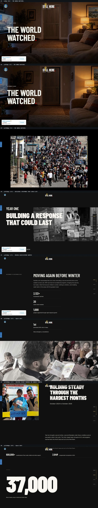
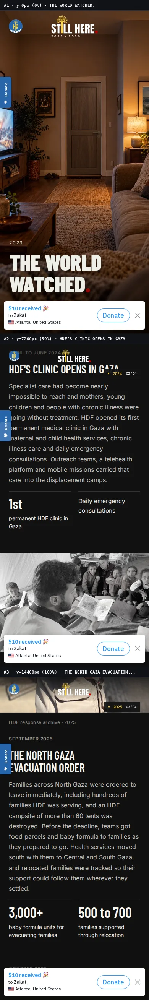

# UI Design System & Master Generation Blueprint: stillhere-hdfund-org

> **STILL HERE. · Three Years in Gaza · HDF** (https://stillhere.hdfund.org/) — Three years. One story. Experience three years of HDF’s work in Gaza from 2023–2026.





---

## 1. Executive Visual Persona & Design Archetype

- **Brand Essence & Persona**: **STILL HERE. · Three Years in Gaza · HDF** (`https://stillhere.hdfund.org/`). Three years. One story. Experience three years of HDF’s work in Gaza from 2023–2026.
- **Capture Provenance**: Live browser capture (`tier1_fast`, HTTP `200`, captured `2026-11-24`).
- **Visual Archetype**: **High-Contrast Obsidian / Atmospheric Design System (`#111111` canvas, `#ffffff` ink, `#0000ff` accent)**.
- **Anti-AI-Slop Differentiators**:
  - **Live-Computed Chromatic Polarity**: Anchors the viewport in `#111111` (live computed `body` `background-color` (`computed_styles.json`)) paired with `#ffffff` primary typography and `#0000ff` accents.
  - **Grounded Typographic Hierarchy**: Pairs `Opening Barlow` for display copy (`THE WORLD WATCHED.`) with `Inter`.
  - **Calibrated Spatial Grid & Motion**: Combines `1260px` container bounds (`gap: 32px`, padding `57.6px`) with `cubic-bezier(.22,1,.36,1)` easing and Three.js / WebGL Canvas Pipeline.

---

## 2. Spatial Architecture & Modular Grid Mathematics

### Viewport Allocation & Container Geometry
- **Captured Journey Filmstrips**: Desktop `1280×6624px` (`assets/desktop-journey.webp`, `8` keyframes up to `y=14400px` / doc `50997px`), Mobile `390×2616px` (`assets/mobile-journey.webp`, `3` keyframes).
- **Master Container Bounds**: `1260px` (measured widest bounded `<section>` landmark width on `1440px` desktop).
- **Canvas Lateral Padding & Spacing**: `57.6px` lateral canvas padding with `32px` grid gap.
- **Border Radius Scale**: `50%`, `2px`.

### Responsive Breakpoint Architecture
- **Desktop Layout**: Multi-column CSS Grid / Flexbox layout at `1440px` (`max-width: 1260px`, `gap: 32px`).
- **Mobile Layout**: Single-column vertical stack at `390px` viewport width with `57.6px` horizontal padding.
- **Extracted CSS Media Queries**: `@media (min-width:1600px)`, `@media (max-width:1100px)`, `@media (max-width:700px)`, `@media (max-height:700px) and (min-width:701px)`.

---

## 3. Color System, Materiality & Atmospheric Lighting

### Semantic Palette & Source Grounding
| Semantic Role | Ground-Truth Value | Extracted Live / CSS Source |
|---|---|---|
| **Primary Canvas Substrate** | `#111111` | live computed `body` `background-color` (`computed_styles.json`) |
| **Primary Typography Ink** | `#ffffff` | live computed `footer` `color` (`computed_styles.json`) |
| **Elevated Surface / Card Substrate** | `#090a09` | live computed `section` `background-color` (`computed_styles.json`) |
| **Interactive Accent / Highlight** | `#0000ff` | `.button-outline:hover { color: blue }` (`#0000ff`) |
| **Secondary / Muted Copy** | `#a8aaa1` | `var(--muted)` in `:root` |
| **Structural Hairline Border** | `#20201e` | `.year-ghost { stroke: #20201e }` |
| **Variable Token (`--ink`)** | `#101210` | `var(--ink)` in `:root` |
| **Variable Token (`--paper`)** | `#eeeee8` | `var(--paper)` in `:root` |
| **Variable Token (`--gold`)** | `#fed545` | `var(--gold)` in `:root` |
| **Variable Token (`--blue`)** | `#2564aa` | `var(--blue)` in `:root` |
| **Variable Token (`--n-paper`)** | `#f7f5f0` | `var(--n-paper)` in `:root` |
| **Variable Token (`--campaign-red`)** | `#bb0305` | `var(--campaign-red)` in `:root` |

### Sanitized Root CSS Variables (`ui-ux.md` Ground Truth)
| Variable Name | Extracted Value | Semantic Role |
|---|---|---|
| `--ink` | `#101210` | Typography Ink Token |
| `--paper` | `#eeeee8` | Canvas / Surface Token |
| `--muted` | `#a8aaa1` | Color / Atmospheric Token |
| `--gold` | `#FED545` | Color / Atmospheric Token |
| `--blue` | `#2564AA` | Color / Atmospheric Token |
| `--display` | `Barlow,'Arial Narrow',Impact,sans-serif` | Design System Custom Token |
| `--body` | `Inter,Arial,sans-serif` | Design System Custom Token |
| `--gutter` | `7.2vw` | Layout / Spatial Grid Token |
| `--n-ink` | `#111111` | Typography Ink Token |
| `--n-paper` | `#F7F5F0` | Canvas / Surface Token |
| `--n-blue` | `#2564AA` | Color / Atmospheric Token |
| `--n-yellow` | `#FED545` | Color / Atmospheric Token |
| `--n-gutter` | `clamp(26px,6.25vw,120px)` | Layout / Spatial Grid Token |
| `--campaign-red` | `#BB0305` | Color / Atmospheric Token |
| `--chapter-gutter` | `var(--n-gutter)` | Layout / Spatial Grid Token |
| `--doc-paper` | `#F7F5F0` | Canvas / Surface Token |

---

## 4. Typographic Scale & Editorial Hierarchy

### Font Family Stacks
- **Display Typography**: `Opening Barlow`.
- **Primary Body Stack**: `Inter`.
- **Technical / Metadata Stack**: not declared in live computed styles (uses primary stack / `ui-monospace`).

### Typographic Scale & Rules (Live Computed & Stylesheet Grounded)
- **Hero Display (`H1`)**: live computed `h1` (`font-size: 126.72px`, `line-height: 117.85px`, `font-weight: 700`, `letter-spacing: -1.9008px`); CSS variables `--display: Barlow,'Arial Narrow',Impact,sans-serif`; rule `h1` (`font-weight: 700`).
- **Section Heading (`H2`)**: live computed `h2` (`font-size: 302.4px`, `line-height: 266.112px`, `font-weight: 900`, `letter-spacing: -6.048px`); rule `h2` (`font-size: clamp(76px,8.8vw,156px)`, `line-height: .93`, `letter-spacing: -.015em`).
- **Body Copy**: live computed `body` (`font-size: 16px`, `line-height: normal`, `font-weight: 400`); CSS variables `--body: Inter,Arial,sans-serif`; rule `p` (`font-size: 14px`).
- **Metadata & Navigation Labels**: live computed `nav/a` (`font-size: 14px`, `line-height: normal`, `font-weight: 600`, `letter-spacing: 1.05px`); rule `small` (`font-size: 12px`).

---

## 5. Choreographed Motion & Interaction Physics

### Primary Easing Curves
- **Extracted Timing Functions**: `cubic-bezier(.22,1,.36,1)`.

### Per-Element Transition & Choreography Rules
- **Selector `.site-header`**: `transition: color .4s,background .4s,opacity .4s` extracted from `stillhere-hdfund-org` stylesheet.
- **Selector `.story-photo>img`**: `transition: filter .8s` extracted from `stillhere-hdfund-org` stylesheet.
- **Selector `.button`**: `transition: background .2s,color .2s,border .2s` extracted from `stillhere-hdfund-org` stylesheet.
- **Extracted Easing Curve (`cubic-bezier(.22,1,.36,1)`)**: Governs interactive state transitions across `<header.site-header>` and `<section.first-days>`.
- **Runtime Interaction Engine**: Integrates Three.js / WebGL Canvas Pipeline with `prefers-reduced-motion: reduce` fallback guards.
### Measured Runtime Scroll & Interaction Telemetry (`behavioral_journey_v2`)
- **Scroll Driver Mode**: `native` (max document height `50997px`, deepest scrollY reached `14400px` across `8` desktop keyframes).
- **Detected Scroll / Motion Libraries**: Native browser scroll / standard CSS transitions.

---

## 6. Component Wireframe & Structural DOM Map

### Visual Layout Schematic — Desktop (`1440px`, Grounded in `dom.html` & Landmark Bounding Boxes)
```
┌────────────────────────────────────────────────────────────────────────┐
│ DESKTOP VIEWPORT (1440px) — STILL HERE. · Three Years in Gaza · HDF    │
│ ====================================================================== │
│ [ <header.site-header> (1440x112px)   | Overview · Index · Archive · ] │
│ ---------------------------------------------------------------------- │
│ | HERO STAGE: <section.intro> (w=1440px)                             | │
│ | H1: THE WORLD WATCHED.                                             | │
│ | Substrate: #111111 | Ink: #ffffff | Accent: #0000ff                | │
│ ---------------------------------------------------------------------- │
│ | SHOWCASE GRID (<section.first-days>) max-w: 1260px                 | │
│ | +------------------------------+  +------------------------------+ | │
│ | | THE WORLD WATCHED .          |  | THE FIRST DAYS               | | │
│ | +------------------------------+  +------------------------------+ | │
│ ---------------------------------------------------------------------- │
│ | DETAIL MODULE (<section.timeline-intro>) — THREE YEARS . STILL H   | │
│ ---------------------------------------------------------------------- │
│ [ FOOTER (<footer.campaign-foo) | https://stillhere.hdfund.org/        │
└────────────────────────────────────────────────────────────────────────┘
```

### Visual Layout Schematic — Mobile Reflow (`390px`)
```
┌────────────────────────────────────────────────────────────────────────┐
│ MOBILE VIEWPORT REFLOW (390px) — Single-Column Stack (gap: 32px)       │
│ ====================================================================== │
│ [ HEADER BAR (<header.site-header>    ) | Compact Menu (390px)         │
│ ---------------------------------------------------------------------- │
│ | HERO STAGE (<section.intro>) — 390px Vertical Lead                 | │
│ | H1: THE WORLD WATCHED.                                             | │
│ ---------------------------------------------------------------------- │
│ | SHOWCASE STACK (<section.first-days>) — 1-Col Stack                | │
│ | [ Item 1: THE WORLD WATCHED .                                    ] | │
│ | [ Item 2: THE FIRST DAYS                                         ] | │
│ ---------------------------------------------------------------------- │
│ | DETAIL STACK (<section.timeline-intro>) — 1-Col (THREE YEARS . STIL) │
│ ---------------------------------------------------------------------- │
│ [ FOOTER (<footer.campaign-foo) | Stacked 390px Colophon               │
└────────────────────────────────────────────────────────────────────────┘
```

### Granular DOM Region Breakdown
1. **Brand Header & Navigation Bar (<header.site-header> — `stillhere-hdfund-org`)**:
   - Landmark `<header class="site-header">` (`1440x112px`) hosting `STILL HERE. · Three Years in Gaza · ` navigation (`Overview · Index · Archive · About · Contact`), DOM attributes (`data-opening-bootstrap`, `data-site-webpage`, `data-campaign-identity="3e"`, `data-campaign-identity="3e"`), and stylesheet rule `html { scroll-padding-top:100px }`.
2. **Hero Stage & Focal Lead (<section.intro> — `THE WORLD WATCHED.`)**:
   - Landmark `<section class="intro scroll-scene">` presenting display lead `THE WORLD WATCHED.` and copy excerpt *"The opening couldn’t load."* over `#111111` canvas and `#ffffff` ink.
3. **Primary Showcase & Content Grid (<section.first-days> — `THE WORLD WATCHED .`)**:
   - Landmark `<section class="first-days scroll-scene">` rendering section `THE WORLD WATCHED .` with copy *"TIME KEPT MOVING ."*, asset references (`door-leaf.webp`, `al-aqsa-wall-print.webp`, `door-leaf-mono.webp`, `al-aqsa-wall-print-mono.webp`), and grid rule `button:focus-visible { outline:2px solid var(--gold);outline-offset:7px }`.
4. **Interactive Detail & Feature Matrix (<section.timeline-intro> — `THE FIRST DAYS`)**:
   - Landmark `<section class="timeline-intro">` framing `THE FIRST DAYS` and `THREE YEARS . STILL HERE .` (*"SCROLL UP TO BEGIN"*) with `#090a09` surface cards, `#0000ff` accents, and `img { display:block;max-width:100% }`.
5. **Colophon & Global Directory Footer (<footer.campaign-footer> — `https://stillhere.hdfund.org/`)**:
   - Landmark `<footer class="campaign-footer">` anchoring `STILL HERE. · Three Years in Gaz` footer links (`Overview · Index · Archive · About · Contact`), copy *"GAZA CRISIS RESPONSE"*, and `#20201e` structural dividers.
### Full Vertical Scroll Sequence (Desktop `1440×900` Keyframes)
- **Step 01** (`y=0px`, `0%`): Active landmark `THE WORLD WATCHED.` · sticky/fixed elements: `2`
- **Step 02** (`y=850px`, `2%`): Active landmark `THE WORLD WATCHED.` · sticky/fixed elements: `2`
- **Step 03** (`y=3400px`, `7%`): Active landmark `THE WORLD WATCHED.` · sticky/fixed elements: `2`
- **Step 04** (`y=5950px`, `12%`): Active landmark `BUILDING A RESPONSE THAT COULD LAST` · sticky/fixed elements: `3`
- **Step 05** (`y=8500px`, `17%`): Active landmark `MOVING AGAIN BEFORE WINTER` · sticky/fixed elements: `2`
- **Step 06** (`y=11050px`, `22%`): Active landmark `#year-2023` · sticky/fixed elements: `2`
- **Step 07** (`y=13600px`, `27%`): Active landmark `HOLDING STEADY THROUGH THE HARDEST MONTHS` · sticky/fixed elements: `3`
- **Step 08** (`y=14400px`, `29%`): Active landmark `#year-2024` · sticky/fixed elements: `2`

---

## 7. Master Zero-Shot AI Generation Prompt

```markdown
# Master Zero-Shot Frontend Generation Prompt: stillhere-hdfund-org (STILL HERE. · Three Years in Gaza · HDF)

You are a principal frontend architect and design systems engineer. Build a complete, production-ready web application replicating the exact design system, DOM landmarks, typographic hierarchy, color tokens, and motion physics of `stillhere-hdfund-org` (**STILL HERE. · Three Years in Gaza · HDF** — `https://stillhere.hdfund.org/`).

### 1. Visual Archetype & Anti-AI-Slop Mandates
- **Archetype**: High-Contrast Obsidian / Atmospheric Design System (`#111111` canvas, `#ffffff` ink, `#0000ff` accent).
- **Identity & Domain Context**: Three years. One story. Experience three years of HDF’s work in Gaza from 2023–2026.
- **Primary Substrate**: `#111111` (live computed `body` `background-color` (`computed_styles.json`)), **Primary Ink**: `#ffffff`, **Accent / Highlight**: `#0000ff`.
- **Site-Specific Differentiators**:
  - **Live-Computed Chromatic Polarity**: Anchors the viewport in `#111111` (live computed `body` `background-color` (`computed_styles.json`)) paired with `#ffffff` primary typography and `#0000ff` accents.
  - **Grounded Typographic Hierarchy**: Pairs `Opening Barlow` for display copy (`THE WORLD WATCHED.`) with `Inter`.
  - **Calibrated Spatial Grid & Motion**: Combines `1260px` container bounds (`gap: 32px`, padding `57.6px`) with `cubic-bezier(.22,1,.36,1)` easing and Three.js / WebGL Canvas Pipeline.

### 2. Ground-Truth CSS Variables (`:root` Token Contract)
Declare and consume these exact custom properties extracted from `stillhere-hdfund-org` in your global stylesheet:

:root {
  /* STILL HERE. · Three Years in Gaza · HDF (stillhere-hdfund-org) — Live-Grounded CSS Variables */
  --ink: #101210; /* Typography Ink Token (stillhere-hdfund-org) */
  --paper: #eeeee8; /* Canvas / Surface Token (stillhere-hdfund-org) */
  --muted: #a8aaa1; /* Color / Atmospheric Token (stillhere-hdfund-org) */
  --gold: #FED545; /* Color / Atmospheric Token (stillhere-hdfund-org) */
  --blue: #2564AA; /* Color / Atmospheric Token (stillhere-hdfund-org) */
  --display: Barlow,'Arial Narrow',Impact,sans-serif; /* Design System Custom Token (stillhere-hdfund-org) */
  --body: Inter,Arial,sans-serif; /* Design System Custom Token (stillhere-hdfund-org) */
  --gutter: 7.2vw; /* Layout / Spatial Grid Token (stillhere-hdfund-org) */
  --n-ink: #111111; /* Typography Ink Token (stillhere-hdfund-org) */
  --n-paper: #F7F5F0; /* Canvas / Surface Token (stillhere-hdfund-org) */
  --n-blue: #2564AA; /* Color / Atmospheric Token (stillhere-hdfund-org) */
  --n-yellow: #FED545; /* Color / Atmospheric Token (stillhere-hdfund-org) */
  --n-gutter: clamp(26px,6.25vw,120px); /* Layout / Spatial Grid Token (stillhere-hdfund-org) */
  --campaign-red: #BB0305; /* Color / Atmospheric Token (stillhere-hdfund-org) */
  --chapter-gutter: var(--n-gutter); /* Layout / Spatial Grid Token (stillhere-hdfund-org) */
  --doc-paper: #F7F5F0; /* Canvas / Surface Token (stillhere-hdfund-org) */
}

### 3. Semantic Color & Materiality Contract
Map every surface, ink, and border strictly to these source-grounded tokens:
- **Primary Canvas Substrate**: `#111111` — grounded in live computed `body` `background-color` (`computed_styles.json`)
- **Primary Typography Ink**: `#ffffff` — grounded in live computed `footer` `color` (`computed_styles.json`)
- **Elevated Surface / Card Substrate**: `#090a09` — grounded in live computed `section` `background-color` (`computed_styles.json`)
- **Interactive Accent / Highlight**: `#0000ff` — grounded in `.button-outline:hover { color: blue }` (`#0000ff`)
- **Secondary / Muted Copy**: `#a8aaa1` — grounded in `var(--muted)` in `:root`
- **Structural Hairline Border**: `#20201e` — grounded in `.year-ghost { stroke: #20201e }`
- **Variable Token (`--ink`)**: `#101210` — grounded in `var(--ink)` in `:root`
- **Variable Token (`--paper`)**: `#eeeee8` — grounded in `var(--paper)` in `:root`
- **Variable Token (`--gold`)**: `#fed545` — grounded in `var(--gold)` in `:root`
- **Variable Token (`--blue`)**: `#2564aa` — grounded in `var(--blue)` in `:root`
- **Variable Token (`--n-paper`)**: `#f7f5f0` — grounded in `var(--n-paper)` in `:root`
- **Variable Token (`--campaign-red`)**: `#bb0305` — grounded in `var(--campaign-red)` in `:root`

### 4. Spatial Grid, Container Bounds & Responsive Breakpoints
- **Desktop Viewport Reference**: `1280×6624px` (multi-frame vertical journey filmstrip (6624px), `1440px` standard desktop width).
- **Mobile Viewport Reference**: `390×2616px` (multi-frame vertical journey filmstrip (2616px), `390px` standard mobile width).
- **Container Max-Width**: `1260px` (measured widest bounded `<section>` landmark width on `1440px` desktop)
- **Padding & Gutters**: `57.6px` lateral canvas padding with `32px` grid gap
- **Desktop Grid**: Multi-column CSS Grid / Flexbox layout at `1440px` (`max-width: 1260px`, `gap: 32px`)
- **Mobile Adaptation**: Single-column vertical stack at `390px` viewport width with `57.6px` horizontal padding
- **Media Queries**: `@media (min-width:1600px)`, `@media (max-width:1100px)`, `@media (max-width:700px)`, `@media (max-height:700px) and (min-width:701px)`
- **Corner Radii**: `50%`, `2px`

### 5. Typography & Editorial Scale Contract
- **Display Font Stack**: `Opening Barlow`
- **Body Font Stack**: `Inter`
- **Monospace / Technical Font Stack**: not declared in live computed styles (uses primary stack / `ui-monospace`)
- **H1 Display Rule**: live computed `h1` (`font-size: 126.72px`, `line-height: 117.85px`, `font-weight: 700`, `letter-spacing: -1.9008px`); CSS variables `--display: Barlow,'Arial Narrow',Impact,sans-serif`; rule `h1` (`font-weight: 700`)
- **H2 Section Rule**: live computed `h2` (`font-size: 302.4px`, `line-height: 266.112px`, `font-weight: 900`, `letter-spacing: -6.048px`); rule `h2` (`font-size: clamp(76px,8.8vw,156px)`, `line-height: .93`, `letter-spacing: -.015em`)
- **Body Copy Rule**: live computed `body` (`font-size: 16px`, `line-height: normal`, `font-weight: 400`); CSS variables `--body: Inter,Arial,sans-serif`; rule `p` (`font-size: 14px`)
- **Metadata & Index Rule**: live computed `nav/a` (`font-size: 14px`, `line-height: normal`, `font-weight: 600`, `letter-spacing: 1.05px`); rule `small` (`font-size: 12px`)

### 6. Component Hierarchy, Verbatim Copy & Real DOM Landmarks
Scaffold `stillhere-hdfund-org` (`STILL HERE. · Three Years in Gaza · HDF`) with these exact structural regions, extracted copy, and CSS rules from `dom.html`:
1. **Brand Header & Navigation Bar (<header.site-header> — `stillhere-hdfund-org`)**:
   - DOM & Selectors: Landmark `<header class="site-header">` (`1440x112px`) hosting `STILL HERE. · Three Years in Gaza · ` navigation (`Overview · Index · Archive · About · Contact`), DOM attributes (`data-opening-bootstrap`, `data-site-webpage`, `data-campaign-identity="3e"`, `data-campaign-identity="3e"`), and stylesheet rule `html { scroll-padding-top:100px }`.
   - Responsive Contract: Header `Brand Header & Navigation Bar (<header.site-header> — `stillhere-hdfund-org`)` (`stillhere-hdfund-org`) adapts across `@media (min-width:1600px)`, `@media (max-width:1100px)`, `@media (max-width:700px)`, `@media (max-height:700px) and (min-width:701px)` with `cubic-bezier(.22,1,.36,1)` transitions and links `Overview · Index · Archive · About · Contact`.
2. **Hero Stage & Focal Lead (<section.intro> — `THE WORLD WATCHED.`)**:
   - DOM & Selectors: Landmark `<section class="intro scroll-scene">` presenting display lead `THE WORLD WATCHED.` and copy excerpt *"The opening couldn’t load."* over `#111111` canvas and `#ffffff` ink.
   - Responsive Contract: Hero stage (`1280×6624px` desktop / `390×2616px` mobile) sets `#111111` background with `#ffffff` headline `THE WORLD WATCHED.`.
3. **Primary Showcase & Content Grid (<section.first-days> — `THE WORLD WATCHED .`)**:
   - DOM & Selectors: Landmark `<section class="first-days scroll-scene">` rendering section `THE WORLD WATCHED .` with copy *"TIME KEPT MOVING ."*, asset references (`door-leaf.webp`, `al-aqsa-wall-print.webp`, `door-leaf-mono.webp`, `al-aqsa-wall-print-mono.webp`), and grid rule `button:focus-visible { outline:2px solid var(--gold);outline-offset:7px }`.
   - Responsive Contract: Showcase grid `Primary Showcase & Content Grid (<section.first-days> — `THE WORLD WATCHED .`)` applies Multi-column CSS Grid / Flexbox layout at `1440px` (`max-width: 1260px`, `gap: 32px`) on desktop and Single-column vertical stack at `390px` viewport width with `57.6px` horizontal padding on mobile.
4. **Interactive Detail & Feature Matrix (<section.timeline-intro> — `THE FIRST DAYS`)**:
   - DOM & Selectors: Landmark `<section class="timeline-intro">` framing `THE FIRST DAYS` and `THREE YEARS . STILL HERE .` (*"SCROLL UP TO BEGIN"*) with `#090a09` surface cards, `#0000ff` accents, and `img { display:block;max-width:100% }`.
   - Responsive Contract: Detail module `Interactive Detail & Feature Matrix (<section.timeline-intro> — `THE FIRST DAYS`)` uses `50%`, `2px` radii, `#0000ff` highlights, and assets (door-leaf.webp, al-aqsa-wall-print.webp, door-leaf-mono.webp).
5. **Colophon & Global Directory Footer (<footer.campaign-footer> — `https://stillhere.hdfund.org/`)**:
   - DOM & Selectors: Landmark `<footer class="campaign-footer">` anchoring `STILL HERE. · Three Years in Gaz` footer links (`Overview · Index · Archive · About · Contact`), copy *"GAZA CRISIS RESPONSE"*, and `#20201e` structural dividers.
   - Responsive Contract: Footer `Colophon & Global Directory Footer (<footer.campaign-footer> — `https://stillhere.hdfund.org/`)` aligns to `1260px` (measured widest bounded `<section>` landmark width on `1440px` desktop) with `57.6px` lateral canvas padding with `32px` grid gap and attributes (data-opening-bootstrap, data-site-webpage, data-campaign-identity="3e").

#### Verbatim DOM Copy Excerpts (`dom.html`)
- Copy Excerpt 1: *"The opening couldn’t load."*
- Copy Excerpt 2: *"TIME KEPT MOVING ."*
- Copy Excerpt 3: *"SCROLL UP TO BEGIN"*
- Copy Excerpt 4: *"GAZA CRISIS RESPONSE"*

### 7. Motion, Extracted Stylesheet Rules & Interaction Choreography
- **Primary Easing Functions**: `cubic-bezier(.22,1,.36,1)`
- **Extracted Stylesheet Rules (`stillhere-hdfund-org`)**:
- `html { scroll-padding-top:100px }`
- `button:focus-visible { outline:2px solid var(--gold);outline-offset:7px }`
- `img { display:block;max-width:100% }`
- `selection { background:var(--gold);color:var(--ink) }`
- `.brand { width:112px }`
- **Per-Selector Transition Rules**:
- **Selector `.site-header`**: `transition: color .4s,background .4s,opacity .4s` extracted from `stillhere-hdfund-org` stylesheet.
- **Selector `.story-photo>img`**: `transition: filter .8s` extracted from `stillhere-hdfund-org` stylesheet.
- **Selector `.button`**: `transition: background .2s,color .2s,border .2s` extracted from `stillhere-hdfund-org` stylesheet.
- **Extracted Easing Curve (`cubic-bezier(.22,1,.36,1)`)**: Governs interactive state transitions across `<header.site-header>` and `<section.first-days>`.
- **Runtime Interaction Engine**: Integrates Three.js / WebGL Canvas Pipeline with `prefers-reduced-motion: reduce` fallback guards.
### 7b. Full-Page Scroll Choreography, Interactive States & Multi-Page Routes
- **Scroll Mechanics**: Implement `native` vertical progression up to `50997px` across 8 distinct viewport chapters.
- **Vertical Chapter Sequence**: THE WORLD WATCHED. (0%) -> THE WORLD WATCHED. (2%) -> THE WORLD WATCHED. (7%) -> BUILDING A RESPONSE THAT CO... (12%) -> MOVING AGAIN BEFORE WINTER (17%) -> #year-2023 (22%) -> HOLDING STEADY THROUGH THE... (27%) -> #year-2024 (29%).

### 8. Technical Deliverables
- Implement in Next.js (App Router) with TypeScript and Tailwind CSS consuming the `:root` custom properties defined above for `stillhere-hdfund-org`.
- Reproduce both the `1440px` desktop architecture and `390px` mobile breakpoint transitions, preserving semantic HTML5 landmarks (`<header>`, `<nav>`, `<main>`, `<section>`, `<footer>`) and `prefers-reduced-motion` accessibility guards.
```
---

## 8. Full-Page Scroll Journey, Interactive States & Subpage Inventory

### Desktop Scroll Keyframes (`1440×900` WebP)
| Step | Scroll Y | Progress | Active Landmark / Section | Sticky/Fixed | Visual Asset |
| :---: | :---: | :---: | :--- | :---: | :--- |
| `#01` | `0px` | `0%` | THE WORLD WATCHED. | `2` | [desktop-step-01.webp](assets/desktop-step-01.webp) |
| `#02` | `850px` | `2%` | THE WORLD WATCHED. | `2` | [desktop-step-02.webp](assets/desktop-step-02.webp) |
| `#03` | `3400px` | `7%` | THE WORLD WATCHED. | `2` | [desktop-step-03.webp](assets/desktop-step-03.webp) |
| `#04` | `5950px` | `12%` | BUILDING A RESPONSE THAT COULD LAST | `3` | [desktop-step-04.webp](assets/desktop-step-04.webp) |
| `#05` | `8500px` | `17%` | MOVING AGAIN BEFORE WINTER | `2` | [desktop-step-05.webp](assets/desktop-step-05.webp) |
| `#06` | `11050px` | `22%` | #year-2023 | `2` | [desktop-step-06.webp](assets/desktop-step-06.webp) |
| `#07` | `13600px` | `27%` | HOLDING STEADY THROUGH THE HARDEST MONTHS | `3` | [desktop-step-07.webp](assets/desktop-step-07.webp) |
| `#08` | `14400px` | `29%` | #year-2024 | `2` | [desktop-step-08.webp](assets/desktop-step-08.webp) |

### Mobile Condensed Keyframes (`390×844` WebP)
| Step | Scroll Y | Progress | Active Landmark | Visual Asset |
| :---: | :---: | :---: | :--- | :--- |
| `#01` | `0px` | `0%` | THE WORLD WATCHED. | [mobile-step-01.webp](assets/mobile-step-01.webp) |
| `#02` | `7200px` | `50%` | HDF'S CLINIC OPENS IN GAZA | [mobile-step-02.webp](assets/mobile-step-02.webp) |
| `#03` | `14400px` | `100%` | THE NORTH GAZA EVACUATION ORDER | [mobile-step-03.webp](assets/mobile-step-03.webp) |

