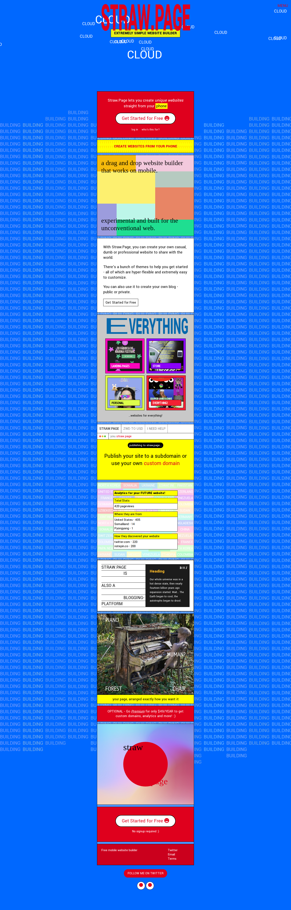
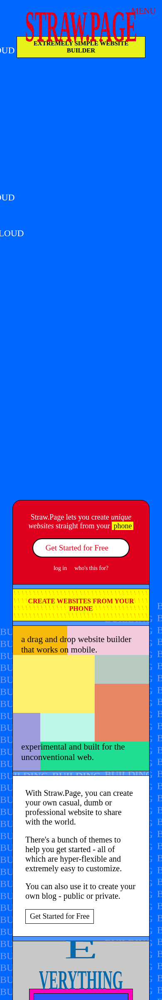

# UI Design System & Master Generation Blueprint: straw-page

> **Straw.Page - Extremely simple website builder** (https://straw.page) — Straw.Page is the world's simplest website builder. Create unique websites from your mobile device.



---

## 1. Executive Visual Persona & Design Archetype

- **Brand Essence & Persona**: **Straw.Page - Extremely simple website builder** (`https://straw.page`). Straw.Page is the world's simplest website builder. Create unique websites from your mobile device.
- **Visual Archetype**: **High-Contrast Obsidian / Atmospheric Design System (`#000` canvas, `#fff` ink, `#94c3f4` accent)**.
- **Anti-AI-Slop Differentiators**:
  - **Source-Grounded Chromatic Polarity**: Anchors the viewport in `#000` (`var(--pupilColor)` in `:root`) paired with `#fff` primary typography and `#94c3f4` accents.
  - **Extracted Typographic Hierarchy**: Pairs `Baloo Paaji 2` for display copy (`Sign in`) with `Bangers` and not declared in static CSS (uses primary stack / `ui-monospace`).
  - **Calibrated Spatial Grid & Motion**: Combines `995px` container bounds (`gap: 10px`, padding `40px`) with `cubic-bezier(0.25,0.1,0.25,1)` easing and Three.js / WebGL Canvas Pipeline.

---

## 2. Spatial Architecture & Modular Grid Mathematics



### Viewport Allocation & Container Geometry
- **Captured Viewport Dimensions**: Desktop `1440×4487px` (`assets/desktop.png`, full-page scroll capture), Mobile `390×2400px` (`assets/mobile.png`, capped at 2400px multi-section capture).
- **Master Container Bounds**: `995px` extracted from `straw-page` stylesheet.
- **Canvas Lateral Padding & Spacing**: `40px` lateral canvas padding with `10px` grid gap.
- **Border Radius Scale**: `50%`, `20px`, `40px`, `150px`.

### Responsive Breakpoint Architecture
- **Desktop Layout**: Multi-column CSS Grid / Flexbox layout at `1440px` (`max-width: 995px`, `gap: 10px`).
- **Mobile Layout**: Single-column vertical stack at `390px` viewport width with `40px` horizontal padding.
- **Extracted CSS Media Queries**: `@media (max-width: 650px)`, `@media (max-width: 550px)`, `@media (max-width:600px)`, `@media (max-width:700px)`.

---

## 3. Color System, Materiality & Atmospheric Lighting

### Semantic Palette & Source Grounding
| Semantic Role | Ground-Truth Value | Extracted CSS Source / Selector |
|---|---|---|
| **Primary Canvas Substrate** | `#000` | `var(--pupilColor)` in `:root` |
| **Primary Typography Ink** | `#eee` | `.fa-border { border: #eee }` |
| **Elevated Surface / Card Substrate** | `#fff` | `.fa-inverse { color: #fff }` |
| **Interactive Accent / Highlight** | `#94c3f4` | `.first { background: #94c3f4 }` |
| **Secondary / Muted Copy** | `#0068ff` | `.first { background: #0068ff }` |
| **Structural Hairline Border** | `#df001d` | `.intro h1 { color: #df001d }` |

### Sanitized Root CSS Variables (`ui-ux.md` Ground Truth)
| Variable Name | Extracted Value | Semantic Role |
|---|---|---|
| `--lefter` | `0px` | Dimension / Scale Token |
| `--eyeballHeight` | `40px` | Layout / Spatial Grid Token |
| `--eyeballWidth` | `40px` | Layout / Spatial Grid Token |
| `--pupilColor` | `#000` | Brand / Palette Token |
| `--straw-page-bg` | `#000` | Canvas Substrate (from `var(--pupilColor)` in `:root`) |
| `--straw-page-ink` | `#fff` | Primary Typography Ink (stylesheet-derived) |
| `--straw-page-surface` | `#fff` | Surface Substrate (stylesheet-derived) |
| `--straw-page-accent` | `#94c3f4` | Interactive Accent (stylesheet-derived) |
| `--straw-page-muted` | `#0068ff` | Secondary Ink (stylesheet-derived) |
| `--straw-page-border` | `#df001d` | Structural Border (stylesheet-derived) |
| `--straw-page-container` | `995px` | Container Bound (stylesheet-derived) |
| `--straw-page-gap` | `10px` | Grid Gutter (stylesheet-derived) |
| `--straw-page-pad` | `40px` | Lateral Padding (stylesheet-derived) |
| `--straw-page-ease` | `cubic-bezier(0.25,0.1,0.25,1)` | Primary Easing Function |
| `--straw-page-radius` | `50%` | Corner Radius (stylesheet-derived) |
| `--straw-page-fs-base` | `1.33333em` | Observed Font Size Token |

---

## 4. Typographic Scale & Editorial Hierarchy

### Font Family Stacks
- **Display Typography**: `Baloo Paaji 2`.
- **Primary Body Stack**: `Bangers`.
- **Technical / Metadata Stack**: not declared in static CSS (uses primary stack / `ui-monospace`).

### Typographic Scale & Rules (Extracted from Stylesheet & Variables)
- **Hero Display (`H1`)**: rule `h1` (`font-size: 80px`).
- **Section Heading (`H2`)**: rule `h2` (`font-size: 18px`, `font-weight: 100`).
- **Body Copy**: rule `p` (`font-weight: 900`).
- **Metadata & Navigation Labels**: not explicitly declared on tag in static CSS (stylesheet font-size ladder: `1.33333em`, `.75em`, `.875em`, `1em`, `2em`).

---

## 5. Choreographed Motion & Interaction Physics

### Primary Easing Curves
- **Extracted Timing Functions**: `cubic-bezier(0.25,0.1,0.25,1)`.

### Per-Element Transition & Choreography Rules
- **Selector `.first`**: `transition: background 1s ease` extracted from `straw-page` stylesheet.
- **Selector `.clouds span`**: `transition: opacity 0.3s ease` extracted from `straw-page` stylesheet.
- **Selector `.final button`**: `transition: all 0.3s ease` extracted from `straw-page` stylesheet.
- **Standard CSS Easing (`cubic-bezier(0.25,0.1,0.25,1)`)**: Default timing curve (no custom `cubic-bezier()` declared in static CSS).
- **Runtime Interaction Engine**: Integrates Three.js / WebGL Canvas Pipeline with `prefers-reduced-motion: reduce` fallback guards.

---

## 6. Component Wireframe & Structural DOM Map

### Visual Layout Schematic (Grounded in `dom.html` — `1440px` Desktop & `390px` Mobile Reflow)
```
┌────────────────────────────────────────────────────────────────────────┐
│ DESKTOP VIEWPORT (1440px) — Straw.Page - Extremely simple website buil │
│ ====================================================================== │
│ [ <header.first>           | Pricing · Twitter · Premium · Email ·  ]  │
│ ---------------------------------------------------------------------- │
│ | HERO STAGE: <div.first>                                          |   │
│ | H1: Sign in                                                      |   │
│ | Substrate: #000       | Ink: #fff       | Accent: #94c3f4        |   │
│ ---------------------------------------------------------------------- │
│ | SHOWCASE GRID (<div.first>               ) max-w: 995px          |   │
│ | +------------------------------+  +------------------------------+ | │
│ | | Forgot password              |  | Sign up                      | | │
│ | +------------------------------+  +------------------------------+ | │
│ ---------------------------------------------------------------------- │
│ | MOBILE VIEWPORT REFLOW (390px) — Single-Column Stack (gap: 10px  ) | │
│ | [<header.first>] -> [<div.first>] -> [<div.first>] |                 │
│ ---------------------------------------------------------------------- │
│ [ FOOTER (<footer.innerSun>     ) | https://straw.page                 │
└────────────────────────────────────────────────────────────────────────┘
```

### Granular DOM Region Breakdown
1. **Brand Header & Navigation Bar (<header.first> — `straw-page`)**:
   - Landmark `<header class="first">` hosting `Straw.Page - Extremely simple websit` navigation (`Pricing · Twitter · Premium · Email · Terms`), DOM attributes (`data-open="signIn"`, `data-open="signUp"`, `data-cf-beacon="("version":"2024.11.0..."`), and stylesheet rule `.fa-lg { font-size:1.33333em;line-height:.75em;vertical-align:-.0667em }`.
2. **Hero Stage & Focal Lead (<div.first> — `Sign in`)**:
   - Landmark `<div class="first">` presenting display lead `Sign in` and copy excerpt *"Check your email for a password reset link. Be sure to check your"* over `#000` canvas and `#fff` ink.
3. **Primary Showcase & Content Grid (<div.first> — `Forgot password`)**:
   - Landmark `<div class="first">` rendering section `Forgot password` with copy *"Straw.Page lets you create unique websites straight from your pho"*, asset references (`all.min.css`, `jquery.min.js`, `apple-touch-icon.png`, `favicon-32x32.png`), and grid rule `.fa-xs { font-size:.75em }`.
4. **Interactive Detail & Feature Matrix (<div.first> — `Sign up`)**:
   - Landmark `<div class="first">` framing `Sign up` and `Straw.Page` (*"Get Started for Free"*) with `#fff` surface cards, `#94c3f4` accents, and `.fa-sm { font-size:.875em }`.
5. **Colophon & Global Directory Footer (<footer.innerSun> — `https://straw.page`)**:
   - Landmark `<footer class="innerSun">` anchoring `Straw.Page - Extremely simple we` footer links (`Pricing · Twitter · Premium · Email · Terms`), copy *"Create websites from your phone"*, and `#df001d` structural dividers.

---

## 7. Master Zero-Shot AI Generation Prompt

```markdown
# Master Zero-Shot Frontend Generation Prompt: straw-page (Straw.Page - Extremely simple website builder)

You are a principal frontend architect and design systems engineer. Build a complete, production-ready web application replicating the exact design system, DOM landmarks, typographic hierarchy, color tokens, and motion physics of `straw-page` (**Straw.Page - Extremely simple website builder** — `https://straw.page`).

### 1. Visual Archetype & Anti-AI-Slop Mandates
- **Archetype**: High-Contrast Obsidian / Atmospheric Design System (`#000` canvas, `#fff` ink, `#94c3f4` accent).
- **Identity & Domain Context**: Straw.Page is the world's simplest website builder. Create unique websites from your mobile device.
- **Primary Substrate**: `#000` (`var(--pupilColor)` in `:root`), **Primary Ink**: `#fff`, **Accent / Highlight**: `#94c3f4`.
- **Site-Specific Differentiators**:
  - **Source-Grounded Chromatic Polarity**: Anchors the viewport in `#000` (`var(--pupilColor)` in `:root`) paired with `#fff` primary typography and `#94c3f4` accents.
  - **Extracted Typographic Hierarchy**: Pairs `Baloo Paaji 2` for display copy (`Sign in`) with `Bangers` and not declared in static CSS (uses primary stack / `ui-monospace`).
  - **Calibrated Spatial Grid & Motion**: Combines `995px` container bounds (`gap: 10px`, padding `40px`) with `cubic-bezier(0.25,0.1,0.25,1)` easing and Three.js / WebGL Canvas Pipeline.

### 2. Ground-Truth CSS Variables (`:root` Token Contract)
Declare and consume these exact custom properties extracted from `straw-page` in your global stylesheet:

:root {
  /* Straw.Page - Extremely simple website builder (straw-page) — Ground-Truth Extracted CSS Variables */
  --lefter: 0px; /* Dimension / Scale Token (straw-page) */
  --eyeballHeight: 40px; /* Layout / Spatial Grid Token (straw-page) */
  --eyeballWidth: 40px; /* Layout / Spatial Grid Token (straw-page) */
  --pupilColor: #000; /* Brand / Palette Token (straw-page) */
  --straw-page-bg: #000; /* Canvas Substrate (from `var(--pupilColor)` in `:root`) (straw-page) */
  --straw-page-ink: #fff; /* Primary Typography Ink (stylesheet-derived) (straw-page) */
  --straw-page-surface: #fff; /* Surface Substrate (stylesheet-derived) (straw-page) */
  --straw-page-accent: #94c3f4; /* Interactive Accent (stylesheet-derived) (straw-page) */
  --straw-page-muted: #0068ff; /* Secondary Ink (stylesheet-derived) (straw-page) */
  --straw-page-border: #df001d; /* Structural Border (stylesheet-derived) (straw-page) */
  --straw-page-container: 995px; /* Container Bound (stylesheet-derived) (straw-page) */
  --straw-page-gap: 10px; /* Grid Gutter (stylesheet-derived) (straw-page) */
  --straw-page-pad: 40px; /* Lateral Padding (stylesheet-derived) (straw-page) */
  --straw-page-ease: cubic-bezier(0.25,0.1,0.25,1); /* Primary Easing Function (straw-page) */
  --straw-page-radius: 50%; /* Corner Radius (stylesheet-derived) (straw-page) */
  --straw-page-fs-base: 1.33333em; /* Observed Font Size Token (straw-page) */
}

### 3. Semantic Color & Materiality Contract
Map every surface, ink, and border strictly to these source-grounded tokens:
- **Primary Canvas Substrate**: `#000` — grounded in `var(--pupilColor)` in `:root`
- **Primary Typography Ink**: `#eee` — grounded in `.fa-border { border: #eee }`
- **Elevated Surface / Card Substrate**: `#fff` — grounded in `.fa-inverse { color: #fff }`
- **Interactive Accent / Highlight**: `#94c3f4` — grounded in `.first { background: #94c3f4 }`
- **Secondary / Muted Copy**: `#0068ff` — grounded in `.first { background: #0068ff }`
- **Structural Hairline Border**: `#df001d` — grounded in `.intro h1 { color: #df001d }`

### 4. Spatial Grid, Container Bounds & Responsive Breakpoints
- **Desktop Viewport Reference**: `1440×4487px` (full-page scroll capture, `1440px` standard desktop width).
- **Mobile Viewport Reference**: `390×2400px` (capped at 2400px multi-section capture, `390px` standard mobile width).
- **Container Max-Width**: `995px` extracted from `straw-page` stylesheet
- **Padding & Gutters**: `40px` lateral canvas padding with `10px` grid gap
- **Desktop Grid**: Multi-column CSS Grid / Flexbox layout at `1440px` (`max-width: 995px`, `gap: 10px`)
- **Mobile Adaptation**: Single-column vertical stack at `390px` viewport width with `40px` horizontal padding
- **Media Queries**: `@media (max-width: 650px)`, `@media (max-width: 550px)`, `@media (max-width:600px)`, `@media (max-width:700px)`
- **Corner Radii**: `50%`, `20px`, `40px`, `150px`

### 5. Typography & Editorial Scale Contract
- **Display Font Stack**: `Baloo Paaji 2`
- **Body Font Stack**: `Bangers`
- **Monospace / Technical Font Stack**: not declared in static CSS (uses primary stack / `ui-monospace`)
- **H1 Display Rule**: rule `h1` (`font-size: 80px`)
- **H2 Section Rule**: rule `h2` (`font-size: 18px`, `font-weight: 100`)
- **Body Copy Rule**: rule `p` (`font-weight: 900`)
- **Metadata & Index Rule**: not explicitly declared on tag in static CSS (stylesheet font-size ladder: `1.33333em`, `.75em`, `.875em`, `1em`, `2em`)

### 6. Component Hierarchy, Verbatim Copy & Real DOM Landmarks
Scaffold `straw-page` (`Straw.Page - Extremely simple website builder`) with these exact structural regions, extracted copy, and CSS rules from `dom.html`:
1. **Brand Header & Navigation Bar (<header.first> — `straw-page`)**:
   - DOM & Selectors: Landmark `<header class="first">` hosting `Straw.Page - Extremely simple websit` navigation (`Pricing · Twitter · Premium · Email · Terms`), DOM attributes (`data-open="signIn"`, `data-open="signUp"`, `data-cf-beacon="("version":"2024.11.0..."`), and stylesheet rule `.fa-lg { font-size:1.33333em;line-height:.75em;vertical-align:-.0667em }`.
   - Responsive Contract: Header `Brand Header & Navigation Bar (<header.first> — `straw-page`)` (`straw-page`) adapts across `@media (max-width: 650px)`, `@media (max-width: 550px)`, `@media (max-width:600px)`, `@media (max-width:700px)` with `cubic-bezier(0.25,0.1,0.25,1)` transitions and links `Pricing · Twitter · Premium · Email · Terms`.
2. **Hero Stage & Focal Lead (<div.first> — `Sign in`)**:
   - DOM & Selectors: Landmark `<div class="first">` presenting display lead `Sign in` and copy excerpt *"Check your email for a password reset link. Be sure to check your"* over `#000` canvas and `#fff` ink.
   - Responsive Contract: Hero stage (`1440×4487px` desktop / `390×2400px` mobile) sets `#000` background with `#fff` headline `Sign in`.
3. **Primary Showcase & Content Grid (<div.first> — `Forgot password`)**:
   - DOM & Selectors: Landmark `<div class="first">` rendering section `Forgot password` with copy *"Straw.Page lets you create unique websites straight from your pho"*, asset references (`all.min.css`, `jquery.min.js`, `apple-touch-icon.png`, `favicon-32x32.png`), and grid rule `.fa-xs { font-size:.75em }`.
   - Responsive Contract: Showcase grid `Primary Showcase & Content Grid (<div.first> — `Forgot password`)` applies Multi-column CSS Grid / Flexbox layout at `1440px` (`max-width: 995px`, `gap: 10px`) on desktop and Single-column vertical stack at `390px` viewport width with `40px` horizontal padding on mobile.
4. **Interactive Detail & Feature Matrix (<div.first> — `Sign up`)**:
   - DOM & Selectors: Landmark `<div class="first">` framing `Sign up` and `Straw.Page` (*"Get Started for Free"*) with `#fff` surface cards, `#94c3f4` accents, and `.fa-sm { font-size:.875em }`.
   - Responsive Contract: Detail module `Interactive Detail & Feature Matrix (<div.first> — `Sign up`)` uses `50%`, `20px`, `40px`, `150px` radii, `#94c3f4` highlights, and assets (all.min.css, jquery.min.js, apple-touch-icon.png).
5. **Colophon & Global Directory Footer (<footer.innerSun> — `https://straw.page`)**:
   - DOM & Selectors: Landmark `<footer class="innerSun">` anchoring `Straw.Page - Extremely simple we` footer links (`Pricing · Twitter · Premium · Email · Terms`), copy *"Create websites from your phone"*, and `#df001d` structural dividers.
   - Responsive Contract: Footer `Colophon & Global Directory Footer (<footer.innerSun> — `https://straw.page`)` aligns to `995px` extracted from `straw-page` stylesheet with `40px` lateral canvas padding with `10px` grid gap and attributes (data-open="signIn", data-open="signUp", data-cf-beacon="("version":"2024.11.0...").

#### Verbatim DOM Copy Excerpts (`dom.html`)
- Copy Excerpt 1: *"Check your email for a password reset link. Be sure to check your Spam folder if i..."*
- Copy Excerpt 2: *"Straw.Page lets you create unique websites straight from your phone"*
- Copy Excerpt 3: *"Get Started for Free"*
- Copy Excerpt 4: *"Create websites from your phone"*

### 7. Motion, Extracted Stylesheet Rules & Interaction Choreography
- **Primary Easing Functions**: `cubic-bezier(0.25,0.1,0.25,1)`
- **Extracted Stylesheet Rules (`straw-page`)**:
- `.fa-lg { font-size:1.33333em;line-height:.75em;vertical-align:-.0667em }`
- `.fa-xs { font-size:.75em }`
- `.fa-sm { font-size:.875em }`
- `.fa-1x { font-size:1em }`
- `.fa-2x { font-size:2em }`
- **Per-Selector Transition Rules**:
- **Selector `.first`**: `transition: background 1s ease` extracted from `straw-page` stylesheet.
- **Selector `.clouds span`**: `transition: opacity 0.3s ease` extracted from `straw-page` stylesheet.
- **Selector `.final button`**: `transition: all 0.3s ease` extracted from `straw-page` stylesheet.
- **Standard CSS Easing (`cubic-bezier(0.25,0.1,0.25,1)`)**: Default timing curve (no custom `cubic-bezier()` declared in static CSS).
- **Runtime Interaction Engine**: Integrates Three.js / WebGL Canvas Pipeline with `prefers-reduced-motion: reduce` fallback guards.

### 8. Technical Deliverables
- Implement in Next.js (App Router) with TypeScript and Tailwind CSS consuming the `:root` custom properties defined above for `straw-page`.
- Reproduce both the `1440px` desktop architecture and `390px` mobile breakpoint transitions, preserving semantic HTML5 landmarks (`<header>`, `<nav>`, `<main>`, `<section>`, `<footer>`) and `prefers-reduced-motion` accessibility guards.
```
