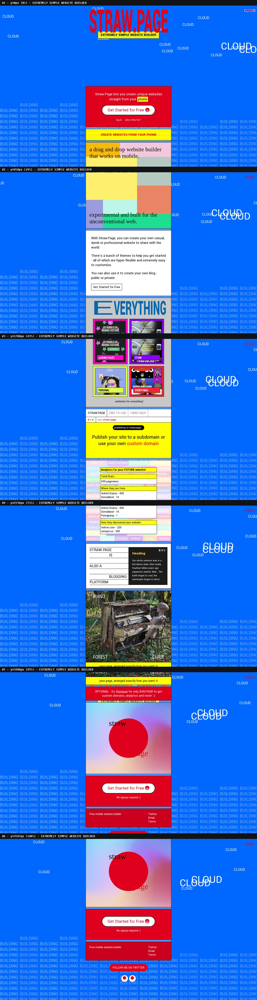
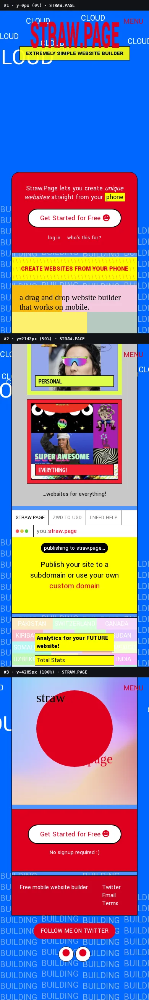

# UI Design System & Master Generation Blueprint: straw-page

> **Straw.Page - Extremely simple website builder** (https://straw.page) — Straw.Page is the world's simplest website builder. Create unique websites from your mobile device.





---

## 1. Executive Visual Persona & Design Archetype

- **Brand Essence & Persona**: **Straw.Page - Extremely simple website builder** (`https://straw.page`). Straw.Page is the world's simplest website builder. Create unique websites from your mobile device.
- **Capture Provenance**: Live browser capture (`tier1_fast`, HTTP `200`, captured `2026-11-24`).
- **Visual Archetype**: **Light-Substrate Editorial & Modular Grid System (`#ffffff` canvas, `#000000` ink, `#ffff00` accent)**.
- **Anti-AI-Slop Differentiators**:
  - **Live-Computed Chromatic Polarity**: Anchors the viewport in `#ffffff` (live computed `browser-default` `background-color` (`computed_styles.json`)) paired with `#000000` primary typography and `#ffff00` accents.
  - **Grounded Typographic Hierarchy**: Pairs `Yantramanav` for display copy (`STRAW.PAGE`) with `Frank Ruhl Libre`.
  - **Calibrated Spatial Grid & Motion**: Combines `1440px` container bounds (`gap: 10px`, padding `40px`) with `cubic-bezier(0.25,0.1,0.25,1)` easing and Three.js / WebGL Canvas Pipeline.

---

## 2. Spatial Architecture & Modular Grid Mathematics

### Viewport Allocation & Container Geometry
- **Captured Journey Filmstrips**: Desktop `1280×4968px` (`assets/desktop-journey.webp`, `6` keyframes up to `y=3587px` / doc `4487px`), Mobile `390×2616px` (`assets/mobile-journey.webp`, `3` keyframes).
- **Master Container Bounds**: `1440px` (full-bleed `100%` viewport stage).
- **Canvas Lateral Padding & Spacing**: `40px` lateral canvas padding with `10px` grid gap.
- **Border Radius Scale**: `40px`, `50%`, `20px`, `150px`.

### Responsive Breakpoint Architecture
- **Desktop Layout**: Multi-column CSS Grid / Flexbox layout at `1440px` (`max-width: 1440px`, `gap: 10px`).
- **Mobile Layout**: Single-column vertical stack at `390px` viewport width with `40px` horizontal padding.
- **Extracted CSS Media Queries**: `@media (max-width: 650px)`, `@media (max-width: 550px)`, `@media (max-width:600px)`, `@media (max-width:700px)`.

---

## 3. Color System, Materiality & Atmospheric Lighting

### Semantic Palette & Source Grounding
| Semantic Role | Ground-Truth Value | Extracted Live / CSS Source |
|---|---|---|
| **Primary Canvas Substrate** | `#ffffff` | live computed `browser-default` `background-color` (`computed_styles.json`) |
| **Primary Typography Ink** | `#000000` | live computed `body` `color` (`computed_styles.json`) |
| **Elevated Surface / Card Substrate** | `#ffff00` | live computed `h2` `background-color` (`computed_styles.json`) |
| **Interactive Accent / Highlight** | `#ffff00` | `.final button:hover { background: yellow }` (`#ffff00`) |
| **Secondary / Muted Copy** | `#df001d` | live computed `p` `color` (`computed_styles.json`) |
| **Structural Hairline Border** | `#eeeeee` | `.fa-border { border: #eeeeee }` |

### Sanitized Root CSS Variables (`ui-ux.md` Ground Truth)
| Variable Name | Extracted Value | Semantic Role |
|---|---|---|
| `--lefter` | `0px` | Dimension / Scale Token |
| `--eyeballHeight` | `40px` | Layout / Spatial Grid Token |
| `--eyeballWidth` | `40px` | Layout / Spatial Grid Token |
| `--pupilColor` | `#000` | Brand / Palette Token |
| `--straw-page-bg` | `#ffffff` | Canvas Substrate (from live computed `browser-default` `background-color` (`computed_styles.json`)) |
| `--straw-page-ink` | `#000000` | Primary Typography Ink (computed-derived) |
| `--straw-page-surface` | `#ffff00` | Surface Substrate (computed-derived) |
| `--straw-page-accent` | `#ffff00` | Interactive Accent (computed-derived) |
| `--straw-page-muted` | `#df001d` | Secondary Ink (computed-derived) |
| `--straw-page-border` | `#eeeeee` | Structural Border (computed-derived) |
| `--straw-page-container` | `1440px` | Container Bound (computed-derived) |
| `--straw-page-gap` | `10px` | Grid Gutter (computed-derived) |
| `--straw-page-pad` | `40px` | Lateral Padding (computed-derived) |
| `--straw-page-ease` | `cubic-bezier(0.25,0.1,0.25,1)` | Primary Easing Function |
| `--straw-page-radius` | `40px` | Corner Radius (computed-derived) |
| `--straw-page-fs-base` | `80px` | Observed Font Size Token |

---

## 4. Typographic Scale & Editorial Hierarchy

### Font Family Stacks
- **Display Typography**: `Yantramanav`.
- **Primary Body Stack**: `Frank Ruhl Libre`.
- **Technical / Metadata Stack**: not declared in live computed styles (uses primary stack / `ui-monospace`).

### Typographic Scale & Rules (Live Computed & Stylesheet Grounded)
- **Hero Display (`H1`)**: live computed `h1` (`font-size: 80px`, `line-height: normal`, `font-weight: 700`); rule `h1` (`font-size: 80px`).
- **Section Heading (`H2`)**: live computed `h3 (primary section heading)` (`font-size: 60px`, `line-height: normal`, `font-weight: 700`); rule `h2` (`font-size: 18px`, `font-weight: 100`).
- **Body Copy**: live computed `body` (`font-size: 16px`, `line-height: normal`, `font-weight: 400`); rule `p` (`font-weight: 900`).
- **Metadata & Navigation Labels**: live computed `nav/a` (`font-size: 20px`, `line-height: normal`, `font-weight: 400`).

---

## 5. Choreographed Motion & Interaction Physics

### Primary Easing Curves
- **Extracted Timing Functions**: `cubic-bezier(0.25,0.1,0.25,1)`.

### Per-Element Transition & Choreography Rules
- **Selector `.first`**: `transition: background 1s ease` extracted from `straw-page` stylesheet.
- **Selector `.clouds span`**: `transition: opacity 0.3s ease` extracted from `straw-page` stylesheet.
- **Selector `.final button`**: `transition: all 0.3s ease` extracted from `straw-page` stylesheet.
- **Standard CSS Easing (`cubic-bezier(0.25,0.1,0.25,1)`)**: Default timing curve (no custom `cubic-bezier()` declared in captured CSS).
- **Runtime Interaction Engine**: Integrates Three.js / WebGL Canvas Pipeline with `prefers-reduced-motion: reduce` fallback guards.
### Measured Runtime Scroll & Interaction Telemetry (`behavioral_journey_v2`)
- **Scroll Driver Mode**: `native` (max document height `4487px`, deepest scrollY reached `3587px` across `6` desktop keyframes).
- **Detected Scroll / Motion Libraries**: Native browser scroll / standard CSS transitions.

---

## 6. Component Wireframe & Structural DOM Map

### Visual Layout Schematic — Desktop (`1440px`, Grounded in `dom.html` & Landmark Bounding Boxes)
```
┌────────────────────────────────────────────────────────────────────────┐
│ DESKTOP VIEWPORT (1440px) — Straw.Page - Extremely simple website buil │
│ ====================================================================== │
│ [ <header.first> (1440px)             | Pricing · Twitter · Premium  ] │
│ ---------------------------------------------------------------------- │
│ | HERO STAGE: <div.first> (w=1440px)                                 | │
│ | H1: STRAW.PAGE                                                     | │
│ | Substrate: #ffffff | Ink: #000000 | Accent: #ffff00                | │
│ ---------------------------------------------------------------------- │
│ | SHOWCASE GRID (<div.first:nth(2)>) max-w: 1440px                   | │
│ | +------------------------------+  +------------------------------+ | │
│ | | Forgot password              |  | Straw.Page                   | | │
│ | +------------------------------+  +------------------------------+ | │
│ ---------------------------------------------------------------------- │
│ | DETAIL MODULE (<div.first:nth(3)>) — Extremely simple webs         | │
│ ---------------------------------------------------------------------- │
│ [ FOOTER (<footer.innerSun>   ) | https://straw.page                   │
└────────────────────────────────────────────────────────────────────────┘
```

### Visual Layout Schematic — Mobile Reflow (`390px`)
```
┌────────────────────────────────────────────────────────────────────────┐
│ MOBILE VIEWPORT REFLOW (390px) — Single-Column Stack (gap: 10px)       │
│ ====================================================================== │
│ [ HEADER BAR (<header.first>          ) | Compact Menu (390px)         │
│ ---------------------------------------------------------------------- │
│ | HERO STAGE (<div.first>) — 390px Vertical Lead                     | │
│ | H1: STRAW.PAGE                                                     | │
│ ---------------------------------------------------------------------- │
│ | SHOWCASE STACK (<div.first:nth(2)>) — 1-Col Stack                  | │
│ | [ Item 1: Forgot password                                        ] | │
│ | [ Item 2: Straw.Page                                             ] | │
│ ---------------------------------------------------------------------- │
│ | DETAIL STACK (<div.first:nth(3)>) — 1-Col (Extremely simple w)     | │
│ ---------------------------------------------------------------------- │
│ [ FOOTER (<footer.innerSun>   ) | Stacked 390px Colophon               │
└────────────────────────────────────────────────────────────────────────┘
```

### Granular DOM Region Breakdown
1. **Brand Header & Navigation Bar (<header.first> — `straw-page`)**:
   - Landmark `<header class="first">` (`1440px`) hosting `Straw.Page - Extremely simple websit` navigation (`Pricing · Twitter · Premium · Email · Terms`), DOM attributes (`data-open="signIn"`, `data-open="signUp"`, `data-cf-beacon="("version":"2024.11.0..."`), and stylesheet rule `.fa-lg { font-size:1.33333em;line-height:.75em;vertical-align:-.0667em }`.
2. **Hero Stage & Focal Lead (<div.first> — `STRAW.PAGE`)**:
   - Landmark `<div class="first">` presenting display lead `STRAW.PAGE` and copy excerpt *"Check your email for a password reset link. Be sure to check your"* over `#ffffff` canvas and `#000000` ink.
3. **Primary Showcase & Content Grid (<div.first:nth(2)> — `Forgot password`)**:
   - Landmark `<div class="first">` rendering section `Forgot password` with copy *"Straw.Page lets you create unique websites straight from your pho"*, asset references (`all.min.css`, `jquery.min.js`, `apple-touch-icon.png`, `favicon-32x32.png`), and grid rule `.fa-xs { font-size:.75em }`.
4. **Interactive Detail & Feature Matrix (<div.first:nth(3)> — `Straw.Page`)**:
   - Landmark `<div class="first">` framing `Straw.Page` and `Extremely simple website builder` (*"Create websites from your phone"*) with `#ffff00` surface cards, `#ffff00` accents, and `.fa-sm { font-size:.875em }`.
5. **Colophon & Global Directory Footer (<footer.innerSun> — `https://straw.page`)**:
   - Landmark `<footer class="innerSun">` anchoring `Straw.Page - Extremely simple we` footer links (`Pricing · Twitter · Premium · Email · Terms`), copy *"A drag and drop website builder that works on mobile."*, and `#eeeeee` structural dividers.
### Full Vertical Scroll Sequence (Desktop `1440×900` Keyframes)
- **Step 01** (`y=0px`, `0%`): Active landmark `EXTREMELY SIMPLE WEBSITE BUILDER` · sticky/fixed elements: `4`
- **Step 02** (`y=850px`, `24%`): Active landmark `EXTREMELY SIMPLE WEBSITE BUILDER` · sticky/fixed elements: `4`
- **Step 03** (`y=1700px`, `47%`): Active landmark `EXTREMELY SIMPLE WEBSITE BUILDER` · sticky/fixed elements: `4`
- **Step 04** (`y=2550px`, `71%`): Active landmark `EXTREMELY SIMPLE WEBSITE BUILDER` · sticky/fixed elements: `4`
- **Step 05** (`y=3400px`, `95%`): Active landmark `EXTREMELY SIMPLE WEBSITE BUILDER` · sticky/fixed elements: `4`
- **Step 06** (`y=3587px`, `100%`): Active landmark `EXTREMELY SIMPLE WEBSITE BUILDER` · sticky/fixed elements: `4`

---

## 7. Master Zero-Shot AI Generation Prompt

```markdown
# Master Zero-Shot Frontend Generation Prompt: straw-page (Straw.Page - Extremely simple website builder)

You are a principal frontend architect and design systems engineer. Build a complete, production-ready web application replicating the exact design system, DOM landmarks, typographic hierarchy, color tokens, and motion physics of `straw-page` (**Straw.Page - Extremely simple website builder** — `https://straw.page`).

### 1. Visual Archetype & Anti-AI-Slop Mandates
- **Archetype**: Light-Substrate Editorial & Modular Grid System (`#ffffff` canvas, `#000000` ink, `#ffff00` accent).
- **Identity & Domain Context**: Straw.Page is the world's simplest website builder. Create unique websites from your mobile device.
- **Primary Substrate**: `#ffffff` (live computed `browser-default` `background-color` (`computed_styles.json`)), **Primary Ink**: `#000000`, **Accent / Highlight**: `#ffff00`.
- **Site-Specific Differentiators**:
  - **Live-Computed Chromatic Polarity**: Anchors the viewport in `#ffffff` (live computed `browser-default` `background-color` (`computed_styles.json`)) paired with `#000000` primary typography and `#ffff00` accents.
  - **Grounded Typographic Hierarchy**: Pairs `Yantramanav` for display copy (`STRAW.PAGE`) with `Frank Ruhl Libre`.
  - **Calibrated Spatial Grid & Motion**: Combines `1440px` container bounds (`gap: 10px`, padding `40px`) with `cubic-bezier(0.25,0.1,0.25,1)` easing and Three.js / WebGL Canvas Pipeline.

### 2. Ground-Truth CSS Variables (`:root` Token Contract)
Declare and consume these exact custom properties extracted from `straw-page` in your global stylesheet:

:root {
  /* Straw.Page - Extremely simple website builder (straw-page) — Live-Grounded CSS Variables */
  --lefter: 0px; /* Dimension / Scale Token (straw-page) */
  --eyeballHeight: 40px; /* Layout / Spatial Grid Token (straw-page) */
  --eyeballWidth: 40px; /* Layout / Spatial Grid Token (straw-page) */
  --pupilColor: #000; /* Brand / Palette Token (straw-page) */
  --straw-page-bg: #ffffff; /* Canvas Substrate (from live computed `browser-default` `background-color` (`computed_styles.json`)) (straw-page) */
  --straw-page-ink: #000000; /* Primary Typography Ink (computed-derived) (straw-page) */
  --straw-page-surface: #ffff00; /* Surface Substrate (computed-derived) (straw-page) */
  --straw-page-accent: #ffff00; /* Interactive Accent (computed-derived) (straw-page) */
  --straw-page-muted: #df001d; /* Secondary Ink (computed-derived) (straw-page) */
  --straw-page-border: #eeeeee; /* Structural Border (computed-derived) (straw-page) */
  --straw-page-container: 1440px; /* Container Bound (computed-derived) (straw-page) */
  --straw-page-gap: 10px; /* Grid Gutter (computed-derived) (straw-page) */
  --straw-page-pad: 40px; /* Lateral Padding (computed-derived) (straw-page) */
  --straw-page-ease: cubic-bezier(0.25,0.1,0.25,1); /* Primary Easing Function (straw-page) */
  --straw-page-radius: 40px; /* Corner Radius (computed-derived) (straw-page) */
  --straw-page-fs-base: 80px; /* Observed Font Size Token (straw-page) */
}

### 3. Semantic Color & Materiality Contract
Map every surface, ink, and border strictly to these source-grounded tokens:
- **Primary Canvas Substrate**: `#ffffff` — grounded in live computed `browser-default` `background-color` (`computed_styles.json`)
- **Primary Typography Ink**: `#000000` — grounded in live computed `body` `color` (`computed_styles.json`)
- **Elevated Surface / Card Substrate**: `#ffff00` — grounded in live computed `h2` `background-color` (`computed_styles.json`)
- **Interactive Accent / Highlight**: `#ffff00` — grounded in `.final button:hover { background: yellow }` (`#ffff00`)
- **Secondary / Muted Copy**: `#df001d` — grounded in live computed `p` `color` (`computed_styles.json`)
- **Structural Hairline Border**: `#eeeeee` — grounded in `.fa-border { border: #eeeeee }`

### 4. Spatial Grid, Container Bounds & Responsive Breakpoints
- **Desktop Viewport Reference**: `1280×4968px` (multi-frame vertical journey filmstrip (4968px), `1440px` standard desktop width).
- **Mobile Viewport Reference**: `390×2616px` (multi-frame vertical journey filmstrip (2616px), `390px` standard mobile width).
- **Container Max-Width**: `1440px` (full-bleed `100%` viewport stage)
- **Padding & Gutters**: `40px` lateral canvas padding with `10px` grid gap
- **Desktop Grid**: Multi-column CSS Grid / Flexbox layout at `1440px` (`max-width: 1440px`, `gap: 10px`)
- **Mobile Adaptation**: Single-column vertical stack at `390px` viewport width with `40px` horizontal padding
- **Media Queries**: `@media (max-width: 650px)`, `@media (max-width: 550px)`, `@media (max-width:600px)`, `@media (max-width:700px)`
- **Corner Radii**: `40px`, `50%`, `20px`, `150px`

### 5. Typography & Editorial Scale Contract
- **Display Font Stack**: `Yantramanav`
- **Body Font Stack**: `Frank Ruhl Libre`
- **Monospace / Technical Font Stack**: not declared in live computed styles (uses primary stack / `ui-monospace`)
- **H1 Display Rule**: live computed `h1` (`font-size: 80px`, `line-height: normal`, `font-weight: 700`); rule `h1` (`font-size: 80px`)
- **H2 Section Rule**: live computed `h3 (primary section heading)` (`font-size: 60px`, `line-height: normal`, `font-weight: 700`); rule `h2` (`font-size: 18px`, `font-weight: 100`)
- **Body Copy Rule**: live computed `body` (`font-size: 16px`, `line-height: normal`, `font-weight: 400`); rule `p` (`font-weight: 900`)
- **Metadata & Index Rule**: live computed `nav/a` (`font-size: 20px`, `line-height: normal`, `font-weight: 400`)

### 6. Component Hierarchy, Verbatim Copy & Real DOM Landmarks
Scaffold `straw-page` (`Straw.Page - Extremely simple website builder`) with these exact structural regions, extracted copy, and CSS rules from `dom.html`:
1. **Brand Header & Navigation Bar (<header.first> — `straw-page`)**:
   - DOM & Selectors: Landmark `<header class="first">` (`1440px`) hosting `Straw.Page - Extremely simple websit` navigation (`Pricing · Twitter · Premium · Email · Terms`), DOM attributes (`data-open="signIn"`, `data-open="signUp"`, `data-cf-beacon="("version":"2024.11.0..."`), and stylesheet rule `.fa-lg { font-size:1.33333em;line-height:.75em;vertical-align:-.0667em }`.
   - Responsive Contract: Header `Brand Header & Navigation Bar (<header.first> — `straw-page`)` (`straw-page`) adapts across `@media (max-width: 650px)`, `@media (max-width: 550px)`, `@media (max-width:600px)`, `@media (max-width:700px)` with `cubic-bezier(0.25,0.1,0.25,1)` transitions and links `Pricing · Twitter · Premium · Email · Terms`.
2. **Hero Stage & Focal Lead (<div.first> — `STRAW.PAGE`)**:
   - DOM & Selectors: Landmark `<div class="first">` presenting display lead `STRAW.PAGE` and copy excerpt *"Check your email for a password reset link. Be sure to check your"* over `#ffffff` canvas and `#000000` ink.
   - Responsive Contract: Hero stage (`1280×4968px` desktop / `390×2616px` mobile) sets `#ffffff` background with `#000000` headline `STRAW.PAGE`.
3. **Primary Showcase & Content Grid (<div.first:nth(2)> — `Forgot password`)**:
   - DOM & Selectors: Landmark `<div class="first">` rendering section `Forgot password` with copy *"Straw.Page lets you create unique websites straight from your pho"*, asset references (`all.min.css`, `jquery.min.js`, `apple-touch-icon.png`, `favicon-32x32.png`), and grid rule `.fa-xs { font-size:.75em }`.
   - Responsive Contract: Showcase grid `Primary Showcase & Content Grid (<div.first:nth(2)> — `Forgot password`)` applies Multi-column CSS Grid / Flexbox layout at `1440px` (`max-width: 1440px`, `gap: 10px`) on desktop and Single-column vertical stack at `390px` viewport width with `40px` horizontal padding on mobile.
4. **Interactive Detail & Feature Matrix (<div.first:nth(3)> — `Straw.Page`)**:
   - DOM & Selectors: Landmark `<div class="first">` framing `Straw.Page` and `Extremely simple website builder` (*"Create websites from your phone"*) with `#ffff00` surface cards, `#ffff00` accents, and `.fa-sm { font-size:.875em }`.
   - Responsive Contract: Detail module `Interactive Detail & Feature Matrix (<div.first:nth(3)> — `Straw.Page`)` uses `40px`, `50%`, `20px`, `150px` radii, `#ffff00` highlights, and assets (all.min.css, jquery.min.js, apple-touch-icon.png).
5. **Colophon & Global Directory Footer (<footer.innerSun> — `https://straw.page`)**:
   - DOM & Selectors: Landmark `<footer class="innerSun">` anchoring `Straw.Page - Extremely simple we` footer links (`Pricing · Twitter · Premium · Email · Terms`), copy *"A drag and drop website builder that works on mobile."*, and `#eeeeee` structural dividers.
   - Responsive Contract: Footer `Colophon & Global Directory Footer (<footer.innerSun> — `https://straw.page`)` aligns to `1440px` (full-bleed `100%` viewport stage) with `40px` lateral canvas padding with `10px` grid gap and attributes (data-open="signIn", data-open="signUp", data-cf-beacon="("version":"2024.11.0...").

#### Verbatim DOM Copy Excerpts (`dom.html`)
- Copy Excerpt 1: *"Check your email for a password reset link. Be sure to check your Spam folder if i..."*
- Copy Excerpt 2: *"Straw.Page lets you create unique websites straight from your phone"*
- Copy Excerpt 3: *"Create websites from your phone"*
- Copy Excerpt 4: *"A drag and drop website builder that works on mobile."*

### 7. Motion, Extracted Stylesheet Rules & Interaction Choreography
- **Primary Easing Functions**: `cubic-bezier(0.25,0.1,0.25,1)`
- **Extracted Stylesheet Rules (`straw-page`)**:
- `.fa-lg { font-size:1.33333em;line-height:.75em;vertical-align:-.0667em }`
- `.fa-xs { font-size:.75em }`
- `.fa-sm { font-size:.875em }`
- `.fa-1x { font-size:1em }`
- `.fa-2x { font-size:2em }`
- **Per-Selector Transition Rules**:
- **Selector `.first`**: `transition: background 1s ease` extracted from `straw-page` stylesheet.
- **Selector `.clouds span`**: `transition: opacity 0.3s ease` extracted from `straw-page` stylesheet.
- **Selector `.final button`**: `transition: all 0.3s ease` extracted from `straw-page` stylesheet.
- **Standard CSS Easing (`cubic-bezier(0.25,0.1,0.25,1)`)**: Default timing curve (no custom `cubic-bezier()` declared in captured CSS).
- **Runtime Interaction Engine**: Integrates Three.js / WebGL Canvas Pipeline with `prefers-reduced-motion: reduce` fallback guards.
### 7b. Full-Page Scroll Choreography, Interactive States & Multi-Page Routes
- **Scroll Mechanics**: Implement `native` vertical progression up to `4487px` across 6 distinct viewport chapters.
- **Vertical Chapter Sequence**: EXTREMELY SIMPLE WEBSITE BU... (0%) -> EXTREMELY SIMPLE WEBSITE BU... (24%) -> EXTREMELY SIMPLE WEBSITE BU... (47%) -> EXTREMELY SIMPLE WEBSITE BU... (71%) -> EXTREMELY SIMPLE WEBSITE BU... (95%) -> EXTREMELY SIMPLE WEBSITE BU... (100%).

### 8. Technical Deliverables
- Implement in Next.js (App Router) with TypeScript and Tailwind CSS consuming the `:root` custom properties defined above for `straw-page`.
- Reproduce both the `1440px` desktop architecture and `390px` mobile breakpoint transitions, preserving semantic HTML5 landmarks (`<header>`, `<nav>`, `<main>`, `<section>`, `<footer>`) and `prefers-reduced-motion` accessibility guards.
```
---

## 8. Full-Page Scroll Journey, Interactive States & Subpage Inventory

### Desktop Scroll Keyframes (`1440×900` WebP)
| Step | Scroll Y | Progress | Active Landmark / Section | Sticky/Fixed | Visual Asset |
| :---: | :---: | :---: | :--- | :---: | :--- |
| `#01` | `0px` | `0%` | EXTREMELY SIMPLE WEBSITE BUILDER | `4` | [desktop-step-01.webp](assets/desktop-step-01.webp) |
| `#02` | `850px` | `24%` | EXTREMELY SIMPLE WEBSITE BUILDER | `4` | [desktop-step-02.webp](assets/desktop-step-02.webp) |
| `#03` | `1700px` | `47%` | EXTREMELY SIMPLE WEBSITE BUILDER | `4` | [desktop-step-03.webp](assets/desktop-step-03.webp) |
| `#04` | `2550px` | `71%` | EXTREMELY SIMPLE WEBSITE BUILDER | `4` | [desktop-step-04.webp](assets/desktop-step-04.webp) |
| `#05` | `3400px` | `95%` | EXTREMELY SIMPLE WEBSITE BUILDER | `4` | [desktop-step-05.webp](assets/desktop-step-05.webp) |
| `#06` | `3587px` | `100%` | EXTREMELY SIMPLE WEBSITE BUILDER | `4` | [desktop-step-06.webp](assets/desktop-step-06.webp) |

### Mobile Condensed Keyframes (`390×844` WebP)
| Step | Scroll Y | Progress | Active Landmark | Visual Asset |
| :---: | :---: | :---: | :--- | :--- |
| `#01` | `0px` | `0%` | STRAW.PAGE | [mobile-step-01.webp](assets/mobile-step-01.webp) |
| `#02` | `2142px` | `50%` | STRAW.PAGE | [mobile-step-02.webp](assets/mobile-step-02.webp) |
| `#03` | `4285px` | `100%` | STRAW.PAGE | [mobile-step-03.webp](assets/mobile-step-03.webp) |

