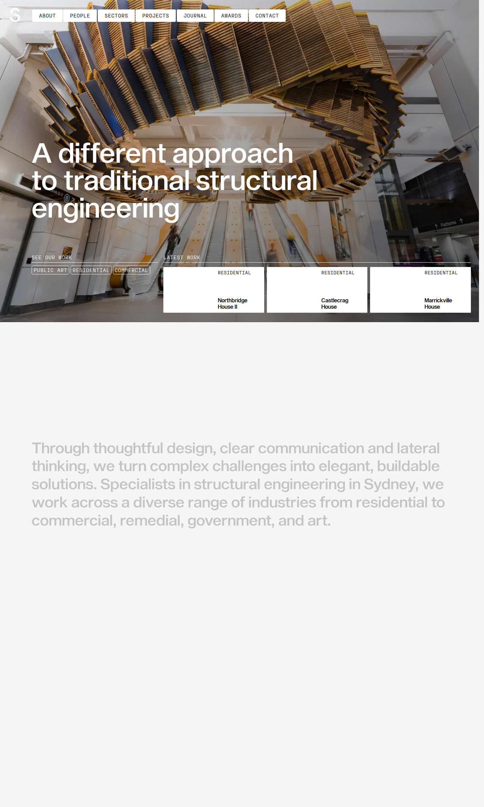

# UI Design System & Master Generation Blueprint: structureengineering-com-au

> **Structure Consulting Engineers · Structural Engineering Sydney** (https://structureengineering.com.au/) — Specialists in structural engineering in Sydney, we work across a range of industries from residential to commercial, remedial, governmen...



---

## 1. Executive Visual Persona & Design Archetype

- **Brand Essence & Persona**: **Structure Consulting Engineers · Structural Engineering Sydney** (`https://structureengineering.com.au/`). Specialists in structural engineering in Sydney, we work across a range of industries from residential to commercial, remedial, governmen...
- **Capture Provenance**: Live browser capture (`tier1_fast`, HTTP `200`, captured `2026-11-23`).
- **Visual Archetype**: **Light-Substrate Editorial & Modular Grid System (`#f5f5f5` canvas, `#000000` ink, `#ffffff` accent)**.
- **Anti-AI-Slop Differentiators**:
  - **Live-Computed Chromatic Polarity**: Anchors the viewport in `#f5f5f5` (live computed `body` `background-color` (`computed_styles.json`)) paired with `#000000` primary typography and `#ffffff` accents.
  - **Grounded Typographic Hierarchy**: Pairs `SequelSans` for display copy (`A different approach to traditional `) with `SequelSans` and `PPFraktionMono`.
  - **Calibrated Spatial Grid & Motion**: Combines `1440px` container bounds (`gap: 12px`, padding `1.5rem`) with `cubic-bezier(0.015,0.791,0.757,1.024)` easing and Three.js / WebGL Canvas Pipeline, Swiper Touch Carousel Engine.

---

## 2. Spatial Architecture & Modular Grid Mathematics


### Viewport Allocation & Container Geometry
- **Captured Viewport Dimensions**: Desktop `1440×2400px` (`assets/desktop.png`, clamped at 2400px live multi-section capture), Mobile `390×2400px` (`assets/mobile.png`, clamped at 2400px live multi-section capture).
- **Master Container Bounds**: `1440px` (full-bleed `100%` desktop stage measured on `1440px` viewport).
- **Canvas Lateral Padding & Spacing**: `1.5rem` lateral canvas padding with `12px` grid gap.
- **Border Radius Scale**: `1.6px`, `100%`, `50%`, `0px`.

### Responsive Breakpoint Architecture
- **Desktop Layout**: Multi-column CSS Grid / Flexbox layout at `1440px` (`max-width: 1440px`, `gap: 12px`).
- **Mobile Layout**: Single-column vertical stack at `390px` viewport width with `1.5rem` horizontal padding.
- **Extracted CSS Media Queries**: `@media (min-width: 375px)`, `@media (min-width: 769px)`, `@media (min-width: 1200px)`, `@media (max-width: 1199px)`.

---

## 3. Color System, Materiality & Atmospheric Lighting

### Semantic Palette & Source Grounding
| Semantic Role | Ground-Truth Value | Extracted Live / CSS Source |
|---|---|---|
| **Primary Canvas Substrate** | `#f5f5f5` | live computed `body` `background-color` (`computed_styles.json`) |
| **Primary Typography Ink** | `#000000` | live computed `main` `color` (`computed_styles.json`) |
| **Elevated Surface / Card Substrate** | `#ffffff` | live computed `button` `background-color` (`computed_styles.json`) |
| **Interactive Accent / Highlight** | `#ffffff` | live computed `button` `background-color` (`computed_styles.json`) |
| **Secondary / Muted Copy** | `#777777` | `form-wrap .dropdown-menu>.disab... { color: #777777 }` |
| **Structural Hairline Border** | `#ffffff` | `a.btn-with-arrow:hover { border-color: #ffffff }` |
| **Variable Token (`--color-gold`)** | `#b9b36d` | `var(--color-gold)` in `:root` |
| **Variable Token (`--color-grey`)** | `#bebebe` | `var(--color-grey)` in `:root` |
| **Variable Token (`--wp--preset--color--cyan-bluish-gray`)** | `#abb8c3` | `var(--wp--preset--color--cyan-bluish-gray)` in stylesheet |

### Sanitized Root CSS Variables (`ui-ux.md` Ground Truth)
| Variable Name | Extracted Value | Semantic Role |
|---|---|---|
| `--color-black` | `#000` | Canvas / Surface Token |
| `--color-white` | `#ffffff` | Canvas / Surface Token |
| `--color-gold` | `#B9B36D` | Brand / Palette Token |
| `--color-background-grey` | `#F5F5F5` | Canvas / Surface Token |
| `--color-grey` | `#BEBEBE` | Brand / Palette Token |
| `--wp--preset--aspect-ratio--square` | `1` | Design System Custom Token |
| `--wp--preset--aspect-ratio--4-3` | `4/3` | Design System Custom Token |
| `--wp--preset--aspect-ratio--3-4` | `3/4` | Design System Custom Token |
| `--wp--preset--aspect-ratio--3-2` | `3/2` | Design System Custom Token |
| `--wp--preset--aspect-ratio--2-3` | `2/3` | Design System Custom Token |
| `--wp--preset--aspect-ratio--16-9` | `16/9` | Design System Custom Token |
| `--wp--preset--aspect-ratio--9-16` | `9/16` | Design System Custom Token |
| `--wp--preset--color--black` | `#000000` | Canvas / Surface Token |
| `--wp--preset--color--cyan-bluish-gray` | `#abb8c3` | Brand / Palette Token |
| `--structureenginee-bg` | `#f5f5f5` | Canvas Substrate (from live computed `body` `background-color` (`computed_styles.json`)) |
| `--structureenginee-ink` | `#000000` | Primary Typography Ink (computed-derived) |

---

## 4. Typographic Scale & Editorial Hierarchy

### Font Family Stacks
- **Display Typography**: `SequelSans`.
- **Primary Body Stack**: `SequelSans`.
- **Technical / Metadata Stack**: `PPFraktionMono`.

### Typographic Scale & Rules (Live Computed & Stylesheet Grounded)
- **Hero Display (`H1`)**: live computed `h1` (`font-size: 81.6px`, `line-height: 81.6px`, `font-weight: 400`); rule `h1` (`font-size: 2em`).
- **Section Heading (`H2`)**: live computed `h2` (`font-size: 16px`, `line-height: 16px`, `font-weight: 400`); rule `.h2` (`font-size: 3.7em`, `line-height: 1`).
- **Body Copy**: live computed `body` (`font-size: 16px`, `line-height: 20.8px`, `font-weight: 400`); rule `body` (`font-size: 0.8em`, `line-height: 1.3`).
- **Metadata & Navigation Labels**: live computed `nav/a` (`font-size: 16px`, `line-height: 20.8px`, `font-weight: 400`); rule `small` (`font-size: 80%`).

---

## 5. Choreographed Motion & Interaction Physics

### Primary Easing Curves
- **Extracted Timing Functions**: `cubic-bezier(0.015,0.791,0.757,1.024)`, `cubic-bezier(0.76,0,0.24,1)`, `cubic-bezier(0.66,0,0.34,1)`.

### Per-Element Transition & Choreography Rules
- **Selector `.preload *`**: `transition: none !important` extracted from `structureengineering-com-au` stylesheet.
- **Selector `.rocket-lazyload`**: `transition: opacity 1s` extracted from `structureengineering-com-au` stylesheet.
- **Selector `.media-link .media`**: `transition: ease-in-out 0.5s` extracted from `structureengineering-com-au` stylesheet.
- **Extracted Easing Curve (`cubic-bezier(0.015,0.791,0.757,1.024)`)**: Governs interactive state transitions across `<nav.top-nav>` and `<section.section-intro>`.
- **Runtime Interaction Engine**: Integrates Three.js / WebGL Canvas Pipeline, Swiper Touch Carousel Engine with `prefers-reduced-motion: reduce` fallback guards.

---

## 6. Component Wireframe & Structural DOM Map

### Visual Layout Schematic — Desktop (`1440px`, Grounded in `dom.html` & Landmark Bounding Boxes)
```
┌────────────────────────────────────────────────────────────────────────┐
│ DESKTOP VIEWPORT (1440px) — Structure Consulting Engineers · Structura │
│ ====================================================================== │
│ [ <nav.top-nav> (878x93px)            | About · Company · Careers ·  ] │
│ ---------------------------------------------------------------------- │
│ | HERO STAGE: <section.section> (w=1425px)                           | │
│ | H1: A different approach to traditional structural en...           | │
│ | Substrate: #f5f5f5 | Ink: #000000 | Accent: #ffffff                | │
│ ---------------------------------------------------------------------- │
│ | SHOWCASE GRID (<section.section-intro>) max-w: 1440px              | │
│ | +------------------------------+  +------------------------------+ | │
│ | | Northbridge House II         |  | Castlecrag House             | | │
│ | +------------------------------+  +------------------------------+ | │
│ ---------------------------------------------------------------------- │
│ | DETAIL MODULE (<section.section-spread>) — Marrickville House      | │
│ ---------------------------------------------------------------------- │
│ [ FOOTER (<footer.preloadergon) | https://structureengineering.com.au  │
└────────────────────────────────────────────────────────────────────────┘
```

### Visual Layout Schematic — Mobile Reflow (`390px`)
```
┌────────────────────────────────────────────────────────────────────────┐
│ MOBILE VIEWPORT REFLOW (390px) — Single-Column Stack (gap: 12px)       │
│ ====================================================================== │
│ [ HEADER BAR (<nav.top-nav>           ) | Compact Menu (390px)         │
│ ---------------------------------------------------------------------- │
│ | HERO STAGE (<section.section>) — 390px Vertical Lead               | │
│ | H1: A different approach to traditional structural en...           | │
│ ---------------------------------------------------------------------- │
│ | SHOWCASE STACK (<section.section-intro) — 1-Col Stack              | │
│ | [ Item 1: Northbridge House II                                   ] | │
│ | [ Item 2: Castlecrag House                                       ] | │
│ ---------------------------------------------------------------------- │
│ | DETAIL STACK (<section.section-spread>) — 1-Col (Marrickville House) │
│ ---------------------------------------------------------------------- │
│ [ FOOTER (<footer.preloadergon) | Stacked 390px Colophon               │
└────────────────────────────────────────────────────────────────────────┘
```

### Granular DOM Region Breakdown
1. **Brand Header & Navigation Bar (<nav.top-nav> — `structureengineering-com-au`)**:
   - Landmark `<nav class="top-nav font-PPFraktionMono">` (`878x93px`) hosting `Structure Consulting Engineers · Str` navigation (`About · Company · Careers · People · Sectors`), DOM attributes (`data-section-background-color="background-color-black"`, `data-rocket-prefetch`, `data-rocket-preload`, `data-rocket-async="style"`), and stylesheet rule `html { scrollbar-gutter: stable; }`.
2. **Hero Stage & Focal Lead (<section.section> — `A different approach to traditiona`)**:
   - Landmark `<section class="section section-topbannerhome">` presenting display lead `A different approach to traditional structural en...` and copy excerpt *"Residential Northbridge House II"* over `#f5f5f5` canvas and `#000000` ink.
3. **Primary Showcase & Content Grid (<section.section-intro> — `Northbridge House II`)**:
   - Landmark `<section class="section section-intro">` rendering section `Northbridge House II` with copy *"Residential Castlecrag House"*, asset references (`www.googletagmanager.com`, `SequelSans-Medium.woff2`, `PPFraktionMono-Regular.woff2`, `s.svg`), and grid rule `body { margin: 0; }`.
4. **Interactive Detail & Feature Matrix (<section.section-spread> — `Castlecrag House`)**:
   - Landmark `<section class="section section-spread">` framing `Castlecrag House` and `Marrickville House` (*"Residential Marrickville House"*) with `#ffffff` surface cards, `#ffffff` accents, and `main { display: block; }`.
5. **Colophon & Global Directory Footer (<footer.preloadergone> — `https://structureengineering.com.au/`)**:
   - Landmark `<footer class="preloadergone">` anchoring `Structure Consulting Engineers ·` footer links (`About · Company · Careers · People · Sectors`), copy *"Through thoughtful design, clear communication and lateral t"*, and `#ffffff` structural dividers.

---

## 7. Master Zero-Shot AI Generation Prompt

```markdown
# Master Zero-Shot Frontend Generation Prompt: structureengineering-com-au (Structure Consulting Engineers · Structural Engineering Sydney)

You are a principal frontend architect and design systems engineer. Build a complete, production-ready web application replicating the exact design system, DOM landmarks, typographic hierarchy, color tokens, and motion physics of `structureengineering-com-au` (**Structure Consulting Engineers · Structural Engineering Sydney** — `https://structureengineering.com.au/`).

### 1. Visual Archetype & Anti-AI-Slop Mandates
- **Archetype**: Light-Substrate Editorial & Modular Grid System (`#f5f5f5` canvas, `#000000` ink, `#ffffff` accent).
- **Identity & Domain Context**: Specialists in structural engineering in Sydney, we work across a range of industries from residential to commercial, remedial, governmen...
- **Primary Substrate**: `#f5f5f5` (live computed `body` `background-color` (`computed_styles.json`)), **Primary Ink**: `#000000`, **Accent / Highlight**: `#ffffff`.
- **Site-Specific Differentiators**:
  - **Live-Computed Chromatic Polarity**: Anchors the viewport in `#f5f5f5` (live computed `body` `background-color` (`computed_styles.json`)) paired with `#000000` primary typography and `#ffffff` accents.
  - **Grounded Typographic Hierarchy**: Pairs `SequelSans` for display copy (`A different approach to traditional `) with `SequelSans` and `PPFraktionMono`.
  - **Calibrated Spatial Grid & Motion**: Combines `1440px` container bounds (`gap: 12px`, padding `1.5rem`) with `cubic-bezier(0.015,0.791,0.757,1.024)` easing and Three.js / WebGL Canvas Pipeline, Swiper Touch Carousel Engine.

### 2. Ground-Truth CSS Variables (`:root` Token Contract)
Declare and consume these exact custom properties extracted from `structureengineering-com-au` in your global stylesheet:

:root {
  /* Structure Consulting Engineers · Structural Engineering Sydney (structureengineering-com-au) — Live-Grounded CSS Variables */
  --color-black: #000; /* Canvas / Surface Token (structureengineering-com-au) */
  --color-white: #ffffff; /* Canvas / Surface Token (structureengineering-com-au) */
  --color-gold: #B9B36D; /* Brand / Palette Token (structureengineering-com-au) */
  --color-background-grey: #F5F5F5; /* Canvas / Surface Token (structureengineering-com-au) */
  --color-grey: #BEBEBE; /* Brand / Palette Token (structureengineering-com-au) */
  --wp--preset--aspect-ratio--square: 1; /* Design System Custom Token (structureengineering-com-au) */
  --wp--preset--aspect-ratio--4-3: 4/3; /* Design System Custom Token (structureengineering-com-au) */
  --wp--preset--aspect-ratio--3-4: 3/4; /* Design System Custom Token (structureengineering-com-au) */
  --wp--preset--aspect-ratio--3-2: 3/2; /* Design System Custom Token (structureengineering-com-au) */
  --wp--preset--aspect-ratio--2-3: 2/3; /* Design System Custom Token (structureengineering-com-au) */
  --wp--preset--aspect-ratio--16-9: 16/9; /* Design System Custom Token (structureengineering-com-au) */
  --wp--preset--aspect-ratio--9-16: 9/16; /* Design System Custom Token (structureengineering-com-au) */
  --wp--preset--color--black: #000000; /* Canvas / Surface Token (structureengineering-com-au) */
  --wp--preset--color--cyan-bluish-gray: #abb8c3; /* Brand / Palette Token (structureengineering-com-au) */
  --structureenginee-bg: #f5f5f5; /* Canvas Substrate (from live computed `body` `background-color` (`computed_styles.json`)) (structureengineering-com-au) */
  --structureenginee-ink: #000000; /* Primary Typography Ink (computed-derived) (structureengineering-com-au) */
}

### 3. Semantic Color & Materiality Contract
Map every surface, ink, and border strictly to these source-grounded tokens:
- **Primary Canvas Substrate**: `#f5f5f5` — grounded in live computed `body` `background-color` (`computed_styles.json`)
- **Primary Typography Ink**: `#000000` — grounded in live computed `main` `color` (`computed_styles.json`)
- **Elevated Surface / Card Substrate**: `#ffffff` — grounded in live computed `button` `background-color` (`computed_styles.json`)
- **Interactive Accent / Highlight**: `#ffffff` — grounded in live computed `button` `background-color` (`computed_styles.json`)
- **Secondary / Muted Copy**: `#777777` — grounded in `form-wrap .dropdown-menu>.disab... { color: #777777 }`
- **Structural Hairline Border**: `#ffffff` — grounded in `a.btn-with-arrow:hover { border-color: #ffffff }`
- **Variable Token (`--color-gold`)**: `#b9b36d` — grounded in `var(--color-gold)` in `:root`
- **Variable Token (`--color-grey`)**: `#bebebe` — grounded in `var(--color-grey)` in `:root`
- **Variable Token (`--wp--preset--color--cyan-bluish-gray`)**: `#abb8c3` — grounded in `var(--wp--preset--color--cyan-bluish-gray)` in stylesheet

### 4. Spatial Grid, Container Bounds & Responsive Breakpoints
- **Desktop Viewport Reference**: `1440×2400px` (clamped at 2400px live multi-section capture, `1440px` standard desktop width).
- **Mobile Viewport Reference**: `390×2400px` (clamped at 2400px live multi-section capture, `390px` standard mobile width).
- **Container Max-Width**: `1440px` (full-bleed `100%` desktop stage measured on `1440px` viewport)
- **Padding & Gutters**: `1.5rem` lateral canvas padding with `12px` grid gap
- **Desktop Grid**: Multi-column CSS Grid / Flexbox layout at `1440px` (`max-width: 1440px`, `gap: 12px`)
- **Mobile Adaptation**: Single-column vertical stack at `390px` viewport width with `1.5rem` horizontal padding
- **Media Queries**: `@media (min-width: 375px)`, `@media (min-width: 769px)`, `@media (min-width: 1200px)`, `@media (max-width: 1199px)`
- **Corner Radii**: `1.6px`, `100%`, `50%`, `0px`

### 5. Typography & Editorial Scale Contract
- **Display Font Stack**: `SequelSans`
- **Body Font Stack**: `SequelSans`
- **Monospace / Technical Font Stack**: `PPFraktionMono`
- **H1 Display Rule**: live computed `h1` (`font-size: 81.6px`, `line-height: 81.6px`, `font-weight: 400`); rule `h1` (`font-size: 2em`)
- **H2 Section Rule**: live computed `h2` (`font-size: 16px`, `line-height: 16px`, `font-weight: 400`); rule `.h2` (`font-size: 3.7em`, `line-height: 1`)
- **Body Copy Rule**: live computed `body` (`font-size: 16px`, `line-height: 20.8px`, `font-weight: 400`); rule `body` (`font-size: 0.8em`, `line-height: 1.3`)
- **Metadata & Index Rule**: live computed `nav/a` (`font-size: 16px`, `line-height: 20.8px`, `font-weight: 400`); rule `small` (`font-size: 80%`)

### 6. Component Hierarchy, Verbatim Copy & Real DOM Landmarks
Scaffold `structureengineering-com-au` (`Structure Consulting Engineers · Structural Engineering Sydney`) with these exact structural regions, extracted copy, and CSS rules from `dom.html`:
1. **Brand Header & Navigation Bar (<nav.top-nav> — `structureengineering-com-au`)**:
   - DOM & Selectors: Landmark `<nav class="top-nav font-PPFraktionMono">` (`878x93px`) hosting `Structure Consulting Engineers · Str` navigation (`About · Company · Careers · People · Sectors`), DOM attributes (`data-section-background-color="background-color-black"`, `data-rocket-prefetch`, `data-rocket-preload`, `data-rocket-async="style"`), and stylesheet rule `html { scrollbar-gutter: stable; }`.
   - Responsive Contract: Header `Brand Header & Navigation Bar (<nav.top-nav> — `structureengineering-com-au`)` (`structureengineering-com-au`) adapts across `@media (min-width: 375px)`, `@media (min-width: 769px)`, `@media (min-width: 1200px)`, `@media (max-width: 1199px)` with `cubic-bezier(0.015,0.791,0.757,1.024)`, `cubic-bezier(0.76,0,0.24,1)`, `cubic-bezier(0.66,0,0.34,1)` transitions and links `About · Company · Careers · People · Sectors`.
2. **Hero Stage & Focal Lead (<section.section> — `A different approach to traditiona`)**:
   - DOM & Selectors: Landmark `<section class="section section-topbannerhome">` presenting display lead `A different approach to traditional structural en...` and copy excerpt *"Residential Northbridge House II"* over `#f5f5f5` canvas and `#000000` ink.
   - Responsive Contract: Hero stage (`1440×2400px` desktop / `390×2400px` mobile) sets `#f5f5f5` background with `#000000` headline `A different approach to traditional structural en...`.
3. **Primary Showcase & Content Grid (<section.section-intro> — `Northbridge House II`)**:
   - DOM & Selectors: Landmark `<section class="section section-intro">` rendering section `Northbridge House II` with copy *"Residential Castlecrag House"*, asset references (`www.googletagmanager.com`, `SequelSans-Medium.woff2`, `PPFraktionMono-Regular.woff2`, `s.svg`), and grid rule `body { margin: 0; }`.
   - Responsive Contract: Showcase grid `Primary Showcase & Content Grid (<section.section-intro> — `Northbridge House II`)` applies Multi-column CSS Grid / Flexbox layout at `1440px` (`max-width: 1440px`, `gap: 12px`) on desktop and Single-column vertical stack at `390px` viewport width with `1.5rem` horizontal padding on mobile.
4. **Interactive Detail & Feature Matrix (<section.section-spread> — `Castlecrag House`)**:
   - DOM & Selectors: Landmark `<section class="section section-spread">` framing `Castlecrag House` and `Marrickville House` (*"Residential Marrickville House"*) with `#ffffff` surface cards, `#ffffff` accents, and `main { display: block; }`.
   - Responsive Contract: Detail module `Interactive Detail & Feature Matrix (<section.section-spread> — `Castlecrag House`)` uses `1.6px`, `100%`, `50%`, `0px` radii, `#ffffff` highlights, and assets (www.googletagmanager.com, SequelSans-Medium.woff2, PPFraktionMono-Regular.woff2).
5. **Colophon & Global Directory Footer (<footer.preloadergone> — `https://structureengineering.com.au/`)**:
   - DOM & Selectors: Landmark `<footer class="preloadergone">` anchoring `Structure Consulting Engineers ·` footer links (`About · Company · Careers · People · Sectors`), copy *"Through thoughtful design, clear communication and lateral t"*, and `#ffffff` structural dividers.
   - Responsive Contract: Footer `Colophon & Global Directory Footer (<footer.preloadergone> — `https://structureengineering.com.au/`)` aligns to `1440px` (full-bleed `100%` desktop stage measured on `1440px` viewport) with `1.5rem` lateral canvas padding with `12px` grid gap and attributes (data-section-background-color="background-color-black", data-rocket-prefetch, data-rocket-preload).

#### Verbatim DOM Copy Excerpts (`dom.html`)
- Copy Excerpt 1: *"Residential Northbridge House II"*
- Copy Excerpt 2: *"Residential Castlecrag House"*
- Copy Excerpt 3: *"Residential Marrickville House"*
- Copy Excerpt 4: *"Through thoughtful design, clear communication and lateral thinking, we turn compl..."*

### 7. Motion, Extracted Stylesheet Rules & Interaction Choreography
- **Primary Easing Functions**: `cubic-bezier(0.015,0.791,0.757,1.024)`, `cubic-bezier(0.76,0,0.24,1)`, `cubic-bezier(0.66,0,0.34,1)`
- **Extracted Stylesheet Rules (`structureengineering-com-au`)**:
- `html { scrollbar-gutter: stable; }`
- `body { margin: 0; }`
- `main { display: block; }`
- `h1 { font-size: 2em; margin: 0.67em 0; }`
- `hr { box-sizing: content-box; height: 0; overflow: visible; }`
- **Per-Selector Transition Rules**:
- **Selector `.preload *`**: `transition: none !important` extracted from `structureengineering-com-au` stylesheet.
- **Selector `.rocket-lazyload`**: `transition: opacity 1s` extracted from `structureengineering-com-au` stylesheet.
- **Selector `.media-link .media`**: `transition: ease-in-out 0.5s` extracted from `structureengineering-com-au` stylesheet.
- **Extracted Easing Curve (`cubic-bezier(0.015,0.791,0.757,1.024)`)**: Governs interactive state transitions across `<nav.top-nav>` and `<section.section-intro>`.
- **Runtime Interaction Engine**: Integrates Three.js / WebGL Canvas Pipeline, Swiper Touch Carousel Engine with `prefers-reduced-motion: reduce` fallback guards.

### 8. Technical Deliverables
- Implement in Next.js (App Router) with TypeScript and Tailwind CSS consuming the `:root` custom properties defined above for `structureengineering-com-au`.
- Reproduce both the `1440px` desktop architecture and `390px` mobile breakpoint transitions, preserving semantic HTML5 landmarks (`<header>`, `<nav>`, `<main>`, `<section>`, `<footer>`) and `prefers-reduced-motion` accessibility guards.
```
