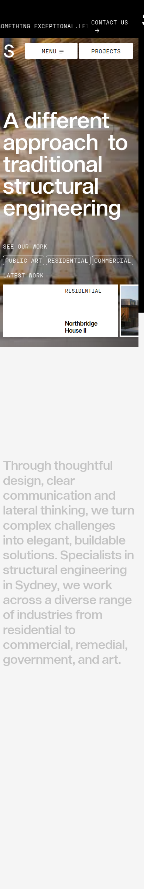

# UI Design System & Master Generation Blueprint: structureengineering-com-au

> **Structure Consulting Engineers · Structural Engineering Sydney** (https://structureengineering.com.au/) — Specialists in structural engineering in Sydney, we work across a range of industries from residential to commercial, remedial, governmen...


---

## 1. Executive Visual Persona & Design Archetype

- **Brand Essence & Persona**: **Structure Consulting Engineers · Structural Engineering Sydney** (`https://structureengineering.com.au/`). Specialists in structural engineering in Sydney, we work across a range of industries from residential to commercial, remedial, governmen...
- **Visual Archetype**: **High-Contrast Obsidian / Atmospheric Design System (`#000` canvas, `#ffffff` ink, `#F5F5F5` accent)**.
- **Anti-AI-Slop Differentiators**:
  - **Source-Grounded Chromatic Polarity**: Anchors the viewport in `#000` (`var(--color-black)` in `:root`) paired with `#ffffff` primary typography and `#F5F5F5` accents.
  - **Extracted Typographic Hierarchy**: Pairs `SequelSans` for display copy (`A different approach to traditional `) with `PPFraktionMono` and `PPFraktionMono`.
  - **Calibrated Spatial Grid & Motion**: Combines `767px` container bounds (`gap: 0px (flush layout)`, padding `1px`) with `cubic-bezier(0.015,0.791,0.757,1.024)` easing and Three.js / WebGL Canvas Pipeline, Swiper Touch Carousel Engine.

---

## 2. Spatial Architecture & Modular Grid Mathematics



### Viewport Allocation & Container Geometry
- **Captured Viewport Dimensions**: Desktop `1440×9590px` (`assets/desktop.png`, full-page scroll capture), Mobile `390×2400px` (`assets/mobile.png`, capped at 2400px multi-section capture).
- **Master Container Bounds**: `767px` extracted from `structureengineering-com-au` stylesheet.
- **Canvas Lateral Padding & Spacing**: `1px` lateral canvas padding with `0px (flush layout)` grid gap.
- **Border Radius Scale**: `100%`, `4px`, `0px`, `50%`.

### Responsive Breakpoint Architecture
- **Desktop Layout**: Multi-column CSS Grid / Flexbox layout at `1440px` (`max-width: 767px`, `gap: 0px (flush layout)`).
- **Mobile Layout**: Single-column vertical stack at `390px` viewport width with `1px` horizontal padding.
- **Extracted CSS Media Queries**: `@media (min-width: 769px)`, `@media (max-width:767px)`, `@media (min-width:768px)`, `@media screen\9`.

---

## 3. Color System, Materiality & Atmospheric Lighting

### Semantic Palette & Source Grounding
| Semantic Role | Ground-Truth Value | Extracted CSS Source / Selector |
|---|---|---|
| **Primary Canvas Substrate** | `#000` | `var(--color-black)` in `:root` |
| **Primary Typography Ink** | `#ffffff` | `var(--color-white)` in `:root` |
| **Elevated Surface / Card Substrate** | `#B9B36D` | `var(--color-gold)` in `:root` |
| **Interactive Accent / Highlight** | `#F5F5F5` | `var(--color-background-grey)` in `:root` |
| **Secondary / Muted Copy** | `#BEBEBE` | `var(--color-grey)` in `:root` |
| **Structural Hairline Border** | `#fff` | `.preloader { background-color: #fff }` |
| **Variable Token (`--swiper-theme-color`)** | `#007aff` | `var(--swiper-theme-color)` in stylesheet |

### Sanitized Root CSS Variables (`ui-ux.md` Ground Truth)
| Variable Name | Extracted Value | Semantic Role |
|---|---|---|
| `--color-black` | `#000` | Canvas / Surface Token |
| `--color-white` | `#ffffff` | Canvas / Surface Token |
| `--color-gold` | `#B9B36D` | Brand / Palette Token |
| `--color-background-grey` | `#F5F5F5` | Canvas / Surface Token |
| `--color-grey` | `#BEBEBE` | Brand / Palette Token |
| `--swiper-theme-color` | `#007aff` | Brand / Palette Token |
| `--swiper-preloader-color` | `#fff` | Brand / Palette Token |
| `--swiper-navigation-size` | `44px` | Layout / Spatial Grid Token |
| `--swiper-navigation-color` | `black` | Brand / Palette Token |
| `--wp--preset--aspect-ratio--square` | `1` | Design System Custom Token |
| `--wp--preset--aspect-ratio--4-3` | `4/3` | Design System Custom Token |
| `--wp--preset--aspect-ratio--3-4` | `3/4` | Design System Custom Token |
| `--wp--preset--aspect-ratio--3-2` | `3/2` | Design System Custom Token |
| `--wp--preset--aspect-ratio--2-3` | `2/3` | Design System Custom Token |
| `--structureenginee-bg` | `#000` | Canvas Substrate (from `var(--color-black)` in `:root`) |
| `--structureenginee-ink` | `#ffffff` | Primary Typography Ink (stylesheet-derived) |

---

## 4. Typographic Scale & Editorial Hierarchy

### Font Family Stacks
- **Display Typography**: `SequelSans`.
- **Primary Body Stack**: `PPFraktionMono`.
- **Technical / Metadata Stack**: `PPFraktionMono`.

### Typographic Scale & Rules (Extracted from Stylesheet & Variables)
- **Hero Display (`H1`)**: rule `h1` (`font-size: 2em`).
- **Section Heading (`H2`)**: rule `.h2` (`font-size: 3.7em`, `line-height: 1`).
- **Body Copy**: rule `p` (`font-size: 16px`).
- **Metadata & Navigation Labels**: rule `small` (`font-size: 80%`).

---

## 5. Choreographed Motion & Interaction Physics

### Primary Easing Curves
- **Extracted Timing Functions**: `cubic-bezier(0.015,0.791,0.757,1.024)`, `cubic-bezier(0.76,0,0.24,1)`, `cubic-bezier(0.66,0,0.34,1)`.

### Per-Element Transition & Choreography Rules
- **Selector `check-in-viewport.fadeinandslideu...`**: `transition: opacity 0.5s, transform 0.5s` extracted from `structureengineering-com-au` stylesheet.
- **Selector `.block-heading span`**: `transition: cubic-bezier(0.015,0.791,0.757,1.024) 0.3s, opacity ease-ou...` extracted from `structureengineering-com-au` stylesheet.
- **Selector `main`**: `transition: ease-in 0.5s` extracted from `structureengineering-com-au` stylesheet.
- **Extracted Easing Curve (`cubic-bezier(0.015,0.791,0.757,1.024)`)**: Governs interactive state transitions across `<nav.top-nav>` and `<section.section>`.
- **Runtime Interaction Engine**: Integrates Three.js / WebGL Canvas Pipeline, Swiper Touch Carousel Engine with `prefers-reduced-motion: reduce` fallback guards.

---

## 6. Component Wireframe & Structural DOM Map

### Visual Layout Schematic (Grounded in `dom.html` — `1440px` Desktop & `390px` Mobile Reflow)
```
┌────────────────────────────────────────────────────────────────────────┐
│ DESKTOP VIEWPORT (1440px) — Structure Consulting Engineers · Structura │
│ ====================================================================== │
│ [ <nav.top-nav>            | About · Company · Careers · People · S ]  │
│ ---------------------------------------------------------------------- │
│ | HERO STAGE: <section.section>                                    |   │
│ | H1: A different approach to traditional structural en...         |   │
│ | Substrate: #000       | Ink: #ffffff    | Accent: #F5F5F5        |   │
│ ---------------------------------------------------------------------- │
│ | SHOWCASE GRID (<section.section>         ) max-w: 767px          |   │
│ | +------------------------------+  +------------------------------+ | │
│ | | See our work                 |  | Latest work                  | | │
│ | +------------------------------+  +------------------------------+ | │
│ ---------------------------------------------------------------------- │
│ | MOBILE VIEWPORT REFLOW (390px) — Single-Column Stack (gap: 0px (f) | │
│ | [<nav.top-nav>] -> [<section.section>] -> [<section.section>] |      │
│ ---------------------------------------------------------------------- │
│ [ FOOTER (<footer.preloadergone>) | https://structureengineering.com.a │
└────────────────────────────────────────────────────────────────────────┘
```

### Granular DOM Region Breakdown
1. **Brand Header & Navigation Bar (<nav.top-nav> — `structureengineering-com-au`)**:
   - Landmark `<nav class="top-nav font-PPFraktionMono">` hosting `Structure Consulting Engineers · Str` navigation (`About · Company · Careers · People · Sectors`), DOM attributes (`data-section-background-color="background-color-black"`, `data-rocket-prefetch`, `data-rocket-preload`, `data-rocket-async="style"`), and stylesheet rule `html { scroll-behavior: smooth; }`.
2. **Hero Stage & Focal Lead (<section.section> — `A different approach to traditiona`)**:
   - Landmark `<section class="section section-topbannerhome">` presenting display lead `A different approach to traditional structural en...` and copy excerpt *"About Company Careers"* over `#000` canvas and `#ffffff` ink.
3. **Primary Showcase & Content Grid (<section.section> — `See our work`)**:
   - Landmark `<section class="section section-intro">` rendering section `See our work` with copy *"Sectors Residential Commercial Public Art"*, asset references (`www.googletagmanager.com`, `SequelSans-Medium.woff2`, `PPFraktionMono-Regular.woff2`, `s.svg`), and grid rule `.bounce { animation: bounce 2s linear 4s infinite alternate; }`.
4. **Interactive Detail & Feature Matrix (<section.section> — `Latest work`)**:
   - Landmark `<section class="section section-spread">` framing `Latest work` and `Northbridge House II` (*"Let's build something exceptional."*) with `#B9B36D` surface cards, `#F5F5F5` accents, and `.fadein { animation: fadein 0.5s; }`.
5. **Colophon & Global Directory Footer (<footer.preloadergone> — `https://structureengineering.com.au/`)**:
   - Landmark `<footer class="preloadergone">` anchoring `Structure Consulting Engineers ·` footer links (`About · Company · Careers · People · Sectors`), copy *"Let's build something exceptional"*, and `#fff` structural dividers.

---

## 7. Master Zero-Shot AI Generation Prompt

```markdown
# Master Zero-Shot Frontend Generation Prompt: structureengineering-com-au (Structure Consulting Engineers · Structural Engineering Sydney)

You are a principal frontend architect and design systems engineer. Build a complete, production-ready web application replicating the exact design system, DOM landmarks, typographic hierarchy, color tokens, and motion physics of `structureengineering-com-au` (**Structure Consulting Engineers · Structural Engineering Sydney** — `https://structureengineering.com.au/`).

### 1. Visual Archetype & Anti-AI-Slop Mandates
- **Archetype**: High-Contrast Obsidian / Atmospheric Design System (`#000` canvas, `#ffffff` ink, `#F5F5F5` accent).
- **Identity & Domain Context**: Specialists in structural engineering in Sydney, we work across a range of industries from residential to commercial, remedial, governmen...
- **Primary Substrate**: `#000` (`var(--color-black)` in `:root`), **Primary Ink**: `#ffffff`, **Accent / Highlight**: `#F5F5F5`.
- **Site-Specific Differentiators**:
  - **Source-Grounded Chromatic Polarity**: Anchors the viewport in `#000` (`var(--color-black)` in `:root`) paired with `#ffffff` primary typography and `#F5F5F5` accents.
  - **Extracted Typographic Hierarchy**: Pairs `SequelSans` for display copy (`A different approach to traditional `) with `PPFraktionMono` and `PPFraktionMono`.
  - **Calibrated Spatial Grid & Motion**: Combines `767px` container bounds (`gap: 0px (flush layout)`, padding `1px`) with `cubic-bezier(0.015,0.791,0.757,1.024)` easing and Three.js / WebGL Canvas Pipeline, Swiper Touch Carousel Engine.

### 2. Ground-Truth CSS Variables (`:root` Token Contract)
Declare and consume these exact custom properties extracted from `structureengineering-com-au` in your global stylesheet:

:root {
  /* Structure Consulting Engineers · Structural Engineering Sydney (structureengineering-com-au) — Ground-Truth Extracted CSS Variables */
  --color-black: #000; /* Canvas / Surface Token (structureengineering-com-au) */
  --color-white: #ffffff; /* Canvas / Surface Token (structureengineering-com-au) */
  --color-gold: #B9B36D; /* Brand / Palette Token (structureengineering-com-au) */
  --color-background-grey: #F5F5F5; /* Canvas / Surface Token (structureengineering-com-au) */
  --color-grey: #BEBEBE; /* Brand / Palette Token (structureengineering-com-au) */
  --swiper-theme-color: #007aff; /* Brand / Palette Token (structureengineering-com-au) */
  --swiper-preloader-color: #fff; /* Brand / Palette Token (structureengineering-com-au) */
  --swiper-navigation-size: 44px; /* Layout / Spatial Grid Token (structureengineering-com-au) */
  --swiper-navigation-color: black; /* Brand / Palette Token (structureengineering-com-au) */
  --wp--preset--aspect-ratio--square: 1; /* Design System Custom Token (structureengineering-com-au) */
  --wp--preset--aspect-ratio--4-3: 4/3; /* Design System Custom Token (structureengineering-com-au) */
  --wp--preset--aspect-ratio--3-4: 3/4; /* Design System Custom Token (structureengineering-com-au) */
  --wp--preset--aspect-ratio--3-2: 3/2; /* Design System Custom Token (structureengineering-com-au) */
  --wp--preset--aspect-ratio--2-3: 2/3; /* Design System Custom Token (structureengineering-com-au) */
  --structureenginee-bg: #000; /* Canvas Substrate (from `var(--color-black)` in `:root`) (structureengineering-com-au) */
  --structureenginee-ink: #ffffff; /* Primary Typography Ink (stylesheet-derived) (structureengineering-com-au) */
}

### 3. Semantic Color & Materiality Contract
Map every surface, ink, and border strictly to these source-grounded tokens:
- **Primary Canvas Substrate**: `#000` — grounded in `var(--color-black)` in `:root`
- **Primary Typography Ink**: `#ffffff` — grounded in `var(--color-white)` in `:root`
- **Elevated Surface / Card Substrate**: `#B9B36D` — grounded in `var(--color-gold)` in `:root`
- **Interactive Accent / Highlight**: `#F5F5F5` — grounded in `var(--color-background-grey)` in `:root`
- **Secondary / Muted Copy**: `#BEBEBE` — grounded in `var(--color-grey)` in `:root`
- **Structural Hairline Border**: `#fff` — grounded in `.preloader { background-color: #fff }`
- **Variable Token (`--swiper-theme-color`)**: `#007aff` — grounded in `var(--swiper-theme-color)` in stylesheet

### 4. Spatial Grid, Container Bounds & Responsive Breakpoints
- **Desktop Viewport Reference**: `1440×9590px` (full-page scroll capture, `1440px` standard desktop width).
- **Mobile Viewport Reference**: `390×2400px` (capped at 2400px multi-section capture, `390px` standard mobile width).
- **Container Max-Width**: `767px` extracted from `structureengineering-com-au` stylesheet
- **Padding & Gutters**: `1px` lateral canvas padding with `0px (flush layout)` grid gap
- **Desktop Grid**: Multi-column CSS Grid / Flexbox layout at `1440px` (`max-width: 767px`, `gap: 0px (flush layout)`)
- **Mobile Adaptation**: Single-column vertical stack at `390px` viewport width with `1px` horizontal padding
- **Media Queries**: `@media (min-width: 769px)`, `@media (max-width:767px)`, `@media (min-width:768px)`, `@media screen\9`
- **Corner Radii**: `100%`, `4px`, `0px`, `50%`

### 5. Typography & Editorial Scale Contract
- **Display Font Stack**: `SequelSans`
- **Body Font Stack**: `PPFraktionMono`
- **Monospace / Technical Font Stack**: `PPFraktionMono`
- **H1 Display Rule**: rule `h1` (`font-size: 2em`)
- **H2 Section Rule**: rule `.h2` (`font-size: 3.7em`, `line-height: 1`)
- **Body Copy Rule**: rule `p` (`font-size: 16px`)
- **Metadata & Index Rule**: rule `small` (`font-size: 80%`)

### 6. Component Hierarchy, Verbatim Copy & Real DOM Landmarks
Scaffold `structureengineering-com-au` (`Structure Consulting Engineers · Structural Engineering Sydney`) with these exact structural regions, extracted copy, and CSS rules from `dom.html`:
1. **Brand Header & Navigation Bar (<nav.top-nav> — `structureengineering-com-au`)**:
   - DOM & Selectors: Landmark `<nav class="top-nav font-PPFraktionMono">` hosting `Structure Consulting Engineers · Str` navigation (`About · Company · Careers · People · Sectors`), DOM attributes (`data-section-background-color="background-color-black"`, `data-rocket-prefetch`, `data-rocket-preload`, `data-rocket-async="style"`), and stylesheet rule `html { scroll-behavior: smooth; }`.
   - Responsive Contract: Header `Brand Header & Navigation Bar (<nav.top-nav> — `structureengineering-com-au`)` (`structureengineering-com-au`) adapts across `@media (min-width: 769px)`, `@media (max-width:767px)`, `@media (min-width:768px)`, `@media screen\9` with `cubic-bezier(0.015,0.791,0.757,1.024)`, `cubic-bezier(0.76,0,0.24,1)`, `cubic-bezier(0.66,0,0.34,1)` transitions and links `About · Company · Careers · People · Sectors`.
2. **Hero Stage & Focal Lead (<section.section> — `A different approach to traditiona`)**:
   - DOM & Selectors: Landmark `<section class="section section-topbannerhome">` presenting display lead `A different approach to traditional structural en...` and copy excerpt *"About Company Careers"* over `#000` canvas and `#ffffff` ink.
   - Responsive Contract: Hero stage (`1440×9590px` desktop / `390×2400px` mobile) sets `#000` background with `#ffffff` headline `A different approach to traditional structural en...`.
3. **Primary Showcase & Content Grid (<section.section> — `See our work`)**:
   - DOM & Selectors: Landmark `<section class="section section-intro">` rendering section `See our work` with copy *"Sectors Residential Commercial Public Art"*, asset references (`www.googletagmanager.com`, `SequelSans-Medium.woff2`, `PPFraktionMono-Regular.woff2`, `s.svg`), and grid rule `.bounce { animation: bounce 2s linear 4s infinite alternate; }`.
   - Responsive Contract: Showcase grid `Primary Showcase & Content Grid (<section.section> — `See our work`)` applies Multi-column CSS Grid / Flexbox layout at `1440px` (`max-width: 767px`, `gap: 0px (flush layout)`) on desktop and Single-column vertical stack at `390px` viewport width with `1px` horizontal padding on mobile.
4. **Interactive Detail & Feature Matrix (<section.section> — `Latest work`)**:
   - DOM & Selectors: Landmark `<section class="section section-spread">` framing `Latest work` and `Northbridge House II` (*"Let's build something exceptional."*) with `#B9B36D` surface cards, `#F5F5F5` accents, and `.fadein { animation: fadein 0.5s; }`.
   - Responsive Contract: Detail module `Interactive Detail & Feature Matrix (<section.section> — `Latest work`)` uses `100%`, `4px`, `0px`, `50%` radii, `#F5F5F5` highlights, and assets (www.googletagmanager.com, SequelSans-Medium.woff2, PPFraktionMono-Regular.woff2).
5. **Colophon & Global Directory Footer (<footer.preloadergone> — `https://structureengineering.com.au/`)**:
   - DOM & Selectors: Landmark `<footer class="preloadergone">` anchoring `Structure Consulting Engineers ·` footer links (`About · Company · Careers · People · Sectors`), copy *"Let's build something exceptional"*, and `#fff` structural dividers.
   - Responsive Contract: Footer `Colophon & Global Directory Footer (<footer.preloadergone> — `https://structureengineering.com.au/`)` aligns to `767px` extracted from `structureengineering-com-au` stylesheet with `1px` lateral canvas padding with `0px (flush layout)` grid gap and attributes (data-section-background-color="background-color-black", data-rocket-prefetch, data-rocket-preload).

#### Verbatim DOM Copy Excerpts (`dom.html`)
- Copy Excerpt 1: *"About Company Careers"*
- Copy Excerpt 2: *"Sectors Residential Commercial Public Art"*
- Copy Excerpt 3: *"Let's build something exceptional."*
- Copy Excerpt 4: *"Let's build something exceptional"*

### 7. Motion, Extracted Stylesheet Rules & Interaction Choreography
- **Primary Easing Functions**: `cubic-bezier(0.015,0.791,0.757,1.024)`, `cubic-bezier(0.76,0,0.24,1)`, `cubic-bezier(0.66,0,0.34,1)`
- **Extracted Stylesheet Rules (`structureengineering-com-au`)**:
- `html { scroll-behavior: smooth; }`
- `.bounce { animation: bounce 2s linear 4s infinite alternate; }`
- `.fadein { animation: fadein 0.5s; }`
- `k-in-viewport.fadeinandslideup-on... { transition: opacity 0.5s, transform 0.5s; transform: translateY(3rem); o... }`
- `t.in-viewport.fadeinandslideup-on... { transform: translateY(0); opacity: 1; }`
- **Per-Selector Transition Rules**:
- **Selector `check-in-viewport.fadeinandslideu...`**: `transition: opacity 0.5s, transform 0.5s` extracted from `structureengineering-com-au` stylesheet.
- **Selector `.block-heading span`**: `transition: cubic-bezier(0.015,0.791,0.757,1.024) 0.3s, opacity ease-ou...` extracted from `structureengineering-com-au` stylesheet.
- **Selector `main`**: `transition: ease-in 0.5s` extracted from `structureengineering-com-au` stylesheet.
- **Extracted Easing Curve (`cubic-bezier(0.015,0.791,0.757,1.024)`)**: Governs interactive state transitions across `<nav.top-nav>` and `<section.section>`.
- **Runtime Interaction Engine**: Integrates Three.js / WebGL Canvas Pipeline, Swiper Touch Carousel Engine with `prefers-reduced-motion: reduce` fallback guards.

### 8. Technical Deliverables
- Implement in Next.js (App Router) with TypeScript and Tailwind CSS consuming the `:root` custom properties defined above for `structureengineering-com-au`.
- Reproduce both the `1440px` desktop architecture and `390px` mobile breakpoint transitions, preserving semantic HTML5 landmarks (`<header>`, `<nav>`, `<main>`, `<section>`, `<footer>`) and `prefers-reduced-motion` accessibility guards.
```
