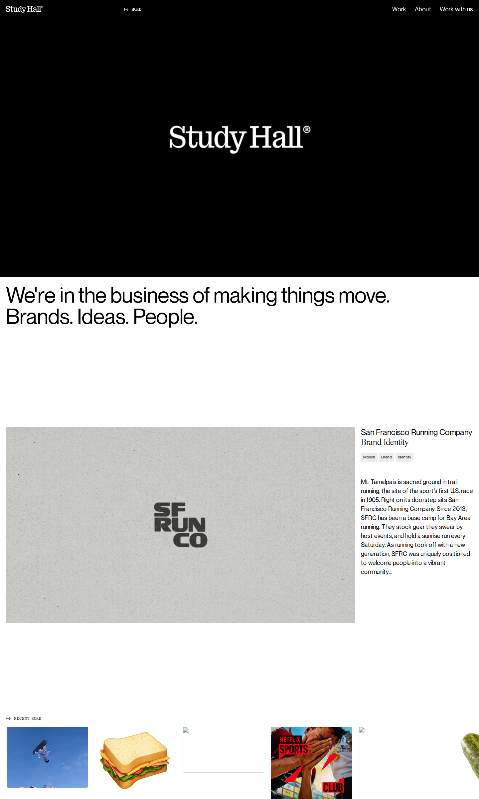
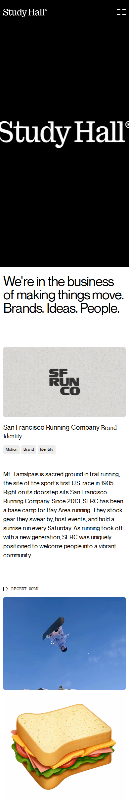

# UI Design System & Master Generation Blueprint: studyhall-design

> **Home · Study Hall ✶ Built to move you.** (https://studyhall.design/) — A creative agency based in Oakland and partnering globally. We craft brand, motion, and interactive to help businesses resonate now and r...



---

## 1. Executive Visual Persona & Design Archetype

- **Brand Essence & Persona**: **Home · Study Hall ✶ Built to move you.** (`https://studyhall.design/`). A creative agency based in Oakland and partnering globally. We craft brand, motion, and interactive to help businesses resonate now and r...
- **Final Redirected URL**: [https://www.studyhall.design/](https://www.studyhall.design/)
- **Capture Provenance**: Live browser capture (`tier1_fast`, HTTP `200`, captured `2026-11-23`).
- **Visual Archetype**: **Light-Gallery WebGL / Canvas Interactive Experience (`#ffffff` / `#0000ff`)**.
- **Anti-AI-Slop Differentiators**:
  - **Live-Computed Chromatic Polarity**: Anchors the viewport in `#ffffff` (live computed `body` `background-color` (`computed_styles.json`)) paired with `#000000` primary typography and `#0000ff` accents.
  - **Grounded Typographic Hierarchy**: Pairs `Neue Montreal` for display copy (`We're in the business of making thin`) with `Neue Montreal` and `SFMono-Regular`.
  - **Calibrated Spatial Grid & Motion**: Combines `1440px` container bounds (`gap: 18px`, padding `18px`) with `cubic-bezier(0,0,.2,1)` easing and Lenis Smooth Scroll (`data-lenis`), HTML5 `<canvas>` Interactive Viewport Surface.

---

## 2. Spatial Architecture & Modular Grid Mathematics



### Viewport Allocation & Container Geometry
- **Captured Viewport Dimensions**: Desktop `1440×2400px` (`assets/desktop.png`, clamped at 2400px live multi-section capture), Mobile `390×2400px` (`assets/mobile.png`, clamped at 2400px live multi-section capture).
- **Master Container Bounds**: `1440px` (live computed `main` `max-width`).
- **Canvas Lateral Padding & Spacing**: `18px` lateral canvas padding with `18px` grid gap.
- **Border Radius Scale**: `.25rem`, `3px`, `4px`, `5rem`.

### Responsive Breakpoint Architecture
- **Desktop Layout**: Multi-column CSS Grid / Flexbox layout at `1440px` (`max-width: 1440px`, `gap: 18px`).
- **Mobile Layout**: Single-column vertical stack at `390px` viewport width with `18px` horizontal padding.
- **Extracted CSS Media Queries**: `@media (width>=48.0625rem)`, `@media (width>=64rem)`, `@media (width>=80rem)`, `@media (width>=96rem)`.

---

## 3. Color System, Materiality & Atmospheric Lighting

### Semantic Palette & Source Grounding
| Semantic Role | Ground-Truth Value | Extracted Live / CSS Source |
|---|---|---|
| **Primary Canvas Substrate** | `#ffffff` | live computed `body` `background-color` (`computed_styles.json`) |
| **Primary Typography Ink** | `#000000` | live computed `h1` `color` (`computed_styles.json`) |
| **Elevated Surface / Card Substrate** | `#cdcdcd` | `var(--color-form-bg)` in `:root` |
| **Interactive Accent / Highlight** | `#0000ff` | `.bg-blue-500 { background-color: blue }` (`#0000ff`) |
| **Secondary / Muted Copy** | `#ff0000` | `.text-red-700 { color: red }` (`#ff0000`) |
| **Structural Hairline Border** | `#e5e5e5` | `10 { border-color: #e5e5e5 }` |

### Sanitized Root CSS Variables (`ui-ux.md` Ground Truth)
| Variable Name | Extracted Value | Semantic Role |
|---|---|---|
| `--type-root-max-value` | `18` | Typography / Scale Token |
| `--gx` | `1rem` | Dimension / Scale Token |
| `--gutter` | `1rem` | Layout / Spatial Grid Token |
| `--project-image-gap` | `10px` | Layout / Spatial Grid Token |
| `--columns` | `12` | Layout / Spatial Grid Token |
| `--gy` | `calc(140 / var(--type-root-max-value) * 1rem)` | Dimension / Scale Token |
| `--xs` | `calc(4 / var(--type-root-max-value) * 1rem)` | Dimension / Scale Token |
| `--sm` | `2rem` | Dimension / Scale Token |
| `--md` | `4rem` | Dimension / Scale Token |
| `--lg` | `8rem` | Dimension / Scale Token |
| `--xl` | `16rem` | Dimension / Scale Token |
| `--xxl` | `32rem` | Dimension / Scale Token |
| `--max-w` | `calc(1920 / var(--type-root-max-value) * 1rem)` | Layout / Spatial Grid Token |
| `--nav-h` | `3rem` | Layout / Spatial Grid Token |
| `--nav-b` | `1rem` | Layout / Spatial Grid Token |
| `--nav-clear` | `calc(var(--nav-h) + var(--nav-b))` | Layout / Spatial Grid Token |

---

## 4. Typographic Scale & Editorial Hierarchy

### Font Family Stacks
- **Display Typography**: `Neue Montreal`.
- **Primary Body Stack**: `Neue Montreal`.
- **Technical / Metadata Stack**: `SFMono-Regular`.

### Typographic Scale & Rules (Live Computed & Stylesheet Grounded)
- **Hero Display (`H1`)**: live computed `h1` (`font-size: 64px`, `line-height: 64px`, `font-weight: 400`, `letter-spacing: -1.28px`).
- **Section Heading (`H2`)**: live computed `h2` (`font-size: 24px`, `line-height: 30px`, `font-weight: 400`).
- **Body Copy**: live computed `body` (`font-size: 18px`, `line-height: 27px`, `font-weight: 400`); CSS variables `--type-body-lg-mobile: 20`, `--type-body-lg-tablet: 20`, `--type-body-lg-desktop: 24`.
- **Metadata & Navigation Labels**: live computed `nav/a` (`font-size: 18px`, `line-height: 27px`, `font-weight: 400`); CSS variables `--type-small-mobile: 16`, `--type-small-tablet: 16`, `--type-small-desktop: 16`.

---

## 5. Choreographed Motion & Interaction Physics

### Primary Easing Curves
- **Extracted Timing Functions**: `cubic-bezier(0,0,.2,1)`, `cubic-bezier(.4,0,.2,1)`, `cubic-bezier(.45,0,.2,1)`.

### Per-Element Transition & Choreography Rules
- **Selector `layer theme`**: `transition: .15s` extracted from `studyhall-design` stylesheet.
- **Selector `.transition`**: `transition: var(--tw-ease,var(--default-transition-timing-function))` extracted from `studyhall-design` stylesheet.
- **Selector `.transition-colors`**: `transition: var(--tw-ease,var(--default-transition-timing-function))` extracted from `studyhall-design` stylesheet.
- **Extracted Easing Curve (`cubic-bezier(0,0,.2,1)`)**: Governs interactive state transitions across `<nav.pt-20>` and `<section.py-gy>`.
- **Runtime Interaction Engine**: Integrates Lenis Smooth Scroll (`data-lenis`), HTML5 `<canvas>` Interactive Viewport Surface with `prefers-reduced-motion: reduce` fallback guards.

---

## 6. Component Wireframe & Structural DOM Map

### Visual Layout Schematic — Desktop (`1440px`, Grounded in `dom.html` & Landmark Bounding Boxes)
```
┌────────────────────────────────────────────────────────────────────────┐
│ DESKTOP VIEWPORT (1440px) — Home · Study Hall ✶ Built to move you.     │
│ ====================================================================== │
│ [ <nav.pt-20> (1440x54px)             | About · Work with us         ] │
│ ---------------------------------------------------------------------- │
│ | HERO STAGE: <section.pb-gy> (w=1440px)                             | │
│ | H1: We're in the business of making things move. Bran...           | │
│ | Substrate: #ffffff | Ink: #000000 | Accent: #0000ff                | │
│ ---------------------------------------------------------------------- │
│ | SHOWCASE GRID (<section.py-gy>) max-w: 1440px                      | │
│ | +------------------------------+  +------------------------------+ | │
│ | | San Francisco Running Compan |  | Awards & Publications        | | │
│ | +------------------------------+  +------------------------------+ | │
│ ---------------------------------------------------------------------- │
│ | DETAIL MODULE (<section.gap-gutter>) — Recent Work                 | │
│ ---------------------------------------------------------------------- │
│ [ FOOTER (<footer.mb-18>      ) | https://studyhall.design/            │
└────────────────────────────────────────────────────────────────────────┘
```

### Visual Layout Schematic — Mobile Reflow (`390px`)
```
┌────────────────────────────────────────────────────────────────────────┐
│ MOBILE VIEWPORT REFLOW (390px) — Single-Column Stack (gap: 18px)       │
│ ====================================================================== │
│ [ HEADER BAR (<nav.pt-20>             ) | Compact Menu (390px)         │
│ ---------------------------------------------------------------------- │
│ | HERO STAGE (<section.pb-gy>) — 390px Vertical Lead                 | │
│ | H1: We're in the business of making things move. Bran...           | │
│ ---------------------------------------------------------------------- │
│ | SHOWCASE STACK (<section.py-gy>) — 1-Col Stack                     | │
│ | [ Item 1: San Francisco Running Company Brand Identity           ] | │
│ | [ Item 2: Awards & Publications                                  ] | │
│ ---------------------------------------------------------------------- │
│ | DETAIL STACK (<section.gap-gutter>) — 1-Col (Recent Work)          | │
│ ---------------------------------------------------------------------- │
│ [ FOOTER (<footer.mb-18>      ) | Stacked 390px Colophon               │
└────────────────────────────────────────────────────────────────────────┘
```

### Granular DOM Region Breakdown
1. **Brand Header & Navigation Bar (<nav.pt-20> — `studyhall-design`)**:
   - Landmark `<nav class="pt-20 flex">` (`1440x54px`) hosting `Home · Study Hall ✶ Built to move yo` navigation (`About · Work with us`), DOM attributes (`data-leadin-portal-id="246568091"`, `data-leadin-env="prod"`, `data-loader="hs-scriptloader"`, `data-hsjs-portal="246568091"`), and stylesheet rule `backdrop { box-sizing:border-box;border:0 solid;margin:0;padding:0 }`.
2. **Hero Stage & Focal Lead (<section.pb-gy> — `We're in the business of making th`)**:
   - Landmark `<section class="pb-gy">` presenting display lead `We're in the business of making things move. Bran...` and copy excerpt *"San Francisco Running Company"* over `#ffffff` canvas and `#000000` ink.
3. **Primary Showcase & Content Grid (<section.py-gy> — `San Francisco Running Company Bran`)**:
   - Landmark `<section class="py-gy px-gx">` rendering section `San Francisco Running Company Brand Identity` with copy *"Mt. Tamalpais is sacred ground in trail running, the site of the "*, asset references (`246568091.js`, `collectedforms.js`, `banner.js`, `594ac8afc003a31c157eba4bb9a25ab65...`), and grid rule `file-selector-button { box-sizing:border-box;border:0 solid;margin:0;padding:0 }`.
4. **Interactive Detail & Feature Matrix (<section.gap-gutter> — `Awards & Publications`)**:
   - Landmark `<section class="py-gy gap-gutter">` framing `Awards & Publications` and `Recent Work` (*"Netflix Sports Club"*) with `#cdcdcd` surface cards, `#0000ff` accents, and `strong { font-weight:bolder }`.
5. **Colophon & Global Directory Footer (<footer.mb-18> — `https://studyhall.design/`)**:
   - Landmark `<footer class="mb-18 pt-24">` anchoring `Home · Study Hall ✶ Built to mov` footer links (`About · Work with us`), copy *"Since day one, this unique blend 1 has powered vast creative"*, and `#e5e5e5` structural dividers.

---

## 7. Master Zero-Shot AI Generation Prompt

```markdown
# Master Zero-Shot Frontend Generation Prompt: studyhall-design (Home · Study Hall ✶ Built to move you.)

You are a principal frontend architect and design systems engineer. Build a complete, production-ready web application replicating the exact design system, DOM landmarks, typographic hierarchy, color tokens, and motion physics of `studyhall-design` (**Home · Study Hall ✶ Built to move you.** — `https://studyhall.design/`).

### 1. Visual Archetype & Anti-AI-Slop Mandates
- **Archetype**: Light-Gallery WebGL / Canvas Interactive Experience (`#ffffff` / `#0000ff`).
- **Identity & Domain Context**: A creative agency based in Oakland and partnering globally. We craft brand, motion, and interactive to help businesses resonate now and r...
- **Primary Substrate**: `#ffffff` (live computed `body` `background-color` (`computed_styles.json`)), **Primary Ink**: `#000000`, **Accent / Highlight**: `#0000ff`.
- **Site-Specific Differentiators**:
  - **Live-Computed Chromatic Polarity**: Anchors the viewport in `#ffffff` (live computed `body` `background-color` (`computed_styles.json`)) paired with `#000000` primary typography and `#0000ff` accents.
  - **Grounded Typographic Hierarchy**: Pairs `Neue Montreal` for display copy (`We're in the business of making thin`) with `Neue Montreal` and `SFMono-Regular`.
  - **Calibrated Spatial Grid & Motion**: Combines `1440px` container bounds (`gap: 18px`, padding `18px`) with `cubic-bezier(0,0,.2,1)` easing and Lenis Smooth Scroll (`data-lenis`), HTML5 `<canvas>` Interactive Viewport Surface.

### 2. Ground-Truth CSS Variables (`:root` Token Contract)
Declare and consume these exact custom properties extracted from `studyhall-design` in your global stylesheet:

:root {
  /* Home · Study Hall ✶ Built to move you. (studyhall-design) — Live-Grounded CSS Variables */
  --type-root-max-value: 18; /* Typography / Scale Token (studyhall-design) */
  --gx: 1rem; /* Dimension / Scale Token (studyhall-design) */
  --gutter: 1rem; /* Layout / Spatial Grid Token (studyhall-design) */
  --project-image-gap: 10px; /* Layout / Spatial Grid Token (studyhall-design) */
  --columns: 12; /* Layout / Spatial Grid Token (studyhall-design) */
  --gy: calc(140 / var(--type-root-max-value) * 1rem); /* Dimension / Scale Token (studyhall-design) */
  --xs: calc(4 / var(--type-root-max-value) * 1rem); /* Dimension / Scale Token (studyhall-design) */
  --sm: 2rem; /* Dimension / Scale Token (studyhall-design) */
  --md: 4rem; /* Dimension / Scale Token (studyhall-design) */
  --lg: 8rem; /* Dimension / Scale Token (studyhall-design) */
  --xl: 16rem; /* Dimension / Scale Token (studyhall-design) */
  --xxl: 32rem; /* Dimension / Scale Token (studyhall-design) */
  --max-w: calc(1920 / var(--type-root-max-value) * 1rem); /* Layout / Spatial Grid Token (studyhall-design) */
  --nav-h: 3rem; /* Layout / Spatial Grid Token (studyhall-design) */
  --nav-b: 1rem; /* Layout / Spatial Grid Token (studyhall-design) */
  --nav-clear: calc(var(--nav-h) + var(--nav-b)); /* Layout / Spatial Grid Token (studyhall-design) */
}

### 3. Semantic Color & Materiality Contract
Map every surface, ink, and border strictly to these source-grounded tokens:
- **Primary Canvas Substrate**: `#ffffff` — grounded in live computed `body` `background-color` (`computed_styles.json`)
- **Primary Typography Ink**: `#000000` — grounded in live computed `h1` `color` (`computed_styles.json`)
- **Elevated Surface / Card Substrate**: `#cdcdcd` — grounded in `var(--color-form-bg)` in `:root`
- **Interactive Accent / Highlight**: `#0000ff` — grounded in `.bg-blue-500 { background-color: blue }` (`#0000ff`)
- **Secondary / Muted Copy**: `#ff0000` — grounded in `.text-red-700 { color: red }` (`#ff0000`)
- **Structural Hairline Border**: `#e5e5e5` — grounded in `10 { border-color: #e5e5e5 }`

### 4. Spatial Grid, Container Bounds & Responsive Breakpoints
- **Desktop Viewport Reference**: `1440×2400px` (clamped at 2400px live multi-section capture, `1440px` standard desktop width).
- **Mobile Viewport Reference**: `390×2400px` (clamped at 2400px live multi-section capture, `390px` standard mobile width).
- **Container Max-Width**: `1440px` (live computed `main` `max-width`)
- **Padding & Gutters**: `18px` lateral canvas padding with `18px` grid gap
- **Desktop Grid**: Multi-column CSS Grid / Flexbox layout at `1440px` (`max-width: 1440px`, `gap: 18px`)
- **Mobile Adaptation**: Single-column vertical stack at `390px` viewport width with `18px` horizontal padding
- **Media Queries**: `@media (width>=48.0625rem)`, `@media (width>=64rem)`, `@media (width>=80rem)`, `@media (width>=96rem)`
- **Corner Radii**: `.25rem`, `3px`, `4px`, `5rem`

### 5. Typography & Editorial Scale Contract
- **Display Font Stack**: `Neue Montreal`
- **Body Font Stack**: `Neue Montreal`
- **Monospace / Technical Font Stack**: `SFMono-Regular`
- **H1 Display Rule**: live computed `h1` (`font-size: 64px`, `line-height: 64px`, `font-weight: 400`, `letter-spacing: -1.28px`)
- **H2 Section Rule**: live computed `h2` (`font-size: 24px`, `line-height: 30px`, `font-weight: 400`)
- **Body Copy Rule**: live computed `body` (`font-size: 18px`, `line-height: 27px`, `font-weight: 400`); CSS variables `--type-body-lg-mobile: 20`, `--type-body-lg-tablet: 20`, `--type-body-lg-desktop: 24`
- **Metadata & Index Rule**: live computed `nav/a` (`font-size: 18px`, `line-height: 27px`, `font-weight: 400`); CSS variables `--type-small-mobile: 16`, `--type-small-tablet: 16`, `--type-small-desktop: 16`

### 6. Component Hierarchy, Verbatim Copy & Real DOM Landmarks
Scaffold `studyhall-design` (`Home · Study Hall ✶ Built to move you.`) with these exact structural regions, extracted copy, and CSS rules from `dom.html`:
1. **Brand Header & Navigation Bar (<nav.pt-20> — `studyhall-design`)**:
   - DOM & Selectors: Landmark `<nav class="pt-20 flex">` (`1440x54px`) hosting `Home · Study Hall ✶ Built to move yo` navigation (`About · Work with us`), DOM attributes (`data-leadin-portal-id="246568091"`, `data-leadin-env="prod"`, `data-loader="hs-scriptloader"`, `data-hsjs-portal="246568091"`), and stylesheet rule `backdrop { box-sizing:border-box;border:0 solid;margin:0;padding:0 }`.
   - Responsive Contract: Header `Brand Header & Navigation Bar (<nav.pt-20> — `studyhall-design`)` (`studyhall-design`) adapts across `@media (width>=48.0625rem)`, `@media (width>=64rem)`, `@media (width>=80rem)`, `@media (width>=96rem)` with `cubic-bezier(0,0,.2,1)`, `cubic-bezier(.4,0,.2,1)`, `cubic-bezier(.45,0,.2,1)` transitions and links `About · Work with us`.
2. **Hero Stage & Focal Lead (<section.pb-gy> — `We're in the business of making th`)**:
   - DOM & Selectors: Landmark `<section class="pb-gy">` presenting display lead `We're in the business of making things move. Bran...` and copy excerpt *"San Francisco Running Company"* over `#ffffff` canvas and `#000000` ink.
   - Responsive Contract: Hero stage (`1440×2400px` desktop / `390×2400px` mobile) sets `#ffffff` background with `#000000` headline `We're in the business of making things move. Bran...`.
3. **Primary Showcase & Content Grid (<section.py-gy> — `San Francisco Running Company Bran`)**:
   - DOM & Selectors: Landmark `<section class="py-gy px-gx">` rendering section `San Francisco Running Company Brand Identity` with copy *"Mt. Tamalpais is sacred ground in trail running, the site of the "*, asset references (`246568091.js`, `collectedforms.js`, `banner.js`, `594ac8afc003a31c157eba4bb9a25ab65...`), and grid rule `file-selector-button { box-sizing:border-box;border:0 solid;margin:0;padding:0 }`.
   - Responsive Contract: Showcase grid `Primary Showcase & Content Grid (<section.py-gy> — `San Francisco Running Company Bran`)` applies Multi-column CSS Grid / Flexbox layout at `1440px` (`max-width: 1440px`, `gap: 18px`) on desktop and Single-column vertical stack at `390px` viewport width with `18px` horizontal padding on mobile.
4. **Interactive Detail & Feature Matrix (<section.gap-gutter> — `Awards & Publications`)**:
   - DOM & Selectors: Landmark `<section class="py-gy gap-gutter">` framing `Awards & Publications` and `Recent Work` (*"Netflix Sports Club"*) with `#cdcdcd` surface cards, `#0000ff` accents, and `strong { font-weight:bolder }`.
   - Responsive Contract: Detail module `Interactive Detail & Feature Matrix (<section.gap-gutter> — `Awards & Publications`)` uses `.25rem`, `3px`, `4px`, `5rem` radii, `#0000ff` highlights, and assets (246568091.js, collectedforms.js, banner.js).
5. **Colophon & Global Directory Footer (<footer.mb-18> — `https://studyhall.design/`)**:
   - DOM & Selectors: Landmark `<footer class="mb-18 pt-24">` anchoring `Home · Study Hall ✶ Built to mov` footer links (`About · Work with us`), copy *"Since day one, this unique blend 1 has powered vast creative"*, and `#e5e5e5` structural dividers.
   - Responsive Contract: Footer `Colophon & Global Directory Footer (<footer.mb-18> — `https://studyhall.design/`)` aligns to `1440px` (live computed `main` `max-width`) with `18px` lateral canvas padding with `18px` grid gap and attributes (data-leadin-portal-id="246568091", data-leadin-env="prod", data-loader="hs-scriptloader").

#### Verbatim DOM Copy Excerpts (`dom.html`)
- Copy Excerpt 1: *"San Francisco Running Company"*
- Copy Excerpt 2: *"Mt. Tamalpais is sacred ground in trail running, the site of the sport’s first U.S..."*
- Copy Excerpt 3: *"Netflix Sports Club"*
- Copy Excerpt 4: *"Since day one, this unique blend 1 has powered vast creative needs, from motion pl..."*

### 7. Motion, Extracted Stylesheet Rules & Interaction Choreography
- **Primary Easing Functions**: `cubic-bezier(0,0,.2,1)`, `cubic-bezier(.4,0,.2,1)`, `cubic-bezier(.45,0,.2,1)`
- **Extracted Stylesheet Rules (`studyhall-design`)**:
- `backdrop { box-sizing:border-box;border:0 solid;margin:0;padding:0 }`
- `file-selector-button { box-sizing:border-box;border:0 solid;margin:0;padding:0 }`
- `strong { font-weight:bolder }`
- `small { font-size:80% }`
- `sup { vertical-align:baseline;font-size:75%;line-height:0;position:relative }`
- **Per-Selector Transition Rules**:
- **Selector `layer theme`**: `transition: .15s` extracted from `studyhall-design` stylesheet.
- **Selector `.transition`**: `transition: var(--tw-ease,var(--default-transition-timing-function))` extracted from `studyhall-design` stylesheet.
- **Selector `.transition-colors`**: `transition: var(--tw-ease,var(--default-transition-timing-function))` extracted from `studyhall-design` stylesheet.
- **Extracted Easing Curve (`cubic-bezier(0,0,.2,1)`)**: Governs interactive state transitions across `<nav.pt-20>` and `<section.py-gy>`.
- **Runtime Interaction Engine**: Integrates Lenis Smooth Scroll (`data-lenis`), HTML5 `<canvas>` Interactive Viewport Surface with `prefers-reduced-motion: reduce` fallback guards.

### 8. Technical Deliverables
- Implement in Next.js (App Router) with TypeScript and Tailwind CSS consuming the `:root` custom properties defined above for `studyhall-design`.
- Reproduce both the `1440px` desktop architecture and `390px` mobile breakpoint transitions, preserving semantic HTML5 landmarks (`<header>`, `<nav>`, `<main>`, `<section>`, `<footer>`) and `prefers-reduced-motion` accessibility guards.
```
