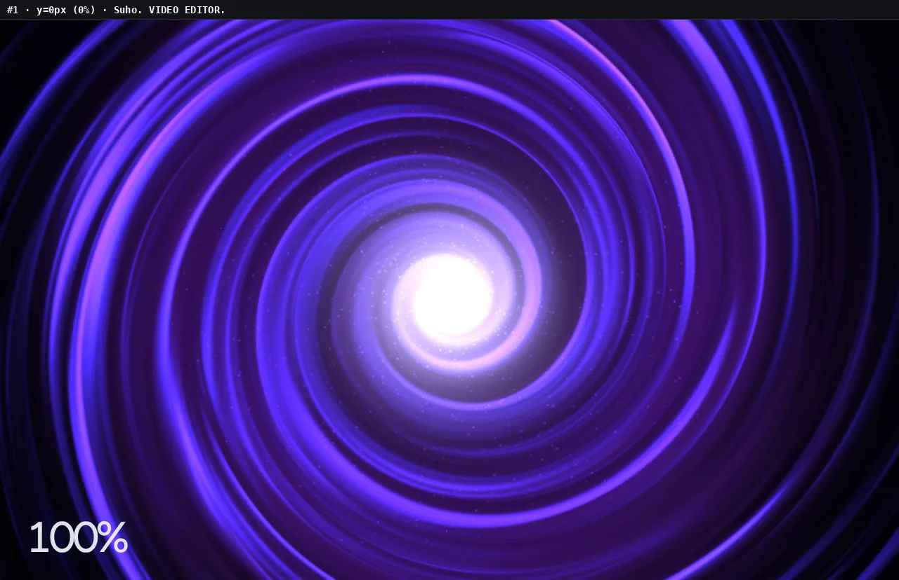
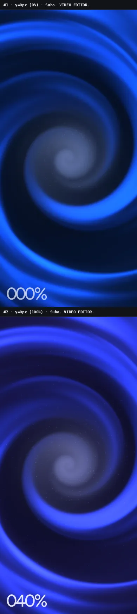

# UI Design System & Master Generation Blueprint: suho-studio

> **Suho Video Editor** (https://suho.studio/) — Selected work by Suho, video editor and sound designer.





---

## 1. Executive Visual Persona & Design Archetype

- **Brand Essence & Persona**: **Suho Video Editor** (`https://suho.studio/`). Selected work by Suho, video editor and sound designer.
- **Capture Provenance**: Live browser capture (`tier1_fast`, HTTP `200`, captured `2026-11-24`).
- **Visual Archetype**: **Dark-Substrate WebGL / Canvas Interactive Experience (`#01040b` / `#d7401f`)**.
- **Anti-AI-Slop Differentiators**:
  - **Live-Computed Chromatic Polarity**: Anchors the viewport in `#01040b` (live computed `body` `background-color` (`computed_styles.json`)) paired with `#f7f7f4` primary typography and `#d7401f` accents.
  - **Grounded Typographic Hierarchy**: Uses `Figtree Variable` across display (`Suho. VIDEO EDITOR.`) and body copy.
  - **Calibrated Spatial Grid & Motion**: Combines `82rem` container bounds (`gap: 38px`, padding `.8rem`) with `cubic-bezier(.22,1,.36,1)` easing and Lenis Smooth Scroll (`data-lenis`), Three.js / WebGL Canvas Pipeline.

---

## 2. Spatial Architecture & Modular Grid Mathematics

### Viewport Allocation & Container Geometry
- **Captured Journey Filmstrips**: Desktop `1280×828px` (`assets/desktop-journey.webp`, `1` keyframes up to `y=0px` / doc `23939px`), Mobile `390×1744px` (`assets/mobile-journey.webp`, `2` keyframes).
- **Master Container Bounds**: `82rem` (non-`@media` desktop container stylesheet rule).
- **Canvas Lateral Padding & Spacing**: `.8rem` lateral canvas padding with `38px` grid gap.
- **Border Radius Scale**: `21.12px`, `4px`, `.25rem`, `.5rem`.

### Responsive Breakpoint Architecture
- **Desktop Layout**: Multi-column CSS Grid / Flexbox layout at `1440px` (`max-width: 82rem`, `gap: 38px`).
- **Mobile Layout**: Single-column vertical stack at `390px` viewport width with `.8rem` horizontal padding.
- **Extracted CSS Media Queries**: `@media (max-width:767px),(max-aspect-ratio:4/5)`, `@media (max-height:520px) and (min-width:600px)`, `@media (prefers-reduced-motion:reduce)`, `@media (not (min-width:48rem)) and (orientation:portrait)`.

---

## 3. Color System, Materiality & Atmospheric Lighting

### Semantic Palette & Source Grounding
| Semantic Role | Ground-Truth Value | Extracted Live / CSS Source |
|---|---|---|
| **Primary Canvas Substrate** | `#01040b` | live computed `body` `background-color` (`computed_styles.json`) |
| **Primary Typography Ink** | `#f7f7f4` | live computed `h1` `color` (`computed_styles.json`) |
| **Elevated Surface / Card Substrate** | `#07090d` | live computed `nav` `background-color` (`computed_styles.json`) |
| **Interactive Accent / Highlight** | `#d7401f` | `var(--film-accent)` in `:root` |
| **Secondary / Muted Copy** | `#111111` | live computed `a` `color` (`computed_styles.json`) |
| **Structural Hairline Border** | `#898a8d` | `:hover { border-color: #898a8d }` |
| **Variable Token (`--color-paper`)** | `#f3f3ef` | `var(--color-paper)` in `:root` |
| **Variable Token (`--color-gallery-paper`)** | `#ebebeb` | `var(--color-gallery-paper)` in `:root` |
| **Variable Token (`--color-ink`)** | `#10100f` | `var(--color-ink)` in `:root` |
| **Variable Token (`--color-blue`)** | `#2f53ff` | `var(--color-blue)` in `:root` |
| **Variable Token (`--color-purple`)** | `#7d3fef` | `var(--color-purple)` in `:root` |
| **Variable Token (`--color-blue-soft`)** | `#99a8ff` | `var(--color-blue-soft)` in `:root` |
| **Variable Token (`--color-cyan`)** | `#19d9f3` | `var(--color-cyan)` in `:root` |
| **Variable Token (`--color-cyan-soft`)** | `#8decf8` | `var(--color-cyan-soft)` in `:root` |
| **Variable Token (`--color-night`)** | `#020b18` | `var(--color-night)` in `:root` |
| **Variable Token (`--color-sky`)** | `#020408` | `var(--color-sky)` in `:root` |

### Sanitized Root CSS Variables (`ui-ux.md` Ground Truth)
| Variable Name | Extracted Value | Semantic Role |
|---|---|---|
| `--color-paper` | `#f3f3ef` | Canvas / Surface Token |
| `--color-gallery-paper` | `#ebebeb` | Canvas / Surface Token |
| `--color-ink` | `#10100f` | Typography Ink Token |
| `--color-blue` | `#2f53ff` | Brand / Palette Token |
| `--color-purple` | `#7d3fef` | Brand / Palette Token |
| `--color-blue-soft` | `#99a8ff` | Brand / Palette Token |
| `--color-cyan` | `#19d9f3` | Brand / Palette Token |
| `--color-cyan-soft` | `#8decf8` | Brand / Palette Token |
| `--color-night` | `#020b18` | Brand / Palette Token |
| `--color-void` | `#01040b` | Brand / Palette Token |
| `--color-sky` | `#020408` | Brand / Palette Token |
| `--grain-strength` | `.6` | Design System Custom Token |
| `--color-line` | `color-mix(in srgb, var(--color-ink) 16%, transparent)` | Brand / Palette Token |
| `--color-muted` | `color-mix(in srgb, var(--color-ink) 60%, transparent)` | Brand / Palette Token |
| `--color-paper-muted` | `color-mix(in srgb, var(--color-paper) 76%, transparent)` | Canvas / Surface Token |
| `--font-major` | `"Figtree Variable", "Helvetica Neue", Arial, sans-serif` | Typography / Scale Token |

---

## 4. Typographic Scale & Editorial Hierarchy

### Font Family Stacks
- **Display Typography**: `Figtree Variable`.
- **Primary Body Stack**: `Figtree Variable`.
- **Technical / Metadata Stack**: not declared in live computed styles (uses primary stack / `ui-monospace`).

### Typographic Scale & Rules (Live Computed & Stylesheet Grounded)
- **Hero Display (`H1`)**: live computed `h1` (`font-size: 66.24px`, `line-height: 56.9664px`, `font-weight: 700`); CSS variables `--font-weight-display: 600`, `--tracking-display: -.083em`, `--type-display: clamp(3.3rem, 1.52857rem + 8.85714vw, 9.5rem)`; rule `h1` (`font-size: clamp(72px,9vw,170px)`, `line-height: 1`, `letter-spacing: -.03em`, `font-weight: 400`).
- **Section Heading (`H2`)**: live computed `h2` (`font-size: 129.6px`, `line-height: 101.088px`, `font-weight: 400`, `letter-spacing: -9.72px`).
- **Body Copy**: live computed `body` (`font-size: 16px`, `line-height: normal`, `font-weight: 400`); CSS variables `--type-body: clamp(.95rem, .9rem + .25vw, 1.125rem)`.
- **Metadata & Navigation Labels**: live computed `nav/a` (`font-size: 16px`, `line-height: normal`, `font-weight: 400`); CSS variables `--tracking-label: .07em`, `--type-label: clamp(.625rem, .589286rem + .178571vw, .75rem)`.

---

## 5. Choreographed Motion & Interaction Physics

### Primary Easing Curves
- **Extracted Timing Functions**: `cubic-bezier(.22,1,.36,1)`, `cubic-bezier(.2,0,0,1)`, `cubic-bezier(.16,1,.3,1)`.

### Per-Element Transition & Choreography Rules
- **Selector `nd-scene-module-scss-module__7nHW...`**: `transition: opacity 1.4s` extracted from `suho-studio` stylesheet.
- **Selector `cene-module-scss-module__7nHW2G__...`**: `transition: background-color .25s,box-shadow .25s` extracted from `suho-studio` stylesheet.
- **Selector `dule-scss-module__7nHW2G__returnL...`**: `transition: transform .65s` extracted from `suho-studio` stylesheet.
- **Extracted Easing Curve (`cubic-bezier(.22,1,.36,1)`)**: Governs interactive state transitions across `<header.skip-link>` and `<section.sr-only>`.
- **Runtime Interaction Engine**: Integrates Lenis Smooth Scroll (`data-lenis`), Three.js / WebGL Canvas Pipeline, Framer Motion Layout Physics with `prefers-reduced-motion: reduce` fallback guards.
### Measured Runtime Scroll & Interaction Telemetry (`behavioral_journey_v2`)
- **Scroll Driver Mode**: `native` (max document height `23939px`, deepest scrollY reached `0px` across `1` desktop keyframes).
- **Detected Scroll / Motion Libraries**: Native browser scroll / standard CSS transitions.

---

## 6. Component Wireframe & Structural DOM Map

### Visual Layout Schematic — Desktop (`1440px`, Grounded in `dom.html` & Landmark Bounding Boxes)
```
┌────────────────────────────────────────────────────────────────────────┐
│ DESKTOP VIEWPORT (1440px) — Suho Video Editor                          │
│ ====================================================================== │
│ [ <header.skip-link> (240x148px)      | Suho eyes Suho home · Home · ] │
│ ---------------------------------------------------------------------- │
│ | HERO STAGE: <section.static-portfolio> (w=1440px)                  | │
│ | H1: Suho. VIDEO EDITOR.                                            | │
│ | Substrate: #01040b | Ink: #f7f7f4 | Accent: #d7401f                | │
│ ---------------------------------------------------------------------- │
│ | SHOWCASE GRID (<section.sr-only>) max-w: 82rem                     | │
│ | +------------------------------+  +------------------------------+ | │
│ | | Suho Video Editor            |  | Selected work                | | │
│ | +------------------------------+  +------------------------------+ | │
│ ---------------------------------------------------------------------- │
│ | DETAIL MODULE (<section.undefined>) — Personal edits               | │
│ ---------------------------------------------------------------------- │
│ [ FOOTER (<footer>            ) | https://suho.studio/                 │
└────────────────────────────────────────────────────────────────────────┘
```

### Visual Layout Schematic — Mobile Reflow (`390px`)
```
┌────────────────────────────────────────────────────────────────────────┐
│ MOBILE VIEWPORT REFLOW (390px) — Single-Column Stack (gap: 38px)       │
│ ====================================================================== │
│ [ HEADER BAR (<header.skip-link>      ) | Compact Menu (390px)         │
│ ---------------------------------------------------------------------- │
│ | HERO STAGE (<section.static-portfoli) — 390px Vertical Lead        | │
│ | H1: Suho. VIDEO EDITOR.                                            | │
│ ---------------------------------------------------------------------- │
│ | SHOWCASE STACK (<section.sr-only>) — 1-Col Stack                   | │
│ | [ Item 1: Suho Video Editor                                      ] | │
│ | [ Item 2: Selected work                                          ] | │
│ ---------------------------------------------------------------------- │
│ | DETAIL STACK (<section.undefined>) — 1-Col (Personal edits)        | │
│ ---------------------------------------------------------------------- │
│ [ FOOTER (<footer>            ) | Stacked 390px Colophon               │
└────────────────────────────────────────────────────────────────────────┘
```

### Granular DOM Region Breakdown
1. **Brand Header & Navigation Bar (<header.skip-link> — `suho-studio`)**:
   - Landmark `<header class="skip-link">` (`240x148px`) hosting `Suho Video Editor` navigation (`Suho eyes Suho home · Home · Work W W o o r r k k · Get in touch`), DOM attributes (`data-precedence="next"`, `data-precedence="next"`, `data-precedence="next"`, `data-skip-link="true"`), and stylesheet rule `scene-module-scss-module__7nHW2G_... { pointer-events:none;width:100%;height:100%;position:absolute;inset:0 }`.
2. **Hero Stage & Focal Lead (<section.static-portfolio> — `Suho. VIDEO EDITOR.`)**:
   - Landmark `<section class="static-portfolio">` presenting display lead `Suho. VIDEO EDITOR.` and copy excerpt *"Editing stories through SFX, Storytelling, Motion Design and Soun"* over `#01040b` canvas and `#f7f7f4` ink.
3. **Primary Showcase & Content Grid (<section.sr-only> — `Suho Video Editor`)**:
   - Landmark `<section class="sr-only">` rendering section `Suho Video Editor` with copy *"Selected work by Suho, video editor and sound designer."*, asset references (`Figtree-VariableFont_wght.woff2`, `254drbfp0n4_4.css`, `161fswjwr-tnq.css`, `00ierz6vnepx8.css`), and grid rule `cene-module-scss-module__7nHW2G__... { opacity:1;transition:opacity 1.4s }`.
4. **Interactive Detail & Feature Matrix (<section.undefined> — `Selected work`)**:
   - Landmark `<section class="undefined">` framing `Selected work` and `Personal edits` (*"Featured commission Screens, text and graphics move together to s"*) with `#07090d` surface cards, `#d7401f` accents, and `module-scss-module__7nHW2G__error... { color:dce6f4;text-shadow:-.5px 0 5fbed280,.65px 0 637cd880 }`.
5. **Colophon & Global Directory Footer (<footer> — `https://suho.studio/`)**:
   - Landmark `<footer>` landmark anchoring `Suho Video Editor` footer links (`Suho eyes Suho home · Home · Work W W o o r r k k · Get in touch`), copy *"Screens, text and graphics move together to show a product i"*, and `#898a8d` structural dividers.
### Full Vertical Scroll Sequence (Desktop `1440×900` Keyframes)
- **Step 01** (`y=0px`, `0%`): Active landmark `Suho. VIDEO EDITOR.` · sticky/fixed elements: `1`

---

## 7. Master Zero-Shot AI Generation Prompt

```markdown
# Master Zero-Shot Frontend Generation Prompt: suho-studio (Suho Video Editor)

You are a principal frontend architect and design systems engineer. Build a complete, production-ready web application replicating the exact design system, DOM landmarks, typographic hierarchy, color tokens, and motion physics of `suho-studio` (**Suho Video Editor** — `https://suho.studio/`).

### 1. Visual Archetype & Anti-AI-Slop Mandates
- **Archetype**: Dark-Substrate WebGL / Canvas Interactive Experience (`#01040b` / `#d7401f`).
- **Identity & Domain Context**: Selected work by Suho, video editor and sound designer.
- **Primary Substrate**: `#01040b` (live computed `body` `background-color` (`computed_styles.json`)), **Primary Ink**: `#f7f7f4`, **Accent / Highlight**: `#d7401f`.
- **Site-Specific Differentiators**:
  - **Live-Computed Chromatic Polarity**: Anchors the viewport in `#01040b` (live computed `body` `background-color` (`computed_styles.json`)) paired with `#f7f7f4` primary typography and `#d7401f` accents.
  - **Grounded Typographic Hierarchy**: Uses `Figtree Variable` across display (`Suho. VIDEO EDITOR.`) and body copy.
  - **Calibrated Spatial Grid & Motion**: Combines `82rem` container bounds (`gap: 38px`, padding `.8rem`) with `cubic-bezier(.22,1,.36,1)` easing and Lenis Smooth Scroll (`data-lenis`), Three.js / WebGL Canvas Pipeline.

### 2. Ground-Truth CSS Variables (`:root` Token Contract)
Declare and consume these exact custom properties extracted from `suho-studio` in your global stylesheet:

:root {
  /* Suho Video Editor (suho-studio) — Live-Grounded CSS Variables */
  --color-paper: #f3f3ef; /* Canvas / Surface Token (suho-studio) */
  --color-gallery-paper: #ebebeb; /* Canvas / Surface Token (suho-studio) */
  --color-ink: #10100f; /* Typography Ink Token (suho-studio) */
  --color-blue: #2f53ff; /* Brand / Palette Token (suho-studio) */
  --color-purple: #7d3fef; /* Brand / Palette Token (suho-studio) */
  --color-blue-soft: #99a8ff; /* Brand / Palette Token (suho-studio) */
  --color-cyan: #19d9f3; /* Brand / Palette Token (suho-studio) */
  --color-cyan-soft: #8decf8; /* Brand / Palette Token (suho-studio) */
  --color-night: #020b18; /* Brand / Palette Token (suho-studio) */
  --color-void: #01040b; /* Brand / Palette Token (suho-studio) */
  --color-sky: #020408; /* Brand / Palette Token (suho-studio) */
  --grain-strength: .6; /* Design System Custom Token (suho-studio) */
  --color-line: color-mix(in srgb, var(--color-ink) 16%, transparent); /* Brand / Palette Token (suho-studio) */
  --color-muted: color-mix(in srgb, var(--color-ink) 60%, transparent); /* Brand / Palette Token (suho-studio) */
  --color-paper-muted: color-mix(in srgb, var(--color-paper) 76%, transparent); /* Canvas / Surface Token (suho-studio) */
  --font-major: "Figtree Variable", "Helvetica Neue", Arial, sans-serif; /* Typography / Scale Token (suho-studio) */
}

### 3. Semantic Color & Materiality Contract
Map every surface, ink, and border strictly to these source-grounded tokens:
- **Primary Canvas Substrate**: `#01040b` — grounded in live computed `body` `background-color` (`computed_styles.json`)
- **Primary Typography Ink**: `#f7f7f4` — grounded in live computed `h1` `color` (`computed_styles.json`)
- **Elevated Surface / Card Substrate**: `#07090d` — grounded in live computed `nav` `background-color` (`computed_styles.json`)
- **Interactive Accent / Highlight**: `#d7401f` — grounded in `var(--film-accent)` in `:root`
- **Secondary / Muted Copy**: `#111111` — grounded in live computed `a` `color` (`computed_styles.json`)
- **Structural Hairline Border**: `#898a8d` — grounded in `:hover { border-color: #898a8d }`
- **Variable Token (`--color-paper`)**: `#f3f3ef` — grounded in `var(--color-paper)` in `:root`
- **Variable Token (`--color-gallery-paper`)**: `#ebebeb` — grounded in `var(--color-gallery-paper)` in `:root`
- **Variable Token (`--color-ink`)**: `#10100f` — grounded in `var(--color-ink)` in `:root`
- **Variable Token (`--color-blue`)**: `#2f53ff` — grounded in `var(--color-blue)` in `:root`
- **Variable Token (`--color-purple`)**: `#7d3fef` — grounded in `var(--color-purple)` in `:root`
- **Variable Token (`--color-blue-soft`)**: `#99a8ff` — grounded in `var(--color-blue-soft)` in `:root`
- **Variable Token (`--color-cyan`)**: `#19d9f3` — grounded in `var(--color-cyan)` in `:root`
- **Variable Token (`--color-cyan-soft`)**: `#8decf8` — grounded in `var(--color-cyan-soft)` in `:root`
- **Variable Token (`--color-night`)**: `#020b18` — grounded in `var(--color-night)` in `:root`
- **Variable Token (`--color-sky`)**: `#020408` — grounded in `var(--color-sky)` in `:root`

### 4. Spatial Grid, Container Bounds & Responsive Breakpoints
- **Desktop Viewport Reference**: `1280×828px` (single-viewport 100vh live capture (900px), `1440px` standard desktop width).
- **Mobile Viewport Reference**: `390×1744px` (full-page live capture (1744px), `390px` standard mobile width).
- **Container Max-Width**: `82rem` (non-`@media` desktop container stylesheet rule)
- **Padding & Gutters**: `.8rem` lateral canvas padding with `38px` grid gap
- **Desktop Grid**: Multi-column CSS Grid / Flexbox layout at `1440px` (`max-width: 82rem`, `gap: 38px`)
- **Mobile Adaptation**: Single-column vertical stack at `390px` viewport width with `.8rem` horizontal padding
- **Media Queries**: `@media (max-width:767px),(max-aspect-ratio:4/5)`, `@media (max-height:520px) and (min-width:600px)`, `@media (prefers-reduced-motion:reduce)`, `@media (not (min-width:48rem)) and (orientation:portrait)`
- **Corner Radii**: `21.12px`, `4px`, `.25rem`, `.5rem`

### 5. Typography & Editorial Scale Contract
- **Display Font Stack**: `Figtree Variable`
- **Body Font Stack**: `Figtree Variable`
- **Monospace / Technical Font Stack**: not declared in live computed styles (uses primary stack / `ui-monospace`)
- **H1 Display Rule**: live computed `h1` (`font-size: 66.24px`, `line-height: 56.9664px`, `font-weight: 700`); CSS variables `--font-weight-display: 600`, `--tracking-display: -.083em`, `--type-display: clamp(3.3rem, 1.52857rem + 8.85714vw, 9.5rem)`; rule `h1` (`font-size: clamp(72px,9vw,170px)`, `line-height: 1`, `letter-spacing: -.03em`, `font-weight: 400`)
- **H2 Section Rule**: live computed `h2` (`font-size: 129.6px`, `line-height: 101.088px`, `font-weight: 400`, `letter-spacing: -9.72px`)
- **Body Copy Rule**: live computed `body` (`font-size: 16px`, `line-height: normal`, `font-weight: 400`); CSS variables `--type-body: clamp(.95rem, .9rem + .25vw, 1.125rem)`
- **Metadata & Index Rule**: live computed `nav/a` (`font-size: 16px`, `line-height: normal`, `font-weight: 400`); CSS variables `--tracking-label: .07em`, `--type-label: clamp(.625rem, .589286rem + .178571vw, .75rem)`

### 6. Component Hierarchy, Verbatim Copy & Real DOM Landmarks
Scaffold `suho-studio` (`Suho Video Editor`) with these exact structural regions, extracted copy, and CSS rules from `dom.html`:
1. **Brand Header & Navigation Bar (<header.skip-link> — `suho-studio`)**:
   - DOM & Selectors: Landmark `<header class="skip-link">` (`240x148px`) hosting `Suho Video Editor` navigation (`Suho eyes Suho home · Home · Work W W o o r r k k · Get in touch`), DOM attributes (`data-precedence="next"`, `data-precedence="next"`, `data-precedence="next"`, `data-skip-link="true"`), and stylesheet rule `scene-module-scss-module__7nHW2G_... { pointer-events:none;width:100%;height:100%;position:absolute;inset:0 }`.
   - Responsive Contract: Header `Brand Header & Navigation Bar (<header.skip-link> — `suho-studio`)` (`suho-studio`) adapts across `@media (max-width:767px),(max-aspect-ratio:4/5)`, `@media (max-height:520px) and (min-width:600px)`, `@media (prefers-reduced-motion:reduce)`, `@media (not (min-width:48rem)) and (orientation:portrait)` with `cubic-bezier(.22,1,.36,1)`, `cubic-bezier(.2,0,0,1)`, `cubic-bezier(.16,1,.3,1)` transitions and links `Suho eyes Suho home · Home · Work W W o o r r k k · Get in touch`.
2. **Hero Stage & Focal Lead (<section.static-portfolio> — `Suho. VIDEO EDITOR.`)**:
   - DOM & Selectors: Landmark `<section class="static-portfolio">` presenting display lead `Suho. VIDEO EDITOR.` and copy excerpt *"Editing stories through SFX, Storytelling, Motion Design and Soun"* over `#01040b` canvas and `#f7f7f4` ink.
   - Responsive Contract: Hero stage (`1280×828px` desktop / `390×1744px` mobile) sets `#01040b` background with `#f7f7f4` headline `Suho. VIDEO EDITOR.`.
3. **Primary Showcase & Content Grid (<section.sr-only> — `Suho Video Editor`)**:
   - DOM & Selectors: Landmark `<section class="sr-only">` rendering section `Suho Video Editor` with copy *"Selected work by Suho, video editor and sound designer."*, asset references (`Figtree-VariableFont_wght.woff2`, `254drbfp0n4_4.css`, `161fswjwr-tnq.css`, `00ierz6vnepx8.css`), and grid rule `cene-module-scss-module__7nHW2G__... { opacity:1;transition:opacity 1.4s }`.
   - Responsive Contract: Showcase grid `Primary Showcase & Content Grid (<section.sr-only> — `Suho Video Editor`)` applies Multi-column CSS Grid / Flexbox layout at `1440px` (`max-width: 82rem`, `gap: 38px`) on desktop and Single-column vertical stack at `390px` viewport width with `.8rem` horizontal padding on mobile.
4. **Interactive Detail & Feature Matrix (<section.undefined> — `Selected work`)**:
   - DOM & Selectors: Landmark `<section class="undefined">` framing `Selected work` and `Personal edits` (*"Featured commission Screens, text and graphics move together to s"*) with `#07090d` surface cards, `#d7401f` accents, and `module-scss-module__7nHW2G__error... { color:dce6f4;text-shadow:-.5px 0 5fbed280,.65px 0 637cd880 }`.
   - Responsive Contract: Detail module `Interactive Detail & Feature Matrix (<section.undefined> — `Selected work`)` uses `21.12px`, `4px`, `.25rem`, `.5rem` radii, `#d7401f` highlights, and assets (Figtree-VariableFont_wght.woff2, 254drbfp0n4_4.css, 161fswjwr-tnq.css).
5. **Colophon & Global Directory Footer (<footer> — `https://suho.studio/`)**:
   - DOM & Selectors: Landmark `<footer>` landmark anchoring `Suho Video Editor` footer links (`Suho eyes Suho home · Home · Work W W o o r r k k · Get in touch`), copy *"Screens, text and graphics move together to show a product i"*, and `#898a8d` structural dividers.
   - Responsive Contract: Footer `Colophon & Global Directory Footer (<footer> — `https://suho.studio/`)` aligns to `82rem` (non-`@media` desktop container stylesheet rule) with `.8rem` lateral canvas padding with `38px` grid gap and attributes (data-precedence="next", data-precedence="next", data-precedence="next").

#### Verbatim DOM Copy Excerpts (`dom.html`)
- Copy Excerpt 1: *"Editing stories through SFX, Storytelling, Motion Design and Sound Design. EDITING..."*
- Copy Excerpt 2: *"Selected work by Suho, video editor and sound designer."*
- Copy Excerpt 3: *"Featured commission Screens, text and graphics move together to show a product in..."*
- Copy Excerpt 4: *"Screens, text and graphics move together to show a product in use. This can make a..."*

### 7. Motion, Extracted Stylesheet Rules & Interaction Choreography
- **Primary Easing Functions**: `cubic-bezier(.22,1,.36,1)`, `cubic-bezier(.2,0,0,1)`, `cubic-bezier(.16,1,.3,1)`
- **Extracted Stylesheet Rules (`suho-studio`)**:
- `scene-module-scss-module__7nHW2G_... { pointer-events:none;width:100%;height:100%;position:absolute;inset:0 }`
- `cene-module-scss-module__7nHW2G__... { opacity:1;transition:opacity 1.4s }`
- `module-scss-module__7nHW2G__error... { color:dce6f4;text-shadow:-.5px 0 5fbed280,.65px 0 637cd880 }`
- `ne-module-scss-module__7nHW2G__re... { flex-direction:column;align-items:flex-start;gap:clamp(18px,1.8vw,28px);... }`
- `odule__7nHW2G__returnLink:focus-v... { outline-offset:6px;outline:2px solid b9d1ff }`
- **Per-Selector Transition Rules**:
- **Selector `nd-scene-module-scss-module__7nHW...`**: `transition: opacity 1.4s` extracted from `suho-studio` stylesheet.
- **Selector `cene-module-scss-module__7nHW2G__...`**: `transition: background-color .25s,box-shadow .25s` extracted from `suho-studio` stylesheet.
- **Selector `dule-scss-module__7nHW2G__returnL...`**: `transition: transform .65s` extracted from `suho-studio` stylesheet.
- **Extracted Easing Curve (`cubic-bezier(.22,1,.36,1)`)**: Governs interactive state transitions across `<header.skip-link>` and `<section.sr-only>`.
- **Runtime Interaction Engine**: Integrates Lenis Smooth Scroll (`data-lenis`), Three.js / WebGL Canvas Pipeline, Framer Motion Layout Physics with `prefers-reduced-motion: reduce` fallback guards.
### 7b. Full-Page Scroll Choreography, Interactive States & Multi-Page Routes
- **Scroll Mechanics**: Implement `native` vertical progression up to `23939px` across 1 distinct viewport chapters.
- **Vertical Chapter Sequence**: Suho. VIDEO EDITOR. (0%).

### 8. Technical Deliverables
- Implement in Next.js (App Router) with TypeScript and Tailwind CSS consuming the `:root` custom properties defined above for `suho-studio`.
- Reproduce both the `1440px` desktop architecture and `390px` mobile breakpoint transitions, preserving semantic HTML5 landmarks (`<header>`, `<nav>`, `<main>`, `<section>`, `<footer>`) and `prefers-reduced-motion` accessibility guards.
```
---

## 8. Full-Page Scroll Journey, Interactive States & Subpage Inventory

### Desktop Scroll Keyframes (`1440×900` WebP)
| Step | Scroll Y | Progress | Active Landmark / Section | Sticky/Fixed | Visual Asset |
| :---: | :---: | :---: | :--- | :---: | :--- |
| `#01` | `0px` | `0%` | Suho. VIDEO EDITOR. | `1` | [desktop-step-01.webp](assets/desktop-step-01.webp) |

### Mobile Condensed Keyframes (`390×844` WebP)
| Step | Scroll Y | Progress | Active Landmark | Visual Asset |
| :---: | :---: | :---: | :--- | :--- |
| `#01` | `0px` | `0%` | Suho. VIDEO EDITOR. | [mobile-step-01.webp](assets/mobile-step-01.webp) |
| `#02` | `0px` | `100%` | Suho. VIDEO EDITOR. | [mobile-step-02.webp](assets/mobile-step-02.webp) |

