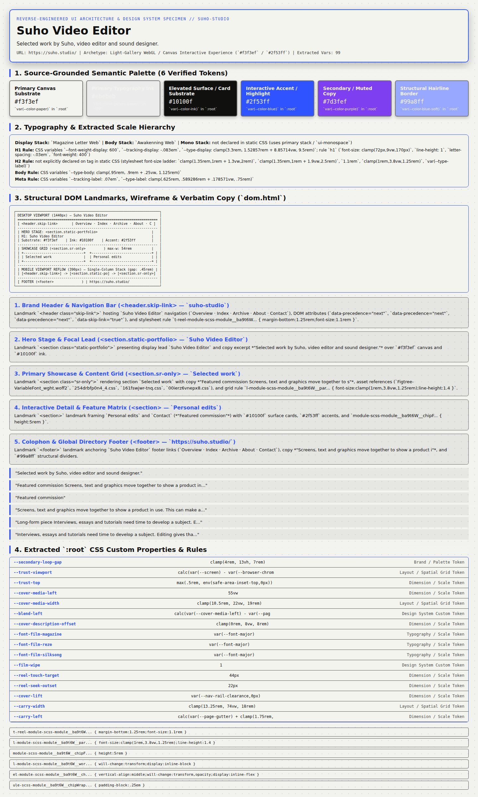
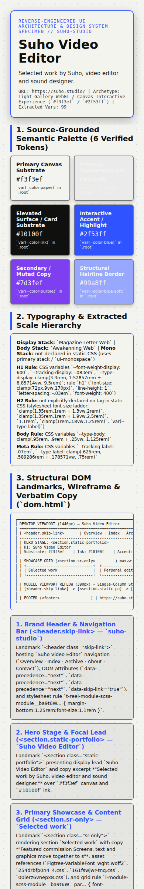

# UI Design System & Master Generation Blueprint: suho-studio

> **Suho Video Editor** (https://suho.studio/) — Selected work by Suho, video editor and sound designer.



---

## 1. Executive Visual Persona & Design Archetype

- **Brand Essence & Persona**: **Suho Video Editor** (`https://suho.studio/`). Selected work by Suho, video editor and sound designer.
- **Visual Archetype**: **Light-Gallery WebGL / Canvas Interactive Experience (`#f3f3ef` / `#2f53ff`)**.
- **Anti-AI-Slop Differentiators**:
  - **Source-Grounded Chromatic Polarity**: Anchors the viewport in `#f3f3ef` (`var(--color-paper)` in `:root`) paired with `#10100f` primary typography and `#2f53ff` accents.
  - **Extracted Typographic Hierarchy**: Pairs `Magazine Letter Web` for display copy (`Suho Video Editor`) with `Awakenning Web` and not declared in static CSS (uses primary stack / `ui-monospace`).
  - **Calibrated Spatial Grid & Motion**: Combines `54rem` container bounds (`gap: .45rem`, padding `.35rem`) with `cubic-bezier(.2,.75,.25,1)` easing and Lenis Smooth Scroll (`data-lenis`), Three.js / WebGL Canvas Pipeline.

---

## 2. Spatial Architecture & Modular Grid Mathematics



### Viewport Allocation & Container Geometry
- **Captured Viewport Dimensions**: Desktop `1440×2400px` (`assets/desktop.png`, capped at 2400px multi-section capture), Mobile `390×2400px` (`assets/mobile.png`, capped at 2400px multi-section capture).
- **Master Container Bounds**: `54rem` extracted from `suho-studio` stylesheet.
- **Canvas Lateral Padding & Spacing**: `.35rem` lateral canvas padding with `.45rem` grid gap.
- **Border Radius Scale**: `.5rem`, `.35rem`, `50%`, `14%`.

### Responsive Breakpoint Architecture
- **Desktop Layout**: Multi-column CSS Grid / Flexbox layout at `1440px` (`max-width: 54rem`, `gap: .45rem`).
- **Mobile Layout**: Single-column vertical stack at `390px` viewport width with `.35rem` horizontal padding.
- **Extracted CSS Media Queries**: `@media (not (min-width:48rem)) and (orientation:portrait)`, `@media (orientation:landscape) and (max-height:500px) and (max-w...`, `@media (prefers-reduced-motion:reduce)`, `@media (min-width:64rem) and (prefers-reduced-motion:no-preference)`.

---

## 3. Color System, Materiality & Atmospheric Lighting

### Semantic Palette & Source Grounding
| Semantic Role | Ground-Truth Value | Extracted CSS Source / Selector |
|---|---|---|
| **Primary Canvas Substrate** | `#f3f3ef` | `var(--color-paper)` in `:root` |
| **Primary Typography Ink** | `#ebebeb` | `var(--color-gallery-paper)` in `:root` |
| **Elevated Surface / Card Substrate** | `#10100f` | `var(--color-ink)` in `:root` |
| **Interactive Accent / Highlight** | `#2f53ff` | `var(--color-blue)` in `:root` |
| **Secondary / Muted Copy** | `#7d3fef` | `var(--color-purple)` in `:root` |
| **Structural Hairline Border** | `#99a8ff` | `var(--color-blue-soft)` in `:root` |

### Sanitized Root CSS Variables (`ui-ux.md` Ground Truth)
| Variable Name | Extracted Value | Semantic Role |
|---|---|---|
| `--secondary-loop-gap` | `clamp(4rem, 13vh, 7rem)` | Brand / Palette Token |
| `--trust-viewport` | `calc(var(--screen) - var(--browser-chrome))` | Layout / Spatial Grid Token |
| `--trust-top` | `max(.5rem, env(safe-area-inset-top,0px))` | Dimension / Scale Token |
| `--cover-media-left` | `55vw` | Dimension / Scale Token |
| `--cover-media-width` | `clamp(10.5rem, 22vw, 19rem)` | Layout / Spatial Grid Token |
| `--blend-left` | `calc(var(--cover-media-left) - var(--page-gutter))` | Design System Custom Token |
| `--cover-description-offset` | `clamp(0rem, 8vw, 8rem)` | Dimension / Scale Token |
| `--font-film-magazine` | `var(--font-major)` | Typography / Scale Token |
| `--font-film-reze` | `var(--font-major)` | Typography / Scale Token |
| `--font-film-silksong` | `var(--font-major)` | Typography / Scale Token |
| `--film-wipe` | `1` | Design System Custom Token |
| `--reel-touch-target` | `44px` | Dimension / Scale Token |
| `--reel-seek-outset` | `22px` | Dimension / Scale Token |
| `--cover-lift` | `var(--nav-rail-clearance,0px)` | Dimension / Scale Token |
| `--carry-width` | `clamp(13.25rem, 74vw, 18rem)` | Layout / Spatial Grid Token |
| `--carry-left` | `calc(var(--page-gutter) + clamp(1.75rem, 8vw, 3.5rem))` | Dimension / Scale Token |

---

## 4. Typographic Scale & Editorial Hierarchy

### Font Family Stacks
- **Display Typography**: `Magazine Letter Web`.
- **Primary Body Stack**: `Awakenning Web`.
- **Technical / Metadata Stack**: not declared in static CSS (uses primary stack / `ui-monospace`).

### Typographic Scale & Rules (Extracted from Stylesheet & Variables)
- **Hero Display (`H1`)**: CSS variables `--font-weight-display: 600`, `--tracking-display: -.083em`, `--type-display: clamp(3.3rem, 1.52857rem + 8.85714vw, 9.5rem)`; rule `h1` (`font-size: clamp(72px,9vw,170px)`, `line-height: 1`, `letter-spacing: -.03em`, `font-weight: 400`).
- **Section Heading (`H2`)**: not explicitly declared on tag in static CSS (stylesheet font-size ladder: `clamp(1.35rem,1rem + 1.3vw,2rem)`, `clamp(1.35rem,1rem + 1.9vw,2.5rem)`, `1.1rem`, `clamp(1rem,3.8vw,1.25rem)`, `var(--type-label)`).
- **Body Copy**: CSS variables `--type-body: clamp(.95rem, .9rem + .25vw, 1.125rem)`.
- **Metadata & Navigation Labels**: CSS variables `--tracking-label: .07em`, `--type-label: clamp(.625rem, .589286rem + .178571vw, .75rem)`.

---

## 5. Choreographed Motion & Interaction Physics

### Primary Easing Curves
- **Extracted Timing Functions**: `cubic-bezier(.2,.75,.25,1)`, `cubic-bezier(.22,1,.36,1)`, `cubic-bezier(.16,1,.3,1)`.

### Per-Element Transition & Choreography Rules
- **Selector `about-reel-module-scss-module__ba...`**: `transition: transform var(--duration-normal) var(--ease-out),box-shadow va...` extracted from `suho-studio` stylesheet.
- **Selector `t-reel-module-scss-module__ba9t6W...`**: `transition: opacity var(--duration-normal) var(--ease-out)` extracted from `suho-studio` stylesheet.
- **Selector `-reel-module-scss-module__ba9t6W_...`**: `transition: opacity var(--duration-fast) var(--ease-out),transform var(--d...` extracted from `suho-studio` stylesheet.
- **Extracted Easing Curve (`cubic-bezier(.2,.75,.25,1)`)**: Governs interactive state transitions across `<header.skip-link>` and `<section.sr-only>`.
- **Runtime Interaction Engine**: Integrates Lenis Smooth Scroll (`data-lenis`), Three.js / WebGL Canvas Pipeline, Framer Motion Layout Physics with `prefers-reduced-motion: reduce` fallback guards.

---

## 6. Component Wireframe & Structural DOM Map

### Visual Layout Schematic (Grounded in `dom.html` — `1440px` Desktop & `390px` Mobile Reflow)
```
┌────────────────────────────────────────────────────────────────────────┐
│ DESKTOP VIEWPORT (1440px) — Suho Video Editor                          │
│ ====================================================================== │
│ [ <header.skip-link>       | Overview · Index · Archive · About · C ]  │
│ ---------------------------------------------------------------------- │
│ | HERO STAGE: <section.static-portfolio>                           |   │
│ | H1: Suho Video Editor                                            |   │
│ | Substrate: #f3f3ef    | Ink: #10100f    | Accent: #2f53ff        |   │
│ ---------------------------------------------------------------------- │
│ | SHOWCASE GRID (<section.sr-only>         ) max-w: 54rem          |   │
│ | +------------------------------+  +------------------------------+ | │
│ | | Selected work                |  | Personal edits               | | │
│ | +------------------------------+  +------------------------------+ | │
│ ---------------------------------------------------------------------- │
│ | MOBILE VIEWPORT REFLOW (390px) — Single-Column Stack (gap: .45rem) | │
│ | [<header.skip-link>] -> [<section.static-po] -> [<section.sr-only>]  │
│ ---------------------------------------------------------------------- │
│ [ FOOTER (<footer>              ) | https://suho.studio/               │
└────────────────────────────────────────────────────────────────────────┘
```

### Granular DOM Region Breakdown
1. **Brand Header & Navigation Bar (<header.skip-link> — `suho-studio`)**:
   - Landmark `<header class="skip-link">` hosting `Suho Video Editor` navigation (`Overview · Index · Archive · About · Contact`), DOM attributes (`data-precedence="next"`, `data-precedence="next"`, `data-precedence="next"`, `data-skip-link="true"`), and stylesheet rule `t-reel-module-scss-module__ba9t6W... { margin-bottom:1.25rem;font-size:1.1rem }`.
2. **Hero Stage & Focal Lead (<section.static-portfolio> — `Suho Video Editor`)**:
   - Landmark `<section class="static-portfolio">` presenting display lead `Suho Video Editor` and copy excerpt *"Selected work by Suho, video editor and sound designer."* over `#f3f3ef` canvas and `#10100f` ink.
3. **Primary Showcase & Content Grid (<section.sr-only> — `Selected work`)**:
   - Landmark `<section class="sr-only">` rendering section `Selected work` with copy *"Featured commission Screens, text and graphics move together to s"*, asset references (`Figtree-VariableFont_wght.woff2`, `254drbfp0n4_4.css`, `161fswjwr-tnq.css`, `00ierz6vnepx8.css`), and grid rule `l-module-scss-module__ba9t6W__par... { font-size:clamp(1rem,3.8vw,1.25rem);line-height:1.4 }`.
4. **Interactive Detail & Feature Matrix (<section> — `Personal edits`)**:
   - Landmark `<section>` landmark framing `Personal edits` and `Contact` (*"Featured commission"*) with `#10100f` surface cards, `#2f53ff` accents, and `module-scss-module__ba9t6W__chipF... { height:5rem }`.
5. **Colophon & Global Directory Footer (<footer> — `https://suho.studio/`)**:
   - Landmark `<footer>` landmark anchoring `Suho Video Editor` footer links (`Overview · Index · Archive · About · Contact`), copy *"Screens, text and graphics move together to show a product i"*, and `#99a8ff` structural dividers.

---

## 7. Master Zero-Shot AI Generation Prompt

```markdown
# Master Zero-Shot Frontend Generation Prompt: suho-studio (Suho Video Editor)

You are a principal frontend architect and design systems engineer. Build a complete, production-ready web application replicating the exact design system, DOM landmarks, typographic hierarchy, color tokens, and motion physics of `suho-studio` (**Suho Video Editor** — `https://suho.studio/`).

### 1. Visual Archetype & Anti-AI-Slop Mandates
- **Archetype**: Light-Gallery WebGL / Canvas Interactive Experience (`#f3f3ef` / `#2f53ff`).
- **Identity & Domain Context**: Selected work by Suho, video editor and sound designer.
- **Primary Substrate**: `#f3f3ef` (`var(--color-paper)` in `:root`), **Primary Ink**: `#10100f`, **Accent / Highlight**: `#2f53ff`.
- **Site-Specific Differentiators**:
  - **Source-Grounded Chromatic Polarity**: Anchors the viewport in `#f3f3ef` (`var(--color-paper)` in `:root`) paired with `#10100f` primary typography and `#2f53ff` accents.
  - **Extracted Typographic Hierarchy**: Pairs `Magazine Letter Web` for display copy (`Suho Video Editor`) with `Awakenning Web` and not declared in static CSS (uses primary stack / `ui-monospace`).
  - **Calibrated Spatial Grid & Motion**: Combines `54rem` container bounds (`gap: .45rem`, padding `.35rem`) with `cubic-bezier(.2,.75,.25,1)` easing and Lenis Smooth Scroll (`data-lenis`), Three.js / WebGL Canvas Pipeline.

### 2. Ground-Truth CSS Variables (`:root` Token Contract)
Declare and consume these exact custom properties extracted from `suho-studio` in your global stylesheet:

:root {
  /* Suho Video Editor (suho-studio) — Ground-Truth Extracted CSS Variables */
  --secondary-loop-gap: clamp(4rem, 13vh, 7rem); /* Brand / Palette Token (suho-studio) */
  --trust-viewport: calc(var(--screen) - var(--browser-chrome)); /* Layout / Spatial Grid Token (suho-studio) */
  --trust-top: max(.5rem, env(safe-area-inset-top,0px)); /* Dimension / Scale Token (suho-studio) */
  --cover-media-left: 55vw; /* Dimension / Scale Token (suho-studio) */
  --cover-media-width: clamp(10.5rem, 22vw, 19rem); /* Layout / Spatial Grid Token (suho-studio) */
  --blend-left: calc(var(--cover-media-left) - var(--page-gutter)); /* Design System Custom Token (suho-studio) */
  --cover-description-offset: clamp(0rem, 8vw, 8rem); /* Dimension / Scale Token (suho-studio) */
  --font-film-magazine: var(--font-major); /* Typography / Scale Token (suho-studio) */
  --font-film-reze: var(--font-major); /* Typography / Scale Token (suho-studio) */
  --font-film-silksong: var(--font-major); /* Typography / Scale Token (suho-studio) */
  --film-wipe: 1; /* Design System Custom Token (suho-studio) */
  --reel-touch-target: 44px; /* Dimension / Scale Token (suho-studio) */
  --reel-seek-outset: 22px; /* Dimension / Scale Token (suho-studio) */
  --cover-lift: var(--nav-rail-clearance,0px); /* Dimension / Scale Token (suho-studio) */
  --carry-width: clamp(13.25rem, 74vw, 18rem); /* Layout / Spatial Grid Token (suho-studio) */
  --carry-left: calc(var(--page-gutter) + clamp(1.75rem, 8vw, 3.5rem)); /* Dimension / Scale Token (suho-studio) */
}

### 3. Semantic Color & Materiality Contract
Map every surface, ink, and border strictly to these source-grounded tokens:
- **Primary Canvas Substrate**: `#f3f3ef` — grounded in `var(--color-paper)` in `:root`
- **Primary Typography Ink**: `#ebebeb` — grounded in `var(--color-gallery-paper)` in `:root`
- **Elevated Surface / Card Substrate**: `#10100f` — grounded in `var(--color-ink)` in `:root`
- **Interactive Accent / Highlight**: `#2f53ff` — grounded in `var(--color-blue)` in `:root`
- **Secondary / Muted Copy**: `#7d3fef` — grounded in `var(--color-purple)` in `:root`
- **Structural Hairline Border**: `#99a8ff` — grounded in `var(--color-blue-soft)` in `:root`

### 4. Spatial Grid, Container Bounds & Responsive Breakpoints
- **Desktop Viewport Reference**: `1440×2400px` (capped at 2400px multi-section capture, `1440px` standard desktop width).
- **Mobile Viewport Reference**: `390×2400px` (capped at 2400px multi-section capture, `390px` standard mobile width).
- **Container Max-Width**: `54rem` extracted from `suho-studio` stylesheet
- **Padding & Gutters**: `.35rem` lateral canvas padding with `.45rem` grid gap
- **Desktop Grid**: Multi-column CSS Grid / Flexbox layout at `1440px` (`max-width: 54rem`, `gap: .45rem`)
- **Mobile Adaptation**: Single-column vertical stack at `390px` viewport width with `.35rem` horizontal padding
- **Media Queries**: `@media (not (min-width:48rem)) and (orientation:portrait)`, `@media (orientation:landscape) and (max-height:500px) and (max-w...`, `@media (prefers-reduced-motion:reduce)`, `@media (min-width:64rem) and (prefers-reduced-motion:no-preference)`
- **Corner Radii**: `.5rem`, `.35rem`, `50%`, `14%`

### 5. Typography & Editorial Scale Contract
- **Display Font Stack**: `Magazine Letter Web`
- **Body Font Stack**: `Awakenning Web`
- **Monospace / Technical Font Stack**: not declared in static CSS (uses primary stack / `ui-monospace`)
- **H1 Display Rule**: CSS variables `--font-weight-display: 600`, `--tracking-display: -.083em`, `--type-display: clamp(3.3rem, 1.52857rem + 8.85714vw, 9.5rem)`; rule `h1` (`font-size: clamp(72px,9vw,170px)`, `line-height: 1`, `letter-spacing: -.03em`, `font-weight: 400`)
- **H2 Section Rule**: not explicitly declared on tag in static CSS (stylesheet font-size ladder: `clamp(1.35rem,1rem + 1.3vw,2rem)`, `clamp(1.35rem,1rem + 1.9vw,2.5rem)`, `1.1rem`, `clamp(1rem,3.8vw,1.25rem)`, `var(--type-label)`)
- **Body Copy Rule**: CSS variables `--type-body: clamp(.95rem, .9rem + .25vw, 1.125rem)`
- **Metadata & Index Rule**: CSS variables `--tracking-label: .07em`, `--type-label: clamp(.625rem, .589286rem + .178571vw, .75rem)`

### 6. Component Hierarchy, Verbatim Copy & Real DOM Landmarks
Scaffold `suho-studio` (`Suho Video Editor`) with these exact structural regions, extracted copy, and CSS rules from `dom.html`:
1. **Brand Header & Navigation Bar (<header.skip-link> — `suho-studio`)**:
   - DOM & Selectors: Landmark `<header class="skip-link">` hosting `Suho Video Editor` navigation (`Overview · Index · Archive · About · Contact`), DOM attributes (`data-precedence="next"`, `data-precedence="next"`, `data-precedence="next"`, `data-skip-link="true"`), and stylesheet rule `t-reel-module-scss-module__ba9t6W... { margin-bottom:1.25rem;font-size:1.1rem }`.
   - Responsive Contract: Header `Brand Header & Navigation Bar (<header.skip-link> — `suho-studio`)` (`suho-studio`) adapts across `@media (not (min-width:48rem)) and (orientation:portrait)`, `@media (orientation:landscape) and (max-height:500px) and (max-w...`, `@media (prefers-reduced-motion:reduce)`, `@media (min-width:64rem) and (prefers-reduced-motion:no-preference)` with `cubic-bezier(.2,.75,.25,1)`, `cubic-bezier(.22,1,.36,1)`, `cubic-bezier(.16,1,.3,1)` transitions and links `Overview · Index · Archive · About · Contact`.
2. **Hero Stage & Focal Lead (<section.static-portfolio> — `Suho Video Editor`)**:
   - DOM & Selectors: Landmark `<section class="static-portfolio">` presenting display lead `Suho Video Editor` and copy excerpt *"Selected work by Suho, video editor and sound designer."* over `#f3f3ef` canvas and `#10100f` ink.
   - Responsive Contract: Hero stage (`1440×2400px` desktop / `390×2400px` mobile) sets `#f3f3ef` background with `#10100f` headline `Suho Video Editor`.
3. **Primary Showcase & Content Grid (<section.sr-only> — `Selected work`)**:
   - DOM & Selectors: Landmark `<section class="sr-only">` rendering section `Selected work` with copy *"Featured commission Screens, text and graphics move together to s"*, asset references (`Figtree-VariableFont_wght.woff2`, `254drbfp0n4_4.css`, `161fswjwr-tnq.css`, `00ierz6vnepx8.css`), and grid rule `l-module-scss-module__ba9t6W__par... { font-size:clamp(1rem,3.8vw,1.25rem);line-height:1.4 }`.
   - Responsive Contract: Showcase grid `Primary Showcase & Content Grid (<section.sr-only> — `Selected work`)` applies Multi-column CSS Grid / Flexbox layout at `1440px` (`max-width: 54rem`, `gap: .45rem`) on desktop and Single-column vertical stack at `390px` viewport width with `.35rem` horizontal padding on mobile.
4. **Interactive Detail & Feature Matrix (<section> — `Personal edits`)**:
   - DOM & Selectors: Landmark `<section>` landmark framing `Personal edits` and `Contact` (*"Featured commission"*) with `#10100f` surface cards, `#2f53ff` accents, and `module-scss-module__ba9t6W__chipF... { height:5rem }`.
   - Responsive Contract: Detail module `Interactive Detail & Feature Matrix (<section> — `Personal edits`)` uses `.5rem`, `.35rem`, `50%`, `14%` radii, `#2f53ff` highlights, and assets (Figtree-VariableFont_wght.woff2, 254drbfp0n4_4.css, 161fswjwr-tnq.css).
5. **Colophon & Global Directory Footer (<footer> — `https://suho.studio/`)**:
   - DOM & Selectors: Landmark `<footer>` landmark anchoring `Suho Video Editor` footer links (`Overview · Index · Archive · About · Contact`), copy *"Screens, text and graphics move together to show a product i"*, and `#99a8ff` structural dividers.
   - Responsive Contract: Footer `Colophon & Global Directory Footer (<footer> — `https://suho.studio/`)` aligns to `54rem` extracted from `suho-studio` stylesheet with `.35rem` lateral canvas padding with `.45rem` grid gap and attributes (data-precedence="next", data-precedence="next", data-precedence="next").

#### Verbatim DOM Copy Excerpts (`dom.html`)
- Copy Excerpt 1: *"Selected work by Suho, video editor and sound designer."*
- Copy Excerpt 2: *"Featured commission Screens, text and graphics move together to show a product in..."*
- Copy Excerpt 3: *"Featured commission"*
- Copy Excerpt 4: *"Screens, text and graphics move together to show a product in use. This can make a..."*

### 7. Motion, Extracted Stylesheet Rules & Interaction Choreography
- **Primary Easing Functions**: `cubic-bezier(.2,.75,.25,1)`, `cubic-bezier(.22,1,.36,1)`, `cubic-bezier(.16,1,.3,1)`
- **Extracted Stylesheet Rules (`suho-studio`)**:
- `t-reel-module-scss-module__ba9t6W... { margin-bottom:1.25rem;font-size:1.1rem }`
- `l-module-scss-module__ba9t6W__par... { font-size:clamp(1rem,3.8vw,1.25rem);line-height:1.4 }`
- `module-scss-module__ba9t6W__chipF... { height:5rem }`
- `l-module-scss-module__ba9t6W__wor... { will-change:transform;display:inline-block }`
- `el-module-scss-module__ba9t6W__ch... { vertical-align:middle;will-change:transform,opacity;display:inline-flex }`
- **Per-Selector Transition Rules**:
- **Selector `about-reel-module-scss-module__ba...`**: `transition: transform var(--duration-normal) var(--ease-out),box-shadow va...` extracted from `suho-studio` stylesheet.
- **Selector `t-reel-module-scss-module__ba9t6W...`**: `transition: opacity var(--duration-normal) var(--ease-out)` extracted from `suho-studio` stylesheet.
- **Selector `-reel-module-scss-module__ba9t6W_...`**: `transition: opacity var(--duration-fast) var(--ease-out),transform var(--d...` extracted from `suho-studio` stylesheet.
- **Extracted Easing Curve (`cubic-bezier(.2,.75,.25,1)`)**: Governs interactive state transitions across `<header.skip-link>` and `<section.sr-only>`.
- **Runtime Interaction Engine**: Integrates Lenis Smooth Scroll (`data-lenis`), Three.js / WebGL Canvas Pipeline, Framer Motion Layout Physics with `prefers-reduced-motion: reduce` fallback guards.

### 8. Technical Deliverables
- Implement in Next.js (App Router) with TypeScript and Tailwind CSS consuming the `:root` custom properties defined above for `suho-studio`.
- Reproduce both the `1440px` desktop architecture and `390px` mobile breakpoint transitions, preserving semantic HTML5 landmarks (`<header>`, `<nav>`, `<main>`, `<section>`, `<footer>`) and `prefers-reduced-motion` accessibility guards.
```
