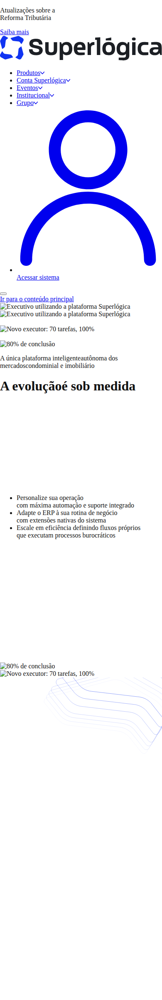

# UI Design System & Master Generation Blueprint: superlogica-com

> **Superlógica: Plataforma de Gestão para Condomínios e Imobiliárias** (https://superlogica.com/) — A plataforma parceira das administradoras de condomínios e imobiliárias, com gestão autônoma, financeira e customizável para escalar a su...


---

## 1. Executive Visual Persona & Design Archetype

- **Brand Essence & Persona**: **Superlógica: Plataforma de Gestão para Condomínios e Imobiliárias** (`https://superlogica.com/`). A plataforma parceira das administradoras de condomínios e imobiliárias, com gestão autônoma, financeira e customizável para escalar a su...
- **Visual Archetype**: **Light-Substrate Editorial & Modular Grid System (`#fff` canvas, `#121212` ink, `#3498db` accent)**.
- **Anti-AI-Slop Differentiators**:
  - **Source-Grounded Chromatic Polarity**: Anchors the viewport in `#fff` (`.Toastify__toast-container { color: #fff }`) paired with `#121212` primary typography and `#3498db` accents.
  - **Extracted Typographic Hierarchy**: Pairs `proxima-nova` for display copy (`A evolução é sob medida`) with `paralucent` and not declared in static CSS (uses primary stack / `ui-monospace`).
  - **Calibrated Spatial Grid & Motion**: Combines `480px` container bounds (`gap: 50px`, padding `4px`) with `cubic-bezier(.215,.61,.355,1)` easing and Lenis Smooth Scroll (`data-lenis`), Lottie Vector Animation Player.

---

## 2. Spatial Architecture & Modular Grid Mathematics



### Viewport Allocation & Container Geometry
- **Captured Viewport Dimensions**: Desktop `1440×12985px` (`assets/desktop.png`, full-page scroll capture), Mobile `390×2400px` (`assets/mobile.png`, capped at 2400px multi-section capture).
- **Master Container Bounds**: `480px` extracted from `superlogica-com` stylesheet.
- **Canvas Lateral Padding & Spacing**: `4px` lateral canvas padding with `50px` grid gap.
- **Border Radius Scale**: `4px`, `10px`, `.75rem`, `9999px`.

### Responsive Breakpoint Architecture
- **Desktop Layout**: Multi-column CSS Grid / Flexbox layout at `1440px` (`max-width: 480px`, `gap: 50px`).
- **Mobile Layout**: Single-column vertical stack at `390px` viewport width with `4px` horizontal padding.
- **Extracted CSS Media Queries**: `@media only screen and (max-width:480px)`, `@media (max-width:992px)`.

---

## 3. Color System, Materiality & Atmospheric Lighting

### Semantic Palette & Source Grounding
| Semantic Role | Ground-Truth Value | Extracted CSS Source / Selector |
|---|---|---|
| **Primary Canvas Substrate** | `#fff` | `.Toastify__toast-container { color: #fff }` |
| **Primary Typography Ink** | `#121212` | `.Toastify__toast--dark { background: #121212 }` |
| **Elevated Surface / Card Substrate** | `#aaa` | `.Toastify__toast--default { color: #aaa }` |
| **Interactive Accent / Highlight** | `#3498db` | `.Toastify__toast--info { background: #3498db }` |
| **Secondary / Muted Copy** | `#07bc0c` | `.Toastify__toast--success { background: #07bc0c }` |
| **Structural Hairline Border** | `#f1c40f` | `.Toastify__toast--warning { background: #f1c40f }` |

### Sanitized Root CSS Variables (`ui-ux.md` Ground Truth)
| Variable Name | Extracted Value | Semantic Role |
|---|---|---|
| `--notification-height` | `34px` | Layout / Spatial Grid Token |
| `--superlogica-com-bg` | `#fff` | Canvas Substrate (from `.Toastify__toast-container { color: #fff }`) |
| `--superlogica-com-ink` | `#121212` | Primary Typography Ink (stylesheet-derived) |
| `--superlogica-com-surface` | `#aaa` | Surface Substrate (stylesheet-derived) |
| `--superlogica-com-accent` | `#3498db` | Interactive Accent (stylesheet-derived) |
| `--superlogica-com-muted` | `#07bc0c` | Secondary Ink (stylesheet-derived) |
| `--superlogica-com-border` | `#f1c40f` | Structural Border (stylesheet-derived) |
| `--superlogica-com-container` | `480px` | Container Bound (stylesheet-derived) |
| `--superlogica-com-gap` | `50px` | Grid Gutter (stylesheet-derived) |
| `--superlogica-com-pad` | `4px` | Lateral Padding (stylesheet-derived) |
| `--superlogica-com-ease` | `cubic-bezier(.215,.61,.355,1)` | Primary Easing Function |
| `--superlogica-com-radius` | `4px` | Corner Radius (stylesheet-derived) |
| `--superlogica-com-fs-base` | `1.8rem` | Observed Font Size Token |

---

## 4. Typographic Scale & Editorial Hierarchy

### Font Family Stacks
- **Display Typography**: `proxima-nova`.
- **Primary Body Stack**: `paralucent`.
- **Technical / Metadata Stack**: not declared in static CSS (uses primary stack / `ui-monospace`).

### Typographic Scale & Rules (Extracted from Stylesheet & Variables)
- **Hero Display (`H1`)**: not explicitly declared on tag in static CSS (stylesheet font-size ladder: `1.8rem`, `1.4rem`, `1.2rem`, `1.5rem`, `1.125rem`).
- **Section Heading (`H2`)**: rule `h2` (`font-size: 1.8rem`).
- **Body Copy**: rule `p` (`font-size: 1.125rem`).
- **Metadata & Navigation Labels**: not explicitly declared on tag in static CSS (stylesheet font-size ladder: `1.8rem`, `1.4rem`, `1.2rem`, `1.5rem`, `1.125rem`).

---

## 5. Choreographed Motion & Interaction Physics

### Primary Easing Curves
- **Extracted Timing Functions**: `cubic-bezier(.215,.61,.355,1)`.

### Per-Element Transition & Choreography Rules
- **Selector `.Toastify__close-button`**: `transition: .3s ease` extracted from `superlogica-com` stylesheet.
- **Selector `.Toastify__progress-bar--controlled`**: `transition: transform .2s` extracted from `superlogica-com` stylesheet.
- **Selector `.gatsby-image-wrapper [data-main-...`**: `transition: opacity .25s linear` extracted from `superlogica-com` stylesheet.
- **Extracted Easing Curve (`cubic-bezier(.215,.61,.355,1)`)**: Governs interactive state transitions across `<header.sc-12j0ex9-15>` and `<section.sc-gc6j39-0>`.
- **Runtime Interaction Engine**: Integrates Lenis Smooth Scroll (`data-lenis`), Lottie Vector Animation Player, Framer Motion Layout Physics with `prefers-reduced-motion: reduce` fallback guards.

---

## 6. Component Wireframe & Structural DOM Map

### Visual Layout Schematic (Grounded in `dom.html` — `1440px` Desktop & `390px` Mobile Reflow)
```
┌────────────────────────────────────────────────────────────────────────┐
│ DESKTOP VIEWPORT (1440px) — Superlógica: Plataforma de Gestão para Con │
│ ====================================================================== │
│ [ <header.sc-12j0ex9-15>   | Produtos · Imobiliárias · Módulo Finan ]  │
│ ---------------------------------------------------------------------- │
│ | HERO STAGE: <section.sc-jk3tv7-0>                                |   │
│ | H1: A evolução é sob medida                                      |   │
│ | Substrate: #fff       | Ink: #121212    | Accent: #3498db        |   │
│ ---------------------------------------------------------------------- │
│ | SHOWCASE GRID (<section.sc-gc6j39-0>     ) max-w: 480px          |   │
│ | +------------------------------+  +------------------------------+ | │
│ | | Estrutura que conecta custom |  | Plataforma líder no mercado  | | │
│ | +------------------------------+  +------------------------------+ | │
│ ---------------------------------------------------------------------- │
│ | MOBILE VIEWPORT REFLOW (390px) — Single-Column Stack (gap: 50px  ) | │
│ | [<header.sc-12j0ex9] -> [<section.sc-jk3tv7] -> [<section.sc-gc6j39] │
│ ---------------------------------------------------------------------- │
│ [ FOOTER (<footer.sc-17tfpbv-15>) | https://superlogica.com/           │
└────────────────────────────────────────────────────────────────────────┘
```

### Granular DOM Region Breakdown
1. **Brand Header & Navigation Bar (<header.sc-12j0ex9-15> — `superlogica-com`)**:
   - Landmark `<header class="sc-12j0ex9-15 jCAcrk">` hosting `Superlógica: Plataforma de Gestão pa` navigation (`Produtos · Imobiliárias · Módulo Financeiro · Controle de acesso · Folha de Pagamento`), DOM attributes (`data-react-helmet="lang"`, `data-react-helmet="true"`, `data-react-helmet="true"`, `data-react-helmet="true"`), and stylesheet rule `.tk-proxima-nova { font-family: "proxima-nova",sans-serif; }`.
2. **Hero Stage & Focal Lead (<section.sc-jk3tv7-0> — `A evolução é sob medida`)**:
   - Landmark `<section class="sc-jk3tv7-0 hGoWlU">` presenting display lead `A evolução é sob medida` and copy excerpt *"Atualizações sobre a Reforma Tributária"* over `#fff` canvas and `#121212` ink.
3. **Primary Showcase & Content Grid (<section.sc-gc6j39-0> — `Estrutura que conecta customização`)**:
   - Landmark `<section class="sc-gc6j39-0 dJeiUC">` rendering section `Estrutura que conecta customização e automação pa...` with copy *"Produtos Produtos Superlógica com Nexus Professional Services Adm"*, asset references (`homem-bg-office-mobile.webp`, `insight.min.js`, `3453052.js`, `pixels.js`), and grid rule `.tk-paralucent { font-family: "paralucent",sans-serif; }`.
4. **Interactive Detail & Feature Matrix (<section.sc-f5frjq-0> — `Plataforma líder no mercado brasil`)**:
   - Landmark `<section class="sc-f5frjq-0 igGITI">` framing `Plataforma líder no mercado brasileiro, referênci...` and `O fim da operação manual.` (*"Superlógica com Nexus"*) with `#aaa` surface cards, `#3498db` accents, and `.tk-argumentum { font-family: "argumentum",sans-serif; }`.
5. **Colophon & Global Directory Footer (<footer.sc-17tfpbv-15> — `https://superlogica.com/`)**:
   - Landmark `<footer class="sc-17tfpbv-15 cQUIfz">` anchoring `Superlógica: Plataforma de Gestã` footer links (`Produtos · Imobiliárias · Módulo Financeiro · Controle de acesso · Folha de Pagamento`), copy *"Professional Services"*, and `#f1c40f` structural dividers.

---

## 7. Master Zero-Shot AI Generation Prompt

```markdown
# Master Zero-Shot Frontend Generation Prompt: superlogica-com (Superlógica: Plataforma de Gestão para Condomínios e Imobiliárias)

You are a principal frontend architect and design systems engineer. Build a complete, production-ready web application replicating the exact design system, DOM landmarks, typographic hierarchy, color tokens, and motion physics of `superlogica-com` (**Superlógica: Plataforma de Gestão para Condomínios e Imobiliárias** — `https://superlogica.com/`).

### 1. Visual Archetype & Anti-AI-Slop Mandates
- **Archetype**: Light-Substrate Editorial & Modular Grid System (`#fff` canvas, `#121212` ink, `#3498db` accent).
- **Identity & Domain Context**: A plataforma parceira das administradoras de condomínios e imobiliárias, com gestão autônoma, financeira e customizável para escalar a su...
- **Primary Substrate**: `#fff` (`.Toastify__toast-container { color: #fff }`), **Primary Ink**: `#121212`, **Accent / Highlight**: `#3498db`.
- **Site-Specific Differentiators**:
  - **Source-Grounded Chromatic Polarity**: Anchors the viewport in `#fff` (`.Toastify__toast-container { color: #fff }`) paired with `#121212` primary typography and `#3498db` accents.
  - **Extracted Typographic Hierarchy**: Pairs `proxima-nova` for display copy (`A evolução é sob medida`) with `paralucent` and not declared in static CSS (uses primary stack / `ui-monospace`).
  - **Calibrated Spatial Grid & Motion**: Combines `480px` container bounds (`gap: 50px`, padding `4px`) with `cubic-bezier(.215,.61,.355,1)` easing and Lenis Smooth Scroll (`data-lenis`), Lottie Vector Animation Player.

### 2. Ground-Truth CSS Variables (`:root` Token Contract)
Declare and consume these exact custom properties extracted from `superlogica-com` in your global stylesheet:

:root {
  /* Superlógica: Plataforma de Gestão para Condomínios e Imobiliárias (superlogica-com) — Ground-Truth Extracted CSS Variables */
  --notification-height: 34px; /* Layout / Spatial Grid Token (superlogica-com) */
  --superlogica-com-bg: #fff; /* Canvas Substrate (from `.Toastify__toast-container { color: #fff }`) (superlogica-com) */
  --superlogica-com-ink: #121212; /* Primary Typography Ink (stylesheet-derived) (superlogica-com) */
  --superlogica-com-surface: #aaa; /* Surface Substrate (stylesheet-derived) (superlogica-com) */
  --superlogica-com-accent: #3498db; /* Interactive Accent (stylesheet-derived) (superlogica-com) */
  --superlogica-com-muted: #07bc0c; /* Secondary Ink (stylesheet-derived) (superlogica-com) */
  --superlogica-com-border: #f1c40f; /* Structural Border (stylesheet-derived) (superlogica-com) */
  --superlogica-com-container: 480px; /* Container Bound (stylesheet-derived) (superlogica-com) */
  --superlogica-com-gap: 50px; /* Grid Gutter (stylesheet-derived) (superlogica-com) */
  --superlogica-com-pad: 4px; /* Lateral Padding (stylesheet-derived) (superlogica-com) */
  --superlogica-com-ease: cubic-bezier(.215,.61,.355,1); /* Primary Easing Function (superlogica-com) */
  --superlogica-com-radius: 4px; /* Corner Radius (stylesheet-derived) (superlogica-com) */
  --superlogica-com-fs-base: 1.8rem; /* Observed Font Size Token (superlogica-com) */
}

### 3. Semantic Color & Materiality Contract
Map every surface, ink, and border strictly to these source-grounded tokens:
- **Primary Canvas Substrate**: `#fff` — grounded in `.Toastify__toast-container { color: #fff }`
- **Primary Typography Ink**: `#121212` — grounded in `.Toastify__toast--dark { background: #121212 }`
- **Elevated Surface / Card Substrate**: `#aaa` — grounded in `.Toastify__toast--default { color: #aaa }`
- **Interactive Accent / Highlight**: `#3498db` — grounded in `.Toastify__toast--info { background: #3498db }`
- **Secondary / Muted Copy**: `#07bc0c` — grounded in `.Toastify__toast--success { background: #07bc0c }`
- **Structural Hairline Border**: `#f1c40f` — grounded in `.Toastify__toast--warning { background: #f1c40f }`

### 4. Spatial Grid, Container Bounds & Responsive Breakpoints
- **Desktop Viewport Reference**: `1440×12985px` (full-page scroll capture, `1440px` standard desktop width).
- **Mobile Viewport Reference**: `390×2400px` (capped at 2400px multi-section capture, `390px` standard mobile width).
- **Container Max-Width**: `480px` extracted from `superlogica-com` stylesheet
- **Padding & Gutters**: `4px` lateral canvas padding with `50px` grid gap
- **Desktop Grid**: Multi-column CSS Grid / Flexbox layout at `1440px` (`max-width: 480px`, `gap: 50px`)
- **Mobile Adaptation**: Single-column vertical stack at `390px` viewport width with `4px` horizontal padding
- **Media Queries**: `@media only screen and (max-width:480px)`, `@media (max-width:992px)`
- **Corner Radii**: `4px`, `10px`, `.75rem`, `9999px`

### 5. Typography & Editorial Scale Contract
- **Display Font Stack**: `proxima-nova`
- **Body Font Stack**: `paralucent`
- **Monospace / Technical Font Stack**: not declared in static CSS (uses primary stack / `ui-monospace`)
- **H1 Display Rule**: not explicitly declared on tag in static CSS (stylesheet font-size ladder: `1.8rem`, `1.4rem`, `1.2rem`, `1.5rem`, `1.125rem`)
- **H2 Section Rule**: rule `h2` (`font-size: 1.8rem`)
- **Body Copy Rule**: rule `p` (`font-size: 1.125rem`)
- **Metadata & Index Rule**: not explicitly declared on tag in static CSS (stylesheet font-size ladder: `1.8rem`, `1.4rem`, `1.2rem`, `1.5rem`, `1.125rem`)

### 6. Component Hierarchy, Verbatim Copy & Real DOM Landmarks
Scaffold `superlogica-com` (`Superlógica: Plataforma de Gestão para Condomínios e Imobiliárias`) with these exact structural regions, extracted copy, and CSS rules from `dom.html`:
1. **Brand Header & Navigation Bar (<header.sc-12j0ex9-15> — `superlogica-com`)**:
   - DOM & Selectors: Landmark `<header class="sc-12j0ex9-15 jCAcrk">` hosting `Superlógica: Plataforma de Gestão pa` navigation (`Produtos · Imobiliárias · Módulo Financeiro · Controle de acesso · Folha de Pagamento`), DOM attributes (`data-react-helmet="lang"`, `data-react-helmet="true"`, `data-react-helmet="true"`, `data-react-helmet="true"`), and stylesheet rule `.tk-proxima-nova { font-family: "proxima-nova",sans-serif; }`.
   - Responsive Contract: Header `Brand Header & Navigation Bar (<header.sc-12j0ex9-15> — `superlogica-com`)` (`superlogica-com`) adapts across `@media only screen and (max-width:480px)`, `@media (max-width:992px)` with `cubic-bezier(.215,.61,.355,1)` transitions and links `Produtos · Imobiliárias · Módulo Financeiro · Controle de acesso · Folha de Pagamento`.
2. **Hero Stage & Focal Lead (<section.sc-jk3tv7-0> — `A evolução é sob medida`)**:
   - DOM & Selectors: Landmark `<section class="sc-jk3tv7-0 hGoWlU">` presenting display lead `A evolução é sob medida` and copy excerpt *"Atualizações sobre a Reforma Tributária"* over `#fff` canvas and `#121212` ink.
   - Responsive Contract: Hero stage (`1440×12985px` desktop / `390×2400px` mobile) sets `#fff` background with `#121212` headline `A evolução é sob medida`.
3. **Primary Showcase & Content Grid (<section.sc-gc6j39-0> — `Estrutura que conecta customização`)**:
   - DOM & Selectors: Landmark `<section class="sc-gc6j39-0 dJeiUC">` rendering section `Estrutura que conecta customização e automação pa...` with copy *"Produtos Produtos Superlógica com Nexus Professional Services Adm"*, asset references (`homem-bg-office-mobile.webp`, `insight.min.js`, `3453052.js`, `pixels.js`), and grid rule `.tk-paralucent { font-family: "paralucent",sans-serif; }`.
   - Responsive Contract: Showcase grid `Primary Showcase & Content Grid (<section.sc-gc6j39-0> — `Estrutura que conecta customização`)` applies Multi-column CSS Grid / Flexbox layout at `1440px` (`max-width: 480px`, `gap: 50px`) on desktop and Single-column vertical stack at `390px` viewport width with `4px` horizontal padding on mobile.
4. **Interactive Detail & Feature Matrix (<section.sc-f5frjq-0> — `Plataforma líder no mercado brasil`)**:
   - DOM & Selectors: Landmark `<section class="sc-f5frjq-0 igGITI">` framing `Plataforma líder no mercado brasileiro, referênci...` and `O fim da operação manual.` (*"Superlógica com Nexus"*) with `#aaa` surface cards, `#3498db` accents, and `.tk-argumentum { font-family: "argumentum",sans-serif; }`.
   - Responsive Contract: Detail module `Interactive Detail & Feature Matrix (<section.sc-f5frjq-0> — `Plataforma líder no mercado brasil`)` uses `4px`, `10px`, `.75rem`, `9999px` radii, `#3498db` highlights, and assets (homem-bg-office-mobile.webp, insight.min.js, 3453052.js).
5. **Colophon & Global Directory Footer (<footer.sc-17tfpbv-15> — `https://superlogica.com/`)**:
   - DOM & Selectors: Landmark `<footer class="sc-17tfpbv-15 cQUIfz">` anchoring `Superlógica: Plataforma de Gestã` footer links (`Produtos · Imobiliárias · Módulo Financeiro · Controle de acesso · Folha de Pagamento`), copy *"Professional Services"*, and `#f1c40f` structural dividers.
   - Responsive Contract: Footer `Colophon & Global Directory Footer (<footer.sc-17tfpbv-15> — `https://superlogica.com/`)` aligns to `480px` extracted from `superlogica-com` stylesheet with `4px` lateral canvas padding with `50px` grid gap and attributes (data-react-helmet="lang", data-react-helmet="true", data-react-helmet="true").

#### Verbatim DOM Copy Excerpts (`dom.html`)
- Copy Excerpt 1: *"Atualizações sobre a Reforma Tributária"*
- Copy Excerpt 2: *"Produtos Produtos Superlógica com Nexus Professional Services Administração condom..."*
- Copy Excerpt 3: *"Superlógica com Nexus"*
- Copy Excerpt 4: *"Professional Services"*

### 7. Motion, Extracted Stylesheet Rules & Interaction Choreography
- **Primary Easing Functions**: `cubic-bezier(.215,.61,.355,1)`
- **Extracted Stylesheet Rules (`superlogica-com`)**:
- `.tk-proxima-nova { font-family: "proxima-nova",sans-serif; }`
- `.tk-paralucent { font-family: "paralucent",sans-serif; }`
- `.tk-argumentum { font-family: "argumentum",sans-serif; }`
- `.Toastify__toast-container--top-left { left:1em;top:1em }`
- `.Toastify__toast-container--top-c... { left:50%;top:1em;transform:translateX(-50%) }`
- **Per-Selector Transition Rules**:
- **Selector `.Toastify__close-button`**: `transition: .3s ease` extracted from `superlogica-com` stylesheet.
- **Selector `.Toastify__progress-bar--controlled`**: `transition: transform .2s` extracted from `superlogica-com` stylesheet.
- **Selector `.gatsby-image-wrapper [data-main-...`**: `transition: opacity .25s linear` extracted from `superlogica-com` stylesheet.
- **Extracted Easing Curve (`cubic-bezier(.215,.61,.355,1)`)**: Governs interactive state transitions across `<header.sc-12j0ex9-15>` and `<section.sc-gc6j39-0>`.
- **Runtime Interaction Engine**: Integrates Lenis Smooth Scroll (`data-lenis`), Lottie Vector Animation Player, Framer Motion Layout Physics with `prefers-reduced-motion: reduce` fallback guards.

### 8. Technical Deliverables
- Implement in Next.js (App Router) with TypeScript and Tailwind CSS consuming the `:root` custom properties defined above for `superlogica-com`.
- Reproduce both the `1440px` desktop architecture and `390px` mobile breakpoint transitions, preserving semantic HTML5 landmarks (`<header>`, `<nav>`, `<main>`, `<section>`, `<footer>`) and `prefers-reduced-motion` accessibility guards.
```
