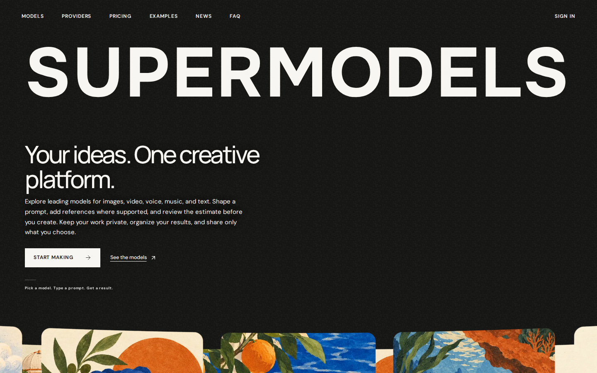
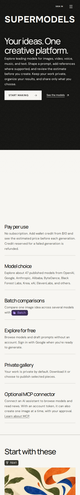

# UI Design System & Master Generation Blueprint: supermodels-phototypelabs-com

> **SUPERMODELS — Image, Video, Voice & Music, Pay Per Use** (https://supermodels.phototypelabs.com) — SUPERMODELS is a creative platform for images, video, voice, music, and text with leading models. Pay per use, with no subscription.



---

## 1. Executive Visual Persona & Design Archetype

- **Brand Essence & Persona**: **SUPERMODELS — Image, Video, Voice & Music, Pay Per Use** (`https://supermodels.phototypelabs.com`). SUPERMODELS is a creative platform for images, video, voice, music, and text with leading models. Pay per use, with no subscription.
- **Capture Provenance**: Live browser capture (`tier1_fast`, HTTP `200`, captured `2026-11-23`).
- **Visual Archetype**: **Dark-Substrate WebGL / Canvas Interactive Experience (`#000000` / `#57d778`)**.
- **Anti-AI-Slop Differentiators**:
  - **Live-Computed Chromatic Polarity**: Anchors the viewport in `#000000` (live computed `body` `background-color` (`computed_styles.json`)) paired with `#f7f6f2` primary typography and `#57d778` accents.
  - **Grounded Typographic Hierarchy**: Pairs `Manrope` for display copy (`Your ideas. One creative platform.`) with `DM Sans` and `IBM Plex Mono`.
  - **Calibrated Spatial Grid & Motion**: Combines `1440px` container bounds (`gap: 32px`, padding `51.84px`) with `cubic-bezier(.2,.8,.2,1)` easing and Three.js / WebGL Canvas Pipeline.

---

## 2. Spatial Architecture & Modular Grid Mathematics



### Viewport Allocation & Container Geometry
- **Captured Viewport Dimensions**: Desktop `1440×900px` (`assets/desktop.png`, single-viewport 100vh live capture (900px)), Mobile `390×2400px` (`assets/mobile.png`, clamped at 2400px live multi-section capture).
- **Master Container Bounds**: `1440px` (full-bleed `100%` desktop stage measured on `1440px` viewport).
- **Canvas Lateral Padding & Spacing**: `51.84px` lateral canvas padding with `32px` grid gap.
- **Border Radius Scale**: `999px`, `50%`, `20%`, `var(--radius-sm)`.

### Responsive Breakpoint Architecture
- **Desktop Layout**: Multi-column CSS Grid / Flexbox layout at `1440px` (`max-width: 1440px`, `gap: 32px`).
- **Mobile Layout**: Single-column vertical stack at `390px` viewport width with `51.84px` horizontal padding.
- **Extracted CSS Media Queries**: `@media (prefers-reduced-motion:reduce)`, `@media (width<=1000px)`, `@media (width<=550px)`, `@media (width<=880px)`.

---

## 3. Color System, Materiality & Atmospheric Lighting

### Semantic Palette & Source Grounding
| Semantic Role | Ground-Truth Value | Extracted Live / CSS Source |
|---|---|---|
| **Primary Canvas Substrate** | `#000000` | live computed `body` `background-color` (`computed_styles.json`) |
| **Primary Typography Ink** | `#f7f6f2` | live computed `h1` `color` (`computed_styles.json`) |
| **Elevated Surface / Card Substrate** | `#171715` | live computed `header` `background-color` (`computed_styles.json`) |
| **Interactive Accent / Highlight** | `#57d778` | `var(--category-accent)` in `:root` |
| **Secondary / Muted Copy** | `#5f5f5a` | `var(--editorial-muted)` in `:root` |
| **Structural Hairline Border** | `#39352e` | `var(--workspace-dark-rule)` in `:root` |
| **Variable Token (`--editorial-ground`)** | `#ecebe7` | `var(--editorial-ground)` in `:root` |
| **Variable Token (`--editorial-paper-quiet`)** | `#efeee9` | `var(--editorial-paper-quiet)` in `:root` |
| **Variable Token (`--editorial-rule`)** | `#c9c8c3` | `var(--editorial-rule)` in `:root` |
| **Variable Token (`--workspace-sand`)** | `#ded5c5` | `var(--workspace-sand)` in `:root` |
| **Variable Token (`--workspace-sand-muted`)** | `#a9a08f` | `var(--workspace-sand-muted)` in `:root` |
| **Variable Token (`--surface-dark-muted`)** | `#b8af9e` | `var(--surface-dark-muted)` in `:root` |

### Sanitized Root CSS Variables (`ui-ux.md` Ground Truth)
| Variable Name | Extracted Value | Semantic Role |
|---|---|---|
| `--site-frame` | `#000` | Color / Atmospheric Token |
| `--editorial-ground` | `#ecebe7` | Color / Atmospheric Token |
| `--editorial-paper` | `#f7f6f2` | Canvas / Surface Token |
| `--editorial-paper-quiet` | `#efeee9` | Canvas / Surface Token |
| `--editorial-ink` | `#171715` | Typography Ink Token |
| `--editorial-muted` | `#5f5f5a` | Color / Atmospheric Token |
| `--editorial-rule` | `#c9c8c3` | Color / Atmospheric Token |
| `--workspace-sand` | `#ded5c5` | Layout / Spatial Grid Token |
| `--workspace-sand-muted` | `#a9a08f` | Layout / Spatial Grid Token |
| `--workspace-dark-rule` | `#39352e` | Canvas / Surface Token |
| `--surface-light-text` | `var(--editorial-ink)` | Canvas / Surface Token |
| `--surface-light-muted` | `var(--editorial-muted)` | Canvas / Surface Token |
| `--surface-dark-text` | `var(--workspace-sand)` | Canvas / Surface Token |
| `--surface-dark-muted` | `#b8af9e` | Canvas / Surface Token |
| `--editorial-accent` | `#5f5f5a` | Brand / Palette Token |
| `--font-sans` | `"DM Sans", -apple-system, BlinkMacSystemFont, "Segoe UI", sans-serif` | Typography / Scale Token |

---

## 4. Typographic Scale & Editorial Hierarchy

### Font Family Stacks
- **Display Typography**: `Manrope`.
- **Primary Body Stack**: `DM Sans`.
- **Technical / Metadata Stack**: `IBM Plex Mono`.

### Typographic Scale & Rules (Live Computed & Stylesheet Grounded)
- **Hero Display (`H1`)**: live computed `h1` (`font-size: 58.32px`, `line-height: 60.6528px`, `font-weight: 500`, `letter-spacing: -3.7908px`); CSS variables `--font-display: "Manrope", var(--font-sans)`.
- **Section Heading (`H2`)**: live computed `h2` (`font-size: 74.88px`, `line-height: 79.3728px`, `font-weight: 500`, `letter-spacing: -4.1184px`).
- **Body Copy**: live computed `body` (`font-size: 16px`, `line-height: normal`, `font-weight: 400`); CSS variables `--landing-body-size: .9375rem`.
- **Metadata & Navigation Labels**: live computed `nav/a` (`font-size: 16px`, `line-height: normal`, `font-weight: 400`); CSS variables `--font-mono: "IBM Plex Mono", "SF Mono", monospace`, `--landing-label-size: .75rem`, `--hero-brand-letter-spacing: 0.02em`.

---

## 5. Choreographed Motion & Interaction Physics

### Primary Easing Curves
- **Extracted Timing Functions**: `cubic-bezier(.2,.8,.2,1)`, `cubic-bezier(.65,0,.35,1)`, `cubic-bezier(.22,.61,.36,1)`.

### Per-Element Transition & Choreography Rules
- **Selector `.app-slider-fill[data-v-c750e325]`**: `transition: width .16s cubic-bezier(.2,.8,.2,1)` extracted from `supermodels-phototypelabs-com` stylesheet.
- **Selector `nput[data-v-c750e325]::-webkit-sl...`**: `transition: transform .18s cubic-bezier(.2,.8,.2,1)` extracted from `supermodels-phototypelabs-com` stylesheet.
- **Selector `er-input[data-v-c750e325]::-moz-r...`**: `transition: transform .18s cubic-bezier(.2,.8,.2,1)` extracted from `supermodels-phototypelabs-com` stylesheet.
- **Extracted Easing Curve (`cubic-bezier(.2,.8,.2,1)`)**: Governs interactive state transitions across `<header.editorial-header>` and `<section.principles-section>`.
- **Runtime Interaction Engine**: Integrates Three.js / WebGL Canvas Pipeline with `prefers-reduced-motion: reduce` fallback guards.

---

## 6. Component Wireframe & Structural DOM Map

### Visual Layout Schematic — Desktop (`1440px`, Grounded in `dom.html` & Landmark Bounding Boxes)
```
┌────────────────────────────────────────────────────────────────────────┐
│ DESKTOP VIEWPORT (1440px) — SUPERMODELS — Image, Video, Voice & Music, │
│ ====================================================================== │
│ [ <header.editorial-head (1440x78px)  | Models · Providers · Pricing ] │
│ ---------------------------------------------------------------------- │
│ | HERO STAGE: <section.editorial-hero> (w=1440px)                    | │
│ | H1: Your ideas. One creative platform.                             | │
│ | Substrate: #000000 | Ink: #f7f6f2 | Accent: #57d778                | │
│ ---------------------------------------------------------------------- │
│ | SHOWCASE GRID (<section.principles-sectio) max-w: 1440px           | │
│ | +------------------------------+  +------------------------------+ | │
│ | | Model choice                 |  | Batch comparisons            | | │
│ | +------------------------------+  +------------------------------+ | │
│ ---------------------------------------------------------------------- │
│ | DETAIL MODULE (<article.editorial-landing) — Explore for free      | │
│ ---------------------------------------------------------------------- │
│ [ FOOTER (<footer.creative-foo) | https://supermodels.phototypelabs.c  │
└────────────────────────────────────────────────────────────────────────┘
```

### Visual Layout Schematic — Mobile Reflow (`390px`)
```
┌────────────────────────────────────────────────────────────────────────┐
│ MOBILE VIEWPORT REFLOW (390px) — Single-Column Stack (gap: 32px)       │
│ ====================================================================== │
│ [ HEADER BAR (<header.editorial-header) | Compact Menu (390px)         │
│ ---------------------------------------------------------------------- │
│ | HERO STAGE (<section.editorial-hero>) — 390px Vertical Lead        | │
│ | H1: Your ideas. One creative platform.                             | │
│ ---------------------------------------------------------------------- │
│ | SHOWCASE STACK (<section.principles-se) — 1-Col Stack              | │
│ | [ Item 1: Model choice                                           ] | │
│ | [ Item 2: Batch comparisons                                      ] | │
│ ---------------------------------------------------------------------- │
│ | DETAIL STACK (<article.editorial-landi) — 1-Col (Explore for free) | │
│ ---------------------------------------------------------------------- │
│ [ FOOTER (<footer.creative-foo) | Stacked 390px Colophon               │
└────────────────────────────────────────────────────────────────────────┘
```

### Granular DOM Region Breakdown
1. **Brand Header & Navigation Bar (<header.editorial-header> — `supermodels-phototypelabs-com`)**:
   - Landmark `<header class="editorial-header">` (`1440x78px`) hosting `SUPERMODELS — Image, Video, Voice & ` navigation (`Models · Providers · Pricing · Examples · News`), DOM attributes (`data-landing-brand="SUPERMODELS"`, `data-landing-brand-weight="700"`, `data-landing-brand-spacing="0.02"`, `data-landing-font="Onest"`), and stylesheet rule `webkit-slider-runnable-track { background:0 0;height:.32rem }`.
2. **Hero Stage & Focal Lead (<section.editorial-hero> — `Your ideas. One creative platform.`)**:
   - Landmark `<section class="editorial-hero">` presenting display lead `Your ideas. One creative platform.` and copy excerpt *"Explore leading models for images, video, voice, music, and text."* over `#000000` canvas and `#f7f6f2` ink.
3. **Primary Showcase & Content Grid (<section.principles-section> — `Model choice`)**:
   - Landmark `<section class="principles-section platform-overview">` rendering section `Model choice` with copy *"Pick a model. Type a prompt. Get a result."*, asset references (`favicon.svg`, `favicon.png`, `favicon.ico`, `apple-touch-icon.png`), and grid rule `moz-range-track { background:0 0;height:.32rem }`.
4. **Interactive Detail & Feature Matrix (<article.editorial-landing> — `Batch comparisons`)**:
   - Landmark `<article class="editorial-landing">` framing `Batch comparisons` and `Explore for free` (*"No subscription. Add wallet credit from $10 and see the estimated"*) with `#171715` surface cards, `#57d778` accents, and `active::-webkit-slider-thumb { transform:scale(1.24) }`.
5. **Colophon & Global Directory Footer (<footer.creative-footer> — `https://supermodels.phototypelabs.com`)**:
   - Landmark `<footer class="creative-footer">` anchoring `SUPERMODELS — Image, Video, Voic` footer links (`Models · Providers · Pricing · Examples · News`), copy *"Explore about 47 published models from OpenAI, Google, Anthr"*, and `#39352e` structural dividers.

---

## 7. Master Zero-Shot AI Generation Prompt

```markdown
# Master Zero-Shot Frontend Generation Prompt: supermodels-phototypelabs-com (SUPERMODELS — Image, Video, Voice & Music, Pay Per Use)

You are a principal frontend architect and design systems engineer. Build a complete, production-ready web application replicating the exact design system, DOM landmarks, typographic hierarchy, color tokens, and motion physics of `supermodels-phototypelabs-com` (**SUPERMODELS — Image, Video, Voice & Music, Pay Per Use** — `https://supermodels.phototypelabs.com`).

### 1. Visual Archetype & Anti-AI-Slop Mandates
- **Archetype**: Dark-Substrate WebGL / Canvas Interactive Experience (`#000000` / `#57d778`).
- **Identity & Domain Context**: SUPERMODELS is a creative platform for images, video, voice, music, and text with leading models. Pay per use, with no subscription.
- **Primary Substrate**: `#000000` (live computed `body` `background-color` (`computed_styles.json`)), **Primary Ink**: `#f7f6f2`, **Accent / Highlight**: `#57d778`.
- **Site-Specific Differentiators**:
  - **Live-Computed Chromatic Polarity**: Anchors the viewport in `#000000` (live computed `body` `background-color` (`computed_styles.json`)) paired with `#f7f6f2` primary typography and `#57d778` accents.
  - **Grounded Typographic Hierarchy**: Pairs `Manrope` for display copy (`Your ideas. One creative platform.`) with `DM Sans` and `IBM Plex Mono`.
  - **Calibrated Spatial Grid & Motion**: Combines `1440px` container bounds (`gap: 32px`, padding `51.84px`) with `cubic-bezier(.2,.8,.2,1)` easing and Three.js / WebGL Canvas Pipeline.

### 2. Ground-Truth CSS Variables (`:root` Token Contract)
Declare and consume these exact custom properties extracted from `supermodels-phototypelabs-com` in your global stylesheet:

:root {
  /* SUPERMODELS — Image, Video, Voice & Music, Pay Per Use (supermodels-phototypelabs-com) — Live-Grounded CSS Variables */
  --site-frame: #000; /* Color / Atmospheric Token (supermodels-phototypelabs-com) */
  --editorial-ground: #ecebe7; /* Color / Atmospheric Token (supermodels-phototypelabs-com) */
  --editorial-paper: #f7f6f2; /* Canvas / Surface Token (supermodels-phototypelabs-com) */
  --editorial-paper-quiet: #efeee9; /* Canvas / Surface Token (supermodels-phototypelabs-com) */
  --editorial-ink: #171715; /* Typography Ink Token (supermodels-phototypelabs-com) */
  --editorial-muted: #5f5f5a; /* Color / Atmospheric Token (supermodels-phototypelabs-com) */
  --editorial-rule: #c9c8c3; /* Color / Atmospheric Token (supermodels-phototypelabs-com) */
  --workspace-sand: #ded5c5; /* Layout / Spatial Grid Token (supermodels-phototypelabs-com) */
  --workspace-sand-muted: #a9a08f; /* Layout / Spatial Grid Token (supermodels-phototypelabs-com) */
  --workspace-dark-rule: #39352e; /* Canvas / Surface Token (supermodels-phototypelabs-com) */
  --surface-light-text: var(--editorial-ink); /* Canvas / Surface Token (supermodels-phototypelabs-com) */
  --surface-light-muted: var(--editorial-muted); /* Canvas / Surface Token (supermodels-phototypelabs-com) */
  --surface-dark-text: var(--workspace-sand); /* Canvas / Surface Token (supermodels-phototypelabs-com) */
  --surface-dark-muted: #b8af9e; /* Canvas / Surface Token (supermodels-phototypelabs-com) */
  --editorial-accent: #5f5f5a; /* Brand / Palette Token (supermodels-phototypelabs-com) */
  --font-sans: "DM Sans", -apple-system, BlinkMacSystemFont, "Segoe UI", sans-serif; /* Typography / Scale Token (supermodels-phototypelabs-com) */
}

### 3. Semantic Color & Materiality Contract
Map every surface, ink, and border strictly to these source-grounded tokens:
- **Primary Canvas Substrate**: `#000000` — grounded in live computed `body` `background-color` (`computed_styles.json`)
- **Primary Typography Ink**: `#f7f6f2` — grounded in live computed `h1` `color` (`computed_styles.json`)
- **Elevated Surface / Card Substrate**: `#171715` — grounded in live computed `header` `background-color` (`computed_styles.json`)
- **Interactive Accent / Highlight**: `#57d778` — grounded in `var(--category-accent)` in `:root`
- **Secondary / Muted Copy**: `#5f5f5a` — grounded in `var(--editorial-muted)` in `:root`
- **Structural Hairline Border**: `#39352e` — grounded in `var(--workspace-dark-rule)` in `:root`
- **Variable Token (`--editorial-ground`)**: `#ecebe7` — grounded in `var(--editorial-ground)` in `:root`
- **Variable Token (`--editorial-paper-quiet`)**: `#efeee9` — grounded in `var(--editorial-paper-quiet)` in `:root`
- **Variable Token (`--editorial-rule`)**: `#c9c8c3` — grounded in `var(--editorial-rule)` in `:root`
- **Variable Token (`--workspace-sand`)**: `#ded5c5` — grounded in `var(--workspace-sand)` in `:root`
- **Variable Token (`--workspace-sand-muted`)**: `#a9a08f` — grounded in `var(--workspace-sand-muted)` in `:root`
- **Variable Token (`--surface-dark-muted`)**: `#b8af9e` — grounded in `var(--surface-dark-muted)` in `:root`

### 4. Spatial Grid, Container Bounds & Responsive Breakpoints
- **Desktop Viewport Reference**: `1440×900px` (single-viewport 100vh live capture (900px), `1440px` standard desktop width).
- **Mobile Viewport Reference**: `390×2400px` (clamped at 2400px live multi-section capture, `390px` standard mobile width).
- **Container Max-Width**: `1440px` (full-bleed `100%` desktop stage measured on `1440px` viewport)
- **Padding & Gutters**: `51.84px` lateral canvas padding with `32px` grid gap
- **Desktop Grid**: Multi-column CSS Grid / Flexbox layout at `1440px` (`max-width: 1440px`, `gap: 32px`)
- **Mobile Adaptation**: Single-column vertical stack at `390px` viewport width with `51.84px` horizontal padding
- **Media Queries**: `@media (prefers-reduced-motion:reduce)`, `@media (width<=1000px)`, `@media (width<=550px)`, `@media (width<=880px)`
- **Corner Radii**: `999px`, `50%`, `20%`, `var(--radius-sm)`

### 5. Typography & Editorial Scale Contract
- **Display Font Stack**: `Manrope`
- **Body Font Stack**: `DM Sans`
- **Monospace / Technical Font Stack**: `IBM Plex Mono`
- **H1 Display Rule**: live computed `h1` (`font-size: 58.32px`, `line-height: 60.6528px`, `font-weight: 500`, `letter-spacing: -3.7908px`); CSS variables `--font-display: "Manrope", var(--font-sans)`
- **H2 Section Rule**: live computed `h2` (`font-size: 74.88px`, `line-height: 79.3728px`, `font-weight: 500`, `letter-spacing: -4.1184px`)
- **Body Copy Rule**: live computed `body` (`font-size: 16px`, `line-height: normal`, `font-weight: 400`); CSS variables `--landing-body-size: .9375rem`
- **Metadata & Index Rule**: live computed `nav/a` (`font-size: 16px`, `line-height: normal`, `font-weight: 400`); CSS variables `--font-mono: "IBM Plex Mono", "SF Mono", monospace`, `--landing-label-size: .75rem`, `--hero-brand-letter-spacing: 0.02em`

### 6. Component Hierarchy, Verbatim Copy & Real DOM Landmarks
Scaffold `supermodels-phototypelabs-com` (`SUPERMODELS — Image, Video, Voice & Music, Pay Per Use`) with these exact structural regions, extracted copy, and CSS rules from `dom.html`:
1. **Brand Header & Navigation Bar (<header.editorial-header> — `supermodels-phototypelabs-com`)**:
   - DOM & Selectors: Landmark `<header class="editorial-header">` (`1440x78px`) hosting `SUPERMODELS — Image, Video, Voice & ` navigation (`Models · Providers · Pricing · Examples · News`), DOM attributes (`data-landing-brand="SUPERMODELS"`, `data-landing-brand-weight="700"`, `data-landing-brand-spacing="0.02"`, `data-landing-font="Onest"`), and stylesheet rule `webkit-slider-runnable-track { background:0 0;height:.32rem }`.
   - Responsive Contract: Header `Brand Header & Navigation Bar (<header.editorial-header> — `supermodels-phototypelabs-com`)` (`supermodels-phototypelabs-com`) adapts across `@media (prefers-reduced-motion:reduce)`, `@media (width<=1000px)`, `@media (width<=550px)`, `@media (width<=880px)` with `cubic-bezier(.2,.8,.2,1)`, `cubic-bezier(.65,0,.35,1)`, `cubic-bezier(.22,.61,.36,1)` transitions and links `Models · Providers · Pricing · Examples · News`.
2. **Hero Stage & Focal Lead (<section.editorial-hero> — `Your ideas. One creative platform.`)**:
   - DOM & Selectors: Landmark `<section class="editorial-hero">` presenting display lead `Your ideas. One creative platform.` and copy excerpt *"Explore leading models for images, video, voice, music, and text."* over `#000000` canvas and `#f7f6f2` ink.
   - Responsive Contract: Hero stage (`1440×900px` desktop / `390×2400px` mobile) sets `#000000` background with `#f7f6f2` headline `Your ideas. One creative platform.`.
3. **Primary Showcase & Content Grid (<section.principles-section> — `Model choice`)**:
   - DOM & Selectors: Landmark `<section class="principles-section platform-overview">` rendering section `Model choice` with copy *"Pick a model. Type a prompt. Get a result."*, asset references (`favicon.svg`, `favicon.png`, `favicon.ico`, `apple-touch-icon.png`), and grid rule `moz-range-track { background:0 0;height:.32rem }`.
   - Responsive Contract: Showcase grid `Primary Showcase & Content Grid (<section.principles-section> — `Model choice`)` applies Multi-column CSS Grid / Flexbox layout at `1440px` (`max-width: 1440px`, `gap: 32px`) on desktop and Single-column vertical stack at `390px` viewport width with `51.84px` horizontal padding on mobile.
4. **Interactive Detail & Feature Matrix (<article.editorial-landing> — `Batch comparisons`)**:
   - DOM & Selectors: Landmark `<article class="editorial-landing">` framing `Batch comparisons` and `Explore for free` (*"No subscription. Add wallet credit from $10 and see the estimated"*) with `#171715` surface cards, `#57d778` accents, and `active::-webkit-slider-thumb { transform:scale(1.24) }`.
   - Responsive Contract: Detail module `Interactive Detail & Feature Matrix (<article.editorial-landing> — `Batch comparisons`)` uses `999px`, `50%`, `20%`, `var(--radius-sm)` radii, `#57d778` highlights, and assets (favicon.svg, favicon.png, favicon.ico).
5. **Colophon & Global Directory Footer (<footer.creative-footer> — `https://supermodels.phototypelabs.com`)**:
   - DOM & Selectors: Landmark `<footer class="creative-footer">` anchoring `SUPERMODELS — Image, Video, Voic` footer links (`Models · Providers · Pricing · Examples · News`), copy *"Explore about 47 published models from OpenAI, Google, Anthr"*, and `#39352e` structural dividers.
   - Responsive Contract: Footer `Colophon & Global Directory Footer (<footer.creative-footer> — `https://supermodels.phototypelabs.com`)` aligns to `1440px` (full-bleed `100%` desktop stage measured on `1440px` viewport) with `51.84px` lateral canvas padding with `32px` grid gap and attributes (data-landing-brand="SUPERMODELS", data-landing-brand-weight="700", data-landing-brand-spacing="0.02").

#### Verbatim DOM Copy Excerpts (`dom.html`)
- Copy Excerpt 1: *"Explore leading models for images, video, voice, music, and text. Shape a prompt,..."*
- Copy Excerpt 2: *"Pick a model. Type a prompt. Get a result."*
- Copy Excerpt 3: *"No subscription. Add wallet credit from $10 and see the estimated price before eac..."*
- Copy Excerpt 4: *"Explore about 47 published models from OpenAI, Google, Anthropic, Alibaba, ByteDan..."*

### 7. Motion, Extracted Stylesheet Rules & Interaction Choreography
- **Primary Easing Functions**: `cubic-bezier(.2,.8,.2,1)`, `cubic-bezier(.65,0,.35,1)`, `cubic-bezier(.22,.61,.36,1)`
- **Extracted Stylesheet Rules (`supermodels-phototypelabs-com`)**:
- `webkit-slider-runnable-track { background:0 0;height:.32rem }`
- `moz-range-track { background:0 0;height:.32rem }`
- `active::-webkit-slider-thumb { transform:scale(1.24) }`
- `active::-moz-range-thumb { transform:scale(1.24) }`
- `webkit-slider-thumb { transition:none }`
- **Per-Selector Transition Rules**:
- **Selector `.app-slider-fill[data-v-c750e325]`**: `transition: width .16s cubic-bezier(.2,.8,.2,1)` extracted from `supermodels-phototypelabs-com` stylesheet.
- **Selector `nput[data-v-c750e325]::-webkit-sl...`**: `transition: transform .18s cubic-bezier(.2,.8,.2,1)` extracted from `supermodels-phototypelabs-com` stylesheet.
- **Selector `er-input[data-v-c750e325]::-moz-r...`**: `transition: transform .18s cubic-bezier(.2,.8,.2,1)` extracted from `supermodels-phototypelabs-com` stylesheet.
- **Extracted Easing Curve (`cubic-bezier(.2,.8,.2,1)`)**: Governs interactive state transitions across `<header.editorial-header>` and `<section.principles-section>`.
- **Runtime Interaction Engine**: Integrates Three.js / WebGL Canvas Pipeline with `prefers-reduced-motion: reduce` fallback guards.

### 8. Technical Deliverables
- Implement in Next.js (App Router) with TypeScript and Tailwind CSS consuming the `:root` custom properties defined above for `supermodels-phototypelabs-com`.
- Reproduce both the `1440px` desktop architecture and `390px` mobile breakpoint transitions, preserving semantic HTML5 landmarks (`<header>`, `<nav>`, `<main>`, `<section>`, `<footer>`) and `prefers-reduced-motion` accessibility guards.
```
