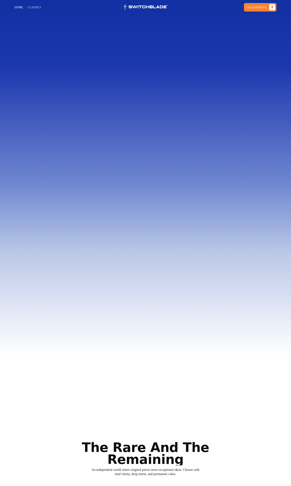
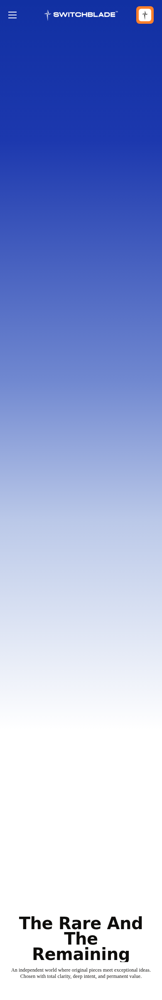

# UI Design System & Master Generation Blueprint: switchblade-awwwards-vercel-app

> **SWITCHBLADE™** (https://switchblade-awwwards.vercel.app/) — SWITCHBLADE™: a philosophy applied to whatever it touches. Strength, compassion, and intent, distilled into a mark for builders who refus...



---

## 1. Executive Visual Persona & Design Archetype

- **Brand Essence & Persona**: **SWITCHBLADE™** (`https://switchblade-awwwards.vercel.app/`). SWITCHBLADE™: a philosophy applied to whatever it touches. Strength, compassion, and intent, distilled into a mark for builders who refus...
- **Visual Archetype**: **Dark-Substrate WebGL / Canvas Interactive Experience (`#fb2c36` / `#f2ede4`)**.
- **Anti-AI-Slop Differentiators**:
  - **Source-Grounded Chromatic Polarity**: Anchors the viewport in `#fb2c36` (`var(--color-red-500)` in `:root`) paired with `#fff` primary typography and `#f2ede4` accents.
  - **Extracted Typographic Hierarchy**: Pairs `Averia Serif Libre` for display copy (`The Rare And The Remaining`) with `Averia Serif Libre Fallback` and `IBM Plex Sans`.
  - **Calibrated Spatial Grid & Motion**: Combines `40rem` container bounds (`gap: var(--spacing)`, padding `6px`) with `cubic-bezier(0,0,.2,1)` easing and Lenis Smooth Scroll (`data-lenis`), Three.js / WebGL Canvas Pipeline.

---

## 2. Spatial Architecture & Modular Grid Mathematics



### Viewport Allocation & Container Geometry
- **Captured Viewport Dimensions**: Desktop `1440×2400px` (`assets/desktop.png`, capped at 2400px multi-section capture), Mobile `390×2400px` (`assets/mobile.png`, capped at 2400px multi-section capture).
- **Master Container Bounds**: `40rem` extracted from `switchblade-awwwards-vercel-app` stylesheet.
- **Canvas Lateral Padding & Spacing**: `6px` lateral canvas padding with `var(--spacing)` grid gap.
- **Border Radius Scale**: `.25rem`, `var(--radius-lg)`, `var(--radius-xl)`, `18px`.

### Responsive Breakpoint Architecture
- **Desktop Layout**: Multi-column CSS Grid / Flexbox layout at `1440px` (`max-width: 40rem`, `gap: var(--spacing)`).
- **Mobile Layout**: Single-column vertical stack at `390px` viewport width with `6px` horizontal padding.
- **Extracted CSS Media Queries**: `@media (min-width:40rem)`, `@media (min-width:48rem)`, `@media (min-width:64rem)`, `@media (min-width:80rem)`.

---

## 3. Color System, Materiality & Atmospheric Lighting

### Semantic Palette & Source Grounding
| Semantic Role | Ground-Truth Value | Extracted CSS Source / Selector |
|---|---|---|
| **Primary Canvas Substrate** | `#fb2c36` | `var(--color-red-500)` in `:root` |
| **Primary Typography Ink** | `#000` | `var(--color-black)` in `:root` |
| **Elevated Surface / Card Substrate** | `#fff` | `var(--color-white)` in `:root` |
| **Interactive Accent / Highlight** | `#f2ede4` | `var(--cream)` in `:root` |
| **Secondary / Muted Copy** | `#eae4da` | `var(--cream-2)` in `:root` |
| **Structural Hairline Border** | `#0d0d0d` | `var(--ink)` in `:root` |

### Sanitized Root CSS Variables (`ui-ux.md` Ground Truth)
| Variable Name | Extracted Value | Semantic Role |
|---|---|---|
| `--font-averia` | `"Averia Serif Libre", "Averia Serif Libre Fallback"` | Typography / Scale Token |
| `--font-barlow` | `"barlow", "barlow Fallback"` | Typography / Scale Token |
| `--font-ibm` | `"IBM Plex Sans", "IBM Plex Sans Fallback"` | Typography / Scale Token |
| `--font-ibm-mono` | `"IBM Plex Mono", "IBM Plex Mono Fallback"` | Typography / Scale Token |
| `--font-inter` | `"Inter", "Inter Fallback"` | Typography / Scale Token |
| `--font-archivo` | `"Archivo", "Archivo Fallback"` | Typography / Scale Token |
| `--color-red-500` | `#fb2c36` | Brand / Palette Token |
| `--color-black` | `#000` | Canvas / Surface Token |
| `--color-white` | `#fff` | Canvas / Surface Token |
| `--spacing` | `.25rem` | Layout / Spatial Grid Token |
| `--container-sm` | `24rem` | Layout / Spatial Grid Token |
| `--container-lg` | `32rem` | Layout / Spatial Grid Token |
| `--container-xl` | `36rem` | Layout / Spatial Grid Token |
| `--container-2xl` | `42rem` | Layout / Spatial Grid Token |
| `--container-3xl` | `48rem` | Layout / Spatial Grid Token |
| `--text-xs` | `.75rem` | Typography Ink Token |

---

## 4. Typographic Scale & Editorial Hierarchy

### Font Family Stacks
- **Display Typography**: `Averia Serif Libre`.
- **Primary Body Stack**: `Averia Serif Libre Fallback`.
- **Technical / Metadata Stack**: `IBM Plex Sans`.

### Typographic Scale & Rules (Extracted from Stylesheet & Variables)
- **Hero Display (`H1`)**: not explicitly declared on tag in static CSS (stylesheet font-size ladder: `1em`, `80%`, `75%`, `var(--text-base)`, `var(--text-sm)`).
- **Section Heading (`H2`)**: not explicitly declared on tag in static CSS (stylesheet font-size ladder: `1em`, `80%`, `75%`, `var(--text-base)`, `var(--text-sm)`).
- **Body Copy**: CSS variables `--text-base: 1rem`, `--text-base--line-height: calc(1.5 / 1)`.
- **Metadata & Navigation Labels**: CSS variables `--font-ibm-mono: "IBM Plex Mono", "IBM Plex Mono Fallback"`, `--text-xs: .75rem`, `--text-xs--line-height: calc(1 / .75)`.

---

## 5. Choreographed Motion & Interaction Physics

### Primary Easing Curves
- **Extracted Timing Functions**: `cubic-bezier(0,0,.2,1)`, `cubic-bezier(.4,0,.2,1)`, `cubic-bezier(.37,0,.63,1)`.

### Per-Element Transition & Choreography Rules
- **Selector `layer theme`**: `transition: .15s` extracted from `switchblade-awwwards-vercel-app` stylesheet.
- **Selector `.transition`**: `transition: var(--tw-ease,var(--default-transition-timing-function))` extracted from `switchblade-awwwards-vercel-app` stylesheet.
- **Selector `.transition-\[border-color\]`**: `transition: var(--tw-ease,var(--default-transition-timing-function))` extracted from `switchblade-awwwards-vercel-app` stylesheet.
- **Extracted Easing Curve (`cubic-bezier(0,0,.2,1)`)**: Governs interactive state transitions across `<header.lenis>` and `<section.site-px>`.
- **Runtime Interaction Engine**: Integrates Lenis Smooth Scroll (`data-lenis`), Three.js / WebGL Canvas Pipeline with `prefers-reduced-motion: reduce` fallback guards.

---

## 6. Component Wireframe & Structural DOM Map

### Visual Layout Schematic (Grounded in `dom.html` — `1440px` Desktop & `390px` Mobile Reflow)
```
┌────────────────────────────────────────────────────────────────────────┐
│ DESKTOP VIEWPORT (1440px) — SWITCHBLADE™                               │
│ ====================================================================== │
│ [ <header.lenis>           | Home · Classics · Collaborate · Instag ]  │
│ ---------------------------------------------------------------------- │
│ | HERO STAGE: <section.relative>                                   |   │
│ | H1: The Rare And The Remaining                                   |   │
│ | Substrate: #fb2c36    | Ink: #fff       | Accent: #f2ede4        |   │
│ ---------------------------------------------------------------------- │
│ | SHOWCASE GRID (<section.site-px>         ) max-w: 40rem          |   │
│ | +------------------------------+  +------------------------------+ | │
│ | | The O rigins                 |  | The Brand Journey            | | │
│ | +------------------------------+  +------------------------------+ | │
│ ---------------------------------------------------------------------- │
│ | MOBILE VIEWPORT REFLOW (390px) — Single-Column Stack (gap: var(--) | │
│ | [<header.lenis>] -> [<section.relative>] -> [<section.site-px>] |    │
│ ---------------------------------------------------------------------- │
│ [ FOOTER (<footer.site-px>      ) | https://switchblade-awwwards.verce │
└────────────────────────────────────────────────────────────────────────┘
```

### Granular DOM Region Breakdown
1. **Brand Header & Navigation Bar (<header.lenis> — `switchblade-awwwards-vercel-app`)**:
   - Landmark `<header class="lenis">` hosting `SWITCHBLADE™` navigation (`Home · Classics · Collaborate · Instagram · Collaboration`), DOM attributes (`data-scroll-behavior="smooth"`, `data-precedence="next"`, `data-engine="three.js r169"`, `data-sweep="true"`), and stylesheet rule `ibre_63ecb988-module__K5xa_q__cla... { font-family:Averia Serif Libre,Averia Serif Libre Fallback }`.
2. **Hero Stage & Focal Lead (<section.relative> — `The Rare And The Remaining`)**:
   - Landmark `<section class="relative h-screen">` presenting display lead `The Rare And The Remaining` and copy excerpt *"The Rare And The Remaining"* over `#fb2c36` canvas and `#fff` ink.
3. **Primary Showcase & Content Grid (<section.site-px> — `The O rigins`)**:
   - Landmark `<section class="site-px">` rendering section `The O rigins` with copy *"An independent world where original pieces meet exceptional ideas"*, asset references (`03fc1b4a8d284b5e-s.p.0wiir8udbzjv...`, `063c621f808926da-s.p.0owiw8pss6ip...`, `1b9db6b14d5f23d9-s.p.287p25qttz2h...`, `1e7b70e7d87e0cff-s.p.3c8rqma_d2be...`), and grid rule `libre_63ecb988-module__K5xa_q__va... { --font-averia:"Averia Serif Libre", "Averia Serif Libre Fallback" }`.
4. **Interactive Detail & Feature Matrix (<section.site-px> — `The Brand Journey`)**:
   - Landmark `<section class="site-px">` framing `The Brand Journey` and `One Standard. Every Part Of Life.` (*"S W I T C H B L A D E"*) with `#fff` surface cards, `#f2ede4` accents, and `rlow_8b927dcc-module__7A2ffW__cla... { font-family:barlow,barlow Fallback }`.
5. **Colophon & Global Directory Footer (<footer.site-px> — `https://switchblade-awwwards.vercel.app/`)**:
   - Landmark `<footer class="site-px">` anchoring `SWITCHBLADE™` footer links (`Home · Classics · Collaborate · Instagram · Collaboration`), copy *"C o n v i c t i o n"*, and `#0d0d0d` structural dividers.

---

## 7. Master Zero-Shot AI Generation Prompt

```markdown
# Master Zero-Shot Frontend Generation Prompt: switchblade-awwwards-vercel-app (SWITCHBLADE™)

You are a principal frontend architect and design systems engineer. Build a complete, production-ready web application replicating the exact design system, DOM landmarks, typographic hierarchy, color tokens, and motion physics of `switchblade-awwwards-vercel-app` (**SWITCHBLADE™** — `https://switchblade-awwwards.vercel.app/`).

### 1. Visual Archetype & Anti-AI-Slop Mandates
- **Archetype**: Dark-Substrate WebGL / Canvas Interactive Experience (`#fb2c36` / `#f2ede4`).
- **Identity & Domain Context**: SWITCHBLADE™: a philosophy applied to whatever it touches. Strength, compassion, and intent, distilled into a mark for builders who refus...
- **Primary Substrate**: `#fb2c36` (`var(--color-red-500)` in `:root`), **Primary Ink**: `#fff`, **Accent / Highlight**: `#f2ede4`.
- **Site-Specific Differentiators**:
  - **Source-Grounded Chromatic Polarity**: Anchors the viewport in `#fb2c36` (`var(--color-red-500)` in `:root`) paired with `#fff` primary typography and `#f2ede4` accents.
  - **Extracted Typographic Hierarchy**: Pairs `Averia Serif Libre` for display copy (`The Rare And The Remaining`) with `Averia Serif Libre Fallback` and `IBM Plex Sans`.
  - **Calibrated Spatial Grid & Motion**: Combines `40rem` container bounds (`gap: var(--spacing)`, padding `6px`) with `cubic-bezier(0,0,.2,1)` easing and Lenis Smooth Scroll (`data-lenis`), Three.js / WebGL Canvas Pipeline.

### 2. Ground-Truth CSS Variables (`:root` Token Contract)
Declare and consume these exact custom properties extracted from `switchblade-awwwards-vercel-app` in your global stylesheet:

:root {
  /* SWITCHBLADE™ (switchblade-awwwards-vercel-app) — Ground-Truth Extracted CSS Variables */
  --font-averia: "Averia Serif Libre", "Averia Serif Libre Fallback"; /* Typography / Scale Token (switchblade-awwwards-vercel-app) */
  --font-barlow: "barlow", "barlow Fallback"; /* Typography / Scale Token (switchblade-awwwards-vercel-app) */
  --font-ibm: "IBM Plex Sans", "IBM Plex Sans Fallback"; /* Typography / Scale Token (switchblade-awwwards-vercel-app) */
  --font-ibm-mono: "IBM Plex Mono", "IBM Plex Mono Fallback"; /* Typography / Scale Token (switchblade-awwwards-vercel-app) */
  --font-inter: "Inter", "Inter Fallback"; /* Typography / Scale Token (switchblade-awwwards-vercel-app) */
  --font-archivo: "Archivo", "Archivo Fallback"; /* Typography / Scale Token (switchblade-awwwards-vercel-app) */
  --color-red-500: #fb2c36; /* Brand / Palette Token (switchblade-awwwards-vercel-app) */
  --color-black: #000; /* Canvas / Surface Token (switchblade-awwwards-vercel-app) */
  --color-white: #fff; /* Canvas / Surface Token (switchblade-awwwards-vercel-app) */
  --spacing: .25rem; /* Layout / Spatial Grid Token (switchblade-awwwards-vercel-app) */
  --container-sm: 24rem; /* Layout / Spatial Grid Token (switchblade-awwwards-vercel-app) */
  --container-lg: 32rem; /* Layout / Spatial Grid Token (switchblade-awwwards-vercel-app) */
  --container-xl: 36rem; /* Layout / Spatial Grid Token (switchblade-awwwards-vercel-app) */
  --container-2xl: 42rem; /* Layout / Spatial Grid Token (switchblade-awwwards-vercel-app) */
  --container-3xl: 48rem; /* Layout / Spatial Grid Token (switchblade-awwwards-vercel-app) */
  --text-xs: .75rem; /* Typography Ink Token (switchblade-awwwards-vercel-app) */
}

### 3. Semantic Color & Materiality Contract
Map every surface, ink, and border strictly to these source-grounded tokens:
- **Primary Canvas Substrate**: `#fb2c36` — grounded in `var(--color-red-500)` in `:root`
- **Primary Typography Ink**: `#000` — grounded in `var(--color-black)` in `:root`
- **Elevated Surface / Card Substrate**: `#fff` — grounded in `var(--color-white)` in `:root`
- **Interactive Accent / Highlight**: `#f2ede4` — grounded in `var(--cream)` in `:root`
- **Secondary / Muted Copy**: `#eae4da` — grounded in `var(--cream-2)` in `:root`
- **Structural Hairline Border**: `#0d0d0d` — grounded in `var(--ink)` in `:root`

### 4. Spatial Grid, Container Bounds & Responsive Breakpoints
- **Desktop Viewport Reference**: `1440×2400px` (capped at 2400px multi-section capture, `1440px` standard desktop width).
- **Mobile Viewport Reference**: `390×2400px` (capped at 2400px multi-section capture, `390px` standard mobile width).
- **Container Max-Width**: `40rem` extracted from `switchblade-awwwards-vercel-app` stylesheet
- **Padding & Gutters**: `6px` lateral canvas padding with `var(--spacing)` grid gap
- **Desktop Grid**: Multi-column CSS Grid / Flexbox layout at `1440px` (`max-width: 40rem`, `gap: var(--spacing)`)
- **Mobile Adaptation**: Single-column vertical stack at `390px` viewport width with `6px` horizontal padding
- **Media Queries**: `@media (min-width:40rem)`, `@media (min-width:48rem)`, `@media (min-width:64rem)`, `@media (min-width:80rem)`
- **Corner Radii**: `.25rem`, `var(--radius-lg)`, `var(--radius-xl)`, `18px`

### 5. Typography & Editorial Scale Contract
- **Display Font Stack**: `Averia Serif Libre`
- **Body Font Stack**: `Averia Serif Libre Fallback`
- **Monospace / Technical Font Stack**: `IBM Plex Sans`
- **H1 Display Rule**: not explicitly declared on tag in static CSS (stylesheet font-size ladder: `1em`, `80%`, `75%`, `var(--text-base)`, `var(--text-sm)`)
- **H2 Section Rule**: not explicitly declared on tag in static CSS (stylesheet font-size ladder: `1em`, `80%`, `75%`, `var(--text-base)`, `var(--text-sm)`)
- **Body Copy Rule**: CSS variables `--text-base: 1rem`, `--text-base--line-height: calc(1.5 / 1)`
- **Metadata & Index Rule**: CSS variables `--font-ibm-mono: "IBM Plex Mono", "IBM Plex Mono Fallback"`, `--text-xs: .75rem`, `--text-xs--line-height: calc(1 / .75)`

### 6. Component Hierarchy, Verbatim Copy & Real DOM Landmarks
Scaffold `switchblade-awwwards-vercel-app` (`SWITCHBLADE™`) with these exact structural regions, extracted copy, and CSS rules from `dom.html`:
1. **Brand Header & Navigation Bar (<header.lenis> — `switchblade-awwwards-vercel-app`)**:
   - DOM & Selectors: Landmark `<header class="lenis">` hosting `SWITCHBLADE™` navigation (`Home · Classics · Collaborate · Instagram · Collaboration`), DOM attributes (`data-scroll-behavior="smooth"`, `data-precedence="next"`, `data-engine="three.js r169"`, `data-sweep="true"`), and stylesheet rule `ibre_63ecb988-module__K5xa_q__cla... { font-family:Averia Serif Libre,Averia Serif Libre Fallback }`.
   - Responsive Contract: Header `Brand Header & Navigation Bar (<header.lenis> — `switchblade-awwwards-vercel-app`)` (`switchblade-awwwards-vercel-app`) adapts across `@media (min-width:40rem)`, `@media (min-width:48rem)`, `@media (min-width:64rem)`, `@media (min-width:80rem)` with `cubic-bezier(0,0,.2,1)`, `cubic-bezier(.4,0,.2,1)`, `cubic-bezier(.37,0,.63,1)` transitions and links `Home · Classics · Collaborate · Instagram · Collaboration`.
2. **Hero Stage & Focal Lead (<section.relative> — `The Rare And The Remaining`)**:
   - DOM & Selectors: Landmark `<section class="relative h-screen">` presenting display lead `The Rare And The Remaining` and copy excerpt *"The Rare And The Remaining"* over `#fb2c36` canvas and `#fff` ink.
   - Responsive Contract: Hero stage (`1440×2400px` desktop / `390×2400px` mobile) sets `#fb2c36` background with `#fff` headline `The Rare And The Remaining`.
3. **Primary Showcase & Content Grid (<section.site-px> — `The O rigins`)**:
   - DOM & Selectors: Landmark `<section class="site-px">` rendering section `The O rigins` with copy *"An independent world where original pieces meet exceptional ideas"*, asset references (`03fc1b4a8d284b5e-s.p.0wiir8udbzjv...`, `063c621f808926da-s.p.0owiw8pss6ip...`, `1b9db6b14d5f23d9-s.p.287p25qttz2h...`, `1e7b70e7d87e0cff-s.p.3c8rqma_d2be...`), and grid rule `libre_63ecb988-module__K5xa_q__va... { --font-averia:"Averia Serif Libre", "Averia Serif Libre Fallback" }`.
   - Responsive Contract: Showcase grid `Primary Showcase & Content Grid (<section.site-px> — `The O rigins`)` applies Multi-column CSS Grid / Flexbox layout at `1440px` (`max-width: 40rem`, `gap: var(--spacing)`) on desktop and Single-column vertical stack at `390px` viewport width with `6px` horizontal padding on mobile.
4. **Interactive Detail & Feature Matrix (<section.site-px> — `The Brand Journey`)**:
   - DOM & Selectors: Landmark `<section class="site-px">` framing `The Brand Journey` and `One Standard. Every Part Of Life.` (*"S W I T C H B L A D E"*) with `#fff` surface cards, `#f2ede4` accents, and `rlow_8b927dcc-module__7A2ffW__cla... { font-family:barlow,barlow Fallback }`.
   - Responsive Contract: Detail module `Interactive Detail & Feature Matrix (<section.site-px> — `The Brand Journey`)` uses `.25rem`, `var(--radius-lg)`, `var(--radius-xl)`, `18px` radii, `#f2ede4` highlights, and assets (03fc1b4a8d284b5e-s.p.0wiir8udbzjv..., 063c621f808926da-s.p.0owiw8pss6ip..., 1b9db6b14d5f23d9-s.p.287p25qttz2h...).
5. **Colophon & Global Directory Footer (<footer.site-px> — `https://switchblade-awwwards.vercel.app/`)**:
   - DOM & Selectors: Landmark `<footer class="site-px">` anchoring `SWITCHBLADE™` footer links (`Home · Classics · Collaborate · Instagram · Collaboration`), copy *"C o n v i c t i o n"*, and `#0d0d0d` structural dividers.
   - Responsive Contract: Footer `Colophon & Global Directory Footer (<footer.site-px> — `https://switchblade-awwwards.vercel.app/`)` aligns to `40rem` extracted from `switchblade-awwwards-vercel-app` stylesheet with `6px` lateral canvas padding with `var(--spacing)` grid gap and attributes (data-scroll-behavior="smooth", data-precedence="next", data-engine="three.js r169").

#### Verbatim DOM Copy Excerpts (`dom.html`)
- Copy Excerpt 1: *"The Rare And The Remaining"*
- Copy Excerpt 2: *"An independent world where original pieces meet exceptional ideas. Chosen with tot..."*
- Copy Excerpt 3: *"S W I T C H B L A D E"*
- Copy Excerpt 4: *"C o n v i c t i o n"*

### 7. Motion, Extracted Stylesheet Rules & Interaction Choreography
- **Primary Easing Functions**: `cubic-bezier(0,0,.2,1)`, `cubic-bezier(.4,0,.2,1)`, `cubic-bezier(.37,0,.63,1)`
- **Extracted Stylesheet Rules (`switchblade-awwwards-vercel-app`)**:
- `ibre_63ecb988-module__K5xa_q__cla... { font-family:Averia Serif Libre,Averia Serif Libre Fallback }`
- `libre_63ecb988-module__K5xa_q__va... { --font-averia:"Averia Serif Libre", "Averia Serif Libre Fallback" }`
- `rlow_8b927dcc-module__7A2ffW__cla... { font-family:barlow,barlow Fallback }`
- `arlow_8b927dcc-module__7A2ffW__va... { --font-barlow:"barlow", "barlow Fallback" }`
- `sans_1a63cfa6-module__F-tLOW__cla... { font-family:IBM Plex Sans,IBM Plex Sans Fallback;font-style:normal }`
- **Per-Selector Transition Rules**:
- **Selector `layer theme`**: `transition: .15s` extracted from `switchblade-awwwards-vercel-app` stylesheet.
- **Selector `.transition`**: `transition: var(--tw-ease,var(--default-transition-timing-function))` extracted from `switchblade-awwwards-vercel-app` stylesheet.
- **Selector `.transition-\[border-color\]`**: `transition: var(--tw-ease,var(--default-transition-timing-function))` extracted from `switchblade-awwwards-vercel-app` stylesheet.
- **Extracted Easing Curve (`cubic-bezier(0,0,.2,1)`)**: Governs interactive state transitions across `<header.lenis>` and `<section.site-px>`.
- **Runtime Interaction Engine**: Integrates Lenis Smooth Scroll (`data-lenis`), Three.js / WebGL Canvas Pipeline with `prefers-reduced-motion: reduce` fallback guards.

### 8. Technical Deliverables
- Implement in Next.js (App Router) with TypeScript and Tailwind CSS consuming the `:root` custom properties defined above for `switchblade-awwwards-vercel-app`.
- Reproduce both the `1440px` desktop architecture and `390px` mobile breakpoint transitions, preserving semantic HTML5 landmarks (`<header>`, `<nav>`, `<main>`, `<section>`, `<footer>`) and `prefers-reduced-motion` accessibility guards.
```
