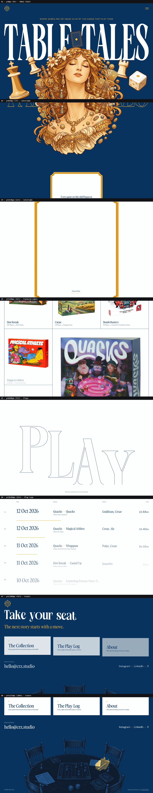
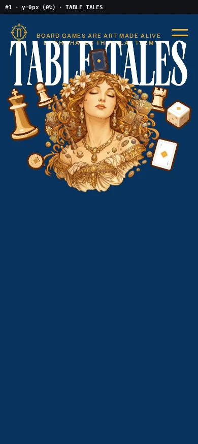

# UI Design System & Master Generation Blueprint: tabletales-crz-studio

> **Table Tales by CRZ.STUDIO · Board Game Collection & Play Log** (https://tabletales.crz.studio/) — Table Tales is a digital exhibition of board games as art: a curated collection and a living log of every night at the table. Designed an...





---

## 1. Executive Visual Persona & Design Archetype

- **Brand Essence & Persona**: **Table Tales by CRZ.STUDIO · Board Game Collection & Play Log** (`https://tabletales.crz.studio/`). Table Tales is a digital exhibition of board games as art: a curated collection and a living log of every night at the table. Designed an...
- **Capture Provenance**: Live browser capture (`tier1_fast`, HTTP `200`, captured `2026-11-24`).
- **Visual Archetype**: **Dark-Substrate WebGL / Canvas Interactive Experience (`#08335d` / `#0000ff`)**.
- **Anti-AI-Slop Differentiators**:
  - **Live-Computed Chromatic Polarity**: Anchors the viewport in `#08335d` (live computed `body` `background-color` (`computed_styles.json`)) paired with `#fdffff` primary typography and `#0000ff` accents.
  - **Grounded Typographic Hierarchy**: Pairs `glowfor` for display copy (`TABLE TALES`) with `grotesk`.
  - **Calibrated Spatial Grid & Motion**: Combines `1360px` container bounds (`gap: 24px`, padding `40.032px`) with `cubic-bezier(.16,1,.3,1)` easing and Lenis Smooth Scroll (`data-lenis`), Three.js / WebGL Canvas Pipeline.

---

## 2. Spatial Architecture & Modular Grid Mathematics

### Viewport Allocation & Container Geometry
- **Captured Journey Filmstrips**: Desktop `1280×6624px` (`assets/desktop-journey.webp`, `8` keyframes up to `y=12258px` / doc `13158px`), Mobile `390×872px` (`assets/mobile-journey.webp`, `1` keyframes).
- **Master Container Bounds**: `1360px` (measured widest bounded `<section>` landmark width on `1440px` desktop).
- **Canvas Lateral Padding & Spacing**: `40.032px` lateral canvas padding with `24px` grid gap.
- **Border Radius Scale**: `2px`, `1px`, `50%`.

### Responsive Breakpoint Architecture
- **Desktop Layout**: Multi-column CSS Grid / Flexbox layout at `1440px` (`max-width: 1360px`, `gap: 24px`).
- **Mobile Layout**: Single-column vertical stack at `390px` viewport width with `40.032px` horizontal padding.
- **Extracted CSS Media Queries**: `@media (max-width:1200px)`, `@media (max-width:900px)`, `@media (max-width:560px)`, `@media (max-height:700px) and (min-width:901px)`.

---

## 3. Color System, Materiality & Atmospheric Lighting

### Semantic Palette & Source Grounding
| Semantic Role | Ground-Truth Value | Extracted Live / CSS Source |
|---|---|---|
| **Primary Canvas Substrate** | `#08335d` | live computed `body` `background-color` (`computed_styles.json`) |
| **Primary Typography Ink** | `#fdffff` | live computed `h1` `color` (`computed_styles.json`) |
| **Elevated Surface / Card Substrate** | `#0000ff` | `.fCnJEG_loader { background: blue }` (`#0000ff`) |
| **Interactive Accent / Highlight** | `#0000ff` | `.AtWhqq_archiveLink { color: blue }` (`#0000ff`) |
| **Secondary / Muted Copy** | `#f7b538` | live computed `p` `color` (`computed_styles.json`) |
| **Structural Hairline Border** | `#0000ff` | `.J3CQ6a_ledger { border-top: #0000ff }` |
| **Variable Token (`--color-ochre`)** | `#c98f2e` | `var(--color-ochre)` in `:root` |
| **Variable Token (`--color-teal`)** | `#145a86` | `var(--color-teal)` in `:root` |
| **Variable Token (`--color-night`)** | `#010e1c` | `var(--color-night)` in `:root` |

### Sanitized Root CSS Variables (`ui-ux.md` Ground Truth)
| Variable Name | Extracted Value | Semantic Role |
|---|---|---|
| `--color-blue` | `#08335d` | Brand / Palette Token |
| `--color-golden` | `#f7b538` | Brand / Palette Token |
| `--color-azure` | `#fdffff` | Brand / Palette Token |
| `--color-ochre` | `#c98f2e` | Brand / Palette Token |
| `--color-teal` | `#145a86` | Brand / Palette Token |
| `--color-night` | `#010e1c` | Brand / Palette Token |
| `--color-line-on-light` | `color-mix(in srgb, var(--color-blue) 22%, transparent)` | Canvas / Surface Token |
| `--color-line-on-dark` | `color-mix(in srgb, var(--color-azure) 22%, transparent)` | Canvas / Surface Token |
| `--color-muted-on-light` | `color-mix(in srgb, var(--color-blue) 62%, transparent)` | Canvas / Surface Token |
| `--color-muted-on-dark` | `color-mix(in srgb, var(--color-azure) 62%, transparent)` | Canvas / Surface Token |
| `--section-padding-inline` | `clamp(20px, 2.78vw, 64px)` | Layout / Spatial Grid Token |
| `--section-padding-block` | `clamp(72px, 8.33vw, 160px)` | Layout / Spatial Grid Token |
| `--measure-padding` | `clamp(0px, 18vw, 420px)` | Layout / Spatial Grid Token |
| `--space-2xs` | `4px` | Layout / Spatial Grid Token |
| `--space-xs` | `8px` | Layout / Spatial Grid Token |
| `--space-s` | `clamp(12px, 1.11vw, 16px)` | Layout / Spatial Grid Token |

---

## 4. Typographic Scale & Editorial Hierarchy

### Font Family Stacks
- **Display Typography**: `glowfor`.
- **Primary Body Stack**: `grotesk`.
- **Technical / Metadata Stack**: not declared in live computed styles (uses primary stack / `ui-monospace`).

### Typographic Scale & Rules (Live Computed & Stylesheet Grounded)
- **Hero Display (`H1`)**: live computed `h1` (`font-size: 144px`, `line-height: 144px`, `font-weight: 400`); CSS variables `--font-display: "display", "display Fallback"`.
- **Section Heading (`H2`)**: live computed `h2` (`font-size: 219.837px`, `line-height: 197.853px`, `font-weight: 400`); rule `h2` (`font-size: clamp(56px,5.6vw,120px)`, `line-height: .92`, `letter-spacing: 0`, `font-weight: 400`).
- **Body Copy**: live computed `body` (`font-size: 16px`, `line-height: normal`, `font-weight: 400`); CSS variables `--text-body: clamp(16px, 1.25vw, 20px)`; rule `p` (`font-size: var(--text-body)`, `line-height: 1.35`).
- **Metadata & Navigation Labels**: live computed `nav/a` (`font-size: 16px`, `line-height: normal`, `font-weight: 400`); CSS variables `--text-label: clamp(12px, .9vw, 14px)`, `--text-small: clamp(14px, 1.04vw, 16px)`.

---

## 5. Choreographed Motion & Interaction Physics

### Primary Easing Curves
- **Extracted Timing Functions**: `cubic-bezier(.16,1,.3,1)`, `cubic-bezier(.76,0,.24,1)`.

### Per-Element Transition & Choreography Rules
- **Selector `._8wxUTq_closeButton`**: `transition: color var(--duration-fast) var(--ease-out)` extracted from `tabletales-crz-studio` stylesheet.
- **Selector `._8wxUTq_closeButton span:after`**: `transition: transform var(--duration-base) var(--ease-out)` extracted from `tabletales-crz-studio` stylesheet.
- **Selector `._8wxUTq_pagerArrow`**: `transition: transform var(--duration-base) var(--ease-out)` extracted from `tabletales-crz-studio` stylesheet.
- **Extracted Easing Curve (`cubic-bezier(.16,1,.3,1)`)**: Governs interactive state transitions across `<header.LYh_OG_variable>` and `<section.uxasZq_variable>`.
- **Runtime Interaction Engine**: Integrates Lenis Smooth Scroll (`data-lenis`), Three.js / WebGL Canvas Pipeline with `prefers-reduced-motion: reduce` fallback guards.
### Measured Runtime Scroll & Interaction Telemetry (`behavioral_journey_v2`)
- **Scroll Driver Mode**: `native` (max document height `13158px`, deepest scrollY reached `12258px` across `8` desktop keyframes).
- **Detected Scroll / Motion Libraries**: `Lenis`, `WebGL/Canvas`.
- **Interactive Control Probe (`accordion`)**: Tested `01 12 Oct 2026 QuacksQuacks Cesar...` (diff `3.314`).
- **Route Transition Architecture**: First internal navigation (`/collection`) measured as `direct` in `1295ms`.

---

## 6. Component Wireframe & Structural DOM Map

### Visual Layout Schematic — Desktop (`1440px`, Grounded in `dom.html` & Landmark Bounding Boxes)
```
┌────────────────────────────────────────────────────────────────────────┐
│ DESKTOP VIEWPORT (1440px) — Table Tales by CRZ.STUDIO · Board Game Col │
│ ====================================================================== │
│ [ <header.LYh_OG_variabl (1440x97px)  | Overview · Index · Archive · ] │
│ ---------------------------------------------------------------------- │
│ | HERO STAGE: <section.q_m67W_hero> (w=1440px)                       | │
│ | H1: TABLE TALES                                                    | │
│ | Substrate: #08335d | Ink: #fdffff | Accent: #0000ff                | │
│ ---------------------------------------------------------------------- │
│ | SHOWCASE GRID (<section.uxasZq_variable>) max-w: 1360px            | │
│ | +------------------------------+  +------------------------------+ | │
│ | | T a b l e T a l e s          |  | Featured Games               | | │
│ | +------------------------------+  +------------------------------+ | │
│ ---------------------------------------------------------------------- │
│ | DETAIL MODULE (<section.O43udq_featured>) — The play log           | │
│ ---------------------------------------------------------------------- │
│ [ FOOTER (<footer.tUdqrq_foote) | https://tabletales.crz.studio/       │
└────────────────────────────────────────────────────────────────────────┘
```

### Visual Layout Schematic — Mobile Reflow (`390px`)
```
┌────────────────────────────────────────────────────────────────────────┐
│ MOBILE VIEWPORT REFLOW (390px) — Single-Column Stack (gap: 24px)       │
│ ====================================================================== │
│ [ HEADER BAR (<header.LYh_OG_variable>) | Compact Menu (390px)         │
│ ---------------------------------------------------------------------- │
│ | HERO STAGE (<section.q_m67W_hero>) — 390px Vertical Lead           | │
│ | H1: TABLE TALES                                                    | │
│ ---------------------------------------------------------------------- │
│ | SHOWCASE STACK (<section.uxasZq_variab) — 1-Col Stack              | │
│ | [ Item 1: T a b l e T a l e s                                    ] | │
│ | [ Item 2: Featured Games                                         ] | │
│ ---------------------------------------------------------------------- │
│ | DETAIL STACK (<section.O43udq_featured) — 1-Col (The play log)     | │
│ ---------------------------------------------------------------------- │
│ [ FOOTER (<footer.tUdqrq_foote) | Stacked 390px Colophon               │
└────────────────────────────────────────────────────────────────────────┘
```

### Granular DOM Region Breakdown
1. **Brand Header & Navigation Bar (<header.LYh_OG_variable> — `tabletales-crz-studio`)**:
   - Landmark `<header class="LYh_OG_variable">` (`1440x97px`) hosting `Table Tales by CRZ.STUDIO · Board Ga` navigation (`Overview · Index · Archive · About · Contact`), DOM attributes (`data-precedence="next"`, `data-precedence="next"`, `data-precedence="next"`, `data-sdkn="@vercel/analytics/next"`), and stylesheet rule `.LYh_OG_className { font-family:grotesk,grotesk Fallback }`.
2. **Hero Stage & Focal Lead (<section.q_m67W_hero> — `TABLE TALES`)**:
   - Landmark `<section class="q_m67W_hero">` presenting display lead `TABLE TALES` and copy excerpt *"BOARD GAMES ARE ART MADE ALIVE BY THE HANDS THAT PLAY THEM"* over `#08335d` canvas and `#fdffff` ink.
3. **Primary Showcase & Content Grid (<section.uxasZq_variable> — `T a b l e T a l e s`)**:
   - Landmark `<section class="uxasZq_variable">` rendering section `T a b l e T a l e s` with copy *"Board games are art made alive by the hands that play them"*, asset references (`FoundersGrotesk_Bold-s.p.2z72oy2q...`, `FoundersGrotesk_BoldItalic-s.p.2h...`, `FoundersGrotesk_Light-s.p.03ydj7u...`, `FoundersGrotesk_LightItalic-s.p.2...`), and grid rule `.LYh_OG_variable { --font-grotesk:"grotesk", "grotesk Fallback" }`.
4. **Interactive Detail & Feature Matrix (<section.O43udq_featured> — `Featured Games`)**:
   - Landmark `<section class="O43udq_featured">` framing `Featured Games` and `The play log` (*"Every game on this shelf began as a picture someone wanted to wal"*) with `#0000ff` surface cards, `#0000ff` accents, and `.zL8RMq_className { font-family:display,display Fallback;font-style:normal;font-weight:400 }`.
5. **Colophon & Global Directory Footer (<footer.tUdqrq_footer> — `https://tabletales.crz.studio/`)**:
   - Landmark `<footer class="tUdqrq_footer">` anchoring `Table Tales by CRZ.STUDIO · Boar` footer links (`Overview · Index · Archive · About · Contact`), copy *"Chosen for the worlds they build and the stories they leave "*, and `#0000ff` structural dividers.
### Full Vertical Scroll Sequence (Desktop `1440×900` Keyframes)
- **Step 01** (`y=0px`, `0%`): Active landmark `TABLE TALES` · sticky/fixed elements: `3`
- **Step 02** (`y=850px`, `7%`): Active landmark `Interlude` · sticky/fixed elements: `3`
- **Step 03** (`y=2550px`, `21%`): Active landmark `Interlude` · sticky/fixed elements: `3`
- **Step 04** (`y=5100px`, `42%`): Active landmark `Featured Games` · sticky/fixed elements: `2`
- **Step 05** (`y=6800px`, `55%`): Active landmark `Plays` · sticky/fixed elements: `2`
- **Step 06** (`y=10200px`, `83%`): Active landmark `Play Logs` · sticky/fixed elements: `2`
- **Step 07** (`y=11900px`, `97%`): Active landmark `Footer` · sticky/fixed elements: `2`
- **Step 08** (`y=12258px`, `100%`): Active landmark `Footer` · sticky/fixed elements: `2`

### Multi-Page Internal Route Map
- **Listing Route (`/collection`)**: `https://tabletales.crz.studio/collection` — H1: `THE COLLECTION`, scrollHeight `5423px`, transition `direct` (`1295ms`)
- **Other Route (`/plays`)**: `https://tabletales.crz.studio/plays` — H1: `THE PLAY LOG`, scrollHeight `5610px`, transition `direct` (`2330ms`)

---

## 7. Master Zero-Shot AI Generation Prompt

```markdown
# Master Zero-Shot Frontend Generation Prompt: tabletales-crz-studio (Table Tales by CRZ.STUDIO · Board Game Collection & Play Log)

You are a principal frontend architect and design systems engineer. Build a complete, production-ready web application replicating the exact design system, DOM landmarks, typographic hierarchy, color tokens, and motion physics of `tabletales-crz-studio` (**Table Tales by CRZ.STUDIO · Board Game Collection & Play Log** — `https://tabletales.crz.studio/`).

### 1. Visual Archetype & Anti-AI-Slop Mandates
- **Archetype**: Dark-Substrate WebGL / Canvas Interactive Experience (`#08335d` / `#0000ff`).
- **Identity & Domain Context**: Table Tales is a digital exhibition of board games as art: a curated collection and a living log of every night at the table. Designed an...
- **Primary Substrate**: `#08335d` (live computed `body` `background-color` (`computed_styles.json`)), **Primary Ink**: `#fdffff`, **Accent / Highlight**: `#0000ff`.
- **Site-Specific Differentiators**:
  - **Live-Computed Chromatic Polarity**: Anchors the viewport in `#08335d` (live computed `body` `background-color` (`computed_styles.json`)) paired with `#fdffff` primary typography and `#0000ff` accents.
  - **Grounded Typographic Hierarchy**: Pairs `glowfor` for display copy (`TABLE TALES`) with `grotesk`.
  - **Calibrated Spatial Grid & Motion**: Combines `1360px` container bounds (`gap: 24px`, padding `40.032px`) with `cubic-bezier(.16,1,.3,1)` easing and Lenis Smooth Scroll (`data-lenis`), Three.js / WebGL Canvas Pipeline.

### 2. Ground-Truth CSS Variables (`:root` Token Contract)
Declare and consume these exact custom properties extracted from `tabletales-crz-studio` in your global stylesheet:

:root {
  /* Table Tales by CRZ.STUDIO · Board Game Collection & Play Log (tabletales-crz-studio) — Live-Grounded CSS Variables */
  --color-blue: #08335d; /* Brand / Palette Token (tabletales-crz-studio) */
  --color-golden: #f7b538; /* Brand / Palette Token (tabletales-crz-studio) */
  --color-azure: #fdffff; /* Brand / Palette Token (tabletales-crz-studio) */
  --color-ochre: #c98f2e; /* Brand / Palette Token (tabletales-crz-studio) */
  --color-teal: #145a86; /* Brand / Palette Token (tabletales-crz-studio) */
  --color-night: #010e1c; /* Brand / Palette Token (tabletales-crz-studio) */
  --color-line-on-light: color-mix(in srgb, var(--color-blue) 22%, transparent); /* Canvas / Surface Token (tabletales-crz-studio) */
  --color-line-on-dark: color-mix(in srgb, var(--color-azure) 22%, transparent); /* Canvas / Surface Token (tabletales-crz-studio) */
  --color-muted-on-light: color-mix(in srgb, var(--color-blue) 62%, transparent); /* Canvas / Surface Token (tabletales-crz-studio) */
  --color-muted-on-dark: color-mix(in srgb, var(--color-azure) 62%, transparent); /* Canvas / Surface Token (tabletales-crz-studio) */
  --section-padding-inline: clamp(20px, 2.78vw, 64px); /* Layout / Spatial Grid Token (tabletales-crz-studio) */
  --section-padding-block: clamp(72px, 8.33vw, 160px); /* Layout / Spatial Grid Token (tabletales-crz-studio) */
  --measure-padding: clamp(0px, 18vw, 420px); /* Layout / Spatial Grid Token (tabletales-crz-studio) */
  --space-2xs: 4px; /* Layout / Spatial Grid Token (tabletales-crz-studio) */
  --space-xs: 8px; /* Layout / Spatial Grid Token (tabletales-crz-studio) */
  --space-s: clamp(12px, 1.11vw, 16px); /* Layout / Spatial Grid Token (tabletales-crz-studio) */
}

### 3. Semantic Color & Materiality Contract
Map every surface, ink, and border strictly to these source-grounded tokens:
- **Primary Canvas Substrate**: `#08335d` — grounded in live computed `body` `background-color` (`computed_styles.json`)
- **Primary Typography Ink**: `#fdffff` — grounded in live computed `h1` `color` (`computed_styles.json`)
- **Elevated Surface / Card Substrate**: `#0000ff` — grounded in `.fCnJEG_loader { background: blue }` (`#0000ff`)
- **Interactive Accent / Highlight**: `#0000ff` — grounded in `.AtWhqq_archiveLink { color: blue }` (`#0000ff`)
- **Secondary / Muted Copy**: `#f7b538` — grounded in live computed `p` `color` (`computed_styles.json`)
- **Structural Hairline Border**: `#0000ff` — grounded in `.J3CQ6a_ledger { border-top: #0000ff }`
- **Variable Token (`--color-ochre`)**: `#c98f2e` — grounded in `var(--color-ochre)` in `:root`
- **Variable Token (`--color-teal`)**: `#145a86` — grounded in `var(--color-teal)` in `:root`
- **Variable Token (`--color-night`)**: `#010e1c` — grounded in `var(--color-night)` in `:root`

### 4. Spatial Grid, Container Bounds & Responsive Breakpoints
- **Desktop Viewport Reference**: `1280×6624px` (multi-frame vertical journey filmstrip (6624px), `1440px` standard desktop width).
- **Mobile Viewport Reference**: `390×872px` (full-page live capture (872px), `390px` standard mobile width).
- **Container Max-Width**: `1360px` (measured widest bounded `<section>` landmark width on `1440px` desktop)
- **Padding & Gutters**: `40.032px` lateral canvas padding with `24px` grid gap
- **Desktop Grid**: Multi-column CSS Grid / Flexbox layout at `1440px` (`max-width: 1360px`, `gap: 24px`)
- **Mobile Adaptation**: Single-column vertical stack at `390px` viewport width with `40.032px` horizontal padding
- **Media Queries**: `@media (max-width:1200px)`, `@media (max-width:900px)`, `@media (max-width:560px)`, `@media (max-height:700px) and (min-width:901px)`
- **Corner Radii**: `2px`, `1px`, `50%`

### 5. Typography & Editorial Scale Contract
- **Display Font Stack**: `glowfor`
- **Body Font Stack**: `grotesk`
- **Monospace / Technical Font Stack**: not declared in live computed styles (uses primary stack / `ui-monospace`)
- **H1 Display Rule**: live computed `h1` (`font-size: 144px`, `line-height: 144px`, `font-weight: 400`); CSS variables `--font-display: "display", "display Fallback"`
- **H2 Section Rule**: live computed `h2` (`font-size: 219.837px`, `line-height: 197.853px`, `font-weight: 400`); rule `h2` (`font-size: clamp(56px,5.6vw,120px)`, `line-height: .92`, `letter-spacing: 0`, `font-weight: 400`)
- **Body Copy Rule**: live computed `body` (`font-size: 16px`, `line-height: normal`, `font-weight: 400`); CSS variables `--text-body: clamp(16px, 1.25vw, 20px)`; rule `p` (`font-size: var(--text-body)`, `line-height: 1.35`)
- **Metadata & Index Rule**: live computed `nav/a` (`font-size: 16px`, `line-height: normal`, `font-weight: 400`); CSS variables `--text-label: clamp(12px, .9vw, 14px)`, `--text-small: clamp(14px, 1.04vw, 16px)`

### 6. Component Hierarchy, Verbatim Copy & Real DOM Landmarks
Scaffold `tabletales-crz-studio` (`Table Tales by CRZ.STUDIO · Board Game Collection & Play Log`) with these exact structural regions, extracted copy, and CSS rules from `dom.html`:
1. **Brand Header & Navigation Bar (<header.LYh_OG_variable> — `tabletales-crz-studio`)**:
   - DOM & Selectors: Landmark `<header class="LYh_OG_variable">` (`1440x97px`) hosting `Table Tales by CRZ.STUDIO · Board Ga` navigation (`Overview · Index · Archive · About · Contact`), DOM attributes (`data-precedence="next"`, `data-precedence="next"`, `data-precedence="next"`, `data-sdkn="@vercel/analytics/next"`), and stylesheet rule `.LYh_OG_className { font-family:grotesk,grotesk Fallback }`.
   - Responsive Contract: Header `Brand Header & Navigation Bar (<header.LYh_OG_variable> — `tabletales-crz-studio`)` (`tabletales-crz-studio`) adapts across `@media (max-width:1200px)`, `@media (max-width:900px)`, `@media (max-width:560px)`, `@media (max-height:700px) and (min-width:901px)` with `cubic-bezier(.16,1,.3,1)`, `cubic-bezier(.76,0,.24,1)` transitions and links `Overview · Index · Archive · About · Contact`.
2. **Hero Stage & Focal Lead (<section.q_m67W_hero> — `TABLE TALES`)**:
   - DOM & Selectors: Landmark `<section class="q_m67W_hero">` presenting display lead `TABLE TALES` and copy excerpt *"BOARD GAMES ARE ART MADE ALIVE BY THE HANDS THAT PLAY THEM"* over `#08335d` canvas and `#fdffff` ink.
   - Responsive Contract: Hero stage (`1280×6624px` desktop / `390×872px` mobile) sets `#08335d` background with `#fdffff` headline `TABLE TALES`.
3. **Primary Showcase & Content Grid (<section.uxasZq_variable> — `T a b l e T a l e s`)**:
   - DOM & Selectors: Landmark `<section class="uxasZq_variable">` rendering section `T a b l e T a l e s` with copy *"Board games are art made alive by the hands that play them"*, asset references (`FoundersGrotesk_Bold-s.p.2z72oy2q...`, `FoundersGrotesk_BoldItalic-s.p.2h...`, `FoundersGrotesk_Light-s.p.03ydj7u...`, `FoundersGrotesk_LightItalic-s.p.2...`), and grid rule `.LYh_OG_variable { --font-grotesk:"grotesk", "grotesk Fallback" }`.
   - Responsive Contract: Showcase grid `Primary Showcase & Content Grid (<section.uxasZq_variable> — `T a b l e T a l e s`)` applies Multi-column CSS Grid / Flexbox layout at `1440px` (`max-width: 1360px`, `gap: 24px`) on desktop and Single-column vertical stack at `390px` viewport width with `40.032px` horizontal padding on mobile.
4. **Interactive Detail & Feature Matrix (<section.O43udq_featured> — `Featured Games`)**:
   - DOM & Selectors: Landmark `<section class="O43udq_featured">` framing `Featured Games` and `The play log` (*"Every game on this shelf began as a picture someone wanted to wal"*) with `#0000ff` surface cards, `#0000ff` accents, and `.zL8RMq_className { font-family:display,display Fallback;font-style:normal;font-weight:400 }`.
   - Responsive Contract: Detail module `Interactive Detail & Feature Matrix (<section.O43udq_featured> — `Featured Games`)` uses `2px`, `1px`, `50%` radii, `#0000ff` highlights, and assets (FoundersGrotesk_Bold-s.p.2z72oy2q..., FoundersGrotesk_BoldItalic-s.p.2h..., FoundersGrotesk_Light-s.p.03ydj7u...).
5. **Colophon & Global Directory Footer (<footer.tUdqrq_footer> — `https://tabletales.crz.studio/`)**:
   - DOM & Selectors: Landmark `<footer class="tUdqrq_footer">` anchoring `Table Tales by CRZ.STUDIO · Boar` footer links (`Overview · Index · Archive · About · Contact`), copy *"Chosen for the worlds they build and the stories they leave "*, and `#0000ff` structural dividers.
   - Responsive Contract: Footer `Colophon & Global Directory Footer (<footer.tUdqrq_footer> — `https://tabletales.crz.studio/`)` aligns to `1360px` (measured widest bounded `<section>` landmark width on `1440px` desktop) with `40.032px` lateral canvas padding with `24px` grid gap and attributes (data-precedence="next", data-precedence="next", data-precedence="next").

#### Verbatim DOM Copy Excerpts (`dom.html`)
- Copy Excerpt 1: *"BOARD GAMES ARE ART MADE ALIVE BY THE HANDS THAT PLAY THEM"*
- Copy Excerpt 2: *"Board games are art made alive by the hands that play them"*
- Copy Excerpt 3: *"Every game on this shelf began as a picture someone wanted to walk into: a map, a..."*
- Copy Excerpt 4: *"Chosen for the worlds they build and the stories they leave behind."*

### 7. Motion, Extracted Stylesheet Rules & Interaction Choreography
- **Primary Easing Functions**: `cubic-bezier(.16,1,.3,1)`, `cubic-bezier(.76,0,.24,1)`
- **Extracted Stylesheet Rules (`tabletales-crz-studio`)**:
- `.LYh_OG_className { font-family:grotesk,grotesk Fallback }`
- `.LYh_OG_variable { --font-grotesk:"grotesk", "grotesk Fallback" }`
- `.zL8RMq_className { font-family:display,display Fallback;font-style:normal;font-weight:400 }`
- `.zL8RMq_variable { --font-display:"display", "display Fallback" }`
- `.uxasZq_className { font-family:glowfor,glowfor Fallback;font-style:normal;font-weight:400 }`
- **Per-Selector Transition Rules**:
- **Selector `._8wxUTq_closeButton`**: `transition: color var(--duration-fast) var(--ease-out)` extracted from `tabletales-crz-studio` stylesheet.
- **Selector `._8wxUTq_closeButton span:after`**: `transition: transform var(--duration-base) var(--ease-out)` extracted from `tabletales-crz-studio` stylesheet.
- **Selector `._8wxUTq_pagerArrow`**: `transition: transform var(--duration-base) var(--ease-out)` extracted from `tabletales-crz-studio` stylesheet.
- **Extracted Easing Curve (`cubic-bezier(.16,1,.3,1)`)**: Governs interactive state transitions across `<header.LYh_OG_variable>` and `<section.uxasZq_variable>`.
- **Runtime Interaction Engine**: Integrates Lenis Smooth Scroll (`data-lenis`), Three.js / WebGL Canvas Pipeline with `prefers-reduced-motion: reduce` fallback guards.
### 7b. Full-Page Scroll Choreography, Interactive States & Multi-Page Routes
- **Scroll Mechanics**: Implement `native` vertical progression up to `13158px` across 8 distinct viewport chapters using Lenis, WebGL/Canvas.
- **Vertical Chapter Sequence**: TABLE TALES (0%) -> Interlude (7%) -> Interlude (21%) -> Featured Games (42%) -> Plays (55%) -> Play Logs (83%) -> Footer (97%) -> Footer (100%).
- **Multi-Page Routes**: Scaffold internal routes `/collection` (listing, direct), `/plays` (other, direct) sharing the global header/footer shell and design tokens.

### 8. Technical Deliverables
- Implement in Next.js (App Router) with TypeScript and Tailwind CSS consuming the `:root` custom properties defined above for `tabletales-crz-studio`.
- Reproduce both the `1440px` desktop architecture and `390px` mobile breakpoint transitions, preserving semantic HTML5 landmarks (`<header>`, `<nav>`, `<main>`, `<section>`, `<footer>`) and `prefers-reduced-motion` accessibility guards.
```
---

## 8. Full-Page Scroll Journey, Interactive States & Subpage Inventory

### Desktop Scroll Keyframes (`1440×900` WebP)
| Step | Scroll Y | Progress | Active Landmark / Section | Sticky/Fixed | Visual Asset |
| :---: | :---: | :---: | :--- | :---: | :--- |
| `#01` | `0px` | `0%` | TABLE TALES | `3` | [desktop-step-01.webp](assets/desktop-step-01.webp) |
| `#02` | `850px` | `7%` | Interlude | `3` | [desktop-step-02.webp](assets/desktop-step-02.webp) |
| `#03` | `2550px` | `21%` | Interlude | `3` | [desktop-step-03.webp](assets/desktop-step-03.webp) |
| `#04` | `5100px` | `42%` | Featured Games | `2` | [desktop-step-04.webp](assets/desktop-step-04.webp) |
| `#05` | `6800px` | `55%` | Plays | `2` | [desktop-step-05.webp](assets/desktop-step-05.webp) |
| `#06` | `10200px` | `83%` | Play Logs | `2` | [desktop-step-06.webp](assets/desktop-step-06.webp) |
| `#07` | `11900px` | `97%` | Footer | `2` | [desktop-step-07.webp](assets/desktop-step-07.webp) |
| `#08` | `12258px` | `100%` | Footer | `2` | [desktop-step-08.webp](assets/desktop-step-08.webp) |

### Mobile Condensed Keyframes (`390×844` WebP)
| Step | Scroll Y | Progress | Active Landmark | Visual Asset |
| :---: | :---: | :---: | :--- | :--- |
| `#01` | `0px` | `0%` | TABLE TALES | [mobile-step-01.webp](assets/mobile-step-01.webp) |

### Internal Subpage Filmstrips (`1080px` Wide WebP)
| # | Template | Route URL | H1 / Title | Scroll Height | Transition | Filmstrip Asset |
| :-: | :---: | :--- | :--- | :---: | :---: | :--- |
| `1` | `listing` | `https://tabletales.crz.studio/collection` | THE COLLECTION | `5423px` | `direct` (`1295ms`) | [subpage-01-collection.webp](assets/subpage-01-collection.webp) |
| `3` | `other` | `https://tabletales.crz.studio/plays` | THE PLAY LOG | `5610px` | `direct` (`2330ms`) | [subpage-03-plays.webp](assets/subpage-03-plays.webp) |

