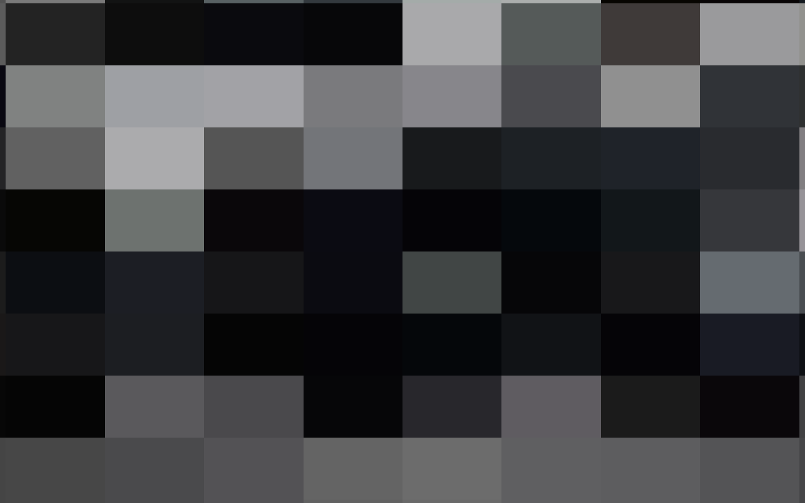
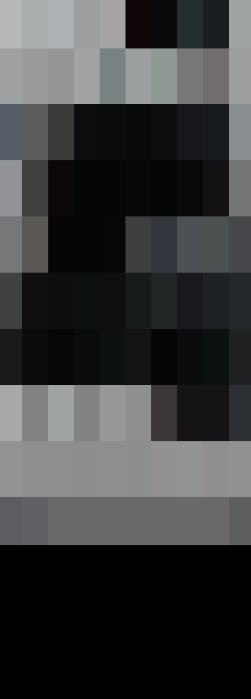

# UI Design System & Master Generation Blueprint: tamasolajos-com

> **Tamás Olajos — AI Filmmaker & Director · London & Budapest** (https://tamasolajos.com/) — Tamás Olajos is an award-winning AI filmmaker and director, Runway and Dreamina Creative Partner. Cinematic commercial campaigns and expe...



---

## 1. Executive Visual Persona & Design Archetype

- **Brand Essence & Persona**: **Tamás Olajos — AI Filmmaker & Director · London & Budapest** (`https://tamasolajos.com/`). Tamás Olajos is an award-winning AI filmmaker and director, Runway and Dreamina Creative Partner. Cinematic commercial campaigns and expe...
- **Capture Provenance**: Live browser capture (`tier1_fast`, HTTP `200`, captured `2026-11-23`).
- **Visual Archetype**: **Dark-Substrate WebGL / Canvas Interactive Experience (`#000000` / `#ffffff`)**.
- **Anti-AI-Slop Differentiators**:
  - **Live-Computed Chromatic Polarity**: Anchors the viewport in `#000000` (live computed `html` `background-color` (`computed_styles.json`)) paired with `#ffffff` primary typography and `#ffffff` accents.
  - **Grounded Typographic Hierarchy**: Pairs `system-ui, -apple-system, sans-serif` (live computed system stack) for display copy (`Tamás Olajos — AI Filmmaker & Direct`) with `system-ui, -apple-system, sans-serif` (live computed system stack) and not declared in live computed styles (uses primary stack / `ui-monospace`).
  - **Calibrated Spatial Grid & Motion**: Combines `1440px` container bounds (`gap: 0px (flush layout)`, padding `1rem`) with `cubic-bezier(0.25,0.1,0.25,1)` easing and Three.js / WebGL Canvas Pipeline.

---

## 2. Spatial Architecture & Modular Grid Mathematics



### Viewport Allocation & Container Geometry
- **Captured Viewport Dimensions**: Desktop `1440×900px` (`assets/desktop.png`, single-viewport 100vh live capture (900px)), Mobile `390×1082px` (`assets/mobile.png`, full-page live capture (1082px)).
- **Master Container Bounds**: `1440px` (full-bleed `100%` viewport stage).
- **Canvas Lateral Padding & Spacing**: `1rem` lateral canvas padding with `0px (flush layout)` grid gap.
- **Border Radius Scale**: `4rem`.

### Responsive Breakpoint Architecture
- **Desktop Layout**: Multi-column CSS Grid / Flexbox layout at `1440px` (`max-width: 1440px`, `gap: 0px (flush layout)`).
- **Mobile Layout**: Single-column vertical stack at `390px` viewport width with `1rem` horizontal padding.
- **Extracted CSS Media Queries**: no `@media` queries in captured stylesheet (fluid viewport scaling).

---

## 3. Color System, Materiality & Atmospheric Lighting

### Semantic Palette & Source Grounding
| Semantic Role | Ground-Truth Value | Extracted Live / CSS Source |
|---|---|---|
| **Primary Canvas Substrate** | `#000000` | live computed `html` `background-color` (`computed_styles.json`) |
| **Primary Typography Ink** | `#ffffff` | `body` default contrast ink (`#ffffff`) |
| **Elevated Surface / Card Substrate** | `#000000` | transparent/inherited card surface over live computed `html` `background-color` (`computed_styles.json`) |
| **Interactive Accent / Highlight** | `#ffffff` | `body` default contrast ink (`#ffffff`) |
| **Secondary / Muted Copy** | `#ffffff` | secondary opacity step of `body` default contrast ink (`#ffffff`) |
| **Structural Hairline Border** | `#ffffff` | hairline divider derived from secondary opacity step of `body` default contrast ink (`#ffffff`) |

### Sanitized Root CSS Variables (`ui-ux.md` Ground Truth)
| Variable Name | Extracted Value | Semantic Role |
|---|---|---|
| `--inner-height` | `900px` | Layout / Spatial Grid Token |
| `--tamasolajos-com-bg` | `#000000` | Canvas Substrate (from live computed `html` `background-color` (`computed_styles.json`)) |
| `--tamasolajos-com-ink` | `#ffffff` | Primary Typography Ink (computed-derived) |
| `--tamasolajos-com-surface` | `#000000` | Surface Substrate (computed-derived) |
| `--tamasolajos-com-accent` | `#ffffff` | Interactive Accent (computed-derived) |
| `--tamasolajos-com-muted` | `#ffffff` | Secondary Ink (computed-derived) |
| `--tamasolajos-com-border` | `#ffffff` | Structural Border (computed-derived) |
| `--tamasolajos-com-container` | `1440px` | Container Bound (computed-derived) |
| `--tamasolajos-com-gap` | `0px` | Grid Gutter (computed-derived) |
| `--tamasolajos-com-pad` | `1rem` | Lateral Padding (computed-derived) |
| `--tamasolajos-com-ease` | `cubic-bezier(0.25,0.1,0.25,1)` | Primary Easing Function |
| `--tamasolajos-com-radius` | `4rem` | Corner Radius (computed-derived) |
| `--tamasolajos-com-fs-base` | `10px` | Observed Font Size Token |

---

## 4. Typographic Scale & Editorial Hierarchy

### Font Family Stacks
- **Display Typography**: `system-ui, -apple-system, sans-serif` (live computed system stack).
- **Primary Body Stack**: `system-ui, -apple-system, sans-serif` (live computed system stack).
- **Technical / Metadata Stack**: not declared in live computed styles (uses primary stack / `ui-monospace`).

### Typographic Scale & Rules (Live Computed & Stylesheet Grounded)
- **Hero Display (`H1`)**: observed font-size ladder: `10px`.
- **Section Heading (`H2`)**: observed font-size ladder: `10px`.
- **Body Copy**: live computed `body` (`font-size: 10px`, `line-height: normal`, `font-weight: 400`).
- **Metadata & Navigation Labels**: observed font-size ladder: `10px`.

---

## 5. Choreographed Motion & Interaction Physics

### Primary Easing Curves
- **Extracted Timing Functions**: `cubic-bezier(0.25,0.1,0.25,1)`.

### Per-Element Transition & Choreography Rules
- **Standard CSS Easing (`cubic-bezier(0.25,0.1,0.25,1)`)**: Default timing curve (no custom `cubic-bezier()` declared in captured CSS).
- **Runtime Interaction Engine**: Integrates Three.js / WebGL Canvas Pipeline with `prefers-reduced-motion: reduce` fallback guards.

---

## 6. Component Wireframe & Structural DOM Map

### Visual Layout Schematic — Desktop (`1440px`, Grounded in `dom.html` & Landmark Bounding Boxes)
```
┌────────────────────────────────────────────────────────────────────────┐
│ DESKTOP VIEWPORT (1440px) — Tamás Olajos — AI Filmmaker & Director · L │
│ ====================================================================== │
│ [ <header.webgl> (1440px)             | Overview · Index · Archive · ] │
│ ---------------------------------------------------------------------- │
│ | HERO STAGE: <div.webgl> (w=1440px)                                 | │
│ | H1: Tamás Olajos — AI Filmmaker & Director · London                | │
│ | Substrate: #000000 | Ink: #ffffff | Accent: #ffffff                | │
│ ---------------------------------------------------------------------- │
│ | SHOWCASE GRID (<div.webgl:nth(2)>) max-w: 1440px                   | │
│ | +------------------------------+  +------------------------------+ | │
│ | | Featured Work & Interactive  |  | Technical Architecture & Nar | | │
│ | +------------------------------+  +------------------------------+ | │
│ ---------------------------------------------------------------------- │
│ | DETAIL MODULE (<div.webgl:nth(3)>) — Global Directory & Co         | │
│ ---------------------------------------------------------------------- │
│ [ FOOTER (<footer>            ) | https://tamasolajos.com/             │
└────────────────────────────────────────────────────────────────────────┘
```

### Visual Layout Schematic — Mobile Reflow (`390px`)
```
┌────────────────────────────────────────────────────────────────────────┐
│ MOBILE VIEWPORT REFLOW (390px) — Single-Column Stack (gap: 0px (flu)   │
│ ====================================================================== │
│ [ HEADER BAR (<header.webgl>          ) | Compact Menu (390px)         │
│ ---------------------------------------------------------------------- │
│ | HERO STAGE (<div.webgl>) — 390px Vertical Lead                     | │
│ | H1: Tamás Olajos — AI Filmmaker & Director · London                | │
│ ---------------------------------------------------------------------- │
│ | SHOWCASE STACK (<div.webgl:nth(2)>) — 1-Col Stack                  | │
│ | [ Item 1: Featured Work & Interactive Showcase                   ] | │
│ | [ Item 2: Technical Architecture & Narrative                     ] | │
│ ---------------------------------------------------------------------- │
│ | DETAIL STACK (<div.webgl:nth(3)>) — 1-Col (Global Directory &)     | │
│ ---------------------------------------------------------------------- │
│ [ FOOTER (<footer>            ) | Stacked 390px Colophon               │
└────────────────────────────────────────────────────────────────────────┘
```

### Granular DOM Region Breakdown
1. **Brand Header & Navigation Bar (<header.webgl> — `tamasolajos-com`)**:
   - Landmark `<header class="webgl">` (`1440px`) hosting `Tamás Olajos — AI Filmmaker & Direct` navigation (`Overview · Index · Archive · About · Contact`), DOM attributes (`data-engine="three.js r181"`), and stylesheet rule `body { overscroll-behavior:none;touch-action:none;margin:0;padding:0;overflow:h... }`.
2. **Hero Stage & Focal Lead (<div.webgl> — `Tamás Olajos — AI Filmmaker & Dire`)**:
   - Landmark `<div class="webgl">` presenting display lead `Tamás Olajos — AI Filmmaker & Director · London ` and copy excerpt *"Tamás Olajos is an award-winning AI filmmaker and director, Runwa"* over `#000000` canvas and `#ffffff` ink.
3. **Primary Showcase & Content Grid (<div.webgl:nth(2)> — `Featured Work & Interactive Showca`)**:
   - Landmark `<div class="webgl">` rendering section `Featured Work & Interactive Showcase` with copy *"Tamás Olajos — AI Filmmaker & Director · London "*, asset references (`favicon.svg`, `index-BZCf80GG.js`, `index-DcXtDSRr.css`, `showreel_short.mp4`), and grid rule `html { background-color:000;font-size:10px }`.
4. **Interactive Detail & Feature Matrix (<div.webgl:nth(3)> — `Technical Architecture & Narrative`)**:
   - Landmark `<div class="webgl">` framing `Technical Architecture & Narrative` and `Global Directory & Contact` (*"Featured Work & Interactive Showcase"*) with `#000000` surface cards, `#ffffff` accents, and `.webgl { -webkit-user-select:none;user-select:none;width:100dvw;height:100dvh;pos... }`.
5. **Colophon & Global Directory Footer (<footer> — `https://tamasolajos.com/`)**:
   - Landmark `<footer>` landmark anchoring `Tamás Olajos — AI Filmmaker & Di` footer links (`Overview · Index · Archive · About · Contact`), copy *"Technical Architecture & Narrative"*, and `#ffffff` structural dividers.

---

## 7. Master Zero-Shot AI Generation Prompt

```markdown
# Master Zero-Shot Frontend Generation Prompt: tamasolajos-com (Tamás Olajos — AI Filmmaker & Director · London & Budapest)

You are a principal frontend architect and design systems engineer. Build a complete, production-ready web application replicating the exact design system, DOM landmarks, typographic hierarchy, color tokens, and motion physics of `tamasolajos-com` (**Tamás Olajos — AI Filmmaker & Director · London & Budapest** — `https://tamasolajos.com/`).

### 1. Visual Archetype & Anti-AI-Slop Mandates
- **Archetype**: Dark-Substrate WebGL / Canvas Interactive Experience (`#000000` / `#ffffff`).
- **Identity & Domain Context**: Tamás Olajos is an award-winning AI filmmaker and director, Runway and Dreamina Creative Partner. Cinematic commercial campaigns and expe...
- **Primary Substrate**: `#000000` (live computed `html` `background-color` (`computed_styles.json`)), **Primary Ink**: `#ffffff`, **Accent / Highlight**: `#ffffff`.
- **Site-Specific Differentiators**:
  - **Live-Computed Chromatic Polarity**: Anchors the viewport in `#000000` (live computed `html` `background-color` (`computed_styles.json`)) paired with `#ffffff` primary typography and `#ffffff` accents.
  - **Grounded Typographic Hierarchy**: Pairs `system-ui, -apple-system, sans-serif` (live computed system stack) for display copy (`Tamás Olajos — AI Filmmaker & Direct`) with `system-ui, -apple-system, sans-serif` (live computed system stack) and not declared in live computed styles (uses primary stack / `ui-monospace`).
  - **Calibrated Spatial Grid & Motion**: Combines `1440px` container bounds (`gap: 0px (flush layout)`, padding `1rem`) with `cubic-bezier(0.25,0.1,0.25,1)` easing and Three.js / WebGL Canvas Pipeline.

### 2. Ground-Truth CSS Variables (`:root` Token Contract)
Declare and consume these exact custom properties extracted from `tamasolajos-com` in your global stylesheet:

:root {
  /* Tamás Olajos — AI Filmmaker & Director · London & Budapest (tamasolajos-com) — Live-Grounded CSS Variables */
  --inner-height: 900px; /* Layout / Spatial Grid Token (tamasolajos-com) */
  --tamasolajos-com-bg: #000000; /* Canvas Substrate (from live computed `html` `background-color` (`computed_styles.json`)) (tamasolajos-com) */
  --tamasolajos-com-ink: #ffffff; /* Primary Typography Ink (computed-derived) (tamasolajos-com) */
  --tamasolajos-com-surface: #000000; /* Surface Substrate (computed-derived) (tamasolajos-com) */
  --tamasolajos-com-accent: #ffffff; /* Interactive Accent (computed-derived) (tamasolajos-com) */
  --tamasolajos-com-muted: #ffffff; /* Secondary Ink (computed-derived) (tamasolajos-com) */
  --tamasolajos-com-border: #ffffff; /* Structural Border (computed-derived) (tamasolajos-com) */
  --tamasolajos-com-container: 1440px; /* Container Bound (computed-derived) (tamasolajos-com) */
  --tamasolajos-com-gap: 0px; /* Grid Gutter (computed-derived) (tamasolajos-com) */
  --tamasolajos-com-pad: 1rem; /* Lateral Padding (computed-derived) (tamasolajos-com) */
  --tamasolajos-com-ease: cubic-bezier(0.25,0.1,0.25,1); /* Primary Easing Function (tamasolajos-com) */
  --tamasolajos-com-radius: 4rem; /* Corner Radius (computed-derived) (tamasolajos-com) */
  --tamasolajos-com-fs-base: 10px; /* Observed Font Size Token (tamasolajos-com) */
}

### 3. Semantic Color & Materiality Contract
Map every surface, ink, and border strictly to these source-grounded tokens:
- **Primary Canvas Substrate**: `#000000` — grounded in live computed `html` `background-color` (`computed_styles.json`)
- **Primary Typography Ink**: `#ffffff` — grounded in `body` default contrast ink (`#ffffff`)
- **Elevated Surface / Card Substrate**: `#000000` — grounded in transparent/inherited card surface over live computed `html` `background-color` (`computed_styles.json`)
- **Interactive Accent / Highlight**: `#ffffff` — grounded in `body` default contrast ink (`#ffffff`)
- **Secondary / Muted Copy**: `#ffffff` — grounded in secondary opacity step of `body` default contrast ink (`#ffffff`)
- **Structural Hairline Border**: `#ffffff` — grounded in hairline divider derived from secondary opacity step of `body` default contrast ink (`#ffffff`)

### 4. Spatial Grid, Container Bounds & Responsive Breakpoints
- **Desktop Viewport Reference**: `1440×900px` (single-viewport 100vh live capture (900px), `1440px` standard desktop width).
- **Mobile Viewport Reference**: `390×1082px` (full-page live capture (1082px), `390px` standard mobile width).
- **Container Max-Width**: `1440px` (full-bleed `100%` viewport stage)
- **Padding & Gutters**: `1rem` lateral canvas padding with `0px (flush layout)` grid gap
- **Desktop Grid**: Multi-column CSS Grid / Flexbox layout at `1440px` (`max-width: 1440px`, `gap: 0px (flush layout)`)
- **Mobile Adaptation**: Single-column vertical stack at `390px` viewport width with `1rem` horizontal padding
- **Media Queries**: no `@media` queries in captured stylesheet (fluid viewport scaling)
- **Corner Radii**: `4rem`

### 5. Typography & Editorial Scale Contract
- **Display Font Stack**: `system-ui, -apple-system, sans-serif` (live computed system stack)
- **Body Font Stack**: `system-ui, -apple-system, sans-serif` (live computed system stack)
- **Monospace / Technical Font Stack**: not declared in live computed styles (uses primary stack / `ui-monospace`)
- **H1 Display Rule**: observed font-size ladder: `10px`
- **H2 Section Rule**: observed font-size ladder: `10px`
- **Body Copy Rule**: live computed `body` (`font-size: 10px`, `line-height: normal`, `font-weight: 400`)
- **Metadata & Index Rule**: observed font-size ladder: `10px`

### 6. Component Hierarchy, Verbatim Copy & Real DOM Landmarks
Scaffold `tamasolajos-com` (`Tamás Olajos — AI Filmmaker & Director · London & Budapest`) with these exact structural regions, extracted copy, and CSS rules from `dom.html`:
1. **Brand Header & Navigation Bar (<header.webgl> — `tamasolajos-com`)**:
   - DOM & Selectors: Landmark `<header class="webgl">` (`1440px`) hosting `Tamás Olajos — AI Filmmaker & Direct` navigation (`Overview · Index · Archive · About · Contact`), DOM attributes (`data-engine="three.js r181"`), and stylesheet rule `body { overscroll-behavior:none;touch-action:none;margin:0;padding:0;overflow:h... }`.
   - Responsive Contract: Header `Brand Header & Navigation Bar (<header.webgl> — `tamasolajos-com`)` (`tamasolajos-com`) adapts across no `@media` queries in captured stylesheet (fluid viewport scaling) with `cubic-bezier(0.25,0.1,0.25,1)` transitions and links `Overview · Index · Archive · About · Contact`.
2. **Hero Stage & Focal Lead (<div.webgl> — `Tamás Olajos — AI Filmmaker & Dire`)**:
   - DOM & Selectors: Landmark `<div class="webgl">` presenting display lead `Tamás Olajos — AI Filmmaker & Director · London ` and copy excerpt *"Tamás Olajos is an award-winning AI filmmaker and director, Runwa"* over `#000000` canvas and `#ffffff` ink.
   - Responsive Contract: Hero stage (`1440×900px` desktop / `390×1082px` mobile) sets `#000000` background with `#ffffff` headline `Tamás Olajos — AI Filmmaker & Director · London `.
3. **Primary Showcase & Content Grid (<div.webgl:nth(2)> — `Featured Work & Interactive Showca`)**:
   - DOM & Selectors: Landmark `<div class="webgl">` rendering section `Featured Work & Interactive Showcase` with copy *"Tamás Olajos — AI Filmmaker & Director · London "*, asset references (`favicon.svg`, `index-BZCf80GG.js`, `index-DcXtDSRr.css`, `showreel_short.mp4`), and grid rule `html { background-color:000;font-size:10px }`.
   - Responsive Contract: Showcase grid `Primary Showcase & Content Grid (<div.webgl:nth(2)> — `Featured Work & Interactive Showca`)` applies Multi-column CSS Grid / Flexbox layout at `1440px` (`max-width: 1440px`, `gap: 0px (flush layout)`) on desktop and Single-column vertical stack at `390px` viewport width with `1rem` horizontal padding on mobile.
4. **Interactive Detail & Feature Matrix (<div.webgl:nth(3)> — `Technical Architecture & Narrative`)**:
   - DOM & Selectors: Landmark `<div class="webgl">` framing `Technical Architecture & Narrative` and `Global Directory & Contact` (*"Featured Work & Interactive Showcase"*) with `#000000` surface cards, `#ffffff` accents, and `.webgl { -webkit-user-select:none;user-select:none;width:100dvw;height:100dvh;pos... }`.
   - Responsive Contract: Detail module `Interactive Detail & Feature Matrix (<div.webgl:nth(3)> — `Technical Architecture & Narrative`)` uses `4rem` radii, `#ffffff` highlights, and assets (favicon.svg, index-BZCf80GG.js, index-DcXtDSRr.css).
5. **Colophon & Global Directory Footer (<footer> — `https://tamasolajos.com/`)**:
   - DOM & Selectors: Landmark `<footer>` landmark anchoring `Tamás Olajos — AI Filmmaker & Di` footer links (`Overview · Index · Archive · About · Contact`), copy *"Technical Architecture & Narrative"*, and `#ffffff` structural dividers.
   - Responsive Contract: Footer `Colophon & Global Directory Footer (<footer> — `https://tamasolajos.com/`)` aligns to `1440px` (full-bleed `100%` viewport stage) with `1rem` lateral canvas padding with `0px (flush layout)` grid gap and attributes (data-engine="three.js r181").

#### Verbatim DOM Copy Excerpts (`dom.html`)
- Lead Copy: *"Tamás Olajos is an award-winning AI filmmaker and director, Runway and Dreamina Creative Partner. Cinematic commercial campaigns and expe..."*

### 7. Motion, Extracted Stylesheet Rules & Interaction Choreography
- **Primary Easing Functions**: `cubic-bezier(0.25,0.1,0.25,1)`
- **Extracted Stylesheet Rules (`tamasolajos-com`)**:
- `body { overscroll-behavior:none;touch-action:none;margin:0;padding:0;overflow:h... }`
- `html { background-color:000;font-size:10px }`
- `.webgl { -webkit-user-select:none;user-select:none;width:100dvw;height:100dvh;pos... }`
- `.ui { justify-content:space-between;width:100%;padding:1rem;display:flex;posit... }`
- `.ui .button img { opacity:.8;width:100%;height:100%;padding:1rem }`
- **Per-Selector Transition Rules**:
- **Standard CSS Easing (`cubic-bezier(0.25,0.1,0.25,1)`)**: Default timing curve (no custom `cubic-bezier()` declared in captured CSS).
- **Runtime Interaction Engine**: Integrates Three.js / WebGL Canvas Pipeline with `prefers-reduced-motion: reduce` fallback guards.

### 8. Technical Deliverables
- Implement in Next.js (App Router) with TypeScript and Tailwind CSS consuming the `:root` custom properties defined above for `tamasolajos-com`.
- Reproduce both the `1440px` desktop architecture and `390px` mobile breakpoint transitions, preserving semantic HTML5 landmarks (`<header>`, `<nav>`, `<main>`, `<section>`, `<footer>`) and `prefers-reduced-motion` accessibility guards.
```
