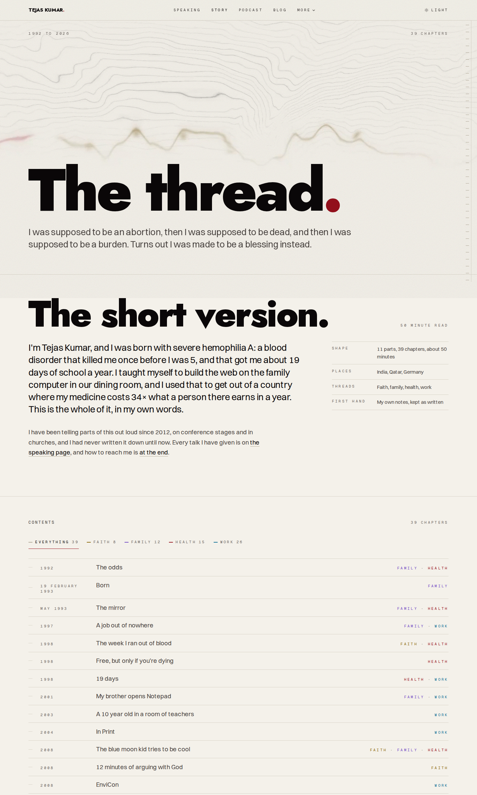
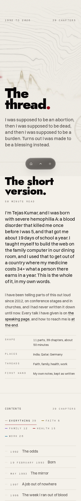

# UI Design System & Master Generation Blueprint: tej-as_story

> **The testimony and autobiography of Tejas Kumar** (https://tej.as/story) — Tejas Kumar died at 4 and was revived, got about 19 days of school a year, and is now an AI engineer at IBM. His full testimony, in 39 ch...



---

## 1. Executive Visual Persona & Design Archetype

- **Brand Essence & Persona**: **The testimony and autobiography of Tejas Kumar** (`https://tej.as/story`). Tejas Kumar died at 4 and was revived, got about 19 days of school a year, and is now an AI engineer at IBM. His full testimony, in 39 ch...
- **Capture Provenance**: Live browser capture (`tier1_fast`, HTTP `200`, captured `2026-11-23`).
- **Visual Archetype**: **Light-Gallery WebGL / Canvas Interactive Experience (`#f4f1ea` / `#1ed760`)**.
- **Anti-AI-Slop Differentiators**:
  - **Live-Computed Chromatic Polarity**: Anchors the viewport in `#f4f1ea` (live computed `body` `background-color` (`computed_styles.json`)) paired with `#0a0708` primary typography and `#1ed760` accents.
  - **Grounded Typographic Hierarchy**: Pairs `Jost` for display copy (`The thread.`) with `Switzer` and `Geist Mono`.
  - **Calibrated Spatial Grid & Motion**: Combines `1267px` container bounds (`gap: 24px`, padding `86.4px`) with `cubic-bezier(.4,0,.2,1)` easing and Three.js / WebGL Canvas Pipeline.

---

## 2. Spatial Architecture & Modular Grid Mathematics



### Viewport Allocation & Container Geometry
- **Captured Viewport Dimensions**: Desktop `1440×2400px` (`assets/desktop.png`, clamped at 2400px live multi-section capture), Mobile `390×2400px` (`assets/mobile.png`, clamped at 2400px live multi-section capture).
- **Master Container Bounds**: `1267px` (measured widest bounded `<section>` landmark width on `1440px` desktop).
- **Canvas Lateral Padding & Spacing**: `86.4px` lateral canvas padding with `24px` grid gap.
- **Border Radius Scale**: `.25rem`, `1rem`, `2px`, `var(--r-1)`.

### Responsive Breakpoint Architecture
- **Desktop Layout**: Multi-column CSS Grid / Flexbox layout at `1440px` (`max-width: 1267px`, `gap: 24px`).
- **Mobile Layout**: Single-column vertical stack at `390px` viewport width with `86.4px` horizontal padding.
- **Extracted CSS Media Queries**: `@media (width>=640px)`, `@media (width>=768px)`, `@media (width>=1024px)`, `@media (width>=1280px)`.

---

## 3. Color System, Materiality & Atmospheric Lighting

### Semantic Palette & Source Grounding
| Semantic Role | Ground-Truth Value | Extracted Live / CSS Source |
|---|---|---|
| **Primary Canvas Substrate** | `#f4f1ea` | live computed `body` `background-color` (`computed_styles.json`) |
| **Primary Typography Ink** | `#0a0708` | live computed `h1` `color` (`computed_styles.json`) |
| **Elevated Surface / Card Substrate** | `#e8e4da` | `var(--paper-2)` in `:root` |
| **Interactive Accent / Highlight** | `#1ed760` | `var(--brand-spotify)` in `:root` |
| **Secondary / Muted Copy** | `#4a4441` | live computed `p` `color` (`computed_styles.json`) |
| **Structural Hairline Border** | `#d8d3c7` | `var(--paper-rule)` in `:root` |
| **Variable Token (`--ink`)** | `#161012` | `var(--ink)` in `:root` |
| **Variable Token (`--rule-dark`)** | `#2a2426` | `var(--rule-dark)` in `:root` |
| **Variable Token (`--bone`)** | `#f2efe9` | `var(--bone)` in `:root` |
| **Variable Token (`--ash`)** | `#a39b98` | `var(--ash)` in `:root` |
| **Variable Token (`--ash-dim`)** | `#8c8481` | `var(--ash-dim)` in `:root` |
| **Variable Token (`--paper-dim`)** | `#6b6460` | `var(--paper-dim)` in `:root` |
| **Variable Token (`--paper-rule-lit`)** | `#b3aa99` | `var(--paper-rule-lit)` in `:root` |
| **Variable Token (`--red`)** | `#ef3340` | `var(--red)` in `:root` |
| **Variable Token (`--red-paper`)** | `#96101c` | `var(--red-paper)` in `:root` |

### Sanitized Root CSS Variables (`ui-ux.md` Ground Truth)
| Variable Name | Extracted Value | Semantic Role |
|---|---|---|
| `--void` | `#0a0708` | Color / Atmospheric Token |
| `--ink` | `#161012` | Typography Ink Token |
| `--rule-dark` | `#2a2426` | Canvas / Surface Token |
| `--rule-dark-lit` | `#4a4441` | Canvas / Surface Token |
| `--bone` | `#f2efe9` | Color / Atmospheric Token |
| `--ash` | `#a39b98` | Color / Atmospheric Token |
| `--ash-dim` | `#8c8481` | Color / Atmospheric Token |
| `--paper` | `#f4f1ea` | Canvas / Surface Token |
| `--paper-2` | `#e8e4da` | Canvas / Surface Token |
| `--paper-ink` | `#0a0708` | Canvas / Surface Token |
| `--paper-mid` | `#4a4441` | Canvas / Surface Token |
| `--paper-dim` | `#6b6460` | Canvas / Surface Token |
| `--paper-rule` | `#d8d3c7` | Canvas / Surface Token |
| `--paper-rule-lit` | `#b3aa99` | Canvas / Surface Token |
| `--red` | `#ef3340` | Color / Atmospheric Token |
| `--red-paper` | `#96101c` | Canvas / Surface Token |

---

## 4. Typographic Scale & Editorial Hierarchy

### Font Family Stacks
- **Display Typography**: `Jost`.
- **Primary Body Stack**: `Switzer`.
- **Technical / Metadata Stack**: `Geist Mono`.

### Typographic Scale & Rules (Live Computed & Stylesheet Grounded)
- **Hero Display (`H1`)**: live computed `h1` (`font-size: 180px`, `line-height: 144px`, `font-weight: 900`, `letter-spacing: -7.2px`); CSS variables `--font-display: "Jost", "Futura", "Century Gothic", "Trebuchet MS", system-ui, sans-serif`.
- **Section Heading (`H2`)**: live computed `h2` (`font-size: 109.44px`, `line-height: 94.1184px`, `font-weight: 900`, `letter-spacing: -3.50208px`).
- **Body Copy**: live computed `body` (`font-size: 18.72px`, `line-height: 30.3264px`, `font-weight: 400`); CSS variables `--font-body: "Switzer", "Helvetica Neue", Helvetica, Arial, system-ui, sans-serif`, `--t-body: clamp(1.125rem, 1.3vw, 1.3125rem)`, `--lh-body: 1.62`.
- **Metadata & Navigation Labels**: live computed `nav/a` (`font-size: 18.72px`, `line-height: 30.3264px`, `font-weight: 400`); CSS variables `--fg-label: color-mix(in srgb, var(--fg-2) 72%, var(--fg))`, `--font-mono: "Geist Mono", ui-monospace, SFMono-Regular, Menlo, Consolas, monospace`, `--t-small: clamp(.9375rem, 1vw, 1rem)`.

---

## 5. Choreographed Motion & Interaction Physics

### Primary Easing Curves
- **Extracted Timing Functions**: `cubic-bezier(.4,0,.2,1)`, `cubic-bezier(.22,1,.36,1)`.

### Per-Element Transition & Choreography Rules
- **Selector `.transition`**: `transition: .15s` extracted from `tej-as_story` stylesheet.
- **Selector `.transition-colors`**: `transition: .15s` extracted from `tej-as_story` stylesheet.
- **Selector `.transition-opacity`**: `transition: .15s` extracted from `tej-as_story` stylesheet.
- **Extracted Easing Curve (`cubic-bezier(.4,0,.2,1)`)**: Governs interactive state transitions across `<header.topbar>` and `<section.summary>`.
- **Runtime Interaction Engine**: Integrates Three.js / WebGL Canvas Pipeline with `prefers-reduced-motion: reduce` fallback guards.

---

## 6. Component Wireframe & Structural DOM Map

### Visual Layout Schematic — Desktop (`1440px`, Grounded in `dom.html` & Landmark Bounding Boxes)
```
┌────────────────────────────────────────────────────────────────────────┐
│ DESKTOP VIEWPORT (1440px) — The testimony and autobiography of Tejas K │
│ ====================================================================== │
│ [ <header.topbar> (1440x62px)         | Speaking · Story · Podcast · ] │
│ ---------------------------------------------------------------------- │
│ | HERO STAGE: <section.px-gutter> (w=1440px)                         | │
│ | H1: The thread.                                                    | │
│ | Substrate: #f4f1ea | Ink: #0a0708 | Accent: #1ed760                | │
│ ---------------------------------------------------------------------- │
│ | SHOWCASE GRID (<section.summary>) max-w: 1267px                    | │
│ | +------------------------------+  +------------------------------+ | │
│ | | The thread .                 |  | The short version.           | | │
│ | +------------------------------+  +------------------------------+ | │
│ ---------------------------------------------------------------------- │
│ | DETAIL MODULE (<section.border-hairline>) — A job out of nowhere   | │
│ ---------------------------------------------------------------------- │
│ [ FOOTER (<footer.border-hairl) | https://tej.as/story                 │
└────────────────────────────────────────────────────────────────────────┘
```

### Visual Layout Schematic — Mobile Reflow (`390px`)
```
┌────────────────────────────────────────────────────────────────────────┐
│ MOBILE VIEWPORT REFLOW (390px) — Single-Column Stack (gap: 24px)       │
│ ====================================================================== │
│ [ HEADER BAR (<header.topbar>         ) | Compact Menu (390px)         │
│ ---------------------------------------------------------------------- │
│ | HERO STAGE (<section.px-gutter>) — 390px Vertical Lead             | │
│ | H1: The thread.                                                    | │
│ ---------------------------------------------------------------------- │
│ | SHOWCASE STACK (<section.summary>) — 1-Col Stack                   | │
│ | [ Item 1: The thread .                                           ] | │
│ | [ Item 2: The short version.                                     ] | │
│ ---------------------------------------------------------------------- │
│ | DETAIL STACK (<section.border-hairline) — 1-Col (A job out of nowhe) │
│ ---------------------------------------------------------------------- │
│ [ FOOTER (<footer.border-hairl) | Stacked 390px Colophon               │
└────────────────────────────────────────────────────────────────────────┘
```

### Granular DOM Region Breakdown
1. **Brand Header & Navigation Bar (<header.topbar> — `tej-as_story`)**:
   - Landmark `<header class="topbar">` (`1440x62px`) hosting `The testimony and autobiography of T` navigation (`Speaking · Story · Podcast · Blog · Book Fluent React`), DOM attributes (`data-theme="light"`, `data-track="Nav Click"`, `data-track-label="Wordmark"`, `data-track-href="/"`), and stylesheet rule `after { box-sizing:border-box;border:0 solid e5e7eb }`.
2. **Hero Stage & Focal Lead (<section.px-gutter> — `The thread.`)**:
   - Landmark `<section class="px-gutter pb-l">` presenting display lead `The thread.` and copy excerpt *"I was supposed to be an abortion, then I was supposed to be dead,"* over `#f4f1ea` canvas and `#0a0708` ink.
3. **Primary Showcase & Content Grid (<section.summary> — `The thread .`)**:
   - Landmark `<section class="summary">` rendering section `The thread .` with copy *"19 February 1993 Born"*, asset references (`favicon.svg`, `story`, `array.js`, `jost-var.woff2`), and grid rule `body { line-height:inherit;margin:0 }`.
4. **Interactive Detail & Feature Matrix (<section.border-hairline> — `The short version.`)**:
   - Landmark `<section class="border-hairline px-gutter">` framing `The short version.` and `A job out of nowhere` (*"May 1993 The mirror"*) with `#e8e4da` surface cards, `#1ed760` accents, and `strong { font-weight:bolder }`.
5. **Colophon & Global Directory Footer (<footer.border-hairline> — `https://tej.as/story`)**:
   - Landmark `<footer class="border-hairline px-gutter">` anchoring `The testimony and autobiography ` footer links (`Speaking · Story · Podcast · Blog · Book Fluent React`), copy *"1997 A job out of nowhere"*, and `#d8d3c7` structural dividers.

---

## 7. Master Zero-Shot AI Generation Prompt

```markdown
# Master Zero-Shot Frontend Generation Prompt: tej-as_story (The testimony and autobiography of Tejas Kumar)

You are a principal frontend architect and design systems engineer. Build a complete, production-ready web application replicating the exact design system, DOM landmarks, typographic hierarchy, color tokens, and motion physics of `tej-as_story` (**The testimony and autobiography of Tejas Kumar** — `https://tej.as/story`).

### 1. Visual Archetype & Anti-AI-Slop Mandates
- **Archetype**: Light-Gallery WebGL / Canvas Interactive Experience (`#f4f1ea` / `#1ed760`).
- **Identity & Domain Context**: Tejas Kumar died at 4 and was revived, got about 19 days of school a year, and is now an AI engineer at IBM. His full testimony, in 39 ch...
- **Primary Substrate**: `#f4f1ea` (live computed `body` `background-color` (`computed_styles.json`)), **Primary Ink**: `#0a0708`, **Accent / Highlight**: `#1ed760`.
- **Site-Specific Differentiators**:
  - **Live-Computed Chromatic Polarity**: Anchors the viewport in `#f4f1ea` (live computed `body` `background-color` (`computed_styles.json`)) paired with `#0a0708` primary typography and `#1ed760` accents.
  - **Grounded Typographic Hierarchy**: Pairs `Jost` for display copy (`The thread.`) with `Switzer` and `Geist Mono`.
  - **Calibrated Spatial Grid & Motion**: Combines `1267px` container bounds (`gap: 24px`, padding `86.4px`) with `cubic-bezier(.4,0,.2,1)` easing and Three.js / WebGL Canvas Pipeline.

### 2. Ground-Truth CSS Variables (`:root` Token Contract)
Declare and consume these exact custom properties extracted from `tej-as_story` in your global stylesheet:

:root {
  /* The testimony and autobiography of Tejas Kumar (tej-as_story) — Live-Grounded CSS Variables */
  --void: #0a0708; /* Color / Atmospheric Token (tej-as_story) */
  --ink: #161012; /* Typography Ink Token (tej-as_story) */
  --rule-dark: #2a2426; /* Canvas / Surface Token (tej-as_story) */
  --rule-dark-lit: #4a4441; /* Canvas / Surface Token (tej-as_story) */
  --bone: #f2efe9; /* Color / Atmospheric Token (tej-as_story) */
  --ash: #a39b98; /* Color / Atmospheric Token (tej-as_story) */
  --ash-dim: #8c8481; /* Color / Atmospheric Token (tej-as_story) */
  --paper: #f4f1ea; /* Canvas / Surface Token (tej-as_story) */
  --paper-2: #e8e4da; /* Canvas / Surface Token (tej-as_story) */
  --paper-ink: #0a0708; /* Canvas / Surface Token (tej-as_story) */
  --paper-mid: #4a4441; /* Canvas / Surface Token (tej-as_story) */
  --paper-dim: #6b6460; /* Canvas / Surface Token (tej-as_story) */
  --paper-rule: #d8d3c7; /* Canvas / Surface Token (tej-as_story) */
  --paper-rule-lit: #b3aa99; /* Canvas / Surface Token (tej-as_story) */
  --red: #ef3340; /* Color / Atmospheric Token (tej-as_story) */
  --red-paper: #96101c; /* Canvas / Surface Token (tej-as_story) */
}

### 3. Semantic Color & Materiality Contract
Map every surface, ink, and border strictly to these source-grounded tokens:
- **Primary Canvas Substrate**: `#f4f1ea` — grounded in live computed `body` `background-color` (`computed_styles.json`)
- **Primary Typography Ink**: `#0a0708` — grounded in live computed `h1` `color` (`computed_styles.json`)
- **Elevated Surface / Card Substrate**: `#e8e4da` — grounded in `var(--paper-2)` in `:root`
- **Interactive Accent / Highlight**: `#1ed760` — grounded in `var(--brand-spotify)` in `:root`
- **Secondary / Muted Copy**: `#4a4441` — grounded in live computed `p` `color` (`computed_styles.json`)
- **Structural Hairline Border**: `#d8d3c7` — grounded in `var(--paper-rule)` in `:root`
- **Variable Token (`--ink`)**: `#161012` — grounded in `var(--ink)` in `:root`
- **Variable Token (`--rule-dark`)**: `#2a2426` — grounded in `var(--rule-dark)` in `:root`
- **Variable Token (`--bone`)**: `#f2efe9` — grounded in `var(--bone)` in `:root`
- **Variable Token (`--ash`)**: `#a39b98` — grounded in `var(--ash)` in `:root`
- **Variable Token (`--ash-dim`)**: `#8c8481` — grounded in `var(--ash-dim)` in `:root`
- **Variable Token (`--paper-dim`)**: `#6b6460` — grounded in `var(--paper-dim)` in `:root`
- **Variable Token (`--paper-rule-lit`)**: `#b3aa99` — grounded in `var(--paper-rule-lit)` in `:root`
- **Variable Token (`--red`)**: `#ef3340` — grounded in `var(--red)` in `:root`
- **Variable Token (`--red-paper`)**: `#96101c` — grounded in `var(--red-paper)` in `:root`

### 4. Spatial Grid, Container Bounds & Responsive Breakpoints
- **Desktop Viewport Reference**: `1440×2400px` (clamped at 2400px live multi-section capture, `1440px` standard desktop width).
- **Mobile Viewport Reference**: `390×2400px` (clamped at 2400px live multi-section capture, `390px` standard mobile width).
- **Container Max-Width**: `1267px` (measured widest bounded `<section>` landmark width on `1440px` desktop)
- **Padding & Gutters**: `86.4px` lateral canvas padding with `24px` grid gap
- **Desktop Grid**: Multi-column CSS Grid / Flexbox layout at `1440px` (`max-width: 1267px`, `gap: 24px`)
- **Mobile Adaptation**: Single-column vertical stack at `390px` viewport width with `86.4px` horizontal padding
- **Media Queries**: `@media (width>=640px)`, `@media (width>=768px)`, `@media (width>=1024px)`, `@media (width>=1280px)`
- **Corner Radii**: `.25rem`, `1rem`, `2px`, `var(--r-1)`

### 5. Typography & Editorial Scale Contract
- **Display Font Stack**: `Jost`
- **Body Font Stack**: `Switzer`
- **Monospace / Technical Font Stack**: `Geist Mono`
- **H1 Display Rule**: live computed `h1` (`font-size: 180px`, `line-height: 144px`, `font-weight: 900`, `letter-spacing: -7.2px`); CSS variables `--font-display: "Jost", "Futura", "Century Gothic", "Trebuchet MS", system-ui, sans-serif`
- **H2 Section Rule**: live computed `h2` (`font-size: 109.44px`, `line-height: 94.1184px`, `font-weight: 900`, `letter-spacing: -3.50208px`)
- **Body Copy Rule**: live computed `body` (`font-size: 18.72px`, `line-height: 30.3264px`, `font-weight: 400`); CSS variables `--font-body: "Switzer", "Helvetica Neue", Helvetica, Arial, system-ui, sans-serif`, `--t-body: clamp(1.125rem, 1.3vw, 1.3125rem)`, `--lh-body: 1.62`
- **Metadata & Index Rule**: live computed `nav/a` (`font-size: 18.72px`, `line-height: 30.3264px`, `font-weight: 400`); CSS variables `--fg-label: color-mix(in srgb, var(--fg-2) 72%, var(--fg))`, `--font-mono: "Geist Mono", ui-monospace, SFMono-Regular, Menlo, Consolas, monospace`, `--t-small: clamp(.9375rem, 1vw, 1rem)`

### 6. Component Hierarchy, Verbatim Copy & Real DOM Landmarks
Scaffold `tej-as_story` (`The testimony and autobiography of Tejas Kumar`) with these exact structural regions, extracted copy, and CSS rules from `dom.html`:
1. **Brand Header & Navigation Bar (<header.topbar> — `tej-as_story`)**:
   - DOM & Selectors: Landmark `<header class="topbar">` (`1440x62px`) hosting `The testimony and autobiography of T` navigation (`Speaking · Story · Podcast · Blog · Book Fluent React`), DOM attributes (`data-theme="light"`, `data-track="Nav Click"`, `data-track-label="Wordmark"`, `data-track-href="/"`), and stylesheet rule `after { box-sizing:border-box;border:0 solid e5e7eb }`.
   - Responsive Contract: Header `Brand Header & Navigation Bar (<header.topbar> — `tej-as_story`)` (`tej-as_story`) adapts across `@media (width>=640px)`, `@media (width>=768px)`, `@media (width>=1024px)`, `@media (width>=1280px)` with `cubic-bezier(.4,0,.2,1)`, `cubic-bezier(.22,1,.36,1)` transitions and links `Speaking · Story · Podcast · Blog · Book Fluent React`.
2. **Hero Stage & Focal Lead (<section.px-gutter> — `The thread.`)**:
   - DOM & Selectors: Landmark `<section class="px-gutter pb-l">` presenting display lead `The thread.` and copy excerpt *"I was supposed to be an abortion, then I was supposed to be dead,"* over `#f4f1ea` canvas and `#0a0708` ink.
   - Responsive Contract: Hero stage (`1440×2400px` desktop / `390×2400px` mobile) sets `#f4f1ea` background with `#0a0708` headline `The thread.`.
3. **Primary Showcase & Content Grid (<section.summary> — `The thread .`)**:
   - DOM & Selectors: Landmark `<section class="summary">` rendering section `The thread .` with copy *"19 February 1993 Born"*, asset references (`favicon.svg`, `story`, `array.js`, `jost-var.woff2`), and grid rule `body { line-height:inherit;margin:0 }`.
   - Responsive Contract: Showcase grid `Primary Showcase & Content Grid (<section.summary> — `The thread .`)` applies Multi-column CSS Grid / Flexbox layout at `1440px` (`max-width: 1267px`, `gap: 24px`) on desktop and Single-column vertical stack at `390px` viewport width with `86.4px` horizontal padding on mobile.
4. **Interactive Detail & Feature Matrix (<section.border-hairline> — `The short version.`)**:
   - DOM & Selectors: Landmark `<section class="border-hairline px-gutter">` framing `The short version.` and `A job out of nowhere` (*"May 1993 The mirror"*) with `#e8e4da` surface cards, `#1ed760` accents, and `strong { font-weight:bolder }`.
   - Responsive Contract: Detail module `Interactive Detail & Feature Matrix (<section.border-hairline> — `The short version.`)` uses `.25rem`, `1rem`, `2px`, `var(--r-1)` radii, `#1ed760` highlights, and assets (favicon.svg, story, array.js).
5. **Colophon & Global Directory Footer (<footer.border-hairline> — `https://tej.as/story`)**:
   - DOM & Selectors: Landmark `<footer class="border-hairline px-gutter">` anchoring `The testimony and autobiography ` footer links (`Speaking · Story · Podcast · Blog · Book Fluent React`), copy *"1997 A job out of nowhere"*, and `#d8d3c7` structural dividers.
   - Responsive Contract: Footer `Colophon & Global Directory Footer (<footer.border-hairline> — `https://tej.as/story`)` aligns to `1267px` (measured widest bounded `<section>` landmark width on `1440px` desktop) with `86.4px` lateral canvas padding with `24px` grid gap and attributes (data-theme="light", data-track="Nav Click", data-track-label="Wordmark").

#### Verbatim DOM Copy Excerpts (`dom.html`)
- Copy Excerpt 1: *"I was supposed to be an abortion, then I was supposed to be dead, and then I was s..."*
- Copy Excerpt 2: *"19 February 1993 Born"*
- Copy Excerpt 3: *"May 1993 The mirror"*
- Copy Excerpt 4: *"1997 A job out of nowhere"*

### 7. Motion, Extracted Stylesheet Rules & Interaction Choreography
- **Primary Easing Functions**: `cubic-bezier(.4,0,.2,1)`, `cubic-bezier(.22,1,.36,1)`
- **Extracted Stylesheet Rules (`tej-as_story`)**:
- `after { box-sizing:border-box;border:0 solid e5e7eb }`
- `body { line-height:inherit;margin:0 }`
- `strong { font-weight:bolder }`
- `pre { font-family:var(--font-mono);font-feature-settings:normal;font-variation... }`
- `small { font-size:80% }`
- **Per-Selector Transition Rules**:
- **Selector `.transition`**: `transition: .15s` extracted from `tej-as_story` stylesheet.
- **Selector `.transition-colors`**: `transition: .15s` extracted from `tej-as_story` stylesheet.
- **Selector `.transition-opacity`**: `transition: .15s` extracted from `tej-as_story` stylesheet.
- **Extracted Easing Curve (`cubic-bezier(.4,0,.2,1)`)**: Governs interactive state transitions across `<header.topbar>` and `<section.summary>`.
- **Runtime Interaction Engine**: Integrates Three.js / WebGL Canvas Pipeline with `prefers-reduced-motion: reduce` fallback guards.

### 8. Technical Deliverables
- Implement in Next.js (App Router) with TypeScript and Tailwind CSS consuming the `:root` custom properties defined above for `tej-as_story`.
- Reproduce both the `1440px` desktop architecture and `390px` mobile breakpoint transitions, preserving semantic HTML5 landmarks (`<header>`, `<nav>`, `<main>`, `<section>`, `<footer>`) and `prefers-reduced-motion` accessibility guards.
```
