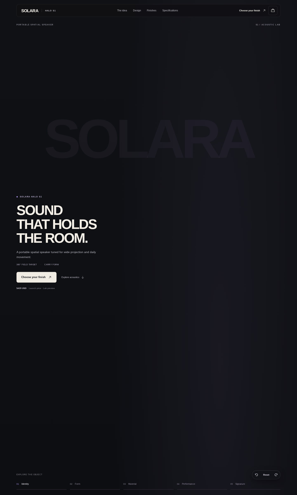
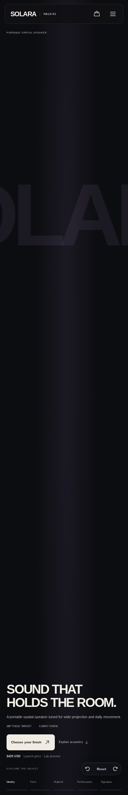

# UI Design System & Master Generation Blueprint: templates-preview-oxvo-app_t-oxvo-original-studio-max-commerce-3d-latest

> **SOLARA HALO S1 · Sound with presence.** (https://templates-preview.oxvo.app/t/oxvo-original-studio-max-commerce-3d/latest/#/) — Explore SOLARA HALO S1: a portable spatial speaker with a tactile acoustic shell. Choose a finish and try the local reservation preview.



---

## 1. Executive Visual Persona & Design Archetype

- **Brand Essence & Persona**: **SOLARA HALO S1 · Sound with presence.** (`https://templates-preview.oxvo.app/t/oxvo-original-studio-max-commerce-3d/latest/#/`). Explore SOLARA HALO S1: a portable spatial speaker with a tactile acoustic shell. Choose a finish and try the local reservation preview.
- **Visual Archetype**: **Dark-Substrate WebGL / Canvas Interactive Experience (`#0b0c0f` / `#f9f6ef`)**.
- **Anti-AI-Slop Differentiators**:
  - **Source-Grounded Chromatic Polarity**: Anchors the viewport in `#0b0c0f` (`var(--studio-ink)` in `:root`) paired with `#f9f6ef` primary typography and `#f9f6ef` accents.
  - **Extracted Typographic Hierarchy**: Pairs `Geist Variable` for display copy (`SOUND THAT HOLDS THE ROOM.`) with `Geist Fallback` and `SFMono-Regular`.
  - **Calibrated Spatial Grid & Motion**: Combines `520px` container bounds (`gap: 10px`, padding `14px`) with `cubic-bezier(0,0,.2,1)` easing and Three.js / WebGL Canvas Pipeline.

---

## 2. Spatial Architecture & Modular Grid Mathematics



### Viewport Allocation & Container Geometry
- **Captured Viewport Dimensions**: Desktop `1440×2400px` (`assets/desktop.png`, capped at 2400px multi-section capture), Mobile `390×2400px` (`assets/mobile.png`, capped at 2400px multi-section capture).
- **Master Container Bounds**: `520px` extracted from `templates-preview-oxvo-app_t-oxvo-original-studio-max-commerce-3d-latest` stylesheet.
- **Canvas Lateral Padding & Spacing**: `14px` lateral canvas padding with `10px` grid gap.
- **Border Radius Scale**: `.25rem`, `8px`, `50%`, `var(--radius-control)`.

### Responsive Breakpoint Architecture
- **Desktop Layout**: Multi-column CSS Grid / Flexbox layout at `1440px` (`max-width: 520px`, `gap: 10px`).
- **Mobile Layout**: Single-column vertical stack at `390px` viewport width with `14px` horizontal padding.
- **Extracted CSS Media Queries**: `@media (min-width:1600px)`, `@media (max-width:1100px)`, `@media (max-width:700px)`, `@media (max-width:390px)`.

---

## 3. Color System, Materiality & Atmospheric Lighting

### Semantic Palette & Source Grounding
| Semantic Role | Ground-Truth Value | Extracted CSS Source / Selector |
|---|---|---|
| **Primary Canvas Substrate** | `#0b0c0f` | `var(--studio-ink)` in `:root` |
| **Primary Typography Ink** | `#16171b` | `var(--studio-panel)` in `:root` |
| **Elevated Surface / Card Substrate** | `#f0ece4` | `var(--studio-paper)` in `:root` |
| **Interactive Accent / Highlight** | `#f9f6ef` | `var(--studio-white)` in `:root` |
| **Secondary / Muted Copy** | `#b2b1b8` | `var(--studio-muted)` in `:root` |
| **Structural Hairline Border** | `#b29af3` | `var(--studio-accent)` in `:root` |

### Sanitized Root CSS Variables (`ui-ux.md` Ground Truth)
| Variable Name | Extracted Value | Semantic Role |
|---|---|---|
| `--font-sans` | `"Geist Variable", "Geist Fallback", sans-serif` | Typography / Scale Token |
| `--spacing` | `.25rem` | Layout / Spatial Grid Token |
| `--ease-out` | `cubic-bezier(0, 0, .2, 1)` | Motion / Easing Token |
| `--default-transition-duration` | `.15s` | Motion / Easing Token |
| `--default-transition-timing-function` | `cubic-bezier(.4, 0, .2, 1)` | Motion / Easing Token |
| `--default-font-family` | `"Geist Variable", "Geist Fallback", sans-serif` | Typography / Scale Token |
| `--default-mono-font-family` | `var(--font-mono)` | Typography / Scale Token |
| `--background` | `oklch(100% 0 0)` | Canvas / Surface Token |
| `--foreground` | `oklch(14.5% 0 0)` | Typography Ink Token |
| `--card` | `oklch(100% 0 0)` | Color / Atmospheric Token |
| `--card-foreground` | `oklch(14.5% 0 0)` | Typography Ink Token |
| `--popover` | `oklch(100% 0 0)` | Color / Atmospheric Token |
| `--popover-foreground` | `oklch(14.5% 0 0)` | Typography Ink Token |
| `--primary` | `oklch(20.5% 0 0)` | Brand / Palette Token |
| `--primary-foreground` | `oklch(98.5% 0 0)` | Typography Ink Token |
| `--secondary` | `oklch(97% 0 0)` | Brand / Palette Token |

---

## 4. Typographic Scale & Editorial Hierarchy

### Font Family Stacks
- **Display Typography**: `Geist Variable`.
- **Primary Body Stack**: `Geist Fallback`.
- **Technical / Metadata Stack**: `SFMono-Regular`.

### Typographic Scale & Rules (Extracted from Stylesheet & Variables)
- **Hero Display (`H1`)**: not explicitly declared on tag in static CSS (stylesheet font-size ladder: `1em`, `80%`, `75%`, `10px`, `13px`).
- **Section Heading (`H2`)**: rule `h2` (`font-size: 23px`, `letter-spacing: -.04em`, `font-weight: 800`).
- **Body Copy**: rule `p` (`font-size: 11px`).
- **Metadata & Navigation Labels**: CSS variables `--default-mono-font-family: var(--font-mono)`, `--materials-caption-h: 57px`, `--materials-caption-gap: 12px`; rule `small` (`font-size: 10px`, `letter-spacing: .12em`, `font-weight: 600`).

---

## 5. Choreographed Motion & Interaction Physics

### Primary Easing Curves
- **Extracted Timing Functions**: `cubic-bezier(0,0,.2,1)`, `cubic-bezier(.4,0,.2,1)`, `cubic-bezier(.22,1,.36,1)`.

### Per-Element Transition & Choreography Rules
- **Selector `layer theme`**: `transition: .15s` extracted from `templates-preview-oxvo-app_t-oxvo-original-studio-max-commerce-3d-latest` stylesheet.
- **Selector `.transition`**: `transition: var(--tw-ease,var(--default-transition-timing-function))` extracted from `templates-preview-oxvo-app_t-oxvo-original-studio-max-commerce-3d-latest` stylesheet.
- **Selector `.commerce-button`**: `transition: transform .22s var(--ease-out),background-color .18s,border-co...` extracted from `templates-preview-oxvo-app_t-oxvo-original-studio-max-commerce-3d-latest` stylesheet.
- **Extracted Easing Curve (`cubic-bezier(0,0,.2,1)`)**: Governs interactive state transitions across `<header.site-header>` and `<section.content-band>`.
- **Runtime Interaction Engine**: Integrates Three.js / WebGL Canvas Pipeline with `prefers-reduced-motion: reduce` fallback guards.

---

## 6. Component Wireframe & Structural DOM Map

### Visual Layout Schematic (Grounded in `dom.html` — `1440px` Desktop & `390px` Mobile Reflow)
```
┌────────────────────────────────────────────────────────────────────────┐
│ DESKTOP VIEWPORT (1440px) — SOLARA HALO S1 · Sound with presence.      │
│ ====================================================================== │
│ [ <header.site-header>     | The idea · Design · Finishes · Specifi ]  │
│ ---------------------------------------------------------------------- │
│ | HERO STAGE: <section.immersive-hero>                             |   │
│ | H1: SOUND THAT HOLDS THE ROOM.                                   |   │
│ | Substrate: #0b0c0f    | Ink: #f9f6ef    | Accent: #f9f6ef        |   │
│ ---------------------------------------------------------------------- │
│ | SHOWCASE GRID (<section.content-band>    ) max-w: 520px          |   │
│ | +------------------------------+  +------------------------------+ | │
│ | | WRAPPED AROUND AIR.          |  | TACTILE BY DESIGN.           | | │
│ | +------------------------------+  +------------------------------+ | │
│ ---------------------------------------------------------------------- │
│ | MOBILE VIEWPORT REFLOW (390px) — Single-Column Stack (gap: 10px  ) | │
│ | [<header.site-heade] -> [<section.immersive] -> [<section.content-b] │
│ ---------------------------------------------------------------------- │
│ [ FOOTER (<footer.site-footer>  ) | https://templates-preview.oxvo.app │
└────────────────────────────────────────────────────────────────────────┘
```

### Granular DOM Region Breakdown
1. **Brand Header & Navigation Bar (<header.site-header> — `templates-preview-oxvo-app_t-oxvo-original-studio-max-commerce-3d-latest`)**:
   - Landmark `<header class="site-header">` hosting `SOLARA HALO S1 · Sound with presence` navigation (`The idea · Design · Finishes · Specifications`), DOM attributes (`data-first-load="done"`, `data-first-load-path="warm@3365"`, `data-oxvo-mounted-static-preview-router`, `data-product-runtime-ready="true"`), and stylesheet rule `backdrop { box-sizing:border-box;border:0 solid;margin:0;padding:0 }`.
2. **Hero Stage & Focal Lead (<section.immersive-hero> — `SOUND THAT HOLDS THE ROOM.`)**:
   - Landmark `<section class="immersive-hero">` presenting display lead `SOUND THAT HOLDS THE ROOM.` and copy excerpt *"Skip to main content"* over `#0b0c0f` canvas and `#f9f6ef` ink.
3. **Primary Showcase & Content Grid (<section.content-band> — `WRAPPED AROUND AIR.`)**:
   - Landmark `<section class="content-band promise-band">` rendering section `WRAPPED AROUND AIR.` with copy *"Choose your finish"*, asset references (`index-B571lmvU.js`, `index-CiVtvupN.css`, `geist-latin-wght-normal-Dm3htQBi....`, `PersistentProductCanvas-m78oPoe0.js`), and grid rule `file-selector-button { box-sizing:border-box;border:0 solid;margin:0;padding:0 }`.
4. **Interactive Detail & Feature Matrix (<article.persistent-product-canvas> — `TACTILE BY DESIGN.`)**:
   - Landmark `<article class="persistent-product-canvas">` framing `TACTILE BY DESIGN.` and `BUILT FOR THE SECOND ROOM.` (*"Portable spatial speaker"*) with `#f0ece4` surface cards, `#f9f6ef` accents, and `strong { font-weight:bolder }`.
5. **Colophon & Global Directory Footer (<footer.site-footer> — `https://templates-preview.oxvo.app/t/oxvo-original-studio-max-commerce-3d/latest/#/`)**:
   - Landmark `<footer class="site-footer">` anchoring `SOLARA HALO S1 · Sound with pres` footer links (`The idea · Design · Finishes · Specifications`), copy *"Preparing your experience"*, and `#b29af3` structural dividers.

---

## 7. Master Zero-Shot AI Generation Prompt

```markdown
# Master Zero-Shot Frontend Generation Prompt: templates-preview-oxvo-app_t-oxvo-original-studio-max-commerce-3d-latest (SOLARA HALO S1 · Sound with presence.)

You are a principal frontend architect and design systems engineer. Build a complete, production-ready web application replicating the exact design system, DOM landmarks, typographic hierarchy, color tokens, and motion physics of `templates-preview-oxvo-app_t-oxvo-original-studio-max-commerce-3d-latest` (**SOLARA HALO S1 · Sound with presence.** — `https://templates-preview.oxvo.app/t/oxvo-original-studio-max-commerce-3d/latest/#/`).

### 1. Visual Archetype & Anti-AI-Slop Mandates
- **Archetype**: Dark-Substrate WebGL / Canvas Interactive Experience (`#0b0c0f` / `#f9f6ef`).
- **Identity & Domain Context**: Explore SOLARA HALO S1: a portable spatial speaker with a tactile acoustic shell. Choose a finish and try the local reservation preview.
- **Primary Substrate**: `#0b0c0f` (`var(--studio-ink)` in `:root`), **Primary Ink**: `#f9f6ef`, **Accent / Highlight**: `#f9f6ef`.
- **Site-Specific Differentiators**:
  - **Source-Grounded Chromatic Polarity**: Anchors the viewport in `#0b0c0f` (`var(--studio-ink)` in `:root`) paired with `#f9f6ef` primary typography and `#f9f6ef` accents.
  - **Extracted Typographic Hierarchy**: Pairs `Geist Variable` for display copy (`SOUND THAT HOLDS THE ROOM.`) with `Geist Fallback` and `SFMono-Regular`.
  - **Calibrated Spatial Grid & Motion**: Combines `520px` container bounds (`gap: 10px`, padding `14px`) with `cubic-bezier(0,0,.2,1)` easing and Three.js / WebGL Canvas Pipeline.

### 2. Ground-Truth CSS Variables (`:root` Token Contract)
Declare and consume these exact custom properties extracted from `templates-preview-oxvo-app_t-oxvo-original-studio-max-commerce-3d-latest` in your global stylesheet:

:root {
  /* SOLARA HALO S1 · Sound with presence. (templates-preview-oxvo-app_t-oxvo-original-studio-max-commerce-3d-latest) — Ground-Truth Extracted CSS Variables */
  --font-sans: "Geist Variable", "Geist Fallback", sans-serif; /* Typography / Scale Token (templates-preview-oxvo-app_t-oxvo-original-studio-max-commerce-3d-latest) */
  --spacing: .25rem; /* Layout / Spatial Grid Token (templates-preview-oxvo-app_t-oxvo-original-studio-max-commerce-3d-latest) */
  --ease-out: cubic-bezier(0, 0, .2, 1); /* Motion / Easing Token (templates-preview-oxvo-app_t-oxvo-original-studio-max-commerce-3d-latest) */
  --default-transition-duration: .15s; /* Motion / Easing Token (templates-preview-oxvo-app_t-oxvo-original-studio-max-commerce-3d-latest) */
  --default-transition-timing-function: cubic-bezier(.4, 0, .2, 1); /* Motion / Easing Token (templates-preview-oxvo-app_t-oxvo-original-studio-max-commerce-3d-latest) */
  --default-font-family: "Geist Variable", "Geist Fallback", sans-serif; /* Typography / Scale Token (templates-preview-oxvo-app_t-oxvo-original-studio-max-commerce-3d-latest) */
  --default-mono-font-family: var(--font-mono); /* Typography / Scale Token (templates-preview-oxvo-app_t-oxvo-original-studio-max-commerce-3d-latest) */
  --background: oklch(100% 0 0); /* Canvas / Surface Token (templates-preview-oxvo-app_t-oxvo-original-studio-max-commerce-3d-latest) */
  --foreground: oklch(14.5% 0 0); /* Typography Ink Token (templates-preview-oxvo-app_t-oxvo-original-studio-max-commerce-3d-latest) */
  --card: oklch(100% 0 0); /* Color / Atmospheric Token (templates-preview-oxvo-app_t-oxvo-original-studio-max-commerce-3d-latest) */
  --card-foreground: oklch(14.5% 0 0); /* Typography Ink Token (templates-preview-oxvo-app_t-oxvo-original-studio-max-commerce-3d-latest) */
  --popover: oklch(100% 0 0); /* Color / Atmospheric Token (templates-preview-oxvo-app_t-oxvo-original-studio-max-commerce-3d-latest) */
  --popover-foreground: oklch(14.5% 0 0); /* Typography Ink Token (templates-preview-oxvo-app_t-oxvo-original-studio-max-commerce-3d-latest) */
  --primary: oklch(20.5% 0 0); /* Brand / Palette Token (templates-preview-oxvo-app_t-oxvo-original-studio-max-commerce-3d-latest) */
  --primary-foreground: oklch(98.5% 0 0); /* Typography Ink Token (templates-preview-oxvo-app_t-oxvo-original-studio-max-commerce-3d-latest) */
  --secondary: oklch(97% 0 0); /* Brand / Palette Token (templates-preview-oxvo-app_t-oxvo-original-studio-max-commerce-3d-latest) */
}

### 3. Semantic Color & Materiality Contract
Map every surface, ink, and border strictly to these source-grounded tokens:
- **Primary Canvas Substrate**: `#0b0c0f` — grounded in `var(--studio-ink)` in `:root`
- **Primary Typography Ink**: `#16171b` — grounded in `var(--studio-panel)` in `:root`
- **Elevated Surface / Card Substrate**: `#f0ece4` — grounded in `var(--studio-paper)` in `:root`
- **Interactive Accent / Highlight**: `#f9f6ef` — grounded in `var(--studio-white)` in `:root`
- **Secondary / Muted Copy**: `#b2b1b8` — grounded in `var(--studio-muted)` in `:root`
- **Structural Hairline Border**: `#b29af3` — grounded in `var(--studio-accent)` in `:root`

### 4. Spatial Grid, Container Bounds & Responsive Breakpoints
- **Desktop Viewport Reference**: `1440×2400px` (capped at 2400px multi-section capture, `1440px` standard desktop width).
- **Mobile Viewport Reference**: `390×2400px` (capped at 2400px multi-section capture, `390px` standard mobile width).
- **Container Max-Width**: `520px` extracted from `templates-preview-oxvo-app_t-oxvo-original-studio-max-commerce-3d-latest` stylesheet
- **Padding & Gutters**: `14px` lateral canvas padding with `10px` grid gap
- **Desktop Grid**: Multi-column CSS Grid / Flexbox layout at `1440px` (`max-width: 520px`, `gap: 10px`)
- **Mobile Adaptation**: Single-column vertical stack at `390px` viewport width with `14px` horizontal padding
- **Media Queries**: `@media (min-width:1600px)`, `@media (max-width:1100px)`, `@media (max-width:700px)`, `@media (max-width:390px)`
- **Corner Radii**: `.25rem`, `8px`, `50%`, `var(--radius-control)`

### 5. Typography & Editorial Scale Contract
- **Display Font Stack**: `Geist Variable`
- **Body Font Stack**: `Geist Fallback`
- **Monospace / Technical Font Stack**: `SFMono-Regular`
- **H1 Display Rule**: not explicitly declared on tag in static CSS (stylesheet font-size ladder: `1em`, `80%`, `75%`, `10px`, `13px`)
- **H2 Section Rule**: rule `h2` (`font-size: 23px`, `letter-spacing: -.04em`, `font-weight: 800`)
- **Body Copy Rule**: rule `p` (`font-size: 11px`)
- **Metadata & Index Rule**: CSS variables `--default-mono-font-family: var(--font-mono)`, `--materials-caption-h: 57px`, `--materials-caption-gap: 12px`; rule `small` (`font-size: 10px`, `letter-spacing: .12em`, `font-weight: 600`)

### 6. Component Hierarchy, Verbatim Copy & Real DOM Landmarks
Scaffold `templates-preview-oxvo-app_t-oxvo-original-studio-max-commerce-3d-latest` (`SOLARA HALO S1 · Sound with presence.`) with these exact structural regions, extracted copy, and CSS rules from `dom.html`:
1. **Brand Header & Navigation Bar (<header.site-header> — `templates-preview-oxvo-app_t-oxvo-original-studio-max-commerce-3d-latest`)**:
   - DOM & Selectors: Landmark `<header class="site-header">` hosting `SOLARA HALO S1 · Sound with presence` navigation (`The idea · Design · Finishes · Specifications`), DOM attributes (`data-first-load="done"`, `data-first-load-path="warm@3365"`, `data-oxvo-mounted-static-preview-router`, `data-product-runtime-ready="true"`), and stylesheet rule `backdrop { box-sizing:border-box;border:0 solid;margin:0;padding:0 }`.
   - Responsive Contract: Header `Brand Header & Navigation Bar (<header.site-header> — `templates-preview-oxvo-app_t-oxvo-original-studio-max-commerce-3d-latest`)` (`templates-preview-oxvo-app_t-oxvo-original-studio-max-commerce-3d-latest`) adapts across `@media (min-width:1600px)`, `@media (max-width:1100px)`, `@media (max-width:700px)`, `@media (max-width:390px)` with `cubic-bezier(0,0,.2,1)`, `cubic-bezier(.4,0,.2,1)`, `cubic-bezier(.22,1,.36,1)` transitions and links `The idea · Design · Finishes · Specifications`.
2. **Hero Stage & Focal Lead (<section.immersive-hero> — `SOUND THAT HOLDS THE ROOM.`)**:
   - DOM & Selectors: Landmark `<section class="immersive-hero">` presenting display lead `SOUND THAT HOLDS THE ROOM.` and copy excerpt *"Skip to main content"* over `#0b0c0f` canvas and `#f9f6ef` ink.
   - Responsive Contract: Hero stage (`1440×2400px` desktop / `390×2400px` mobile) sets `#0b0c0f` background with `#f9f6ef` headline `SOUND THAT HOLDS THE ROOM.`.
3. **Primary Showcase & Content Grid (<section.content-band> — `WRAPPED AROUND AIR.`)**:
   - DOM & Selectors: Landmark `<section class="content-band promise-band">` rendering section `WRAPPED AROUND AIR.` with copy *"Choose your finish"*, asset references (`index-B571lmvU.js`, `index-CiVtvupN.css`, `geist-latin-wght-normal-Dm3htQBi....`, `PersistentProductCanvas-m78oPoe0.js`), and grid rule `file-selector-button { box-sizing:border-box;border:0 solid;margin:0;padding:0 }`.
   - Responsive Contract: Showcase grid `Primary Showcase & Content Grid (<section.content-band> — `WRAPPED AROUND AIR.`)` applies Multi-column CSS Grid / Flexbox layout at `1440px` (`max-width: 520px`, `gap: 10px`) on desktop and Single-column vertical stack at `390px` viewport width with `14px` horizontal padding on mobile.
4. **Interactive Detail & Feature Matrix (<article.persistent-product-canvas> — `TACTILE BY DESIGN.`)**:
   - DOM & Selectors: Landmark `<article class="persistent-product-canvas">` framing `TACTILE BY DESIGN.` and `BUILT FOR THE SECOND ROOM.` (*"Portable spatial speaker"*) with `#f0ece4` surface cards, `#f9f6ef` accents, and `strong { font-weight:bolder }`.
   - Responsive Contract: Detail module `Interactive Detail & Feature Matrix (<article.persistent-product-canvas> — `TACTILE BY DESIGN.`)` uses `.25rem`, `8px`, `50%`, `var(--radius-control)` radii, `#f9f6ef` highlights, and assets (index-B571lmvU.js, index-CiVtvupN.css, geist-latin-wght-normal-Dm3htQBi....).
5. **Colophon & Global Directory Footer (<footer.site-footer> — `https://templates-preview.oxvo.app/t/oxvo-original-studio-max-commerce-3d/latest/#/`)**:
   - DOM & Selectors: Landmark `<footer class="site-footer">` anchoring `SOLARA HALO S1 · Sound with pres` footer links (`The idea · Design · Finishes · Specifications`), copy *"Preparing your experience"*, and `#b29af3` structural dividers.
   - Responsive Contract: Footer `Colophon & Global Directory Footer (<footer.site-footer> — `https://templates-preview.oxvo.app/t/oxvo-original-studio-max-commerce-3d/latest/#/`)` aligns to `520px` extracted from `templates-preview-oxvo-app_t-oxvo-original-studio-max-commerce-3d-latest` stylesheet with `14px` lateral canvas padding with `10px` grid gap and attributes (data-first-load="done", data-first-load-path="warm@3365", data-oxvo-mounted-static-preview-router).

#### Verbatim DOM Copy Excerpts (`dom.html`)
- Copy Excerpt 1: *"Skip to main content"*
- Copy Excerpt 2: *"Choose your finish"*
- Copy Excerpt 3: *"Portable spatial speaker"*
- Copy Excerpt 4: *"Preparing your experience"*

### 7. Motion, Extracted Stylesheet Rules & Interaction Choreography
- **Primary Easing Functions**: `cubic-bezier(0,0,.2,1)`, `cubic-bezier(.4,0,.2,1)`, `cubic-bezier(.22,1,.36,1)`
- **Extracted Stylesheet Rules (`templates-preview-oxvo-app_t-oxvo-original-studio-max-commerce-3d-latest`)**:
- `backdrop { box-sizing:border-box;border:0 solid;margin:0;padding:0 }`
- `file-selector-button { box-sizing:border-box;border:0 solid;margin:0;padding:0 }`
- `strong { font-weight:bolder }`
- `small { font-size:80% }`
- `sup { vertical-align:baseline;font-size:75%;line-height:0;position:relative }`
- **Per-Selector Transition Rules**:
- **Selector `layer theme`**: `transition: .15s` extracted from `templates-preview-oxvo-app_t-oxvo-original-studio-max-commerce-3d-latest` stylesheet.
- **Selector `.transition`**: `transition: var(--tw-ease,var(--default-transition-timing-function))` extracted from `templates-preview-oxvo-app_t-oxvo-original-studio-max-commerce-3d-latest` stylesheet.
- **Selector `.commerce-button`**: `transition: transform .22s var(--ease-out),background-color .18s,border-co...` extracted from `templates-preview-oxvo-app_t-oxvo-original-studio-max-commerce-3d-latest` stylesheet.
- **Extracted Easing Curve (`cubic-bezier(0,0,.2,1)`)**: Governs interactive state transitions across `<header.site-header>` and `<section.content-band>`.
- **Runtime Interaction Engine**: Integrates Three.js / WebGL Canvas Pipeline with `prefers-reduced-motion: reduce` fallback guards.

### 8. Technical Deliverables
- Implement in Next.js (App Router) with TypeScript and Tailwind CSS consuming the `:root` custom properties defined above for `templates-preview-oxvo-app_t-oxvo-original-studio-max-commerce-3d-latest`.
- Reproduce both the `1440px` desktop architecture and `390px` mobile breakpoint transitions, preserving semantic HTML5 landmarks (`<header>`, `<nav>`, `<main>`, `<section>`, `<footer>`) and `prefers-reduced-motion` accessibility guards.
```
