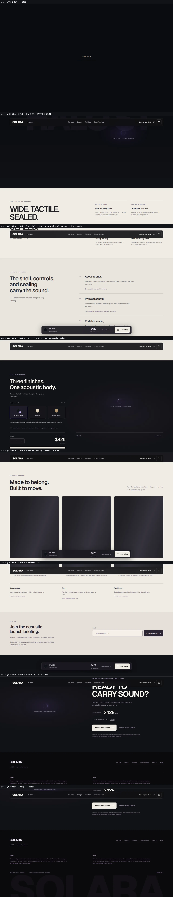
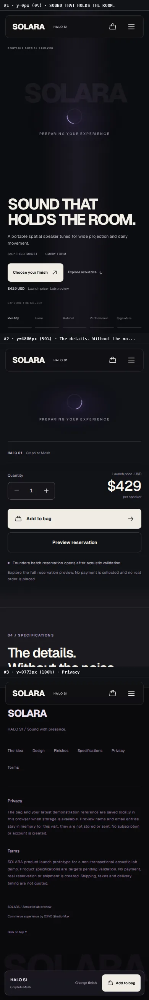

# UI Design System & Master Generation Blueprint: templates-preview-oxvo-app_t-oxvo-original-studio-max-commerce-3d-latest

> **SOLARA HALO S1 · Sound with presence.** (https://templates-preview.oxvo.app/t/oxvo-original-studio-max-commerce-3d/latest/#/) — Explore SOLARA HALO S1: a portable spatial speaker with a tactile acoustic shell. Choose a finish and try the local reservation preview.





---

## 1. Executive Visual Persona & Design Archetype

- **Brand Essence & Persona**: **SOLARA HALO S1 · Sound with presence.** (`https://templates-preview.oxvo.app/t/oxvo-original-studio-max-commerce-3d/latest/#/`). Explore SOLARA HALO S1: a portable spatial speaker with a tactile acoustic shell. Choose a finish and try the local reservation preview.
- **Capture Provenance**: Live browser capture (`tier1_fast`, HTTP `200`, captured `2026-11-24`).
- **Visual Archetype**: **High-Contrast Obsidian / Atmospheric Design System (`#0b0c0f` canvas, `#f9f6ef` ink, `#b29af3` accent)**.
- **Anti-AI-Slop Differentiators**:
  - **Live-Computed Chromatic Polarity**: Anchors the viewport in `#0b0c0f` (live computed `body` `background-color` (`computed_styles.json`)) paired with `#f9f6ef` primary typography and `#b29af3` accents.
  - **Grounded Typographic Hierarchy**: Uses `Geist Variable` across display (`SOUND THAT HOLDS THE ROOM.`) and body copy, paired with `SFMono-Regular` for monospace/code.
  - **Calibrated Spatial Grid & Motion**: Combines `1392px` container bounds (`gap: 20px`, padding `22px`) with `cubic-bezier(0,0,.2,1)` easing and Three.js / WebGL Canvas Pipeline.

---

## 2. Spatial Architecture & Modular Grid Mathematics

### Viewport Allocation & Container Geometry
- **Captured Journey Filmstrips**: Desktop `1280×6624px` (`assets/desktop-journey.webp`, `8` keyframes up to `y=7934px` / doc `8834px`), Mobile `390×2616px` (`assets/mobile-journey.webp`, `3` keyframes).
- **Master Container Bounds**: `1392px` (non-`@media` desktop container stylesheet rule).
- **Canvas Lateral Padding & Spacing**: `22px` lateral canvas padding with `20px` grid gap.
- **Border Radius Scale**: `8px`, `12px`, `.25rem`, `50%`.

### Responsive Breakpoint Architecture
- **Desktop Layout**: Multi-column CSS Grid / Flexbox layout at `1440px` (`max-width: 1392px`, `gap: 20px`).
- **Mobile Layout**: Single-column vertical stack at `390px` viewport width with `22px` horizontal padding.
- **Extracted CSS Media Queries**: `@media (min-width:1600px)`, `@media (max-width:1100px)`, `@media (max-width:700px)`, `@media (max-width:390px)`.

---

## 3. Color System, Materiality & Atmospheric Lighting

### Semantic Palette & Source Grounding
| Semantic Role | Ground-Truth Value | Extracted Live / CSS Source |
|---|---|---|
| **Primary Canvas Substrate** | `#0b0c0f` | live computed `body` `background-color` (`computed_styles.json`) |
| **Primary Typography Ink** | `#f9f6ef` | live computed `main` `color` (`computed_styles.json`) |
| **Elevated Surface / Card Substrate** | `#101114` | live computed `header` `background-color` (`computed_styles.json`) |
| **Interactive Accent / Highlight** | `#b29af3` | `var(--studio-accent)` in `:root` |
| **Secondary / Muted Copy** | `#b2b1b8` | `var(--studio-muted)` in `:root` |
| **Structural Hairline Border** | `#48434e` | `var(--commerce-border)` in `:root` |

### Sanitized Root CSS Variables (`ui-ux.md` Ground Truth)
| Variable Name | Extracted Value | Semantic Role |
|---|---|---|
| `--background` | `oklch(100% 0 0)` | Canvas / Surface Token |
| `--foreground` | `oklch(14.5% 0 0)` | Typography Ink Token |
| `--card` | `oklch(100% 0 0)` | Color / Atmospheric Token |
| `--card-foreground` | `oklch(14.5% 0 0)` | Typography Ink Token |
| `--popover` | `oklch(100% 0 0)` | Color / Atmospheric Token |
| `--popover-foreground` | `oklch(14.5% 0 0)` | Typography Ink Token |
| `--primary` | `oklch(20.5% 0 0)` | Brand / Palette Token |
| `--primary-foreground` | `oklch(98.5% 0 0)` | Typography Ink Token |
| `--secondary` | `oklch(97% 0 0)` | Brand / Palette Token |
| `--secondary-foreground` | `oklch(20.5% 0 0)` | Typography Ink Token |
| `--muted` | `oklch(97% 0 0)` | Color / Atmospheric Token |
| `--muted-foreground` | `oklch(55.6% 0 0)` | Typography Ink Token |
| `--accent` | `oklch(97% 0 0)` | Brand / Palette Token |
| `--accent-foreground` | `oklch(20.5% 0 0)` | Typography Ink Token |
| `--destructive` | `oklch(57.7% .245 27.325)` | Color / Atmospheric Token |
| `--border` | `oklch(92.2% 0 0)` | Elevation / Border Token |

---

## 4. Typographic Scale & Editorial Hierarchy

### Font Family Stacks
- **Display Typography**: `Geist Variable`.
- **Primary Body Stack**: `Geist Variable`.
- **Technical / Metadata Stack**: `SFMono-Regular`.

### Typographic Scale & Rules (Live Computed & Stylesheet Grounded)
- **Hero Display (`H1`)**: live computed `h1` (`font-size: 69.12px`, `line-height: 67.7376px`, `font-weight: 750`, `letter-spacing: -3.8016px`).
- **Section Heading (`H2`)**: live computed `h2` (`font-size: 66.24px`, `line-height: 65.5776px`, `font-weight: 600`, `letter-spacing: -4.3056px`); rule `h2` (`font-size: 23px`, `letter-spacing: -.04em`, `font-weight: 800`).
- **Body Copy**: live computed `body` (`font-size: 16px`, `line-height: 24px`, `font-weight: 400`); rule `p` (`font-size: 11px`).
- **Metadata & Navigation Labels**: live computed `nav/a` (`font-size: 16px`, `line-height: 24px`, `font-weight: 400`); CSS variables `--default-mono-font-family: var(--font-mono)`, `--materials-caption-h: 57px`, `--materials-caption-gap: 12px`; rule `small` (`font-size: 10px`, `letter-spacing: .12em`, `font-weight: 600`).

---

## 5. Choreographed Motion & Interaction Physics

### Primary Easing Curves
- **Extracted Timing Functions**: `cubic-bezier(0,0,.2,1)`, `cubic-bezier(.4,0,.2,1)`, `cubic-bezier(.22,1,.36,1)`.

### Per-Element Transition & Choreography Rules
- **Selector `layer theme`**: `transition: .15s` extracted from `templates-preview-oxvo-app_t-oxvo-original-studio-max-commerce-3d-latest` stylesheet.
- **Selector `.transition`**: `transition: var(--tw-ease,var(--default-transition-timing-function))` extracted from `templates-preview-oxvo-app_t-oxvo-original-studio-max-commerce-3d-latest` stylesheet.
- **Selector `.commerce-button`**: `transition: transform .22s var(--ease-out),background-color .18s,border-co...` extracted from `templates-preview-oxvo-app_t-oxvo-original-studio-max-commerce-3d-latest` stylesheet.
- **Extracted Easing Curve (`cubic-bezier(0,0,.2,1)`)**: Governs interactive state transitions across `<header.site-header>` and `<section.content-band>`.
- **Runtime Interaction Engine**: Integrates Three.js / WebGL Canvas Pipeline with `prefers-reduced-motion: reduce` fallback guards.
### Measured Runtime Scroll & Interaction Telemetry (`behavioral_journey_v2`)
- **Scroll Driver Mode**: `native` (max document height `8834px`, deepest scrollY reached `7934px` across `8` desktop keyframes).
- **Detected Scroll / Motion Libraries**: Native browser scroll / standard CSS transitions.
- **Hover Physics (`primary_cta` · `Choose your finish`)**: `transform`: `none` -> `matrix(1, 0, 0, 1, 0, -2)`; `backgroundColor`: `rgb(240, 236, 228)` -> `rgb(255, 255, 255)`; `boxShadow`: `none` -> `rgba(0, 0, 0, 0.133) 0p...` (`transition-duration: 0.22s, 0.18s, 0.18s, 0.22s`, `timing: cubic-bezier(0.22, 1, 0.36, 1), ease, ease, ease`).
- **Interactive Control Probe (`accordion` · `02 Power`)**: Triggered visual diff `29.957` (attr `false -> true`, captured in `assets/state-interactive.webp`).

---

## 6. Component Wireframe & Structural DOM Map

### Visual Layout Schematic — Desktop (`1440px`, Grounded in `dom.html` & Landmark Bounding Boxes)
```
┌────────────────────────────────────────────────────────────────────────┐
│ DESKTOP VIEWPORT (1440px) — SOLARA HALO S1 · Sound with presence.      │
│ ====================================================================== │
│ [ <header.site-header> (1280x62px)    | The idea · Design · Finishes ] │
│ ---------------------------------------------------------------------- │
│ | HERO STAGE: <section.immersive-hero> (w=1440px)                    | │
│ | H1: SOUND THAT HOLDS THE ROOM.                                     | │
│ | Substrate: #0b0c0f | Ink: #f9f6ef | Accent: #b29af3                | │
│ ---------------------------------------------------------------------- │
│ | SHOWCASE GRID (<section.content-band>) max-w: 1392px               | │
│ | +------------------------------+  +------------------------------+ | │
│ | | WRAPPED AROUND AIR.          |  | TACTILE BY DESIGN.           | | │
│ | +------------------------------+  +------------------------------+ | │
│ ---------------------------------------------------------------------- │
│ | DETAIL MODULE (<article.is-shown>) — BUILT FOR THE SECOND          | │
│ ---------------------------------------------------------------------- │
│ [ FOOTER (<footer.site-footer>) | https://templates-preview.oxvo.app/  │
└────────────────────────────────────────────────────────────────────────┘
```

### Visual Layout Schematic — Mobile Reflow (`390px`)
```
┌────────────────────────────────────────────────────────────────────────┐
│ MOBILE VIEWPORT REFLOW (390px) — Single-Column Stack (gap: 20px)       │
│ ====================================================================== │
│ [ HEADER BAR (<header.site-header>    ) | Compact Menu (390px)         │
│ ---------------------------------------------------------------------- │
│ | HERO STAGE (<section.immersive-hero>) — 390px Vertical Lead        | │
│ | H1: SOUND THAT HOLDS THE ROOM.                                     | │
│ ---------------------------------------------------------------------- │
│ | SHOWCASE STACK (<section.content-band>) — 1-Col Stack              | │
│ | [ Item 1: WRAPPED AROUND AIR.                                    ] | │
│ | [ Item 2: TACTILE BY DESIGN.                                     ] | │
│ ---------------------------------------------------------------------- │
│ | DETAIL STACK (<article.is-shown>) — 1-Col (BUILT FOR THE SECO)     | │
│ ---------------------------------------------------------------------- │
│ [ FOOTER (<footer.site-footer>) | Stacked 390px Colophon               │
└────────────────────────────────────────────────────────────────────────┘
```

### Granular DOM Region Breakdown
1. **Brand Header & Navigation Bar (<header.site-header> — `templates-preview-oxvo-app_t-oxvo-original-studio-max-commerce-3d-latest`)**:
   - Landmark `<header class="site-header">` (`1280x62px`) hosting `SOLARA HALO S1 · Sound with presence` navigation (`The idea · Design · Finishes · Specifications`), DOM attributes (`data-first-load="loading"`, `data-first-load-path="cold@2964"`, `data-oxvo-mounted-static-preview-router`, `data-product-runtime-ready="false"`), and stylesheet rule `backdrop { box-sizing:border-box;border:0 solid;margin:0;padding:0 }`.
2. **Hero Stage & Focal Lead (<section.immersive-hero> — `SOUND THAT HOLDS THE ROOM.`)**:
   - Landmark `<section class="immersive-hero">` presenting display lead `SOUND THAT HOLDS THE ROOM.` and copy excerpt *"Portable spatial speaker"* over `#0b0c0f` canvas and `#f9f6ef` ink.
3. **Primary Showcase & Content Grid (<section.content-band> — `WRAPPED AROUND AIR.`)**:
   - Landmark `<section class="content-band promise-band">` rendering section `WRAPPED AROUND AIR.` with copy *"Preparing your experience"*, asset references (`index-B571lmvU.js`, `index-CiVtvupN.css`, `geist-latin-wght-normal-Dm3htQBi....`, `PersistentProductCanvas-m78oPoe0.js`), and grid rule `file-selector-button { box-sizing:border-box;border:0 solid;margin:0;padding:0 }`.
4. **Interactive Detail & Feature Matrix (<article.is-shown> — `TACTILE BY DESIGN.`)**:
   - Landmark `<article class="is-shown">` framing `TACTILE BY DESIGN.` and `BUILT FOR THE SECOND ROOM.` (*"Use the left and right arrow keys to turn the product, up and dow"*) with `#101114` surface cards, `#b29af3` accents, and `strong { font-weight:bolder }`.
5. **Colophon & Global Directory Footer (<footer.site-footer> — `https://templates-preview.oxvo.app/t/oxvo-original-studio-max-commerce-3d/latest/#/`)**:
   - Landmark `<footer class="site-footer">` anchoring `SOLARA HALO S1 · Sound with pres` footer links (`The idea · Design · Finishes · Specifications`), copy *"A portable spatial speaker tuned for wide projection and dai"*, and `#48434e` structural dividers.
### Full Vertical Scroll Sequence (Desktop `1440×900` Keyframes)
- **Step 01** (`y=0px`, `0%`): Active landmark `#top` · sticky/fixed elements: `4`
- **Step 02** (`y=2550px`, `32%`): Active landmark `HALO S1. CARRIED SOUND.` · sticky/fixed elements: `3`
- **Step 03** (`y=3400px`, `43%`): Active landmark `The shell, controls, and sealing carry the sound.` · sticky/fixed elements: `2`
- **Step 04** (`y=4250px`, `54%`): Active landmark `Three finishes. One acoustic body.` · sticky/fixed elements: `2`
- **Step 05** (`y=5950px`, `75%`): Active landmark `Made to belong. Built to move.` · sticky/fixed elements: `3`
- **Step 06** (`y=6800px`, `86%`): Active landmark `Construction` · sticky/fixed elements: `2`
- **Step 07** (`y=7650px`, `96%`): Active landmark `READY TO CARRY SOUND?` · sticky/fixed elements: `1`
- **Step 08** (`y=7934px`, `100%`): Active landmark `Footer` · sticky/fixed elements: `1`

---

## 7. Master Zero-Shot AI Generation Prompt

```markdown
# Master Zero-Shot Frontend Generation Prompt: templates-preview-oxvo-app_t-oxvo-original-studio-max-commerce-3d-latest (SOLARA HALO S1 · Sound with presence.)

You are a principal frontend architect and design systems engineer. Build a complete, production-ready web application replicating the exact design system, DOM landmarks, typographic hierarchy, color tokens, and motion physics of `templates-preview-oxvo-app_t-oxvo-original-studio-max-commerce-3d-latest` (**SOLARA HALO S1 · Sound with presence.** — `https://templates-preview.oxvo.app/t/oxvo-original-studio-max-commerce-3d/latest/#/`).

### 1. Visual Archetype & Anti-AI-Slop Mandates
- **Archetype**: High-Contrast Obsidian / Atmospheric Design System (`#0b0c0f` canvas, `#f9f6ef` ink, `#b29af3` accent).
- **Identity & Domain Context**: Explore SOLARA HALO S1: a portable spatial speaker with a tactile acoustic shell. Choose a finish and try the local reservation preview.
- **Primary Substrate**: `#0b0c0f` (live computed `body` `background-color` (`computed_styles.json`)), **Primary Ink**: `#f9f6ef`, **Accent / Highlight**: `#b29af3`.
- **Site-Specific Differentiators**:
  - **Live-Computed Chromatic Polarity**: Anchors the viewport in `#0b0c0f` (live computed `body` `background-color` (`computed_styles.json`)) paired with `#f9f6ef` primary typography and `#b29af3` accents.
  - **Grounded Typographic Hierarchy**: Uses `Geist Variable` across display (`SOUND THAT HOLDS THE ROOM.`) and body copy, paired with `SFMono-Regular` for monospace/code.
  - **Calibrated Spatial Grid & Motion**: Combines `1392px` container bounds (`gap: 20px`, padding `22px`) with `cubic-bezier(0,0,.2,1)` easing and Three.js / WebGL Canvas Pipeline.

### 2. Ground-Truth CSS Variables (`:root` Token Contract)
Declare and consume these exact custom properties extracted from `templates-preview-oxvo-app_t-oxvo-original-studio-max-commerce-3d-latest` in your global stylesheet:

:root {
  /* SOLARA HALO S1 · Sound with presence. (templates-preview-oxvo-app_t-oxvo-original-studio-max-commerce-3d-latest) — Live-Grounded CSS Variables */
  --background: oklch(100% 0 0); /* Canvas / Surface Token (templates-preview-oxvo-app_t-oxvo-original-studio-max-commerce-3d-latest) */
  --foreground: oklch(14.5% 0 0); /* Typography Ink Token (templates-preview-oxvo-app_t-oxvo-original-studio-max-commerce-3d-latest) */
  --card: oklch(100% 0 0); /* Color / Atmospheric Token (templates-preview-oxvo-app_t-oxvo-original-studio-max-commerce-3d-latest) */
  --card-foreground: oklch(14.5% 0 0); /* Typography Ink Token (templates-preview-oxvo-app_t-oxvo-original-studio-max-commerce-3d-latest) */
  --popover: oklch(100% 0 0); /* Color / Atmospheric Token (templates-preview-oxvo-app_t-oxvo-original-studio-max-commerce-3d-latest) */
  --popover-foreground: oklch(14.5% 0 0); /* Typography Ink Token (templates-preview-oxvo-app_t-oxvo-original-studio-max-commerce-3d-latest) */
  --primary: oklch(20.5% 0 0); /* Brand / Palette Token (templates-preview-oxvo-app_t-oxvo-original-studio-max-commerce-3d-latest) */
  --primary-foreground: oklch(98.5% 0 0); /* Typography Ink Token (templates-preview-oxvo-app_t-oxvo-original-studio-max-commerce-3d-latest) */
  --secondary: oklch(97% 0 0); /* Brand / Palette Token (templates-preview-oxvo-app_t-oxvo-original-studio-max-commerce-3d-latest) */
  --secondary-foreground: oklch(20.5% 0 0); /* Typography Ink Token (templates-preview-oxvo-app_t-oxvo-original-studio-max-commerce-3d-latest) */
  --muted: oklch(97% 0 0); /* Color / Atmospheric Token (templates-preview-oxvo-app_t-oxvo-original-studio-max-commerce-3d-latest) */
  --muted-foreground: oklch(55.6% 0 0); /* Typography Ink Token (templates-preview-oxvo-app_t-oxvo-original-studio-max-commerce-3d-latest) */
  --accent: oklch(97% 0 0); /* Brand / Palette Token (templates-preview-oxvo-app_t-oxvo-original-studio-max-commerce-3d-latest) */
  --accent-foreground: oklch(20.5% 0 0); /* Typography Ink Token (templates-preview-oxvo-app_t-oxvo-original-studio-max-commerce-3d-latest) */
  --destructive: oklch(57.7% .245 27.325); /* Color / Atmospheric Token (templates-preview-oxvo-app_t-oxvo-original-studio-max-commerce-3d-latest) */
  --border: oklch(92.2% 0 0); /* Elevation / Border Token (templates-preview-oxvo-app_t-oxvo-original-studio-max-commerce-3d-latest) */
}

### 3. Semantic Color & Materiality Contract
Map every surface, ink, and border strictly to these source-grounded tokens:
- **Primary Canvas Substrate**: `#0b0c0f` — grounded in live computed `body` `background-color` (`computed_styles.json`)
- **Primary Typography Ink**: `#f9f6ef` — grounded in live computed `main` `color` (`computed_styles.json`)
- **Elevated Surface / Card Substrate**: `#101114` — grounded in live computed `header` `background-color` (`computed_styles.json`)
- **Interactive Accent / Highlight**: `#b29af3` — grounded in `var(--studio-accent)` in `:root`
- **Secondary / Muted Copy**: `#b2b1b8` — grounded in `var(--studio-muted)` in `:root`
- **Structural Hairline Border**: `#48434e` — grounded in `var(--commerce-border)` in `:root`

### 4. Spatial Grid, Container Bounds & Responsive Breakpoints
- **Desktop Viewport Reference**: `1280×6624px` (multi-frame vertical journey filmstrip (6624px), `1440px` standard desktop width).
- **Mobile Viewport Reference**: `390×2616px` (multi-frame vertical journey filmstrip (2616px), `390px` standard mobile width).
- **Container Max-Width**: `1392px` (non-`@media` desktop container stylesheet rule)
- **Padding & Gutters**: `22px` lateral canvas padding with `20px` grid gap
- **Desktop Grid**: Multi-column CSS Grid / Flexbox layout at `1440px` (`max-width: 1392px`, `gap: 20px`)
- **Mobile Adaptation**: Single-column vertical stack at `390px` viewport width with `22px` horizontal padding
- **Media Queries**: `@media (min-width:1600px)`, `@media (max-width:1100px)`, `@media (max-width:700px)`, `@media (max-width:390px)`
- **Corner Radii**: `8px`, `12px`, `.25rem`, `50%`

### 5. Typography & Editorial Scale Contract
- **Display Font Stack**: `Geist Variable`
- **Body Font Stack**: `Geist Variable`
- **Monospace / Technical Font Stack**: `SFMono-Regular`
- **H1 Display Rule**: live computed `h1` (`font-size: 69.12px`, `line-height: 67.7376px`, `font-weight: 750`, `letter-spacing: -3.8016px`)
- **H2 Section Rule**: live computed `h2` (`font-size: 66.24px`, `line-height: 65.5776px`, `font-weight: 600`, `letter-spacing: -4.3056px`); rule `h2` (`font-size: 23px`, `letter-spacing: -.04em`, `font-weight: 800`)
- **Body Copy Rule**: live computed `body` (`font-size: 16px`, `line-height: 24px`, `font-weight: 400`); rule `p` (`font-size: 11px`)
- **Metadata & Index Rule**: live computed `nav/a` (`font-size: 16px`, `line-height: 24px`, `font-weight: 400`); CSS variables `--default-mono-font-family: var(--font-mono)`, `--materials-caption-h: 57px`, `--materials-caption-gap: 12px`; rule `small` (`font-size: 10px`, `letter-spacing: .12em`, `font-weight: 600`)

### 6. Component Hierarchy, Verbatim Copy & Real DOM Landmarks
Scaffold `templates-preview-oxvo-app_t-oxvo-original-studio-max-commerce-3d-latest` (`SOLARA HALO S1 · Sound with presence.`) with these exact structural regions, extracted copy, and CSS rules from `dom.html`:
1. **Brand Header & Navigation Bar (<header.site-header> — `templates-preview-oxvo-app_t-oxvo-original-studio-max-commerce-3d-latest`)**:
   - DOM & Selectors: Landmark `<header class="site-header">` (`1280x62px`) hosting `SOLARA HALO S1 · Sound with presence` navigation (`The idea · Design · Finishes · Specifications`), DOM attributes (`data-first-load="loading"`, `data-first-load-path="cold@2964"`, `data-oxvo-mounted-static-preview-router`, `data-product-runtime-ready="false"`), and stylesheet rule `backdrop { box-sizing:border-box;border:0 solid;margin:0;padding:0 }`.
   - Responsive Contract: Header `Brand Header & Navigation Bar (<header.site-header> — `templates-preview-oxvo-app_t-oxvo-original-studio-max-commerce-3d-latest`)` (`templates-preview-oxvo-app_t-oxvo-original-studio-max-commerce-3d-latest`) adapts across `@media (min-width:1600px)`, `@media (max-width:1100px)`, `@media (max-width:700px)`, `@media (max-width:390px)` with `cubic-bezier(0,0,.2,1)`, `cubic-bezier(.4,0,.2,1)`, `cubic-bezier(.22,1,.36,1)` transitions and links `The idea · Design · Finishes · Specifications`.
2. **Hero Stage & Focal Lead (<section.immersive-hero> — `SOUND THAT HOLDS THE ROOM.`)**:
   - DOM & Selectors: Landmark `<section class="immersive-hero">` presenting display lead `SOUND THAT HOLDS THE ROOM.` and copy excerpt *"Portable spatial speaker"* over `#0b0c0f` canvas and `#f9f6ef` ink.
   - Responsive Contract: Hero stage (`1280×6624px` desktop / `390×2616px` mobile) sets `#0b0c0f` background with `#f9f6ef` headline `SOUND THAT HOLDS THE ROOM.`.
3. **Primary Showcase & Content Grid (<section.content-band> — `WRAPPED AROUND AIR.`)**:
   - DOM & Selectors: Landmark `<section class="content-band promise-band">` rendering section `WRAPPED AROUND AIR.` with copy *"Preparing your experience"*, asset references (`index-B571lmvU.js`, `index-CiVtvupN.css`, `geist-latin-wght-normal-Dm3htQBi....`, `PersistentProductCanvas-m78oPoe0.js`), and grid rule `file-selector-button { box-sizing:border-box;border:0 solid;margin:0;padding:0 }`.
   - Responsive Contract: Showcase grid `Primary Showcase & Content Grid (<section.content-band> — `WRAPPED AROUND AIR.`)` applies Multi-column CSS Grid / Flexbox layout at `1440px` (`max-width: 1392px`, `gap: 20px`) on desktop and Single-column vertical stack at `390px` viewport width with `22px` horizontal padding on mobile.
4. **Interactive Detail & Feature Matrix (<article.is-shown> — `TACTILE BY DESIGN.`)**:
   - DOM & Selectors: Landmark `<article class="is-shown">` framing `TACTILE BY DESIGN.` and `BUILT FOR THE SECOND ROOM.` (*"Use the left and right arrow keys to turn the product, up and dow"*) with `#101114` surface cards, `#b29af3` accents, and `strong { font-weight:bolder }`.
   - Responsive Contract: Detail module `Interactive Detail & Feature Matrix (<article.is-shown> — `TACTILE BY DESIGN.`)` uses `8px`, `12px`, `.25rem`, `50%` radii, `#b29af3` highlights, and assets (index-B571lmvU.js, index-CiVtvupN.css, geist-latin-wght-normal-Dm3htQBi....).
5. **Colophon & Global Directory Footer (<footer.site-footer> — `https://templates-preview.oxvo.app/t/oxvo-original-studio-max-commerce-3d/latest/#/`)**:
   - DOM & Selectors: Landmark `<footer class="site-footer">` anchoring `SOLARA HALO S1 · Sound with pres` footer links (`The idea · Design · Finishes · Specifications`), copy *"A portable spatial speaker tuned for wide projection and dai"*, and `#48434e` structural dividers.
   - Responsive Contract: Footer `Colophon & Global Directory Footer (<footer.site-footer> — `https://templates-preview.oxvo.app/t/oxvo-original-studio-max-commerce-3d/latest/#/`)` aligns to `1392px` (non-`@media` desktop container stylesheet rule) with `22px` lateral canvas padding with `20px` grid gap and attributes (data-first-load="loading", data-first-load-path="cold@2964", data-oxvo-mounted-static-preview-router).

#### Verbatim DOM Copy Excerpts (`dom.html`)
- Copy Excerpt 1: *"Portable spatial speaker"*
- Copy Excerpt 2: *"Preparing your experience"*
- Copy Excerpt 3: *"Use the left and right arrow keys to turn the product, up and down to tilt it, and..."*
- Copy Excerpt 4: *"A portable spatial speaker tuned for wide projection and daily movement."*

### 7. Motion, Extracted Stylesheet Rules & Interaction Choreography
- **Primary Easing Functions**: `cubic-bezier(0,0,.2,1)`, `cubic-bezier(.4,0,.2,1)`, `cubic-bezier(.22,1,.36,1)`
- **Extracted Stylesheet Rules (`templates-preview-oxvo-app_t-oxvo-original-studio-max-commerce-3d-latest`)**:
- `backdrop { box-sizing:border-box;border:0 solid;margin:0;padding:0 }`
- `file-selector-button { box-sizing:border-box;border:0 solid;margin:0;padding:0 }`
- `strong { font-weight:bolder }`
- `small { font-size:80% }`
- `sup { vertical-align:baseline;font-size:75%;line-height:0;position:relative }`
- **Per-Selector Transition Rules**:
- **Selector `layer theme`**: `transition: .15s` extracted from `templates-preview-oxvo-app_t-oxvo-original-studio-max-commerce-3d-latest` stylesheet.
- **Selector `.transition`**: `transition: var(--tw-ease,var(--default-transition-timing-function))` extracted from `templates-preview-oxvo-app_t-oxvo-original-studio-max-commerce-3d-latest` stylesheet.
- **Selector `.commerce-button`**: `transition: transform .22s var(--ease-out),background-color .18s,border-co...` extracted from `templates-preview-oxvo-app_t-oxvo-original-studio-max-commerce-3d-latest` stylesheet.
- **Extracted Easing Curve (`cubic-bezier(0,0,.2,1)`)**: Governs interactive state transitions across `<header.site-header>` and `<section.content-band>`.
- **Runtime Interaction Engine**: Integrates Three.js / WebGL Canvas Pipeline with `prefers-reduced-motion: reduce` fallback guards.
### 7b. Full-Page Scroll Choreography, Interactive States & Multi-Page Routes
- **Scroll Mechanics**: Implement `native` vertical progression up to `8834px` across 8 distinct viewport chapters.
- **Vertical Chapter Sequence**: #top (0%) -> HALO S1. CARRIED SOUND. (32%) -> The shell, controls, and se... (43%) -> Three finishes. One acousti... (54%) -> Made to belong. Built to move. (75%) -> Construction (86%) -> READY TO CARRY SOUND? (96%) -> Footer (100%).
- **Hover Micro-Interaction (`primary_cta`)**: Animate `transform, backgroundColor, boxShadow` with `0.22s, 0.18s, 0.18s, 0.22s cubic-bezier(0.22, 1, 0.36, 1), ease, ease, ease`.

### 8. Technical Deliverables
- Implement in Next.js (App Router) with TypeScript and Tailwind CSS consuming the `:root` custom properties defined above for `templates-preview-oxvo-app_t-oxvo-original-studio-max-commerce-3d-latest`.
- Reproduce both the `1440px` desktop architecture and `390px` mobile breakpoint transitions, preserving semantic HTML5 landmarks (`<header>`, `<nav>`, `<main>`, `<section>`, `<footer>`) and `prefers-reduced-motion` accessibility guards.
```
---

## 8. Full-Page Scroll Journey, Interactive States & Subpage Inventory

### Desktop Scroll Keyframes (`1440×900` WebP)
| Step | Scroll Y | Progress | Active Landmark / Section | Sticky/Fixed | Visual Asset |
| :---: | :---: | :---: | :--- | :---: | :--- |
| `#01` | `0px` | `0%` | #top | `4` | [desktop-step-01.webp](assets/desktop-step-01.webp) |
| `#02` | `2550px` | `32%` | HALO S1. CARRIED SOUND. | `3` | [desktop-step-02.webp](assets/desktop-step-02.webp) |
| `#03` | `3400px` | `43%` | The shell, controls, and sealing carry the so... | `2` | [desktop-step-03.webp](assets/desktop-step-03.webp) |
| `#04` | `4250px` | `54%` | Three finishes. One acoustic body. | `2` | [desktop-step-04.webp](assets/desktop-step-04.webp) |
| `#05` | `5950px` | `75%` | Made to belong. Built to move. | `3` | [desktop-step-05.webp](assets/desktop-step-05.webp) |
| `#06` | `6800px` | `86%` | Construction | `2` | [desktop-step-06.webp](assets/desktop-step-06.webp) |
| `#07` | `7650px` | `96%` | READY TO CARRY SOUND? | `1` | [desktop-step-07.webp](assets/desktop-step-07.webp) |
| `#08` | `7934px` | `100%` | Footer | `1` | [desktop-step-08.webp](assets/desktop-step-08.webp) |

### Mobile Condensed Keyframes (`390×844` WebP)
| Step | Scroll Y | Progress | Active Landmark | Visual Asset |
| :---: | :---: | :---: | :--- | :--- |
| `#01` | `0px` | `0%` | SOUND THAT HOLDS THE ROOM. | [mobile-step-01.webp](assets/mobile-step-01.webp) |
| `#02` | `4886px` | `50%` | The details. Without the noise. | [mobile-step-02.webp](assets/mobile-step-02.webp) |
| `#03` | `9773px` | `100%` | Privacy | [mobile-step-03.webp](assets/mobile-step-03.webp) |

### Interactive UI State Captures (`1440×900` WebP)
| State Type | Trigger / Observation | Visual Asset |
| :--- | :--- | :--- |
| `interactive_control` | Control `accordion` (`02 Power`, diff `29.957`) | [state-interactive.webp](assets/state-interactive.webp) |

