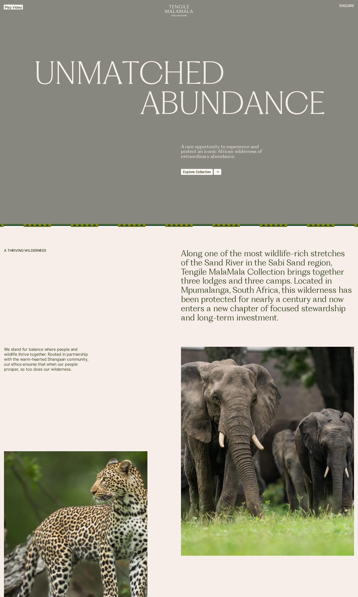
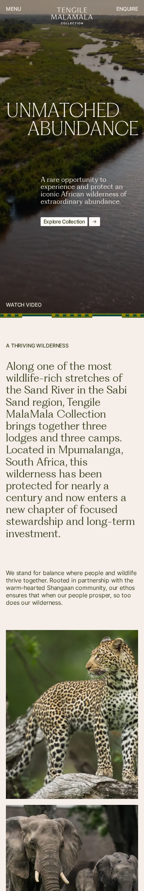

# UI Design System & Master Generation Blueprint: tengilemalamala-com

> **Luxury Safari Experiences in Greater Kruger & Sabi Sand · Tengile MalaMa...** (https://tengilemalamala.com/) — Discover luxury safari experiences in Greater Kruger and Sabi Sand. Wildlife, luxury accommodation and unforgettable Big Five encounters....



---

## 1. Executive Visual Persona & Design Archetype

- **Brand Essence & Persona**: **Luxury Safari Experiences in Greater Kruger & Sabi Sand · Tengile MalaMa...** (`https://tengilemalamala.com/`). Discover luxury safari experiences in Greater Kruger and Sabi Sand. Wildlife, luxury accommodation and unforgettable Big Five encounters....
- **Visual Archetype**: **Light-Substrate Editorial & Modular Grid System (`#fbf8f6` canvas, `#48561a` ink, `#a5a593` accent)**.
- **Anti-AI-Slop Differentiators**:
  - **Source-Grounded Chromatic Polarity**: Anchors the viewport in `#fbf8f6` (`eBanner-module-scss-module__3-R... { background-color: #fbf8f6 }`) paired with `#48561a` primary typography and `#a5a593` accents.
  - **Extracted Typographic Hierarchy**: Pairs `PP Fragment` for display copy (`Khensani River Lodge`) with `Inter` and not declared in static CSS (uses primary stack / `ui-monospace`).
  - **Calibrated Spatial Grid & Motion**: Combines `360px` container bounds (`gap: 4px`, padding `12px`) with `cubic-bezier(.19,1,.22,1)` easing and Lenis Smooth Scroll (`data-lenis`), Three.js / WebGL Canvas Pipeline.

---

## 2. Spatial Architecture & Modular Grid Mathematics



### Viewport Allocation & Container Geometry
- **Captured Viewport Dimensions**: Desktop `1440×11566px` (`assets/desktop.png`, full-page scroll capture), Mobile `390×2400px` (`assets/mobile.png`, capped at 2400px multi-section capture).
- **Master Container Bounds**: `360px` extracted from `tengilemalamala-com` stylesheet.
- **Canvas Lateral Padding & Spacing**: `12px` lateral canvas padding with `4px` grid gap.
- **Border Radius Scale**: `4px`, `14px`, `50%`, `2px`.

### Responsive Breakpoint Architecture
- **Desktop Layout**: Multi-column CSS Grid / Flexbox layout at `1440px` (`max-width: 360px`, `gap: 4px`).
- **Mobile Layout**: Single-column vertical stack at `390px` viewport width with `12px` horizontal padding.
- **Extracted CSS Media Queries**: `@media only screen and (max-width:1023px)`, `@media only screen and (min-width:1920px)`, `@media only screen and (min-width:1024px)`, `@media only screen and (max-width:390px)`.

---

## 3. Color System, Materiality & Atmospheric Lighting

### Semantic Palette & Source Grounding
| Semantic Role | Ground-Truth Value | Extracted CSS Source / Selector |
|---|---|---|
| **Primary Canvas Substrate** | `#fbf8f6` | `eBanner-module-scss-module__3-R... { background-color: #fbf8f6 }` |
| **Primary Typography Ink** | `#5c6e21` | `css-module__3-RGkq__cookie a:fo... { color: #5c6e21 }` |
| **Elevated Surface / Card Substrate** | `#e3e1d4` | `Banner-module-scss-module__3-RG... { border-top: #e3e1d4 }` |
| **Interactive Accent / Highlight** | `#a5a593` | `module-scss-module__3-RGkq__set... { color: #a5a593 }` |
| **Secondary / Muted Copy** | `#f5eee9` | `:focus-visible { color: #f5eee9 }` |
| **Structural Hairline Border** | `#48561a` | `:focus-visible { background-color: #48561a }` |
| **Variable Token (`--plyr-video-progress-buffered-background`)** | `#fbf8f61a` | `var(--plyr-video-progress-buffered-background)` in stylesheet |

### Sanitized Root CSS Variables (`ui-ux.md` Ground Truth)
| Variable Name | Extracted Value | Semantic Role |
|---|---|---|
| `--offset` | `150dvw` | Dimension / Scale Token |
| `--lvh` | `1vh` | Layout / Spatial Grid Token |
| `--svh` | `1vh` | Layout / Spatial Grid Token |
| `--size` | `1440` | Layout / Spatial Grid Token |
| `--duration` | `120s` | Motion / Easing Token |
| `--plyr-color-main` | `#fbf8f6` | Brand / Palette Token |
| `--plyr-video-control-color` | `#fbf8f6` | Brand / Palette Token |
| `--plyr-font-size-small` | `14px` | Typography / Scale Token |
| `--plyr-range-track-height` | `2px` | Layout / Spatial Grid Token |
| `--plyr-range-thumb-height` | `0px` | Layout / Spatial Grid Token |
| `--plyr-video-progress-buffered-background` | `#fbf8f61a` | Canvas / Surface Token |
| `--tengilemalamala--bg` | `#fbf8f6` | Canvas Substrate (from `eBanner-module-scss-module__3-R... { background-color: #fbf8f6 }`) |
| `--tengilemalamala--ink` | `#48561a` | Primary Typography Ink (stylesheet-derived) |
| `--tengilemalamala--surface` | `#e3e1d4` | Surface Substrate (stylesheet-derived) |
| `--tengilemalamala--accent` | `#a5a593` | Interactive Accent (stylesheet-derived) |
| `--tengilemalamala--muted` | `#f5eee9` | Secondary Ink (stylesheet-derived) |

---

## 4. Typographic Scale & Editorial Hierarchy

### Font Family Stacks
- **Display Typography**: `PP Fragment`.
- **Primary Body Stack**: `Inter`.
- **Technical / Metadata Stack**: not declared in static CSS (uses primary stack / `ui-monospace`).

### Typographic Scale & Rules (Extracted from Stylesheet & Variables)
- **Hero Display (`H1`)**: not explicitly declared on tag in static CSS (stylesheet font-size ladder: `clamp(3rem,12.5vw,5.2rem)`, `16px`, `12rem`, `16rem`, `11px`).
- **Section Heading (`H2`)**: not explicitly declared on tag in static CSS (stylesheet font-size ladder: `clamp(3rem,12.5vw,5.2rem)`, `16px`, `12rem`, `16rem`, `11px`).
- **Body Copy**: rule `p` (`letter-spacing: -.01em`).
- **Metadata & Navigation Labels**: not explicitly declared on tag in static CSS (stylesheet font-size ladder: `clamp(3rem,12.5vw,5.2rem)`, `16px`, `12rem`, `16rem`, `11px`).

---

## 5. Choreographed Motion & Interaction Physics

### Primary Easing Curves
- **Extracted Timing Functions**: `cubic-bezier(.19,1,.22,1)`, `cubic-bezier(.165,.84,.44,1)`, `cubic-bezier(.25,.46,.45,.94)`.

### Per-Element Transition & Choreography Rules
- **Selector `Banner-module-scss-module__3-RGkq...`**: `transition: color .3s` extracted from `tengilemalamala-com` stylesheet.
- **Selector `-module-scss-module__3-RGkq__sett...`**: `transition: background-color .3s` extracted from `tengilemalamala-com` stylesheet.
- **Selector `e-scss-module__3-RGkq__settingsTo...`**: `transition: all .3s` extracted from `tengilemalamala-com` stylesheet.
- **Extracted Easing Curve (`cubic-bezier(.19,1,.22,1)`)**: Governs interactive state transitions across `<header.site-header>` and `<section.site-header>`.
- **Runtime Interaction Engine**: Integrates Lenis Smooth Scroll (`data-lenis`), Three.js / WebGL Canvas Pipeline with `prefers-reduced-motion: reduce` fallback guards.

---

## 6. Component Wireframe & Structural DOM Map

### Visual Layout Schematic (Grounded in `dom.html` — `1440px` Desktop & `390px` Mobile Reflow)
```
┌────────────────────────────────────────────────────────────────────────┐
│ DESKTOP VIEWPORT (1440px) — Luxury Safari Experiences in Greater Kruge │
│ ====================================================================== │
│ [ <header.site-header>     | About · Accommodation · Experiences ·  ]  │
│ ---------------------------------------------------------------------- │
│ | HERO STAGE: <section.lenis-stopped>                              |   │
│ | H1: Khensani River Lodge                                         |   │
│ | Substrate: #fbf8f6    | Ink: #48561a    | Accent: #a5a593        |   │
│ ---------------------------------------------------------------------- │
│ | SHOWCASE GRID (<section.site-header>     ) max-w: 360px          |   │
│ | +------------------------------+  +------------------------------+ | │
│ | | Tengile River Lodge          |  | Rattray's Lodge              | | │
│ | +------------------------------+  +------------------------------+ | │
│ ---------------------------------------------------------------------- │
│ | MOBILE VIEWPORT REFLOW (390px) — Single-Column Stack (gap: 4px   ) | │
│ | [<header.site-heade] -> [<section.lenis-sto] -> [<section.site-head] │
│ ---------------------------------------------------------------------- │
│ [ FOOTER (<footer.action-card-cl) | https://tengilemalamala.com/       │
└────────────────────────────────────────────────────────────────────────┘
```

### Granular DOM Region Breakdown
1. **Brand Header & Navigation Bar (<header.site-header> — `tengilemalamala-com`)**:
   - Landmark `<header class="site-header">` hosting `Luxury Safari Experiences in Greater` navigation (`About · Accommodation · Experiences · Conservation · Partner Hub`), DOM attributes (`data-next-head`, `data-nscript="beforeInteractive"`, `data-n-g`, `data-n-css`), and stylesheet rule `nner-module-scss-module__3-RGkq__... { width:auto;right:1.6rem }`.
2. **Hero Stage & Focal Lead (<section.lenis-stopped> — `Khensani River Lodge`)**:
   - Landmark `<section class="lenis-stopped">` presenting display lead `Khensani River Lodge` and copy excerpt *"Skip to main content"* over `#fbf8f6` canvas and `#48561a` ink.
3. **Primary Showcase & Content Grid (<section.site-header> — `Tengile River Lodge`)**:
   - Landmark `<section class="site-header">` rendering section `Tengile River Lodge` with copy *"Khensani River Lodge"*, asset references (`icon-32.png`, `icon-16.png`, `inter-regular.woff2`, `inter-medium.woff2`), and grid rule `er-module-scss-module__3-RGkq__co... { text-decoration:underline;transition:color .3s }`.
4. **Interactive Detail & Feature Matrix (<section.no-lenis> — `Rattray's Lodge`)**:
   - Landmark `<section class="no-lenis">` framing `Rattray's Lodge` and `MalaMala Camp` (*"Tengile River Lodge"*) with `#e3e1d4` surface cards, `#a5a593` accents, and `module__3-RGkq__cookie a:focus-vi... { color:5c6e21 }`.
5. **Colophon & Global Directory Footer (<footer.action-card-click-label> — `https://tengilemalamala.com/`)**:
   - Landmark `<footer class="action-card-click-label">` anchoring `Luxury Safari Experiences in Gre` footer links (`About · Accommodation · Experiences · Conservation · Partner Hub`), copy *"U N M A T C H E D A B U N D A N C E"*, and `#48561a` structural dividers.

---

## 7. Master Zero-Shot AI Generation Prompt

```markdown
# Master Zero-Shot Frontend Generation Prompt: tengilemalamala-com (Luxury Safari Experiences in Greater Kruger & Sabi Sand · Tengile MalaMa...)

You are a principal frontend architect and design systems engineer. Build a complete, production-ready web application replicating the exact design system, DOM landmarks, typographic hierarchy, color tokens, and motion physics of `tengilemalamala-com` (**Luxury Safari Experiences in Greater Kruger & Sabi Sand · Tengile MalaMa...** — `https://tengilemalamala.com/`).

### 1. Visual Archetype & Anti-AI-Slop Mandates
- **Archetype**: Light-Substrate Editorial & Modular Grid System (`#fbf8f6` canvas, `#48561a` ink, `#a5a593` accent).
- **Identity & Domain Context**: Discover luxury safari experiences in Greater Kruger and Sabi Sand. Wildlife, luxury accommodation and unforgettable Big Five encounters....
- **Primary Substrate**: `#fbf8f6` (`eBanner-module-scss-module__3-R... { background-color: #fbf8f6 }`), **Primary Ink**: `#48561a`, **Accent / Highlight**: `#a5a593`.
- **Site-Specific Differentiators**:
  - **Source-Grounded Chromatic Polarity**: Anchors the viewport in `#fbf8f6` (`eBanner-module-scss-module__3-R... { background-color: #fbf8f6 }`) paired with `#48561a` primary typography and `#a5a593` accents.
  - **Extracted Typographic Hierarchy**: Pairs `PP Fragment` for display copy (`Khensani River Lodge`) with `Inter` and not declared in static CSS (uses primary stack / `ui-monospace`).
  - **Calibrated Spatial Grid & Motion**: Combines `360px` container bounds (`gap: 4px`, padding `12px`) with `cubic-bezier(.19,1,.22,1)` easing and Lenis Smooth Scroll (`data-lenis`), Three.js / WebGL Canvas Pipeline.

### 2. Ground-Truth CSS Variables (`:root` Token Contract)
Declare and consume these exact custom properties extracted from `tengilemalamala-com` in your global stylesheet:

:root {
  /* Luxury Safari Experiences in Greater Kruger & Sabi Sand · Tengile MalaMa... (tengilemalamala-com) — Ground-Truth Extracted CSS Variables */
  --offset: 150dvw; /* Dimension / Scale Token (tengilemalamala-com) */
  --lvh: 1vh; /* Layout / Spatial Grid Token (tengilemalamala-com) */
  --svh: 1vh; /* Layout / Spatial Grid Token (tengilemalamala-com) */
  --size: 1440; /* Layout / Spatial Grid Token (tengilemalamala-com) */
  --duration: 120s; /* Motion / Easing Token (tengilemalamala-com) */
  --plyr-color-main: #fbf8f6; /* Brand / Palette Token (tengilemalamala-com) */
  --plyr-video-control-color: #fbf8f6; /* Brand / Palette Token (tengilemalamala-com) */
  --plyr-font-size-small: 14px; /* Typography / Scale Token (tengilemalamala-com) */
  --plyr-range-track-height: 2px; /* Layout / Spatial Grid Token (tengilemalamala-com) */
  --plyr-range-thumb-height: 0px; /* Layout / Spatial Grid Token (tengilemalamala-com) */
  --plyr-video-progress-buffered-background: #fbf8f61a; /* Canvas / Surface Token (tengilemalamala-com) */
  --tengilemalamala--bg: #fbf8f6; /* Canvas Substrate (from `eBanner-module-scss-module__3-R... { background-color: #fbf8f6 }`) (tengilemalamala-com) */
  --tengilemalamala--ink: #48561a; /* Primary Typography Ink (stylesheet-derived) (tengilemalamala-com) */
  --tengilemalamala--surface: #e3e1d4; /* Surface Substrate (stylesheet-derived) (tengilemalamala-com) */
  --tengilemalamala--accent: #a5a593; /* Interactive Accent (stylesheet-derived) (tengilemalamala-com) */
  --tengilemalamala--muted: #f5eee9; /* Secondary Ink (stylesheet-derived) (tengilemalamala-com) */
}

### 3. Semantic Color & Materiality Contract
Map every surface, ink, and border strictly to these source-grounded tokens:
- **Primary Canvas Substrate**: `#fbf8f6` — grounded in `eBanner-module-scss-module__3-R... { background-color: #fbf8f6 }`
- **Primary Typography Ink**: `#5c6e21` — grounded in `css-module__3-RGkq__cookie a:fo... { color: #5c6e21 }`
- **Elevated Surface / Card Substrate**: `#e3e1d4` — grounded in `Banner-module-scss-module__3-RG... { border-top: #e3e1d4 }`
- **Interactive Accent / Highlight**: `#a5a593` — grounded in `module-scss-module__3-RGkq__set... { color: #a5a593 }`
- **Secondary / Muted Copy**: `#f5eee9` — grounded in `:focus-visible { color: #f5eee9 }`
- **Structural Hairline Border**: `#48561a` — grounded in `:focus-visible { background-color: #48561a }`
- **Variable Token (`--plyr-video-progress-buffered-background`)**: `#fbf8f61a` — grounded in `var(--plyr-video-progress-buffered-background)` in stylesheet

### 4. Spatial Grid, Container Bounds & Responsive Breakpoints
- **Desktop Viewport Reference**: `1440×11566px` (full-page scroll capture, `1440px` standard desktop width).
- **Mobile Viewport Reference**: `390×2400px` (capped at 2400px multi-section capture, `390px` standard mobile width).
- **Container Max-Width**: `360px` extracted from `tengilemalamala-com` stylesheet
- **Padding & Gutters**: `12px` lateral canvas padding with `4px` grid gap
- **Desktop Grid**: Multi-column CSS Grid / Flexbox layout at `1440px` (`max-width: 360px`, `gap: 4px`)
- **Mobile Adaptation**: Single-column vertical stack at `390px` viewport width with `12px` horizontal padding
- **Media Queries**: `@media only screen and (max-width:1023px)`, `@media only screen and (min-width:1920px)`, `@media only screen and (min-width:1024px)`, `@media only screen and (max-width:390px)`
- **Corner Radii**: `4px`, `14px`, `50%`, `2px`

### 5. Typography & Editorial Scale Contract
- **Display Font Stack**: `PP Fragment`
- **Body Font Stack**: `Inter`
- **Monospace / Technical Font Stack**: not declared in static CSS (uses primary stack / `ui-monospace`)
- **H1 Display Rule**: not explicitly declared on tag in static CSS (stylesheet font-size ladder: `clamp(3rem,12.5vw,5.2rem)`, `16px`, `12rem`, `16rem`, `11px`)
- **H2 Section Rule**: not explicitly declared on tag in static CSS (stylesheet font-size ladder: `clamp(3rem,12.5vw,5.2rem)`, `16px`, `12rem`, `16rem`, `11px`)
- **Body Copy Rule**: rule `p` (`letter-spacing: -.01em`)
- **Metadata & Index Rule**: not explicitly declared on tag in static CSS (stylesheet font-size ladder: `clamp(3rem,12.5vw,5.2rem)`, `16px`, `12rem`, `16rem`, `11px`)

### 6. Component Hierarchy, Verbatim Copy & Real DOM Landmarks
Scaffold `tengilemalamala-com` (`Luxury Safari Experiences in Greater Kruger & Sabi Sand · Tengile MalaMa...`) with these exact structural regions, extracted copy, and CSS rules from `dom.html`:
1. **Brand Header & Navigation Bar (<header.site-header> — `tengilemalamala-com`)**:
   - DOM & Selectors: Landmark `<header class="site-header">` hosting `Luxury Safari Experiences in Greater` navigation (`About · Accommodation · Experiences · Conservation · Partner Hub`), DOM attributes (`data-next-head`, `data-nscript="beforeInteractive"`, `data-n-g`, `data-n-css`), and stylesheet rule `nner-module-scss-module__3-RGkq__... { width:auto;right:1.6rem }`.
   - Responsive Contract: Header `Brand Header & Navigation Bar (<header.site-header> — `tengilemalamala-com`)` (`tengilemalamala-com`) adapts across `@media only screen and (max-width:1023px)`, `@media only screen and (min-width:1920px)`, `@media only screen and (min-width:1024px)`, `@media only screen and (max-width:390px)` with `cubic-bezier(.19,1,.22,1)`, `cubic-bezier(.165,.84,.44,1)`, `cubic-bezier(.25,.46,.45,.94)` transitions and links `About · Accommodation · Experiences · Conservation · Partner Hub`.
2. **Hero Stage & Focal Lead (<section.lenis-stopped> — `Khensani River Lodge`)**:
   - DOM & Selectors: Landmark `<section class="lenis-stopped">` presenting display lead `Khensani River Lodge` and copy excerpt *"Skip to main content"* over `#fbf8f6` canvas and `#48561a` ink.
   - Responsive Contract: Hero stage (`1440×11566px` desktop / `390×2400px` mobile) sets `#fbf8f6` background with `#48561a` headline `Khensani River Lodge`.
3. **Primary Showcase & Content Grid (<section.site-header> — `Tengile River Lodge`)**:
   - DOM & Selectors: Landmark `<section class="site-header">` rendering section `Tengile River Lodge` with copy *"Khensani River Lodge"*, asset references (`icon-32.png`, `icon-16.png`, `inter-regular.woff2`, `inter-medium.woff2`), and grid rule `er-module-scss-module__3-RGkq__co... { text-decoration:underline;transition:color .3s }`.
   - Responsive Contract: Showcase grid `Primary Showcase & Content Grid (<section.site-header> — `Tengile River Lodge`)` applies Multi-column CSS Grid / Flexbox layout at `1440px` (`max-width: 360px`, `gap: 4px`) on desktop and Single-column vertical stack at `390px` viewport width with `12px` horizontal padding on mobile.
4. **Interactive Detail & Feature Matrix (<section.no-lenis> — `Rattray's Lodge`)**:
   - DOM & Selectors: Landmark `<section class="no-lenis">` framing `Rattray's Lodge` and `MalaMala Camp` (*"Tengile River Lodge"*) with `#e3e1d4` surface cards, `#a5a593` accents, and `module__3-RGkq__cookie a:focus-vi... { color:5c6e21 }`.
   - Responsive Contract: Detail module `Interactive Detail & Feature Matrix (<section.no-lenis> — `Rattray's Lodge`)` uses `4px`, `14px`, `50%`, `2px` radii, `#a5a593` highlights, and assets (icon-32.png, icon-16.png, inter-regular.woff2).
5. **Colophon & Global Directory Footer (<footer.action-card-click-label> — `https://tengilemalamala.com/`)**:
   - DOM & Selectors: Landmark `<footer class="action-card-click-label">` anchoring `Luxury Safari Experiences in Gre` footer links (`About · Accommodation · Experiences · Conservation · Partner Hub`), copy *"U N M A T C H E D A B U N D A N C E"*, and `#48561a` structural dividers.
   - Responsive Contract: Footer `Colophon & Global Directory Footer (<footer.action-card-click-label> — `https://tengilemalamala.com/`)` aligns to `360px` extracted from `tengilemalamala-com` stylesheet with `12px` lateral canvas padding with `4px` grid gap and attributes (data-next-head, data-nscript="beforeInteractive", data-n-g).

#### Verbatim DOM Copy Excerpts (`dom.html`)
- Copy Excerpt 1: *"Skip to main content"*
- Copy Excerpt 2: *"Khensani River Lodge"*
- Copy Excerpt 3: *"Tengile River Lodge"*
- Copy Excerpt 4: *"U N M A T C H E D A B U N D A N C E"*

### 7. Motion, Extracted Stylesheet Rules & Interaction Choreography
- **Primary Easing Functions**: `cubic-bezier(.19,1,.22,1)`, `cubic-bezier(.165,.84,.44,1)`, `cubic-bezier(.25,.46,.45,.94)`
- **Extracted Stylesheet Rules (`tengilemalamala-com`)**:
- `nner-module-scss-module__3-RGkq__... { width:auto;right:1.6rem }`
- `er-module-scss-module__3-RGkq__co... { text-decoration:underline;transition:color .3s }`
- `module__3-RGkq__cookie a:focus-vi... { color:5c6e21 }`
- `ner-module-scss-module__3-RGkq__a... { padding:12px }`
- `ner-module-scss-module__3-RGkq__c... { padding-bottom:0 }`
- **Per-Selector Transition Rules**:
- **Selector `Banner-module-scss-module__3-RGkq...`**: `transition: color .3s` extracted from `tengilemalamala-com` stylesheet.
- **Selector `-module-scss-module__3-RGkq__sett...`**: `transition: background-color .3s` extracted from `tengilemalamala-com` stylesheet.
- **Selector `e-scss-module__3-RGkq__settingsTo...`**: `transition: all .3s` extracted from `tengilemalamala-com` stylesheet.
- **Extracted Easing Curve (`cubic-bezier(.19,1,.22,1)`)**: Governs interactive state transitions across `<header.site-header>` and `<section.site-header>`.
- **Runtime Interaction Engine**: Integrates Lenis Smooth Scroll (`data-lenis`), Three.js / WebGL Canvas Pipeline with `prefers-reduced-motion: reduce` fallback guards.

### 8. Technical Deliverables
- Implement in Next.js (App Router) with TypeScript and Tailwind CSS consuming the `:root` custom properties defined above for `tengilemalamala-com`.
- Reproduce both the `1440px` desktop architecture and `390px` mobile breakpoint transitions, preserving semantic HTML5 landmarks (`<header>`, `<nav>`, `<main>`, `<section>`, `<footer>`) and `prefers-reduced-motion` accessibility guards.
```
